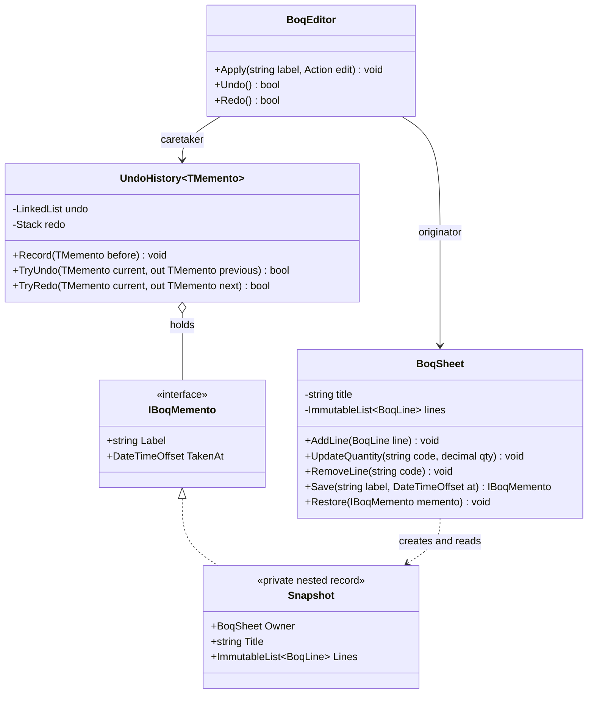
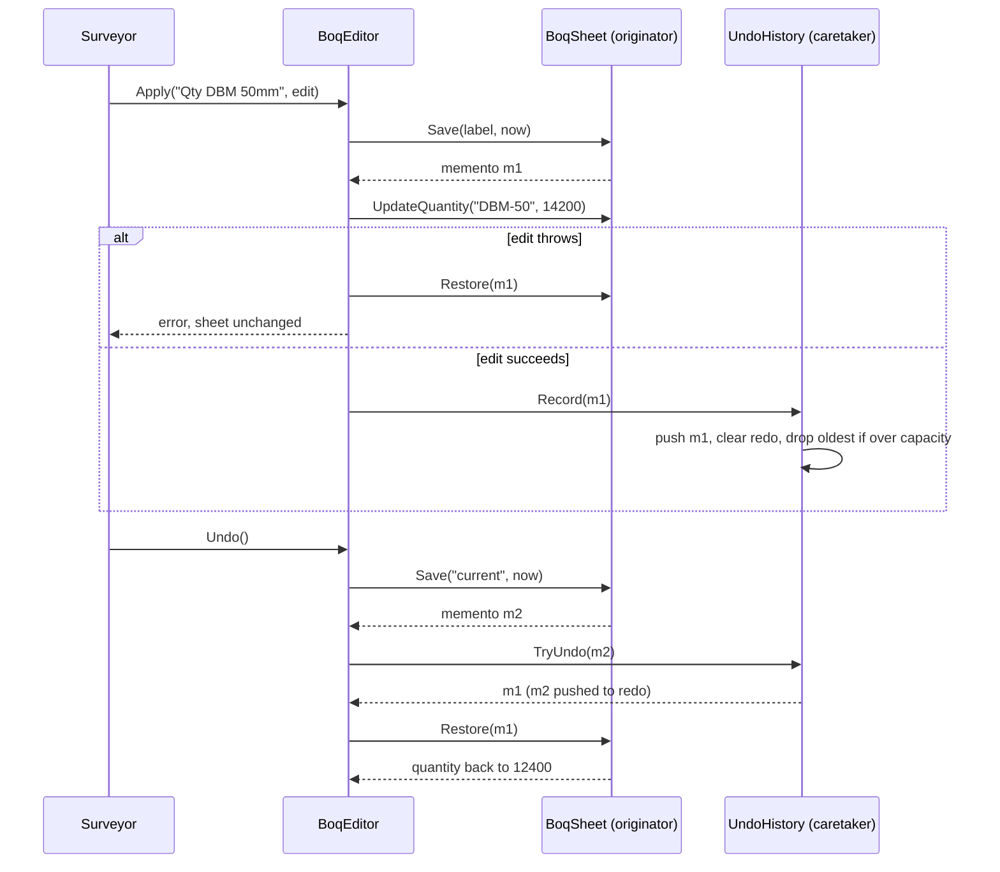
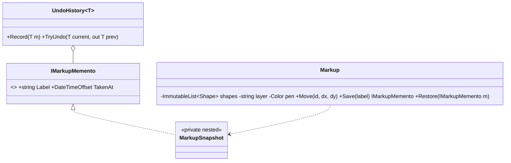

Every editor you have used has an undo button, and every long form you've abandoned halfway was, ideally, waiting for you when you came back. Both features rest on the same idea: take a sealed photograph of an object's state, keep it somewhere, and later put the object back exactly as it was. That photograph is a **memento**. This lesson builds undo for a Bill of Quantities (BOQ) editor, autosaved drafts for an inspection form, and compares snapshot-based undo with command-based undo, including what each one costs in memory.

## Learning objectives

By the end of this lesson you will be able to:

1. Explain the problem Memento solves: saving and restoring state *without breaking encapsulation*.
2. Name the three participants (originator, memento, caretaker) and say what each one is allowed to see.
3. Implement an opaque memento in C# using a private nested type behind a narrow public interface.
4. Build an undo/redo history with a capacity limit, and use a memento to roll back a failed edit.
5. Estimate the memory cost of snapshots and reduce it with immutable data and structural sharing.
6. Persist mementos safely (autosaved drafts) with explicit schema versions and migrations.
7. Choose between snapshot undo, command-based undo and a hybrid, and say when Memento is the wrong tool.

## Prerequisites

- [Classes and objects](#/lesson/m01-classes-objects): private fields and properties are the heart of this pattern.
- [Immutable objects](#/lesson/m07-immutability): immutable records make snapshots cheap and safe.
- [Command](#/lesson/m06-command): the main alternative way to implement undo. We compare the two.

## Explain it like I'm a beginner

Think of a video game with a **save point**. Before the boss fight, the game saves. You lose, and it puts you back at the save point with the same health, the same items and the same position. You never see what's inside the save file. You just know you can load it.

Three roles are hiding in that story:

- **The game world** is the thing whose state gets saved. It knows how to make a save and how to load one. This is the **originator**.
- **The save file** holds the state. To you, it is a sealed box with a label such as "Before boss, 9:42 pm". This is the **memento**.
- **The save menu** keeps a list of save files and lets you pick one. It never opens them. This is the **caretaker**.

Now a work example. A quantity surveyor is editing a BOQ for a 4 km road project: 1,800 line items with codes, quantities and rates. She changes the quantity of "Dense bituminous macadam, 50 mm" from 12,400 m² to 14,200 m², deletes two lines by mistake, and presses **Ctrl+Z** twice. The two lines come back, then the quantity goes back to 12,400.

How? Before each edit, the editor asked the BOQ sheet for a sealed snapshot and pushed it onto a stack. Undo pops the latest snapshot and hands it back to the sheet: "restore yourself to this". The undo stack (the caretaker) never knew what a BOQ line looks like. If the BOQ sheet adds a new field next month, say a GST rate per line, the undo code doesn't change.

## First-principles explanation

### The original problem

You want to restore an object to an earlier state. The obvious solution is to read all its fields from outside, copy them somewhere, and write them back later. That breaks three things:

1. **Encapsulation.** To copy the fields, outside code needs access to them. So you make private fields public, or add setters "just for undo". Now any code can put the object into an invalid state, such as a negative quantity or a duplicated item code.
2. **Change safety.** Add a field and every piece of copy code must be updated. Forget one and undo silently restores only part of the state. These bugs are very hard to spot.
3. **Responsibility.** The object is the only thing that knows which fields form its *real* state and which are derived or cached. `Total` is calculated from the lines, so it shouldn't be saved. A dirty flag shouldn't be restored. Outside code can't know this.

The GoF solution: **let the object produce its own snapshot**, in a form that only it can read.

### Participants

| Participant | Job | Can see inside the memento? |
|---|---|---|
| **Originator** | Creates a memento of its current state; restores itself from a memento | Yes (the "wide" interface) |
| **Memento** | Stores the originator's state at one moment; immutable | It *is* the state |
| **Caretaker** | Keeps mementos (undo stack, draft store) and decides when to save and restore | No: only a label and a timestamp (the "narrow" interface) |

The simplest implementation in C# is a record:

```csharp
public sealed record DocumentMemento(string Text, int Cursor);   // anyone can read it
```

That works for small, internal code, but the caretaker *can* read and even construct mementos. The GoF intent is stronger: the caretaker should only be able to hold one. C# gives you a neat way to do that. Make the real memento a **private nested type** inside the originator, and give the caretaker only a public interface with harmless members:

```csharp
public interface IBoqMemento { string Label { get; } DateTimeOffset TakenAt { get; } }

public sealed class BoqSheet
{
    private sealed record Snapshot(BoqSheet Owner, string Title, ImmutableList<BoqLine> Lines,
                                   string Label, DateTimeOffset TakenAt) : IBoqMemento;
    // Save() returns IBoqMemento; Restore(IBoqMemento) casts back to Snapshot.
}
```

Only `BoqSheet` can name `Snapshot`, so only `BoqSheet` can create one or read its state.

### How it works internally

1. Before a change, the caretaker calls `originator.Save()`. The originator copies its *essential* state into a new memento object.
2. The caretaker stores the memento, often on a stack.
3. To undo, the caretaker hands a memento back: `originator.Restore(memento)`. The originator checks that the memento is one of its own and replaces its state.

The key question is **what "copy its state" means**. If the state contains mutable objects such as a `List<T>` or a class with setters, a shallow copy shares them. Change the list after saving and the "saved" state changes too. You must either deep-copy the mutable parts, or, much better, keep the state immutable so that sharing is safe.

### The memory cost, and how immutability fixes it

Here is a back-of-the-envelope estimate. Treat these as estimates for reasoning, not measurements.

- A BOQ of 1,800 mutable line objects, at roughly 150–250 bytes each including strings, is about 300–450 KB.
- A *deep* copy per edit, with 100 undo steps, is roughly 30–45 MB per open editor.
- With 40 surveyors editing at once on one server, that is well over a gigabyte for undo history alone.

Now make each line an immutable `record` and keep the lines in an `ImmutableList<BoqLine>`. An immutable list is a balanced tree. Changing one item creates a new version that **shares** almost every node with the old version (structural sharing). Only the path from the root to the changed item is new, about log₂(1,800) ≈ 11 nodes. A snapshot is now just a reference to the current list. Saving costs almost nothing, and each edit allocates a few hundred bytes instead of hundreds of kilobytes.

This is the single most useful idea in this lesson: **immutable state makes mementos nearly free.**

### Snapshot undo vs command-based undo

There are two classic ways to build undo.

| | Snapshot (Memento) | Command-based ([Command](#/lesson/m06-command)) |
|---|---|---|
| What is stored | The whole state before each change | Each operation plus how to reverse it |
| Correctness | Very easy: restore is "put it all back" | Every command needs a correct inverse; easy to get subtly wrong |
| Memory | High with mutable state; low with immutable state | Tiny per operation |
| New operations | Free: they're covered automatically | Each needs `Execute` and `Undo` |
| Collaboration | Poor: restoring a snapshot wipes other people's changes | Better: you can undo *your* operation only |
| Typical use | Forms, drawing tools, single-user editors, rollback | Text editors, collaborative tools, audit trails |

A **hybrid** is common in practice: store commands, but take a full snapshot every N operations (a checkpoint). To jump far back, restore the nearest checkpoint and replay commands. Event sourcing uses the same trick ([Event sourcing](#/lesson/m08-event-sourcing)).

### Memento beyond undo

- **Rollback of a failed multi-step change.** Take a snapshot, attempt the edit, restore on exception. It is a mini in-memory transaction.
- **Autosaved drafts.** Persist the memento (as JSON) so a half-filled form survives a closed browser tab.
- **"What-if" analysis.** Snapshot an estimate, try three rate scenarios, restore.
- **Game save points, wizard back buttons, configuration "revert to last good".**

### When it is unnecessary

- The object is already immutable. Every version *is* a snapshot, so just keep references to old versions. (The pattern is still present, but it is invisible.)
- The data lives in a database with history: a temporal table, an audit table or event sourcing. Undo is then a database operation, not an in-memory one.
- Restoring state isn't enough. If an edit also sent an email or charged a card, rolling back the object doesn't un-send the email. You need compensating actions, not mementos.

### Trade-offs it introduces

| You gain | You pay |
|---|---|
| Undo/rollback without exposing internals | Memory for each snapshot (unless state is immutable) |
| Restore is simple and always complete | Restoring the whole state is coarse: it can't undo just one person's change |
| Caretaker code never changes when state changes | Persisted mementos need versioning, or old drafts break after a release |
| Works for any new operation automatically | Snapshotting large graphs can be slow, so you need to decide *when* to snapshot |

## Visual explanation

### Class diagram



How to read it: `BoqSheet` is the originator. It creates `Snapshot` objects, and only it can read them, because `Snapshot` is private and nested inside it. The rest of the world sees snapshots only through `IBoqMemento`, which exposes a label and a timestamp. `UndoHistory<TMemento>` is the caretaker. It holds mementos but has no idea what is in them, so it is generic and reusable for any originator. `BoqEditor` ties the two together and decides *when* to take a snapshot.

### Sequence diagram — edit, then undo



The editor takes the snapshot *before* the edit. If the edit fails, the same snapshot is used to roll back, so the sheet is never left half-changed. If the edit succeeds, the snapshot goes into the history and the redo stack is cleared, because a new edit creates a new timeline. On undo, the editor first snapshots the *current* state so it can be redone, then restores the previous one.

## Step-by-step example

### Step 1 — undo by poking at internals (the bad start)

```csharp
public sealed class BoqSheet
{
    public List<BoqLine> Lines { get; set; } = new();   // public setter "for undo"
    public string Title { get; set; } = "";
}

public sealed class UndoManager
{
    private readonly Stack<(string, List<BoqLine>)> _stack = new();
    public void Save(BoqSheet s) => _stack.Push((s.Title, s.Lines));   // BUG: shares the same list
    public void Undo(BoqSheet s) { var (t, l) = _stack.Pop(); s.Title = t; s.Lines = l; }
}
```

Two bugs in six lines. `Save` stores a reference to the *same* list, so later edits change the "saved" state too, and undo restores nothing. And the public setters let any code replace the lines with something invalid.

### Step 2 — make the state immutable

Make `BoqLine` a positional `record` and store lines in an `ImmutableList<BoqLine>`. Every edit now produces a new list. The old one is untouched and still valid, so the sharing bug can't happen.

### Step 3 — let the originator make the snapshot

Add `Save()` and `Restore()` to `BoqSheet` and remove the public setters. `Save` returns an opaque `IBoqMemento`. `Restore` accepts only snapshots it created, and checks the owner so that a snapshot of sheet A can't be restored into sheet B.

### Step 4 — a generic caretaker

`UndoHistory<TMemento>` keeps an undo list and a redo stack, with a capacity limit (drop the oldest beyond 100). It works for any originator.

### Step 5 — use the snapshot for rollback too

`BoqEditor.Apply` takes the snapshot, runs the edit, and restores the snapshot if the edit throws. One mechanism gives you both undo and all-or-nothing edits.

## Production-style C# implementation

```text
Estimating.Api/
  Program.cs
  Boq/BoqSheet.cs              # originator + private memento
  Boq/BoqEditor.cs             # ties originator and caretaker; rollback on failure
  Boq/BoqEditorSessions.cs     # per-session editors in IMemoryCache
  Undo/UndoHistory.cs          # generic caretaker
  Drafts/InspectionDraft.cs
  Drafts/DistributedDraftStore.cs  # persisted mementos with schema versions
```

### Originator and memento

```csharp file=Boq/BoqSheet.cs
using System.Collections.Immutable;

namespace Estimating.Boq;

public sealed record BoqLine(string ItemCode, string Description, string Unit, decimal Quantity, decimal Rate)
{
    public decimal Amount => Math.Round(Quantity * Rate, 2, MidpointRounding.AwayFromZero);
}

/// <summary>The narrow interface: all a caretaker may know about a snapshot.</summary>
public interface IBoqMemento
{
    string Label { get; }
    DateTimeOffset TakenAt { get; }
}

/// <summary>Originator. Its state is immutable, so a snapshot is just two references.</summary>
public sealed class BoqSheet(string title)
{
    private string _title = title;
    private ImmutableList<BoqLine> _lines = ImmutableList<BoqLine>.Empty;

    public string Title => _title;
    public IReadOnlyList<BoqLine> Lines => _lines;
    public decimal Total => _lines.Sum(l => l.Amount);   // derived, never stored in a snapshot

    public void Rename(string newTitle)
    {
        ArgumentException.ThrowIfNullOrWhiteSpace(newTitle);
        _title = newTitle.Trim();
    }

    public void AddLine(BoqLine line)
    {
        ArgumentNullException.ThrowIfNull(line);
        if (line.Quantity < 0 || line.Rate < 0)
            throw new ArgumentOutOfRangeException(nameof(line), "Quantity and rate must be non-negative.");
        if (_lines.Any(l => l.ItemCode == line.ItemCode))
            throw new InvalidOperationException($"Item {line.ItemCode} already exists.");
        _lines = _lines.Add(line);
    }

    public void UpdateQuantity(string itemCode, decimal quantity)
    {
        ArgumentOutOfRangeException.ThrowIfNegative(quantity);
        var i = IndexOf(itemCode);
        _lines = _lines.SetItem(i, _lines[i] with { Quantity = quantity });
    }

    public void RemoveLine(string itemCode) => _lines = _lines.RemoveAt(IndexOf(itemCode));

    public IBoqMemento Save(string label, DateTimeOffset at) => new Snapshot(this, _title, _lines, label, at);

    public void Restore(IBoqMemento memento)
    {
        if (memento is not Snapshot s || !ReferenceEquals(s.Owner, this))
            throw new ArgumentException("This memento was not created by this sheet.", nameof(memento));
        _title = s.Title;
        _lines = s.Lines;
    }

    private int IndexOf(string itemCode)
    {
        var i = _lines.FindIndex(l => l.ItemCode == itemCode);
        return i >= 0 ? i : throw new KeyNotFoundException($"Item {itemCode} not found.");
    }

    /// <summary>The wide interface. Private and nested: only BoqSheet can create or read it.</summary>
    private sealed record Snapshot(BoqSheet Owner, string Title, ImmutableList<BoqLine> Lines,
                                   string Label, DateTimeOffset TakenAt) : IBoqMemento;
}
```

### Caretaker

```csharp file=Undo/UndoHistory.cs
using System.Diagnostics.CodeAnalysis;

namespace Estimating.Undo;

/// <summary>Generic caretaker: stores mementos without knowing what is inside them.</summary>
public sealed class UndoHistory<TMemento> where TMemento : class
{
    private readonly LinkedList<TMemento> _undo = new();   // newest at the end; oldest dropped first
    private readonly Stack<TMemento> _redo = new();

    public UndoHistory(int capacity = 100)
    {
        ArgumentOutOfRangeException.ThrowIfLessThan(capacity, 1);
        Capacity = capacity;
    }

    public int Capacity { get; }
    public int UndoCount => _undo.Count;
    public int RedoCount => _redo.Count;
    public bool CanUndo => _undo.Count > 0;
    public bool CanRedo => _redo.Count > 0;

    /// <summary>Most recent first, for an "undo history" dropdown.</summary>
    public IEnumerable<TMemento> UndoTimeline => _undo.Reverse();

    public void Record(TMemento before)
    {
        ArgumentNullException.ThrowIfNull(before);
        _undo.AddLast(before);
        if (_undo.Count > Capacity) _undo.RemoveFirst();
        _redo.Clear();   // a new edit starts a new timeline
    }

    public bool TryUndo(TMemento current, [NotNullWhen(true)] out TMemento? previous)
    {
        if (_undo.Last is not { } last) { previous = null; return false; }
        _undo.RemoveLast();
        _redo.Push(current);
        previous = last.Value;
        return true;
    }

    public bool TryRedo(TMemento current, [NotNullWhen(true)] out TMemento? next)
    {
        if (!_redo.TryPop(out next)) return false;
        _undo.AddLast(current);
        return true;
    }
}
```

### The editor: undo, redo and rollback

```csharp file=Boq/BoqEditor.cs
using Estimating.Undo;

namespace Estimating.Boq;

public sealed class BoqEditor(BoqSheet sheet, TimeProvider clock, int maxUndo = 100)
{
    private readonly UndoHistory<IBoqMemento> _history = new(maxUndo);

    public BoqSheet Sheet => sheet;
    /// <summary>One editor is used by one surveyor, but HTTP requests can overlap; serialise them.</summary>
    public Lock Gate { get; } = new();
    public bool CanUndo => _history.CanUndo;
    public bool CanRedo => _history.CanRedo;
    public IEnumerable<string> RecentEdits => _history.UndoTimeline.Select(m => m.Label);

    /// <summary>Runs an edit as all-or-nothing and records it for undo.</summary>
    public void Apply(string label, Action<BoqSheet> edit)
    {
        var before = sheet.Save(label, clock.GetUtcNow());
        try
        {
            edit(sheet);
        }
        catch
        {
            sheet.Restore(before);   // a multi-step edit that fails halfway leaves no trace
            throw;
        }
        _history.Record(before);
    }

    public bool Undo()
    {
        if (!_history.TryUndo(sheet.Save("redo point", clock.GetUtcNow()), out var previous)) return false;
        sheet.Restore(previous);
        return true;
    }

    public bool Redo()
    {
        if (!_history.TryRedo(sheet.Save("undo point", clock.GetUtcNow()), out var next)) return false;
        sheet.Restore(next);
        return true;
    }
}
```

```csharp file=Boq/BoqEditorSessions.cs
using Microsoft.Extensions.Caching.Memory;

namespace Estimating.Boq;

/// <summary>Keeps one editor (and its undo history) per editing session, in server memory.</summary>
public sealed class BoqEditorSessions(IMemoryCache cache, TimeProvider clock)
{
    private static readonly MemoryCacheEntryOptions Options = new() { SlidingExpiration = TimeSpan.FromMinutes(30), Size = 1 };

    public Guid Start(string title)
    {
        var id = Guid.NewGuid();
        cache.Set(Key(id), new BoqEditor(new BoqSheet(title), clock), Options);
        return id;
    }

    public BoqEditor? Find(Guid id) => cache.TryGetValue(Key(id), out BoqEditor? editor) ? editor : null;

    private static string Key(Guid id) => $"boq-session:{id}";
}
```

### Persisted mementos: autosaved drafts

A draft is a memento that outlives the process. That raises a new problem: **the code that reads it may be newer than the code that wrote it.** So every persisted memento carries a schema version, and the loader knows how to upgrade old versions.

```csharp file=Drafts/InspectionDraft.cs
namespace Estimating.Drafts;

public sealed record ChecklistItem(string Item, bool Passed);

/// <summary>Version 2 of the draft. Version 1 stored checklist items as "Item:ok" strings and a single "remark".</summary>
public sealed record InspectionDraft(string Location, IReadOnlyList<ChecklistItem> Checklist, string Remarks);
```

```csharp file=Drafts/DistributedDraftStore.cs
using System.Text.Json;
using Microsoft.Extensions.Caching.Distributed;
using Microsoft.Extensions.Logging;

namespace Estimating.Drafts;

public interface IDraftStore
{
    Task SaveAsync(string userId, string formId, InspectionDraft draft, CancellationToken ct);
    Task<InspectionDraft?> LoadAsync(string userId, string formId, CancellationToken ct);
    Task DiscardAsync(string userId, string formId, CancellationToken ct);
}

public sealed class DistributedDraftStore(IDistributedCache cache, TimeProvider clock, ILogger<DistributedDraftStore> logger) : IDraftStore
{
    public const int CurrentSchemaVersion = 2;
    private static readonly JsonSerializerOptions Json = new(JsonSerializerDefaults.Web);
    private static readonly DistributedCacheEntryOptions Expiry = new() { SlidingExpiration = TimeSpan.FromDays(7) };

    public Task SaveAsync(string userId, string formId, InspectionDraft draft, CancellationToken ct)
    {
        var envelope = new { schemaVersion = CurrentSchemaVersion, savedAt = clock.GetUtcNow(), payload = draft };
        return cache.SetAsync(Key(userId, formId), JsonSerializer.SerializeToUtf8Bytes(envelope, Json), Expiry, ct);
    }

    public async Task<InspectionDraft?> LoadAsync(string userId, string formId, CancellationToken ct)
    {
        var bytes = await cache.GetAsync(Key(userId, formId), ct);
        if (bytes is null) return null;

        using var doc = JsonDocument.Parse(bytes);
        var root = doc.RootElement;
        var version = root.TryGetProperty("schemaVersion", out var v) && v.TryGetInt32(out var n) ? n : 0;
        var payload = root.GetProperty("payload");

        switch (version)
        {
            case CurrentSchemaVersion:
                return payload.Deserialize<InspectionDraft>(Json);
            case 1:
                return UpgradeFromV1(payload);
            default:
                // Never crash the form because of an unreadable draft; the user just starts fresh.
                logger.LogWarning("Discarding draft {FormId} for {UserId}: unsupported schema version {Version}", formId, userId, version);
                return null;
        }
    }

    public Task DiscardAsync(string userId, string formId, CancellationToken ct) => cache.RemoveAsync(Key(userId, formId), ct);

    private static InspectionDraft UpgradeFromV1(JsonElement p)
    {
        var items = p.TryGetProperty("items", out var arr)
            ? arr.EnumerateArray().Select(e => ParseV1Item(e.GetString() ?? "")).ToList()
            : new List<ChecklistItem>();
        return new InspectionDraft(
            p.TryGetProperty("location", out var loc) ? loc.GetString() ?? "" : "",
            items,
            p.TryGetProperty("remark", out var r) ? r.GetString() ?? "" : "");
    }

    private static ChecklistItem ParseV1Item(string raw)
    {
        var i = raw.LastIndexOf(':');
        return i < 0
            ? new ChecklistItem(raw.Trim(), false)
            : new ChecklistItem(raw[..i].Trim(), raw[(i + 1)..].Trim().Equals("ok", StringComparison.OrdinalIgnoreCase));
    }

    // Drafts are per user: one user must never load another user's half-filled form.
    private static string Key(string userId, string formId) => $"draft:inspection:{userId}:{formId}";
}
```

### Wiring and endpoints

```csharp file=Program.cs
using System.Security.Claims;
using Estimating.Boq;
using Estimating.Drafts;

var builder = WebApplication.CreateBuilder(args);

builder.Services.AddSingleton(TimeProvider.System);
builder.Services.AddMemoryCache(o => o.SizeLimit = 2_000);   // at most 2,000 open editors per instance
builder.Services.AddDistributedMemoryCache();                // swap for Redis in a multi-instance deployment
builder.Services.AddSingleton<BoqEditorSessions>();
builder.Services.AddSingleton<IDraftStore, DistributedDraftStore>();

var app = builder.Build();

app.MapPost("/boq-sessions", (StartSession body, BoqEditorSessions sessions) =>
    Results.Ok(new { sessionId = sessions.Start(body.Title) }));

app.MapPost("/boq-sessions/{id:guid}/lines", (Guid id, BoqLine line, BoqEditorSessions sessions) =>
    WithEditor(sessions, id, e => e.Apply($"Add {line.ItemCode}", s => s.AddLine(line))));

app.MapPatch("/boq-sessions/{id:guid}/lines/{code}", (Guid id, string code, QuantityChange body, BoqEditorSessions sessions) =>
    WithEditor(sessions, id, e => e.Apply($"Qty {code} → {body.Quantity}", s => s.UpdateQuantity(code, body.Quantity))));

app.MapPost("/boq-sessions/{id:guid}/undo", (Guid id, BoqEditorSessions sessions) =>
    WithEditor(sessions, id, e => { if (!e.Undo()) throw new InvalidOperationException("Nothing to undo."); }));

app.MapPost("/boq-sessions/{id:guid}/redo", (Guid id, BoqEditorSessions sessions) =>
    WithEditor(sessions, id, e => { if (!e.Redo()) throw new InvalidOperationException("Nothing to redo."); }));

app.MapPut("/drafts/inspection/{formId}", async (string formId, InspectionDraft draft, ClaimsPrincipal user, IDraftStore store, CancellationToken ct) =>
{
    var userId = user.FindFirst(ClaimTypes.NameIdentifier)?.Value;
    if (userId is null) return Results.Unauthorized();
    await store.SaveAsync(userId, formId, draft, ct);
    return Results.NoContent();
});

app.MapGet("/drafts/inspection/{formId}", async (string formId, ClaimsPrincipal user, IDraftStore store, CancellationToken ct) =>
{
    var userId = user.FindFirst(ClaimTypes.NameIdentifier)?.Value;
    if (userId is null) return Results.Unauthorized();
    var draft = await store.LoadAsync(userId, formId, ct);
    return draft is null ? Results.NotFound() : Results.Ok(draft);
});

app.Run();

static IResult WithEditor(BoqEditorSessions sessions, Guid id, Action<BoqEditor> action)
{
    var editor = sessions.Find(id);
    if (editor is null) return Results.NotFound();
    lock (editor.Gate)
    {
        try
        {
            action(editor);
            return Results.Ok(new { editor.Sheet.Title, editor.Sheet.Lines, editor.Sheet.Total, editor.CanUndo, editor.CanRedo, editor.RecentEdits });
        }
        catch (Exception ex) when (ex is ArgumentException or InvalidOperationException or KeyNotFoundException)
        {
            return Results.Problem(ex.Message, statusCode: StatusCodes.Status400BadRequest);
        }
    }
}

public sealed record StartSession(string Title);
public sealed record QuantityChange(decimal Quantity);
```

**Where should undo history live in a web app?** Three options, each with a trade-off:

1. **In the browser.** The client keeps snapshots of its own form state. This is the simplest and scales for free, but the history is lost on refresh. It is fine for forms.
2. **In server memory, per session** (as above). It works for rich editors with server-side rules, but it needs sticky sessions or a single instance, and the history is lost on deploy. Bound it with `SizeLimit` and expiry.
3. **In the database**, as a version table or event log. It survives everything and supports audit, but you are now building versioning, not just undo.

:::callout type=warning title="Never use BinaryFormatter for mementos"
Older .NET samples serialise mementos with `BinaryFormatter`. It is insecure, since deserialising untrusted data can run code, and it has been removed from the runtime since .NET 9. Use `System.Text.Json` with explicit, versioned data shapes, as in `DistributedDraftStore`.
:::

## Bad design vs good design

**Bad**: the `UndoManager` from Step 1. It exposes public setters, shares mutable lists, copies fields from outside, and has no capacity limit.

What goes wrong in production:

- **Silent partial undo.** Someone adds `GstRate` to the sheet and forgets to copy it in the undo manager. Undo restores quantities but not GST, and an invoice goes out wrong.
- **Aliasing.** The saved list is the live list, so undo "works" in a quick demo with one edit and fails with two.
- **Unbounded memory.** A surveyor leaves the tab open all day and makes 3,000 edits. Every one is kept.
- **No rollback.** A bulk "apply 5 % rate escalation" edit fails at line 900 of 1,800 and leaves the sheet half-escalated.

**Good**: the implementation above.

- The originator owns snapshot creation, so new fields are covered automatically.
- State is immutable, so sharing is safe and snapshots are cheap.
- The caretaker is generic and bounded.
- The same snapshot serves for undo and rollback.

**Is the improvement worth it?** For a 6-field form with client-side undo, a plain record memento (`with` expressions) is enough. The opaque nested type matters when the originator is a domain object with invariants and several caretakers are written by other people.

:::callout type=tip title="Records give you mementos for free"
If your whole state is an immutable record, `var before = state;` *is* the snapshot, and `state = before;` *is* the restore. Many modern UI state stores (Redux-style, Blazor state containers, Fluxor) do exactly this. The pattern hasn't disappeared. It's just one line.
:::

## Practical playground

Run the playground. It edits a short site-diary text with snapshot undo. Then try three changes. Make `TextDocument` hold a `StringBuilder` instead of a `string` and see the aliasing bug appear. Add a capacity of 3 to the history. Add a `Redo` method.

:::playground type=csharp title="Snapshot undo in 50 lines"
```csharp file=Program.cs
using System;
using System.Collections.Generic;

public sealed record DocumentMemento(string Text, int Cursor);

public sealed class TextDocument
{
    public string Text { get; private set; } = "";
    public int Cursor { get; private set; }

    public void Type(string s) { Text = Text.Insert(Cursor, s); Cursor += s.Length; }
    public void Backspace(int n) { n = Math.Min(n, Cursor); Text = Text.Remove(Cursor - n, n); Cursor -= n; }

    public DocumentMemento Save() => new(Text, Cursor);
    public void Restore(DocumentMemento m) { Text = m.Text; Cursor = m.Cursor; }
}

public static class Program
{
    public static void Main()
    {
        var doc = new TextDocument();
        var undo = new Stack<DocumentMemento>();

        void Edit(Action change) { undo.Push(doc.Save()); change(); Console.WriteLine($"edit  -> \"{doc.Text}\""); }
        void Undo() { if (undo.TryPop(out var m)) doc.Restore(m); Console.WriteLine($"undo  -> \"{doc.Text}\""); }

        Edit(() => doc.Type("Pier P3: "));
        Edit(() => doc.Type("concreting done"));
        Edit(() => doc.Backspace(4));
        Edit(() => doc.Type("started"));
        Undo();
        Undo();
        Console.WriteLine($"Undo steps left: {undo.Count}");
    }
}
```
:::

## Exercises

:::exercise id=m06-memento-ex1 difficulty=beginner kind=code title="Undo and redo for a text editor"
`TextDocument` already knows how to `Save()` and `Restore()` itself. Implement the caretaker, `EditorSession`, so that every edit can be undone and redone.
::requirements
- `Type` and `Backspace` take a snapshot *before* changing the document, and clear the redo stack.
- An edit that changes nothing (typing `""`, or backspace at position 0) is **not** recorded.
- `Undo()` and `Redo()` return `false` when there is nothing to do.
::acceptance
- Type "Hello", type " World", undo: text is "Hello". Redo: text is "Hello World".
- Undo twice from "Hello World" gives "". A third undo returns `false`.
- After an undo, a new edit makes `CanRedo` false.
- A no-op edit doesn't add an undo step.
::hint
You need two stacks. What goes on the redo stack when you undo?
::hint
On undo: push the *current* snapshot onto redo, then restore the popped undo snapshot. Redo is the mirror image.
::hint
To detect a no-op, compare the snapshot before with the snapshot after. Records compare by value.
::hint
```csharp
private void Edit(Action change)
{
    var before = Document.Save();
    change();
    if (Document.Save() == before) return;   // nothing changed
    _undo.Push(before);
    _redo.Clear();
}
```
::starter
```csharp file=EditorSession.cs
using System;
using System.Collections.Generic;

public sealed record DocumentMemento(string Text, int Cursor);

public sealed class TextDocument
{
    public string Text { get; private set; } = "";
    public int Cursor { get; private set; }

    public void Type(string s) { Text = Text.Insert(Cursor, s); Cursor += s.Length; }
    public void Backspace(int count) { var n = Math.Min(count, Cursor); Text = Text.Remove(Cursor - n, n); Cursor -= n; }

    public DocumentMemento Save() => new(Text, Cursor);
    public void Restore(DocumentMemento m) { Text = m.Text; Cursor = m.Cursor; }
}

public sealed class EditorSession(TextDocument document)
{
    public TextDocument Document { get; } = document;
    public bool CanUndo => throw new NotImplementedException();
    public bool CanRedo => throw new NotImplementedException();

    public void Type(string s) => throw new NotImplementedException();
    public void Backspace(int count) => throw new NotImplementedException();
    public bool Undo() => throw new NotImplementedException();
    public bool Redo() => throw new NotImplementedException();
}
```
::tests
```csharp file=EditorSessionTests.cs
using Xunit;

public class EditorSessionTests
{
    [Fact]
    public void Undo_then_redo()
    {
        var s = new EditorSession(new TextDocument());
        s.Type("Hello"); s.Type(" World");
        Assert.True(s.Undo());
        Assert.Equal("Hello", s.Document.Text);
        Assert.True(s.Redo());
        Assert.Equal("Hello World", s.Document.Text);
    }

    [Fact]
    public void Undo_to_empty_then_false()
    {
        var s = new EditorSession(new TextDocument());
        s.Type("Hello"); s.Type(" World");
        s.Undo(); s.Undo();
        Assert.Equal("", s.Document.Text);
        Assert.False(s.Undo());
        Assert.False(s.CanUndo);
    }

    [Fact]
    public void New_edit_clears_redo()
    {
        var s = new EditorSession(new TextDocument());
        s.Type("abc"); s.Backspace(1);
        s.Undo();
        Assert.True(s.CanRedo);
        s.Type("d");
        Assert.False(s.CanRedo);
        Assert.Equal("abcd", s.Document.Text);
    }

    [Fact]
    public void No_op_edits_are_not_recorded()
    {
        var s = new EditorSession(new TextDocument());
        s.Backspace(3);
        s.Type("");
        Assert.False(s.CanUndo);
    }

    [Fact]
    public void Redo_when_nothing_to_redo_is_false() => Assert.False(new EditorSession(new TextDocument()).Redo());
}
```
::solution
Two stacks of mementos. The session never looks inside a memento except to compare two for equality, which records give us for free.

```csharp file=EditorSession.cs
using System;
using System.Collections.Generic;

public sealed record DocumentMemento(string Text, int Cursor);

public sealed class TextDocument
{
    public string Text { get; private set; } = "";
    public int Cursor { get; private set; }

    public void Type(string s) { Text = Text.Insert(Cursor, s); Cursor += s.Length; }
    public void Backspace(int count) { var n = Math.Min(count, Cursor); Text = Text.Remove(Cursor - n, n); Cursor -= n; }

    public DocumentMemento Save() => new(Text, Cursor);
    public void Restore(DocumentMemento m) { Text = m.Text; Cursor = m.Cursor; }
}

public sealed class EditorSession(TextDocument document)
{
    private readonly Stack<DocumentMemento> _undo = new();
    private readonly Stack<DocumentMemento> _redo = new();

    public TextDocument Document { get; } = document;
    public bool CanUndo => _undo.Count > 0;
    public bool CanRedo => _redo.Count > 0;

    public void Type(string s) => Edit(() => Document.Type(s));
    public void Backspace(int count) => Edit(() => Document.Backspace(count));

    public bool Undo()
    {
        if (!_undo.TryPop(out var previous)) return false;
        _redo.Push(Document.Save());
        Document.Restore(previous);
        return true;
    }

    public bool Redo()
    {
        if (!_redo.TryPop(out var next)) return false;
        _undo.Push(Document.Save());
        Document.Restore(next);
        return true;
    }

    private void Edit(Action change)
    {
        var before = Document.Save();
        change();
        if (Document.Save() == before) return;
        _undo.Push(before);
        _redo.Clear();
    }
}
```
::mistakes
- Pushing the snapshot *after* the edit, so undo restores the state you are already in.
- Forgetting to push the current state onto redo before restoring, which makes redo impossible.
- Not clearing redo on a new edit, so redo jumps to a timeline that no longer exists.
::extensions
Add a capacity (keep only the last 50 undo steps), and merge consecutive single-character `Type` calls into one undo step, as real editors do.
:::

:::exercise id=m06-memento-ex2 difficulty=beginner kind=code title="A site diary memento that can't be corrupted"
`SiteDiaryForm` keeps a mutable list of labour entries. Implement `Save` and `Restore` so that a memento is a true snapshot: changes to the form after saving must never change the memento.
::requirements
- `Save()` returns a `DiaryMemento` holding the form id, weather and a **copy** of the labour entries.
- `Restore(m)` throws `ArgumentNullException` for null and `InvalidOperationException` if `m.FormId` differs from the form's id.
- After `Restore`, the form's labour list equals the memento's entries, and later edits don't affect the memento.
::acceptance
- Save with 3 labour entries, call `ClearLabour()`, restore: 3 entries are back.
- Restoring a memento from another form throws `InvalidOperationException`.
- Restoring the same memento twice works both times.
::hint
What does the `DiaryMemento` constructor receive if you pass `_labour` directly?
::hint
A `List<T>` is a reference type. Pass a copy, for example `_labour.ToArray()`.
::hint
In `Restore`, don't assign the memento's list to `_labour`. Clear `_labour` and `AddRange` the memento's entries, so the memento stays independent.
::starter
```csharp file=SiteDiary.cs
using System;
using System.Collections.Generic;

public sealed class DiaryMemento
{
    internal DiaryMemento(Guid formId, string weather, IReadOnlyList<string> labour)
    {
        FormId = formId; Weather = weather; Labour = labour;
    }
    public Guid FormId { get; }
    internal string Weather { get; }
    internal IReadOnlyList<string> Labour { get; }
}

public sealed class SiteDiaryForm(Guid formId)
{
    private readonly List<string> _labour = new();

    public Guid FormId { get; } = formId;
    public string Weather { get; set; } = "";
    public IReadOnlyList<string> Labour => _labour;

    public void AddLabour(string entry) => _labour.Add(entry);
    public void ClearLabour() => _labour.Clear();

    public DiaryMemento Save() => throw new NotImplementedException();
    public void Restore(DiaryMemento memento) => throw new NotImplementedException();
}
```
::tests
```csharp file=SiteDiaryTests.cs
using System;
using System.Collections.Generic;
using Xunit;

public class SiteDiaryTests
{
    private static SiteDiaryForm Filled()
    {
        var f = new SiteDiaryForm(Guid.NewGuid()) { Weather = "Clear, 31°C" };
        f.AddLabour("Masons: 6"); f.AddLabour("Helpers: 14"); f.AddLabour("Bar benders: 4");
        return f;
    }

    [Fact]
    public void Memento_survives_later_changes()
    {
        var f = Filled();
        var m = f.Save();
        f.ClearLabour();
        f.Weather = "Rain";
        f.Restore(m);
        Assert.Equal(3, f.Labour.Count);
        Assert.Equal("Clear, 31°C", f.Weather);
    }

    [Fact]
    public void Restore_twice_works()
    {
        var f = Filled();
        var m = f.Save();
        f.Restore(m);
        f.AddLabour("Carpenters: 2");
        f.Restore(m);
        Assert.Equal(new List<string> { "Masons: 6", "Helpers: 14", "Bar benders: 4" }, f.Labour);
    }

    [Fact]
    public void Other_forms_memento_rejected()
    {
        var m = Filled().Save();
        Assert.Throws<InvalidOperationException>(() => Filled().Restore(m));
    }

    [Fact]
    public void Null_rejected() => Assert.Throws<ArgumentNullException>(() => Filled().Restore(null!));
}
```
::solution
Copy on the way in, and copy on the way out.

```csharp file=SiteDiary.cs
using System;
using System.Collections.Generic;

public sealed class DiaryMemento
{
    internal DiaryMemento(Guid formId, string weather, IReadOnlyList<string> labour)
    {
        FormId = formId; Weather = weather; Labour = labour;
    }
    public Guid FormId { get; }
    internal string Weather { get; }
    internal IReadOnlyList<string> Labour { get; }
}

public sealed class SiteDiaryForm(Guid formId)
{
    private readonly List<string> _labour = new();

    public Guid FormId { get; } = formId;
    public string Weather { get; set; } = "";
    public IReadOnlyList<string> Labour => _labour;

    public void AddLabour(string entry) => _labour.Add(entry);
    public void ClearLabour() => _labour.Clear();

    public DiaryMemento Save() => new(FormId, Weather, _labour.ToArray());

    public void Restore(DiaryMemento memento)
    {
        ArgumentNullException.ThrowIfNull(memento);
        if (memento.FormId != FormId)
            throw new InvalidOperationException("This memento belongs to a different diary form.");
        Weather = memento.Weather;
        _labour.Clear();
        _labour.AddRange(memento.Labour);
    }
}
```

Strings are immutable, so copying the list of references is a complete snapshot. If entries were mutable objects, you would need to copy each one too, or better, make them records.
::alternatives
Store the entries as an `ImmutableList<string>` in the form itself. Then `Save` can share the list safely without copying.
::mistakes
- `new DiaryMemento(FormId, Weather, _labour)`. The memento shares the live list, and `ClearLabour()` empties the "snapshot".
- In `Restore`, assigning the memento's list to the form's field. The next `AddLabour` would then fail or change the memento.
:::

:::exercise id=m06-memento-ex3 difficulty=intermediate kind=code title="Versioned draft serialisation with migration"
Drafts of an inspection form are stored as JSON for up to 7 days. Last month the shape changed. Implement `DraftSerializer` so that new drafts are written as version 2 and old version 1 drafts still load.
::requirements
- `Serialize` writes `{"schemaVersion":2,"payload":{...}}` with camelCase property names.
- `Deserialize` reads version 2 directly, and upgrades version 1: `items` is an array of `"Item:ok"` / `"Item:fail"` strings (anything other than `ok` means not passed), and `remark` becomes `Remarks`.
- A missing or unknown `schemaVersion` throws `NotSupportedException`.
::acceptance
- A version 2 round trip keeps location, checklist items and remarks.
- Version 1 `["Shuttering:ok","Cover blocks:fail"]` becomes two `ChecklistItem`s with `Passed` true and false.
- Version 3 and a missing version both throw `NotSupportedException`.
::hint
Read the version *before* you decide how to read the rest. `JsonDocument` lets you inspect the JSON without binding it to a type.
::hint
`JsonSerializerDefaults.Web` gives camelCase names and case-insensitive reading.
::hint
For version 2, `payload.Deserialize<InspectionDraft>(options)` binds the record through its constructor.
::hint
For version 1, walk `items` with `EnumerateArray()`, split each string at the last `:`, and compare the suffix to `"ok"` ignoring case.
::hint
```csharp
return version switch
{
    2 => payload.Deserialize<InspectionDraft>(Options)!,
    1 => FromV1(payload),
    _ => throw new NotSupportedException($"Draft schema version {version} is not supported."),
};
```
::starter
```csharp file=DraftSerializer.cs
using System;
using System.Collections.Generic;
using System.Linq;
using System.Text.Json;

public sealed record ChecklistItem(string Item, bool Passed);
public sealed record InspectionDraft(string Location, IReadOnlyList<ChecklistItem> Checklist, string Remarks);

public static class DraftSerializer
{
    public const int CurrentVersion = 2;

    public static string Serialize(InspectionDraft draft) => throw new NotImplementedException();
    public static InspectionDraft Deserialize(string json) => throw new NotImplementedException();
}
```
::tests
```csharp file=DraftSerializerTests.cs
using System;
using System.Collections.Generic;
using Xunit;

public class DraftSerializerTests
{
    private static readonly InspectionDraft Sample = new("Pier P3",
        new List<ChecklistItem> { new ChecklistItem("Shuttering", true), new ChecklistItem("Cover blocks", false) },
        "Recheck cover at north face");

    [Fact]
    public void Writes_version_2_camel_case()
    {
        var json = DraftSerializer.Serialize(Sample);
        Assert.Contains("\"schemaVersion\":2", json);
        Assert.Contains("\"location\":\"Pier P3\"", json);
    }

    [Fact]
    public void Round_trips_version_2()
    {
        var back = DraftSerializer.Deserialize(DraftSerializer.Serialize(Sample));
        Assert.Equal("Pier P3", back.Location);
        Assert.Equal("Recheck cover at north face", back.Remarks);
        Assert.Equal(Sample.Checklist, back.Checklist);
    }

    [Fact]
    public void Upgrades_version_1()
    {
        const string v1 = "{\"schemaVersion\":1,\"payload\":{\"location\":\"Pier P3\",\"items\":[\"Shuttering:ok\",\"Cover blocks:FAIL\"],\"remark\":\"Check again\"}}";
        var d = DraftSerializer.Deserialize(v1);
        Assert.Equal("Pier P3", d.Location);
        Assert.Equal("Check again", d.Remarks);
        Assert.Equal(new List<ChecklistItem> { new ChecklistItem("Shuttering", true), new ChecklistItem("Cover blocks", false) }, d.Checklist);
    }

    [Fact]
    public void Unknown_version_rejected() =>
        Assert.Throws<NotSupportedException>(() => DraftSerializer.Deserialize("{\"schemaVersion\":3,\"payload\":{}}"));

    [Fact]
    public void Missing_version_rejected() =>
        Assert.Throws<NotSupportedException>(() => DraftSerializer.Deserialize("{\"payload\":{}}"));
}
```
::solution
Peek at the version with `JsonDocument`, then choose the reader.

```csharp file=DraftSerializer.cs
using System;
using System.Collections.Generic;
using System.Linq;
using System.Text.Json;

public sealed record ChecklistItem(string Item, bool Passed);
public sealed record InspectionDraft(string Location, IReadOnlyList<ChecklistItem> Checklist, string Remarks);

public static class DraftSerializer
{
    public const int CurrentVersion = 2;
    private static readonly JsonSerializerOptions Options = new(JsonSerializerDefaults.Web);

    public static string Serialize(InspectionDraft draft)
    {
        ArgumentNullException.ThrowIfNull(draft);
        return JsonSerializer.Serialize(new { schemaVersion = CurrentVersion, payload = draft }, Options);
    }

    public static InspectionDraft Deserialize(string json)
    {
        using var doc = JsonDocument.Parse(json);
        var root = doc.RootElement;
        if (!root.TryGetProperty("schemaVersion", out var v) || !v.TryGetInt32(out var version))
            throw new NotSupportedException("Draft has no schemaVersion.");
        var payload = root.GetProperty("payload");

        return version switch
        {
            2 => payload.Deserialize<InspectionDraft>(Options) ?? throw new JsonException("Empty payload."),
            1 => FromV1(payload),
            _ => throw new NotSupportedException($"Draft schema version {version} is not supported."),
        };
    }

    private static InspectionDraft FromV1(JsonElement p)
    {
        var items = p.TryGetProperty("items", out var arr)
            ? arr.EnumerateArray().Select(e => ParseItem(e.GetString() ?? "")).ToList()
            : new List<ChecklistItem>();
        var location = p.TryGetProperty("location", out var loc) ? loc.GetString() ?? "" : "";
        var remarks = p.TryGetProperty("remark", out var r) ? r.GetString() ?? "" : "";
        return new InspectionDraft(location, items, remarks);
    }

    private static ChecklistItem ParseItem(string raw)
    {
        var i = raw.LastIndexOf(':');
        if (i < 0) return new ChecklistItem(raw.Trim(), false);
        return new ChecklistItem(raw[..i].Trim(), raw[(i + 1)..].Trim().Equals("ok", StringComparison.OrdinalIgnoreCase));
    }
}
```

Why upgrade on read instead of rewriting all stored drafts? Drafts expire after 7 days, so after one week no version 1 drafts remain and the `case 1` branch can be deleted. For long-lived data, run a one-off migration instead.
::alternatives
Use a `[JsonPolymorphic]` envelope with one type per version (`DraftV1`, `DraftV2`) and an explicit `Upgrade()` chain (v1 → v2 → v3). That scales better once you have more than two versions.
::mistakes
- Deserialising straight into `InspectionDraft` and hoping missing fields default sensibly. The v1 checklist silently becomes empty.
- Treating a missing version as "current". Old drafts written before versioning existed then fail in confusing ways.
- Splitting on the *first* `:`, which breaks items such as `"Slump: 75mm:ok"`.
::extensions
In the real store, a draft that can't be read should be logged and discarded, never shown as an error to the user. Add that behaviour and a test for it.
:::

:::exercise id=m06-memento-ex4 difficulty=intermediate kind=design title="Refactor an undo manager that reaches into internals"
A drawing-markup tool for site plans has this undo code:

```csharp
public class Markup { public List<Shape> Shapes = new(); public string Layer = "Default"; public Color Pen; }
public class Shape { public float X, Y, W, H; public string Label; }

public class UndoManager
{
    private readonly Stack<(List<Shape>, string, Color)> _stack = new();
    public void Save(Markup m) => _stack.Push((new List<Shape>(m.Shapes), m.Layer, m.Pen));
    public void Undo(Markup m) { var s = _stack.Pop(); m.Shapes = s.Item1; m.Layer = s.Item2; m.Pen = s.Item3; }
}
```

Users report that "undo after moving a shape doesn't move it back", and that memory climbs to 1.5 GB after a long session. Diagnose both bugs, then redesign using Memento: give the class diagram, what is immutable, and the capacity policy. Finally, decide whether three new features should use snapshot or command-based undo: (a) "rotate all shapes 90°", (b) "upload a photo attachment", (c) "two people annotate the same plan at once".
::acceptance
- Explains why copying the list doesn't snapshot the shapes (shallow copy of mutable objects).
- The redesign keeps all fields private, with `Save`/`Restore` on `Markup` and an opaque memento.
- States a capacity policy (count- or size-based) and why.
- Gives a reasoned snapshot-or-command choice for (a), (b) and (c).
::hint
`new List<Shape>(m.Shapes)` copies what, exactly: the shapes, or references to them?
::hint
If `Shape` were a `record struct` or an immutable `record`, what would the copy cost and what would it protect?
::hint
For (b), think about what lives *outside* the object. Can a memento "un-upload" a file?
::hint
For (c), what happens to user B's annotations if user A restores a snapshot taken five minutes ago?
::solution
**Bug 1, shallow copy.** The list is copied, but it holds references to the same `Shape` objects. Moving a shape mutates `X`/`Y` on an object that both the live list and the "snapshot" share, so undo restores the moved shape. **Bug 2, memory.** There is no capacity limit, and every snapshot copies the full list even when nothing changed.

**Redesign.**



`Shape` becomes `sealed record Shape(Guid Id, float X, float Y, float W, float H, string Label)`. `Move` uses `shapes.SetItem(i, s with { X = s.X + dx })`. A snapshot is three references, about 40 bytes plus the shared tree. Capacity: keep the last 200 steps. This is count-based, because each step is now cheap. If shapes held large data such as embedded images, switch to a byte budget.

**Feature choices.**
(a) Rotate all: **snapshot**. One cheap snapshot covers any number of shapes, and writing an inverse for rotation is error-prone (floating-point drift).
(b) Photo upload: **neither alone**. The memento can remove the reference, but the file is already in object storage. Undo removes the reference. A background job deletes unreferenced files after 24 hours (a compensating action).
(c) Two users: **command-based**. Each user's undo reverts *their* operation by shape id. Restoring a snapshot would erase the other user's work.
::mistakes
- "Fixing" bug 1 with a deep clone of every shape on every edit. It's correct, but memory gets worse.
- Assuming undo can reverse external side effects.
:::

:::exercise id=m06-memento-ex5 difficulty=advanced kind=written title="Undo in a collaborative BOQ editor"
Your BOQ editor is moving from single-user to collaborative: up to 6 surveyors edit the same 1,800-line BOQ at once from Delhi, Pune and a site office with a slow connection. Product wants "Ctrl+Z undoes *my* last change" and "restore to any version from the last 30 days". Write a design note covering: why the current snapshot undo breaks, what you store instead, how undo works per user, how conflicts are handled, and where Memento still fits.
::acceptance
- Explains concretely how restoring a whole-sheet snapshot destroys another user's edit.
- Proposes operation-based storage (commands or events) with per-user undo, and defines what "undo" means when someone else has since changed the same line.
- Separates *undo* (recent, per user, in-session) from *version restore* (any point in 30 days, whole document, audited).
- Uses snapshots/checkpoints where they help (fast load, version restore) and estimates their storage.
- Addresses concurrency on the server (optimistic concurrency, versions) and the slow-connection case.
::hint
Write down a timeline: A edits line 12, B edits line 40, A presses Ctrl+Z. What should happen? What would snapshot undo do?
::hint
Store each change as an operation with the line's previous value, the new value, the user and a sequence number. Undo creates a *new* inverse operation; it doesn't delete history.
::hint
If B changed line 12 after A did, A's undo is now a conflict. Pick a rule (refuse with a message, or apply only if the value is still what A set) and justify it.
::hint
Version restore = load the nearest checkpoint snapshot + replay operations up to the target time. Estimate: 1,800 lines × ~150 bytes ≈ 270 KB per checkpoint (an estimate); a nightly checkpoint for 30 days is under 10 MB per BOQ.
::solution
**Model answer (abridged).**

*Why snapshot undo breaks.* A sets line 12 qty 400 → 450 (snapshot S1 taken before). B sets line 40 rate ₹1,250 → ₹1,310. A presses Ctrl+Z: restoring S1 resets the *whole sheet*, including line 40 back to ₹1,250. B's change silently disappears.

*Store operations, not states.* Each change is an operation row: `(boq_id, seq, user_id, line_code, field, old_value, new_value, at)`. The server assigns `seq` inside a transaction and checks the client's expected line version (optimistic concurrency, see [Locking](#/lesson/m09-locking)). It rejects stale writes with 409, and the client reloads that line.

*Per-user undo.* The client keeps the user's own recent op ids (last 100). Ctrl+Z sends "undo op 8812". The server checks that the line's current value still equals op 8812's `new_value`. If so, it appends a **new** inverse op (450 → 400) marked `undo_of = 8812`. If someone else has changed it since, it refuses with "Line 12 was changed by B at 14:05. Undo skipped", which is predictable and safe. Redo is an inverse of the inverse.

*Slow connection.* Ops are small (under 200 bytes), so they send quickly. The client applies them optimistically and reconciles on rejection. Avoid sending whole-sheet snapshots over the site link.

*Where Memento still fits.* (1) **Checkpoints**: a nightly snapshot of the full sheet as versioned JSON (about 270 KB by estimate; 30 days ≈ 8 MB per BOQ) makes "restore to 3 October 11:00" a matter of loading a checkpoint and replaying under a day of ops. (2) **Version restore** is a whole-document action. It is audited, requires a role, and is itself recorded as an op batch, so it can be undone. (3) **Local rollback**: a bulk "escalate rates 5 %" runs against an in-memory memento, and if validation fails at line 900 the client restores and sends nothing.

*Out of scope / later.* True real-time co-editing of the *same cell* would need OT/CRDT techniques. For a BOQ, line-level optimistic concurrency is usually enough.
::mistakes
- Proposing per-user snapshots. They still restore other users' lines.
- Deleting operations on undo. Audit needs the full history, so undo must append.
- Ignoring the conflict case where someone else changed the same line.
:::

## Automated testing

**1. Round-trip tests on the originator.** Save, change everything, restore, and assert equality with the original. Run this for every kind of edit.

```csharp
public class BoqSheetMementoTests
{
    private static readonly DateTimeOffset T0 = new(2026, 10, 1, 9, 0, 0, TimeSpan.Zero);

    [Fact]
    public void Restore_brings_back_every_field()
    {
        var sheet = new BoqSheet("Package 2 — Earthworks");
        sheet.AddLine(new BoqLine("EW-01", "Excavation in soil", "m3", 12_400m, 185m));
        var m = sheet.Save("before", T0);

        sheet.Rename("Changed");
        sheet.UpdateQuantity("EW-01", 14_200m);
        sheet.AddLine(new BoqLine("EW-02", "Embankment", "m3", 9_000m, 240m));
        sheet.Restore(m);

        Assert.Equal("Package 2 — Earthworks", sheet.Title);
        Assert.Equal(12_400m, Assert.Single(sheet.Lines).Quantity);
    }

    [Fact]
    public void Foreign_memento_is_rejected()
    {
        var a = new BoqSheet("A"); var b = new BoqSheet("B");
        Assert.Throws<ArgumentException>(() => b.Restore(a.Save("x", T0)));
    }
}
```

**2. Rollback on failure.** Use an edit lambda that changes two lines and then throws. Assert that the sheet equals its state before the call and that `CanUndo` is false.

**3. Caretaker behaviour.** With capacity 3, record 5 mementos, undo 3 times, and assert that the 4th undo returns false. This checks the eviction policy. Also check that a new `Record` clears redo.

**4. Serialisation.** Keep a **golden file** test: a stored v1 JSON string, as in exercise 3, that must still load. Without it, a refactor will eventually break old drafts, and you'll only find out from users.

**5. A guard test for completeness.** If a teammate adds a field to the originator but forgets to include it in the snapshot, round-trip tests that set "every field" catch it only if they are updated too. A reflection-based test that lists the originator's private fields and fails when a new one appears forces a conscious decision ("is this state or derived?").

Edge cases: undo with an empty history, restoring the same memento twice, capacity 1, a memento from a different instance, and concurrent requests on one editor session (hence the `Gate` lock).

## Real-world application

- **Editors and design tools.** Office suites, IDEs and drawing tools offer undo stacks. Many combine command-based undo with periodic snapshots.
- **Form drafts.** Long government and insurance forms autosave a draft so a lost connection doesn't lose 40 minutes of typing. The draft is a persisted memento.
- **Games.** Save points and checkpoints are textbook mementos.
- **Transactions and rollback.** PostgreSQL's MVCC keeps old row versions so a transaction can roll back. That is a database-level relative of this idea (see [Transactions and ACID](#/lesson/m09-transactions-acid)).
- **UI state stores.** Redux-style "time travel debugging" keeps every immutable state object and lets you jump between them.
- **Infrastructure project tools.** BOQ and estimate editors, schedule what-if analysis ("what if the monsoon delays earthworks by 6 weeks?"), and revision snapshots of drawings before each issue.

## Interview questions

:::interview
::q beginner
What problem does Memento solve?
::a
It lets you save and later restore an object's state without exposing that state to the code that does the saving. The object creates its own snapshot (the memento), a caretaker stores it, and later the object restores itself from it. This keeps fields private and keeps snapshot logic next to the data it describes.
::q beginner
What are the originator, memento and caretaker?
::a
The **originator** is the object whose state is saved. It creates mementos and restores from them. The **memento** is an immutable snapshot of that state. The **caretaker** stores mementos (an undo stack, a draft store) and decides when to save or restore, but never reads or changes their contents.
::q intermediate
How do you make a memento opaque to the caretaker in C#?
::a
Declare the real memento as a private nested type inside the originator, for example a private record, and have it implement a small public interface such as `IMemento { string Label; DateTimeOffset TakenAt; }`. `Save()` returns the interface. `Restore(IMemento m)` casts back to the private type and rejects anything else, including mementos from another instance. Only the originator can create or read the state.
::q intermediate
Snapshot undo vs command undo: when would you choose each?
::a
Snapshot undo is simpler and always complete. It works well for single-user editors, forms, drawing tools and rollback, especially when state is immutable so snapshots are cheap. Command undo stores small operations with their inverses. It suits large documents, audit trails and multi-user editing, where you need to undo one person's change without reverting others. Many real tools use a hybrid: commands, plus a checkpoint snapshot every N operations.
::q advanced
Your editor stores 100 snapshots of a 2,000-row grid and memory per user is too high. What do you do?
::a
First, measure the real size of a snapshot. Then: (1) make rows immutable records and store them in an `ImmutableList` or `ImmutableArray`, so snapshots share unchanged rows (structural sharing). An edit then costs O(log n) new nodes instead of a full copy. (2) Bound the history by count or by estimated bytes. (3) Merge rapid consecutive edits into one step. (4) If it is still too big, switch to command-based undo with periodic checkpoints. (5) Make sure snapshots aren't keeping large unrelated objects alive, such as caches or loaded images referenced from the state.
::q advanced
You persist mementos as drafts. What can go wrong after a release, and how do you design for it?
::a
The new code may not be able to read the old shape: renamed fields, changed types, split fields. Or it may read it *wrongly* and silently drop data. Design for it: include an explicit `schemaVersion` in every stored memento; write upgrade functions (v1 → v2 → v3); keep golden-file tests of each old version; treat unreadable drafts as discardable with a warning log, never as a user-facing crash; and never persist mementos with `BinaryFormatter` or by serialising private fields directly. Also scope drafts per user and set an expiry, so the number of old versions you must support stays bounded.
:::

## Summary and revision

**Key takeaways**

- Memento saves and restores state *without* exposing it. The originator makes the snapshot, the caretaker stores it, and nobody else reads it.
- In C#, make the memento a private nested type behind a narrow public interface, and check the owner on restore.
- Immutable state makes mementos nearly free, thanks to structural sharing. Mutable state needs deep copies, and memory grows fast.
- A snapshot taken before an edit gives you both undo and rollback on failure.
- Bound the history by count or bytes, and clear redo on a new edit.
- Persisted mementos need schema versions, upgrade code and golden-file tests. Never use `BinaryFormatter`.
- Snapshot undo is coarse. For multi-user editing, use command or operation-based undo, with snapshots as checkpoints.

**Terminology**: originator, memento, caretaker, narrow/wide interface, structural sharing, checkpoint, schema version, compensating action.

:::flashcards
Q: Who creates a memento, and who stores it?
A: The originator creates it (and restores from it); the caretaker stores it without reading its contents.
Q: What is the "narrow interface" of a memento?
A: What the caretaker sees — e.g. a label and timestamp — with no access to the saved state.
Q: Why does `new List<Shape>(shapes)` fail as a snapshot when Shape is mutable?
A: It copies references; the snapshot and the live list share the same Shape objects, so later edits change the snapshot.
Q: Why are immutable collections good for mementos?
A: Structural sharing: a new version reuses unchanged nodes, so a snapshot is just a reference and an edit costs O(log n).
Q: What must you do to the redo stack when a new edit happens?
A: Clear it — a new edit starts a new timeline.
Q: How can a memento implement rollback for a failed multi-step edit?
A: Snapshot before the edit; on exception, restore the snapshot and rethrow.
Q: What must every persisted memento include?
A: An explicit schema version, so newer code can upgrade or safely discard it.
Q: When is snapshot undo the wrong choice?
A: Multi-user editing (restoring wipes others' changes) or when edits have external side effects a snapshot can't reverse.
:::

## Knowledge check

:::quiz pass=70
::q single
A teammate implements undo by having `UndoService` read `sheet.Lines`, `sheet.Title` and `sheet.Discount` through public setters, and write them back later. Next sprint, someone adds `sheet.GstRate`. What is the most likely bug?
- [ ] The code won't compile.
- [x] Undo silently restores everything except GST, because the copy code wasn't updated.
- [ ] GST will be restored twice.
- [ ] Nothing, because public setters are safe.
> When outside code decides what "state" is, new fields are easy to miss. With Memento, the originator builds its own snapshot.
::q single
Your originator's state is an `ImmutableList<BoqLine>` of immutable records. What does `Save()` need to copy?
- [ ] Every line, deeply.
- [ ] Every line's strings.
- [x] Just the reference to the current list. Old versions can never change.
- [ ] Nothing, mementos aren't needed with immutable state.
> Immutable data can be shared safely. You still need a snapshot (the reference) to restore it, and that is cheap.
::q single
After undoing twice, the user makes a new edit. What should happen to the redo stack?
- [ ] Keep it, so the user can redo later.
- [x] Clear it, because the new edit creates a new timeline.
- [ ] Merge it into the undo stack.
- [ ] Push the new edit onto it.
> Redoing onto a different timeline would apply changes to a state they weren't made from.
::q multi
Which are good uses of Memento? (Select all that apply.)
- [x] Rolling back a bulk edit that fails at row 900 of 1,800.
- [x] Autosaving a half-filled inspection form as a versioned draft.
- [ ] Reversing a payment that has already been sent to the bank.
- [x] Undo in a single-user drawing tool.
> A memento restores in-memory state. A payment already sent needs a compensating action, such as a refund.
::q single
Two surveyors edit the same BOQ. Surveyor A presses Ctrl+Z and the editor restores A's last whole-sheet snapshot. What happens?
- [ ] Only A's last change is reverted.
- [x] B's changes made after that snapshot are lost too.
- [ ] The database refuses the restore.
- [ ] Nothing, because snapshots are per user.
> Whole-state snapshots revert everything. For collaboration, undo the user's own operation instead.
::q single
Six months after launch, drafts saved in the old JSON shape fail to load. Which practice would have prevented this?
- [ ] Using `BinaryFormatter` instead of JSON.
- [ ] Storing drafts forever.
- [x] A `schemaVersion` in every draft, plus upgrade code and golden-file tests for old versions.
- [ ] Making all draft properties nullable.
> Versioning makes the format change explicit. Golden files prove old versions still load. `BinaryFormatter` is insecure and removed from modern .NET.
::q single
How do you stop a caretaker from reading a memento's state in C#?
- [ ] Mark the memento's properties `protected`.
- [x] Make the memento a private nested type that implements a narrow public interface.
- [ ] Use `dynamic`.
- [ ] Put the memento in a different project.
> Only the containing class can name a private nested type, so only the originator can construct it or read its members.
:::

## Completion criteria

You have finished this lesson when you can:

- [ ] Score at least 70 % on the knowledge check.
- [ ] Complete exercises 1, 2 and 3 with `dotnet test` passing.
- [ ] Explain, with numbers, why immutable state makes snapshots cheap.
- [ ] Say in under two minutes when you'd choose command-based undo over snapshots, and give one case where neither is enough.
