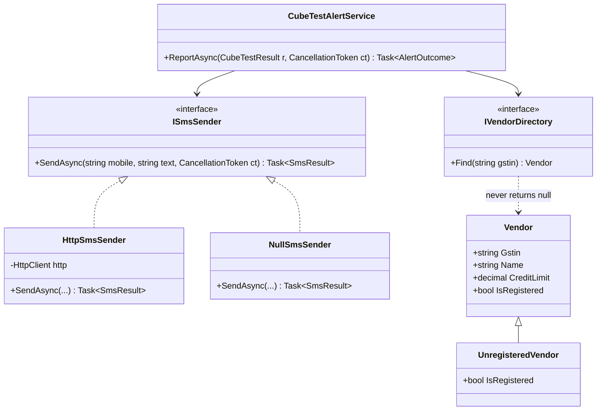
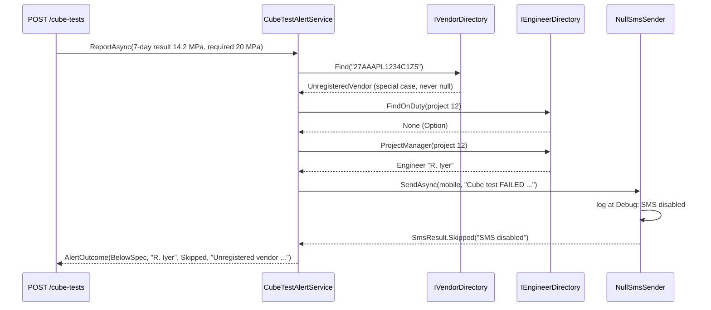

Tony Hoare, who introduced null references in 1965, later called them his "billion-dollar mistake". Most `NullReferenceException`s come from the same place: code that *sometimes* has a collaborator and sometimes doesn't, and a developer who forgot one check out of twenty. The Null Object pattern removes the checks by giving you a real object whose behaviour is "do nothing, safely". It is one of the simplest patterns. It is also one of the easiest to misuse, because "do nothing" is sometimes exactly the wrong thing to do. This lesson covers both sides.

## Learning objectives

By the end of this lesson you will be able to:

1. Explain the problem Null Object solves: repeated `if (x != null)` checks for optional collaborators.
2. Implement a Null Object (and Fowler's **Special Case**) in C#, and register it with dependency injection.
3. Recognise the Null Objects already built into .NET: `NullLogger`, `Stream.Null`, `Enumerable.Empty`, `Task.CompletedTask`, `CancellationToken.None`, `NullFileProvider`.
4. Choose correctly between a Null Object, a nullable reference type, an `Option<T>`, an exception, and a startup error.
5. Spot when a Null Object hides a bug, and make it observable (logs, results, health checks) or impossible to deploy by accident.
6. Test code that uses Null Objects, and test the Null Objects themselves.

## Prerequisites

- [Interfaces and abstract classes](#/lesson/m01-interfaces-abstract): a Null Object is just another implementation of an interface.
- [Dependency injection](#/lesson/m03-dependency-injection): we pick the real or the null implementation at startup.
- [Exceptions and error handling](#/lesson/m01-exceptions): sometimes absence should throw, and you need to know when.

## Explain it like I'm a beginner

Think of a building where some floors have a security guard at the door and some don't. You could put a sign on every floor: "If there is a guard, show your badge. If not, walk in." Every visitor has to check, every time.

Now imagine the building puts a **cardboard cut-out** of a guard on floors without one. Visitors always "show their badge to the guard". On real floors the guard checks it. On the cut-out floors nothing happens, and that's fine, because those floors don't need security. Visitors no longer need the if-check.

That cut-out is a **Null Object**: an object that has the same shape as the real thing but does nothing. In software:

```csharp
// Without a Null Object: every caller checks
if (_sms != null) await _sms.SendAsync(mobile, text, ct);

// With a Null Object: callers just call
await _sms.SendAsync(mobile, text, ct);   // _sms may be a NullSmsSender that does nothing
```

But be careful with the analogy. On the floor with the **cash vault**, a cardboard guard is a disaster. Everyone walks in, and nobody notices until the money is gone. In software, a "do-nothing payment gateway" that pretends payments succeeded is the cardboard guard at the vault. **A Null Object is only right when "nothing happens" is a correct outcome.**

## First-principles explanation

### The original problem

Some collaborators are optional:

- Not every project has an SMS gateway configured. The free tier has none, and so do test environments.
- Some modules want logging and some unit tests don't.
- A discount may or may not apply.
- An invoice may come from a vendor who isn't registered in your directory.

The naive approach uses `null` to mean "not there", and checks everywhere:

```csharp
if (_logger != null) _logger.LogInformation("...");
if (_sms != null) await _sms.SendAsync(...);
var discount = _discountPolicy != null ? _discountPolicy.DiscountFor(subtotal) : 0m;
var name = vendor != null ? vendor.Name : "Unknown vendor";
```

Three costs:

1. **Repetition.** The same check appears in 15 places. Miss one, and you get a `NullReferenceException` in production, usually on the code path nobody tested.
2. **Scattered defaults.** "What do we show for an unknown vendor?" is answered differently in different places: "Unknown", "N/A", "-", an empty string.
3. **Noise.** Business logic gets buried under defensive checks.

### The idea

Create a class that implements the same interface and does the **neutral** thing:

| Interface | Null Object | Neutral behaviour |
|---|---|---|
| `ISmsSender` | `NullSmsSender` | don't send; report "skipped" |
| `ILogger<T>` | `NullLogger<T>` (built in) | discard the log |
| `IDiscountPolicy` | `NoDiscount` | discount is ₹0 |
| `IEnumerable<T>` | `Enumerable.Empty<T>()` (built in) | no items |
| `Stream` | `Stream.Null` (built in) | reads nothing, discards writes |

Callers always get a real object, so they never check for null.

### Participants

| Participant | Job |
|---|---|
| **Abstraction** | The interface or base class that callers depend on (`ISmsSender`) |
| **Real object** | Does the actual work (`HttpSmsSender`) |
| **Null Object** | Same interface, neutral behaviour (`NullSmsSender`). Usually stateless, so one shared instance is enough |
| **Client** | Uses the abstraction with no null checks (`CubeTestAlertService`) |
| **Chooser** | Decides which one to supply. In ASP.NET Core this is the DI registration at startup |

### Special Case: Null Object's bigger sibling

Martin Fowler's **Special Case** generalises the idea from "nothing" to "a known unusual case". Instead of `Vendor?` that is sometimes null, you return an `UnregisteredVendor`. It is a real `Vendor` with the name "Unregistered vendor (GSTIN …)", a credit limit of ₹0, and `IsRegistered = false`. Callers display it, price against it and log it like any other vendor, and the rules for "unregistered" live in one class.

Other common special cases: `GuestCustomer`, `UnassignedEngineer`, `MissingPhoto` (a placeholder image), `UnknownProject`.

### How it works internally

Nothing special. It's ordinary polymorphism. The interesting decisions are elsewhere:

1. **One shared instance.** A stateless Null Object can be a singleton (`NullLogger.Instance`, `NoDiscount.Instance`), so you never allocate one per use.
2. **Make it honest.** A good Null Object *says* that it did nothing, when the caller might care. `NullSmsSender` returns `SmsResult.Skipped("SMS disabled for this environment")` rather than pretending it delivered. It can also log at Debug level.
3. **Choose it once, at the edge.** Decide in `Program.cs` from configuration ("Sms:Provider": "None"). Don't decide deep inside business code.

### The alternatives, and when each is right

C# gives you several tools for "might not be there". Pick deliberately:

| Situation | Best tool | Why |
|---|---|---|
| Optional collaborator where "do nothing" is correct (logging, optional notifications, metrics in tests) | **Null Object** | Removes checks; behaviour is genuinely neutral |
| A well-known unusual *value* with sensible behaviour (guest, unregistered vendor) | **Special Case** | Rules for the unusual case live in one class |
| A lookup that may find nothing, where the caller must decide what to do | **`T?` with nullable reference types**, or **`Option<T>`** | Absence is visible in the type, and the compiler or the type forces handling |
| Absence that means a bug or broken input (a required field missing, an id that must exist) | **Exception** | Fail loudly and early |
| Absence of a *required* dependency because of misconfiguration | **Startup error** | Never let the app start half-working |
| An operation that can fail in expected ways (validation, "not found" as a business outcome) | **Result type** (see [Options and Result](#/lesson/m06-options-result)) | Errors as values, with a reason |

**Nullable reference types** (NRT, enabled with `<Nullable>enable</Nullable>`) deserve a special mention. With NRT on, `Vendor` means "never null" and `Vendor?` means "might be null", and the compiler warns when you dereference a `Vendor?` without checking. This catches most null bugs at compile time. NRT is **compile-time only**, though: JSON deserialisation, reflection, older libraries and the `!` operator can still hand you a null at runtime. Null Object and NRT work well together. A method returning `ISmsSender` (no `?`) can promise "never null" *because* it returns a Null Object when nothing is configured.

**`Option<T>`** (also called Maybe) is a type that is either `Some(value)` or `None`. Unlike `T?`, it forces the caller to handle both cases through `Match` or `GetValueOrDefault`, and it composes with `Map`/`Bind`. C# has no built-in `Option<T>`, so teams write a small one (you'll build it in exercise 3) or use a library. Use it when absence needs a *decision*, not a silent default.

### When a Null Object hides bugs

A Null Object turns "missing" into "nothing happened, silently". That is dangerous when something *should* have happened:

- **`NullPaymentGateway` returning success.** Orders are confirmed, goods ship, money is never collected.
- **`NullAuditTrail` in production.** Legally required audit records are silently dropped, and you discover it during an audit months later.
- **A repository that returns an empty list for an unknown tenant id.** A typo in configuration looks like "this tenant has no projects" instead of an error.
- **`NullSmsSender` registered in production by accident** because a config key was misspelt. Concrete-cube failure alerts never reach site engineers.

Guardrails:

1. **Only use Null Objects where doing nothing is a correct business outcome.** Ask: "If this silently did nothing for a week, would anyone be harmed?"
2. **Make them observable**: return a "skipped" status, log at Debug or Information, and count skips in metrics.
3. **Make them hard to deploy by accident**: validate configuration at startup, refuse a disabled SMS provider in Production unless explicitly allowed, and report `Degraded` from a health check.
4. **Never use a Null Object for something required.** Required means "fail at startup if missing".

### When it is unnecessary

- The dependency is always present. Just make it required (no `?`, no Null Object).
- There's exactly one call site with one check. A single `if` is fine.
- Callers genuinely need to behave differently when the thing is absent. Use `T?` or `Option<T>`, not a silent default.

### Trade-offs it introduces

| You gain | You pay |
|---|---|
| No repeated null checks; fewer `NullReferenceException`s | Absence becomes invisible unless you make the Null Object observable |
| Neutral behaviour defined once | One more class per optional abstraction |
| Simpler client code and tests (`NullLogger.Instance`) | Risk of masking misconfiguration or missing required behaviour |
| Works naturally with DI and NRT ("never null" interfaces) | Not every interface has a sensible "neutral" behaviour; forcing one creates lies |

## Visual explanation

### Class diagram



How to read it: `CubeTestAlertService` depends on two abstractions. Behind `ISmsSender` there are two implementations: the real HTTP gateway and the Null Object. The service can't tell them apart, and doesn't need to. Behind `IVendorDirectory`, `Find` always returns a `Vendor`. For an unknown GSTIN it returns the special case `UnregisteredVendor`, a subclass with its own rules (credit limit ₹0). Neither relationship needs a `?` anywhere.

### Sequence diagram — a failed cube test in an environment with SMS disabled



This one flow shows three different tools. The vendor lookup uses a **Special Case**: the service doesn't branch, and the special case supplies a display name. The on-duty engineer lookup uses an **Option**, because "nobody on duty" needs a *decision* (escalate to the project manager), not a silent default. The SMS sender is a **Null Object**: the service calls it unconditionally, and the result honestly says "Skipped", so the API response and logs show that no SMS went out.

## Step-by-step example

### Step 1 — the null-check version

```csharp
public async Task<AlertOutcome> ReportAsync(CubeTestResult r, CancellationToken ct)
{
    var vendor = _vendors.FindOrNull(r.VendorGstin);
    var supplierName = vendor != null ? vendor.Name : "Unknown";              // default #1
    if (r.StrengthMpa >= r.RequiredMpa) return new(false, "", null, supplierName);

    var engineer = _engineers.FindOnDutyOrNull(r.ProjectId);
    if (engineer == null) engineer = _engineers.ProjectManager(r.ProjectId);   // a real decision: keep it

    if (_sms != null)                                                          // check #1 of many
        await _sms.SendAsync(engineer.Mobile, $"... supplier {vendor?.Name ?? "N/A"}", ct);   // default #2, different!
    _logger?.LogWarning("Cube test failed for {Pour}", r.PourId);             // check #2
    return new(true, engineer.Name, null, supplierName);
}
```

Two different defaults for the same unknown vendor ("Unknown" and "N/A"), two optional-dependency checks, and one genuine decision buried in the noise.

### Step 2 — Null Object for the optional collaborator

Create `NullSmsSender`, and make `ISmsSender` a required constructor parameter. DI supplies either the real or the null implementation. The `if (_sms != null)` disappears.

### Step 3 — `NullLogger` for logging

Make `ILogger<T>` required too. In production DI supplies a real logger, and in unit tests you pass `NullLogger<T>.Instance`. The `?.` disappears.

### Step 4 — Special Case for the unknown vendor

`IVendorDirectory.Find` always returns a `Vendor`. Unknown GSTINs get an `UnregisteredVendor`, whose name is defined once.

### Step 5 — keep the real decision explicit

"Nobody on duty → escalate" is *business logic*, not a neutral default, so don't hide it inside a Null Object. Return `Option<Engineer>` from `FindOnDuty` and handle both cases with `Match`. The full code follows.

## Production-style C# implementation

```text
SiteAlerts.Api/
  Program.cs
  Common/Option.cs
  Notifications/Sms.cs                # ISmsSender, HttpSmsSender, NullSmsSender, health check
  Vendors/Vendor.cs                   # Vendor + UnregisteredVendor special case
  Quality/CubeTestAlertService.cs
```

```csharp file=Common/Option.cs
using System.Diagnostics.CodeAnalysis;

namespace SiteAlerts.Common;

/// <summary>Either Some(value) or None. Forces callers to decide what absence means.</summary>
public readonly struct Option<T> where T : notnull
{
    private readonly T? _value;

    private Option(T value) { _value = value; HasValue = true; }

    public bool HasValue { get; }

    public static Option<T> Some(T value) => new(value ?? throw new ArgumentNullException(nameof(value)));
    public static Option<T> None => default;

    public TResult Match<TResult>(Func<T, TResult> some, Func<TResult> none) => HasValue ? some(_value!) : none();

    public Option<TResult> Map<TResult>(Func<T, TResult> map) where TResult : notnull =>
        HasValue ? Option<TResult>.Some(map(_value!)) : Option<TResult>.None;

    public T GetValueOrDefault(T fallback) => HasValue ? _value! : fallback;

    public bool TryGetValue([MaybeNullWhen(false)] out T value)
    {
        value = _value;
        return HasValue;
    }

    public override string ToString() => HasValue ? $"Some({_value})" : "None";
}
```

```csharp file=Notifications/Sms.cs
using System.Net.Http.Json;
using Microsoft.Extensions.Diagnostics.HealthChecks;
using Microsoft.Extensions.Logging;
using Microsoft.Extensions.Logging.Abstractions;

namespace SiteAlerts.Notifications;

public enum SmsStatus { Accepted, Skipped }

public sealed record SmsResult(SmsStatus Status, string? MessageId, string? Reason)
{
    public static SmsResult Accepted(string messageId) => new(SmsStatus.Accepted, messageId, null);
    public static SmsResult Skipped(string reason) => new(SmsStatus.Skipped, null, reason);
}

public interface ISmsSender
{
    Task<SmsResult> SendAsync(string mobile, string text, CancellationToken ct);
}

public sealed class SmsOptions
{
    public string Provider { get; set; } = "None";        // "Http" or "None"
    public string BaseUrl { get; set; } = "";
    public string ApiKey { get; set; } = "";
    public bool AllowDisabledInProduction { get; set; }
}

/// <summary>The real object: posts to an SMS gateway's HTTP API.</summary>
public sealed class HttpSmsSender(HttpClient http) : ISmsSender
{
    public async Task<SmsResult> SendAsync(string mobile, string text, CancellationToken ct)
    {
        using var response = await http.PostAsJsonAsync("v1/messages", new { to = mobile, text }, ct);
        response.EnsureSuccessStatusCode();
        var reply = await response.Content.ReadFromJsonAsync<GatewayReply>(ct);
        return SmsResult.Accepted(reply?.MessageId ?? "unknown");
    }

    private sealed record GatewayReply(string MessageId);
}

/// <summary>The Null Object: sends nothing, but says so (result + debug log) instead of pretending.</summary>
public sealed class NullSmsSender(ILogger<NullSmsSender> logger) : ISmsSender
{
    /// <summary>A silent instance for tests — a Null Object built from another Null Object.</summary>
    public static NullSmsSender Silent { get; } = new(NullLogger<NullSmsSender>.Instance);

    public Task<SmsResult> SendAsync(string mobile, string text, CancellationToken ct)
    {
        logger.LogDebug("SMS disabled; skipped message to {Mobile}", Mask(mobile));
        return Task.FromResult(SmsResult.Skipped("SMS is disabled for this environment."));
    }

    private static string Mask(string mobile) => mobile.Length <= 4 ? "****" : new string('*', mobile.Length - 4) + mobile[^4..];
}

/// <summary>Makes an accidental Null Object in Production visible on dashboards.</summary>
public sealed class SmsConfigurationHealthCheck(ISmsSender sender, IHostEnvironment env) : IHealthCheck
{
    public Task<HealthCheckResult> CheckHealthAsync(HealthCheckContext context, CancellationToken ct = default) =>
        Task.FromResult(sender is NullSmsSender && env.IsProduction()
            ? HealthCheckResult.Degraded("SMS is disabled (NullSmsSender) in Production; alerts are not being delivered.")
            : HealthCheckResult.Healthy());
}
```

```csharp file=Vendors/Vendor.cs
namespace SiteAlerts.Vendors;

public record Vendor(string Gstin, string Name, decimal CreditLimit)
{
    public virtual bool IsRegistered => true;
    public bool CanSupplyOnCredit(decimal amount) => amount <= CreditLimit;
}

/// <summary>Special Case: a real Vendor whose rules for "not in our directory" are defined once.</summary>
public sealed record UnregisteredVendor(string Gstin) : Vendor(Gstin, $"Unregistered vendor ({Gstin})", 0m)
{
    public override bool IsRegistered => false;
}

public interface IVendorDirectory
{
    /// <summary>Never returns null. Unknown GSTINs give an UnregisteredVendor.</summary>
    Vendor Find(string gstin);
}

public sealed class InMemoryVendorDirectory : IVendorDirectory
{
    private readonly Dictionary<string, Vendor> _byGstin = new(StringComparer.OrdinalIgnoreCase)
    {
        ["06AABCR1234M1Z2"] = new Vendor("06AABCR1234M1Z2", "Haryana Ready-Mix Pvt Ltd", 2_500_000m),
        ["09AACCK5678Q1Z9"] = new Vendor("09AACCK5678Q1Z9", "Kanpur Aggregates", 800_000m),
    };

    public Vendor Find(string gstin) => _byGstin.GetValueOrDefault(gstin) ?? new UnregisteredVendor(gstin);
}
```

```csharp file=Quality/CubeTestAlertService.cs
using Microsoft.Extensions.Logging;
using SiteAlerts.Common;
using SiteAlerts.Notifications;
using SiteAlerts.Vendors;

namespace SiteAlerts.Quality;

public sealed record CubeTestResult(int ProjectId, string PourId, int AgeDays, decimal StrengthMpa, decimal RequiredMpa, string SupplierGstin);
public sealed record Engineer(string Name, string Mobile);
public sealed record AlertOutcome(bool BelowSpec, string? NotifiedPerson, SmsStatus? Sms, string SupplierName);

public interface IEngineerDirectory
{
    /// <summary>Absence needs a decision (escalation), so it is an Option, not a Null Object.</summary>
    Option<Engineer> FindOnDuty(int projectId);
    Engineer ProjectManager(int projectId);
}

public sealed class InMemoryEngineerDirectory : IEngineerDirectory
{
    public Option<Engineer> FindOnDuty(int projectId) =>
        projectId == 12 ? Option<Engineer>.None : Option<Engineer>.Some(new Engineer("A. Khan", "+919800000001"));

    public Engineer ProjectManager(int projectId) => new("R. Iyer", "+919800000099");
}

public sealed class CubeTestAlertService(
    ISmsSender sms, IVendorDirectory vendors, IEngineerDirectory engineers, ILogger<CubeTestAlertService> logger)
{
    public async Task<AlertOutcome> ReportAsync(CubeTestResult r, CancellationToken ct)
    {
        var supplier = vendors.Find(r.SupplierGstin);                 // Special Case: never null
        if (r.StrengthMpa >= r.RequiredMpa) return new AlertOutcome(false, null, null, supplier.Name);

        var contact = engineers.FindOnDuty(r.ProjectId)              // Option: absence is a decision
            .Match(e => e, () => engineers.ProjectManager(r.ProjectId));

        var text = $"Cube test FAILED: pour {r.PourId}, {r.AgeDays}-day strength {r.StrengthMpa} MPa " +
                   $"(required {r.RequiredMpa}). Supplier: {supplier.Name}.";
        var result = await sms.SendAsync(contact.Mobile, text, ct);  // Null Object: no check needed

        logger.LogWarning("Cube test below spec for pour {PourId}: {Strength}/{Required} MPa; notified {Person}; SMS {SmsStatus}",
            r.PourId, r.StrengthMpa, r.RequiredMpa, contact.Name, result.Status);
        return new AlertOutcome(true, contact.Name, result.Status, supplier.Name);
    }
}
```

```csharp file=Program.cs
using Microsoft.Extensions.Options;
using SiteAlerts.Notifications;
using SiteAlerts.Quality;
using SiteAlerts.Vendors;

var builder = WebApplication.CreateBuilder(args);

// ---- Choose the real object or the Null Object once, at startup ----
var sms = builder.Configuration.GetSection("Sms").Get<SmsOptions>() ?? new SmsOptions();
switch (sms.Provider.ToLowerInvariant())
{
    case "http":
        if (string.IsNullOrWhiteSpace(sms.BaseUrl) || string.IsNullOrWhiteSpace(sms.ApiKey))
            throw new InvalidOperationException("Sms:Provider is Http but Sms:BaseUrl or Sms:ApiKey is missing.");
        builder.Services.AddHttpClient<ISmsSender, HttpSmsSender>(http =>
        {
            http.BaseAddress = new Uri(sms.BaseUrl);
            http.DefaultRequestHeaders.Add("X-Api-Key", sms.ApiKey);
            http.Timeout = TimeSpan.FromSeconds(10);
        });
        break;
    case "none":
        // Guardrail: a disabled SMS provider in Production must be an explicit, reviewed decision.
        if (builder.Environment.IsProduction() && !sms.AllowDisabledInProduction)
            throw new InvalidOperationException("SMS is disabled in Production. Set Sms:AllowDisabledInProduction=true to confirm.");
        builder.Services.AddSingleton<ISmsSender, NullSmsSender>();
        break;
    default:
        throw new InvalidOperationException($"Unknown Sms:Provider '{sms.Provider}'. Use 'Http' or 'None'.");
}

builder.Services.AddSingleton<IVendorDirectory, InMemoryVendorDirectory>();
builder.Services.AddSingleton<IEngineerDirectory, InMemoryEngineerDirectory>();
builder.Services.AddScoped<CubeTestAlertService>();
builder.Services.AddHealthChecks().AddCheck<SmsConfigurationHealthCheck>("sms-configuration");

var app = builder.Build();

app.MapPost("/cube-tests", async (CubeTestResult result, CubeTestAlertService alerts, CancellationToken ct) =>
    Results.Ok(await alerts.ReportAsync(result, ct)));

app.MapHealthChecks("/health");
app.Run();
```

Look at what `CubeTestAlertService` *doesn't* contain: no `!= null`, no `?.`, no `?? "Unknown"`. Each kind of absence has been handled by the right tool. The optional collaborator is a Null Object, the unusual value is a Special Case, the decision is an Option, and misconfiguration is a startup error.

### Null Objects you already use in .NET

| Built-in | What it does nothing at |
|---|---|
| `NullLogger<T>.Instance`, `NullLoggerFactory.Instance` | Logging. Ideal in unit tests |
| `Stream.Null`, `TextWriter.Null`, `TextReader.Null` | I/O. Reads nothing, discards writes |
| `Enumerable.Empty<T>()`, `Array.Empty<T>()`, `[]` | Collections. Return these instead of `null` |
| `Task.CompletedTask`, `ValueTask.CompletedTask` | Async work that has nothing to do |
| `CancellationToken.None` | A token that is never cancelled |
| `NullFileProvider` | A file provider with no files |
| `Results.Empty` (minimal APIs) | An HTTP result that writes nothing |

Rule of thumb that follows from this table: **never return `null` for a collection.** Return an empty one.

## Bad design vs good design

### Bad: a Null Object where "nothing" is wrong

```csharp
public sealed class NullPaymentGateway : IPaymentGateway
{
    // "Payments aren't configured in this environment, so just succeed."
    public Task<PaymentResult> ChargeAsync(decimal amount, string upiId, CancellationToken ct) =>
        Task.FromResult(PaymentResult.Success(transactionId: "NULL"));
}

// Program.cs
if (string.IsNullOrEmpty(builder.Configuration["Payments:ApiKey"]))
    builder.Services.AddSingleton<IPaymentGateway, NullPaymentGateway>();   // a missing secret silently disables payments
```

A secret fails to load after a key-vault rotation. The app starts happily. For three days every order is "paid" with transaction id `NULL`. Nothing errors. Nothing alerts. This isn't hypothetical in spirit: silent fallbacks on required dependencies are a common root cause in post-incident reviews.

**Good:** payments are *required*. A missing key is a startup error. Use `ValidateOnStart()` with the options pattern, or throw in `Program.cs`. If you need a fake gateway for local development, call it `FakePaymentGateway`, register it **only** when `IsDevelopment()`, and make it obviously fake (amounts ending in .13 fail, for testing).

### Bad: null checks everywhere

Step 1's code: two inconsistent defaults and checks that someone will eventually forget.

### Good: the production code above

Null Object for optional behaviour, Special Case for known unusual values, Option for decisions, and startup errors for required configuration.

:::callout type=mistake title="The silent Null Object"
If your Null Object returns `void` or `Task` and logs nothing, nobody can ever tell it ran. At minimum, log at Debug level. For anything that matters (alerts, emails), return a status such as `Skipped` and add a health check or metric. "Did nothing" should be a *visible* fact, not an invisible one.
:::

## Practical playground

The playground compares a null-check style with a Null Object style for a site-diary exporter that optionally writes to a log. Run it. Then add a third style using `Option<string>` for an optional "remarks" field. Finally, make `NullAuditLog` print a one-line warning the first time it's used, and decide whether that's helpful or noisy.

:::playground type=csharp title="Null checks vs Null Object"
```csharp file=Program.cs
using System;
using System.Collections.Generic;

public interface IAuditLog { void Record(string message); }

public sealed class ConsoleAuditLog : IAuditLog
{
    public void Record(string message) => Console.WriteLine($"[audit] {message}");
}

public sealed class NullAuditLog : IAuditLog
{
    public static readonly NullAuditLog Instance = new();
    private NullAuditLog() { }
    public void Record(string message) { }   // intentionally does nothing
}

public sealed class DiaryExporterWithChecks(IAuditLog? audit)
{
    public int Export(IReadOnlyList<string> entries)
    {
        if (audit != null) audit.Record($"Exporting {entries.Count} entries");
        foreach (var e in entries) Console.WriteLine($"  {e}");
        if (audit != null) audit.Record("Export finished");
        return entries.Count;
    }
}

public sealed class DiaryExporter(IAuditLog audit)
{
    public int Export(IReadOnlyList<string> entries)
    {
        audit.Record($"Exporting {entries.Count} entries");
        foreach (var e in entries) Console.WriteLine($"  {e}");
        audit.Record("Export finished");
        return entries.Count;
    }
}

public static class Program
{
    public static void Main()
    {
        var entries = new List<string> { "07:30 Crew of 18 on site", "11:10 Slab S2 pour started", "16:45 Pour complete, 64 m3" };

        Console.WriteLine("With checks, no audit:");
        new DiaryExporterWithChecks(null).Export(entries);

        Console.WriteLine("Null Object:");
        new DiaryExporter(NullAuditLog.Instance).Export(entries);

        Console.WriteLine("Real audit:");
        new DiaryExporter(new ConsoleAuditLog()).Export(entries);
    }
}
```
:::

## Exercises

:::exercise id=m06-null-object-ex1 difficulty=beginner kind=code title="A 'no discount' policy that removes the null checks"
`InvoiceCalculator` used to take an optional `IDiscountPolicy?` and check it for null. Implement the Null Object `NoDiscount`, and finish the calculator so that its discount policy is *required*.
::requirements
- `NoDiscount.Instance` is a single shared instance (private constructor). `DiscountFor` returns 0 and `Label` returns `"No discount"`.
- `InvoiceCalculator`'s constructor throws `ArgumentNullException` for a null policy.
- `Calculate(subtotal)` returns the subtotal, discount, GST at 18 % on (subtotal − discount) rounded to 2 decimals, the total, and the policy's label.
::acceptance
- With `NoDiscount.Instance` and a ₹10,000 subtotal: discount 0, GST 1,800, total 11,800, label "No discount".
- With a 10 % policy: discount 1,000, GST 1,620, total 10,620.
- `NoDiscount.Instance` is the same object every time, and the calculator has no null checks except the constructor guard.
::hint
The Null Object implements the same interface as `PercentDiscount`. What is the "neutral" discount?
::hint
A private constructor plus `public static NoDiscount Instance { get; } = new();` gives you one shared instance.
::hint
`ArgumentNullException.ThrowIfNull(policy)` is the one check you keep, at the boundary.
::starter
```csharp file=InvoiceCalculator.cs
using System;

public interface IDiscountPolicy
{
    decimal DiscountFor(decimal subtotal);
    string Label { get; }
}

public sealed class PercentDiscount(decimal percent) : IDiscountPolicy
{
    public decimal DiscountFor(decimal subtotal) => Math.Round(subtotal * percent / 100m, 2);
    public string Label => $"{percent} % off";
}

public sealed class NoDiscount : IDiscountPolicy
{
    public static NoDiscount Instance => throw new NotImplementedException();
    public decimal DiscountFor(decimal subtotal) => throw new NotImplementedException();
    public string Label => throw new NotImplementedException();
}

public sealed record InvoiceTotals(decimal Subtotal, decimal Discount, decimal Gst, decimal Total, string DiscountLabel);

public sealed class InvoiceCalculator
{
    public const decimal GstRate = 0.18m;

    public InvoiceCalculator(IDiscountPolicy discount) => throw new NotImplementedException();

    public InvoiceTotals Calculate(decimal subtotal) => throw new NotImplementedException();
}
```
::tests
```csharp file=InvoiceCalculatorTests.cs
using System;
using Xunit;

public class InvoiceCalculatorTests
{
    [Fact]
    public void No_discount_totals()
    {
        var t = new InvoiceCalculator(NoDiscount.Instance).Calculate(10_000m);
        Assert.Equal(0m, t.Discount);
        Assert.Equal(1_800m, t.Gst);
        Assert.Equal(11_800m, t.Total);
        Assert.Equal("No discount", t.DiscountLabel);
    }

    [Fact]
    public void Percent_discount_totals()
    {
        var t = new InvoiceCalculator(new PercentDiscount(10m)).Calculate(10_000m);
        Assert.Equal(1_000m, t.Discount);
        Assert.Equal(1_620m, t.Gst);
        Assert.Equal(10_620m, t.Total);
    }

    [Fact]
    public void Instance_is_shared() => Assert.Same(NoDiscount.Instance, NoDiscount.Instance);

    [Fact]
    public void Null_policy_rejected() => Assert.Throws<ArgumentNullException>(() => new InvoiceCalculator(null!));

    [Fact]
    public void Gst_is_rounded() => Assert.Equal(180.02m, new InvoiceCalculator(NoDiscount.Instance).Calculate(1_000.11m).Gst);
}
```
::solution
The Null Object is three lines of behaviour. The real win is that `Calculate` never asks "is there a policy?".

```csharp file=InvoiceCalculator.cs
using System;

public interface IDiscountPolicy
{
    decimal DiscountFor(decimal subtotal);
    string Label { get; }
}

public sealed class PercentDiscount(decimal percent) : IDiscountPolicy
{
    public decimal DiscountFor(decimal subtotal) => Math.Round(subtotal * percent / 100m, 2);
    public string Label => $"{percent} % off";
}

public sealed class NoDiscount : IDiscountPolicy
{
    private NoDiscount() { }
    public static NoDiscount Instance { get; } = new();
    public decimal DiscountFor(decimal subtotal) => 0m;
    public string Label => "No discount";
}

public sealed record InvoiceTotals(decimal Subtotal, decimal Discount, decimal Gst, decimal Total, string DiscountLabel);

public sealed class InvoiceCalculator
{
    public const decimal GstRate = 0.18m;
    private readonly IDiscountPolicy _discount;

    public InvoiceCalculator(IDiscountPolicy discount)
    {
        ArgumentNullException.ThrowIfNull(discount);
        _discount = discount;
    }

    public InvoiceTotals Calculate(decimal subtotal)
    {
        var discount = _discount.DiscountFor(subtotal);
        var taxable = subtotal - discount;
        var gst = Math.Round(taxable * GstRate, 2, MidpointRounding.AwayFromZero);
        return new InvoiceTotals(subtotal, discount, gst, taxable + gst, _discount.Label);
    }
}
```

This is also a [Strategy](#/lesson/m06-strategy): `NoDiscount` is simply the "do nothing" strategy. Many Null Objects are strategies in disguise.
::mistakes
- `public static NoDiscount Instance => new();`. That expression-bodied property creates a *new* object on every access, so `Assert.Same` fails.
- Keeping `if (_discount != null)` "just in case", which brings back the noise the pattern removes.
- Using `double` for money.
::extensions
Register `IDiscountPolicy` in DI so that `NoDiscount.Instance` is used unless configuration selects a real policy.
:::

:::exercise id=m06-null-object-ex2 difficulty=beginner kind=code title="Special Case: the unregistered vendor"
Invoices sometimes arrive from vendors who aren't in the vendor directory yet. Today `Find` returns `null`, and every caller invents its own default. Implement the Special Case `UnregisteredVendor` and make `VendorDirectory.Find` never return null.
::requirements
- `UnregisteredVendor(gstin)` is a `Vendor` with name `"Unregistered vendor (<gstin>)"`, credit limit 0 and `IsRegistered = false`.
- `CanSupplyOnCredit(amount)` is false for an unregistered vendor for any positive amount.
- `VendorDirectory.Find` returns the registered vendor when found (ignoring case), otherwise an `UnregisteredVendor`. It never returns null.
::acceptance
- A known GSTIN returns the registered vendor with its credit limit.
- An unknown GSTIN returns an `UnregisteredVendor` with the expected name and `IsRegistered == false`.
- `CanSupplyOnCredit(1)` is false for an unregistered vendor and true for a registered vendor within its limit.
::hint
A special case is a subclass with its own fixed values. Records can inherit from records.
::hint
`public sealed record UnregisteredVendor(string Gstin) : Vendor(Gstin, $"Unregistered vendor ({Gstin})", 0m)`.
::hint
`IsRegistered` should be `virtual` in `Vendor` and overridden to return `false`.
::hint
In `Find`, use `_byGstin.GetValueOrDefault(gstin) ?? new UnregisteredVendor(gstin)`.
::starter
```csharp file=Vendors.cs
using System;
using System.Collections.Generic;

public record Vendor(string Gstin, string Name, decimal CreditLimit)
{
    public virtual bool IsRegistered => true;
    public bool CanSupplyOnCredit(decimal amount) => amount <= CreditLimit;
}

public sealed record UnregisteredVendor : Vendor
{
    public UnregisteredVendor(string gstin) : base(gstin, "", 0m) => throw new NotImplementedException();
}

public sealed class VendorDirectory(IEnumerable<Vendor> vendors)
{
    public Vendor Find(string gstin) => throw new NotImplementedException();
}
```
::tests
```csharp file=VendorsTests.cs
using System.Collections.Generic;
using Xunit;

public class VendorsTests
{
    private static VendorDirectory Directory() => new(new List<Vendor>
    {
        new Vendor("06AABCR1234M1Z2", "Haryana Ready-Mix Pvt Ltd", 2_500_000m),
    });

    [Fact]
    public void Known_vendor_is_found_case_insensitively()
    {
        var v = Directory().Find("06aabcr1234m1z2");
        Assert.True(v.IsRegistered);
        Assert.Equal(2_500_000m, v.CreditLimit);
    }

    [Fact]
    public void Unknown_vendor_is_special_case()
    {
        var v = Directory().Find("27AAAPL1234C1Z5");
        Assert.IsType<UnregisteredVendor>(v);
        Assert.False(v.IsRegistered);
        Assert.Equal("Unregistered vendor (27AAAPL1234C1Z5)", v.Name);
        Assert.Equal(0m, v.CreditLimit);
    }

    [Fact]
    public void Unregistered_cannot_supply_on_credit() => Assert.False(Directory().Find("X").CanSupplyOnCredit(1m));

    [Fact]
    public void Registered_can_supply_within_limit() => Assert.True(Directory().Find("06AABCR1234M1Z2").CanSupplyOnCredit(100_000m));

    [Fact]
    public void Never_null() => Assert.NotNull(Directory().Find(""));
}
```
::solution
A record subclass with fixed values, plus a directory that falls back to it.

```csharp file=Vendors.cs
using System;
using System.Collections.Generic;
using System.Linq;

public record Vendor(string Gstin, string Name, decimal CreditLimit)
{
    public virtual bool IsRegistered => true;
    public bool CanSupplyOnCredit(decimal amount) => amount <= CreditLimit;
}

public sealed record UnregisteredVendor : Vendor
{
    public UnregisteredVendor(string gstin) : base(gstin, $"Unregistered vendor ({gstin})", 0m) { }
    public override bool IsRegistered => false;
}

public sealed class VendorDirectory(IEnumerable<Vendor> vendors)
{
    private readonly Dictionary<string, Vendor> _byGstin =
        vendors.ToDictionary(v => v.Gstin, StringComparer.OrdinalIgnoreCase);

    public Vendor Find(string gstin) => _byGstin.GetValueOrDefault(gstin) ?? new UnregisteredVendor(gstin);
}
```

Every screen, report and SMS now shows the same name for an unregistered vendor, and the credit rule for them is in one place.
::alternatives
If callers must handle unregistered vendors differently (block the invoice, start onboarding), return `Option<Vendor>` or `Vendor?` instead, so the type forces the decision. Special Case is right when most callers can treat the unusual case uniformly.
::mistakes
- Returning a shared `UnregisteredVendor` instance with an empty GSTIN, which loses the information you need for onboarding.
- Overriding `CanSupplyOnCredit` to throw. A special case should behave sensibly, not explode.
:::

:::exercise id=m06-null-object-ex3 difficulty=intermediate kind=code title="Build a small Option<T>"
Some absences need a decision, not a silent default. Implement a minimal `Option<T>` that makes the caller handle both cases.
::requirements
- `Option<T>.Some(value)` throws `ArgumentNullException` for null. `Option<T>.None` has no value. The default value of the struct is `None`.
- `Match(some, none)` calls exactly one of the two functions.
- `Map(f)` transforms a value if present, otherwise stays `None`. `Bind(f)` is like `Map` but `f` returns an `Option` (no nesting).
- `GetValueOrDefault(fallback)` returns the value or the fallback.
::acceptance
- `Some(5).Map(x => x * 2).GetValueOrDefault(0)` is 10; `None.Map(...)` stays None and never calls the function.
- `Bind` chains two lookups and returns `None` if either is missing.
- `default(Option<string>).HasValue` is false.
::hint
Store a `bool HasValue` and a `T? _value`. Make the constructor private, so the only ways in are `Some` and `None`.
::hint
`None` can simply be `default`, because a default struct has `HasValue == false`.
::hint
`Map`: `HasValue ? Option<TResult>.Some(f(_value!)) : Option<TResult>.None`. `Bind`: `HasValue ? f(_value!) : Option<TResult>.None`.
::starter
```csharp file=Option.cs
using System;

public readonly struct Option<T> where T : notnull
{
    private readonly T? _value;
    private Option(T value) { _value = value; HasValue = true; }

    public bool HasValue { get; }

    public static Option<T> Some(T value) => throw new NotImplementedException();
    public static Option<T> None => throw new NotImplementedException();

    public TResult Match<TResult>(Func<T, TResult> some, Func<TResult> none) => throw new NotImplementedException();
    public Option<TResult> Map<TResult>(Func<T, TResult> map) where TResult : notnull => throw new NotImplementedException();
    public Option<TResult> Bind<TResult>(Func<T, Option<TResult>> bind) where TResult : notnull => throw new NotImplementedException();
    public T GetValueOrDefault(T fallback) => throw new NotImplementedException();
}
```
::tests
```csharp file=OptionTests.cs
using System;
using System.Collections.Generic;
using Xunit;

public class OptionTests
{
    private static readonly Dictionary<int, string> EngineerByProject = new() { [12] = "A. Khan" };
    private static readonly Dictionary<string, string> MobileByEngineer = new() { ["A. Khan"] = "+919800000001" };

    private static Option<string> EngineerFor(int project) =>
        EngineerByProject.TryGetValue(project, out var e) ? Option<string>.Some(e) : Option<string>.None;
    private static Option<string> MobileOf(string engineer) =>
        MobileByEngineer.TryGetValue(engineer, out var m) ? Option<string>.Some(m) : Option<string>.None;

    [Fact] public void Map_some() => Assert.Equal(10, Option<int>.Some(5).Map(x => x * 2).GetValueOrDefault(0));

    [Fact]
    public void Map_none_does_not_call()
    {
        var called = false;
        var r = Option<int>.None.Map(x => { called = true; return x; });
        Assert.False(r.HasValue);
        Assert.False(called);
    }

    [Fact] public void Bind_chains() => Assert.Equal("+919800000001", EngineerFor(12).Bind(MobileOf).GetValueOrDefault("none"));
    [Fact] public void Bind_short_circuits() => Assert.Equal("none", EngineerFor(99).Bind(MobileOf).GetValueOrDefault("none"));

    [Fact]
    public void Match_calls_one_branch()
    {
        Assert.Equal("some:A. Khan", EngineerFor(12).Match(e => "some:" + e, () => "none"));
        Assert.Equal("none", EngineerFor(1).Match(e => "some:" + e, () => "none"));
    }

    [Fact] public void Default_is_none() => Assert.False(default(Option<string>).HasValue);
    [Fact] public void Some_null_throws() => Assert.Throws<ArgumentNullException>(() => Option<string>.Some(null!));
}
```
::solution
A struct with a flag. Every operation branches on `HasValue` exactly once, so callers never do.

```csharp file=Option.cs
using System;

public readonly struct Option<T> where T : notnull
{
    private readonly T? _value;
    private Option(T value) { _value = value; HasValue = true; }

    public bool HasValue { get; }

    public static Option<T> Some(T value) => new(value ?? throw new ArgumentNullException(nameof(value)));
    public static Option<T> None => default;

    public TResult Match<TResult>(Func<T, TResult> some, Func<TResult> none) => HasValue ? some(_value!) : none();

    public Option<TResult> Map<TResult>(Func<T, TResult> map) where TResult : notnull =>
        HasValue ? Option<TResult>.Some(map(_value!)) : Option<TResult>.None;

    public Option<TResult> Bind<TResult>(Func<T, Option<TResult>> bind) where TResult : notnull =>
        HasValue ? bind(_value!) : Option<TResult>.None;

    public T GetValueOrDefault(T fallback) => HasValue ? _value! : fallback;
}
```

How is this different from a Null Object? A Null Object *decides for you* that absence means "do nothing". An Option *makes you decide*. Use it when the right behaviour depends on the caller, as with escalating to the project manager when no engineer is on duty.
::alternatives
With nullable reference types enabled, `string?` plus `?.` and `??` gives much of the same safety with no extra type. Teams often prefer NRT for simple lookups and Option for chains of lookups (`Bind`), or for public APIs where "must handle None" should be unmissable.
::mistakes
- Making `Option<T>` a class. Then an `Option` variable can itself be null, which defeats the purpose.
- Exposing a public `Value` property that throws on `None`. Callers will use it without checking, and you're back to null-reference bugs with a different name.
:::

:::exercise id=m06-null-object-ex4 difficulty=intermediate kind=design title="Refactor a service full of null checks"
You inherit this method in a progress-reporting module:

```csharp
public async Task SubmitAsync(DailyProgress p)
{
    _logger?.LogInformation("Submitting {Id}", p.Id);
    var project = await _projects.FindAsync(p.ProjectId);
    if (project == null) { return; }
    var contractor = await _contractors.FindAsync(p.ContractorId);
    var contractorName = contractor?.Name ?? "Unknown contractor";
    if (_cache != null) _cache.Remove($"progress:{p.ProjectId}");
    if (_audit != null) await _audit.RecordAsync("progress.submitted", p.Id);
    if (_payments != null) await _payments.ReleaseMilestoneIfDueAsync(project, p);
    if (_sms != null) await _sms.SendAsync(project.ManagerMobile, $"Progress from {contractorName}");
}
```

For each of the 8 null checks or null-propagating expressions, decide: **Null Object**, **Special Case**, **Option / nullable with explicit handling**, **exception**, or **required dependency (startup error)**. Justify each choice, then sketch the refactored method and the DI registrations.
::acceptance
- Each of the 8 items has a decision and a one-line reason.
- `_payments` and `_audit` are *not* Null Objects, with an explanation of the harm a silent no-op would cause.
- The silent `return` for a missing project is replaced with something that can't be missed.
- The refactored method has no `?.` or `!= null` checks on dependencies.
::hint
Ask the "silent for a week" question for each dependency: if it did nothing for a week, who would be harmed?
::hint
A progress submission for a project that doesn't exist: is that a normal business outcome, or a bug or bad input?
::hint
Is "Unknown contractor" the same as "a contractor we haven't onboarded yet"? Is the default used anywhere else?
::solution
| # | Item | Decision | Reason |
|---|---|---|---|
| 1 | `_logger?.` | Required dependency; `NullLogger` in tests | DI always provides a logger. Tests pass `NullLogger<T>.Instance` |
| 2 | `project == null → return` | **Exception** (`ProjectNotFoundException` → 404) | A submission for a non-existent project is bad input or a bug; returning silently loses the user's data |
| 3 | `contractor?.Name ?? "Unknown contractor"` | **Special Case** (`UnregisteredContractor`) | One consistent display name and rules everywhere |
| 4 | `_cache != null` | **Null Object** (`NoCache`) is acceptable, or simply required | Skipping cache invalidation is harmless when there is no cache |
| 5 | `_audit != null` | **Required dependency** | Audit is a compliance requirement. Silently dropping it is a serious, late-discovered failure |
| 6 | `_payments != null` | **Required dependency** | Milestone payments are money. A no-op would delay contractor payments with no error |
| 7 | `_sms != null` | **Null Object** (`NullSmsSender`) with a `Skipped` result plus health check | Optional notification channel, provided its absence in Production is visible |
| 8 | `project.ManagerMobile` (implicitly may be null) | **Nullable + explicit handling** (`string?` → skip SMS and log) | Missing contact data needs a decision and a data-quality log, not a crash |

```csharp
public async Task SubmitAsync(DailyProgress p, CancellationToken ct)
{
    _logger.LogInformation("Submitting {Id}", p.Id);
    var project = await _projects.GetAsync(p.ProjectId, ct)
                  ?? throw new ProjectNotFoundException(p.ProjectId);
    var contractor = await _contractors.FindAsync(p.ContractorId, ct);    // Special Case, never null

    _cache.Remove($"progress:{p.ProjectId}");                             // NoCache in tests/dev
    await _audit.RecordAsync("progress.submitted", p.Id, ct);             // required
    await _payments.ReleaseMilestoneIfDueAsync(project, p, ct);           // required

    if (project.ManagerMobile is { } mobile)
        await _sms.SendAsync(mobile, $"Progress from {contractor.Name}", ct);   // Null Object when SMS disabled
    else
        _logger.LogWarning("Project {ProjectId} has no manager mobile; SMS skipped", project.Id);
}
```

DI: `AddScoped<IAuditTrail, PostgresAuditTrail>()` and `AddScoped<IMilestonePayments, ...>()` always, failing startup if their configuration is missing. `ISmsSender` is chosen by config with the Production guard. `IProgressCache` is a real cache or `NoCache.Instance`.
::mistakes
- Making every dependency a Null Object "for consistency". Payments and audit must never silently no-op.
- Keeping the silent `return` for a missing project.
:::

:::exercise id=m06-null-object-ex5 difficulty=advanced kind=code title="Make an accidental Null Object impossible to deploy"
After an incident where a misspelt config key silently registered `NullSmsSender` in Production, and cube-test failure alerts went undelivered for days, you're asked to make SMS registration fail fast. Implement `SmsRegistration.AddSms`.
::requirements
- `Sms:Provider = "Gateway"` (case-insensitive) registers a singleton `GatewaySmsSender` built from `Sms:BaseUrl` and `Sms:ApiKey`. If either is missing or blank, throw `InvalidOperationException` whose message names the missing key.
- `Sms:Provider = "None"`, or no provider at all, registers `NullSmsSender.Instance`. In **Production**, this is allowed only when `Sms:AllowDisabledInProduction` is `"true"`; otherwise throw `InvalidOperationException`.
- Any other provider value throws `InvalidOperationException` listing the allowed values.
- All errors happen inside `AddSms`, at startup, never at the first send.
::acceptance
- Development + no provider resolves `NullSmsSender`.
- Production + no provider throws; Production + `"None"` + `AllowDisabledInProduction=true` resolves `NullSmsSender`.
- `"gateway"` with both keys resolves a `GatewaySmsSender` whose `BaseUrl` matches the configuration; with a missing `ApiKey` it throws a message containing `Sms:ApiKey`.
- `"Gatewy"` (typo) throws, and the message contains `Gateway`.
::hint
Read values with `config["Sms:Provider"]`. A missing key returns `null`, so normalise it to `"none"` first.
::hint
`env.IsProduction()` is an extension method in `Microsoft.Extensions.Hosting`.
::hint
Use a `switch` on the lower-cased provider with three arms: gateway, none, and default (throw).
::hint
```csharp
case "none":
    var allow = string.Equals(config["Sms:AllowDisabledInProduction"], "true", StringComparison.OrdinalIgnoreCase);
    if (env.IsProduction() && !allow) throw new InvalidOperationException("...");
    services.AddSingleton<ISmsSender>(NullSmsSender.Instance);
    break;
```
::starter
```csharp file=SmsRegistration.cs
using System;
using System.Threading;
using System.Threading.Tasks;
using Microsoft.Extensions.Configuration;
using Microsoft.Extensions.DependencyInjection;
using Microsoft.Extensions.Hosting;

public interface ISmsSender { Task<bool> SendAsync(string mobile, string text, CancellationToken ct); }

public sealed class NullSmsSender : ISmsSender
{
    private NullSmsSender() { }
    public static NullSmsSender Instance { get; } = new();
    public Task<bool> SendAsync(string mobile, string text, CancellationToken ct) => Task.FromResult(false);
}

/// <summary>Stand-in for a real gateway client (no network in this exercise).</summary>
public sealed class GatewaySmsSender(string baseUrl, string apiKey) : ISmsSender
{
    public string BaseUrl { get; } = baseUrl;
    public Task<bool> SendAsync(string mobile, string text, CancellationToken ct) => Task.FromResult(apiKey.Length > 0);
}

public static class SmsRegistration
{
    public static IServiceCollection AddSms(this IServiceCollection services, IConfiguration config, IHostEnvironment env)
        => throw new NotImplementedException();
}
```
::tests
```csharp file=SmsRegistrationTests.cs
using System;
using System.Collections.Generic;
using Microsoft.Extensions.Configuration;
using Microsoft.Extensions.DependencyInjection;
using Microsoft.Extensions.FileProviders;
using Microsoft.Extensions.Hosting;
using Xunit;

public sealed class FakeEnv(string name) : IHostEnvironment
{
    public string EnvironmentName { get; set; } = name;
    public string ApplicationName { get; set; } = "SiteAlerts";
    public string ContentRootPath { get; set; } = "/";
    public IFileProvider ContentRootFileProvider { get; set; } = new NullFileProvider();   // a Null Object, used for real
}

public class SmsRegistrationTests
{
    private static ISmsSender Resolve(string env, Dictionary<string, string?> settings)
    {
        var config = new ConfigurationBuilder().AddInMemoryCollection(settings).Build();
        return new ServiceCollection().AddSms(config, new FakeEnv(env)).BuildServiceProvider().GetRequiredService<ISmsSender>();
    }

    private static void Register(string env, Dictionary<string, string?> settings) =>
        new ServiceCollection().AddSms(new ConfigurationBuilder().AddInMemoryCollection(settings).Build(), new FakeEnv(env));

    [Fact]
    public void Development_without_provider_uses_null_object() =>
        Assert.Same(NullSmsSender.Instance, Resolve("Development", new()));

    [Fact]
    public void Production_without_provider_fails_fast() =>
        Assert.Throws<InvalidOperationException>(() => Register("Production", new()));

    [Fact]
    public void Production_disabled_only_when_explicit() =>
        Assert.Same(NullSmsSender.Instance, Resolve("Production",
            new() { ["Sms:Provider"] = "None", ["Sms:AllowDisabledInProduction"] = "true" }));

    [Fact]
    public void Gateway_is_registered()
    {
        var s = Resolve("Production", new() { ["Sms:Provider"] = "gateway", ["Sms:BaseUrl"] = "https://sms.example.in", ["Sms:ApiKey"] = "k-123" });
        Assert.Equal("https://sms.example.in", Assert.IsType<GatewaySmsSender>(s).BaseUrl);
    }

    [Fact]
    public void Gateway_missing_key_names_it()
    {
        var ex = Assert.Throws<InvalidOperationException>(() =>
            Register("Production", new() { ["Sms:Provider"] = "Gateway", ["Sms:BaseUrl"] = "https://sms.example.in" }));
        Assert.Contains("Sms:ApiKey", ex.Message);
    }

    [Fact]
    public void Typo_in_provider_fails_fast()
    {
        var ex = Assert.Throws<InvalidOperationException>(() => Register("Development", new() { ["Sms:Provider"] = "Gatewy" }));
        Assert.Contains("Gateway", ex.Message);
    }
}
```
::solution
Every path either registers something deliberate or throws with a message an operator can act on.

```csharp file=SmsRegistration.cs
using System;
using System.Threading;
using System.Threading.Tasks;
using Microsoft.Extensions.Configuration;
using Microsoft.Extensions.DependencyInjection;
using Microsoft.Extensions.Hosting;

public interface ISmsSender { Task<bool> SendAsync(string mobile, string text, CancellationToken ct); }

public sealed class NullSmsSender : ISmsSender
{
    private NullSmsSender() { }
    public static NullSmsSender Instance { get; } = new();
    public Task<bool> SendAsync(string mobile, string text, CancellationToken ct) => Task.FromResult(false);
}

public sealed class GatewaySmsSender(string baseUrl, string apiKey) : ISmsSender
{
    public string BaseUrl { get; } = baseUrl;
    public Task<bool> SendAsync(string mobile, string text, CancellationToken ct) => Task.FromResult(apiKey.Length > 0);
}

public static class SmsRegistration
{
    public static IServiceCollection AddSms(this IServiceCollection services, IConfiguration config, IHostEnvironment env)
    {
        var provider = (config["Sms:Provider"] ?? "None").Trim().ToLowerInvariant();
        switch (provider)
        {
            case "gateway":
                var baseUrl = Required(config, "Sms:BaseUrl");
                var apiKey = Required(config, "Sms:ApiKey");
                services.AddSingleton<ISmsSender>(new GatewaySmsSender(baseUrl, apiKey));
                break;

            case "none":
                var allow = string.Equals(config["Sms:AllowDisabledInProduction"], "true", StringComparison.OrdinalIgnoreCase);
                if (env.IsProduction() && !allow)
                    throw new InvalidOperationException(
                        "SMS is disabled in Production. Configure Sms:Provider=Gateway, or set Sms:AllowDisabledInProduction=true to confirm.");
                services.AddSingleton<ISmsSender>(NullSmsSender.Instance);
                break;

            default:
                throw new InvalidOperationException($"Unknown Sms:Provider '{config["Sms:Provider"]}'. Allowed values: Gateway, None.");
        }
        return services;
    }

    private static string Required(IConfiguration config, string key)
    {
        var value = config[key];
        return string.IsNullOrWhiteSpace(value)
            ? throw new InvalidOperationException($"Sms:Provider is Gateway but {key} is missing.")
            : value;
    }
}
```

Note the test fake: `ContentRootFileProvider = new NullFileProvider()`. That's a Null Object used correctly: the code under test never reads files, so "no files" is a correct, harmless answer.
::alternatives
Bind `SmsOptions` with the options pattern and use `.Validate(...)` plus `.ValidateOnStart()`. That integrates with host startup and reports all failures together. The explicit version here is easier to unit-test and works before the container is built.
::mistakes
- Treating an unknown provider as "None". That is exactly the typo that caused the incident.
- Validating lazily inside `SendAsync`, so the first failure happens during a real alert.
- Allowing `AllowDisabledInProduction` to default to true.
::extensions
Add the `SmsConfigurationHealthCheck` from the lesson and a startup log line at Warning level whenever the Null Object is chosen, in any environment.
:::

## Automated testing

**1. Test the Null Object itself.** It is tiny, but its *contract* matters: it must not throw, must return neutral values, and must be honest.

```csharp
public class NullSmsSenderTests
{
    [Fact]
    public async Task Skips_and_says_so()
    {
        var result = await NullSmsSender.Silent.SendAsync("+919800000001", "test", CancellationToken.None);
        Assert.Equal(SmsStatus.Skipped, result.Status);
        Assert.Null(result.MessageId);
    }
}
```

**2. Use Null Objects to simplify other tests.** `NullLogger<T>.Instance` is the most common one. Pass it wherever a logger is required but irrelevant to the test. For collaborators whose calls you *do* want to verify, write a small recording fake instead. A Null Object can't tell you whether it was called.

```csharp
public class CubeTestAlertServiceTests
{
    private sealed class RecordingSms : ISmsSender
    {
        public List<string> Sent { get; } = new();
        public Task<SmsResult> SendAsync(string mobile, string text, CancellationToken ct)
        { Sent.Add(mobile); return Task.FromResult(SmsResult.Accepted("t-1")); }
    }

    [Fact]
    public async Task Escalates_to_manager_when_nobody_on_duty()
    {
        var sms = new RecordingSms();
        var svc = new CubeTestAlertService(sms, new InMemoryVendorDirectory(), new InMemoryEngineerDirectory(),
                                           NullLogger<CubeTestAlertService>.Instance);
        var outcome = await svc.ReportAsync(new CubeTestResult(12, "S2-P3", 7, 14.2m, 20m, "UNKNOWN"), CancellationToken.None);

        Assert.Equal("R. Iyer", outcome.NotifiedPerson);
        Assert.Equal("+919800000099", Assert.Single(sms.Sent));
        Assert.StartsWith("Unregistered vendor", outcome.SupplierName);
    }
}
```

**3. Test the wiring.** For each environment and configuration combination that matters, build the real service collection and assert which implementation you get, as in exercise 5. Include the *dangerous* combinations (Production + missing config) and assert they **fail**.

**4. Test the health check.** Production + `NullSmsSender` must report `Degraded`, and Development must report `Healthy`.

**5. Special Case tests.** For every special case, test the behaviour callers rely on: display name, credit limit, `IsRegistered`. A special case is part of your domain model, and it deserves domain tests.

## Real-world application

- **Logging and diagnostics.** `NullLogger`, `NullLoggerFactory` and "no-op" tracer and meter providers in observability SDKs let libraries log unconditionally while the host decides whether anything is recorded.
- **Optional integrations.** SMS, push, chat-ops and email channels per tenant: tenants without a channel get a Null Object, and the result is reported as "skipped" in the delivery log.
- **Feature flags.** A disabled feature's service can be replaced with a no-op implementation, provided disabling it is a business decision, not an accident.
- **UI placeholders.** A missing site photo shows a placeholder image (a Special Case), not a broken image.
- **Collections everywhere.** APIs return `[]` instead of `null`, and .NET's own design guidelines recommend never returning null from collection-returning members.
- **Where it went wrong.** Silent fallbacks for *required* dependencies, such as payments, audit and security checks, are a recurring theme in incident reviews. The fix is always the same: fail at startup and alert, never "succeed" quietly.

## Interview questions

:::interview
::q beginner
What is the Null Object pattern?
::a
Instead of using `null` to mean "no collaborator", you provide an object that implements the same interface and does a neutral thing: no-op, zero, empty. Callers always get a real object, so they don't need null checks. Examples in .NET are `NullLogger<T>.Instance`, `Stream.Null` and `Enumerable.Empty<T>()`.
::q beginner
Give an example where a Null Object is a bad idea.
::a
A payment gateway, an audit trail or a security check. If a Null Object silently "succeeds", orders are confirmed without payment, compliance records are lost, or access is granted. Those dependencies are required, so their absence should be a startup error, not a quiet no-op.
::q intermediate
Null Object vs Special Case vs Option: how do you choose?
::a
Use a **Null Object** when the right behaviour for "absent" is *do nothing* and every caller agrees, as with optional logging or notifications. Use a **Special Case** when absence or unusualness is a known *value* with sensible behaviour, such as `GuestCustomer` or `UnregisteredVendor`, so that rules live in one class. Use **Option** (or `T?` with nullable reference types) when callers must *decide* what to do, such as escalating when nobody is on duty. If absence means a bug, throw. If it means misconfiguration, fail at startup.
::q intermediate
How do nullable reference types relate to the Null Object pattern?
::a
NRT makes nullability part of the type at compile time: `ISmsSender` means never null, and `ISmsSender?` means might be null, and the compiler warns about unchecked dereferences. A Null Object lets you keep the non-nullable type honestly, because when nothing is configured you supply a do-nothing implementation instead of null. NRT is compile-time only, though. Deserialisation, reflection and `!` can still produce nulls at runtime, so validate at boundaries.
::q advanced
A Null Object was accidentally registered in production and alerts weren't delivered for days. How would you prevent this class of incident?
::a
(1) Validate configuration at startup. An unknown provider value is an error, never a fallback to "None". (2) Allow the Null Object in Production only behind an explicit, reviewed setting. (3) Make the Null Object observable: return a `Skipped` status, log at startup at Warning level, and count skips in a metric. (4) Add a health check that reports `Degraded` when the Null Object is active in Production, wired to alerting. (5) Write wiring tests for dangerous environment/config combinations. (6) In the post-incident review, classify which dependencies are *required* and remove Null Objects for them entirely.
::q advanced
Is a Null Object a Strategy, a Proxy or something else?
::a
Structurally, it's just another implementation of an interface, so it often *is* a degenerate [Strategy](#/lesson/m06-strategy) (the "no discount" strategy) or a degenerate [Decorator](#/lesson/m06-decorator) or [Proxy](#/lesson/m06-proxy) target. What makes it a distinct pattern is its *intent*: to represent absence with neutral behaviour so clients don't need conditionals. That intent brings specific design rules: make it stateless and shared, make it honest about doing nothing, and never use it where doing nothing is harmful.
:::

## Summary and revision

**Key takeaways**

- A Null Object implements the same interface and does a neutral thing, which removes repeated null checks.
- Special Case generalises it: a known unusual value (unregistered vendor, guest) with its own rules, defined once.
- Choose the object once, at startup, through DI and configuration.
- Make it **honest**: return "skipped", log, and expose it in health checks and metrics.
- It is only valid when doing nothing is a *correct* outcome. Payments, audit and security are never Null Objects.
- Use `T?` (NRT) or `Option<T>` when absence needs a decision, exceptions for bugs, and startup errors for missing required configuration.
- .NET already ships many Null Objects: `NullLogger`, `Stream.Null`, `Enumerable.Empty`, `Task.CompletedTask`, `CancellationToken.None`, `NullFileProvider`. Never return null for a collection.

**Terminology**: Null Object, Special Case, neutral behaviour, nullable reference types, Option/Maybe, fail fast, health check, composition root.

:::flashcards
Q: What does a Null Object do?
A: Implements the same interface as the real object with neutral behaviour (no-op, zero, empty), so callers need no null checks.
Q: Name four Null Objects built into .NET.
A: NullLogger<T>.Instance, Stream.Null, Enumerable.Empty<T>(), Task.CompletedTask (also CancellationToken.None, NullFileProvider).
Q: What is Fowler's Special Case pattern?
A: A subclass representing a known unusual case (e.g. UnregisteredVendor, GuestCustomer) with sensible behaviour defined once.
Q: The "silent for a week" test?
A: If this dependency silently did nothing for a week, would anyone be harmed? If yes, it must not be a Null Object.
Q: When should you use Option<T> instead of a Null Object?
A: When absence requires the caller to make a decision rather than accept a neutral default.
Q: How do you make a Null Object observable?
A: Return a "skipped" status, log (at least Debug; Warning at startup), count it in metrics, and report Degraded in a health check in Production.
Q: Are nullable reference types a runtime guarantee?
A: No — they are compile-time analysis only; deserialisation, reflection and `!` can still produce nulls at runtime.
Q: What should a collection-returning method return when there are no items?
A: An empty collection (e.g. [] or Array.Empty<T>()), never null.
:::

## Knowledge check

:::quiz pass=70
::q single
Some tenants have no SMS gateway. Notifications are "nice to have". Which design is best?
- [ ] `ISmsSender?` with `if (_sms != null)` in every caller.
- [x] Register a `NullSmsSender` for those tenants that returns a "Skipped" result.
- [ ] Throw `NotSupportedException` from the SMS call.
- [ ] Let it throw `NullReferenceException` and catch it.
> Optional, harmless-to-skip behaviour is the textbook Null Object case. Returning "Skipped" keeps it honest.
::q single
The payments API key is missing in Production. What should happen?
- [ ] Register a `NullPaymentGateway` that returns success.
- [ ] Register a `NullPaymentGateway` that returns failure for every payment.
- [x] Fail at startup with a clear configuration error.
- [ ] Log a warning on the first payment.
> Payments are required. A missing key means the app is misconfigured and must not start in a broken state.
::q single
`FindOnDuty(projectId)` might find no engineer. In that case the system must escalate to the project manager. Which return type fits best?
- [ ] `Engineer`, returning a `NullEngineer` that does nothing.
- [x] `Option<Engineer>` (or `Engineer?`), so the caller decides to escalate.
- [ ] `Engineer`, throwing when nobody is on duty.
- [ ] `object`.
> Absence here triggers a business decision, so it must be visible in the type. A `NullEngineer` would silently swallow the alert.
::q single
Invoices from vendors not yet in the directory should show a consistent name and get a ₹0 credit limit everywhere. What fits?
- [ ] Return `null` and let each screen choose a name.
- [x] A Special Case, `UnregisteredVendor`, returned by the directory.
- [ ] A Null Object that returns an empty name.
- [ ] An exception.
> A Special Case defines the unusual case's behaviour once, and every caller benefits.
::q multi
Which make an accidental Null Object in Production visible or impossible? (Select all that apply.)
- [x] Treat unknown provider values as configuration errors at startup.
- [x] A health check that reports `Degraded` when the Null Object is active in Production.
- [ ] Making the Null Object's methods silently return default values.
- [x] Return a "Skipped" status and log when the Null Object is used.
> Silent defaults are the problem, not the fix. Validation, health checks and honest results make absence visible.
::q single
A method returns `IReadOnlyList<Photo>`. When a site visit has no photos, what should it return?
- [ ] `null`
- [x] An empty list
- [ ] A list containing one placeholder photo
- [ ] Throw an exception
> An empty collection is the built-in Null Object for collections. Callers can loop safely. A placeholder belongs in the UI layer, if anywhere.
::q single
With nullable reference types enabled, a JSON request body binds `Remarks` (declared `string`, non-nullable) and the client omits it. What can happen?
- [ ] The compiler prevents the request from being sent.
- [x] At runtime `Remarks` may still be null, because NRT is compile-time analysis only. Validate at the boundary.
- [ ] .NET throws `NullReferenceException` during binding automatically.
- [ ] Nothing. NRT guarantees non-null values at runtime.
> NRT annotations don't change runtime behaviour. Use `required` members, validation or defaults at input boundaries.
:::

## Completion criteria

You have finished this lesson when you can:

- [ ] Score at least 70 % on the knowledge check.
- [ ] Complete exercises 1, 2, 3 and 5 with `dotnet test` passing.
- [ ] For any dependency, apply the "silent for a week" test and choose between Null Object, Special Case, Option, exception and startup error.
- [ ] Explain, in under two minutes, how a Null Object can hide a production incident and three guardrails that prevent it.
