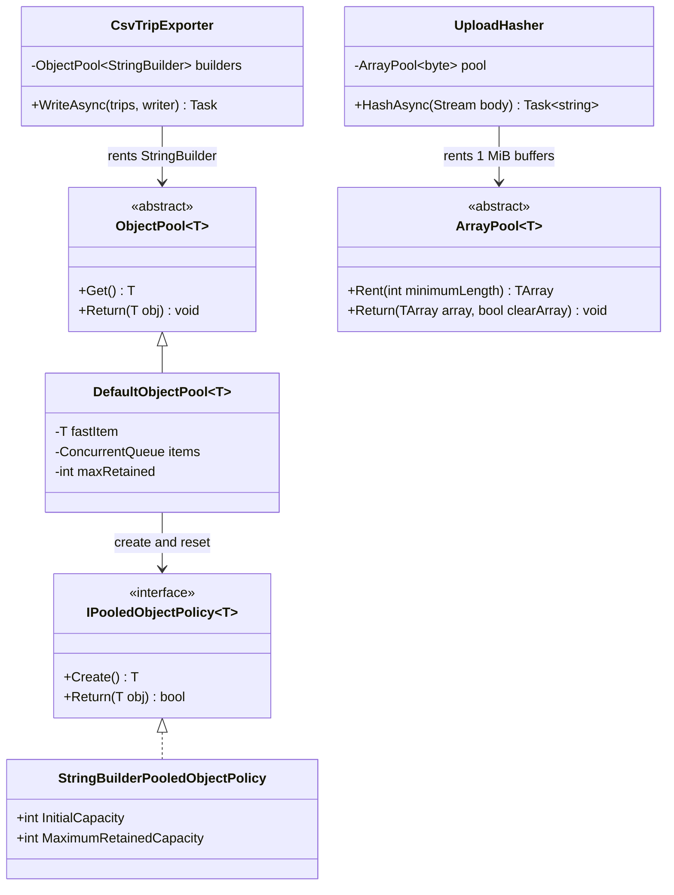
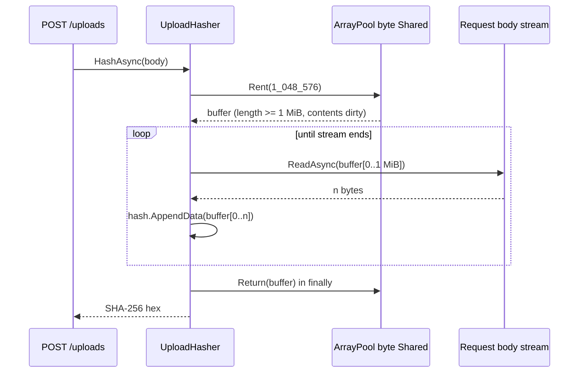

Object Pool isn't one of the original 23 GoF patterns, but you use it every day in .NET without seeing it. Every database connection your app opens comes from a pool. Every `HttpClient` from `IHttpClientFactory` reuses pooled handlers. Kestrel itself rents memory from pools to read requests. This lesson explains how pools work, how to use the ones .NET gives you, and why writing your own pool is usually a mistake.

## Learning objectives

By the end of this lesson you will be able to:

1. Explain the problem an object pool solves, and the two kinds of cost it saves: allocation (memory and garbage collection) and setup (handshakes, connections).
2. Name the participants (pool, pooled object, policy, client) and the rent → use → reset → return lifecycle.
3. Use `ArrayPool<T>` correctly, including its two traps: oversized arrays and dirty contents.
4. Use `Microsoft.Extensions.ObjectPool` with a custom `PooledObjectPolicy<T>` and `IResettable`.
5. Explain DbContext pooling, ADO.NET/Npgsql connection pooling and `IHttpClientFactory` handler pooling, and configure each.
6. Recognise when pooling hurts: data leaking between requests, use-after-return bugs, GC side effects and lock contention.
7. Build a bounded asynchronous pool that waits, honours cancellation and replaces broken resources.

## Prerequisites

- [Value types, reference types and memory basics](#/lesson/m01-value-reference-memory): you need the idea of the heap and of the garbage collector (GC) freeing unused objects.
- [Singleton, scoped and transient services](#/lesson/m03-service-lifetimes): pools are singletons, and the objects they lend out behave like short-lived scopes.
- [Asynchronous programming with async/await](#/lesson/m03-async-await): used in the advanced exercise.

## Explain it like I'm a beginner

Think of the trolleys at a big supermarket in Bengaluru. The shop doesn't build a new trolley for every customer and crush it at the exit. It keeps, say, 200 trolleys. You **take** one at the entrance, **use** it, and **return** it to the bay. A staff member **checks** it (removes leftover receipts, sets aside one with a broken wheel), and it goes back into the line for the next customer.

That is an object pool:

- The trolley bay is the **pool**.
- A trolley is the **pooled object**.
- Taking one is **renting** (or "getting"). Putting it back is **returning**.
- Removing the old receipt is **resetting**, so the next customer doesn't get your shopping list.
- Retiring a broken trolley is **validation**: a pool must not hand out broken objects.
- If all 200 are out, the shop either makes you **wait**, or brings out an extra trolley that's thrown away later (the pool **grows** but keeps only a maximum).

Why bother? Because making a trolley is slow and expensive compared with reusing one. In software, "expensive to make" means one of two things:

1. **Big memory blocks.** Allocating a 1 MB buffer for every file upload makes the garbage collector work hard.
2. **Slow setup.** Opening a database connection involves a network round trip, a TLS handshake and authentication. That can take tens of milliseconds, while running a simple query on an already-open connection can take one millisecond or less.

And the warning: if staff forget to remove the old receipt, the next customer sees your shopping list. In software, a pooled buffer that isn't cleared can leak one user's data into another user's response. Pools make reset your responsibility.

## First-principles explanation

### The original problem

Some objects cost far more to *create* than to *use*:

- **Resource-holding objects**: database connections, TCP sockets, TLS sessions, threads. Creation involves the operating system or the network.
- **Large buffers**: arrays of tens of kilobytes or more. In .NET, objects of 85,000 bytes or larger go on the **Large Object Heap (LOH)**, which is only collected with full (generation 2) collections. Allocating a fresh 1 MB array per request creates exactly the garbage that is most expensive to collect.
- **Objects with heavy initialisation**: compiled regular expressions, parsers with lookup tables, serializers with caches.

If a hot path creates and throws away such objects thousands of times per second, the creation cost dominates. The pool's idea: **keep finished objects and hand them out again**.

### How it works internally

Every pool has the same lifecycle:

1. **Rent.** The client asks the pool for an object. If an idle one is available, the pool returns it. Otherwise it either *creates* a new one (unbounded growth with a retention cap) or *waits* until one is returned (a bounded pool).
2. **Use.** The client has exclusive use of the object. Nobody else holds it.
3. **Reset.** On return, the pool (through a policy) puts the object back into a clean state: clears a `StringBuilder`, zeroes a buffer, rolls back an open transaction.
4. **Validate.** The pool may decide not to keep it: it's too big, broken or too old. It is then dropped (and disposed, if it is `IDisposable`).
5. **Return.** A clean, valid object goes back to the idle set.

Two numbers define a pool's behaviour. **Maximum retained** is how many idle objects it keeps. **Maximum total** (for bounded pools) is how many can be out at once. `Microsoft.Extensions.ObjectPool`'s default pool keeps up to `Environment.ProcessorCount * 2` idle objects and never blocks. Npgsql's connection pool defaults to a maximum of 100 connections and makes callers wait (up to a timeout) when all are busy.

### The simplest implementation

```csharp
public sealed class SimplePool<T>(Func<T> create, Action<T> reset, int maxRetained) where T : class
{
    private readonly ConcurrentBag<T> _items = new();
    public T Rent() => _items.TryTake(out var item) ? item : create();
    public void Return(T item)
    {
        reset(item);
        if (_items.Count < maxRetained) _items.Add(item);   // otherwise let the GC have it
    }
}
```

Ten lines, and it already contains the four decisions every pool makes: where idle objects live, what to do when empty (create), how to reset, and how many to keep. (The `Count` check is slightly racy under concurrency. A few extra items might be kept, which is harmless here.) Exercise 1 asks you to build a stricter version.

### Participants

| Participant | Role | .NET example |
|---|---|---|
| **Pool** | Stores idle objects; rents and returns them | `ArrayPool<T>`, `ObjectPool<T>`, Npgsql's connection pool |
| **Pooled object** | The reusable thing | `byte[]`, `StringBuilder`, `NpgsqlConnector`, `HttpMessageHandler` |
| **Policy** | Knows how to create, reset and validate | `PooledObjectPolicy<T>`, `IResettable` |
| **Client** | Rents, uses briefly, returns, then never touches it again | Your service code |

### What .NET gives you

**`ArrayPool<T>`** (in `System.Buffers`). `ArrayPool<byte>.Shared` is a process-wide, thread-safe pool of arrays bucketed by size. Its rules:

- `Rent(n)` returns an array of length **at least** `n`, often larger (`Rent(100)` typically returns 128 elements). Always track how much you actually use.
- The array's contents are **not** cleared. It may contain someone else's bytes.
- `Return(array, clearArray: true)` zeroes it first. Use that for anything sensitive (tokens, personal data).
- After `Return`, you must never touch the array again, and you must never return it twice.
- If you forget to return, nothing crashes. The array is simply garbage-collected, and you lose the benefit.

**`Microsoft.Extensions.ObjectPool`** (part of the ASP.NET Core shared framework). `ObjectPool<T>` has `Get()` and `Return(T)`. `DefaultObjectPoolProvider` creates pools from a `PooledObjectPolicy<T>` that decides `Create()` and `Return(obj)` (return `false` to drop the object). If `T` implements `IResettable` (.NET 8+), the default policy calls `TryReset()` on return. If `T` is `IDisposable`, the provider creates a pool that disposes objects it drops. There is a ready-made `StringBuilder` policy that refuses to keep builders that grew past a maximum capacity.

**Connection pooling.** ADO.NET providers, including Npgsql for PostgreSQL, pool physical connections. `new NpgsqlConnection(cs)` plus `OpenAsync()` usually *rents* an already-open physical connection. `Dispose()` returns it. So the correct pattern is "open late, close early", per operation. See [Database connection pooling](#/lesson/m09-connection-pooling).

**DbContext pooling** (EF Core). `AddDbContextPool<AppDb>(...)` keeps up to 1,024 `DbContext` instances by default. At the end of each request scope, EF resets the context's change tracker and returns it, instead of constructing a new context (with its internal service lookups) next time. More on its catch below.

**`IHttpClientFactory`**. The expensive part of `HttpClient` is its handler (`SocketsHttpHandler`), which owns a pool of TCP/TLS connections. The factory pools handlers and *rotates* them: by default each handler lives 2 minutes before new clients get a fresh one, so DNS changes are picked up. `HttpClient` objects themselves are cheap wrappers, so the factory creates a new one each time.

### When it is useful

- Profiling shows allocation or GC time on a hot path, especially LOH allocations of large buffers.
- The object holds a costly resource (connection, socket, handler) that can be safely reused after a reset.
- The object is large or has expensive initialisation, *and* is used briefly and frequently.
- You need to cap concurrent use of a scarce resource (for example, at most 10 licensed sessions to a legacy system). A bounded pool doubles as a throttle.

### When pooling hurts

This list is longer than the "useful" list on purpose.

1. **Small, short-lived objects.** Allocating a small object in .NET's generation 0 is a pointer bump, and objects that die young are collected cheaply. A pool for `OrderDto` objects adds locking, resetting and bugs, and usually makes code *slower*.
2. **It changes GC behaviour.** Pooled objects live forever, so they get promoted to generation 2. A gen-2 object that references fresh objects costs the GC extra bookkeeping. Pools that retain thousands of large items also raise your steady memory use.
3. **Data leaks between users.** Forgetting to clear a buffer or a field means request B can see request A's data. This is a security bug, not just a correctness bug.
4. **Use-after-return.** A client keeps a reference after returning the object, and two requests then write into the same buffer. These bugs are intermittent and hard to reproduce.
5. **Double return.** The same object goes into the pool twice and is handed to two clients at once.
6. **Contention.** A pool guarded by one lock becomes a queue under high concurrency. Good pools (like `ArrayPool.Shared`) use per-core or thread-local storage to avoid this.
7. **Stale or broken resources.** Pooled connections can be cut by a firewall or a database failover. Pools need validation and maximum lifetimes.

**Rule:** don't write a pool because something "feels expensive". Measure first (BenchmarkDotNet for micro-benchmarks, `dotnet-counters` for GC and allocation rates in a running app), use the built-in pools, and write your own only for resources .NET doesn't already pool.

### Trade-offs

| You gain | You pay |
|---|---|
| Fewer allocations and GC pauses on hot paths | Reset logic that must be perfect, or data leaks |
| Avoid repeated expensive setup (handshakes) | Objects live longer, so memory use rises |
| A natural cap on concurrent use of scarce resources | Use-after-return and double-return bugs |
| Predictable latency under load | More code, harder debugging, possible contention |

## Visual explanation

### Class diagram



How to read it: there are two independent pool families here. On the left, `ObjectPool<T>` is the abstraction your code depends on, `DefaultObjectPool<T>` is the implementation, and it delegates "how to make one" and "is it fit to keep" to a policy. `CsvTripExporter` only knows the abstract `ObjectPool<StringBuilder>`, which keeps it testable with a fake pool. On the right, `UploadHasher` depends on the abstract `ArrayPool<byte>`. In production we inject `ArrayPool<byte>.Shared`, and in tests a tracking pool that checks every rented array comes back.

### Sequence diagram



The important details are in the arrows. The buffer comes back "length at least 1 MiB, contents dirty", so the code only ever uses `buffer[0..n]`, the bytes it actually read. The return happens in a `finally` block, so a client that disconnects mid-upload (which throws) still returns the buffer. Without the pool, each concurrent upload would allocate a fresh 1 MiB array on the Large Object Heap.

## Step-by-step example

Scenario: a construction-fleet platform. Site supervisors upload drone photos (5–20 MB each), and the API stores a SHA-256 hash for integrity. Managers download a CSV of vehicle trips (dumpers, excavators) for billing.

### Step 1 — the naive version

```csharp
app.MapPost("/uploads", async (HttpRequest req) =>
{
    var buffer = new byte[1024 * 1024];                  // 1 MiB on the LOH, per request
    using var sha = IncrementalHash.CreateHash(HashAlgorithmName.SHA256);
    int n;
    while ((n = await req.Body.ReadAsync(buffer)) > 0) sha.AppendData(buffer, 0, n);
    return Convert.ToHexString(sha.GetHashAndReset());
});
```

Correct, and fine at 5 uploads per minute. At 200 concurrent uploads it allocates 200 MiB of LOH arrays that only full GCs reclaim.

### Step 2 — measure

Before changing anything, run a load test and watch `dotnet-counters monitor System.Runtime` for "Gen 2 GC count", "LOH size" and "Allocation rate". If those stay flat, stop here. Pooling would add risk for no gain.

### Step 3 — rent instead of allocate

Replace `new byte[...]` with `ArrayPool<byte>.Shared.Rent(...)`. Return it in `finally`, and use only the bytes read.

### Step 4 — make it injectable and testable

Inject `ArrayPool<byte>` instead of reaching for `.Shared` directly, so a test can verify that every rented buffer is returned. Do the same for the CSV exporter's `StringBuilder` pool.

## Production-style C# implementation

```text
Fleet.Api/
  Program.cs
  Uploads/UploadHasher.cs
  Trips/Trip.cs
  Trips/CsvTripExporter.cs
  Routing/RoutingClient.cs
```

```csharp file=Uploads/UploadHasher.cs
using System.Buffers;
using System.Security.Cryptography;

namespace Fleet.Uploads;

/// <summary>Hashes large uploads with a pooled buffer instead of allocating 1 MiB per request.</summary>
public sealed class UploadHasher(ArrayPool<byte> pool)
{
    public const int BufferSize = 1024 * 1024;   // above the 85,000-byte LOH threshold, so worth pooling

    public async Task<(string Sha256Hex, long Bytes)> HashAsync(Stream body, CancellationToken ct)
    {
        ArgumentNullException.ThrowIfNull(body);
        var buffer = pool.Rent(BufferSize);   // may be LARGER than BufferSize and contains old data
        try
        {
            using var hash = IncrementalHash.CreateHash(HashAlgorithmName.SHA256);
            long total = 0;
            int read;
            while ((read = await body.ReadAsync(buffer.AsMemory(0, BufferSize), ct)) > 0)
            {
                hash.AppendData(buffer, 0, read);   // only the bytes we actually read
                total += read;
            }
            return (Convert.ToHexString(hash.GetHashAndReset()), total);
        }
        finally
        {
            // Uploads may contain personal data: clear before another request can rent it.
            pool.Return(buffer, clearArray: true);
        }
    }
}
```

```csharp file=Trips/Trip.cs
namespace Fleet.Trips;

public sealed record Trip(string VehicleId, string Site, DateTimeOffset Start, DateTimeOffset End, decimal DistanceKm, decimal LoadTonnes);

public interface ITripReader
{
    IAsyncEnumerable<Trip> ReadAsync(DateOnly from, DateOnly to, CancellationToken ct);
}

/// <summary>Stand-in for a PostgreSQL-backed reader that streams rows.</summary>
public sealed class SampleTripReader : ITripReader
{
    public async IAsyncEnumerable<Trip> ReadAsync(DateOnly from, DateOnly to,
        [System.Runtime.CompilerServices.EnumeratorCancellation] CancellationToken ct)
    {
        var start = new DateTimeOffset(from.ToDateTime(TimeOnly.MinValue), TimeSpan.FromHours(5.5));
        for (var i = 0; i < 2_000; i++)
        {
            ct.ThrowIfCancellationRequested();
            yield return new Trip($"DMP-{i % 40:D3}", i % 3 == 0 ? "Package 2, Km 18" : "Batching plant, Sector 7",
                start.AddMinutes(i * 7), start.AddMinutes(i * 7 + 42), 6.4m + i % 5, 18.5m);
            if (i % 500 == 0) await Task.Yield();
        }
    }
}
```

```csharp file=Trips/CsvTripExporter.cs
using System.Globalization;
using System.Text;
using Microsoft.Extensions.ObjectPool;

namespace Fleet.Trips;

/// <summary>Streams trips as CSV. Rows are batched into a pooled StringBuilder so we don't
/// allocate a new builder (and its growing internal chunks) for every export.</summary>
public sealed class CsvTripExporter(ObjectPool<StringBuilder> builders, ITripReader reader)
{
    private const int RowsPerFlush = 500;

    public async Task WriteAsync(DateOnly from, DateOnly to, TextWriter output, CancellationToken ct)
    {
        var sb = builders.Get();
        try
        {
            sb.AppendLine("vehicle_id,site,start,end,distance_km,load_tonnes");
            var rows = 0;
            await foreach (var t in reader.ReadAsync(from, to, ct))
            {
                AppendField(sb, t.VehicleId).Append(',');
                AppendField(sb, t.Site).Append(',');
                sb.Append(t.Start.ToString("O", CultureInfo.InvariantCulture)).Append(',')
                  .Append(t.End.ToString("O", CultureInfo.InvariantCulture)).Append(',')
                  .Append(t.DistanceKm.ToString(CultureInfo.InvariantCulture)).Append(',')
                  .Append(t.LoadTonnes.ToString(CultureInfo.InvariantCulture)).AppendLine();
                if (++rows % RowsPerFlush == 0)
                {
                    await output.WriteAsync(sb, ct);
                    sb.Clear();
                }
            }
            await output.WriteAsync(sb, ct);
            await output.FlushAsync(ct);
        }
        finally
        {
            builders.Return(sb);   // the policy clears it, and drops it if it grew too large
        }
    }

    private static StringBuilder AppendField(StringBuilder sb, string value)
    {
        if (value.AsSpan().IndexOfAny(",\"\n\r") < 0) return sb.Append(value);
        return sb.Append('"').Append(value.Replace("\"", "\"\"")).Append('"');
    }
}
```

```csharp file=Routing/RoutingClient.cs
using System.Net.Http.Json;

namespace Fleet.Routing;

public sealed record RouteEstimate(decimal DistanceKm, int DurationMinutes);

/// <summary>Typed client. IHttpClientFactory gives it a new, cheap HttpClient each time,
/// backed by a pooled, periodically rotated HttpMessageHandler (connection pool).</summary>
public sealed class RoutingClient(HttpClient http)
{
    public async Task<RouteEstimate?> EstimateAsync(double fromLat, double fromLon, double toLat, double toLon, CancellationToken ct)
    {
        var url = FormattableString.Invariant($"v1/route?from={fromLat},{fromLon}&to={toLat},{toLon}");
        return await http.GetFromJsonAsync<RouteEstimate>(url, ct);
    }
}
```

```csharp file=Program.cs
using System.Buffers;
using System.Text;
using Fleet.Routing;
using Fleet.Trips;
using Fleet.Uploads;
using Microsoft.Extensions.ObjectPool;

var builder = WebApplication.CreateBuilder(args);

// Pools are singletons: one shared set of idle objects for the whole process.
builder.Services.AddSingleton(ArrayPool<byte>.Shared);
builder.Services.AddSingleton<ObjectPoolProvider, DefaultObjectPoolProvider>();
builder.Services.AddSingleton(sp => sp.GetRequiredService<ObjectPoolProvider>()
    .CreateStringBuilderPool(initialCapacity: 16 * 1024, maximumRetainedCapacity: 256 * 1024));

builder.Services.AddSingleton<UploadHasher>();
builder.Services.AddSingleton<ITripReader, SampleTripReader>();
builder.Services.AddSingleton<CsvTripExporter>();

// Handler pooling and rotation: never "new HttpClient()" per call.
builder.Services.AddHttpClient<RoutingClient>(c =>
{
    c.BaseAddress = new Uri("https://routing.example.com/");
    c.Timeout = TimeSpan.FromSeconds(10);
}).SetHandlerLifetime(TimeSpan.FromMinutes(5));

var app = builder.Build();

app.MapPost("/uploads", async (HttpRequest request, UploadHasher hasher, CancellationToken ct) =>
{
    var (sha, bytes) = await hasher.HashAsync(request.Body, ct);
    return Results.Ok(new { sha256 = sha, bytes });
});

app.MapGet("/trips.csv", async (DateOnly from, DateOnly to, CsvTripExporter exporter, HttpResponse response, CancellationToken ct) =>
{
    response.ContentType = "text/csv; charset=utf-8";
    await using var writer = new StreamWriter(response.Body, new UTF8Encoding(false));
    await exporter.WriteAsync(from, to, writer, ct);
});

app.Run();
```

### DbContext pooling (EF Core)

EF Core isn't part of this lesson's compiled project, so here is the configuration as a snippet:

```csharp
// Instead of AddDbContext<FleetDb>(...):
builder.Services.AddDbContextPool<FleetDb>(o => o.UseNpgsql(cs), poolSize: 256);

// For background workers or Blazor, a pooled factory:
builder.Services.AddPooledDbContextFactory<FleetDb>(o => o.UseNpgsql(cs));
// await using var db = await factory.CreateDbContextAsync(ct);   // rented; disposed = returned
```

The catch: a pooled context is constructed **once** and reused across requests, so it must not hold per-request state in its own fields. A classic bug is a multi-tenant `FleetDb` with a `TenantId` field set from the current request in the constructor. With pooling, the constructor doesn't run again, and request B can query with request A's tenant. EF Core resets its *own* state (change tracker and its settings), not your custom fields. The documented fix is to keep the pooled factory as a singleton and set the tenant on each rented context from a scoped wrapper. Also note that `AddDbContextPool` only helps when context creation is a measurable cost. For many apps the gain is small, so measure.

### Npgsql connection pooling

You don't pool `NpgsqlConnection` yourself. Npgsql already pools physical connections per connection string (`Maximum Pool Size`, default 100; `Connection Idle Lifetime`; `Connection Lifetime` to recycle connections after a failover). Write `await using var conn = await dataSource.OpenConnectionAsync(ct);` per operation. Holding a connection for a whole request, or across `await` calls to slow external APIs, starves the pool. Tune pool size against PostgreSQL's `max_connections` across *all* app instances: 8 instances × 100 = 800 potential connections, far above a typical server's comfortable limit. Use PgBouncer if you need more. That's why the [connection pooling lesson](#/lesson/m09-connection-pooling) treats pool size as a capacity-planning decision.

### HttpClient: what's actually pooled

| Approach | What happens |
|---|---|
| `new HttpClient()` per call, disposed | Each call creates a handler with its own connection pool. Closed sockets linger in TIME_WAIT, and under load you can exhaust ephemeral ports |
| One static `HttpClient` forever | Connections are reused (good), but DNS changes are never noticed unless you set `SocketsHttpHandler.PooledConnectionLifetime` (for example, 2 minutes) |
| `IHttpClientFactory` | Pools and rotates handlers (default 2-minute lifetime), integrates with DI, logging and resilience handlers. The recommended default in ASP.NET Core |

## Bad design vs good design

**Bad**: a hand-written pool for DTOs, plus a pooled buffer that leaks.

```csharp
public static class Pools
{
    public static readonly ConcurrentBag<TripDto> Dtos = new();          // pooling 80-byte objects: pointless
    public static readonly ConcurrentBag<byte[]> Buffers = new();
}

public async Task<byte[]> ReadAsync(Stream s)
{
    if (!Pools.Buffers.TryTake(out var buf)) buf = new byte[64 * 1024];
    var n = await s.ReadAsync(buf);
    Pools.Buffers.Add(buf);                 // returned while still in use below...
    return buf[..n];                        // ...and never cleared: next caller sees old bytes beyond n
}
```

Problems:

- The DTO pool saves nothing. The GC handles small short-lived objects cheaply, and now every DTO lives forever.
- The buffer is returned *before* its last use. Another request can rent it and overwrite it in between: a use-after-return race.
- The buffer is never cleared, and `ConcurrentBag` has no size limit, so memory only ever grows.
- Static pools can't be replaced in tests.

**Good**: the implementation above. Use the built-in `ArrayPool<byte>.Shared` (bucketed, thread-local caches, bounded), return in `finally` after the last use, and clear when the data is sensitive. Use `ObjectPool<StringBuilder>` with a capacity cap. Inject pools so tests can verify rent/return balance. Don't pool small objects at all.

:::callout type=warning title="Pooled buffers leak data"
`ArrayPool.Rent` returns arrays with old contents. If you serialise "the whole buffer" instead of "the bytes I wrote", you may send another user's data. Always track the length you used, and pass `clearArray: true` when the contents are sensitive.
:::

:::callout type=tradeoff title="Pool size is a capacity decision"
A bounded pool caps concurrency. That protects a fragile downstream system, but if the cap is too low, requests queue and latency rises. If it's too high, you overload the downstream. Decide the size from the downstream's limits (for example PostgreSQL `max_connections` divided by instance count), not from guesswork.
:::

## Practical playground

Run this and read the output carefully. Then change `Rent(100)` to `Rent(1000)` and observe the length. Comment out the `Clear` call in the policy and watch dirty data appear.

:::playground type=csharp title="ArrayPool and ObjectPool behaviour"
```csharp file=Program.cs
using System;
using System.Buffers;
using System.Text;
using Microsoft.Extensions.ObjectPool;

public sealed class ClearingPolicy : PooledObjectPolicy<StringBuilder>
{
    public override StringBuilder Create() { Console.WriteLine("  (policy) creating new StringBuilder"); return new StringBuilder(64); }
    public override bool Return(StringBuilder sb)
    {
        if (sb.Capacity > 1024) { Console.WriteLine("  (policy) too big, dropping"); return false; }
        sb.Clear();
        return true;
    }
}

public static class Program
{
    public static void Main()
    {
        var a = ArrayPool<byte>.Shared.Rent(100);
        Console.WriteLine($"Asked for 100 bytes, got {a.Length}");
        a[0] = 42;
        ArrayPool<byte>.Shared.Return(a);              // not cleared
        var b = ArrayPool<byte>.Shared.Rent(100);
        Console.WriteLine($"Same array again? {ReferenceEquals(a, b)}; b[0] = {b[0]} (old data!)");
        ArrayPool<byte>.Shared.Return(b, clearArray: true);

        var pool = new DefaultObjectPool<StringBuilder>(new ClearingPolicy(), maximumRetained: 4);
        var sb1 = pool.Get();
        sb1.Append("Km 12+400");
        pool.Return(sb1);
        var sb2 = pool.Get();
        Console.WriteLine($"Reused builder? {ReferenceEquals(sb1, sb2)}; length after reset = {sb2.Length}");
        sb2.Append(new string('x', 5000));
        pool.Return(sb2);
        var sb3 = pool.Get();
        Console.WriteLine($"Got the oversized one back? {ReferenceEquals(sb2, sb3)}");
    }
}
```
:::

`ArrayPool.Shared` typically rounds requests up to a power of two, so asking for 100 bytes usually gets 128. The second `Rent` on the same thread usually returns the same array, still holding `42`. That shows the dirty-data rule in action. The object pool reuses the builder after clearing it, but drops the one that grew to 5,000 characters. That retention cap stops one huge export from keeping megabytes alive forever.

## Exercises

:::exercise id=m06-object-pool-ex1 difficulty=beginner kind=code title="Build a minimal thread-safe pool"
Implement `SimplePool<T>`: a pool that creates objects on demand, resets them on return, and keeps at most `maxRetained` idle objects.
::requirements
- `Rent()` returns an idle object if one exists, otherwise calls the factory.
- `Return(item)` calls the reset action, then keeps the item only if fewer than `maxRetained` are idle. Otherwise it drops it.
- `Created` counts factory calls. `Retained` is the current idle count.
- Safe for concurrent use. `Retained` must never exceed `maxRetained`.
::acceptance
- Rent, return, rent gives back the same instance, with `Created == 1`.
- The reset action runs on every return.
- With `maxRetained: 2`, returning 3 objects leaves `Retained == 2`.
- 10,000 parallel rent/return pairs complete without exceptions, and `Retained <= maxRetained`.
::hint
Where do idle objects live, and what protects them from two threads at once?
::hint
A `Stack<T>` plus a `lock` is the simplest correct choice. Last-returned, first-rented also keeps "warm" objects in use.
::hint
Do the "count < max, then push" check inside the same lock, or two threads can both pass the check.
::hint
Use `Interlocked.Increment(ref _created)` for the counter, because the factory call can happen outside the lock.
::starter
```csharp file=SimplePool.cs
using System;
using System.Collections.Generic;
using System.Threading;

public sealed class SimplePool<T> where T : class
{
    public SimplePool(Func<T> factory, Action<T>? reset = null, int maxRetained = 8)
    {
        throw new NotImplementedException();
    }

    public int Created => throw new NotImplementedException();
    public int Retained => throw new NotImplementedException();

    public T Rent() => throw new NotImplementedException();
    public void Return(T item) => throw new NotImplementedException();
}
```
::tests
```csharp file=SimplePoolTests.cs
using System.Collections.Generic;
using System.Text;
using System.Threading.Tasks;
using Xunit;

public class SimplePoolTests
{
    [Fact]
    public void Reuses_returned_instance()
    {
        var pool = new SimplePool<StringBuilder>(() => new StringBuilder());
        var a = pool.Rent();
        pool.Return(a);
        var b = pool.Rent();
        Assert.Same(a, b);
        Assert.Equal(1, pool.Created);
    }

    [Fact]
    public void Resets_on_return()
    {
        var pool = new SimplePool<StringBuilder>(() => new StringBuilder(), sb => sb.Clear());
        var a = pool.Rent();
        a.Append("secret");
        pool.Return(a);
        Assert.Equal(0, pool.Rent().Length);
    }

    [Fact]
    public void Keeps_at_most_max_retained()
    {
        var pool = new SimplePool<List<int>>(() => new List<int>(), maxRetained: 2);
        var items = new[] { pool.Rent(), pool.Rent(), pool.Rent() };
        Assert.Equal(3, pool.Created);
        foreach (var i in items) pool.Return(i);
        Assert.Equal(2, pool.Retained);
    }

    [Fact]
    public void Creates_when_empty()
    {
        var pool = new SimplePool<object>(() => new object());
        Assert.NotSame(pool.Rent(), pool.Rent());
        Assert.Equal(2, pool.Created);
        Assert.Equal(0, pool.Retained);
    }

    [Fact]
    public void Parallel_use_is_safe()
    {
        var pool = new SimplePool<StringBuilder>(() => new StringBuilder(), sb => sb.Clear(), maxRetained: 4);
        Parallel.For(0, 10_000, i =>
        {
            var sb = pool.Rent();
            sb.Append(i);
            pool.Return(sb);
        });
        Assert.InRange(pool.Retained, 0, 4);
        Assert.True(pool.Created >= 1);
    }
}
```
::solution
```csharp file=SimplePool.cs
using System;
using System.Collections.Generic;
using System.Threading;

public sealed class SimplePool<T> where T : class
{
    private readonly Func<T> _factory;
    private readonly Action<T>? _reset;
    private readonly int _maxRetained;
    private readonly Stack<T> _idle = new();
    private readonly Lock _gate = new();   // C# 13 / .NET 9+ lock type
    private int _created;

    public SimplePool(Func<T> factory, Action<T>? reset = null, int maxRetained = 8)
    {
        ArgumentNullException.ThrowIfNull(factory);
        ArgumentOutOfRangeException.ThrowIfNegative(maxRetained);
        _factory = factory;
        _reset = reset;
        _maxRetained = maxRetained;
    }

    public int Created => Volatile.Read(ref _created);
    public int Retained { get { lock (_gate) return _idle.Count; } }

    public T Rent()
    {
        lock (_gate)
        {
            if (_idle.Count > 0) return _idle.Pop();
        }
        Interlocked.Increment(ref _created);
        return _factory();   // outside the lock: creation may be slow
    }

    public void Return(T item)
    {
        ArgumentNullException.ThrowIfNull(item);
        _reset?.Invoke(item);   // outside the lock too
        lock (_gate)
        {
            if (_idle.Count < _maxRetained) _idle.Push(item);
        }
    }
}
```

The factory and the reset run outside the lock, so a slow creation doesn't block other threads. Only the stack operations are serialised. That keeps the critical section to a few nanoseconds.
::mistakes
- Checking `_idle.Count < max` outside the lock and pushing inside it. Two threads can both pass the check.
- Calling the factory inside the lock. Every `Rent` then waits behind a slow creation.
- Forgetting to reset, which leaks the previous user's data (the `Resets_on_return` test).
::extensions
Add `Func<T, bool> validate` so broken objects are discarded on return. If `T` is `IDisposable`, dispose dropped objects.
:::

:::exercise id=m06-object-pool-ex2 difficulty=beginner kind=code title="Use ArrayPool without the two classic bugs"
Implement `NewlineCounter.Count(stream, pool, bufferSize)`, which counts `\n` bytes in a stream using a buffer rented from the injected `ArrayPool<byte>`. The test pool deliberately returns arrays that are **bigger than requested** and **full of old newline bytes**, just like the real one can.
::requirements
- Rent exactly one buffer of at least `bufferSize` and use only the bytes actually read each time.
- Read at most `bufferSize` bytes per call, even if the array is larger.
- Return the buffer exactly once, even if the stream throws.
::acceptance
- `"a\nb\nc"` gives 2, even though the rented array is pre-filled with newlines.
- 10,000 lines read with a 64-byte buffer give 10,000.
- When the stream throws `IOException`, the exception propagates and the buffer is still returned.
- After every call, rented count equals returned count.
::hint
`Stream.Read` returns how many bytes it put into the buffer. That number, not `buffer.Length`, tells you which bytes are real.
::hint
Wrap the read loop in `try`/`finally`, with `pool.Return(buffer)` in the `finally`.
::hint
`buffer.AsSpan(0, read).Count((byte)'\n')` counts only the valid part. `MemoryExtensions.Count` exists in .NET 8+.
::hint
```text
buffer = pool.Rent(bufferSize)
try: while (read = stream.Read(buffer, 0, bufferSize)) > 0: count += newlines in buffer[0..read]
finally: pool.Return(buffer)
```
::starter
```csharp file=NewlineCounter.cs
using System;
using System.Buffers;
using System.IO;

public static class NewlineCounter
{
    public static long Count(Stream stream, ArrayPool<byte> pool, int bufferSize = 4096) =>
        throw new NotImplementedException();
}
```
::tests
```csharp file=NewlineCounterTests.cs
using System;
using System.Buffers;
using System.IO;
using System.Text;
using Xunit;

/// <summary>Hands out oversized arrays full of '\n' to expose length bugs, and tracks rent/return balance.</summary>
public sealed class DirtyTrackingPool : ArrayPool<byte>
{
    public int Rented { get; private set; }
    public int Returned { get; private set; }

    public override byte[] Rent(int minimumLength)
    {
        Rented++;
        var a = new byte[minimumLength * 2];
        Array.Fill(a, (byte)'\n');
        return a;
    }

    public override void Return(byte[] array, bool clearArray = false) => Returned++;
}

public sealed class FailingStream : MemoryStream
{
    private int _calls;
    public FailingStream(byte[] data) : base(data) { }
    public override int Read(byte[] buffer, int offset, int count) => ++_calls > 1 ? throw new IOException("network dropped") : base.Read(buffer, offset, count);
    public override int Read(Span<byte> buffer) => ++_calls > 1 ? throw new IOException("network dropped") : base.Read(buffer);
}

public class NewlineCounterTests
{
    private static MemoryStream S(string text) => new(Encoding.UTF8.GetBytes(text));

    [Fact]
    public void Counts_only_bytes_read()
    {
        var pool = new DirtyTrackingPool();
        Assert.Equal(2L, NewlineCounter.Count(S("a\nb\nc"), pool, 4096));
    }

    [Fact]
    public void Respects_buffer_size_over_many_reads()
    {
        var sb = new StringBuilder();
        for (var i = 0; i < 10_000; i++) sb.Append("ping,").Append(i).Append('\n');
        var pool = new DirtyTrackingPool();
        Assert.Equal(10_000L, NewlineCounter.Count(S(sb.ToString()), pool, 64));
        Assert.Equal(1, pool.Rented);
    }

    [Fact]
    public void Returns_buffer_exactly_once()
    {
        var pool = new DirtyTrackingPool();
        NewlineCounter.Count(S("x\n"), pool, 16);
        Assert.Equal(1, pool.Rented);
        Assert.Equal(1, pool.Returned);
    }

    [Fact]
    public void Returns_buffer_when_stream_throws()
    {
        var pool = new DirtyTrackingPool();
        var data = Encoding.UTF8.GetBytes(new string('a', 100));
        Assert.Throws<IOException>(() => NewlineCounter.Count(new FailingStream(data), pool, 16));
        Assert.Equal(pool.Rented, pool.Returned);
    }
}
```
::solution
```csharp file=NewlineCounter.cs
using System;
using System.Buffers;
using System.IO;

public static class NewlineCounter
{
    public static long Count(Stream stream, ArrayPool<byte> pool, int bufferSize = 4096)
    {
        ArgumentNullException.ThrowIfNull(stream);
        ArgumentNullException.ThrowIfNull(pool);
        ArgumentOutOfRangeException.ThrowIfNegativeOrZero(bufferSize);

        var buffer = pool.Rent(bufferSize);
        try
        {
            long count = 0;
            int read;
            while ((read = stream.Read(buffer, 0, bufferSize)) > 0)
                count += buffer.AsSpan(0, read).Count((byte)'\n');
            return count;
        }
        finally
        {
            pool.Return(buffer);
        }
    }
}
```

Two numbers matter: `bufferSize` (how much you *asked* to use) and `read` (how much is *valid* this time). `buffer.Length` is neither of them.
::mistakes
- `stream.Read(buffer)` with the whole array. Correct for counting here, but it breaks the "use at most `bufferSize`" contract, and in other code it hides the oversized-array assumption.
- Counting over `buffer` instead of `buffer[..read]`. The dirty pool turns this into a wrong answer.
- Returning the buffer inside the loop or before the last use.
::extensions
Write an async version with `ReadAsync(Memory<byte>, CancellationToken)`. Note that `Span<T>` can't live across an `await`, so use `Memory<T>` or compute the count before awaiting.
:::

:::exercise id=m06-object-pool-ex3 difficulty=intermediate kind=code title="A StringBuilder policy with a retention cap"
Write `BoundedStringBuilderPolicy` for `Microsoft.Extensions.ObjectPool`, and a `CsvLineFormatter` that uses an injected `ObjectPool<StringBuilder>` to format CSV lines.
::requirements
- `Create()` returns a builder with at least the configured initial capacity.
- `Return(sb)` returns `false` (drop) when `sb.Capacity` exceeds the maximum retained capacity. Otherwise it clears the builder and returns `true`.
- `CsvLineFormatter.Format(fields)` joins fields with commas, quotes fields containing a comma, quote, CR or LF, and doubles embedded quotes.
- `Format` always returns the builder to the pool, exactly once per call.
::acceptance
- A small builder is reused and comes back empty.
- A builder that grew past the cap is not reused.
- `["NH-48", "Dumper, 10T", "He said \"stop\""]` formats as `NH-48,"Dumper, 10T","He said ""stop"""`.
- Three `Format` calls result in three `Get` and three `Return` calls on the pool.
::hint
`PooledObjectPolicy<T>` has two methods to override: `Create` and `Return`. The pool calls `Return` to ask "may I keep this?".
::hint
Check `Capacity`, not `Length`. A builder whose length is 0 may still hold a large internal buffer.
::hint
In `Format`, use `Get` / `try` / `finally` / `Return`, and call `ToString()` *before* the `finally` runs.
::hint
`field.AsSpan().IndexOfAny(",\"\r\n") >= 0` tells you whether quoting is needed.
::starter
```csharp file=CsvPooling.cs
using System;
using System.Collections.Generic;
using System.Text;
using Microsoft.Extensions.ObjectPool;

public sealed class BoundedStringBuilderPolicy : PooledObjectPolicy<StringBuilder>
{
    public BoundedStringBuilderPolicy(int initialCapacity = 256, int maximumRetainedCapacity = 4096)
    {
        InitialCapacity = initialCapacity;
        MaximumRetainedCapacity = maximumRetainedCapacity;
    }

    public int InitialCapacity { get; }
    public int MaximumRetainedCapacity { get; }

    public override StringBuilder Create() => throw new NotImplementedException();
    public override bool Return(StringBuilder obj) => throw new NotImplementedException();
}

public sealed class CsvLineFormatter
{
    private readonly ObjectPool<StringBuilder> _pool;
    public CsvLineFormatter(ObjectPool<StringBuilder> pool) { _pool = pool; }

    public string Format(IReadOnlyList<string> fields) => throw new NotImplementedException();
}
```
::tests
```csharp file=CsvPoolingTests.cs
using System.Collections.Generic;
using System.Text;
using Microsoft.Extensions.ObjectPool;
using Xunit;

public sealed class CountingPool : ObjectPool<StringBuilder>
{
    public int Gets { get; private set; }
    public int Returns { get; private set; }
    public override StringBuilder Get() { Gets++; return new StringBuilder(); }
    public override void Return(StringBuilder obj) => Returns++;
}

public class CsvPoolingTests
{
    [Fact]
    public void Create_uses_initial_capacity()
    {
        var p = new BoundedStringBuilderPolicy(512, 4096);
        Assert.True(p.Create().Capacity >= 512);
    }

    [Fact]
    public void Small_builder_is_cleared_and_kept()
    {
        var p = new BoundedStringBuilderPolicy(64, 4096);
        var sb = p.Create().Append("Km 12+400");
        Assert.True(p.Return(sb));
        Assert.Equal(0, sb.Length);
    }

    [Fact]
    public void Oversized_builder_is_dropped()
    {
        var p = new BoundedStringBuilderPolicy(64, 1024);
        var sb = p.Create().Append(new string('x', 5000));
        Assert.False(p.Return(sb));
    }

    [Fact]
    public void Pool_reuses_small_but_not_large_builders()
    {
        var pool = new DefaultObjectPool<StringBuilder>(new BoundedStringBuilderPolicy(64, 1024));
        var a = pool.Get();
        a.Append("small");
        pool.Return(a);
        var b = pool.Get();
        Assert.Same(a, b);
        Assert.Equal(0, b.Length);
        b.Append(new string('y', 10_000));
        pool.Return(b);
        Assert.NotSame(b, pool.Get());
    }

    [Fact]
    public void Formats_and_escapes_fields()
    {
        var f = new CsvLineFormatter(new DefaultObjectPool<StringBuilder>(new BoundedStringBuilderPolicy()));
        var line = f.Format(new List<string> { "NH-48", "Dumper, 10T", "He said \"stop\"" });
        Assert.Equal("NH-48,\"Dumper, 10T\",\"He said \"\"stop\"\"\"", line);
    }

    [Fact]
    public void Every_get_is_matched_by_a_return()
    {
        var pool = new CountingPool();
        var f = new CsvLineFormatter(pool);
        for (var i = 0; i < 3; i++) f.Format(new List<string> { "a", "b" });
        Assert.Equal(3, pool.Gets);
        Assert.Equal(3, pool.Returns);
    }
}
```
::solution
```csharp file=CsvPooling.cs
using System;
using System.Collections.Generic;
using System.Text;
using Microsoft.Extensions.ObjectPool;

public sealed class BoundedStringBuilderPolicy : PooledObjectPolicy<StringBuilder>
{
    public BoundedStringBuilderPolicy(int initialCapacity = 256, int maximumRetainedCapacity = 4096)
    {
        InitialCapacity = initialCapacity;
        MaximumRetainedCapacity = maximumRetainedCapacity;
    }

    public int InitialCapacity { get; }
    public int MaximumRetainedCapacity { get; }

    public override StringBuilder Create() => new(InitialCapacity);

    public override bool Return(StringBuilder obj)
    {
        if (obj.Capacity > MaximumRetainedCapacity) return false;   // let the GC reclaim big ones
        obj.Clear();
        return true;
    }
}

public sealed class CsvLineFormatter
{
    private readonly ObjectPool<StringBuilder> _pool;
    public CsvLineFormatter(ObjectPool<StringBuilder> pool) { _pool = pool; }

    public string Format(IReadOnlyList<string> fields)
    {
        ArgumentNullException.ThrowIfNull(fields);
        var sb = _pool.Get();
        try
        {
            for (var i = 0; i < fields.Count; i++)
            {
                if (i > 0) sb.Append(',');
                var f = fields[i] ?? "";
                if (f.AsSpan().IndexOfAny(",\"\r\n") >= 0)
                    sb.Append('"').Append(f.Replace("\"", "\"\"")).Append('"');
                else
                    sb.Append(f);
            }
            return sb.ToString();
        }
        finally
        {
            _pool.Return(sb);
        }
    }
}
```

In real code, use the built-in `StringBuilderPooledObjectPolicy` (or `ObjectPoolProvider.CreateStringBuilderPool`), which does exactly this. Writing it once shows you what "policy" means. Also check whether you need a pool at all: for a single short line, `string.Join` plus a `Replace` is simpler and allocates little.
::mistakes
- Checking `Length` instead of `Capacity`. A cleared builder still holds its big buffer.
- Returning the builder and *then* calling `ToString()` on it. That's use-after-return.
- Not returning on exceptions (no `finally`).
::extensions
Register the pool in DI with `ObjectPoolProvider.Create(policy)` and write a test that resolves `CsvLineFormatter` from a real `ServiceCollection`.
:::

:::exercise id=m06-object-pool-ex4 difficulty=intermediate kind=written title="Refactor: a code review of a hot endpoint"
A teammate opens a pull request for a GPS ingestion endpoint that receives about 1,500 requests per second at peak (a team estimate). Review it. For each numbered line, decide whether to pool, use a built-in pool, or change nothing, and explain why.

```csharp
app.MapPost("/pings", async (HttpRequest req, IConfiguration cfg) =>
{
    var buffer = new byte[256 * 1024];                                     // (1)
    var n = await req.Body.ReadAtLeastAsync(buffer, 1, throwOnEndOfStream: false);
    var pings = JsonSerializer.Deserialize<List<PingDto>>(buffer.AsSpan(0, n))!;   // (2)
    using var http = new HttpClient();                                     // (3)
    await http.PostAsJsonAsync("https://geofence.internal/check", pings);
    await using var conn = new NpgsqlConnection(cfg.GetConnectionString("Fleet"));  // (4)
    await conn.OpenAsync();
    await using var db = new FleetDb(conn);                                // (5)
    db.Pings.AddRange(pings.Select(p => p.ToEntity()));
    await db.SaveChangesAsync();
    return Results.Accepted();
});
```
::acceptance
- Each of the 5 lines has a verdict: pool, use a built-in pool, or leave as is.
- Every verdict has a reason tied to cost: LOH, sockets, connection handshake, GC of small objects.
- At least one data-safety risk of pooling is named, with how to avoid it.
- The review notes what to measure before and after.
::hint
Which of these objects are large, and which hold OS or network resources?
::hint
256 KB is above the 85,000-byte LOH threshold. `PingDto` objects are small and short-lived.
::hint
`NpgsqlConnection` is *already* pooled by Npgsql. `HttpClient` should come from `IHttpClientFactory`.
::hint
For the buffer, consider whether you need it at all: `JsonSerializer.DeserializeAsync(req.Body)` or `req.ReadFromJsonAsync<List<PingDto>>()` reads the stream without a big buffer.
::solution
1. **256 KB buffer per request: change.** It lands on the LOH, and 1,500 requests per second creates a lot of gen-2 garbage. The best fix removes the buffer entirely: `await req.ReadFromJsonAsync<List<PingDto>>(ct)` streams the body, using pooled buffers internally. If you truly need a buffer, `ArrayPool<byte>.Shared.Rent`, use only `n` bytes, and return in `finally`. Also, the current code silently truncates bodies over 256 KB, which is a correctness bug.
2. **`List<PingDto>`: leave as is.** Small, short-lived objects are what gen 0 is good at. Pooling DTOs adds reset bugs for no gain.
3. **`new HttpClient()` per request: change.** Each instance creates its own handler and connection pool, sockets pile up in TIME_WAIT, and you pay a TCP and TLS handshake every call. Use a typed client from `AddHttpClient<GeofenceClient>()`, which gives pooled, rotated handlers.
4. **`new NpgsqlConnection(...)`: leave the pattern, change the source.** Npgsql already pools physical connections, so open-use-dispose per operation is correct. Better: register an `NpgsqlDataSource` once and call `dataSource.OpenConnectionAsync(ct)`. Don't build your own connection pool. Do check `Maximum Pool Size` against PostgreSQL `max_connections` across all instances.
5. **`new FleetDb(conn)`: consider `AddDbContextPool` or a pooled factory**, but only if profiling shows context creation matters. Make sure `FleetDb` keeps no per-request fields (such as a tenant id), because pooled contexts are reused.

Also: pass the `CancellationToken` everywhere, and validate the payload size limit in Kestrel instead of truncating. **Measure** before and after: allocation rate, gen-2 GC count and LOH size (`dotnet-counters`), p95/p99 latency, and open sockets. **Data-safety risk**: if you pool the buffer, never serialise beyond `n`, and use `clearArray: true` if pings can include personal data such as driver ids.
::mistakes
- Recommending a pool for `PingDto`.
- Writing a custom `NpgsqlConnection` pool on top of Npgsql's pool.
- Making `HttpClient` a static singleton without `PooledConnectionLifetime`, which ignores DNS changes.
:::

:::exercise id=m06-object-pool-ex5 difficulty=advanced kind=code title="A bounded async pool for a licence-limited legacy system"
A legacy survey-data server allows at most N simultaneous sessions (it's licensed per session), and sessions are slow to open. Build `AsyncResourcePool<T>`: a bounded pool where callers *wait* when all N are in use, waiting honours a `CancellationToken`, and broken sessions are disposed and replaced.
::requirements
- At most `maxSize` objects are rented at the same time. Extra callers wait asynchronously, without blocking threads.
- `RentAsync(ct)` returns a `Lease` whose `Dispose()` returns the object. Disposing a lease twice must not return it twice.
- On rent and on return, objects failing `isHealthy` are disposed (if `IDisposable`) and never handed out again.
- Cancelling a waiting `RentAsync` throws an `OperationCanceledException` (or subclass) and doesn't consume a slot.
- Idle healthy objects are reused before new ones are created.
::acceptance
- With `maxSize: 2`, a third `RentAsync` doesn't complete until a lease is disposed.
- Rent, dispose, rent reuses the same object, and `Created == 1`.
- An object marked broken is disposed on return, and the next rent creates a new one.
- A cancelled wait throws, and afterwards a slot is still available once the holder releases.
- A double `Dispose` on one lease doesn't allow more than `maxSize` concurrent leases.
::hint
What .NET primitive counts permits and lets callers wait asynchronously with cancellation?
::hint
`SemaphoreSlim(maxSize, maxSize)`: `WaitAsync(ct)` takes a slot, and `Release()` gives it back. Idle objects can live in a `ConcurrentBag<T>` or a `ConcurrentQueue<T>`.
::hint
If anything throws *after* you got a slot but before you hand out a lease (for example, the factory fails), release the slot or it leaks forever.
::hint
Make `Lease` a class with an `int _disposed` field, and use `Interlocked.Exchange(ref _disposed, 1) == 0` to return only once.
::hint
```text
RentAsync: await slots.WaitAsync(ct)
  try: while idle.TryTake(out x): if healthy(x) return Lease(x) else Destroy(x)
       x = factory(); created++; return Lease(x)
  catch: slots.Release(); throw
Return(x): if healthy(x) idle.Add(x) else Destroy(x); slots.Release()
```
::starter
```csharp file=AsyncResourcePool.cs
using System;
using System.Collections.Concurrent;
using System.Threading;
using System.Threading.Tasks;

public sealed class AsyncResourcePool<T> where T : class
{
    public AsyncResourcePool(int maxSize, Func<T> factory, Func<T, bool>? isHealthy = null)
    {
        throw new NotImplementedException();
    }

    public int Created => throw new NotImplementedException();

    public ValueTask<Lease> RentAsync(CancellationToken ct = default) => throw new NotImplementedException();

    public sealed class Lease : IDisposable
    {
        internal Lease(AsyncResourcePool<T> owner, T value) { Value = value; throw new NotImplementedException(); }
        public T Value { get; }
        public void Dispose() => throw new NotImplementedException();
    }
}
```
::tests
```csharp file=AsyncResourcePoolTests.cs
using System;
using System.Threading;
using System.Threading.Tasks;
using Xunit;

public sealed class FakeSession : IDisposable
{
    private static int _next;
    public int Id { get; } = Interlocked.Increment(ref _next);
    public bool Broken { get; set; }
    public bool Disposed { get; private set; }
    public void Dispose() => Disposed = true;
}

public class AsyncResourcePoolTests
{
    private static AsyncResourcePool<FakeSession> Pool(int max) =>
        new(max, () => new FakeSession(), s => !s.Broken && !s.Disposed);

    [Fact]
    public async Task Third_caller_waits_until_a_lease_is_released()
    {
        var pool = Pool(2);
        var a = await pool.RentAsync();
        var b = await pool.RentAsync();
        var third = pool.RentAsync().AsTask();
        await Task.Delay(50);
        Assert.False(third.IsCompleted);
        a.Dispose();
        var c = await third.WaitAsync(TimeSpan.FromSeconds(2));
        Assert.Same(a.Value, c.Value);
        b.Dispose(); c.Dispose();
    }

    [Fact]
    public async Task Reuses_idle_object()
    {
        var pool = Pool(3);
        var first = await pool.RentAsync();
        var session = first.Value;
        first.Dispose();
        using var second = await pool.RentAsync();
        Assert.Same(session, second.Value);
        Assert.Equal(1, pool.Created);
    }

    [Fact]
    public async Task Broken_object_is_disposed_and_replaced()
    {
        var pool = Pool(1);
        var lease = await pool.RentAsync();
        var broken = lease.Value;
        broken.Broken = true;
        lease.Dispose();
        Assert.True(broken.Disposed);
        using var next = await pool.RentAsync();
        Assert.NotSame(broken, next.Value);
        Assert.Equal(2, pool.Created);
    }

    [Fact]
    public async Task Cancelled_wait_throws_and_does_not_consume_a_slot()
    {
        var pool = Pool(1);
        var held = await pool.RentAsync();
        using var cts = new CancellationTokenSource(TimeSpan.FromMilliseconds(50));
        await Assert.ThrowsAnyAsync<OperationCanceledException>(async () => await pool.RentAsync(cts.Token));
        held.Dispose();
        using var after = await pool.RentAsync().AsTask().WaitAsync(TimeSpan.FromSeconds(2));
        Assert.NotNull(after.Value);
    }

    [Fact]
    public async Task Double_dispose_returns_only_once()
    {
        var pool = Pool(1);
        var lease = await pool.RentAsync();
        lease.Dispose();
        lease.Dispose();
        var one = await pool.RentAsync();
        var two = pool.RentAsync().AsTask();
        await Task.Delay(50);
        Assert.False(two.IsCompleted);
        one.Dispose();
        (await two.WaitAsync(TimeSpan.FromSeconds(2))).Dispose();
    }
}
```
::solution
```csharp file=AsyncResourcePool.cs
using System;
using System.Collections.Concurrent;
using System.Threading;
using System.Threading.Tasks;

public sealed class AsyncResourcePool<T> where T : class
{
    private readonly SemaphoreSlim _slots;
    private readonly ConcurrentBag<T> _idle = new();
    private readonly Func<T> _factory;
    private readonly Func<T, bool> _isHealthy;
    private int _created;

    public AsyncResourcePool(int maxSize, Func<T> factory, Func<T, bool>? isHealthy = null)
    {
        ArgumentOutOfRangeException.ThrowIfNegativeOrZero(maxSize);
        ArgumentNullException.ThrowIfNull(factory);
        _slots = new SemaphoreSlim(maxSize, maxSize);
        _factory = factory;
        _isHealthy = isHealthy ?? (_ => true);
    }

    public int Created => Volatile.Read(ref _created);

    public async ValueTask<Lease> RentAsync(CancellationToken ct = default)
    {
        await _slots.WaitAsync(ct).ConfigureAwait(false);   // throws if cancelled; no slot taken
        try
        {
            while (_idle.TryTake(out var candidate))
            {
                if (_isHealthy(candidate)) return new Lease(this, candidate);
                Destroy(candidate);
            }
            var created = _factory();
            Interlocked.Increment(ref _created);
            return new Lease(this, created);
        }
        catch
        {
            _slots.Release();   // factory failed: give the slot back
            throw;
        }
    }

    private void Return(T item)
    {
        try
        {
            if (_isHealthy(item)) _idle.Add(item);
            else Destroy(item);
        }
        finally
        {
            _slots.Release();
        }
    }

    private static void Destroy(T item) => (item as IDisposable)?.Dispose();

    public sealed class Lease : IDisposable
    {
        private readonly AsyncResourcePool<T> _owner;
        private int _disposed;

        internal Lease(AsyncResourcePool<T> owner, T value) { _owner = owner; Value = value; }

        public T Value { get; }

        public void Dispose()
        {
            if (Interlocked.Exchange(ref _disposed, 1) == 0) _owner.Return(Value);
        }
    }
}
```

The semaphore is both the size limit and the waiting room. `WaitAsync(ct)` waits without blocking a thread, and a cancelled wait never took a permit, so nothing leaks. Every path that took a permit gives it back exactly once: the lease's `Interlocked.Exchange` guards double disposal, and the `catch` guards factory failures.
::alternatives
`System.Threading.Channels` with a bounded channel pre-filled with N items is another clean design. Renting is `ReadAsync`, returning is `TryWrite`. It is less flexible for lazy creation. For real database or HTTP resources, use the driver's built-in pool instead of this.
::mistakes
- Forgetting to release the slot when the factory throws. After N failures, the pool is permanently empty.
- Using a `struct` lease: copies of a struct each carry their own "disposed" flag, so double returns become possible.
- Calling `_slots.Wait()` (synchronous). Under load it blocks thread-pool threads and can starve the app.
::extensions
Add a maximum lifetime per object (recycle sessions after 30 minutes, using an injected `TimeProvider`), and an idle timeout that disposes objects unused for 5 minutes.
:::

## Automated testing

Pools have three kinds of bugs: **leaks** (rented but never returned), **contamination** (state carried between users) and **concurrency** (double handout, exceeded limits). Test for each.

**1. Rent/return balance with a tracking pool.** Because `UploadHasher` and `CsvTripExporter` take their pools through the constructor, a test can hand them a pool that records every call. That's exactly how exercises 2 and 3 work:

```csharp
[Fact]
public async Task Hasher_returns_buffer_even_when_client_disconnects()
{
    var pool = new DirtyTrackingPool();
    var hasher = new UploadHasher(pool);
    await Assert.ThrowsAsync<IOException>(() => hasher.HashAsync(new FailingStream(new byte[10]), CancellationToken.None));
    Assert.Equal(pool.Rented, pool.Returned);
}
```

**2. Contamination tests.** Rent, write a marker such as `"SECRET"`, return, rent again, and assert the marker is gone. For `ArrayPool`, a test pool that pre-fills arrays with garbage (as in exercise 2) catches every "used `buffer.Length` instead of `bytesRead`" bug.

**3. Correctness against a known answer.** For the hasher, compare against `SHA256.HashData` of the same bytes. For the CSV exporter, parse the output back and compare rows. Pooling must never change results.

**4. Concurrency tests.** `Parallel.For` with thousands of iterations, asserting limits (`Retained <= max`) and the absence of exceptions. For bounded pools, start N+1 rents and assert the last one stays pending until a release, as in exercise 5. Use `WaitAsync(timeout)` so a bug fails the test instead of hanging it.

**5. Integration and load.** A `WebApplicationFactory<Program>` test uploads the same file twice in parallel and checks both hashes match. Then a short load test (k6, NBomber or Bombardier) with `dotnet-counters` attached verifies the *reason* you pooled. Gen-2 collections and LOH size should drop. If they don't, remove the pool.

**Extensibility.** Because clients depend on `ArrayPool<T>` and `ObjectPool<T>` abstractions, you can swap in a different pool (a dedicated `ArrayPool<byte>.Create(maxArrayLength, maxArraysPerBucket)` for very large buffers, or a no-op pool to measure the difference) through DI without touching business code.

## Real-world application

- **Kestrel and ASP.NET Core** use memory pools for socket I/O and pipelines, which is why reading a request body doesn't allocate a new buffer per read. `System.Text.Json` rents its working buffers from `ArrayPool<byte>.Shared`.
- **ADO.NET drivers** (Npgsql, SqlClient) pool physical connections, which is the most important pool in most web apps. Many production outages are pool exhaustion: slow queries or leaked connections leave callers waiting for a free connection until a timeout.
- **`IHttpClientFactory`** pools and rotates `HttpMessageHandler` instances, and resilience pipelines sit on top of them.
- **EF Core** offers `AddDbContextPool` and `AddPooledDbContextFactory`.
- **Game engines** pool bullets, particles and enemies to avoid GC pauses mid-frame, a classic use of the pattern.
- **Thread pools** are object pools for threads. `Task.Run` borrows a pool thread instead of creating an OS thread.
- **Field-data platforms** that ingest large drone imagery or LiDAR files use pooled buffers for hashing, uploading to object storage and tiling, because the buffers are big and the traffic is spiky.

### Comparison with similar patterns

| Pattern | Core idea | How it differs from Object Pool |
|---|---|---|
| [Flyweight](#/lesson/m06-flyweight) | Share one *immutable* instance among many users at the same time | Pool objects are *mutable*, used by one client at a time, then reset |
| [Singleton](#/lesson/m06-singleton) | Exactly one instance for the whole app | A pool manages *many* interchangeable instances, and the pool itself is usually a singleton |
| [Prototype](#/lesson/m06-prototype) | Create new objects by copying a configured one | Prototype creates new objects; a pool avoids creating them |
| Cache | Keep *results* keyed by input | A pool keeps *interchangeable* objects with no key; any idle one will do |
| Factory | Encapsulate creation | A pool usually *contains* a factory (the policy's `Create`) and adds reuse |

## Interview questions

:::interview
::q beginner
What is an object pool, and when would you use one?
::a
An object pool keeps a set of reusable objects. Clients rent one, use it briefly, and return it, and the pool resets it for the next client instead of destroying it. Use it when creating an object is expensive compared with using it: large buffers (avoiding LOH allocations and gen-2 GCs), objects holding OS or network resources (connections, sockets, HTTP handlers), or objects with heavy initialisation. Also when you need to cap concurrent use of a scarce resource.
::q beginner
What are the two classic mistakes with `ArrayPool<T>.Rent`?
::a
First, assuming the array has exactly the length you asked for. `Rent(n)` returns *at least* `n` elements, often more, so you must track the used length yourself. Second, assuming it's clean. Rented arrays can contain data from a previous user, so only read what you wrote, and return with `clearArray: true` for sensitive data. Related rules: always return in a `finally`, never use the array after returning it, and never return it twice.
::q intermediate
Why is creating a new `HttpClient` per request a problem, and how does `IHttpClientFactory` fix it?
::a
Each `HttpClient` you create and dispose gets its own `HttpMessageHandler` with its own connection pool. Connections are torn down per call, sockets linger in TIME_WAIT, you pay TCP and TLS handshakes every time, and under load you can exhaust ephemeral ports. A single long-lived client fixes reuse but never notices DNS changes unless you set `PooledConnectionLifetime`. `IHttpClientFactory` pools handlers and rotates them after a lifetime (default 2 minutes), so connections are reused and DNS is refreshed. It also integrates named and typed clients, logging and resilience handlers with DI.
::q intermediate
What does `AddDbContextPool` do, and what can go wrong with it?
::a
It keeps a pool of `DbContext` instances (default up to 1,024). At the end of a scope, the context is reset (change tracker cleared) and returned instead of being disposed, which saves the construction cost on each request. The danger is per-request state stored in the context's own fields or set in its constructor, such as a tenant id or the current user. The constructor doesn't run again for a reused context, so that state leaks into the next request. Inject such state per use (for example, set it on each rented context from a scoped wrapper around a pooled factory). Also, the benefit is only noticeable at high request rates, so measure first.
::q advanced
When does pooling make performance worse?
::a
When objects are small and short-lived. Gen-0 allocation is very cheap and young objects die cheaply, so a pool adds synchronisation and reset work for nothing. Pooled objects also live forever, get promoted to gen 2, and can increase GC card-marking work when they reference young objects. Large retained pools raise steady memory use. Pools with a single lock become contention points. Pools add correctness risks: data leaks from incomplete resets, use-after-return races and double returns. And pooled resources can go stale (connections dropped by failovers), which needs validation and lifetimes. The rule is to profile first, prefer built-in pools, and remove a pool that doesn't measurably help.
::q advanced
Design a pool for 10 licensed sessions to a legacy server. What are the key mechanics?
::a
A bounded async pool. A `SemaphoreSlim(10, 10)` caps concurrent leases and provides async waiting with cancellation and a timeout. A concurrent collection holds idle sessions, and creation is lazy, up to the limit. `RentAsync` waits for a permit, takes an idle healthy session or creates one, and releases the permit if creation fails. The lease object returns the session on `Dispose`, guarded with `Interlocked` against double disposal. On return and on rent, validate health. Dispose broken sessions and recycle sessions after a maximum lifetime (using `TimeProvider` for testability). Expose metrics: in-use count, wait time and timeouts. Alert on sustained waits, since they mean the limit is the bottleneck. Never block threads with synchronous waits.
:::

## Summary and revision

**Key takeaways**

- An object pool reuses expensive objects: rent, use, reset, validate, return.
- Pool for **big** things (LOH-sized buffers) and **resource** things (connections, sockets, handlers). Don't pool small DTOs.
- .NET already pools what matters: `ArrayPool<T>`, `ObjectPool<T>`, ADO.NET/Npgsql connections, `IHttpClientFactory` handlers, `AddDbContextPool`. Use these before writing your own.
- `ArrayPool.Rent` returns oversized, dirty arrays: track the length, clear sensitive data, and return in `finally`.
- Pooled objects must keep no per-user state after reset, or data leaks between requests.
- A bounded pool doubles as a concurrency limit: size it from downstream capacity.
- Measure GC and allocation before and after. Remove pools that don't help.

**Terminology**: object pool, rent/return, pooled object policy, `IResettable`, retention cap, bounded pool, Large Object Heap (LOH), generation 0/2, connection pooling, handler rotation, use-after-return.

:::flashcards
Q: What size array does ArrayPool<byte>.Shared.Rent(100) return?
A: At least 100 elements, typically more (often 128). Track the length you actually use.
Q: Why pool a 1 MiB buffer but not a 100-byte DTO?
A: Objects ≥ 85,000 bytes go on the Large Object Heap and are only collected in gen-2 GCs; small short-lived objects are cheap gen-0 allocations.
Q: What does a PooledObjectPolicy<T>.Return returning false mean?
A: "Don't keep this one": the pool drops it (and disposes it if it is IDisposable and the provider created a disposable pool).
Q: What is the default IHttpClientFactory handler lifetime, and why rotate?
A: 2 minutes; rotating handlers picks up DNS changes while still reusing connections in between.
Q: The classic AddDbContextPool bug?
A: Per-request state (tenant id, user) stored in DbContext fields or set in its constructor leaks to later requests because pooled contexts are reused.
Q: Should you build your own pool of NpgsqlConnection objects?
A: No. Npgsql already pools physical connections; open late, dispose early, and size Maximum Pool Size against PostgreSQL max_connections.
Q: How does a bounded pool limit concurrency?
A: A semaphore with N permits: renting takes a permit (waiting if none), returning releases it.
Q: Three pooling bugs to test for?
A: Leaks (not returned), contamination (state not reset), concurrency (double handout or limit exceeded).
:::

## Knowledge check

:::quiz pass=70
::q single
Your API allocates `new byte[512 * 1024]` per upload, and `dotnet-counters` shows frequent gen-2 collections under load. What is the most appropriate first change?
- [ ] Pool the upload DTO objects.
- [x] Rent the buffer from `ArrayPool<byte>.Shared` and return it in `finally`, or stream without a large buffer.
- [ ] Call `GC.Collect()` after each upload.
- [ ] Increase the server's RAM.
> 512 KB buffers go on the Large Object Heap, which is only collected in gen-2 GCs. Pooling (or not needing the buffer) removes that garbage. Forcing collections makes things worse.
::q single
A teammate serialises `buffer` (rented with `Rent(4096)`) by writing `buffer.Length` bytes to the response. What's the risk?
- [ ] None; the array is exactly 4,096 bytes.
- [x] The array may be larger and contain another request's data, which could be sent to this client.
- [ ] `ArrayPool` throws if you read past 4,096 bytes.
- [ ] The GC will clear the extra bytes.
> Rented arrays can be oversized and dirty. Write only the bytes you produced, and clear sensitive buffers on return.
::q multi
Which of these does .NET already pool for you? (Select all that apply.)
- [x] Physical PostgreSQL connections behind `NpgsqlConnection`
- [x] `HttpMessageHandler` instances created through `IHttpClientFactory`
- [ ] Every `List<T>` you create
- [x] Arrays rented from `ArrayPool<T>.Shared`
- [ ] Your domain entities
> Connection pooling, handler pooling and `ArrayPool` are built in. Ordinary collections and your entities are normal GC-managed objects.
::q single
With `AddDbContextPool<AppDb>`, `AppDb`'s constructor reads the tenant id from `IHttpContextAccessor` into a field. What happens?
- [ ] Each request gets the correct tenant, because the constructor runs per request.
- [x] A reused context keeps the tenant id from the request that first constructed it, so data can leak across tenants.
- [ ] EF Core throws at startup.
- [ ] The tenant id is reset automatically by EF Core.
> Pooled contexts are constructed once and reused. EF resets its own state, not your fields. Set per-request state on each rented context.
::q single
Which object is the *weakest* candidate for pooling?
- [ ] A 2 MB buffer used for image tiling.
- [ ] A session to a licensed legacy server that takes 3 seconds to open.
- [x] A 64-byte `PingDto` created per GPS ping.
- [ ] A `StringBuilder` that builds 200 KB CSV exports.
> Small, short-lived objects are cheap to allocate and collect. Pooling them adds cost and risk.
::q single
In a bounded async pool, the factory throws after `await _slots.WaitAsync()` succeeded. What must happen?
- [ ] Nothing; the semaphore resets itself.
- [ ] Retry the factory forever.
- [x] Release the semaphore slot before rethrowing, or the pool permanently loses capacity.
- [ ] Dispose the pool.
> Every permit taken must be released exactly once on every path, including failures.
::q single
Your service holds a pooled Npgsql connection for the whole request, including a 2-second call to an external API. Under load, requests time out waiting for connections. Why?
- [ ] PostgreSQL is too slow.
- [x] Connections are held idle during the external call, exhausting the pool (default maximum 100), so other requests wait.
- [ ] Npgsql doesn't pool connections.
- [ ] You need a larger `HttpClient` timeout.
> Open late and close early. Hold a pooled resource only while you use it, or the pool becomes the bottleneck.
:::

## Completion criteria

You have finished this lesson when you can:

- [ ] Score at least 70 % on the knowledge check.
- [ ] Complete exercises 1 and 2 with all tests passing.
- [ ] Complete exercise 3 or 5 and compare with the solution.
- [ ] Explain, with the supermarket-trolley analogy, what "reset" means and what happens when it's forgotten.
- [ ] Name three things .NET already pools, and one thing you should never pool.
