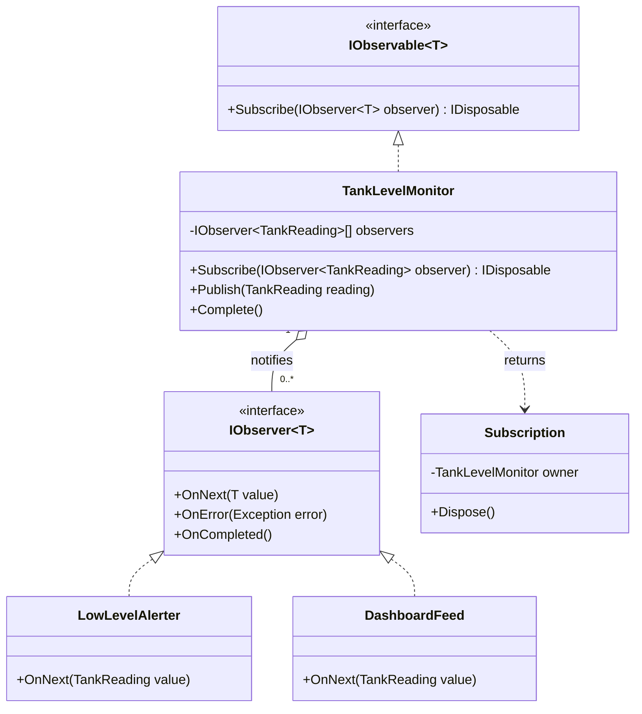
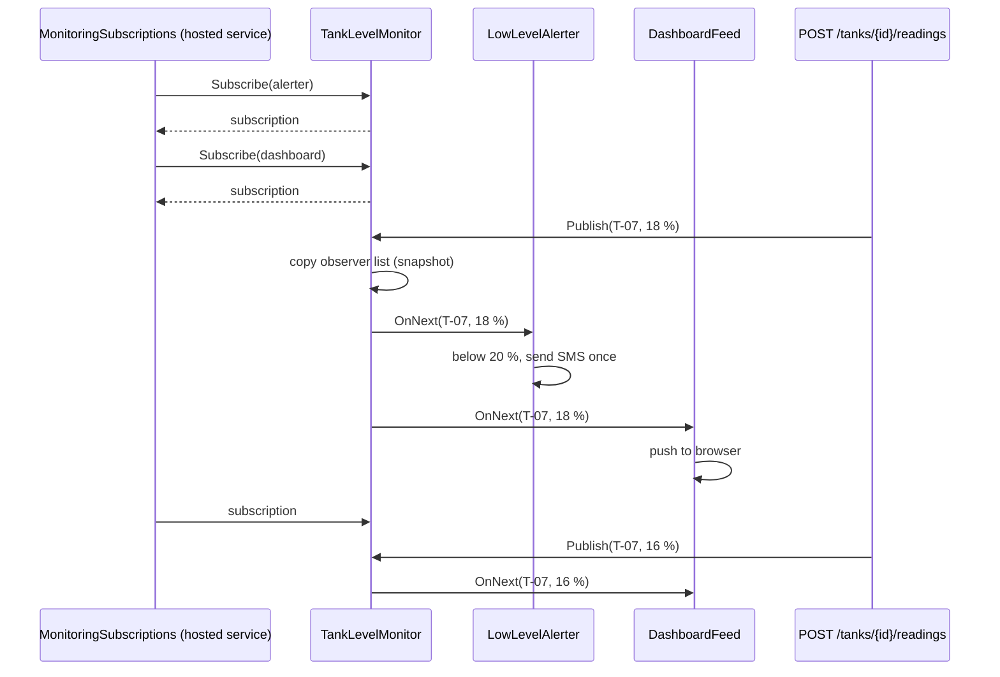
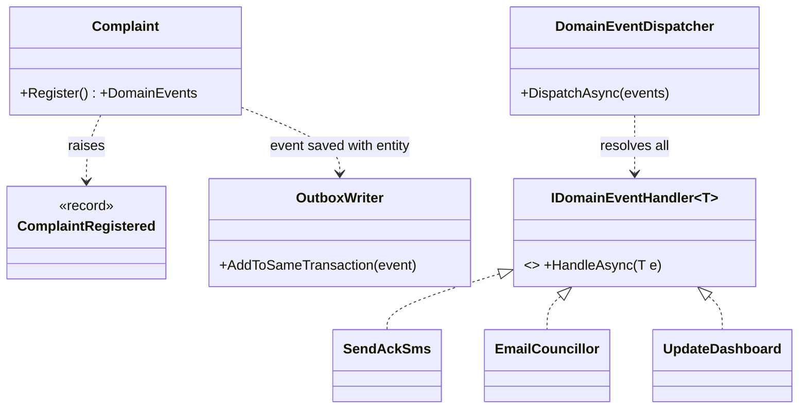

Observer is the pattern behind every "notify me when…" feature you have ever used: a button click, a price alert, a "your order has shipped" SMS, a dashboard that refreshes when new data lands. In .NET it is so common that the language has a keyword for it (`event`) and the base library has two interfaces for it (`IObservable<T>` and `IObserver<T>`).

## Learning objectives

By the end of this lesson you will be able to:

1. Recognise the problem Observer solves: one object calling a growing list of others whenever something changes.
2. Name the participants (subject, observer, subscription) and draw the class and sequence diagrams.
3. Implement Observer with C# events, `IObservable<T>`/`IObserver<T>`, and DI-resolved domain event handlers.
4. Explain and prevent the memory leak caused by subscribers that never unsubscribe.
5. Move slow reactions to a background worker with `Channel<T>`, and say when you need a message broker instead.
6. Test subjects and observers separately, and tell Observer apart from Mediator and broker-based Pub/Sub.

## Prerequisites

- [Interfaces and abstract classes](#/lesson/m01-interfaces-abstract): every observer implements a shared interface.
- [Dependency injection](#/lesson/m03-dependency-injection): we register event handlers in the container.
- [Background services and hosted workers](#/lesson/m03-background-services): the Channel-based section runs work in a `BackgroundService`.

Helpful but optional: [Strategy](#/lesson/m06-strategy), because Observer uses the same "program to an interface" idea.

## Explain it like I'm a beginner

Think of a newspaper delivery in your colony. The newspaper office does not knock on every door asking "do you want today's paper?". Instead, people **subscribe** once. Every morning the office delivers to everyone on its list. If you move house, you **unsubscribe**, and the deliveries stop.

The office does not care who you are. A family, a tea stall and a library all get the same paper. It only needs to know one thing: "this address accepts newspapers".

Software has the same situation all the time. A citizen files a complaint about a broken water pipe. Now several things must happen:

- send the citizen an SMS with a complaint number,
- assign the complaint to the ward's junior engineer,
- add 1 to the "open complaints" counter on the commissioner's dashboard.

The naive code calls all three directly from the "register complaint" method. Next month someone asks for an email to the councillor, then a WhatsApp message, then an audit record. Every request means editing the same method, and that method now knows about SMS gateways, email servers and dashboards.

The Observer idea: the complaint code just **announces** "a complaint was registered" (it raises an event). Anyone interested **subscribes** to that announcement. Adding the councillor email means adding one new subscriber, not editing the complaint code.

- The newspaper office is the **subject** (also called the publisher or observable).
- Each household is an **observer** (also called a subscriber or listener).
- The delivery list is the **subscription list**.

## First-principles explanation

### What it is

Observer defines a one-to-many dependency between objects. When one object (the subject) changes state or something notable happens, all its dependents (observers) are notified automatically. The subject knows only that each observer implements a small interface. It does not know their concrete types.

### The original problem

The Gang of Four book (1994) described the pattern with a spreadsheet. One table of numbers was shown as a grid, a bar chart and a pie chart at the same time. When a cell changed, all three views had to redraw. If the table held direct references to "the grid", "the bar chart" and "the pie chart", you could not add a fourth view without editing the table. Observer inverted the dependency: views register themselves with the table, and the table just loops over "things that want to know".

### How it works internally

Strip away the names and Observer is a list of callbacks:

1. The subject keeps a collection of observers (a list of interface references, or a list of delegates).
2. `Subscribe(observer)` adds to the list. Unsubscribe removes from it.
3. When something happens, the subject loops over the list and calls a method on each observer: `OnNext(value)`, `Handle(event)` or simply invokes the delegate.

In C#, an `event` field is exactly this. The compiler generates a private delegate field plus `add` and `remove` accessors. A delegate can point to several methods at once (a multicast delegate), so `PriceChanged?.Invoke(this, args)` calls every subscribed method, one after another, **on the calling thread**, in the order they subscribed.

Two consequences follow, and both cause real bugs:

- **Notification is synchronous by default.** If one handler takes 3 seconds to send an email, the subject waits 3 seconds. If one handler throws, the remaining handlers in a multicast delegate do not run, and the exception flows back into the subject.
- **The subject holds a strong reference to every observer.** As long as the subject is alive and the observer is still in its list, the garbage collector cannot free the observer. This is the root of the "lapsed listener" memory leak covered below.

### What happens without it

The code that detects a change must know everyone who cares. Each new reaction touches the core class, its constructor and its tests. A `ComplaintService` that takes an `ISmsSender`, an `IEmailSender`, an `IDashboard` and an `IAuditLog` is a warning sign.

### When it is useful

- One change has **several independent reactions**, and the list of reactions grows over time.
- The reactions belong to **different concerns or teams** (notifications, analytics, audit).
- The subject should **not depend** on the reacting code. For example, a domain entity should not reference an SMS library.
- You need **live streams** of values: sensor readings, stock ticks, UI input, log lines.

### When it is unnecessary or harmful

- There is exactly **one** reaction and no realistic second one. A direct method call is clearer and easier to debug.
- The caller **needs a result** from the reaction ("calculate the GST and give me the number"). That is a query or a Strategy, not a notification.
- The reactions must happen in a **strict order with shared transaction rules**. Hiding them behind events makes the order invisible. Use an explicit workflow instead.
- Handlers secretly depend on each other having run first. That is coupling with the documentation removed.

### Trade-offs it introduces

| You gain | You pay |
|---|---|
| Add reactions without editing the subject | Control flow is harder to follow: "who handles this?" needs a search |
| Subject has fewer dependencies | Ordering between observers is implicit and easy to break |
| Each observer can be tested alone | Errors in one observer can affect others unless you isolate them |
| Natural fit for streams and UI | Forgotten unsubscriptions leak memory and cause "ghost" handlers |

### The four flavours you will meet in .NET

1. **C# `event` with `EventHandler<TEventArgs>`**: in-process, synchronous, very cheap. Used by UI frameworks and `FileSystemWatcher`.
2. **`IObservable<T>` / `IObserver<T>`**: the formal push-based stream contract. `Subscribe` returns an `IDisposable` that ends the subscription. Rx.NET adds filtering, buffering and time-window operators on top; `DiagnosticListener` uses this pair.
3. **In-process domain events**: an entity records "ComplaintRegistered" and a dispatcher calls every `IDomainEventHandler<ComplaintRegistered>` registered in DI. The subscription list lives in the container instead of a field.
4. **Out-of-process messaging**: the event goes to a broker (RabbitMQ, Kafka, Azure Service Bus) and other processes react. Same idea across a network, plus delivery guarantees, retries and duplicates.

Rough rule: **in-process events for reactions inside one deployable that may be lost on a crash; a broker for reactions in other services or that must survive a crash.**

## Visual explanation

### Class diagram



How to read it: `TankLevelMonitor` is the **subject**. It implements `IObservable<TankReading>` and holds zero or more observers (the hollow diamond means it holds references but does not own their lifetime). `LowLevelAlerter` and `DashboardFeed` are **concrete observers**; they implement `IObserver<TankReading>`. `Subscribe` hands back a `Subscription` object. Calling `Dispose()` on it removes the observer from the list. Notice that the monitor points at the *interface*, never at the alerter or the dashboard. That is what lets you add a third observer without touching the monitor.

### Sequence diagram



This is the runtime story. At startup a hosted service subscribes two observers and **keeps the subscription tokens**. An IoT gateway posts a reading. The monitor takes a snapshot of its observer list (so a subscriber that unsubscribes mid-loop cannot corrupt the iteration) and calls each observer in turn on the same thread. Later the alerter's subscription is disposed, and the next reading reaches only the dashboard. The key point is the last two messages: **unsubscribing is an explicit act**, and if nobody calls `Dispose()`, the alerter stays in the list for as long as the monitor lives.

## Step-by-step example

We will build a small water-supply monitoring feature for a municipal corporation. Overhead tanks report their water level every minute. When a tank drops below 20 %, the duty engineer gets an SMS.

### Step 1 — the naive version

```csharp
public sealed class TankLevelMonitor(ISmsSender sms, IDashboardHub dashboard, IReadingArchive archive)
{
    public async Task OnReadingAsync(string tankId, decimal level)
    {
        await archive.SaveAsync(tankId, level);
        await dashboard.PushAsync(tankId, level);
        if (level < 20m) await sms.SendAsync("+91-98xxxxxx01", $"Tank {tankId} at {level} %");
    }
}
```

With three reactions this is readable. Problems appear as soon as requirements grow: "also alert the zonal officer above 5 tanks", "also feed the leak-detection model", "the dashboard is down, but readings must still be archived". The monitor's constructor keeps growing and its tests need fakes for everything.

### Step 2 — a C# event

The quickest decoupling is an `event`:

```csharp
public sealed class TankReadingEventArgs(string tankId, decimal level) : EventArgs
{
    public string TankId { get; } = tankId;
    public decimal Level { get; } = level;
}

public sealed class SimpleTankMonitor
{
    public event EventHandler<TankReadingEventArgs>? ReadingReceived;

    public void Report(string tankId, decimal level) =>
        ReadingReceived?.Invoke(this, new TankReadingEventArgs(tankId, level));
}

// Subscribing and unsubscribing
var monitor = new SimpleTankMonitor();
EventHandler<TankReadingEventArgs> handler = (_, e) => Console.WriteLine($"{e.TankId}: {e.Level} %");
monitor.ReadingReceived += handler;
monitor.Report("T-07", 42m);
monitor.ReadingReceived -= handler;   // must be the SAME delegate instance
```

The `?.` matters: when nobody has subscribed, the event field is `null`. The `?.Invoke` reads the field once, so a subscriber leaving on another thread between the null check and the call cannot cause a `NullReferenceException`.

Watch the unsubscribe line. If you write `monitor.ReadingReceived -= (_, e) => Console.WriteLine(...)` with a fresh lambda, nothing is removed, because that is a different delegate. This is one of the most common sources of "my handler still runs".

### Step 3 — `IObservable<T>` with disposable subscriptions

Events can't say "the stream ended" or "the stream failed", and unsubscribing is easy to forget. With `IObservable<T>`, `Subscribe` returns an `IDisposable` you can store and dispose on shutdown, and `IObserver<T>` has `OnCompleted` and `OnError`.

### Step 4 — make the subject safe for production

Readings arrive from many HTTP requests at once. The production version uses a copy-on-write array so the publish loop needs no lock, isolates a failing observer, makes `Dispose()` idempotent (safe to call twice), and tells late subscribers that the stream has completed.

### Step 5 — domain events for business reactions

Tank readings are a *stream*. Complaints are *business facts*: "complaint 4812 was registered in ward 14". For facts, the subscription list lives in the DI container: handlers such as `SendAcknowledgementSms : IDomainEventHandler<ComplaintRegistered>` are found by a dispatcher. A new reaction is one class plus one registration line.

### Step 6 — move slow reactions off the request path

An SMS gateway call can take 300–800 ms (an estimate; it varies by provider). We put the event on an in-memory **waiting line** (`Channel<T>`) and a background worker dispatches it, so the request returns as soon as the complaint is saved.

## Production-style C# implementation

Project layout:

```text
Waterworks.Api/
  Program.cs
  Monitoring/
    TankReading.cs
    TankLevelMonitor.cs
    LowLevelAlerter.cs
    MonitoringSubscriptions.cs
  Notifications/
    ISmsSender.cs
  Grievances/
    DomainEvents.cs
    Complaint.cs
    ComplaintRepository.cs
    DomainEventDispatcher.cs
    ComplaintHandlers.cs
    BackgroundEventQueue.cs
    ComplaintService.cs
```

### The stream: tank monitoring with `IObservable<T>`

```csharp file=Monitoring/TankReading.cs
namespace Waterworks.Monitoring;

public sealed record TankReading(string TankId, decimal LevelPercent, DateTimeOffset MeasuredAt);
```

```csharp file=Monitoring/TankLevelMonitor.cs
using Microsoft.Extensions.Logging;

namespace Waterworks.Monitoring;

/// <summary>
/// Subject. Readings are published from many request threads; subscriptions change rarely.
/// Observers are stored in an immutable array that is replaced on every change (copy-on-write),
/// so Publish can loop over a snapshot without holding a lock.
/// </summary>
public sealed class TankLevelMonitor(ILogger<TankLevelMonitor> logger) : IObservable<TankReading>
{
    private readonly object _gate = new();
    private IObserver<TankReading>[] _observers = [];
    private bool _completed;

    public int ObserverCount => Volatile.Read(ref _observers).Length;

    public IDisposable Subscribe(IObserver<TankReading> observer)
    {
        ArgumentNullException.ThrowIfNull(observer);
        bool alreadyCompleted;
        lock (_gate)
        {
            alreadyCompleted = _completed;
            if (!alreadyCompleted) _observers = [.. _observers, observer];
        }

        if (alreadyCompleted)
        {
            observer.OnCompleted();          // late subscriber: tell it the stream is over
            return NoopSubscription.Instance;
        }
        return new Subscription(this, observer);
    }

    public void Publish(TankReading reading)
    {
        ArgumentNullException.ThrowIfNull(reading);
        IObserver<TankReading>[] snapshot;
        lock (_gate)
        {
            if (_completed) throw new InvalidOperationException("Monitor has completed; no more readings accepted.");
            snapshot = _observers;
        }

        foreach (var observer in snapshot)
        {
            try { observer.OnNext(reading); }
            catch (Exception ex)
            {
                // One faulty observer must not stop the others from being notified.
                logger.LogError(ex, "Observer {Observer} failed for tank {TankId}", observer.GetType().Name, reading.TankId);
            }
        }
    }

    public void Complete()
    {
        IObserver<TankReading>[] snapshot;
        lock (_gate)
        {
            if (_completed) return;
            _completed = true;
            snapshot = _observers;
            _observers = [];
        }
        foreach (var observer in snapshot) observer.OnCompleted();
    }

    private void Unsubscribe(IObserver<TankReading> observer)
    {
        lock (_gate)
        {
            _observers = _observers.Where(o => !ReferenceEquals(o, observer)).ToArray();
        }
    }

    private sealed class Subscription(TankLevelMonitor owner, IObserver<TankReading> observer) : IDisposable
    {
        private int _disposed;
        public void Dispose()
        {
            if (Interlocked.Exchange(ref _disposed, 1) == 0) owner.Unsubscribe(observer);
        }
    }

    private sealed class NoopSubscription : IDisposable
    {
        public static readonly NoopSubscription Instance = new();
        public void Dispose() { }
    }
}
```

Why copy-on-write? Readings arrive often (every minute from every tank, so 500 tanks give roughly 8 readings per second as an estimate), while subscriptions change a handful of times per process lifetime. Copying a small array on the rare path keeps the hot path lock-free during the loop. If subscriptions changed constantly, a `ConcurrentDictionary` or a lock around the loop could be better.

```csharp file=Notifications/ISmsSender.cs
using Microsoft.Extensions.Logging;

namespace Waterworks.Notifications;

public interface ISmsSender
{
    Task SendAsync(string phone, string message, CancellationToken ct);
}

/// <summary>Development stand-in. A real implementation calls an SMS gateway over HTTP.</summary>
public sealed class LoggingSmsSender(ILogger<LoggingSmsSender> logger) : ISmsSender
{
    public Task SendAsync(string phone, string message, CancellationToken ct)
    {
        logger.LogInformation("SMS to {Phone}: {Message}", phone, message);
        return Task.CompletedTask;
    }
}
```

```csharp file=Monitoring/LowLevelAlerter.cs
using System.Collections.Concurrent;
using Microsoft.Extensions.Logging;
using Microsoft.Extensions.Options;
using Waterworks.Notifications;

namespace Waterworks.Monitoring;

public sealed class LowLevelAlertOptions
{
    public decimal AlertBelowPercent { get; set; } = 20m;
    /// <summary>Re-arm only after the level recovers above this, so a level hovering at 19–21 % does not spam SMS.</summary>
    public decimal ResetAbovePercent { get; set; } = 25m;
    public string DutyEngineerPhone { get; set; } = "+910000000000";
}

/// <summary>Concrete observer. Sends one SMS per "drop below threshold" crossing per tank.</summary>
public sealed class LowLevelAlerter(ISmsSender sms, IOptions<LowLevelAlertOptions> options, ILogger<LowLevelAlerter> logger)
    : IObserver<TankReading>
{
    private readonly LowLevelAlertOptions _o = options.Value;
    private readonly ConcurrentDictionary<string, bool> _alerted = new();

    public void OnNext(TankReading value)
    {
        if (value.LevelPercent < _o.AlertBelowPercent && _alerted.TryAdd(value.TankId, true))
        {
            // Fire-and-forget would hide failures; we log them instead. OnNext is synchronous by contract.
            _ = SendAsync(value);
        }
        else if (value.LevelPercent > _o.ResetAbovePercent)
        {
            _alerted.TryRemove(value.TankId, out _);
        }
    }

    private async Task SendAsync(TankReading r)
    {
        try
        {
            await sms.SendAsync(_o.DutyEngineerPhone, $"Tank {r.TankId} low: {r.LevelPercent:0.#} % at {r.MeasuredAt:HH:mm}", CancellationToken.None);
        }
        catch (Exception ex)
        {
            logger.LogError(ex, "Low-level SMS failed for {TankId}", r.TankId);
        }
    }

    public void OnError(Exception error) => logger.LogError(error, "Tank reading stream faulted");
    public void OnCompleted() => logger.LogInformation("Tank reading stream completed");
}
```

The alerter has its own memory (`_alerted`) so it can apply **hysteresis**: alert when crossing below 20 %, and only re-arm after recovering above 25 %. Without it, a level that flickers between 19.8 % and 20.1 % every minute would send an SMS every two minutes.

```csharp file=Monitoring/MonitoringSubscriptions.cs
namespace Waterworks.Monitoring;

/// <summary>
/// Owns the subscriptions. Subscribes on startup and disposes on shutdown,
/// so there is exactly one place that decides how long observers stay attached.
/// </summary>
public sealed class MonitoringSubscriptions(TankLevelMonitor monitor, LowLevelAlerter alerter) : IHostedService
{
    private readonly List<IDisposable> _subscriptions = [];

    public Task StartAsync(CancellationToken cancellationToken)
    {
        _subscriptions.Add(monitor.Subscribe(alerter));
        return Task.CompletedTask;
    }

    public Task StopAsync(CancellationToken cancellationToken)
    {
        foreach (var s in _subscriptions) s.Dispose();
        _subscriptions.Clear();
        monitor.Complete();
        return Task.CompletedTask;
    }
}
```

### Business facts: domain events for complaints

```csharp file=Grievances/DomainEvents.cs
namespace Waterworks.Grievances;

public interface IDomainEvent
{
    DateTimeOffset OccurredAt { get; }
}

/// <summary>An observer of one event type. Many handlers may exist for the same event.</summary>
public interface IDomainEventHandler<in TEvent> where TEvent : IDomainEvent
{
    Task HandleAsync(TEvent domainEvent, CancellationToken ct);
}

public sealed record ComplaintRegistered(
    Guid ComplaintId, string Ward, string Category, string CitizenPhone, DateTimeOffset OccurredAt) : IDomainEvent;
```

```csharp file=Grievances/Complaint.cs
namespace Waterworks.Grievances;

public enum ComplaintStatus { Open, Assigned, Resolved }

/// <summary>The entity records what happened; it never calls SMS or dashboards itself.</summary>
public sealed class Complaint
{
    private readonly List<IDomainEvent> _events = [];

    private Complaint(Guid id, string ward, string category, string citizenPhone)
    {
        Id = id; Ward = ward; Category = category; CitizenPhone = citizenPhone;
    }

    public Guid Id { get; }
    public string Ward { get; }
    public string Category { get; }
    public string CitizenPhone { get; }
    public ComplaintStatus Status { get; private set; } = ComplaintStatus.Open;
    public string? AssignedTo { get; private set; }
    public IReadOnlyList<IDomainEvent> DomainEvents => _events;

    public static Complaint Register(string ward, string category, string citizenPhone, TimeProvider clock)
    {
        if (string.IsNullOrWhiteSpace(ward)) throw new ArgumentException("Ward is required.", nameof(ward));
        if (string.IsNullOrWhiteSpace(category)) throw new ArgumentException("Category is required.", nameof(category));
        var c = new Complaint(Guid.NewGuid(), ward.Trim(), category.Trim(), citizenPhone);
        c._events.Add(new ComplaintRegistered(c.Id, c.Ward, c.Category, citizenPhone, clock.GetUtcNow()));
        return c;
    }

    public void AssignTo(string engineer)
    {
        if (Status != ComplaintStatus.Open) throw new InvalidOperationException($"Cannot assign a {Status} complaint.");
        AssignedTo = engineer;
        Status = ComplaintStatus.Assigned;
    }

    public IReadOnlyList<IDomainEvent> DequeueEvents()
    {
        var copy = _events.ToList();
        _events.Clear();
        return copy;
    }
}
```

```csharp file=Grievances/ComplaintRepository.cs
using System.Collections.Concurrent;

namespace Waterworks.Grievances;

public interface IComplaintRepository
{
    Task AddAsync(Complaint complaint, CancellationToken ct);
    Task<Complaint?> FindAsync(Guid id, CancellationToken ct);
}

/// <summary>In-memory stand-in for a PostgreSQL-backed repository.</summary>
public sealed class InMemoryComplaintRepository : IComplaintRepository
{
    private readonly ConcurrentDictionary<Guid, Complaint> _store = new();
    public Task AddAsync(Complaint complaint, CancellationToken ct) { _store[complaint.Id] = complaint; return Task.CompletedTask; }
    public Task<Complaint?> FindAsync(Guid id, CancellationToken ct) => Task.FromResult(_store.GetValueOrDefault(id));
}
```

The dispatcher is the subject's "loop over observers" moved into infrastructure. It asks the DI container for every handler of the event's runtime type.

```csharp file=Grievances/DomainEventDispatcher.cs
using System.Collections.Concurrent;
using Microsoft.Extensions.Logging;

namespace Waterworks.Grievances;

public interface IDomainEventDispatcher
{
    Task DispatchAsync(IEnumerable<IDomainEvent> events, CancellationToken ct);
}

/// <summary>
/// Calls every registered IDomainEventHandler for each event, in registration order.
/// Policy: a failing handler is logged and the remaining handlers still run.
/// </summary>
public sealed class DomainEventDispatcher(IServiceProvider services, ILogger<DomainEventDispatcher> logger) : IDomainEventDispatcher
{
    private static readonly ConcurrentDictionary<Type, HandlerInvoker> Invokers = new();

    public async Task DispatchAsync(IEnumerable<IDomainEvent> events, CancellationToken ct)
    {
        foreach (var e in events)
        {
            var invoker = Invokers.GetOrAdd(e.GetType(),
                t => (HandlerInvoker)Activator.CreateInstance(typeof(HandlerInvoker<>).MakeGenericType(t))!);
            await invoker.InvokeAsync(services, e, logger, ct);
        }
    }

    // Small generic shim so we can call strongly-typed handlers without reflection on every event.
    private abstract class HandlerInvoker
    {
        public abstract Task InvokeAsync(IServiceProvider sp, IDomainEvent e, ILogger logger, CancellationToken ct);
    }

    private sealed class HandlerInvoker<TEvent> : HandlerInvoker where TEvent : IDomainEvent
    {
        public override async Task InvokeAsync(IServiceProvider sp, IDomainEvent e, ILogger logger, CancellationToken ct)
        {
            foreach (var handler in sp.GetServices<IDomainEventHandler<TEvent>>())
            {
                try { await handler.HandleAsync((TEvent)e, ct); }
                catch (Exception ex) when (ex is not OperationCanceledException)
                {
                    logger.LogError(ex, "Handler {Handler} failed for {Event}", handler.GetType().Name, typeof(TEvent).Name);
                }
            }
        }
    }
}
```

Three concrete observers, each with one job:

```csharp file=Grievances/ComplaintHandlers.cs
using Waterworks.Notifications;

namespace Waterworks.Grievances;

public sealed class SendAcknowledgementSms(ISmsSender sms) : IDomainEventHandler<ComplaintRegistered>
{
    public Task HandleAsync(ComplaintRegistered e, CancellationToken ct) =>
        sms.SendAsync(e.CitizenPhone, $"Complaint {e.ComplaintId.ToString()[..8]} registered ({e.Category}). We will update you.", ct);
}

public sealed class AssignToWardEngineer(IComplaintRepository repository, IWardRoster roster) : IDomainEventHandler<ComplaintRegistered>
{
    public async Task HandleAsync(ComplaintRegistered e, CancellationToken ct)
    {
        var complaint = await repository.FindAsync(e.ComplaintId, ct);
        if (complaint is null || complaint.Status != ComplaintStatus.Open) return;   // idempotent: safe to run twice
        complaint.AssignTo(roster.JuniorEngineerFor(e.Ward));
    }
}

public interface IWardRoster { string JuniorEngineerFor(string ward); }

public sealed class StaticWardRoster : IWardRoster
{
    public string JuniorEngineerFor(string ward) => $"je-ward-{ward}";
}

/// <summary>Singleton read model for the commissioner's dashboard.</summary>
public sealed class DashboardCounters
{
    private readonly ConcurrentCounter _open = new();
    public void IncrementOpen() => _open.Increment();
    public object Snapshot() => new { openComplaints = _open.Value };

    private sealed class ConcurrentCounter
    {
        private long _value;
        public long Value => Interlocked.Read(ref _value);
        public void Increment() => Interlocked.Increment(ref _value);
    }
}

public sealed class UpdateDashboard(DashboardCounters counters) : IDomainEventHandler<ComplaintRegistered>
{
    public Task HandleAsync(ComplaintRegistered e, CancellationToken ct)
    {
        counters.IncrementOpen();
        return Task.CompletedTask;
    }
}
```

### Off the request path: a Channel and a background worker

```csharp file=Grievances/BackgroundEventQueue.cs
using System.Threading.Channels;
using Microsoft.Extensions.Logging;

namespace Waterworks.Grievances;

/// <summary>
/// A bounded in-memory waiting line. When it is full, writers wait (back-pressure) instead of
/// letting memory grow without limit. Events here are LOST if the process crashes.
/// </summary>
public sealed class BackgroundEventQueue
{
    private readonly Channel<IDomainEvent> _channel = Channel.CreateBounded<IDomainEvent>(
        new BoundedChannelOptions(capacity: 1_000) { FullMode = BoundedChannelFullMode.Wait, SingleReader = true });

    public ValueTask EnqueueAsync(IDomainEvent e, CancellationToken ct) => _channel.Writer.WriteAsync(e, ct);
    public IAsyncEnumerable<IDomainEvent> ReadAllAsync(CancellationToken ct) => _channel.Reader.ReadAllAsync(ct);
}

public sealed class DomainEventWorker(BackgroundEventQueue queue, IServiceScopeFactory scopes, ILogger<DomainEventWorker> logger)
    : BackgroundService
{
    protected override async Task ExecuteAsync(CancellationToken stoppingToken)
    {
        try
        {
            await foreach (var e in queue.ReadAllAsync(stoppingToken))
            {
                // A fresh DI scope per event: scoped handlers (e.g. a DbContext) are not shared across events.
                await using var scope = scopes.CreateAsyncScope();
                var dispatcher = scope.ServiceProvider.GetRequiredService<IDomainEventDispatcher>();
                await dispatcher.DispatchAsync([e], stoppingToken);
            }
        }
        catch (OperationCanceledException) when (stoppingToken.IsCancellationRequested)
        {
            logger.LogInformation("Domain event worker stopping");
        }
    }
}
```

```csharp file=Grievances/ComplaintService.cs
namespace Waterworks.Grievances;

public sealed record RegisterComplaintRequest(string Ward, string Category, string CitizenPhone);

public sealed class ComplaintService(IComplaintRepository repository, BackgroundEventQueue queue, TimeProvider clock)
{
    public async Task<Guid> RegisterAsync(RegisterComplaintRequest request, CancellationToken ct)
    {
        var complaint = Complaint.Register(request.Ward, request.Category, request.CitizenPhone, clock);
        await repository.AddAsync(complaint, ct);              // 1. persist first
        foreach (var e in complaint.DequeueEvents())           // 2. then announce
            await queue.EnqueueAsync(e, ct);
        return complaint.Id;
    }
}
```

```csharp file=Program.cs
using Waterworks.Grievances;
using Waterworks.Monitoring;
using Waterworks.Notifications;

var builder = WebApplication.CreateBuilder(args);

builder.Services.AddSingleton(TimeProvider.System);
builder.Services.AddSingleton<ISmsSender, LoggingSmsSender>();

// Stream observers
builder.Services.Configure<LowLevelAlertOptions>(builder.Configuration.GetSection("Monitoring:LowLevel"));
builder.Services.AddSingleton<TankLevelMonitor>();
builder.Services.AddSingleton<LowLevelAlerter>();
builder.Services.AddHostedService<MonitoringSubscriptions>();

// Domain events: the DI container IS the subscription list
builder.Services.AddSingleton<IComplaintRepository, InMemoryComplaintRepository>();
builder.Services.AddSingleton<IWardRoster, StaticWardRoster>();
builder.Services.AddSingleton<DashboardCounters>();
builder.Services.AddScoped<IDomainEventDispatcher, DomainEventDispatcher>();
builder.Services.AddScoped<IDomainEventHandler<ComplaintRegistered>, SendAcknowledgementSms>();
builder.Services.AddScoped<IDomainEventHandler<ComplaintRegistered>, AssignToWardEngineer>();
builder.Services.AddScoped<IDomainEventHandler<ComplaintRegistered>, UpdateDashboard>();
builder.Services.AddSingleton<BackgroundEventQueue>();
builder.Services.AddHostedService<DomainEventWorker>();
builder.Services.AddScoped<ComplaintService>();

var app = builder.Build();

app.MapPost("/tanks/{tankId}/readings", (string tankId, decimal levelPercent, TankLevelMonitor monitor, TimeProvider clock) =>
{
    if (levelPercent is < 0 or > 100) return Results.Problem("levelPercent must be 0–100.", statusCode: 400);
    monitor.Publish(new TankReading(tankId, levelPercent, clock.GetUtcNow()));
    return Results.Accepted();
});

app.MapPost("/complaints", async (RegisterComplaintRequest request, ComplaintService service, CancellationToken ct) =>
{
    try
    {
        var id = await service.RegisterAsync(request, ct);
        return Results.Created($"/complaints/{id}", new { id });
    }
    catch (ArgumentException ex) { return Results.Problem(ex.Message, statusCode: 400); }
});

app.MapGet("/dashboard", (DashboardCounters counters) => Results.Ok(counters.Snapshot()));

app.Run();
```

**Why save first, then announce?** If you announce first and the save then fails, the citizen gets an SMS for a complaint that does not exist. Saving first means the worst case is the opposite: the complaint is saved but the process crashes before the SMS is sent. For an acknowledgement SMS that is usually acceptable. For a reaction that **must** happen, such as billing or a regulatory notification, an in-memory channel is not enough. Write the event to an outbox table in the same database transaction as the complaint and have a relay publish it ([Transactional outbox](#/lesson/m12-outbox)).

### In-process events vs a message broker

| Question | In-process (events, dispatcher, Channel) | Message broker (RabbitMQ, Kafka, Service Bus) |
|---|---|---|
| Who reacts? | Code in the same process | Other services, other teams, other languages |
| Survives a crash? | No, unless you add an outbox | Yes, messages are persisted by the broker |
| Delivery | Exactly what your loop does | Usually at-least-once: consumers must handle duplicates |
| Latency | Microseconds to call a handler | Typically milliseconds (network hop + persistence) |
| Operational cost | None | A cluster to run, monitor, upgrade and secure |
| Debugging | Stack traces, breakpoints | Distributed tracing, dead-letter queues |

Start in-process. Move a specific reaction to a broker when it must survive crashes, when another service owns it, or when you need to scale its consumers independently.

:::callout type=warning title="The lapsed listener leak"
A long-lived subject (singleton, static class, a timer, `AppDomain.CurrentDomain`) holds a strong reference to every subscriber. If a short-lived object subscribes and never unsubscribes, it can never be garbage-collected, and its handler keeps running.

Typical ASP.NET Core version: a **scoped** service subscribes to an event on a **singleton** in its constructor. Every HTTP request creates a new scoped instance and adds one more handler. After 100,000 requests the singleton holds 100,000 handlers, memory climbs, each publish runs 100,000 handlers, and handlers touch disposed `DbContext`s.

Fixes, in order of preference: (1) don't subscribe from short-lived objects; use DI-resolved handlers instead; (2) when you must subscribe, keep the `IDisposable` and dispose it in `Dispose()`; (3) for C# events, unsubscribe with `-=` using the same delegate instance. Weak-event helpers exist in some UI frameworks, but they hide the lifetime problem rather than design it away.
:::

## Bad design vs good design

**Bad**: `ComplaintService` with seven constructor dependencies, sending SMS, email, WhatsApp, updating the dashboard and writing audit rows inline inside the HTTP request.

```csharp
public async Task<Guid> RegisterAsync(RegisterComplaintRequest r)
{
    var c = new Complaint(/*...*/);
    await _db.SaveAsync(c);
    await _sms.SendAsync(r.CitizenPhone, "...");        // 600 ms, can throw
    await _email.SendAsync(_councillorFor(r.Ward), "..."); // can throw → request fails AFTER save
    _dashboard.Increment();
    await _audit.WriteAsync(/*...*/);
    return c.Id;
}
```

Problems:

- The citizen waits for every gateway. If email throws, the API returns 500 even though the complaint was saved, so the citizen retries and creates a duplicate.
- Adding WhatsApp means editing and redeploying this method and its tests.
- Testing "register a complaint" needs seven fakes.

**Also bad (the opposite extreme)**: everything is an event, including things that are not reactions. For example, `ComplaintRegistered` handlers that *validate* the complaint, or a chain where handler B silently needs handler A to have set a field. Validation must happen *before* the fact is recorded; a dependency between handlers must be an explicit call.

**Good**: the version above. The entity records a fact. The service persists and announces. Each reaction is a handler with its own tests. Slow reactions run in the background. Reactions that must not be lost go through an outbox.

**Is it worth it?** If the only reaction is "send one SMS" and it has been that way for years, a direct call to `ISmsSender` is fine and easier to trace. Introduce events when the second or third independent reaction arrives, or when the entity must not depend on infrastructure.

## Practical playground

The playground has a tiny subject with a C# event and an `IObservable` version side by side. Run it, then try these:

1. Remove the `-=` line and watch the "ghost" handler keep firing.
2. Make one handler throw and see that the multicast delegate stops at it, while the `IObservable` monitor carries on.
3. Unsubscribe with a *new* lambda instead of the stored one and notice nothing is removed.

:::playground type=csharp title="Events vs IObservable"
```csharp file=Program.cs
using System;
using System.Collections.Generic;
using System.Linq;

public sealed class PriceEventArgs(string symbol, decimal price) : EventArgs
{
    public string Symbol { get; } = symbol;
    public decimal Price { get; } = price;
}

public sealed class Ticker
{
    public event EventHandler<PriceEventArgs>? PriceChanged;
    public void Push(string symbol, decimal price) => PriceChanged?.Invoke(this, new PriceEventArgs(symbol, price));
}

public sealed class SafeTicker : IObservable<decimal>
{
    private IObserver<decimal>[] _observers = Array.Empty<IObserver<decimal>>();
    public IDisposable Subscribe(IObserver<decimal> o)
    {
        _observers = _observers.Append(o).ToArray();
        return new Unsub(() => _observers = _observers.Where(x => !ReferenceEquals(x, o)).ToArray());
    }
    public void Push(decimal price)
    {
        foreach (var o in _observers)
        {
            try { o.OnNext(price); } catch (Exception ex) { Console.WriteLine($"  (observer failed: {ex.Message}; others continue)"); }
        }
    }
    private sealed class Unsub(Action a) : IDisposable { public void Dispose() => a(); }
}

public sealed class ConsoleObserver(string name, bool explode = false) : IObserver<decimal>
{
    public void OnNext(decimal value) { if (explode) throw new InvalidOperationException(name + " broke"); Console.WriteLine($"  {name} got {value}"); }
    public void OnError(Exception error) { }
    public void OnCompleted() { }
}

public static class Program
{
    public static void Main()
    {
        Console.WriteLine("C# event:");
        var t = new Ticker();
        EventHandler<PriceEventArgs> chart = (_, e) => Console.WriteLine($"  chart: {e.Symbol} {e.Price}");
        t.PriceChanged += chart;
        t.PriceChanged += (_, e) => Console.WriteLine($"  alert: {e.Symbol} {e.Price}");
        t.Push("NIFTY", 24510.5m);
        t.PriceChanged -= chart;               // remove this line to see the ghost handler
        t.Push("NIFTY", 24498.0m);

        Console.WriteLine("IObservable:");
        var s = new SafeTicker();
        using var a = s.Subscribe(new ConsoleObserver("dashboard"));
        var b = s.Subscribe(new ConsoleObserver("faulty", explode: true));
        using var c = s.Subscribe(new ConsoleObserver("sms"));
        s.Push(101.25m);
        b.Dispose();
        s.Push(102.00m);
    }
}
```
:::

## Exercises

:::exercise id=m06-observer-ex1 difficulty=beginner kind=code title="Raise an event when a tariff changes"
A state electricity board publishes a per-unit tariff. Billing, the customer app and an audit logger all need to know when it changes. Implement `ElectricityTariff.SetRate` so that it raises the `TariffChanged` event with the old and new rate.
::requirements
- Raise only when the rate actually changes, through a `protected virtual void OnTariffChanged(...)` (the standard .NET event pattern).
- Reject negative rates with `ArgumentOutOfRangeException`. Don't crash when nobody has subscribed.
::acceptance
- Changing ₹6.50 to ₹7.25 delivers `OldRate = 6.50`, `NewRate = 7.25`.
- Calling `SetRate(7.25m)` again raises no event.
- A handler removed with `-=` is not called.
- `SetRate(-1m)` throws and the rate is unchanged.
::hint
An event is `null` until someone subscribes. How do you call it safely?
::hint
Use `TariffChanged?.Invoke(this, args)` inside `OnTariffChanged`.
::hint
Order of operations: validate, compare with the current rate, store the old value, update `CurrentRate`, then raise.
::hint
```csharp
if (newRate < 0) throw new ArgumentOutOfRangeException(nameof(newRate));
if (newRate == CurrentRate) return;
var old = CurrentRate;
CurrentRate = newRate;
OnTariffChanged(new TariffChangedEventArgs(old, newRate));
```
::starter
```csharp file=ElectricityTariff.cs
using System;

public sealed class TariffChangedEventArgs(decimal oldRate, decimal newRate) : EventArgs
{
    public decimal OldRate { get; } = oldRate;
    public decimal NewRate { get; } = newRate;
}

public class ElectricityTariff(decimal initialRate)
{
    public decimal CurrentRate { get; private set; } = initialRate;

    public event EventHandler<TariffChangedEventArgs>? TariffChanged;

    public void SetRate(decimal newRate) => throw new NotImplementedException();

    protected virtual void OnTariffChanged(TariffChangedEventArgs e) => throw new NotImplementedException();
}
```
::tests
```csharp file=ElectricityTariffTests.cs
using System;
using System.Collections.Generic;
using Xunit;

public class ElectricityTariffTests
{
    [Fact]
    public void Raises_with_old_and_new_rate()
    {
        var t = new ElectricityTariff(6.50m);
        TariffChangedEventArgs? got = null;
        t.TariffChanged += (_, e) => got = e;
        t.SetRate(7.25m);
        Assert.NotNull(got);
        Assert.Equal(6.50m, got!.OldRate);
        Assert.Equal(7.25m, got.NewRate);
        Assert.Equal(7.25m, t.CurrentRate);
    }

    [Fact]
    public void Same_rate_raises_nothing()
    {
        var t = new ElectricityTariff(6.50m);
        var count = 0;
        t.TariffChanged += (_, _) => count++;
        t.SetRate(7.25m);
        t.SetRate(7.25m);
        Assert.Equal(1, count);
    }

    [Fact]
    public void No_subscribers_does_not_throw()
    {
        var t = new ElectricityTariff(5m);
        t.SetRate(6m);
        Assert.Equal(6m, t.CurrentRate);
    }

    [Fact]
    public void Unsubscribed_handler_is_not_called()
    {
        var t = new ElectricityTariff(5m);
        var calls = new List<string>();
        EventHandler<TariffChangedEventArgs> a = (_, _) => calls.Add("a");
        EventHandler<TariffChangedEventArgs> b = (_, _) => calls.Add("b");
        t.TariffChanged += a;
        t.TariffChanged += b;
        t.TariffChanged -= a;
        t.SetRate(6m);
        Assert.Equal(new List<string> { "b" }, calls);
    }

    [Fact]
    public void Negative_rate_rejected_and_unchanged()
    {
        var t = new ElectricityTariff(5m);
        var raised = false;
        t.TariffChanged += (_, _) => raised = true;
        Assert.Throws<ArgumentOutOfRangeException>(() => t.SetRate(-1m));
        Assert.Equal(5m, t.CurrentRate);
        Assert.False(raised);
    }
}
```
::solution
Validate, compare, update, then raise through the protected virtual method. Raising **after** updating `CurrentRate` matters: a handler that reads `tariff.CurrentRate` sees the new value.

```csharp file=ElectricityTariff.cs
using System;

public sealed class TariffChangedEventArgs(decimal oldRate, decimal newRate) : EventArgs
{
    public decimal OldRate { get; } = oldRate;
    public decimal NewRate { get; } = newRate;
}

public class ElectricityTariff(decimal initialRate)
{
    public decimal CurrentRate { get; private set; } = initialRate;

    public event EventHandler<TariffChangedEventArgs>? TariffChanged;

    public void SetRate(decimal newRate)
    {
        if (newRate < 0) throw new ArgumentOutOfRangeException(nameof(newRate), "Tariff cannot be negative.");
        if (newRate == CurrentRate) return;
        var old = CurrentRate;
        CurrentRate = newRate;
        OnTariffChanged(new TariffChangedEventArgs(old, newRate));
    }

    protected virtual void OnTariffChanged(TariffChangedEventArgs e) => TariffChanged?.Invoke(this, e);
}
```
::mistakes
- Raising before updating `CurrentRate`, so handlers that read the property see the old value.
- Writing `if (TariffChanged != null) TariffChanged(this, e);` — another thread can unsubscribe between the check and the call. `?.Invoke` reads the field once.
- Comparing `decimal` money with `double`, which introduces rounding surprises.
::extensions
Add a `TariffChanging` event raised *before* the change whose args have a `Cancel` property (like `CancelEventArgs`), and skip the change when a handler cancels it.
:::

:::exercise id=m06-observer-ex2 difficulty=beginner kind=code title="Disposable subscriptions for a bus arrival board"
A city bus depot publishes arrivals to display boards and a passenger app. Implement `BusArrivalFeed`, an `IObservable<BusArrival>`, with subscriptions that end when disposed.
::requirements
- `Subscribe` returns an `IDisposable` that stops notifications to that observer only; disposing twice is harmless.
- `Complete()` calls `OnCompleted` on every observer and clears the list; a later subscriber gets `OnCompleted` immediately.
::acceptance
- Two observers both receive `Publish("239", "Sector 29")`.
- After disposing observer A's subscription, only B receives the next arrival.
- Disposing twice does not throw or remove anyone else.
- A late subscriber gets `OnCompleted` once and no values.
::hint
The subject needs a collection of observers and a way to remove one.
::hint
Return a small private class that implements `IDisposable` and remembers both the feed and the observer.
::hint
To make `Dispose` idempotent, keep a `bool _disposed` and return early when it is already true.
::hint
```csharp
private sealed class Subscription(BusArrivalFeed feed, IObserver<BusArrival> o) : IDisposable
{
    private bool _done;
    public void Dispose() { if (_done) return; _done = true; feed._observers.Remove(o); }
}
```
::starter
```csharp file=BusArrivalFeed.cs
using System;
using System.Collections.Generic;

public sealed record BusArrival(string Route, string Stop);

public sealed class BusArrivalFeed : IObservable<BusArrival>
{
    private readonly List<IObserver<BusArrival>> _observers = new();
    private bool _completed;

    public int Count => _observers.Count;

    public IDisposable Subscribe(IObserver<BusArrival> observer) => throw new NotImplementedException();

    public void Publish(string route, string stop) => throw new NotImplementedException();

    public void Complete() => throw new NotImplementedException();
}
```
::tests
```csharp file=BusArrivalFeedTests.cs
using System;
using System.Collections.Generic;
using Xunit;

public class BusArrivalFeedTests
{
    private sealed class Recorder : IObserver<BusArrival>
    {
        public List<BusArrival> Values { get; } = new();
        public int Completed { get; private set; }
        public void OnNext(BusArrival value) => Values.Add(value);
        public void OnError(Exception error) { }
        public void OnCompleted() => Completed++;
    }

    [Fact]
    public void All_observers_receive_values()
    {
        var feed = new BusArrivalFeed();
        var a = new Recorder(); var b = new Recorder();
        feed.Subscribe(a); feed.Subscribe(b);
        feed.Publish("239", "Sector 29");
        Assert.Single(a.Values);
        Assert.Equal("Sector 29", b.Values[0].Stop);
    }

    [Fact]
    public void Dispose_stops_only_that_observer()
    {
        var feed = new BusArrivalFeed();
        var a = new Recorder(); var b = new Recorder();
        var subA = feed.Subscribe(a); feed.Subscribe(b);
        subA.Dispose();
        feed.Publish("118", "Cyber Hub");
        Assert.Empty(a.Values);
        Assert.Single(b.Values);
    }

    [Fact]
    public void Double_dispose_is_harmless()
    {
        var feed = new BusArrivalFeed();
        var a = new Recorder(); var b = new Recorder();
        var subA = feed.Subscribe(a); feed.Subscribe(b);
        subA.Dispose();
        subA.Dispose();
        Assert.Equal(1, feed.Count);
    }

    [Fact]
    public void Complete_notifies_and_clears()
    {
        var feed = new BusArrivalFeed();
        var a = new Recorder();
        feed.Subscribe(a);
        feed.Complete();
        Assert.Equal(1, a.Completed);
        Assert.Equal(0, feed.Count);
    }

    [Fact]
    public void Late_subscriber_gets_completed_immediately()
    {
        var feed = new BusArrivalFeed();
        feed.Complete();
        var late = new Recorder();
        var sub = feed.Subscribe(late);
        Assert.Equal(1, late.Completed);
        Assert.Empty(late.Values);
        sub.Dispose();
    }
}
```
::solution
The subscription object is the "unsubscribe button". It captures the feed and the observer, and removes the observer exactly once. `Publish` loops over a copy (`ToArray()`) so an observer that disposes its own subscription inside `OnNext` does not break the loop.

```csharp file=BusArrivalFeed.cs
using System;
using System.Collections.Generic;

public sealed record BusArrival(string Route, string Stop);

public sealed class BusArrivalFeed : IObservable<BusArrival>
{
    private readonly List<IObserver<BusArrival>> _observers = new();
    private bool _completed;

    public int Count => _observers.Count;

    public IDisposable Subscribe(IObserver<BusArrival> observer)
    {
        ArgumentNullException.ThrowIfNull(observer);
        if (_completed)
        {
            observer.OnCompleted();
            return new Subscription(this, observer, alreadyDone: true);
        }
        _observers.Add(observer);
        return new Subscription(this, observer, alreadyDone: false);
    }

    public void Publish(string route, string stop)
    {
        if (_completed) throw new InvalidOperationException("Feed completed.");
        var arrival = new BusArrival(route, stop);
        foreach (var o in _observers.ToArray()) o.OnNext(arrival);
    }

    public void Complete()
    {
        if (_completed) return;
        _completed = true;
        var snapshot = _observers.ToArray();
        _observers.Clear();
        foreach (var o in snapshot) o.OnCompleted();
    }

    private sealed class Subscription(BusArrivalFeed feed, IObserver<BusArrival> observer, bool alreadyDone) : IDisposable
    {
        private bool _done = alreadyDone;
        public void Dispose()
        {
            if (_done) return;
            _done = true;
            feed._observers.Remove(observer);
        }
    }
}
```
This version is single-threaded on purpose. For concurrent publishers, use the copy-on-write array and `Interlocked.Exchange` approach from the production `TankLevelMonitor`.
::mistakes
- Returning `this` (the feed) as the `IDisposable`, so disposing one subscription would have to guess which observer to remove.
- Looping over `_observers` directly while an observer unsubscribes inside `OnNext` → `InvalidOperationException: Collection was modified`.
- Forgetting the late-subscriber case, so a board subscribing after shutdown waits forever.
::extensions
Make the feed thread-safe and add a test that subscribes and disposes from 8 parallel tasks while another task publishes 10,000 arrivals.
:::

:::exercise id=m06-observer-ex3 difficulty=intermediate kind=code title="A publisher that survives failing handlers"
When a GST invoice is approved, three handlers run: post to the ledger, email the PDF, and update analytics. Today, if the email handler throws, analytics never runs. Implement `ResilientPublisher.PublishAsync` so that **every** handler runs, in registration order, and failures are reported together at the end.
::requirements
- Handlers arrive as `IEnumerable<IEventHandler<T>>` (the shape DI gives you). Run them sequentially, in order, even if some throw.
- After all have run, throw one `AggregateException` with every failure. Let `OperationCanceledException` propagate unwrapped.
::acceptance
- With handlers [ok, fail, ok], both ok handlers run and an `AggregateException` with 1 inner exception is thrown.
- With [fail, fail], both run and the aggregate has 2 inner exceptions in order.
- With no handlers, nothing happens.
- A cancelled token causes `OperationCanceledException`, not `AggregateException`.
::hint
You need to remember failures without stopping the loop.
::hint
Collect exceptions in a `List<Exception>` inside a `try/catch` around each handler call.
::hint
Catch `OperationCanceledException` separately (or use an exception filter `when (ex is not OperationCanceledException)`) so cancellation is not swallowed.
::hint
Call `ct.ThrowIfCancellationRequested()` before each handler.
::hint
```csharp
var errors = new List<Exception>();
foreach (var h in _handlers)
{
    ct.ThrowIfCancellationRequested();
    try { await h.HandleAsync(e, ct); }
    catch (Exception ex) when (ex is not OperationCanceledException) { errors.Add(ex); }
}
if (errors.Count > 0) throw new AggregateException(errors);
```
::starter
```csharp file=ResilientPublisher.cs
using System;
using System.Collections.Generic;
using System.Linq;
using System.Threading;
using System.Threading.Tasks;

public interface IEventHandler<in T>
{
    Task HandleAsync(T e, CancellationToken ct);
}

public sealed record InvoiceApproved(string InvoiceNo, decimal AmountInr);

public sealed class ResilientPublisher<T>(IEnumerable<IEventHandler<T>> handlers)
{
    private readonly IReadOnlyList<IEventHandler<T>> _handlers = handlers.ToList();

    public Task PublishAsync(T e, CancellationToken ct) => throw new NotImplementedException();
}
```
::tests
```csharp file=ResilientPublisherTests.cs
using System;
using System.Collections.Generic;
using System.Threading;
using System.Threading.Tasks;
using Xunit;

public class ResilientPublisherTests
{
    private sealed class Probe(string name, List<string> log, bool fail = false) : IEventHandler<InvoiceApproved>
    {
        public async Task HandleAsync(InvoiceApproved e, CancellationToken ct)
        {
            await Task.Yield();
            log.Add(name);
            if (fail) throw new InvalidOperationException(name + " failed");
        }
    }

    private static readonly InvoiceApproved Inv = new("GST/24-25/0042", 118000m);

    [Fact]
    public async Task All_handlers_run_even_if_one_fails()
    {
        var log = new List<string>();
        var p = new ResilientPublisher<InvoiceApproved>(new IEventHandler<InvoiceApproved>[]
            { new Probe("ledger", log), new Probe("email", log, fail: true), new Probe("analytics", log) });
        var ex = await Assert.ThrowsAsync<AggregateException>(() => p.PublishAsync(Inv, CancellationToken.None));
        Assert.Equal(new List<string> { "ledger", "email", "analytics" }, log);
        Assert.Single(ex.InnerExceptions);
    }

    [Fact]
    public async Task Multiple_failures_reported_in_order()
    {
        var log = new List<string>();
        var p = new ResilientPublisher<InvoiceApproved>(new IEventHandler<InvoiceApproved>[]
            { new Probe("a", log, fail: true), new Probe("b", log, fail: true) });
        var ex = await Assert.ThrowsAsync<AggregateException>(() => p.PublishAsync(Inv, CancellationToken.None));
        Assert.Equal(2, ex.InnerExceptions.Count);
        Assert.Equal("a failed", ex.InnerExceptions[0].Message);
        Assert.Equal("b failed", ex.InnerExceptions[1].Message);
    }

    [Fact]
    public async Task No_handlers_is_a_noop()
    {
        var p = new ResilientPublisher<InvoiceApproved>(Array.Empty<IEventHandler<InvoiceApproved>>());
        await p.PublishAsync(Inv, CancellationToken.None);
    }

    [Fact]
    public async Task Cancellation_is_not_wrapped()
    {
        var log = new List<string>();
        var p = new ResilientPublisher<InvoiceApproved>(new IEventHandler<InvoiceApproved>[] { new Probe("a", log) });
        using var cts = new CancellationTokenSource();
        cts.Cancel();
        await Assert.ThrowsAsync<OperationCanceledException>(() => p.PublishAsync(Inv, cts.Token));
        Assert.Empty(log);
    }
}
```
::solution
```csharp file=ResilientPublisher.cs
using System;
using System.Collections.Generic;
using System.Linq;
using System.Threading;
using System.Threading.Tasks;

public interface IEventHandler<in T>
{
    Task HandleAsync(T e, CancellationToken ct);
}

public sealed record InvoiceApproved(string InvoiceNo, decimal AmountInr);

public sealed class ResilientPublisher<T>(IEnumerable<IEventHandler<T>> handlers)
{
    private readonly IReadOnlyList<IEventHandler<T>> _handlers = handlers.ToList();

    public async Task PublishAsync(T e, CancellationToken ct)
    {
        List<Exception>? errors = null;
        foreach (var handler in _handlers)
        {
            ct.ThrowIfCancellationRequested();
            try
            {
                await handler.HandleAsync(e, ct);
            }
            catch (Exception ex) when (ex is not OperationCanceledException)
            {
                (errors ??= new List<Exception>()).Add(ex);
            }
        }
        if (errors is not null) throw new AggregateException("One or more event handlers failed.", errors);
    }
}
```
**Is aggregating the right policy?** In a background worker you often log and move on, as the production dispatcher does. An aggregate helps when the caller must know something failed, for example to keep an outbox row for retry. Retrying re-runs the successful handlers too, so handlers must be **idempotent** (safe to run twice).
::alternatives
Run handlers in parallel with `Task.WhenAll` when they are independent and I/O bound. Total time becomes the slowest handler instead of the sum, but ordering is lost and scoped dependencies like a `DbContext` must not be shared across the parallel calls.
::mistakes
- Swallowing `OperationCanceledException` into the aggregate, so shutdown looks like a handler bug.
- Throwing on the first failure, which is exactly the bug being fixed.
- Using `Task.WhenAll` and then only reading `task.Exception.InnerException`, which drops all but one failure.
:::

:::exercise id=m06-observer-ex4 difficulty=intermediate kind=design title="Refactor a god method into domain events"
You inherit this method in a municipal grievance system. It runs inside the HTTP request.

```csharp
public async Task<Guid> RegisterAsync(ComplaintDto dto)
{
    var c = new Complaint(dto.Ward, dto.Category, dto.Phone);
    _db.Complaints.Add(c);
    var je = _roster.JuniorEngineerFor(dto.Ward);
    c.AssignedTo = je;
    _db.AuditLogs.Add(new AuditLog("ComplaintRegistered", c.Id, _user.Name));
    await _db.SaveChangesAsync();
    await _sms.SendAsync(dto.Phone, $"Complaint {c.Id} registered");
    await _email.SendAsync(_councillors.For(dto.Ward), $"New complaint in ward {dto.Ward}");
    _dashboard.IncrementOpen(dto.Ward);
    await _analyticsHttp.PostAsJsonAsync("/events", new { c.Id, dto.Category });
    return c.Id;
}
```

Redesign it with Observer. Produce a class diagram and a table that classifies each reaction.
::acceptance
- The entity raises a `ComplaintRegistered` domain event and has no infrastructure dependencies.
- Each reaction is classified as one of: *same transaction*, *in-process after commit*, *must not be lost (outbox / broker)*.
- The diagram shows the dispatcher depending only on `IDomainEventHandler<T>`.
- You explain what happens to the citizen's request if the email server is down.
::hint
Not every line is a "reaction". Some lines are part of the fact itself and must commit atomically with it.
::hint
Ask for each line: "if the process crashed right after the save, would losing this be acceptable?"
::hint
Assignment and audit belong in the same transaction (they are part of the business fact and compliance). SMS, email and dashboard are after-commit reactions. Analytics belongs to another team's service.
::hint
Draw: `Complaint` → raises → `ComplaintRegistered`; `DomainEventDispatcher` → `IDomainEventHandler~ComplaintRegistered~` ← implemented by `SendAckSms`, `EmailCouncillor`, `UpdateDashboard`; `OutboxWriter` for analytics.
::solution
| Line | Classification | Reason |
|---|---|---|
| Assign junior engineer | Same transaction (or a domain method called before save) | A complaint without an owner breaks the SLA clock; it is part of the fact |
| Audit log | Same transaction | Compliance: an audit gap is unacceptable |
| SMS acknowledgement | In-process after commit, background | Loss on crash is tolerable; citizen can check the portal |
| Councillor email | In-process after commit, background | Same; failures retried by the worker |
| Dashboard counter | In-process after commit | Read model; can be rebuilt from the database |
| Analytics POST | Outbox → broker | Another service; must survive crashes and their downtime |



With the email server down, the request still returns `201 Created` in a few milliseconds because the email handler runs in the background worker; the failure is logged and retried. In the original code the citizen got a 500 *after* the complaint was saved, retried, and created a duplicate.
::mistakes
- Turning the audit log into an after-commit event, so a crash leaves an unaudited complaint.
- Making the SMS handler depend on the dashboard handler having run first.
- Keeping the analytics call in-process "because it's just one HTTP call", which couples your uptime to theirs.
:::

:::exercise id=m06-observer-ex5 difficulty=advanced kind=code title="A bounded event pump with back-pressure"
Implement `EventPump<T>`, a small in-memory queue between publishers and one consumer, built on `System.Threading.Channels`. It must protect memory with a fixed capacity.
::requirements
- Constructor takes `capacity`. Use a bounded channel with a single reader.
- `TryPublish(T item)` returns `false` immediately when the queue is full (non-blocking, for hot paths like sensor ingestion).
- `PublishAsync(T item, CancellationToken ct)` waits for space when full.
- `RunAsync(Func<T, CancellationToken, Task> handler, CancellationToken ct)` consumes items in order until the pump is completed and drained, then returns.
- `Complete()` stops accepting new items; items already queued are still processed.
- A handler that throws must not stop the pump. Count failures in `FailedCount`.
::acceptance
- Capacity 2 with no consumer: two `TryPublish` calls return true, the third returns false.
- Five published items are handled in order 1, 2, 3, 4, 5, then `RunAsync` returns after `Complete()`.
- A handler that throws on item 2 still processes items 3–5, and `FailedCount` is 1.
- `TryPublish` after `Complete()` returns false.
::hint
`Channel.CreateBounded<T>(new BoundedChannelOptions(capacity) { ... })` gives you a writer and a reader.
::hint
`Writer.TryWrite` is non-blocking. `Writer.WriteAsync` waits. With `FullMode = BoundedChannelFullMode.Wait`, `TryWrite` returns false when full.
::hint
`Writer.TryComplete()` marks the end. `Reader.ReadAllAsync(ct)` ends its loop once the channel is completed **and** empty.
::hint
Wrap each handler call in `try/catch` and increment a counter with `Interlocked.Increment`.
::hint
```csharp
await foreach (var item in _channel.Reader.ReadAllAsync(ct))
{
    try { await handler(item, ct); }
    catch (Exception) { Interlocked.Increment(ref _failed); }
}
```
::starter
```csharp file=EventPump.cs
using System;
using System.Threading;
using System.Threading.Channels;
using System.Threading.Tasks;

public sealed class EventPump<T>
{
    private readonly Channel<T> _channel;
    private int _failed;

    public EventPump(int capacity)
    {
        if (capacity < 1) throw new ArgumentOutOfRangeException(nameof(capacity));
        _channel = Channel.CreateBounded<T>(new BoundedChannelOptions(capacity)
        {
            FullMode = BoundedChannelFullMode.Wait,
            SingleReader = true,
        });
    }

    public int FailedCount => Volatile.Read(ref _failed);

    public bool TryPublish(T item) => throw new NotImplementedException();

    public ValueTask PublishAsync(T item, CancellationToken ct) => throw new NotImplementedException();

    public void Complete() => throw new NotImplementedException();

    public Task RunAsync(Func<T, CancellationToken, Task> handler, CancellationToken ct) => throw new NotImplementedException();
}
```
::tests
```csharp file=EventPumpTests.cs
using System;
using System.Collections.Generic;
using System.Threading;
using System.Threading.Tasks;
using Xunit;

public class EventPumpTests
{
    [Fact]
    public void TryPublish_returns_false_when_full()
    {
        var pump = new EventPump<int>(2);
        Assert.True(pump.TryPublish(1));
        Assert.True(pump.TryPublish(2));
        Assert.False(pump.TryPublish(3));
    }

    [Fact]
    public async Task Processes_in_order_and_finishes_after_complete()
    {
        var pump = new EventPump<int>(10);
        var seen = new List<int>();
        for (var i = 1; i <= 5; i++) await pump.PublishAsync(i, CancellationToken.None);
        pump.Complete();
        await pump.RunAsync((x, _) => { seen.Add(x); return Task.CompletedTask; }, CancellationToken.None);
        Assert.Equal(new List<int> { 1, 2, 3, 4, 5 }, seen);
    }

    [Fact]
    public async Task Failing_handler_does_not_stop_the_pump()
    {
        var pump = new EventPump<int>(10);
        var seen = new List<int>();
        for (var i = 1; i <= 5; i++) Assert.True(pump.TryPublish(i));
        pump.Complete();
        await pump.RunAsync((x, _) =>
        {
            if (x == 2) throw new InvalidOperationException("bad reading");
            seen.Add(x);
            return Task.CompletedTask;
        }, CancellationToken.None);
        Assert.Equal(new List<int> { 1, 3, 4, 5 }, seen);
        Assert.Equal(1, pump.FailedCount);
    }

    [Fact]
    public void Publish_after_complete_is_rejected()
    {
        var pump = new EventPump<string>(4);
        pump.Complete();
        Assert.False(pump.TryPublish("late"));
    }

    [Fact]
    public async Task PublishAsync_waits_for_space()
    {
        var pump = new EventPump<int>(1);
        Assert.True(pump.TryPublish(1));
        var pending = pump.PublishAsync(2, CancellationToken.None).AsTask();
        await Task.Delay(50);
        Assert.False(pending.IsCompleted);           // blocked: queue is full
        var seen = new List<int>();
        var run = pump.RunAsync((x, _) => { seen.Add(x); return Task.CompletedTask; }, CancellationToken.None);
        await pending;                               // space freed by the consumer
        pump.Complete();
        await run;
        Assert.Equal(new List<int> { 1, 2 }, seen);
    }
}
```
::solution
```csharp file=EventPump.cs
using System;
using System.Threading;
using System.Threading.Channels;
using System.Threading.Tasks;

public sealed class EventPump<T>
{
    private readonly Channel<T> _channel;
    private int _failed;

    public EventPump(int capacity)
    {
        if (capacity < 1) throw new ArgumentOutOfRangeException(nameof(capacity));
        _channel = Channel.CreateBounded<T>(new BoundedChannelOptions(capacity)
        {
            FullMode = BoundedChannelFullMode.Wait,
            SingleReader = true,
        });
    }

    public int FailedCount => Volatile.Read(ref _failed);

    public bool TryPublish(T item) => _channel.Writer.TryWrite(item);

    public ValueTask PublishAsync(T item, CancellationToken ct) => _channel.Writer.WriteAsync(item, ct);

    public void Complete() => _channel.Writer.TryComplete();

    public async Task RunAsync(Func<T, CancellationToken, Task> handler, CancellationToken ct)
    {
        ArgumentNullException.ThrowIfNull(handler);
        await foreach (var item in _channel.Reader.ReadAllAsync(ct))
        {
            try
            {
                await handler(item, ct);
            }
            catch (Exception ex) when (ex is not OperationCanceledException)
            {
                Interlocked.Increment(ref _failed);
            }
        }
    }
}
```
**Choosing a full mode.** `Wait` applies back-pressure: fast producers slow down to the consumer's pace. `DropOldest` suits telemetry where only recent values matter (a tank level from 10 minutes ago is useless once a newer one exists). `DropWrite` silently discards the new item, which is rarely what you want without a metric counting the drops. An **unbounded** channel never pushes back, so a slow consumer turns into an out-of-memory crash.
::alternatives
For durable delivery, replace the channel with an outbox table polled by the worker, or a broker queue. For many consumers with independent progress, use a log-based broker such as Kafka, where each consumer group tracks its own offset.
::mistakes
- Using `Channel.CreateUnbounded` "for simplicity" on an ingestion path.
- Catching `OperationCanceledException` inside the loop, so the pump never stops on shutdown.
- Calling `Writer.Complete()` twice, which throws; `TryComplete()` is safe to repeat.
::extensions
Add a `DroppedCount` metric and an option to choose `DropOldest`. Expose both counters through `System.Diagnostics.Metrics` so they appear in OpenTelemetry dashboards.
:::

## Automated testing

Observer splits nicely into three things to test.

**1. The subject: does it notify the right observers, and only them?** Use a recording fake observer. No mocking library is needed.

```csharp
public sealed class RecordingObserver<T> : IObserver<T>
{
    public List<T> Values { get; } = new();
    public bool Completed { get; private set; }
    public void OnNext(T value) => Values.Add(value);
    public void OnError(Exception error) { }
    public void OnCompleted() => Completed = true;
}

public sealed class ThrowingObserver : IObserver<TankReading>
{
    public void OnNext(TankReading value) => throw new InvalidOperationException("boom");
    public void OnError(Exception error) { }
    public void OnCompleted() { }
}

public class TankLevelMonitorTests
{
    private static TankReading R(decimal level) => new("T-07", level, DateTimeOffset.UnixEpoch);

    [Fact]
    public void Disposed_subscription_receives_nothing()
    {
        var monitor = new TankLevelMonitor(NullLogger<TankLevelMonitor>.Instance);
        var a = new RecordingObserver<TankReading>();
        var sub = monitor.Subscribe(a);
        sub.Dispose();
        monitor.Publish(R(50));
        Assert.Empty(a.Values);
        Assert.Equal(0, monitor.ObserverCount);
    }

    [Fact]
    public void Faulty_observer_does_not_block_others()
    {
        var monitor = new TankLevelMonitor(NullLogger<TankLevelMonitor>.Instance);
        monitor.Subscribe(new ThrowingObserver());
        var good = new RecordingObserver<TankReading>();
        monitor.Subscribe(good);
        monitor.Publish(R(50));
        Assert.Single(good.Values);
    }
}
```

**2. Each observer: given an event, does it react correctly?** Call `OnNext` or `HandleAsync` directly with a fake dependency. For the alerter, test the hysteresis rule: readings 18, 17, 19 send one SMS; then 26, 15 sends a second.

```csharp
public sealed class FakeSms : ISmsSender
{
    public List<string> Sent { get; } = new();
    public Task SendAsync(string phone, string message, CancellationToken ct) { Sent.Add(message); return Task.CompletedTask; }
}
```

**3. The wiring: are all handlers registered?** Build a real `ServiceCollection`, register the handlers exactly as `Program.cs` does (or call a shared `AddGrievances()` extension method), resolve `IEnumerable<IDomainEventHandler<ComplaintRegistered>>`, and assert the three expected types are present. This catches the most common production bug in event-driven code: a handler that was written, tested and never registered, so it silently never runs.

**Testing the background worker.** Don't test through `Task.Delay` and hope. Test `DomainEventDispatcher` directly with a `ServiceProvider`, and test the queue with the deterministic approach from exercise 5: publish, complete, then run the consumer to the end.

**Extensibility check.** Write a test that adds a fourth handler (for example, a `NotifyCouncillor` fake) to the service collection and asserts it receives the event with zero changes to `ComplaintService`. That test documents the whole point of the pattern.

Edge cases worth a test: unsubscribing inside `OnNext`, subscribing the same observer twice, publishing after completion, and delivering the same event twice.

## Real-world application

- **.NET itself.** `IOptionsMonitor<T>.OnChange` notifies you when configuration reloads and returns an `IDisposable` to unsubscribe. `IChangeToken` does the same for file providers. `DiagnosticListener` and `ActivityListener` are observers that OpenTelemetry uses to receive tracing data from ASP.NET Core and `HttpClient`.
- **Blazor and UI frameworks.** Components subscribe to state-container events and must unsubscribe in `Dispose`, otherwise a component that was navigated away from keeps re-rendering. This is the lapsed-listener leak in its most common modern form.
- **Live dashboards.** A system like a construction-progress dashboard can push updates to browsers through SignalR: an in-process event ("progress updated for chainage 12+400") triggers a hub broadcast to all connected clients watching that project.
- **Commerce.** "Order placed" fans out to stock reservation, email, loyalty points and analytics: in-process handlers inside one service, broker messages via an outbox across services.
- **IoT and telemetry.** Sensor readings from water tanks, bridge strain gauges or energy meters are streams; `IObservable<T>` plus Rx operators (buffer, throttle, sliding window) or a bounded `Channel<T>` are natural fits.

## Interview questions

:::interview
::q beginner
What is the Observer pattern, in one or two sentences?
::a
A subject keeps a list of observers that implement a common interface and notifies all of them when something happens. The subject does not know the observers' concrete types, so you can add new reactions without changing the subject.
::q beginner
How does a C# `event` relate to Observer?
::a
An `event` is a language-level Observer. The compiler generates a private multicast delegate plus `add`/`remove` accessors. `+=` subscribes, `-=` unsubscribes, and only the declaring class can raise it. Handlers run synchronously, in subscription order, on the raising thread. If one throws, later handlers don't run.
::q intermediate
Explain the lapsed-listener memory leak and how you prevent it in ASP.NET Core.
::a
The subject holds a strong reference to each subscriber. If a short-lived object (a scoped service, a Blazor component, a view model) subscribes to a long-lived subject (a singleton, a static event) and never unsubscribes, the GC can't collect it, and its handler keeps running. In ASP.NET Core this often shows up as a scoped service subscribing in its constructor to a singleton's event: one more handler per request. Prevent it by not subscribing from short-lived objects at all (use DI-resolved handlers), by keeping the `IDisposable` from `Subscribe` and disposing it, or by unsubscribing with the same delegate instance. Memory profilers show it as a growing invocation list on the singleton.
::q intermediate
When would you use `IObservable<T>` instead of a C# event?
::a
When you are modelling a stream that can end or fail (`OnCompleted`, `OnError`), when you want subscriptions to be disposable values you can store and compose, or when you want Rx operators like `Where`, `Buffer`, `Throttle` and `Window`. For a simple "something changed" notification inside a class, a C# event is shorter and well understood.
::q advanced
Your team publishes `OrderPlaced` with an in-process dispatcher. After a production crash, some customers were charged but never got a confirmation email, and the warehouse never reserved stock. What went wrong and how do you fix it?
::a
In-process events live in memory, so a crash between "commit the order" and "run the handlers" loses them. Confirmation email might be acceptable to lose occasionally; stock reservation is not. Fix: classify reactions. Things that are part of the fact go in the same transaction. Things that must not be lost go through a **transactional outbox**: the event row is written in the same database transaction as the order, and a relay publishes it to a broker or runs the handler, retrying until success. Because retries mean at-least-once delivery, handlers must be idempotent, for example by recording processed event IDs. Add monitoring for outbox age so a stuck relay is noticed.
::q advanced
How is Observer different from Mediator and from Pub/Sub with a broker?
::a
In Observer, the subject holds the subscriber list and calls observers directly; publisher and subscribers live in the same process and the subject knows *that* observers exist. In **Mediator**, objects don't talk to each other at all; they talk to a central mediator that contains the coordination logic (often with a request/response shape, e.g. one handler per command). In **Pub/Sub with a broker**, a middleman (topic, exchange) decouples publishers from subscribers completely: neither knows the other exists, they can be in different processes, and the broker adds persistence, routing and delivery guarantees, at the cost of latency, duplicates and operational complexity. An in-process domain event dispatcher sits between Observer and Mediator: the DI container is the subscriber list and the dispatcher is the middleman.
:::

## Summary and revision

**Key takeaways**

- Observer lets a subject announce changes to any number of observers that implement a common interface, so new reactions don't require edits to the subject.
- In .NET: `event` for simple in-class notifications, `IObservable<T>`/`IObserver<T>` for streams with completion and disposable subscriptions, DI-resolved `IDomainEventHandler<T>` for business facts.
- Notification is synchronous by default. One slow or failing observer affects the subject unless you isolate failures or move work to a background `Channel<T>`.
- Every subscription has a lifetime. Short-lived subscribers on long-lived subjects leak unless they unsubscribe.
- In-process events are lost on crash. Use an outbox or a broker for reactions that must happen, and make handlers idempotent.
- Don't use events for things that need a return value or a strict, visible order.

**Terminology**: subject (observable, publisher), observer (subscriber, listener), subscription, multicast delegate, lapsed listener, domain event, dispatcher, back-pressure, bounded channel, transactional outbox, idempotent handler.

:::flashcards
Q: What are the participants of Observer?
A: Subject (observable), observer interface, concrete observers, and in .NET usually a subscription object (IDisposable) that ends the relationship.
Q: In what order and on which thread do C# event handlers run?
A: In subscription order, one after another, synchronously on the thread that raised the event.
Q: What happens to later handlers when one C# event handler throws?
A: They do not run, and the exception propagates to the code that raised the event.
Q: Why does `-= (s, e) => ...` with a new lambda not unsubscribe?
A: It creates a different delegate instance; removal needs the same delegate that was added.
Q: What causes the lapsed-listener leak?
A: A long-lived subject holds strong references to short-lived subscribers that never unsubscribe, so they can't be garbage-collected.
Q: Bounded vs unbounded Channel for event ingestion?
A: Bounded, so a slow consumer applies back-pressure (or drops by policy) instead of growing memory until the process crashes.
Q: When do you need a broker or outbox instead of in-process events?
A: When the reaction must survive a crash, lives in another service, or needs independent scaling.
Q: Why must event handlers be idempotent?
A: Retries and at-least-once delivery mean the same event can be handled twice; running twice must give the same result as once.
:::

## Knowledge check

:::quiz pass=70
::q single
A singleton `PriceFeed` exposes `event EventHandler<PriceEventArgs> Updated`. A scoped `CartService` subscribes in its constructor and never unsubscribes. After a day of traffic, memory keeps growing and each price update takes seconds. What is the most likely cause?
- [ ] The GC is disabled for singletons.
- [x] Every request's `CartService` is still referenced by the singleton's event, so handlers pile up and are never collected.
- [ ] Events are slow in .NET and should be replaced by interfaces.
- [ ] Scoped services cannot handle events.
> This is the lapsed-listener leak. The singleton's invocation list grows by one per request. Fix by not subscribing from scoped services, or by unsubscribing in `Dispose`.
::q single
Three handlers are subscribed to a C# event. The second throws `HttpRequestException`. What happens?
- [ ] All three run and the exception is logged automatically.
- [ ] The third runs first because failed handlers are retried last.
- [x] The first runs, the second throws, the third does not run, and the exception reaches the code that raised the event.
- [ ] Nothing runs because exceptions are checked before invocation.
> A multicast delegate calls targets in sequence. An exception stops the sequence. To isolate failures, loop over `GetInvocationList()` with try/catch, or use a dispatcher that catches per handler.
::q single
Citizens complain that registering a complaint takes 2 seconds. Profiling shows 1.8 s is spent in an SMS handler called synchronously from the domain event dispatcher. The SMS may occasionally be lost. What is the simplest good fix?
- [ ] Make the SMS handler `async void`.
- [x] Enqueue the event to a bounded `Channel<T>` and dispatch it from a `BackgroundService`.
- [ ] Introduce Kafka.
- [ ] Remove the SMS.
> A background channel removes the wait from the request. Occasional loss is acceptable here, so a broker is unnecessary. `async void` hides exceptions and can crash the process.
::q multi
Which reactions to `OrderPlaced` should NOT rely only on an in-memory, in-process event? (Select all that apply.)
- [x] Reserving stock in the warehouse service.
- [x] Sending the invoice to the GST e-invoicing system.
- [ ] Incrementing an in-memory "orders today" counter on an admin page.
- [ ] Writing a debug log line.
> Anything that must happen even if the process crashes, or that belongs to another service, needs an outbox or a broker. A counter that can be rebuilt and a log line can tolerate loss.
::q single
Which is a sign that Observer is the WRONG tool?
- [ ] There are four independent reactions owned by different teams.
- [x] The caller needs the computed GST amount back from the "handler" to finish the invoice.
- [ ] New reactions are added every few months.
- [ ] The entity must not depend on email libraries.
> Notifications are fire-and-react. When you need a result, call a service (or a Strategy) directly.
::q single
Your `IObservable` subject loops over `List<IObserver<T>>` directly. An observer disposes its own subscription inside `OnNext`. What happens?
- [ ] Nothing, lists allow removal during `foreach`.
- [x] `InvalidOperationException: Collection was modified` on the next iteration.
- [ ] The observer is called twice.
- [ ] The subject deadlocks.
> Iterate over a snapshot (`ToArray()` or a copy-on-write array) so subscription changes during notification are safe.
::q single
An ingestion endpoint receives 5,000 sensor readings per second in bursts. The consumer processes 3,000 per second. You use `Channel.CreateUnbounded`. What will happen during a 10-minute burst?
- [ ] The channel automatically slows down producers.
- [x] The backlog grows by about 2,000 items per second (1.2 million in 10 minutes), increasing memory until the burst ends or the process fails.
- [ ] Extra readings are dropped automatically.
- [ ] The consumer speeds up to match.
> Unbounded channels never push back. Use a bounded channel with `Wait` (back-pressure) or `DropOldest` (keep the freshest readings), plus a metric for queue length.
:::

## Completion criteria

You have finished this lesson when you can:

- [ ] Score at least 70 % on the knowledge check.
- [ ] Complete exercises 1 and 2 with all tests passing in the downloaded project.
- [ ] Complete exercise 3 or 5, and explain why handlers should be idempotent.
- [ ] Classify each reaction in exercise 4 as same-transaction, after-commit or outbox, and defend the choice.
- [ ] Explain the lapsed-listener leak to a colleague using an ASP.NET Core example, in under two minutes.
