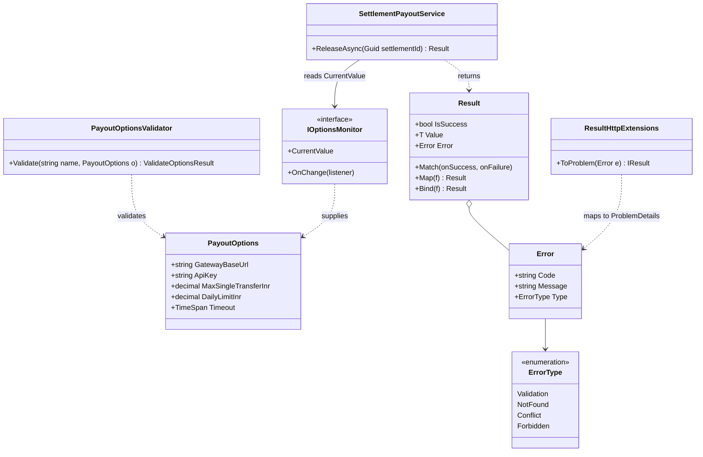
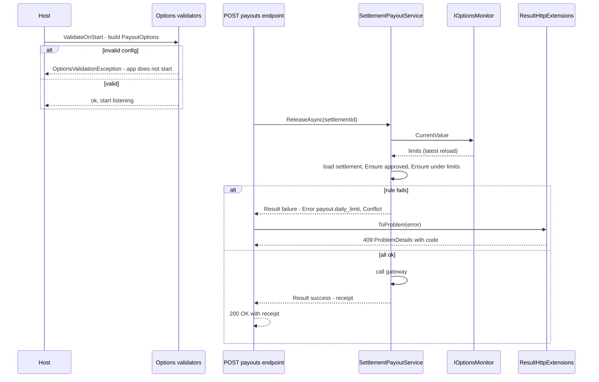

This lesson pairs two patterns that fix two kinds of dishonesty in code. **Options** fixes configuration that lies: settings read as loose strings, mistyped, and discovered to be wrong at 2 a.m. **Result** fixes method signatures that lie: `Task<PayoutReceipt> ReleaseAsync(...)` promises a receipt, but sometimes throws because the seller's settlement wasn't approved yet. That's not a bug. It's an everyday business outcome.

## Learning objectives

By the end of this lesson you will be able to:

1. Bind a configuration section to a typed options class, and validate it with DataAnnotations and `IValidateOptions<T>`.
2. Use `ValidateOnStart` so bad configuration stops the app at start-up, not on the first request.
3. Choose between `IOptions<T>`, `IOptionsSnapshot<T>` and `IOptionsMonitor<T>` by lifetime and reload needs.
4. Implement a `Result<T>` type with `Match`, `Map`, `Bind` and `Ensure`.
5. Decide which failures are *expected* (return a Result) and which are *exceptional* (throw).
6. Map `Error` values to RFC 9457 ProblemDetails responses in ASP.NET Core.

## Prerequisites

- [Dependency Injection as a pattern](#/lesson/m06-dependency-injection-pattern): options are delivered through DI, and their lifetimes matter.
- [Error handling and domain exceptions](#/lesson/m07-domain-exceptions): this lesson argues where *not* to use them.
- [Validation and business rules](#/lesson/m07-validation-rules).

## Explain it like I'm a beginner

**Options: the finance desk's standing instructions.** An online marketplace pays its sellers every week. Before the payout run starts, the finance team pins a **signed instruction sheet** on the desk: maximum single payout ₹50 lakh, daily payout limit ₹2 crore, payment gateway address. Clerks don't phone the finance head each time to ask "what's the limit again?" They read the sheet. And the sheet is **checked before the run starts**. If someone wrote "daily limit ₹10" or left the gateway address blank, no payouts go out until it's fixed.

- The sheet is an **options class**: typed settings in one object.
- Checking it before work starts is **validation on start** (`ValidateOnStart`).
- Some sheets are fixed for the whole year (`IOptions`), some are re-read each morning (`IOptionsSnapshot`), and some are on a live notice board that updates the moment head office changes it (`IOptionsMonitor`).

**Result: an honest reply slip.** When a seller asks the finance desk to release this week's settlement, the clerk returns a slip that says *either* "Paid, UTR 4511…" *or* "Not paid, reason: settlement not approved yet (a customer return is still open)". Both are normal answers. The clerk doesn't faint (throw an exception) because a settlement isn't approved yet. They write the reason on the slip.

- The slip is a **Result**: it holds either a value or an error.
- The reason is an **error value**, with a code and a message.
- If the office is on fire (the database is down), the clerk does stop and raise the alarm. That's a real **exception**.

## First-principles explanation

### Options pattern

**What it is.** A plain class whose properties mirror a configuration section, registered in DI so consumers receive typed, validated settings:

```json
{ "Payouts": { "GatewayBaseUrl": "https://pay.example.in", "ApiKey": "…", "MaxSingleTransferInr": 5000000, "DailyLimitInr": 20000000, "Timeout": "00:00:10" } }
```

**The problem it solves.** `config["Payouts:DailyLimit"]` scattered through code is stringly typed: typos give `null`, and parsing happens everywhere. There's also no single place to say what's valid. A typo in `appsettings.Production.json` stays hidden until the first payout request fails.

**How it works.** `services.AddOptions<PayoutOptions>().BindConfiguration("Payouts")` registers a configuration step. When someone first asks for the options, the framework creates an instance, runs every `Configure`/`Bind` step, then runs every validator (`IValidateOptions<T>`). If any validator fails, it throws `OptionsValidationException` listing all failures. `ValidateOnStart()` forces that first creation during host start-up, so the app refuses to start with bad configuration. In .NET 8 and later you can also mark a partial class with `[OptionsValidator]` to have the validator generated at compile time, which avoids reflection and works with Native AOT.

**The three interfaces:**

| Interface | Lifetime | Reloads when config changes? | Use from |
|---|---|---|---|
| `IOptions<T>` | Singleton | No. The value is computed once. | Anywhere. The simplest choice. |
| `IOptionsSnapshot<T>` | Scoped | Yes, recomputed **per request** | Scoped/transient services, endpoints. **Not** singletons (captive dependency). |
| `IOptionsMonitor<T>` | Singleton | Yes, `CurrentValue` is always the latest, and `OnChange` notifies | Singletons and background services that must see live changes. |

All three also support **named options** (`Get("primary")`, `Get("backup")`) for several configurations of the same type, such as two payment gateways.

**When not to use it.** For values that change per request or per tenant and live in a database (seller-specific payout limits), options are the wrong tool. Load them through a service, perhaps cached. For secrets, bind options from a secret store (Azure Key Vault, environment variables). Never commit them to `appsettings.json`.

### Result pattern

**What it is.** A return type that holds **either** a success value **or** an error, never both: `Result<PayoutReceipt>`. Callers must look at which one they got. Errors are **values**: a code, a message and a category.

**The problem it solves.** Exceptions are invisible in signatures. A caller of `ReleaseAsync` can't tell from the type that "settlement not approved" is a normal outcome, so they forget to handle it, and it surfaces as a 500 error. Teams then write `try/catch` around business calls to turn exceptions into HTTP codes, a hidden `goto` that's easy to get wrong. Exceptions also cost more than return values: capturing a stack trace is expensive compared to returning an object. That doesn't matter for rare failures, but it's noticeable when "invalid input" happens on thousands of requests a minute (an estimate that depends on the workload; measure before optimising).

**How it works.** `Result<T>` exposes `IsSuccess`, `Value` and `Error`, plus combinators:

- `Match(onSuccess, onFailure)`: handle both cases and produce one value, such as an HTTP response.
- `Map(f)`: transform the success value and pass failures through untouched.
- `Bind(f)`: chain another operation that itself returns a Result ("railway-oriented programming": stay on the success track, or switch to the failure track and stay there).
- `Ensure(predicate, error)`: turn a success into a failure if a rule doesn't hold.

**Errors as values vs exceptions — the rule of thumb:**

| Return a Result (expected) | Throw an exception (exceptional) |
|---|---|
| Settlement not found, not approved, or over the limit | Database or network down, timeout |
| Validation failures on user input | Bugs: null where impossible, broken invariants |
| Business rule rejections ("slot already booked") | Misconfiguration discovered at runtime |
| Anything the caller can reasonably act on | Anything the caller can't fix, which goes to a global handler (500/503) |

**When not to use Result.** In code where nearly every failure is exceptional (infrastructure adapters), for a simple CRUD app where a few domain exceptions and one handler are clearer, and when your team isn't consistent. Half the codebase returning Results and half throwing for the same kind of failure is worse than either alone. Also, don't wrap every private method in `Result`. Use it at the boundaries of business operations.

### Trade-offs

| Pattern | You gain | You pay |
|---|---|---|
| Options | Typed settings, fail-fast validation, one source of truth, reload support | Choosing the right interface (snapshot inside a singleton is a classic bug). Reload doesn't fit every setting. |
| Result | Honest signatures, cheap expected failures, explicit HTTP mapping | More verbose call sites. C# has no built-in Result or discriminated unions yet, so the team must agree on one type. |

## Visual explanation

### Class diagram



How to read it: the top half is **Options**. `PayoutOptions` is a plain class, `PayoutOptionsValidator` checks rules that span several fields, and `IOptionsMonitor` (the generic `IOptionsMonitor<PayoutOptions>`) hands the current value to the singleton `SettlementPayoutService`. The bottom half is **Result**: the service returns `Result<PayoutReceipt>`, which carries either a receipt or an `Error`. `ResultHttpExtensions`, at the web boundary, is the only class that knows how an `ErrorType` becomes an HTTP status. The domain never mentions HTTP.

### Sequence diagram



Two moments matter. At **start-up**, `ValidateOnStart` builds and validates the options before Kestrel accepts traffic. A missing API key crashes the deployment immediately, where your health checks and rollout tooling can see it. At **request time**, an expected failure travels back as a *value*. No exception is thrown, and the web layer maps it to a ProblemDetails response in one place.

## Step-by-step example

### Step 1 — the naive version

```csharp
public async Task<PayoutReceipt> ReleaseAsync(Guid settlementId)
{
    var max = decimal.Parse(_config["Payouts:MaxSingle"]!);              // typo-prone, parsed every call
    var settlement = await _settlements.GetAsync(settlementId) ?? throw new KeyNotFoundException();
    if (settlement.Status != SettlementStatus.Approved) throw new InvalidOperationException("Not approved");
    if (settlement.NetPayableInr > max) throw new ArgumentException("Too large");
    return await _gateway.PayAsync(settlement);
}
// Controller: try { ... } catch (KeyNotFoundException) { 404 } catch (InvalidOperationException) { 409 } ...
```

### Step 2 — typed, validated options

Create `PayoutOptions`, bind it, validate it with attributes plus a cross-field validator, and call `ValidateOnStart()`.

### Step 3 — errors as values

Return `Result<PayoutReceipt>`. Each business rejection becomes an `Error` with a stable code (`settlement.not_approved`), which clients and logs can rely on.

### Step 4 — one mapping to HTTP

`result.Match(receipt => Results.Ok(receipt), error => error.ToProblem())`.

## Production-style C# implementation

```text
Payouts.Api/
  Program.cs
  Options/PayoutOptions.cs
  Results/Error.cs, Result.cs, ResultHttpExtensions.cs
  Payouts/Settlements.cs, SettlementPayoutService.cs
```

### Options

```csharp file=Options/PayoutOptions.cs
using System.ComponentModel.DataAnnotations;
using Microsoft.Extensions.Options;

namespace Payouts.Options;

public sealed class PayoutOptions
{
    public const string SectionName = "Payouts";

    [Required, Url] public string GatewayBaseUrl { get; set; } = "";
    [Required, MinLength(16)] public string ApiKey { get; set; } = "";
    [Range(1d, 100_000_000d)] public decimal MaxSingleTransferInr { get; set; } = 5_000_000m;   // ₹50 lakh
    [Range(1d, 1_000_000_000d)] public decimal DailyLimitInr { get; set; } = 20_000_000m;      // ₹2 crore
    [Range(typeof(TimeSpan), "00:00:01", "00:01:00")] public TimeSpan Timeout { get; set; } = TimeSpan.FromSeconds(10);
}

/// <summary>Rules that span fields, or need logic, go here. DataAnnotations handle single-field rules.</summary>
public sealed class PayoutOptionsValidator : IValidateOptions<PayoutOptions>
{
    public ValidateOptionsResult Validate(string? name, PayoutOptions o)
    {
        var failures = new List<string>();
        if (o.MaxSingleTransferInr > o.DailyLimitInr)
            failures.Add($"MaxSingleTransferInr ({o.MaxSingleTransferInr}) cannot exceed DailyLimitInr ({o.DailyLimitInr}).");
        if (Uri.TryCreate(o.GatewayBaseUrl, UriKind.Absolute, out var uri) && uri.Scheme != Uri.UriSchemeHttps)
            failures.Add("GatewayBaseUrl must use https.");
        if (o.ApiKey.Contains("changeme", StringComparison.OrdinalIgnoreCase))
            failures.Add("ApiKey still has the placeholder value.");
        return failures.Count == 0 ? ValidateOptionsResult.Success : ValidateOptionsResult.Fail(failures);
    }
}
```

### Result and Error

```csharp file=Results/Error.cs
namespace Payouts.Results;

public enum ErrorType { Validation, NotFound, Conflict, Forbidden }

/// <summary>An expected failure as a value. Code is stable and machine-readable; Message is for humans.</summary>
public sealed record Error(string Code, string Message, ErrorType Type, IReadOnlyDictionary<string, string[]>? Fields = null)
{
    public static Error NotFound(string code, string message) => new(code, message, ErrorType.NotFound);
    public static Error Conflict(string code, string message) => new(code, message, ErrorType.Conflict);
    public static Error Forbidden(string code, string message) => new(code, message, ErrorType.Forbidden);
    public static Error Validation(string code, string message, IReadOnlyDictionary<string, string[]>? fields = null) =>
        new(code, message, ErrorType.Validation, fields);
}
```

```csharp file=Results/Result.cs
namespace Payouts.Results;

/// <summary>Either a Value or an Error, never both. A class (not a struct) so that default(Result) can't
/// silently mean "failure with no error".</summary>
public sealed class Result<T>
{
    private readonly T? _value;
    private readonly Error? _error;

    private Result(T value) { _value = value; IsSuccess = true; }
    private Result(Error error) { _error = error; }

    public bool IsSuccess { get; }
    public bool IsFailure => !IsSuccess;
    public T Value => IsSuccess ? _value! : throw new InvalidOperationException($"No value: result failed with {_error!.Code}.");
    public Error Error => IsFailure ? _error! : throw new InvalidOperationException("No error: result succeeded.");

    public static Result<T> Success(T value) => new(value);
    public static Result<T> Failure(Error error) => new(error ?? throw new ArgumentNullException(nameof(error)));

    public static implicit operator Result<T>(T value) => Success(value);
    public static implicit operator Result<T>(Error error) => Failure(error);

    public TOut Match<TOut>(Func<T, TOut> onSuccess, Func<Error, TOut> onFailure) =>
        IsSuccess ? onSuccess(_value!) : onFailure(_error!);

    public Result<TOut> Map<TOut>(Func<T, TOut> map) =>
        IsSuccess ? Result<TOut>.Success(map(_value!)) : Result<TOut>.Failure(_error!);

    public Result<TOut> Bind<TOut>(Func<T, Result<TOut>> next) =>
        IsSuccess ? next(_value!) : Result<TOut>.Failure(_error!);

    public async Task<Result<TOut>> BindAsync<TOut>(Func<T, Task<Result<TOut>>> next) =>
        IsSuccess ? await next(_value!) : Result<TOut>.Failure(_error!);

    public Result<T> Ensure(Func<T, bool> rule, Func<T, Error> error) =>
        IsFailure || rule(_value!) ? this : Failure(error(_value!));
}
```

### Mapping errors to ProblemDetails

```csharp file=Results/ResultHttpExtensions.cs
namespace Payouts.Results;

/// <summary>The only place that knows how error categories become HTTP. Domain code never sees status codes.</summary>
public static class ResultHttpExtensions
{
    public static IResult ToProblem(this Error error)
    {
        var extensions = new Dictionary<string, object?> { ["code"] = error.Code };

        if (error.Type == ErrorType.Validation && error.Fields is { Count: > 0 } fields)
            return TypedResults.ValidationProblem(fields.ToDictionary(kv => kv.Key, kv => kv.Value),
                detail: error.Message, title: "One or more fields are invalid.", extensions: extensions);

        var (status, title) = error.Type switch
        {
            ErrorType.NotFound => (StatusCodes.Status404NotFound, "Resource not found"),
            ErrorType.Conflict => (StatusCodes.Status409Conflict, "Request conflicts with current state"),
            ErrorType.Forbidden => (StatusCodes.Status403Forbidden, "Not allowed"),
            _ => (StatusCodes.Status400BadRequest, "Invalid request"),
        };
        return TypedResults.Problem(detail: error.Message, statusCode: status, title: title,
            type: $"https://errors.payouts.example.in/{error.Code}", extensions: extensions);
    }

    public static IResult ToHttpResult<T>(this Result<T> result, Func<T, IResult> onSuccess) =>
        result.Match(onSuccess, e => e.ToProblem());
}
```

### The service

```csharp file=Payouts/Settlements.cs
namespace Payouts.Settlements;

public enum SettlementStatus { Submitted, Approved, Paid, Rejected }

public sealed class SellerSettlement
{
    public required Guid Id { get; init; }
    public required string SellerName { get; init; }
    public required string BankAccountRef { get; init; }
    public decimal NetPayableInr { get; init; }
    public SettlementStatus Status { get; set; }
}

public sealed record PayoutReceipt(Guid SettlementId, string Utr, decimal AmountInr, DateTimeOffset PaidAt);

public interface ISettlementStore
{
    Task<SellerSettlement?> GetAsync(Guid id, CancellationToken ct);
    Task<decimal> PaidTodayAsync(DateOnly day, CancellationToken ct);
    Task MarkPaidAsync(SellerSettlement settlement, PayoutReceipt receipt, CancellationToken ct);
}

public sealed record GatewayResponse(bool Accepted, string? Utr, string? DeclineReason);

public interface IPaymentGateway
{
    /// <summary>Throws (HttpRequestException, TimeoutException) for infrastructure failures;
    /// returns Accepted=false for business declines such as an exhausted escrow balance.</summary>
    Task<GatewayResponse> TransferAsync(string accountRef, decimal amountInr, string idempotencyKey, CancellationToken ct);
}

public sealed class InMemorySettlementStore : ISettlementStore
{
    private readonly Dictionary<Guid, SellerSettlement> _settlements = new();
    private readonly List<PayoutReceipt> _paid = new();
    private readonly object _gate = new();

    public InMemorySettlementStore(IEnumerable<SellerSettlement> seed) { foreach (var b in seed) _settlements[b.Id] = b; }

    public Task<SellerSettlement?> GetAsync(Guid id, CancellationToken ct) { lock (_gate) return Task.FromResult(_settlements.GetValueOrDefault(id)); }
    public Task<decimal> PaidTodayAsync(DateOnly day, CancellationToken ct)
    { lock (_gate) return Task.FromResult(_paid.Where(p => DateOnly.FromDateTime(p.PaidAt.UtcDateTime) == day).Sum(p => p.AmountInr)); }
    public Task MarkPaidAsync(SellerSettlement settlement, PayoutReceipt receipt, CancellationToken ct)
    { lock (_gate) { settlement.Status = SettlementStatus.Paid; _paid.Add(receipt); } return Task.CompletedTask; }
}

public sealed class FakePaymentGateway : IPaymentGateway
{
    private int _n;
    public Task<GatewayResponse> TransferAsync(string accountRef, decimal amountInr, string idempotencyKey, CancellationToken ct) =>
        Task.FromResult(new GatewayResponse(true, $"UTR{Interlocked.Increment(ref _n):D10}", null));
}
```

```csharp file=Payouts/SettlementPayoutService.cs
using Microsoft.Extensions.Options;
using Payouts.Options;
using Payouts.Results;

namespace Payouts.Settlements;

/// <summary>Singleton. Uses IOptionsMonitor so limit changes in configuration apply without a restart.</summary>
public sealed class SettlementPayoutService(ISettlementStore settlements, IPaymentGateway gateway, IOptionsMonitor<PayoutOptions> options, TimeProvider clock)
{
    public async Task<Result<PayoutReceipt>> ReleaseAsync(Guid settlementId, CancellationToken ct)
    {
        var limits = options.CurrentValue;              // read once per operation: consistent within this call
        var settlement = await settlements.GetAsync(settlementId, ct);
        if (settlement is null) return Error.NotFound("settlement.not_found", $"Settlement {settlementId} does not exist.");

        var checkedSettlement = Result<SellerSettlement>.Success(settlement)
            .Ensure(b => b.Status != SettlementStatus.Paid, b => Error.Conflict("settlement.already_paid", "This settlement has already been paid."))
            .Ensure(b => b.Status == SettlementStatus.Approved, b => Error.Conflict("settlement.not_approved", $"Settlement is {b.Status}; only approved settlements can be paid."))
            .Ensure(b => b.NetPayableInr <= limits.MaxSingleTransferInr, b => Error.Validation("payout.over_single_limit",
                $"₹{b.NetPayableInr:N0} exceeds the single-transfer limit of ₹{limits.MaxSingleTransferInr:N0}; split the payment."));
        if (checkedSettlement.IsFailure) return checkedSettlement.Error;

        var now = clock.GetUtcNow();
        var paidToday = await settlements.PaidTodayAsync(DateOnly.FromDateTime(now.UtcDateTime), ct);
        if (paidToday + settlement.NetPayableInr > limits.DailyLimitInr)
            return Error.Conflict("payout.daily_limit", $"Today's limit of ₹{limits.DailyLimitInr:N0} would be exceeded; retry tomorrow.");

        // Infrastructure failures (network, timeout) are exceptions: let them propagate to the global handler.
        var response = await gateway.TransferAsync(settlement.BankAccountRef, settlement.NetPayableInr, idempotencyKey: $"settlement-{settlement.Id}", ct);
        if (!response.Accepted)
            return Error.Conflict("payout.declined", response.DeclineReason ?? "The bank declined the transfer.");

        var receipt = new PayoutReceipt(settlement.Id, response.Utr!, settlement.NetPayableInr, now);
        await settlements.MarkPaidAsync(settlement, receipt, ct);
        return receipt;                                  // implicit conversion to Result<PayoutReceipt>
    }
}
```

### Wiring

```csharp file=Program.cs
using Microsoft.Extensions.Options;
using Payouts.Settlements;
using Payouts.Options;
using Payouts.Results;

var builder = WebApplication.CreateBuilder(args);

builder.Services.AddOptions<PayoutOptions>()
    .BindConfiguration(PayoutOptions.SectionName)
    .ValidateDataAnnotations()           // [Required], [Range], [Url] ...
    .ValidateOnStart();                  // fail the deployment, not the first request
builder.Services.AddSingleton<IValidateOptions<PayoutOptions>, PayoutOptionsValidator>();   // cross-field rules

builder.Services.AddSingleton(TimeProvider.System);
builder.Services.AddSingleton<ISettlementStore>(new InMemorySettlementStore(new[]
{
    new SellerSettlement { Id = Guid.Parse("11111111-1111-1111-1111-111111111111"), SellerName = "Sahyadri Handlooms",
                      BankAccountRef = "acct-ref-001", NetPayableInr = 1_850_000m, Status = SettlementStatus.Approved },
}));
builder.Services.AddSingleton<IPaymentGateway, FakePaymentGateway>();
builder.Services.AddSingleton<SettlementPayoutService>();

builder.Services.AddProblemDetails();    // uniform ProblemDetails for unhandled exceptions and status codes

var app = builder.Build();
app.UseExceptionHandler();               // exceptions -> 500 ProblemDetails (no stack trace leaked)
app.UseStatusCodePages();

app.MapPost("/settlements/{id:guid}/payout", async (Guid id, SettlementPayoutService payouts, CancellationToken ct) =>
    (await payouts.ReleaseAsync(id, ct)).ToHttpResult(receipt => TypedResults.Ok(receipt)));

// IOptionsSnapshot: scoped, recomputed per request. Fine here, because endpoints are per request.
app.MapGet("/payout-limits", (IOptionsSnapshot<PayoutOptions> snapshot) =>
    Results.Ok(new { snapshot.Value.MaxSingleTransferInr, snapshot.Value.DailyLimitInr }));

app.Run();
```

A response for an unapproved settlement looks like this:

```json
{
  "type": "https://errors.payouts.example.in/settlement.not_approved",
  "title": "Request conflicts with current state",
  "status": 409,
  "detail": "Settlement is Submitted; only approved settlements can be paid.",
  "code": "settlement.not_approved"
}
```

## Bad design vs good design

**Bad: `IOptionsSnapshot<T>` in a singleton.** `AddSingleton<SettlementPayoutService>()` with a constructor taking `IOptionsSnapshot<PayoutOptions>`. The snapshot is scoped, so this is a captive dependency. With scope validation on, start-up fails; without it, the singleton freezes the first request's values. Use `IOptionsMonitor<T>` in singletons.

**Bad: reading `.Value` in the constructor and caching it in a singleton,** then wondering why reloads don't apply. That's fine if you *want* fixed values, so use `IOptions<T>` and say so. If you want live values, read `monitor.CurrentValue` per operation.

**Bad: exceptions as control flow for expected outcomes.** It costs more, it's invisible in signatures, and it relies on every controller catching the right types.

**Bad: Results that swallow real failures.** `catch (Exception ex) { return Error.Unexpected(ex.Message); }` around everything hides outages from your exception handler, metrics and alerting, and can leak internal messages to clients. Let infrastructure exceptions propagate.

**Bad: stringly-typed errors.** `Result.Fail("Settlement not approved!!")`. Clients can't branch on text, and translations break it. Use stable `Code`s.

**Good:** validated options with `ValidateOnStart`, the right options interface per lifetime, `Result<T>` for expected business outcomes with stable codes, exceptions for the exceptional, and one mapping to ProblemDetails.

:::callout type=tradeoff title="Libraries vs your own Result"
Popular libraries (ErrorOr, FluentResults, Ardalis.Result, OneOf) provide richer Result types. A 60-line Result like the one above is enough for many teams, and has no dependency. Pick one and use it **consistently** across the codebase. Mixing styles is the real cost.
:::

## Practical playground

The playground binds options from an in-memory configuration, shows validation failing, then demonstrates `IOptions` vs `IOptionsMonitor` after a reload, and finally chains Results. Change `DailyLimitInr` to a value below `MaxSingleTransferInr` and run it again.

:::playground type=csharp title="Options validation, reload and Results"
```csharp file=Program.cs
using System;
using System.Collections.Generic;
using Microsoft.Extensions.Configuration;
using Microsoft.Extensions.DependencyInjection;
using Microsoft.Extensions.Options;

public sealed class LimitOptions { public decimal MaxSingleTransferInr { get; set; } public decimal DailyLimitInr { get; set; } }

public sealed record Error(string Code, string Message);
public sealed class Result<T>
{
    public bool IsSuccess { get; private init; }
    public T? Value { get; private init; }
    public Error? Error { get; private init; }
    public static Result<T> Ok(T v) => new() { IsSuccess = true, Value = v };
    public static Result<T> Fail(Error e) => new() { Error = e };
    public Result<T> Ensure(Func<T, bool> rule, Error e) => IsSuccess && !rule(Value!) ? Fail(e) : this;
    public override string ToString() => IsSuccess ? $"OK {Value}" : $"FAIL {Error!.Code}: {Error.Message}";
}

public static class Program
{
    public static void Main()
    {
        var config = new ConfigurationBuilder().AddInMemoryCollection(new Dictionary<string, string?>
        {
            ["Limits:MaxSingleTransferInr"] = "5000000",
            ["Limits:DailyLimitInr"] = "20000000",
        }).Build();

        using var sp = new ServiceCollection()
            .AddOptions<LimitOptions>().Bind(config.GetSection("Limits"))
            .Validate(o => o.MaxSingleTransferInr <= o.DailyLimitInr, "Single limit cannot exceed daily limit.").Services
            .BuildServiceProvider();

        var fixedValue = sp.GetRequiredService<IOptions<LimitOptions>>();
        var monitor = sp.GetRequiredService<IOptionsMonitor<LimitOptions>>();
        Console.WriteLine($"Start: IOptions daily={fixedValue.Value.DailyLimitInr}, monitor daily={monitor.CurrentValue.DailyLimitInr}");

        config["Limits:DailyLimitInr"] = "30000000";
        config.Reload();
        Console.WriteLine($"After reload: IOptions daily={fixedValue.Value.DailyLimitInr}, monitor daily={monitor.CurrentValue.DailyLimitInr}");

        var limits = monitor.CurrentValue;
        foreach (var amount in new[] { 1_850_000m, 7_500_000m })
        {
            var r = Result<decimal>.Ok(amount)
                .Ensure(a => a > 0, new Error("payout.non_positive", "Amount must be positive."))
                .Ensure(a => a <= limits.MaxSingleTransferInr, new Error("payout.over_single_limit", $"Over ₹{limits.MaxSingleTransferInr:N0}."));
            Console.WriteLine($"Pay ₹{amount:N0}: {r}");
        }

        // A bad edit: the monitor rebuilds the value when the change fires, so the reload itself throws...
        config["Limits:DailyLimitInr"] = "100";
        try { config.Reload(); }
        catch (AggregateException ex) when (ex.InnerException is OptionsValidationException ove)
        { Console.WriteLine("Reload rejected: " + string.Join("; ", ove.Failures)); }
        // ...and every later read throws until the configuration is fixed.
        try { _ = monitor.CurrentValue; }
        catch (OptionsValidationException ex) { Console.WriteLine("CurrentValue now throws: " + ex.Message); }
    }
}
```
:::

## Exercises

:::exercise id=m06-options-result-ex1 difficulty=beginner kind=code title="Implement Result<T> with Match"
Implement the core of `Result<T>`: creation, state checks, guarded access and `Match`.
::requirements
- `Result<T>.Success(value)` and `Result<T>.Failure(error)`. `Failure(null)` throws `ArgumentNullException`.
- `IsSuccess` and `IsFailure`.
- `Value` throws `InvalidOperationException` on a failure. `Error` throws `InvalidOperationException` on a success.
- `Match(onSuccess, onFailure)` calls exactly one of the two functions.
- Implicit conversions from `T` and from `Error`.
::acceptance
- All tests pass, including the "calls exactly one branch" test.
::hint
Two private constructors, one for each case, keep invalid states unrepresentable.
::hint
Store `_value`, `_error` and an `IsSuccess` flag. Only one of `_value` and `_error` is meaningful.
::hint
`public TOut Match<TOut>(Func<T, TOut> ok, Func<Error, TOut> fail) => IsSuccess ? ok(_value!) : fail(_error!);`
::hint
Implicit operators: `public static implicit operator Result<T>(T value) => Success(value);` and the same for `Error`.
::starter
```csharp file=Result.cs
using System;

public sealed record Error(string Code, string Message);

public sealed class Result<T>
{
    public bool IsSuccess => throw new NotImplementedException();
    public bool IsFailure => throw new NotImplementedException();
    public T Value => throw new NotImplementedException();
    public Error Error => throw new NotImplementedException();

    public static Result<T> Success(T value) => throw new NotImplementedException();
    public static Result<T> Failure(Error error) => throw new NotImplementedException();

    public static implicit operator Result<T>(T value) => throw new NotImplementedException();
    public static implicit operator Result<T>(Error error) => throw new NotImplementedException();

    public TOut Match<TOut>(Func<T, TOut> onSuccess, Func<Error, TOut> onFailure) => throw new NotImplementedException();
}
```
::tests
```csharp file=ResultTests.cs
using System;
using Xunit;

public class ResultTests
{
    private static readonly Error NotApproved = new("settlement.not_approved", "Settlement is not approved.");

    [Fact]
    public void Success_exposes_value()
    {
        var r = Result<int>.Success(42);
        Assert.True(r.IsSuccess);
        Assert.False(r.IsFailure);
        Assert.Equal(42, r.Value);
        Assert.Throws<InvalidOperationException>(() => r.Error);
    }

    [Fact]
    public void Failure_exposes_error()
    {
        var r = Result<int>.Failure(NotApproved);
        Assert.True(r.IsFailure);
        Assert.Equal("settlement.not_approved", r.Error.Code);
        Assert.Throws<InvalidOperationException>(() => r.Value);
    }

    [Fact]
    public void Failure_requires_an_error() =>
        Assert.Throws<ArgumentNullException>(() => Result<int>.Failure(null!));

    [Fact]
    public void Match_calls_exactly_one_branch()
    {
        int okCalls = 0, failCalls = 0;
        var text = Result<int>.Failure(NotApproved).Match(v => { okCalls++; return $"ok {v}"; }, e => { failCalls++; return e.Code; });
        Assert.Equal("settlement.not_approved", text);
        Assert.Equal(0, okCalls);
        Assert.Equal(1, failCalls);
    }

    [Fact]
    public void Implicit_conversions()
    {
        Result<string> ok = "UTR0000000042";
        Result<string> fail = NotApproved;
        Assert.True(ok.IsSuccess);
        Assert.True(fail.IsFailure);
    }
}
```
::solution
```csharp file=Result.cs
using System;

public sealed record Error(string Code, string Message);

public sealed class Result<T>
{
    private readonly T? _value;
    private readonly Error? _error;

    private Result(T value) { _value = value; IsSuccess = true; }
    private Result(Error error) { _error = error; }

    public bool IsSuccess { get; }
    public bool IsFailure => !IsSuccess;
    public T Value => IsSuccess ? _value! : throw new InvalidOperationException($"Result failed: {_error!.Code}");
    public Error Error => IsFailure ? _error! : throw new InvalidOperationException("Result succeeded; there is no error.");

    public static Result<T> Success(T value) => new(value);
    public static Result<T> Failure(Error error) => new(error ?? throw new ArgumentNullException(nameof(error)));

    public static implicit operator Result<T>(T value) => Success(value);
    public static implicit operator Result<T>(Error error) => Failure(error);

    public TOut Match<TOut>(Func<T, TOut> onSuccess, Func<Error, TOut> onFailure) =>
        IsSuccess ? onSuccess(_value!) : onFailure(_error!);
}
```

Why throw when reading `Value` on a failure? It turns a forgotten check into a loud bug at the exact line, instead of a silent `default` (0, null) flowing into a payment amount.
::mistakes
- Making `Value` return `default` on failure. A ₹0 payout is a terrible silent failure.
- A public constructor that accepts both a value and an error, which allows impossible states.
- Making `Result<T>` a mutable class with setters.
:::

:::exercise id=m06-options-result-ex2 difficulty=beginner kind=code title="Validate SMS gateway options"
Indian commercial SMS needs a registered 6-character sender ID (header). Write `SmsGatewayOptionsValidator : IValidateOptions<SmsGatewayOptions>`, and register options so that resolving them with bad values throws `OptionsValidationException`.
::requirements
- `SenderId`: exactly 6 uppercase letters A–Z.
- `BaseUrl`: an absolute `https` URL.
- `MaxPerMinute`: between 1 and 600.
- Report **all** failures at once, not just the first.
- `SmsSetup.Register(services, configure)` adds the options with the delegate and registers the validator.
::acceptance
- Valid options produce `ValidateOptionsResult.Success`.
- `SenderId = "Qkcar1"`, `BaseUrl = "http://x"` and `MaxPerMinute = 0` give three failures.
- Resolving `IOptions<SmsGatewayOptions>.Value` with invalid values throws `OptionsValidationException`.
::hint
Collect messages in a `List<string>`, and return `ValidateOptionsResult.Fail(list)` if it's not empty.
::hint
`Regex.IsMatch(o.SenderId ?? "", "^[A-Z]{6}$")` checks the sender ID.
::hint
`Uri.TryCreate(o.BaseUrl, UriKind.Absolute, out var u) && u.Scheme == Uri.UriSchemeHttps`.
::hint
```csharp
services.AddOptions<SmsGatewayOptions>().Configure(configure);
services.AddSingleton<IValidateOptions<SmsGatewayOptions>, SmsGatewayOptionsValidator>();
```
::starter
```csharp file=SmsOptions.cs
using System;
using System.Collections.Generic;
using System.Text.RegularExpressions;
using Microsoft.Extensions.DependencyInjection;
using Microsoft.Extensions.Options;

public sealed class SmsGatewayOptions
{
    public string SenderId { get; set; } = "";
    public string BaseUrl { get; set; } = "";
    public int MaxPerMinute { get; set; } = 60;
}

public sealed class SmsGatewayOptionsValidator : IValidateOptions<SmsGatewayOptions>
{
    public ValidateOptionsResult Validate(string? name, SmsGatewayOptions options) => throw new NotImplementedException();
}

public static class SmsSetup
{
    public static IServiceCollection Register(IServiceCollection services, Action<SmsGatewayOptions> configure) =>
        throw new NotImplementedException();
}
```
::tests
```csharp file=SmsOptionsTests.cs
using System.Linq;
using Microsoft.Extensions.DependencyInjection;
using Microsoft.Extensions.Options;
using Xunit;

public class SmsOptionsTests
{
    private static SmsGatewayOptions Valid() => new() { SenderId = "QKCART", BaseUrl = "https://sms.example.in/api", MaxPerMinute = 120 };

    [Fact]
    public void Valid_options_pass() =>
        Assert.True(new SmsGatewayOptionsValidator().Validate(null, Valid()).Succeeded);

    [Fact]
    public void All_failures_reported()
    {
        var r = new SmsGatewayOptionsValidator().Validate(null, new SmsGatewayOptions { SenderId = "Qkcar1", BaseUrl = "http://x", MaxPerMinute = 0 });
        Assert.True(r.Failed);
        Assert.Equal(3, r.Failures!.Count());
    }

    [Theory]
    [InlineData("QKCAR", false)]
    [InlineData("QKCARTS", false)]
    [InlineData("qkcart", false)]
    [InlineData("QKCART", true)]
    public void Sender_id_rules(string senderId, bool ok)
    {
        var o = Valid(); o.SenderId = senderId;
        Assert.Equal(ok, new SmsGatewayOptionsValidator().Validate(null, o).Succeeded);
    }

    [Fact]
    public void Resolving_invalid_options_throws()
    {
        using var sp = SmsSetup.Register(new ServiceCollection(), o => { o.SenderId = "BAD"; o.BaseUrl = "https://ok.in"; })
            .BuildServiceProvider();
        var ex = Assert.Throws<OptionsValidationException>(() => sp.GetRequiredService<IOptions<SmsGatewayOptions>>().Value);
        Assert.Single(ex.Failures);
    }

    [Fact]
    public void Resolving_valid_options_works()
    {
        using var sp = SmsSetup.Register(new ServiceCollection(), o => { o.SenderId = "QKCART"; o.BaseUrl = "https://ok.in"; o.MaxPerMinute = 600; })
            .BuildServiceProvider();
        Assert.Equal("QKCART", sp.GetRequiredService<IOptions<SmsGatewayOptions>>().Value.SenderId);
    }
}
```
::solution
```csharp file=SmsOptions.cs
using System;
using System.Collections.Generic;
using System.Text.RegularExpressions;
using Microsoft.Extensions.DependencyInjection;
using Microsoft.Extensions.Options;

public sealed class SmsGatewayOptions
{
    public string SenderId { get; set; } = "";
    public string BaseUrl { get; set; } = "";
    public int MaxPerMinute { get; set; } = 60;
}

public sealed class SmsGatewayOptionsValidator : IValidateOptions<SmsGatewayOptions>
{
    private static readonly Regex SenderPattern = new("^[A-Z]{6}$", RegexOptions.Compiled);

    public ValidateOptionsResult Validate(string? name, SmsGatewayOptions o)
    {
        var failures = new List<string>();
        if (!SenderPattern.IsMatch(o.SenderId ?? ""))
            failures.Add($"SenderId '{o.SenderId}' must be exactly 6 uppercase letters.");
        if (!Uri.TryCreate(o.BaseUrl, UriKind.Absolute, out var uri) || uri.Scheme != Uri.UriSchemeHttps)
            failures.Add($"BaseUrl '{o.BaseUrl}' must be an absolute https URL.");
        if (o.MaxPerMinute is < 1 or > 600)
            failures.Add($"MaxPerMinute must be between 1 and 600 (was {o.MaxPerMinute}).");
        return failures.Count == 0 ? ValidateOptionsResult.Success : ValidateOptionsResult.Fail(failures);
    }
}

public static class SmsSetup
{
    public static IServiceCollection Register(IServiceCollection services, Action<SmsGatewayOptions> configure)
    {
        services.AddOptions<SmsGatewayOptions>().Configure(configure);
        services.AddSingleton<IValidateOptions<SmsGatewayOptions>, SmsGatewayOptionsValidator>();
        return services;
    }
}
```

In a real app, add `.BindConfiguration("Sms").ValidateOnStart()` so these failures stop the host before any SMS is attempted. Never echo secret values (API keys) in failure messages. They end up in deployment logs.
::mistakes
- Returning after the first failure. Operators then fix one setting per deployment.
- Logging the full options object, secrets included, on validation failure.
:::

:::exercise id=m06-options-result-ex3 difficulty=intermediate kind=code title="Live limits with IOptionsMonitor"
Finance wants to raise the daily payout limit during the March year-end rush **without restarting** the service. Implement `DailyLimitGuard`, a singleton that always uses the current limit and counts how many changes it has observed.
::requirements
- `DailyLimitGuard(IOptionsMonitor<LimitOptions> monitor)`.
- `CanPay(decimal paidToday, decimal amount)` returns true if `paidToday + amount <= CurrentValue.DailyLimitInr`.
- `ChangesObserved` increments each time the options change (subscribe with `OnChange`).
- Implement `IDisposable` and dispose the `OnChange` subscription.
::acceptance
- After the configuration reloads with a higher limit, `CanPay` uses the new limit immediately.
- `IOptions<LimitOptions>.Value` keeps the **old** value (the test proves the difference).
- `ChangesObserved` is 1 after one reload.
::hint
Never store `monitor.CurrentValue` in a field. Read it inside `CanPay`.
::hint
`monitor.OnChange(_ => ChangesObserved++)` returns an `IDisposable?`. Keep it.
::hint
`services.Configure<LimitOptions>(config.GetSection("Limits"))` registers a change-token source, so `config.Reload()` notifies the monitor.
::hint
Use `Interlocked.Increment` for the counter. Change callbacks can run on another thread.
::starter
```csharp file=DailyLimitGuard.cs
using System;
using Microsoft.Extensions.Options;

public sealed class LimitOptions { public decimal DailyLimitInr { get; set; } }

public sealed class DailyLimitGuard : IDisposable
{
    public DailyLimitGuard(IOptionsMonitor<LimitOptions> monitor) => throw new NotImplementedException();
    public int ChangesObserved => throw new NotImplementedException();
    public bool CanPay(decimal paidToday, decimal amount) => throw new NotImplementedException();
    public void Dispose() => throw new NotImplementedException();
}
```
::tests
```csharp file=DailyLimitGuardTests.cs
using System.Collections.Generic;
using Microsoft.Extensions.Configuration;
using Microsoft.Extensions.DependencyInjection;
using Microsoft.Extensions.Options;
using Xunit;

public class DailyLimitGuardTests
{
    private static (IConfigurationRoot Config, ServiceProvider Sp) Build()
    {
        var config = new ConfigurationBuilder()
            .AddInMemoryCollection(new Dictionary<string, string?> { ["Limits:DailyLimitInr"] = "20000000" }).Build();
        var sp = new ServiceCollection()
            .Configure<LimitOptions>(config.GetSection("Limits"))
            .AddSingleton<DailyLimitGuard>()
            .BuildServiceProvider();
        return (config, sp);
    }

    [Fact]
    public void Uses_current_limit()
    {
        var (_, sp) = Build();
        using var _sp = sp;
        var guard = sp.GetRequiredService<DailyLimitGuard>();
        Assert.True(guard.CanPay(15_000_000m, 5_000_000m));
        Assert.False(guard.CanPay(15_000_000m, 5_000_001m));
    }

    [Fact]
    public void Reload_applies_without_restart_but_IOptions_does_not_change()
    {
        var (config, sp) = Build();
        using var _sp = sp;
        var guard = sp.GetRequiredService<DailyLimitGuard>();
        var fixedOptions = sp.GetRequiredService<IOptions<LimitOptions>>();
        Assert.Equal(20_000_000m, fixedOptions.Value.DailyLimitInr);

        config["Limits:DailyLimitInr"] = "50000000";
        config.Reload();

        Assert.True(guard.CanPay(30_000_000m, 10_000_000m));
        Assert.Equal(1, guard.ChangesObserved);
        Assert.Equal(20_000_000m, fixedOptions.Value.DailyLimitInr);
    }

    [Fact]
    public void Dispose_stops_listening()
    {
        var (config, sp) = Build();
        using var _sp = sp;
        var guard = sp.GetRequiredService<DailyLimitGuard>();
        guard.Dispose();
        config["Limits:DailyLimitInr"] = "1";
        config.Reload();
        Assert.Equal(0, guard.ChangesObserved);
    }
}
```
::solution
```csharp file=DailyLimitGuard.cs
using System;
using System.Threading;
using Microsoft.Extensions.Options;

public sealed class LimitOptions { public decimal DailyLimitInr { get; set; } }

public sealed class DailyLimitGuard : IDisposable
{
    private readonly IOptionsMonitor<LimitOptions> _monitor;
    private readonly IDisposable? _subscription;
    private int _changes;

    public DailyLimitGuard(IOptionsMonitor<LimitOptions> monitor)
    {
        _monitor = monitor;
        _subscription = monitor.OnChange((_, _) => Interlocked.Increment(ref _changes));
    }

    public int ChangesObserved => Volatile.Read(ref _changes);

    public bool CanPay(decimal paidToday, decimal amount) => paidToday + amount <= _monitor.CurrentValue.DailyLimitInr;

    public void Dispose() => _subscription?.Dispose();
}
```

`IOptions<T>` is computed once and cached for the app's lifetime, by design. `IOptionsMonitor<T>` invalidates its cache when the configuration's change token fires, so `CurrentValue` reflects the reload. In ASP.NET Core, JSON configuration files are loaded with `reloadOnChange: true` by default, which is what makes editing `appsettings.json` on a running server take effect.
::mistakes
- Caching `CurrentValue` in a field in the constructor, which defeats the monitor.
- Using `IOptionsSnapshot<T>` in a singleton: a captive scoped dependency.
- Forgetting that a reload can produce **invalid** options. With validators registered, the monitor rebuilds the value when the change fires, so the reload throws `OptionsValidationException`, and `CurrentValue` keeps throwing until the configuration is fixed. Decide whether to keep the last good value or fail loudly.
:::

:::exercise id=m06-options-result-ex4 difficulty=intermediate kind=code title="Map errors to ProblemDetails"
Implement `ProblemMapper.ToProblemDetails(Error error, string instance)` for the API's error responses.
::requirements
- Status: `NotFound` 404, `Conflict` 409, `Forbidden` 403, `Validation` 400.
- `Type` = `"https://errors.example.in/" + error.Code`, `Title` = a fixed title per category, `Detail` = `error.Message`, `Instance` = the request path.
- `Extensions["code"]` = `error.Code`.
- A `Validation` error **with** field errors returns `HttpValidationProblemDetails` with `Errors` filled.
::acceptance
- Each category maps to its status and title.
- Field errors appear under `Errors["NetPayableInr"]`.
- The type URI ends with the error code.
::hint
A `switch` expression on `error.Type` returning `(int Status, string Title)` keeps the mapping in one table.
::hint
`HttpValidationProblemDetails` inherits from `ProblemDetails`. Construct it with the field dictionary.
::hint
Set the common fields (Type, Title, Detail, Instance, Extensions) in one helper so both branches stay identical.
::hint
```csharp
ProblemDetails p = error is { Type: ErrorType.Validation, Fields.Count: > 0 }
    ? new HttpValidationProblemDetails(error.Fields.ToDictionary(k => k.Key, k => k.Value))
    : new ProblemDetails();
```
::starter
```csharp file=ProblemMapper.cs
using System;
using System.Collections.Generic;
using System.Linq;
using Microsoft.AspNetCore.Http;
using Microsoft.AspNetCore.Mvc;

public enum ErrorType { Validation, NotFound, Conflict, Forbidden }
public sealed record Error(string Code, string Message, ErrorType Type, IReadOnlyDictionary<string, string[]>? Fields = null);

public static class ProblemMapper
{
    public static ProblemDetails ToProblemDetails(Error error, string instance) => throw new NotImplementedException();
}
```
::tests
```csharp file=ProblemMapperTests.cs
using System.Collections.Generic;
using Microsoft.AspNetCore.Http;
using Microsoft.AspNetCore.Mvc;
using Xunit;

public class ProblemMapperTests
{
    [Theory]
    [InlineData(ErrorType.NotFound, 404, "Resource not found")]
    [InlineData(ErrorType.Conflict, 409, "Request conflicts with current state")]
    [InlineData(ErrorType.Forbidden, 403, "Not allowed")]
    [InlineData(ErrorType.Validation, 400, "Invalid request")]
    public void Maps_category(ErrorType type, int status, string title)
    {
        var p = ProblemMapper.ToProblemDetails(new Error("x.y", "msg", type), "/settlements/1/payout");
        Assert.Equal(status, p.Status);
        Assert.Equal(title, p.Title);
        Assert.Equal("msg", p.Detail);
        Assert.Equal("/settlements/1/payout", p.Instance);
    }

    [Fact]
    public void Type_and_code_extension()
    {
        var p = ProblemMapper.ToProblemDetails(new Error("settlement.not_approved", "Not approved", ErrorType.Conflict), "/b");
        Assert.Equal("https://errors.example.in/settlement.not_approved", p.Type);
        Assert.Equal("settlement.not_approved", p.Extensions["code"]);
    }

    [Fact]
    public void Field_errors_become_validation_problem()
    {
        var fields = new Dictionary<string, string[]> { ["NetPayableInr"] = new[] { "Must be positive." } };
        var p = ProblemMapper.ToProblemDetails(new Error("settlement.invalid", "Invalid settlement", ErrorType.Validation, fields), "/b");
        var v = Assert.IsType<HttpValidationProblemDetails>(p);
        Assert.Equal(400, v.Status);
        Assert.Equal("Must be positive.", v.Errors["NetPayableInr"][0]);
    }
}
```
::solution
```csharp file=ProblemMapper.cs
using System;
using System.Collections.Generic;
using System.Linq;
using Microsoft.AspNetCore.Http;
using Microsoft.AspNetCore.Mvc;

public enum ErrorType { Validation, NotFound, Conflict, Forbidden }
public sealed record Error(string Code, string Message, ErrorType Type, IReadOnlyDictionary<string, string[]>? Fields = null);

public static class ProblemMapper
{
    public static ProblemDetails ToProblemDetails(Error error, string instance)
    {
        var (status, title) = error.Type switch
        {
            ErrorType.NotFound => (StatusCodes.Status404NotFound, "Resource not found"),
            ErrorType.Conflict => (StatusCodes.Status409Conflict, "Request conflicts with current state"),
            ErrorType.Forbidden => (StatusCodes.Status403Forbidden, "Not allowed"),
            _ => (StatusCodes.Status400BadRequest, "Invalid request"),
        };

        ProblemDetails problem = error is { Type: ErrorType.Validation, Fields.Count: > 0 }
            ? new HttpValidationProblemDetails(error.Fields.ToDictionary(kv => kv.Key, kv => kv.Value))
            : new ProblemDetails();

        problem.Status = status;
        problem.Title = title;
        problem.Detail = error.Message;
        problem.Type = $"https://errors.example.in/{error.Code}";
        problem.Instance = instance;
        problem.Extensions["code"] = error.Code;
        return problem;
    }
}
```

Should validation be 400 or 422? Both are used. 400 is ASP.NET Core's default for model validation. 422 (Unprocessable Content) is often used for semantically invalid but well-formed requests. Pick one, document it, and be consistent.
::mistakes
- Putting exception messages or stack traces in `Detail` for 500s. That leaks internals. Leave unexpected failures to `UseExceptionHandler` + `AddProblemDetails`.
- Changing error `Code`s casually. Clients branch on them, so treat them as part of the public API.
:::

:::exercise id=m06-options-result-ex5 difficulty=advanced kind=code title="Refactor an exception-driven booking service to Results"
A clinic's doctor-appointment booking service throws for every business outcome:

```csharp
public Booking Book(BookingRequest r)
{
    if (string.IsNullOrWhiteSpace(r.DoctorId)) throw new ArgumentException("Doctor required");
    if (r.Date < _today) throw new ArgumentException("Date in the past");
    var slot = _slots.Find(r.SlotId) ?? throw new KeyNotFoundException("Slot");
    if (slot.IsBooked) throw new InvalidOperationException("Slot taken");
    slot.IsBooked = true;
    return new Booking(...);
}
```

Refactor it to return `Result<Booking>`. Implement `Bind` and `Ensure` on the given `Result<T>`, and use them in `BookingService.Book`.
::requirements
- Input validation collects **all** field problems into one `Validation` error, code `booking.invalid`, with `Fields`: `DoctorId` when blank, `Date` when before today.
- Unknown slot: `NotFound`, code `slot.not_found`.
- Already booked: `Conflict`, code `slot.taken`.
- **On any failure, the slot must not be marked booked.**
- Success returns a `Booking` with the slot ID, doctor and date.
::acceptance
- A blank doctor **and** a past date give one error with two field entries.
- Booking the same slot twice: first success, then `slot.taken`.
- Failure paths leave `slot.IsBooked` unchanged.
::hint
Split the method into three steps that each return a Result: `Validate(request)`, `FindSlot(request)` and `Reserve(slot)`.
::hint
`Bind` runs the next step only on success: `IsSuccess ? next(Value) : Failure(Error)`.
::hint
`Ensure` turns a success into a failure when a rule is false, and leaves failures untouched.
::hint
Do the only side effect (`slot.IsBooked = true`) in the **last** step, after every check has passed.
::hint
```csharp
return Validate(request)
    .Bind(FindSlot)
    .Ensure(s => !s.IsBooked, s => new Error("slot.taken", ..., ErrorType.Conflict))
    .Map(s => { s.IsBooked = true; return new Booking(s.Id, request.DoctorId, request.Date); });
```
::starter
```csharp file=BookingService.cs
using System;
using System.Collections.Generic;

public enum ErrorType { Validation, NotFound, Conflict }
public sealed record Error(string Code, string Message, ErrorType Type, IReadOnlyDictionary<string, string[]>? Fields = null);

public sealed class Result<T>
{
    private readonly T? _value; private readonly Error? _error;
    private Result(T v) { _value = v; IsSuccess = true; }
    private Result(Error e) { _error = e; }
    public bool IsSuccess { get; }
    public T Value => IsSuccess ? _value! : throw new InvalidOperationException();
    public Error Error => !IsSuccess ? _error! : throw new InvalidOperationException();
    public static Result<T> Success(T v) => new(v);
    public static Result<T> Failure(Error e) => new(e);
    public static implicit operator Result<T>(T v) => Success(v);
    public static implicit operator Result<T>(Error e) => Failure(e);
    public Result<TOut> Map<TOut>(Func<T, TOut> f) => IsSuccess ? f(_value!) : Result<TOut>.Failure(_error!);

    public Result<TOut> Bind<TOut>(Func<T, Result<TOut>> next) => throw new NotImplementedException();
    public Result<T> Ensure(Func<T, bool> rule, Func<T, Error> error) => throw new NotImplementedException();
}

public sealed class Slot(string id) { public string Id { get; } = id; public bool IsBooked { get; set; } }
public sealed record BookingRequest(string SlotId, string DoctorId, DateOnly Date);
public sealed record Booking(string SlotId, string DoctorId, DateOnly Date);

public sealed class BookingService(IReadOnlyDictionary<string, Slot> slots, DateOnly today)
{
    public Result<Booking> Book(BookingRequest request) => throw new NotImplementedException();
}
```
::tests
```csharp file=BookingServiceTests.cs
using System;
using System.Collections.Generic;
using Xunit;

public class BookingServiceTests
{
    private static readonly DateOnly Today = new(2026, 10, 18);
    private static (BookingService Svc, Slot Slot) Make()
    {
        var slot = new Slot("PATNA-BRIDGE-0900");
        return (new BookingService(new Dictionary<string, Slot> { [slot.Id] = slot }, Today), slot);
    }

    [Fact]
    public void Success_books_slot()
    {
        var (svc, slot) = Make();
        var r = svc.Book(new BookingRequest(slot.Id, "INS-42", Today.AddDays(2)));
        Assert.True(r.IsSuccess);
        Assert.Equal("INS-42", r.Value.DoctorId);
        Assert.True(slot.IsBooked);
    }

    [Fact]
    public void All_field_errors_are_collected()
    {
        var (svc, slot) = Make();
        var r = svc.Book(new BookingRequest(slot.Id, " ", Today.AddDays(-1)));
        Assert.False(r.IsSuccess);
        Assert.Equal("booking.invalid", r.Error.Code);
        Assert.Equal(ErrorType.Validation, r.Error.Type);
        Assert.Equal(2, r.Error.Fields!.Count);
        Assert.True(r.Error.Fields.ContainsKey("DoctorId"));
        Assert.True(r.Error.Fields.ContainsKey("Date"));
        Assert.False(slot.IsBooked);
    }

    [Fact]
    public void Unknown_slot_is_not_found()
    {
        var (svc, _) = Make();
        var r = svc.Book(new BookingRequest("NOPE", "INS-42", Today));
        Assert.Equal(ErrorType.NotFound, r.Error.Type);
        Assert.Equal("slot.not_found", r.Error.Code);
    }

    [Fact]
    public void Double_booking_is_a_conflict()
    {
        var (svc, slot) = Make();
        Assert.True(svc.Book(new BookingRequest(slot.Id, "INS-1", Today)).IsSuccess);
        var second = svc.Book(new BookingRequest(slot.Id, "INS-2", Today));
        Assert.Equal("slot.taken", second.Error.Code);
        Assert.Equal(ErrorType.Conflict, second.Error.Type);
    }

    [Fact]
    public void Ensure_and_Bind_pass_failures_through()
    {
        var failed = Result<int>.Failure(new Error("e", "m", ErrorType.Conflict));
        var calls = 0;
        var r = failed.Ensure(_ => { calls++; return true; }, _ => new Error("x", "x", ErrorType.Validation))
                      .Bind(v => { calls++; return Result<string>.Success("never"); });
        Assert.Equal("e", r.Error.Code);
        Assert.Equal(0, calls);
    }
}
```
::solution
```csharp file=BookingService.cs
using System;
using System.Collections.Generic;

public enum ErrorType { Validation, NotFound, Conflict }
public sealed record Error(string Code, string Message, ErrorType Type, IReadOnlyDictionary<string, string[]>? Fields = null);

public sealed class Result<T>
{
    private readonly T? _value; private readonly Error? _error;
    private Result(T v) { _value = v; IsSuccess = true; }
    private Result(Error e) { _error = e; }
    public bool IsSuccess { get; }
    public T Value => IsSuccess ? _value! : throw new InvalidOperationException();
    public Error Error => !IsSuccess ? _error! : throw new InvalidOperationException();
    public static Result<T> Success(T v) => new(v);
    public static Result<T> Failure(Error e) => new(e);
    public static implicit operator Result<T>(T v) => Success(v);
    public static implicit operator Result<T>(Error e) => Failure(e);
    public Result<TOut> Map<TOut>(Func<T, TOut> f) => IsSuccess ? f(_value!) : Result<TOut>.Failure(_error!);

    public Result<TOut> Bind<TOut>(Func<T, Result<TOut>> next) =>
        IsSuccess ? next(_value!) : Result<TOut>.Failure(_error!);

    public Result<T> Ensure(Func<T, bool> rule, Func<T, Error> error) =>
        !IsSuccess || rule(_value!) ? this : Failure(error(_value!));
}

public sealed class Slot(string id) { public string Id { get; } = id; public bool IsBooked { get; set; } }
public sealed record BookingRequest(string SlotId, string DoctorId, DateOnly Date);
public sealed record Booking(string SlotId, string DoctorId, DateOnly Date);

public sealed class BookingService(IReadOnlyDictionary<string, Slot> slots, DateOnly today)
{
    public Result<Booking> Book(BookingRequest request) =>
        Validate(request)
            .Bind(FindSlot)
            .Ensure(s => !s.IsBooked, s => new Error("slot.taken", $"Slot {s.Id} is already booked.", ErrorType.Conflict))
            .Map(s =>
            {
                s.IsBooked = true;                       // the only side effect, after every check
                return new Booking(s.Id, request.DoctorId.Trim(), request.Date);
            });

    private Result<BookingRequest> Validate(BookingRequest r)
    {
        var fields = new Dictionary<string, string[]>();
        if (string.IsNullOrWhiteSpace(r.DoctorId)) fields["DoctorId"] = new[] { "Doctor is required." };
        if (r.Date < today) fields["Date"] = new[] { $"Date {r.Date:yyyy-MM-dd} is in the past." };
        return fields.Count == 0
            ? r
            : new Error("booking.invalid", "The booking request has invalid fields.", ErrorType.Validation, fields);
    }

    private Result<Slot> FindSlot(BookingRequest r) =>
        slots.TryGetValue(r.SlotId, out var slot)
            ? slot
            : new Error("slot.not_found", $"Slot {r.SlotId} does not exist.", ErrorType.NotFound);
}
```

The happy path now reads top to bottom as the business process. Each failure is visible in the code and in the return type, and the side effect happens only once every check has passed. Under real concurrency, two requests could both pass `Ensure(!IsBooked)` before either sets it. The database (a unique constraint or an optimistic concurrency check) must still be the final guard. Map its violation to `slot.taken` too.
::mistakes
- Validating fields one by one with early returns, so users fix one error per round trip.
- Marking the slot booked inside `FindSlot`, which is a side effect before all checks pass.
- Converting *every* exception to a Result, including database outages.
:::

:::exercise id=m06-options-result-ex6 difficulty=intermediate kind=written title="Exception or Result?"
For each situation in a seller-payout API, decide whether the code should **return an Error** (and which `ErrorType`) or **throw an exception** (and what HTTP status the global handler should produce). Give a one-line reason for each.

1. The settlement ID in the URL doesn't exist.
2. PostgreSQL connection pool exhausted.
3. The bank API returns "beneficiary account frozen".
4. The bank API times out after 10 s.
5. `NetPayableInr` is negative on a settlement loaded from the database.
6. A user without the "Accounts Officer" role tries to release payment.
::acceptance
- All six classified, each with a reason.
- At least one recognised as a **bug or invariant violation**, not a user-facing error.
- Timeout handling discusses idempotency or retry.
::hint
Ask: can the caller do something useful with this specific outcome?
::hint
Data that should be impossible is a bug signal, not a business outcome.
::hint
A timeout is ambiguous: did the bank transfer the money or not?
::solution
1. **Error, NotFound (404).** It's an expected outcome, and the client can correct the ID.
2. **Exception → 503 or 500.** It's infrastructure. The caller can't fix it. Alert on it and retry with backoff.
3. **Error, Conflict (409), code `payout.declined`.** It's a business decline that the user must act on (update bank details).
4. **Exception**, but handle it carefully. The outcome is *unknown*: the transfer may have happened. Don't blindly retry with a new reference. Use the same idempotency key, or query the bank's status API before retrying. Surface it as 503/504, or mark the payout "pending verification".
5. **Exception (500).** The invariant "net payable ≥ 0" is broken, so this is a data bug. Log loudly. Don't present it as a validation error to the user.
6. **Error, Forbidden (403)**, usually enforced earlier by authorization policies (`RequireAuthorization("AccountsOfficer")`). If it's checked in the service, return `Forbidden`.
::mistakes
- Treating timeouts as clean failures and retrying with a fresh transaction reference. That's how double payments happen.
- Returning Errors for impossible data, which hides bugs as "user errors".
:::

## Automated testing

**Options validation.** Test validators as plain classes (`new Validator().Validate(null, options)`). Add one **host-level test** proving bad configuration stops start-up:

```csharp
[Fact]
public async Task Missing_api_key_fails_start()
{
    var builder = WebApplication.CreateBuilder();
    builder.Configuration.AddInMemoryCollection(new Dictionary<string, string?> { ["Payouts:GatewayBaseUrl"] = "https://pay.example.in" });
    builder.Services.AddOptions<PayoutOptions>().BindConfiguration("Payouts").ValidateDataAnnotations().ValidateOnStart();
    await using var app = builder.Build();
    await Assert.ThrowsAsync<OptionsValidationException>(() => app.StartAsync());
}
```

**Reload behaviour.** Use `ConfigurationBuilder().AddInMemoryCollection(...)`, change a key, call `Reload()`, and assert that `IOptionsMonitor.CurrentValue` changed, as in exercise 3.

**Results.** Assert on `IsSuccess`, `Error.Code` and `Error.Type`, not on message text, which changes with wording and translation. For the HTTP mapping, test `ToProblem` directly, or use `WebApplicationFactory` and assert on the response's `status` and `code` fields.

**Services.** `SettlementPayoutService` takes `IOptionsMonitor<PayoutOptions>`. In tests, build a real one from a `ServiceCollection` with `Configure<PayoutOptions>(o => ...)`, or write a tiny fake monitor that returns a fixed value. Use a fake `IPaymentGateway` that can return declines or throw, to cover both failure kinds.

**Extensibility.** A new failure is a new `Error` code (and maybe a new `ErrorType` with its status in one switch). New settings are new properties with attributes. Neither touches existing callers.

## Real-world application

- **ASP.NET Core itself** uses options everywhere: `JwtBearerOptions`, `KestrelServerOptions`, `HostOptions`, `CookieAuthenticationOptions`. Named options configure multiple authentication schemes of the same type.
- **Payment and SMS integrations** keep gateway URLs, sender IDs, limits and timeouts as validated options, with secrets bound from a vault or environment variables.
- **Feature limits that change at runtime** (rate limits, payout caps during year-end) use `IOptionsMonitor` with configuration providers that reload, such as Azure App Configuration or a file watched with `reloadOnChange`.
- **Public APIs** return RFC 9457 ProblemDetails with stable error codes so mobile apps and partner systems can branch on `code` rather than parse messages. Result types in the application layer keep that mapping in one place.

## Interview questions

:::interview
::q beginner
What does the Options pattern give you over reading `IConfiguration` directly?
::a
Typed settings in one class, binding done once, validation (DataAnnotations and `IValidateOptions<T>`) with fail-fast `ValidateOnStart`, DI-friendly consumption, testability (pass `Options.Create(...)`), and optional reload support through `IOptionsMonitor<T>` or `IOptionsSnapshot<T>`.
::q beginner
What is a Result type, and why use one?
::a
A return type holding either a success value or an error value. It makes expected failures visible in the method signature, forces callers to handle them, and avoids exceptions for normal business outcomes. Mapping to HTTP becomes one explicit step at the boundary.
::q intermediate
Compare `IOptions<T>`, `IOptionsSnapshot<T>` and `IOptionsMonitor<T>`.
::a
`IOptions<T>` is a singleton, computed once, with no reload. `IOptionsSnapshot<T>` is scoped and recomputed per scope (per request), so it sees reloads at request boundaries. It can't be used in singletons. `IOptionsMonitor<T>` is a singleton: `CurrentValue` always reflects the latest configuration, and `OnChange` notifies listeners. Use it in singletons and background services. All three support named options.
::q intermediate
When should a method throw instead of returning a failed Result?
::a
Throw when the caller can't reasonably handle the situation and it isn't a normal business outcome: infrastructure failures (database down, timeouts), bugs and broken invariants, and misconfiguration. Return Results for expected outcomes the caller can act on: not found, validation failures, business rule rejections, and declines. Don't convert all exceptions to Results. That hides outages from monitoring and leaks internal messages.
::q advanced
A singleton service uses `IOptionsMonitor<T>`, and a bad configuration reload happens in production. What happens, and how would you design for it?
::a
If validators are registered, the monitor rebuilds the value when the change token fires, so the reload callback itself throws `OptionsValidationException`, and every later `CurrentValue` read throws until the configuration is fixed. Design choices: keep the last known-good value (wrap the monitor, catch validation failures in `OnChange` or on access, log an error and raise an alert), or deliberately fail loudly if running with wrong limits is more dangerous than stopping, as with payment caps. Also validate configuration changes *before* publishing them (CI checks on configuration files, App Configuration validation), and read `CurrentValue` once per operation so one request doesn't mix old and new values.
::q advanced
How would you design error codes and ProblemDetails for a public API consumed by mobile apps and partners?
::a
Use stable, namespaced, machine-readable codes (`settlement.not_approved`) in an extension field, with `type` URIs pointing at documentation. Map categories to status codes consistently in one place (404/409/403/400 or 422). Return `HttpValidationProblemDetails` with an `errors` dictionary for field validation. Never include stack traces or internal messages for 500s; use `AddProblemDetails()` with `UseExceptionHandler()`, and add a trace ID extension for support. Treat codes as part of the API contract: version them and never repurpose one.
:::

## Summary and revision

**Key takeaways**

- **Options**: bind configuration to typed classes, validate with attributes plus `IValidateOptions<T>`, and use `ValidateOnStart` to fail fast.
- `IOptions` is fixed, `IOptionsSnapshot` is per request (never in singletons), and `IOptionsMonitor` is live (for singletons).
- **Result**: expected failures are values with stable codes. Exceptions are for the exceptional.
- Chain operations with `Bind`, `Map` and `Ensure`. Do side effects last.
- Map errors to **ProblemDetails** in exactly one place. Let unexpected exceptions reach `UseExceptionHandler`.

**Terminology**: options class, binding, `IValidateOptions<T>`, `ValidateOnStart`, named options, `IOptionsSnapshot`, `IOptionsMonitor`, change token, Result, error value, railway-oriented programming, ProblemDetails (RFC 9457), `HttpValidationProblemDetails`.

:::flashcards
Q: What does ValidateOnStart do?
A: Forces options to be built and validated during host start-up, so invalid configuration stops the app before it serves traffic.
Q: IOptions vs IOptionsSnapshot vs IOptionsMonitor lifetimes?
A: Singleton (fixed) / scoped (recomputed per request) / singleton (live CurrentValue + OnChange).
Q: Why can't a singleton depend on IOptionsSnapshot<T>?
A: It is scoped — a captive dependency. Use IOptionsMonitor<T> instead.
Q: Where do cross-field option rules go?
A: In an IValidateOptions<T> implementation (or .Validate(predicate, message)); DataAnnotations handle single-field rules.
Q: What does Bind do on a Result?
A: Runs the next Result-returning step only if the current result succeeded; otherwise passes the error through.
Q: Expected vs exceptional failure examples?
A: Expected: not found, validation, business rejection (return Error). Exceptional: DB down, timeout, bug (throw).
Q: What belongs in a ProblemDetails for a business error?
A: status, title, detail, type URI, instance, and a stable machine-readable code extension.
:::

## Knowledge check

:::quiz pass=70
::q single
A team deploys with `"ApiKey": ""` in `appsettings.Production.json`. Options use `[Required]` and `ValidateDataAnnotations()`, but not `ValidateOnStart()`. When is the problem discovered?
- [ ] At compile time.
- [ ] At start-up.
- [x] The first time something resolves the options value, typically the first payout request.
- [ ] Never. Required attributes are ignored for options.
> Options are built lazily. Without `ValidateOnStart`, validation runs on first access, so the deployment looks healthy until a real request fails.
::q single
`PayoutLimitCache` is a singleton that must use the latest daily limit after `appsettings.json` is edited. Which should it inject?
- [ ] `IOptions<PayoutOptions>`.
- [ ] `IOptionsSnapshot<PayoutOptions>`.
- [x] `IOptionsMonitor<PayoutOptions>`, reading `CurrentValue` per operation.
- [ ] `IConfiguration`, parsing the value each time.
> `IOptions` never reloads. `IOptionsSnapshot` is scoped (a captive dependency in a singleton). `IOptionsMonitor` is designed for singletons with live values.
::q multi
Which failures should a `ReleasePayment` method return as `Result` errors rather than throw? (Select all that apply.)
- [x] Settlement not approved yet.
- [x] Amount exceeds the single-transfer limit.
- [ ] Database connection refused.
- [x] Bank declined: beneficiary account frozen.
- [ ] A null reference where the code assumed a value always exists.
> Business outcomes the caller can act on are Results. Infrastructure failures and bugs are exceptions that go to the global handler and alerting.
::q single
What does `Result.Bind(next)` do when the current result is a failure?
- [ ] Calls `next` with a default value.
- [x] Skips `next` and returns the same error.
- [ ] Throws the error as an exception.
- [ ] Converts the failure into a success.
> That's the "railway": once on the failure track, later steps are skipped and the first error is preserved.
::q single
Where should the mapping from `ErrorType.Conflict` to HTTP 409 live?
- [ ] In the domain `Error` record.
- [ ] In every endpoint, as a `switch`.
- [x] In one web-layer extension (such as `ToProblem`) used by all endpoints.
- [ ] In the database layer.
> The domain shouldn't know about HTTP. One mapping keeps responses consistent and makes changes (400 vs 422) a one-line edit.
::q single
A Result-based service wraps everything in `try { ... } catch (Exception ex) { return Error.Unexpected(ex.Message); }`. What's the main problem?
- [ ] It's slower.
- [x] Real outages are hidden from exception handling, metrics and alerts, and internal messages can leak to clients.
- [ ] Results can't carry exception messages.
- [ ] It doesn't compile.
> Let infrastructure exceptions propagate to `UseExceptionHandler` and observability. Convert only specific, expected exceptions, such as a unique-constraint violation meaning "slot taken".
::q single
Two options classes `GatewayOptions` are needed: one for the primary bank and one for a backup bank. What's the idiomatic approach?
- [ ] Two separate classes with identical properties.
- [x] Named options: `Configure<GatewayOptions>("primary", ...)` and `("backup", ...)`, read with `monitor.Get("primary")`.
- [ ] A static dictionary.
- [ ] Keyed `IConfiguration` instances.
> Named options are built for multiple configurations of the same type. Validators receive the name, too.
:::

## Completion criteria

You have finished this lesson when you can:

- [ ] Score at least 70 % on the knowledge check.
- [ ] Complete exercises 1 and 2 with all tests passing.
- [ ] Complete exercise 3 and explain why `IOptions` didn't change after the reload.
- [ ] Complete exercise 5 and show that no failure path has side effects.
- [ ] Classify six failures as Result or exception (exercise 6), with reasons.
