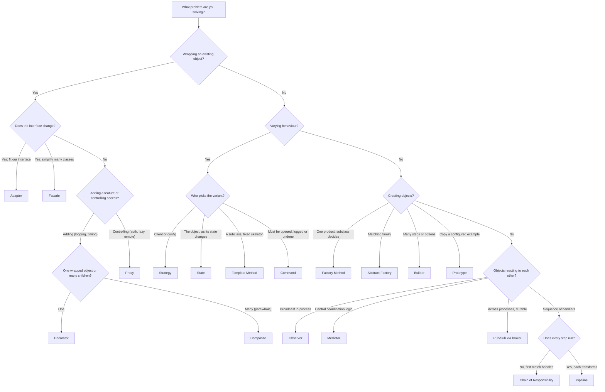
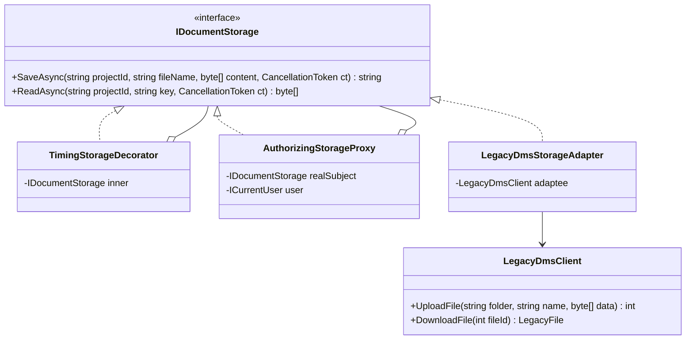
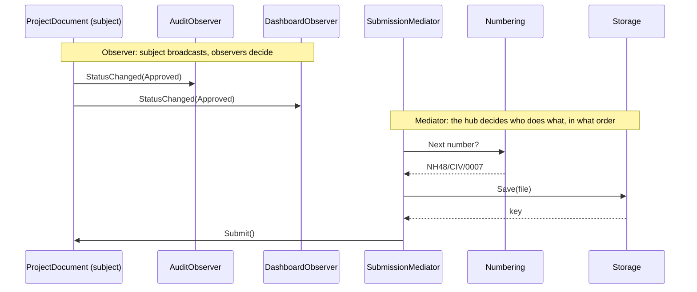

You have learned the patterns one at a time. In real work, nobody hands you a pattern name. You get a problem, and several patterns look like they fit. Worse, many patterns have **the same class diagram**. A decorator, a proxy and an adapter all "wrap an object". A strategy and a state are both "an interface with several implementations held by a context". This lesson teaches you to tell them apart by **intent**, and to choose quickly with a small set of questions.

## Learning objectives

By the end of this lesson you will be able to:

1. Explain why class structure alone can't identify a pattern, and what does (intent, who chooses, what changes).
2. Distinguish Decorator, Proxy, Adapter and Facade; Strategy, State, Template Method and Command; Factory Method, Abstract Factory, Builder and Prototype; Observer, Mediator and Pub/Sub; Composite and Decorator; Chain of Responsibility and Pipeline.
3. Use a decision flowchart to pick a pattern from a problem description.
4. Recognise misnamed patterns in a codebase (a "Strategy" that is really State, a "Proxy" that is really a Decorator) and why the name matters.
5. Combine several patterns in one ASP.NET Core feature, each for a clear reason.
6. Decide when *no* pattern is the right answer.

## Prerequisites

This lesson assumes you've met the individual patterns. At minimum: [Decorator](#/lesson/m06-decorator), [Proxy](#/lesson/m06-proxy), [Adapter](#/lesson/m06-adapter), [Facade](#/lesson/m06-facade), [Strategy](#/lesson/m06-strategy) and [State](#/lesson/m06-state). The others are explained briefly here, with links.

## Explain it like I'm a beginner

Look at four things that all "sit in front of" something else:

- **A travel plug adapter.** Your Indian charger doesn't fit a UK socket. The adapter changes the *shape* so the two fit. It adds nothing else. That's an **Adapter**.
- **Gift wrapping.** The gift is still the same gift and you can still hand it over the same way. The wrapping *adds* something, and you can wrap it twice. That's a **Decorator**.
- **A building security guard.** You still ask to see the same person, the same way. The guard *controls access*: checks your ID, maybe tells you to wait. You often don't even know whether the person is in. That's a **Proxy**.
- **A hotel concierge.** Instead of calling the taxi company, the restaurant and the theatre yourself, you tell one person "dinner and a show tonight". They hide a whole set of services behind a simpler request. That's a **Facade**.

All four stand between you and something else. If you drew them as boxes and arrows, the pictures would look alike. What makes them different is **why they're there**. That's the whole lesson: **patterns are named by intent, not by shape.**

## First-principles explanation

### Why structure isn't enough

The Gang of Four book describes each pattern with an *intent*, a *motivation* and a *structure*. Several patterns share structure because there are only so many ways to arrange "an interface, a class that holds a reference to it, and some implementations". The intent is what tells a reader, months later, what the code is *for* and what changes are safe.

Naming matters in practice. If a class is called `CachingProxy`, a reviewer expects the client not to know about it and the real object to be reached only through it. If it's called `CachingDecorator`, they expect it to be stackable and optional. Getting the name wrong misleads the next developer.

### Five questions that separate look-alikes

1. **What varies?** An algorithm? The object's behaviour over its lifetime? Access to an object? The interface shape? How an object is built?
2. **Who chooses?** The client, configuration, the object itself, or a subclass?
3. **Does the interface change?** Same interface (Decorator, Proxy), different interface (Adapter), a new simpler interface (Facade)?
4. **How many objects are involved?** One wrapped object (Decorator, Proxy, Adapter), many subsystems (Facade), a tree of children (Composite)?
5. **Does it run once, or does every step run?** First handler wins (Chain of Responsibility) or every stage processes the data (Pipeline)?

### Group 1 — Decorator vs Proxy vs Adapter vs Facade (wrappers)

| | Decorator | Proxy | Adapter | Facade |
|---|---|---|---|---|
| **Intent** | Add behaviour | Control access to an object | Make an incompatible interface fit | Simplify a complex subsystem |
| **Interface** | Same as wrapped | Same as wrapped | Different from wrapped | New, simpler interface |
| **Wraps** | One object, of the same interface | One "real subject" | One adaptee | Several classes |
| **Stackable?** | Yes, designed to be | Rarely | Rarely | No |
| **Who creates the wrapped object?** | Usually the client or DI composes it | Often the proxy itself (lazy) or infrastructure | The client or DI | The facade, or DI |
| **Client aware?** | Often, chooses to add it | Usually unaware | Unaware of the adaptee's interface | Aware of the facade only |
| **.NET examples** | `BufferedStream`, `GZipStream` over a `Stream`; `DelegatingHandler` | EF Core lazy-loading proxies; `DispatchProxy`; gRPC/WCF client proxies | `StreamReader` (`Stream` → `TextReader`); a wrapper around a vendor SDK | `File.ReadAllText`; `WebApplication.CreateBuilder` |

**The hardest pair is Decorator vs Proxy**, because the code can be identical. Ask: *is this adding a feature the caller wants, or guarding the real object?* Logging, timing and compression are features: Decorator. Authorisation, lazy creation of an expensive object, and remote access are guards: Proxy. Caching sits on the line. A cache *added* to a repository in DI is usually called a caching decorator. A cache that *stands in* for a remote service the client can't reach directly is a caching proxy. Either name is defensible. Pick one and say why in a comment.

**Adapter vs Facade:** an adapter converts *one* interface into *another existing* interface your code already expects (`IDocumentStorage`). A facade *invents* a new, simpler interface over *many* classes. If you're implementing an interface you already own, it's an adapter.

### Group 2 — Strategy vs State vs Template Method vs Command (behaviour)

| | Strategy | State | Template Method | Command |
|---|---|---|---|---|
| **Intent** | Swap an algorithm | Change behaviour as internal state changes | Fix an algorithm's skeleton, let subclasses fill in steps | Turn a request into an object |
| **Mechanism** | Composition | Composition | Inheritance | Composition |
| **Who chooses the variant?** | Client or configuration | The object itself, through transitions | The subclass, at compile time | The sender creates it; an invoker runs it later |
| **Do variants know each other?** | No | Often: a state returns the next state | No | No |
| **Typical extras** | — | Transitions, guards | Hooks (optional steps) | Undo, queueing, logging, retry |
| **.NET examples** | `IPasswordHasher<T>`; `IComparer<T>` | `Stream` open/closed behaviour; workflow status classes | `BackgroundService.ExecuteAsync`; `DelegatingHandler.SendAsync` | `ICommand` in WPF; a queued job message |

**Strategy vs State** is the classic confusion, because the class diagrams are identical. Ask: *does the variant change because someone chose it, or because something happened to the object?* "Pay by UPI" is chosen: Strategy. "The bill moves from Submitted to Approved" happens: State. Another test: if the implementations return or set the *next* implementation, it's State.

**Strategy vs Template Method:** both vary part of an algorithm. Strategy varies it by *composition* (pass in an object, swap at runtime). Template Method varies it by *inheritance* (override a method, fixed at compile time). Prefer Strategy when you need runtime choice or several independent variations. Template Method is fine when the skeleton is stable and there are a few hook points ([see Composition versus inheritance](#/lesson/m04-composition-inheritance)).

**Strategy vs Command:** both are "an object with one method". A strategy answers *how to do something* for the context, right now, and returns a result. A command packages *something to do*, often with its arguments, so it can be stored, queued, logged, retried or undone. If you need to put it in a queue or a database, it's a Command.

### Group 3 — Factory Method vs Abstract Factory vs Builder vs Prototype (creation)

| | Factory Method | Abstract Factory | Builder | Prototype |
|---|---|---|---|---|
| **Intent** | Let a subclass or overridable method decide which class to create | Create *families* of related objects that must match | Build a complex object step by step | Create new objects by copying a configured one |
| **Product** | One product | Several related products | One complex product | A copy |
| **Typical signal** | `protected virtual Parser CreateParser()` | "If we use provider X, every object must be X's version" | Many optional parameters; validation before creation | Expensive set-up repeated; small variations of a template |
| **.NET examples** | `DelegatingHandler`-style overrides; `ILoggerProvider.CreateLogger` | `DbProviderFactory` (connection, command, parameter for one database) | `WebApplicationBuilder`, `StringBuilder`, `UriBuilder` | C# `record` `with` expressions; `ICloneable` (discouraged) |

Ask: *how many things are being created, and must they match?* One thing chosen by a subclass: Factory Method. A matched set (a PostgreSQL connection with a PostgreSQL command, never a SQL Server one): Abstract Factory. One thing with many steps and options: Builder. Many near-identical things based on an example: Prototype. In modern .NET, the DI container plays the factory role most of the time, so explicit factories are mostly for runtime choices the container can't make ([see Dependency Injection as a pattern](#/lesson/m06-dependency-injection-pattern)).

### Group 4 — Observer vs Mediator vs Pub/Sub (communication)

| | Observer | Mediator | Pub/Sub (message broker) |
|---|---|---|---|
| **Intent** | Notify dependents when a subject changes | Centralise how a group of objects interact | Decouple publishers and subscribers completely |
| **Who knows whom?** | Subject holds a list of observers (by interface) | Colleagues know only the mediator; the mediator knows all | Neither side knows the other; both know a topic |
| **Where's the logic?** | In each observer | In the mediator (coordination rules) | In each subscriber |
| **Process boundary** | Same process | Same process | Usually across processes, via a broker |
| **Delivery** | Synchronous, usually | Synchronous, usually | Asynchronous; durable if the broker is |
| **.NET examples** | C# `event`; `IObservable<T>`; `IOptionsMonitor.OnChange` | A dialog coordinating its controls; a workflow coordinator | RabbitMQ, Kafka, Azure Service Bus |

**Observer vs Mediator:** in Observer, the subject broadcasts and doesn't care what observers do. In Mediator, the mediator *decides* what happens: "when the contractor field changes, reload the contracts list and clear the bill-number field". If the coordination logic is the point, it's a Mediator. Watch out: the popular "MediatR-style" in-process request dispatcher is closer to a command bus than to the GoF Mediator. It routes one request to one handler and doesn't coordinate colleagues ([see Mediator](#/lesson/m06-mediator)).

**Observer vs Pub/Sub:** Pub/Sub is Observer with a broker in the middle. That buys you process isolation, buffering and durability, and costs you latency, eventual consistency and an extra piece of infrastructure to run ([see the event-driven architecture lesson](#/lesson/m02-event-driven)).

### Group 5 — Composite vs Decorator (recursive structures)

Both implement the same interface as the things they hold, so clients treat one object and a group the same way.

| | Composite | Decorator |
|---|---|---|
| **Holds** | Many children | Exactly one wrapped object |
| **Intent** | Represent part–whole trees | Add behaviour to one object |
| **Operation** | Usually aggregates children (sum, render all) | Delegates once, before/after adding something |
| **Example** | A BOQ: a section contains sub-sections and items; `Total()` sums recursively | A `TimingStorage` wrapping `IDocumentStorage` |

Ask: *one child or many?* That settles it nearly every time.

### Group 6 — Chain of Responsibility vs Pipeline (sequences of handlers)

| | Chain of Responsibility | Pipeline (pipes and filters) |
|---|---|---|
| **Intent** | Find the handler that should deal with a request | Pass data through every stage |
| **Does every handler run?** | No. Each decides: handle, or pass to the next | Yes, in order |
| **Typical result** | One handler's answer | Transformed data |
| **Example** | Purchase approval: site engineer, then project manager, then regional head | Invoice import: parse → normalise → validate → enrich |

**ASP.NET Core middleware is a hybrid.** Each middleware can do work, call `next()`, and do more work afterwards (pipeline-like), or *not* call `next()` and short-circuit (chain-like, as authentication does for a 401). That's why the [Pipeline lesson](#/lesson/m06-pipeline) and the [Chain of Responsibility lesson](#/lesson/m06-chain-of-responsibility) both mention it. When you design your own, decide which you want. "Stops at first match" and "always runs every stage" lead to different tests and different bugs.

### When no pattern is the answer

Patterns cost indirection. Two variants that never change are a `switch`. A one-off simplification is a private method, not a Facade class. A single function you pass around is a `Func<T>`, not a Strategy hierarchy. Pick a pattern when its *intent* matches a *real* pressure in the problem, such as several variants, runtime choice, access control or an incompatible SDK, not because the shape is available.

## Visual explanation

### Decision flowchart



Read it top-down and answer one question at a time. The first split is the GoF categories in disguise: wrapping (structural), varying behaviour (behavioral), creating (creational), then communication. Each later question is one of the five separating questions from above. The flowchart is a starting point, not a rule book. Real problems sometimes land on two leaves, and that's often a hint that you need two patterns working together.

### Same shape, different intent



Three classes implement `IDocumentStorage` and hold one other object. The decorator and the proxy even hold the *same type*. The difference is in what each does with the call. The decorator times it and always forwards. The proxy may refuse to forward. The adapter forwards to an object with a *different* interface (`LegacyDmsClient` speaks in folder paths and integer IDs) and translates. You can tell the adapter apart by the arrow: it points at a foreign type, not at `IDocumentStorage`.

### Observer vs Mediator at runtime



In the top half, the document doesn't know what its observers do: auditing and the dashboard each react on their own. In the bottom half, the coordination rule ("number it, then store it, then submit it") lives in one place, and the participants don't talk to each other. If you find observers calling each other or depending on the order in which they're notified, you need a mediator. In this lesson's code, the `DocumentSubmissionFacade` plays that coordinating role for clients, which shows how a facade and a mediator can overlap.

## Step-by-step example

Let's walk the decision process for a real feature request: **"Contractors upload drawings and reports for a highway project. Files go into the client's existing document management system (DMS), whose SDK we can't change. Only people assigned to the project may read or write. Each client numbers documents its own way. Documents go Draft → Submitted → Approved or Rejected; rejected ones can be resubmitted. The audit log and the PM dashboard must react to approvals. We need to measure DMS latency. The API should offer one simple 'submit document' call."**

### Step 1 — split the request into pressures

Each sentence is a separate force on the design:

1. "existing DMS whose SDK we can't change" — incompatible interface.
2. "only people assigned to the project" — access control.
3. "each client numbers documents its own way" — interchangeable algorithm, chosen by configuration.
4. "Draft → Submitted → Approved/Rejected" — behaviour that depends on lifecycle.
5. "audit and dashboard react to approvals" — dependents to notify.
6. "measure DMS latency" — extra behaviour around calls.
7. "one simple submit call" — simplify a multi-step subsystem.

### Step 2 — run each pressure through the questions

| Pressure | Interface change? | Who chooses? | Pattern |
|---|---|---|---|
| 1. Vendor SDK | Yes, to our `IDocumentStorage` | — | Adapter |
| 2. Access control | No | Infrastructure, client unaware | Proxy |
| 3. Numbering | No | Configuration | Strategy |
| 4. Lifecycle | No | The document itself | State |
| 5. React to approvals | No | Observers subscribe | Observer |
| 6. Latency | No | We add it in DI | Decorator |
| 7. One call | New, simpler | — | Facade |

### Step 3 — check for "no pattern needed"

Could numbering be a `switch`? With two clients today and more each quarter, a strategy is justified. Could state be an enum with a `switch` per action? With four states and three actions it could, and some teams would prefer that. We choose State because rejection and resubmission rules are expected to grow (for example, "approval needs two signatures for structural drawings"). This is a judgement call, and it should be written down in an [ADR](#/lesson/m02-adr).

### Step 4 — decide the composition order

The storage chain is `Proxy → Decorator → Adapter → SDK`. The proxy goes outermost, so unauthorised calls are refused before any work, and they don't count towards DMS latency. The decorator times only real DMS calls. The adapter is innermost because it's the only class that knows the SDK.

## Production-style C# implementation

```text
Docs.Api/
  Program.cs
  Documents/
    Contracts.cs            IDocumentStorage, ICurrentUser
    LegacyDms.cs            the vendor SDK (adaptee) and the Adapter
    StorageWrappers.cs      Decorator (timing) and Proxy (authorisation)
    Numbering.cs            Strategy
    Approval.cs             State + the document entity
    Observers.cs            Observer
    DocumentSubmissionFacade.cs   Facade
```

```csharp file=Documents/Contracts.cs
namespace Docs.Documents;

public interface IDocumentStorage
{
    /// <summary>Stores the file and returns an opaque storage key.</summary>
    Task<string> SaveAsync(string projectId, string fileName, byte[] content, CancellationToken ct);

    /// <summary>Returns null if the key does not exist or belongs to another project.</summary>
    Task<byte[]?> ReadAsync(string projectId, string storageKey, CancellationToken ct);
}

public interface ICurrentUser
{
    string UserId { get; }
    bool CanAccessProject(string projectId);
}
```

```csharp file=Documents/LegacyDms.cs
using System.Collections.Concurrent;

namespace Docs.Documents;

/// <summary>Stand-in for a vendor SDK with its own vocabulary (folders, integer ids). We cannot change it.</summary>
public sealed class LegacyDmsClient
{
    private readonly ConcurrentDictionary<int, LegacyFile> _files = new();
    private int _nextId = 1000;

    public int UploadFile(string folderPath, string name, byte[] data)
    {
        var id = Interlocked.Increment(ref _nextId);
        _files[id] = new LegacyFile(id, folderPath, name, data);
        return id;
    }

    public LegacyFile DownloadFile(int fileId) =>
        _files.TryGetValue(fileId, out var f) ? f : throw new KeyNotFoundException($"DMS file {fileId} not found.");
}

public sealed record LegacyFile(int Id, string FolderPath, string Name, byte[] Data);

/// <summary>ADAPTER: makes the vendor SDK fit our IDocumentStorage. Translation only — no policy.</summary>
public sealed class LegacyDmsStorageAdapter(LegacyDmsClient client) : IDocumentStorage
{
    private const string KeyPrefix = "dms:";

    public Task<string> SaveAsync(string projectId, string fileName, byte[] content, CancellationToken ct)
    {
        ct.ThrowIfCancellationRequested();
        var id = client.UploadFile(FolderFor(projectId), fileName, content);
        return Task.FromResult(KeyPrefix + id);
    }

    public Task<byte[]?> ReadAsync(string projectId, string storageKey, CancellationToken ct)
    {
        ct.ThrowIfCancellationRequested();
        if (!storageKey.StartsWith(KeyPrefix, StringComparison.Ordinal) || !int.TryParse(storageKey.AsSpan(KeyPrefix.Length), out var id))
            return Task.FromResult<byte[]?>(null);
        try
        {
            var file = client.DownloadFile(id);
            return Task.FromResult<byte[]?>(file.FolderPath == FolderFor(projectId) ? file.Data : null);
        }
        catch (KeyNotFoundException)
        {
            return Task.FromResult<byte[]?>(null);   // translate the SDK's exception into our contract
        }
    }

    private static string FolderFor(string projectId) => $"/projects/{projectId}";
}
```

```csharp file=Documents/StorageWrappers.cs
using System.Diagnostics;
using Microsoft.Extensions.Logging;

namespace Docs.Documents;

/// <summary>DECORATOR: adds timing. Always forwards. Stackable, optional, chosen at composition time.</summary>
public sealed class TimingStorageDecorator(IDocumentStorage inner, ILogger<TimingStorageDecorator> logger) : IDocumentStorage
{
    public async Task<string> SaveAsync(string projectId, string fileName, byte[] content, CancellationToken ct)
    {
        var start = Stopwatch.GetTimestamp();
        try { return await inner.SaveAsync(projectId, fileName, content, ct); }
        finally { logger.LogInformation("Storage save {Bytes} bytes took {Ms:0.0} ms", content.Length, Stopwatch.GetElapsedTime(start).TotalMilliseconds); }
    }

    public async Task<byte[]?> ReadAsync(string projectId, string storageKey, CancellationToken ct)
    {
        var start = Stopwatch.GetTimestamp();
        try { return await inner.ReadAsync(projectId, storageKey, ct); }
        finally { logger.LogInformation("Storage read {Key} took {Ms:0.0} ms", storageKey, Stopwatch.GetElapsedTime(start).TotalMilliseconds); }
    }
}

/// <summary>PROXY: controls access to the real subject. May refuse to forward. Clients don't know it's there.</summary>
public sealed class AuthorizingStorageProxy(IDocumentStorage realSubject, ICurrentUser user) : IDocumentStorage
{
    public Task<string> SaveAsync(string projectId, string fileName, byte[] content, CancellationToken ct)
    {
        Demand(projectId);
        return realSubject.SaveAsync(projectId, fileName, content, ct);
    }

    public Task<byte[]?> ReadAsync(string projectId, string storageKey, CancellationToken ct)
    {
        Demand(projectId);
        return realSubject.ReadAsync(projectId, storageKey, ct);
    }

    private void Demand(string projectId)
    {
        if (!user.CanAccessProject(projectId))
            throw new UnauthorizedAccessException($"User {user.UserId} is not assigned to project {projectId}.");
    }
}
```

```csharp file=Documents/Numbering.cs
using System.Collections.Concurrent;

namespace Docs.Documents;

/// <summary>STRATEGY: how a client wants documents numbered. Chosen by configuration.</summary>
public interface IDocumentNumberingStrategy
{
    string Format(string projectId, string discipline, int sequence);
}

public sealed class ProjectDisciplineNumbering : IDocumentNumberingStrategy
{
    public string Format(string projectId, string discipline, int sequence) =>
        $"{projectId}/{discipline.ToUpperInvariant()}/{sequence:D4}";
}

public sealed class ClientPrefixedNumbering(string clientPrefix) : IDocumentNumberingStrategy
{
    public string Format(string projectId, string discipline, int sequence) =>
        $"{clientPrefix}-{DateTime.UtcNow:yy}-{sequence:D5}";
}

/// <summary>Per-project counters. Production: a PostgreSQL sequence or a row locked with SELECT ... FOR UPDATE.</summary>
public sealed class DocumentSequence
{
    private readonly ConcurrentDictionary<string, int> _counters = new();
    public int Next(string projectId) => _counters.AddOrUpdate(projectId, 1, (_, n) => n + 1);
}
```

```csharp file=Documents/Approval.cs
namespace Docs.Documents;

/// <summary>STATE: each state decides which actions are legal and which state comes next.</summary>
public abstract class ApprovalState
{
    public abstract string Name { get; }
    public virtual ApprovalState Submit() => throw Illegal("submit");
    public virtual ApprovalState Approve() => throw Illegal("approve");
    public virtual ApprovalState Reject() => throw Illegal("reject");
    protected InvalidOperationException Illegal(string action) => new($"Cannot {action} a document that is {Name}.");
}

public sealed class DraftState : ApprovalState
{
    public static readonly DraftState Instance = new();
    public override string Name => "Draft";
    public override ApprovalState Submit() => SubmittedState.Instance;
}

public sealed class SubmittedState : ApprovalState
{
    public static readonly SubmittedState Instance = new();
    public override string Name => "Submitted";
    public override ApprovalState Approve() => ApprovedState.Instance;
    public override ApprovalState Reject() => RejectedState.Instance;
}

public sealed class RejectedState : ApprovalState
{
    public static readonly RejectedState Instance = new();
    public override string Name => "Rejected";
    public override ApprovalState Submit() => SubmittedState.Instance;   // resubmission
}

public sealed class ApprovedState : ApprovalState
{
    public static readonly ApprovedState Instance = new();
    public override string Name => "Approved";                           // terminal: every action is illegal
}

public sealed record StatusChange(string DocumentNumber, string From, string To, string ByUserId, string? Remark);

/// <summary>The context for the State pattern. Its behaviour depends on the current state object.</summary>
public sealed class ProjectDocument(string number, string projectId, string fileName, string storageKey)
{
    public string Number { get; } = number;
    public string ProjectId { get; } = projectId;
    public string FileName { get; } = fileName;
    public string StorageKey { get; } = storageKey;
    public ApprovalState State { get; private set; } = DraftState.Instance;

    public StatusChange Submit(string byUser) => Move(State.Submit(), byUser, null);
    public StatusChange Approve(string byUser) => Move(State.Approve(), byUser, null);
    public StatusChange Reject(string byUser, string reason) =>
        string.IsNullOrWhiteSpace(reason) ? throw new ArgumentException("A rejection needs a reason.", nameof(reason)) : Move(State.Reject(), byUser, reason);

    private StatusChange Move(ApprovalState next, string byUser, string? remark)
    {
        var change = new StatusChange(Number, State.Name, next.Name, byUser, remark);
        State = next;
        return change;
    }
}
```

```csharp file=Documents/Observers.cs
using Microsoft.Extensions.Logging;

namespace Docs.Documents;

/// <summary>OBSERVER: dependents notified of status changes. Subscribed at composition time through DI.</summary>
public interface IDocumentStatusObserver
{
    Task OnStatusChangedAsync(StatusChange change, CancellationToken ct);
}

public sealed class AuditTrailObserver(ILogger<AuditTrailObserver> logger) : IDocumentStatusObserver
{
    public Task OnStatusChangedAsync(StatusChange c, CancellationToken ct)
    {
        logger.LogInformation("AUDIT {Doc}: {From} -> {To} by {User} {Remark}", c.DocumentNumber, c.From, c.To, c.ByUserId, c.Remark);
        return Task.CompletedTask;
    }
}

public sealed class DashboardCounterObserver : IDocumentStatusObserver
{
    private int _approved;
    public int ApprovedCount => Volatile.Read(ref _approved);

    public Task OnStatusChangedAsync(StatusChange c, CancellationToken ct)
    {
        if (c.To == "Approved") Interlocked.Increment(ref _approved);
        return Task.CompletedTask;
    }
}
```

```csharp file=Documents/DocumentSubmissionFacade.cs
using System.Collections.Concurrent;
using Microsoft.Extensions.Logging;

namespace Docs.Documents;

/// <summary>FACADE: one simple API over numbering, storage, state and notifications.</summary>
public sealed class DocumentSubmissionFacade(
    IDocumentStorage storage,
    IDocumentNumberingStrategy numbering,
    DocumentSequence sequence,
    DocumentRegistry registry,
    IEnumerable<IDocumentStatusObserver> observers,
    ICurrentUser user,
    ILogger<DocumentSubmissionFacade> logger)
{
    public async Task<ProjectDocument> SubmitAsync(string projectId, string discipline, string fileName, byte[] content, CancellationToken ct)
    {
        if (content.Length == 0) throw new ArgumentException("File is empty.", nameof(content));
        var key = await storage.SaveAsync(projectId, fileName, content, ct);          // proxy checks access first
        var number = numbering.Format(projectId, discipline, sequence.Next(projectId));
        var doc = new ProjectDocument(number, projectId, fileName, key);
        registry.Add(doc);
        await NotifyAsync(doc.Submit(user.UserId), ct);
        return doc;
    }

    public Task<ProjectDocument> ApproveAsync(string number, CancellationToken ct) =>
        ChangeAsync(number, d => d.Approve(user.UserId), ct);

    public Task<ProjectDocument> RejectAsync(string number, string reason, CancellationToken ct) =>
        ChangeAsync(number, d => d.Reject(user.UserId, reason), ct);

    private async Task<ProjectDocument> ChangeAsync(string number, Func<ProjectDocument, StatusChange> action, CancellationToken ct)
    {
        var doc = registry.Find(number) ?? throw new KeyNotFoundException($"Document {number} not found.");
        if (!user.CanAccessProject(doc.ProjectId)) throw new UnauthorizedAccessException("Not assigned to this project.");
        await NotifyAsync(action(doc), ct);
        return doc;
    }

    private async Task NotifyAsync(StatusChange change, CancellationToken ct)
    {
        foreach (var o in observers)
        {
            try { await o.OnStatusChangedAsync(change, ct); }
            catch (Exception ex) { logger.LogError(ex, "Observer {Observer} failed for {Doc}", o.GetType().Name, change.DocumentNumber); }
        }
    }
}

public sealed class DocumentRegistry
{
    private readonly ConcurrentDictionary<string, ProjectDocument> _docs = new(StringComparer.OrdinalIgnoreCase);
    public void Add(ProjectDocument d) { if (!_docs.TryAdd(d.Number, d)) throw new InvalidOperationException($"Duplicate number {d.Number}."); }
    public ProjectDocument? Find(string number) => _docs.TryGetValue(number, out var d) ? d : null;
}

/// <summary>Demo identity from headers. Real apps use claims from authentication.</summary>
public sealed class HeaderCurrentUser(IHttpContextAccessor accessor) : ICurrentUser
{
    public string UserId => accessor.HttpContext?.Request.Headers["X-User"].ToString() is { Length: > 0 } u ? u : "anonymous";

    public bool CanAccessProject(string projectId) =>
        (accessor.HttpContext?.Request.Headers["X-Projects"].ToString() ?? "")
            .Split(',', StringSplitOptions.TrimEntries | StringSplitOptions.RemoveEmptyEntries)
            .Contains(projectId, StringComparer.OrdinalIgnoreCase);
}
```

```csharp file=Program.cs
using Docs.Documents;

var builder = WebApplication.CreateBuilder(args);

builder.Services.AddHttpContextAccessor();
builder.Services.AddScoped<ICurrentUser, HeaderCurrentUser>();

// Adapter around the SDK, Decorator for timing, Proxy outermost for access control.
builder.Services.AddSingleton<LegacyDmsClient>();
builder.Services.AddScoped<IDocumentStorage>(sp =>
    new AuthorizingStorageProxy(
        new TimingStorageDecorator(
            new LegacyDmsStorageAdapter(sp.GetRequiredService<LegacyDmsClient>()),
            sp.GetRequiredService<ILogger<TimingStorageDecorator>>()),
        sp.GetRequiredService<ICurrentUser>()));

// Strategy chosen by configuration.
builder.Services.AddSingleton<IDocumentNumberingStrategy>(
    builder.Configuration["Documents:Numbering"] is { Length: > 0 } prefix
        ? new ClientPrefixedNumbering(prefix)
        : new ProjectDisciplineNumbering());

builder.Services.AddSingleton<DocumentSequence>();
builder.Services.AddSingleton<DocumentRegistry>();
builder.Services.AddSingleton<IDocumentStatusObserver, AuditTrailObserver>();
builder.Services.AddSingleton<DashboardCounterObserver>();
builder.Services.AddSingleton<IDocumentStatusObserver>(sp => sp.GetRequiredService<DashboardCounterObserver>());
builder.Services.AddScoped<DocumentSubmissionFacade>();

var app = builder.Build();

app.MapPost("/projects/{projectId}/documents", async (string projectId, SubmitDocumentRequest req, DocumentSubmissionFacade docs, CancellationToken ct) =>
{
    try
    {
        var doc = await docs.SubmitAsync(projectId, req.Discipline, req.FileName, Convert.FromBase64String(req.ContentBase64), ct);
        return Results.Created($"/documents/{Uri.EscapeDataString(doc.Number)}", new { doc.Number, State = doc.State.Name });
    }
    catch (UnauthorizedAccessException) { return Results.StatusCode(StatusCodes.Status403Forbidden); }
});

app.MapPost("/documents/approve", async (string number, DocumentSubmissionFacade docs, CancellationToken ct) =>
{
    try { var d = await docs.ApproveAsync(number, ct); return Results.Ok(new { d.Number, State = d.State.Name }); }
    catch (InvalidOperationException ex) { return Results.Conflict(ex.Message); }
    catch (KeyNotFoundException) { return Results.NotFound(); }
    catch (UnauthorizedAccessException) { return Results.StatusCode(StatusCodes.Status403Forbidden); }
});

app.MapGet("/dashboard/approved", (DashboardCounterObserver counter) => counter.ApprovedCount);

app.Run();

public sealed record SubmitDocumentRequest(string Discipline, string FileName, string ContentBase64);
```

What to notice:

- **Each class's comment names its pattern and its intent.** That's the most useful thing you can do for the next reader.
- **The proxy and the decorator have the same shape.** The comments, the names and the position in the chain carry the intent.
- **The facade also acts as a mediator** for the submission workflow. It decides the order: store, number, submit, notify. That overlap is normal. Name it after the role clients see (Facade), and keep the coordination logic thin.
- **Observer failures are isolated.** One broken observer must not undo an approval. If observers must be reliable across restarts, that's the moment to move to Pub/Sub with an outbox ([see the outbox lesson](#/lesson/m12-outbox)).
- **Approval states are singletons.** They hold no data, so one instance of each is enough. Data such as the rejection reason lives in the `StatusChange`.

## Bad design vs good design

### Misnamed patterns mislead reviewers

```csharp
// Called a Strategy, behaves like State: each "strategy" picks the next one.
public interface IBillStrategy { IBillStrategy Next(Bill b); void Handle(Bill b); }

// Called a Proxy, behaves like a Decorator: it never controls access, it just adds logging.
public class LoggingProxy : IRepository { ... }

// Called a Mediator, is really a god object: 40 methods, every module calls it, it calls every module.
public class AppMediator { ... }

// Called a Factory, but only wraps `new` with no choice at all.
public class InvoiceFactory { public Invoice Create() => new Invoice(); }
```

Each name sets wrong expectations. A reviewer who reads "Strategy" assumes the client chooses and the variants are independent, and won't look for transition bugs. Rename by intent: `BillState`, `LoggingRepositoryDecorator`, split the "mediator" by feature, and delete the factory that makes no decision.

### Forcing a pattern because the shape fits

A team needed "send an alert when a milestone slips". Because they had just learned Mediator, they built a `MilestoneMediator` that every module registered with. A plain Observer (`IMilestoneObserver` injected as `IEnumerable<>`) would have done the job in a third of the code. The mediator's extra power, central coordination rules, was never used.

:::callout type=tip title="The two-pattern smell is often a good sign"
If a problem seems to match two leaves in the flowchart, look again: it often has two pressures. "Retry failed payments later" is Command (queue the request) plus Strategy (the retry policy). Use both, each for its own reason.
:::

:::callout type=tradeoff title="Pattern vocabulary is for humans"
The compiler doesn't care what you call a class. Pattern names are a communication tool: in code review, in design discussions, in interviews. Use them where they save explanation. Don't add `Strategy` to every class name. A name like `UpiPayment` that implements `IPaymentMethod` already tells the reader enough.
:::

## Practical playground

The playground wires one interface through an adapter, a decorator and a proxy, and prints what each layer does. Try changing the order: put the logging decorator *outside* the access proxy and see which calls get logged. Then add a second decorator that counts calls, and confirm that decorators stack but the adapter can only sit at the bottom.

:::playground type=csharp title="Adapter, Decorator and Proxy on one interface"
```csharp file=Program.cs
using System;
using System.Collections.Generic;

// Our interface.
public interface IPriceFeed { decimal PricePerBag(string material); }

// A vendor service with a different interface: paise, different method name.
public sealed class VendorRateService
{
    private readonly Dictionary<string, long> _paise = new() { ["OPC-53"] = 41_500, ["PPC"] = 38_000 };
    public long GetRateInPaise(string sku) => _paise.TryGetValue(sku, out var p) ? p : throw new KeyNotFoundException(sku);
}

// ADAPTER: translates names and units. No new behaviour.
public sealed class VendorPriceAdapter(VendorRateService vendor) : IPriceFeed
{
    public decimal PricePerBag(string material) => vendor.GetRateInPaise(material) / 100m;
}

// DECORATOR: adds logging and always forwards.
public sealed class LoggingPriceFeed(IPriceFeed inner, string label) : IPriceFeed
{
    public decimal PricePerBag(string material)
    {
        Console.WriteLine($"[{label}] asking for {material}");
        var p = inner.PricePerBag(material);
        Console.WriteLine($"[{label}] got {p}");
        return p;
    }
}

// PROXY: controls access. May refuse.
public sealed class SiteAccessProxy(IPriceFeed real, Func<bool> userIsProcurement) : IPriceFeed
{
    public decimal PricePerBag(string material) =>
        userIsProcurement() ? real.PricePerBag(material) : throw new UnauthorizedAccessException("Procurement only");
}

public static class Program
{
    public static void Main()
    {
        var isProcurement = true;
        IPriceFeed feed = new SiteAccessProxy(
            new LoggingPriceFeed(new VendorPriceAdapter(new VendorRateService()), "inner-log"),
            () => isProcurement);

        Console.WriteLine($"OPC-53: Rs {feed.PricePerBag("OPC-53")}");

        isProcurement = false;
        try { feed.PricePerBag("PPC"); }
        catch (UnauthorizedAccessException ex) { Console.WriteLine($"Refused: {ex.Message} (note: nothing was logged)"); }
    }
}
```
:::

## Exercises

:::exercise id=m06-pattern-comparison-ex1 difficulty=beginner kind=written title="Name that pattern"
For each scenario, name the best-fitting pattern and give the one question from this lesson that decided it.

1. Wrap a vendor's SMS SDK (`SendSms(string mobile, string text, int priority)`) so it implements your `INotificationChannel`.
2. A tender bid moves Draft → Submitted → Under evaluation → Awarded / Lost, and allowed actions differ in each.
3. Add response compression to an existing `Stream` without changing code that reads it.
4. Let users pick "cheapest", "fastest" or "greenest" route for material deliveries.
5. Store "recalculate project cost" requests in a table so a worker can run them at night and retry failures.
6. Build an `HttpRequestMessage` with headers, query parameters, body and timeout, validating at the end.
7. Create a PostgreSQL connection, command and parameter that all belong to the same database provider.
8. A cost-estimate tree where a section's total is the sum of its sub-sections and items.
9. Expense approval: team lead up to ₹10,000, manager up to ₹1,00,000, finance head above that.
10. Every uploaded CSV row is trimmed, then converted to typed values, then validated, then saved.
11. A billing service in another process must learn about approved RA bills, even if it is down for an hour.
12. Load a 50 MB drawing only when someone first opens it, but let code hold a reference from the start.
::acceptance
- At least 10 of 12 are correct.
- Each answer cites the deciding question (interface change, who chooses, one vs many, does every step run, and so on).
::hint
Start with the first question in the flowchart: is something being wrapped, varied, created, or communicated?
::hint
For 2 and 4, ask who chooses the variant.
::hint
For 9 and 10, ask whether every step runs.
::hint
For 11, the words "another process" and "down for an hour" point beyond in-process notification.
::solution
| # | Pattern | Deciding question |
|---|---|---|
| 1 | Adapter | The interface changes to one we already own. |
| 2 | State | The object itself changes variant as its lifecycle moves. |
| 3 | Decorator | Same interface, adding a feature, stackable (`GZipStream`). |
| 4 | Strategy | The user chooses the algorithm. |
| 5 | Command | The request must be stored, queued and retried. |
| 6 | Builder | One complex object, many optional steps, validated at the end. |
| 7 | Abstract Factory | A matching family of products (`DbProviderFactory`). |
| 8 | Composite | Many children, part–whole tree, aggregate operation. |
| 9 | Chain of Responsibility | The first handler with enough authority handles it; the others don't run. |
| 10 | Pipeline | Every stage runs and transforms the data. |
| 11 | Pub/Sub via a broker | Across processes and must be durable. |
| 12 | Proxy (virtual proxy) | Same interface, controls *when* the real object is created. |
::mistakes
- Answering Decorator for 12: lazy loading controls the real object's lifecycle, which is Proxy's intent.
- Answering Observer for 11: plain Observer is in-process and loses events when the subscriber is down.
- Answering Factory Method for 7: the key point is that several products must match.
:::

:::exercise id=m06-pattern-comparison-ex2 difficulty=beginner kind=code title="Decorator or Proxy? Build both"
`IReportSource.Load(reportId)` returns a project report. Creating the real source is expensive (it opens a connection pool and loads templates). Build:

1. `LoggingReportSource` — a **decorator** that records `"load {id}"` in a log list, then always forwards to the inner source.
2. `LazyCachingReportProxy` — a **proxy** that doesn't create the real source until the first `Load`, creates it at most once, and caches results per report id.
::requirements
- The proxy receives a `Func<IReportSource>` factory, not an instance.
- Constructing the proxy must not call the factory.
- Report ids are case-sensitive.
::acceptance
- The decorator logs every call, including repeated ones, and forwards every time.
- The proxy calls the factory exactly once, on the first `Load`.
- The proxy calls the real source once per distinct report id.
- Stacking `new LoggingReportSource(new LazyCachingReportProxy(...))` logs every call but hits the real source once per id.
::hint
The decorator is a few lines: log, then `return inner.Load(id)`.
::hint
For the proxy, keep `IReportSource? _real` and create it on demand.
::hint
`_real ??= factory();` creates once. A `Dictionary<string, string>` caches results.
::hint
Thread safety isn't required for the tests, but `Lazy<T>` gives it for free: `_real = new Lazy<IReportSource>(factory)`.
::starter
```csharp file=Reports.cs
using System;
using System.Collections.Generic;

public interface IReportSource { string Load(string reportId); }

/// <summary>Decorator: adds logging, always forwards.</summary>
public sealed class LoggingReportSource(IReportSource inner, List<string> log) : IReportSource
{
    public string Load(string reportId) => throw new NotImplementedException();
}

/// <summary>Proxy: controls when the real source is created, and shields it from repeat calls.</summary>
public sealed class LazyCachingReportProxy(Func<IReportSource> factory) : IReportSource
{
    public string Load(string reportId) => throw new NotImplementedException();
}
```
::tests
```csharp file=ReportTests.cs
using System;
using System.Collections.Generic;
using Xunit;

public class ReportPatternTests
{
    private sealed class CountingSource : IReportSource
    {
        public int Loads;
        public string Load(string id) { Loads++; return $"report:{id}"; }
    }

    [Fact]
    public void Decorator_logs_and_forwards_every_call()
    {
        var real = new CountingSource();
        var log = new List<string>();
        var d = new LoggingReportSource(real, log);
        Assert.Equal("report:R1", d.Load("R1"));
        d.Load("R1");
        Assert.Equal(2, real.Loads);
        Assert.Equal(2, log.Count);
        Assert.Equal("load R1", log[0]);
    }

    [Fact]
    public void Proxy_does_not_create_real_source_until_needed()
    {
        var created = 0;
        _ = new LazyCachingReportProxy(() => { created++; return new CountingSource(); });
        Assert.Equal(0, created);
    }

    [Fact]
    public void Proxy_creates_once_and_caches_per_id()
    {
        var created = 0;
        var real = new CountingSource();
        var p = new LazyCachingReportProxy(() => { created++; return real; });
        p.Load("R1"); p.Load("R1"); p.Load("R2"); p.Load("r1");
        Assert.Equal(1, created);
        Assert.Equal(3, real.Loads);
    }

    [Fact]
    public void Decorator_over_proxy_logs_everything_but_hits_real_once_per_id()
    {
        var real = new CountingSource();
        var log = new List<string>();
        var stack = new LoggingReportSource(new LazyCachingReportProxy(() => real), log);
        stack.Load("R9"); stack.Load("R9"); stack.Load("R9");
        Assert.Equal(3, log.Count);
        Assert.Equal(1, real.Loads);
    }
}
```
::solution
The two classes have the same shape. The intent is in the body: the decorator always forwards, while the proxy decides when and whether to touch the real object.

```csharp file=Reports.cs
using System;
using System.Collections.Generic;

public interface IReportSource { string Load(string reportId); }

public sealed class LoggingReportSource(IReportSource inner, List<string> log) : IReportSource
{
    public string Load(string reportId)
    {
        log.Add($"load {reportId}");
        return inner.Load(reportId);
    }
}

public sealed class LazyCachingReportProxy(Func<IReportSource> factory) : IReportSource
{
    private readonly Lazy<IReportSource> _real = new(factory);
    private readonly Dictionary<string, string> _cache = new(StringComparer.Ordinal);

    public string Load(string reportId)
    {
        if (_cache.TryGetValue(reportId, out var cached)) return cached;
        var report = _real.Value.Load(reportId);
        _cache[reportId] = report;
        return report;
    }
}
```

`Lazy<T>` defaults to thread-safe initialisation, so the factory runs once even under concurrent first calls. The dictionary isn't thread-safe; use `ConcurrentDictionary` if the proxy is shared across requests.
::mistakes
- Calling `factory()` in the proxy's constructor. That's eager creation and defeats the purpose of a virtual proxy.
- Making the decorator skip the inner call when it has "seen" the id. That turns it into a cache, a different intent.
- An unbounded cache in a long-running service. Real caching proxies need expiry and a size limit.
:::

:::exercise id=m06-pattern-comparison-ex3 difficulty=intermediate kind=code title="Turn a misnamed Strategy into State"
A measurement book (MB, the site record of measured work) was written with an `IMbStrategy` field that the code swaps after each action. It's really a state machine. Rewrite it with the State pattern.

Rules: Draft --Submit--> Submitted. Submitted --Verify--> Verified (terminal). Submitted --Return(reason)--> Draft, recording the reason. `AddEntry(quantity)` is allowed only in Draft. Illegal actions throw `InvalidOperationException` naming the current state.
::requirements
- One class per state, each deciding its own legal transitions.
- `MeasurementBook` exposes `StateName`, `Entries`, `ReturnReasons` and a `History` of state names (starting with "Draft").
- `Return` with an empty reason throws `ArgumentException`.
::acceptance
- Happy path: add entries, submit, verify; history is Draft, Submitted, Verified.
- Return path: submit, return("dimensions missing"), add entry, submit again.
- `AddEntry` after submit throws; `Verify` from Draft throws; anything on Verified throws.
::hint
Give the base state class virtual methods that throw by default, and override only the legal ones.
::hint
Each method returns the next state; the `MeasurementBook` stores it and appends to history.
::hint
`AddEntry` doesn't change state, so `DraftState.AddEntry` can return `this`.
::hint
```csharp
public abstract class MbState
{
    public abstract string Name { get; }
    public virtual MbState AddEntry() => throw Illegal("add entries to");
    public virtual MbState Submit() => throw Illegal("submit");
    ...
    protected InvalidOperationException Illegal(string what) => new($"Cannot {what} an MB that is {Name}.");
}
```
::starter
```csharp file=MeasurementBook.cs
using System;
using System.Collections.Generic;

public abstract class MbState
{
    public abstract string Name { get; }
    public virtual MbState AddEntry() => throw new NotImplementedException();
    public virtual MbState Submit() => throw new NotImplementedException();
    public virtual MbState Verify() => throw new NotImplementedException();
    public virtual MbState Return() => throw new NotImplementedException();
}

public sealed class MeasurementBook
{
    public string StateName => throw new NotImplementedException();
    public IReadOnlyList<decimal> Entries => throw new NotImplementedException();
    public IReadOnlyList<string> ReturnReasons => throw new NotImplementedException();
    public IReadOnlyList<string> History => throw new NotImplementedException();

    public void AddEntry(decimal quantity) => throw new NotImplementedException();
    public void Submit() => throw new NotImplementedException();
    public void Verify() => throw new NotImplementedException();
    public void Return(string reason) => throw new NotImplementedException();
}
```
::tests
```csharp file=MeasurementBookTests.cs
using System;
using Xunit;

public class MeasurementBookTests
{
    [Fact]
    public void Happy_path()
    {
        var mb = new MeasurementBook();
        mb.AddEntry(120.5m);
        mb.AddEntry(80m);
        mb.Submit();
        mb.Verify();
        Assert.Equal("Verified", mb.StateName);
        Assert.Equal(new[] { "Draft", "Submitted", "Verified" }, mb.History);
        Assert.Equal(2, mb.Entries.Count);
    }

    [Fact]
    public void Return_and_resubmit()
    {
        var mb = new MeasurementBook();
        mb.AddEntry(10m);
        mb.Submit();
        mb.Return("dimensions missing");
        mb.AddEntry(5m);
        mb.Submit();
        Assert.Equal("Submitted", mb.StateName);
        Assert.Equal("dimensions missing", Assert.Single(mb.ReturnReasons));
        Assert.Equal(new[] { "Draft", "Submitted", "Draft", "Submitted" }, mb.History);
    }

    [Fact]
    public void Cannot_edit_after_submit()
    {
        var mb = new MeasurementBook();
        mb.Submit();
        var ex = Assert.Throws<InvalidOperationException>(() => mb.AddEntry(1m));
        Assert.Contains("Submitted", ex.Message);
    }

    [Fact] public void Cannot_verify_draft() => Assert.Throws<InvalidOperationException>(() => new MeasurementBook().Verify());

    [Fact]
    public void Verified_is_terminal()
    {
        var mb = new MeasurementBook();
        mb.Submit();
        mb.Verify();
        Assert.Throws<InvalidOperationException>(() => mb.Return("late change"));
        Assert.Throws<InvalidOperationException>(() => mb.Submit());
    }

    [Fact]
    public void Return_needs_reason()
    {
        var mb = new MeasurementBook();
        mb.Submit();
        Assert.Throws<ArgumentException>(() => mb.Return(" "));
    }
}
```
::solution
Each state owns its legal moves. The book (the context) delegates to the current state and records history.

```csharp file=MeasurementBook.cs
using System;
using System.Collections.Generic;

public abstract class MbState
{
    public abstract string Name { get; }
    public virtual MbState AddEntry() => throw Illegal("add entries to");
    public virtual MbState Submit() => throw Illegal("submit");
    public virtual MbState Verify() => throw Illegal("verify");
    public virtual MbState Return() => throw Illegal("return");
    protected InvalidOperationException Illegal(string what) => new($"Cannot {what} an MB that is {Name}.");
}

public sealed class DraftMb : MbState
{
    public static readonly DraftMb Instance = new();
    public override string Name => "Draft";
    public override MbState AddEntry() => this;
    public override MbState Submit() => SubmittedMb.Instance;
}

public sealed class SubmittedMb : MbState
{
    public static readonly SubmittedMb Instance = new();
    public override string Name => "Submitted";
    public override MbState Verify() => VerifiedMb.Instance;
    public override MbState Return() => DraftMb.Instance;
}

public sealed class VerifiedMb : MbState
{
    public static readonly VerifiedMb Instance = new();
    public override string Name => "Verified";
}

public sealed class MeasurementBook
{
    private MbState _state = DraftMb.Instance;
    private readonly List<decimal> _entries = new();
    private readonly List<string> _reasons = new();
    private readonly List<string> _history = new() { "Draft" };

    public string StateName => _state.Name;
    public IReadOnlyList<decimal> Entries => _entries;
    public IReadOnlyList<string> ReturnReasons => _reasons;
    public IReadOnlyList<string> History => _history;

    public void AddEntry(decimal quantity)
    {
        _state = _state.AddEntry();          // throws unless Draft
        ArgumentOutOfRangeException.ThrowIfNegativeOrZero(quantity);
        _entries.Add(quantity);
    }

    public void Submit() => Move(_state.Submit());
    public void Verify() => Move(_state.Verify());

    public void Return(string reason)
    {
        var next = _state.Return();           // check legality before validating input
        if (string.IsNullOrWhiteSpace(reason)) throw new ArgumentException("A return needs a reason.", nameof(reason));
        _reasons.Add(reason);
        Move(next);
    }

    private void Move(MbState next)
    {
        _state = next;
        _history.Add(next.Name);
    }
}
```

Why State and not Strategy: the variant changes because *something happened to the MB*, and each state knows its successors. Nobody "chooses" a state from outside.
::alternatives
With 3 states and 4 actions, an `enum` plus a transition table (`Dictionary<(Status, Action), Status>`) is a valid and often shorter alternative, especially if transitions are configured as data. Prefer State classes when states carry real behaviour beyond "is this transition allowed".
::mistakes
- Letting `MeasurementBook` check `if (StateName == "Draft")` itself. The states then exist only for show.
- Adding to history on `AddEntry`, which isn't a transition.
:::

:::exercise id=m06-pattern-comparison-ex4 difficulty=intermediate kind=design title="Observer, Mediator or Pub/Sub?"
When a project milestone slips by more than 7 days, four things must happen:

1. The PM's live dashboard in the same web app updates its "delayed milestones" counter.
2. The risk register (another module in the same modular monolith) creates a risk entry, but only if no open risk exists for that milestone, and it must then tell the dashboard to show a "risk raised" badge.
3. The client's separate billing system (another company's service) must withhold the milestone payment. It's sometimes offline for maintenance.
4. A screen with three linked drop-downs (project, package, milestone) must reset the dependent drop-downs when an earlier one changes.

Choose a pattern for each and justify the choice using the comparison table. Sketch the main types.
::acceptance
- Each of the four has a pattern with a reason tied to process boundary, coordination logic or durability.
- Item 3 handles the "offline" requirement explicitly.
- Item 2's conditional logic and follow-up action are placed deliberately.
::hint
Which of these cross a process boundary? Which need durability?
::hint
Item 4 is the textbook example from the original Mediator description.
::hint
For item 2, decide whether the "only if no open risk" rule belongs to the subject, the observer, or a coordinator.
::solution
| # | Choice | Why |
|---|---|---|
| 1 | Observer | In-process, broadcast, the dashboard decides what to do. `IMilestoneObserver` injected as `IEnumerable<>`. |
| 2 | Observer, with the rule inside the risk module | The risk module is just another observer; "only if no open risk" is *its* business rule. It then raises its own `RiskRaised` event, which the dashboard observes. No central coordinator is needed. If the modules must stay strictly decoupled, an in-process event bus between modules is fine. |
| 3 | Pub/Sub through a broker, with an outbox | Another process, sometimes offline, so it needs durability. Write a `MilestoneSlipped` message to an outbox table in the same transaction as the milestone update. A relay publishes it to the broker, and the billing system consumes it when it's back. |
| 4 | Mediator | The coordination rule ("project change resets package and milestone") *is* the logic. The drop-downs talk only to a `MilestoneFilterMediator`, never to each other. |

Types: `MilestoneSlipped(ProjectId, MilestoneId, DaysLate)` as the event; `IMilestoneObserver.OnSlippedAsync`; `RiskRegisterObserver`, `DashboardObserver`; `OutboxMilestonePublisher`; `MilestoneFilterMediator { ProjectChanged(id); PackageChanged(id); }`.
::mistakes
- Using Observer for item 3. If the billing service is down, an in-process call fails and the event is lost.
- Building one central mediator for items 1–3. It becomes a hub that knows every module, which is the god-object mediator.
- Using a broker for item 1. It adds latency and infrastructure for a same-process notification.
:::

:::exercise id=m06-pattern-comparison-ex5 difficulty=advanced kind=code title="Chain of Responsibility vs Pipeline, side by side"
Implement two sequences of handlers for a construction company's procurement module, and see how their behaviour differs.

**Purchase approval (Chain of Responsibility).** Approvers in order: Site engineer (up to ₹5,00,000), Project manager (up to ₹50,00,000), Regional head (up to ₹5,00,00,000). Anything larger goes to "Board". An approver can't approve a request they raised; it passes to the next.

**Invoice normalisation (Pipeline).** Every step runs, in order: trim all text fields, upper-case the GSTIN, round the amount to 2 decimals. Each step returns a new `Invoice`.
::requirements
- `Approver` has a `SetNext(Approver)` method that returns the next approver (for fluent chaining) and a `Handle(PurchaseRequest)` that returns the approving role.
- `ApprovalChain.Default()` builds the three-level chain.
- `InvoicePipeline` takes steps in its constructor and runs all of them in order.
::acceptance
- ₹3,00,000 → "SiteEngineer"; ₹30,00,000 → "ProjectManager"; ₹3,00,00,000 → "RegionalHead"; ₹30,00,00,000 → "Board".
- ₹3,00,000 raised by the site engineer → "ProjectManager".
- The pipeline turns `"  27abcde1234f1z5 "` into `"27ABCDE1234F1Z5"` and `1234.5678` into `1234.57`, and records that all three steps ran.
::hint
In the chain, each handler decides: handle it, or `return _next?.Handle(r) ?? "Board"`.
::hint
The pipeline is a simple fold: `steps.Aggregate(invoice, (inv, step) => step.Process(inv))`.
::hint
The self-approval rule is just another condition in the handler: `r.Amount <= _limit && r.RaisedByRole != Role`.
::hint
```csharp
public static Approver Default()
{
    var head = new Approver("SiteEngineer", 5_00_000m);
    head.SetNext(new Approver("ProjectManager", 50_00_000m))
        .SetNext(new Approver("RegionalHead", 5_00_00_000m));
    return head;
}
```
::starter
```csharp file=Procurement.cs
using System;
using System.Collections.Generic;
using System.Linq;

public sealed record PurchaseRequest(decimal Amount, string RaisedByRole);

public sealed class Approver(string role, decimal limit)
{
    public string Role { get; } = role;
    public Approver SetNext(Approver next) => throw new NotImplementedException();
    public string Handle(PurchaseRequest request) => throw new NotImplementedException();
}

public static class ApprovalChain
{
    public static Approver Default() => throw new NotImplementedException();
}

public sealed record Invoice(string VendorName, string Gstin, decimal Amount);

public interface IInvoiceStep { string Name { get; } Invoice Process(Invoice invoice); }

public sealed class TrimStep : IInvoiceStep
{
    public string Name => "Trim";
    public Invoice Process(Invoice i) => i with { VendorName = i.VendorName.Trim(), Gstin = i.Gstin.Trim() };
}

public sealed class UpperGstinStep : IInvoiceStep
{
    public string Name => "UpperGstin";
    public Invoice Process(Invoice i) => i with { Gstin = i.Gstin.ToUpperInvariant() };
}

public sealed class RoundAmountStep : IInvoiceStep
{
    public string Name => "RoundAmount";
    public Invoice Process(Invoice i) => i with { Amount = Math.Round(i.Amount, 2, MidpointRounding.AwayFromZero) };
}

public sealed class InvoicePipeline(IEnumerable<IInvoiceStep> steps)
{
    public (Invoice Result, IReadOnlyList<string> StepsRun) Run(Invoice invoice) => throw new NotImplementedException();
}
```
::tests
```csharp file=ProcurementTests.cs
using Xunit;

public class ProcurementTests
{
    [Theory]
    [InlineData(300000, "SiteEngineer")]
    [InlineData(3000000, "ProjectManager")]
    [InlineData(30000000, "RegionalHead")]
    [InlineData(300000000, "Board")]
    public void Chain_routes_to_first_capable_approver(int amount, string expected) =>
        Assert.Equal(expected, ApprovalChain.Default().Handle(new PurchaseRequest(amount, "Storekeeper")));

    [Fact]
    public void Cannot_approve_own_request() =>
        Assert.Equal("ProjectManager", ApprovalChain.Default().Handle(new PurchaseRequest(300000m, "SiteEngineer")));

    [Fact]
    public void Exact_limit_is_within_authority() =>
        Assert.Equal("SiteEngineer", ApprovalChain.Default().Handle(new PurchaseRequest(500000m, "Storekeeper")));

    [Fact]
    public void Pipeline_runs_every_step_in_order()
    {
        var p = new InvoicePipeline(new IInvoiceStep[] { new TrimStep(), new UpperGstinStep(), new RoundAmountStep() });
        var (result, run) = p.Run(new Invoice("  Shree Cement Traders ", "  27abcde1234f1z5 ", 1234.5678m));
        Assert.Equal("27ABCDE1234F1Z5", result.Gstin);
        Assert.Equal("Shree Cement Traders", result.VendorName);
        Assert.Equal(1234.57m, result.Amount);
        Assert.Equal(new[] { "Trim", "UpperGstin", "RoundAmount" }, run);
    }
}
```
::solution
The chain stops at the first handler that accepts. The pipeline never stops.

```csharp file=Procurement.cs
using System;
using System.Collections.Generic;
using System.Linq;

public sealed record PurchaseRequest(decimal Amount, string RaisedByRole);

public sealed class Approver(string role, decimal limit)
{
    private Approver? _next;
    public string Role { get; } = role;

    public Approver SetNext(Approver next)
    {
        _next = next;
        return next;
    }

    public string Handle(PurchaseRequest request)
    {
        if (request.Amount <= limit && !string.Equals(request.RaisedByRole, Role, StringComparison.OrdinalIgnoreCase))
            return Role;
        return _next?.Handle(request) ?? "Board";
    }
}

public static class ApprovalChain
{
    public static Approver Default()
    {
        var first = new Approver("SiteEngineer", 5_00_000m);
        first.SetNext(new Approver("ProjectManager", 50_00_000m))
             .SetNext(new Approver("RegionalHead", 5_00_00_000m));
        return first;
    }
}

public sealed record Invoice(string VendorName, string Gstin, decimal Amount);

public interface IInvoiceStep { string Name { get; } Invoice Process(Invoice invoice); }

public sealed class TrimStep : IInvoiceStep
{
    public string Name => "Trim";
    public Invoice Process(Invoice i) => i with { VendorName = i.VendorName.Trim(), Gstin = i.Gstin.Trim() };
}

public sealed class UpperGstinStep : IInvoiceStep
{
    public string Name => "UpperGstin";
    public Invoice Process(Invoice i) => i with { Gstin = i.Gstin.ToUpperInvariant() };
}

public sealed class RoundAmountStep : IInvoiceStep
{
    public string Name => "RoundAmount";
    public Invoice Process(Invoice i) => i with { Amount = Math.Round(i.Amount, 2, MidpointRounding.AwayFromZero) };
}

public sealed class InvoicePipeline(IEnumerable<IInvoiceStep> steps)
{
    private readonly IReadOnlyList<IInvoiceStep> _steps = steps.ToList();

    public (Invoice Result, IReadOnlyList<string> StepsRun) Run(Invoice invoice)
    {
        var run = new List<string>(_steps.Count);
        var current = invoice;
        foreach (var step in _steps)
        {
            current = step.Process(current);
            run.Add(step.Name);
        }
        return (current, run);
    }
}
```

Note the different testing focus. For the chain, you test *routing*: which handler answered. For the pipeline, you test the *final output* and that every step ran in order.
::alternatives
In ASP.NET Core you could model the approval chain as an ordered `IEnumerable<IApprovalRule>` with "first match wins" in a small loop, which is easier to configure from DI than linked `SetNext` calls. Approval limits often belong in data (a delegation-of-authority table), because finance changes them.
::mistakes
- Letting the chain fall off the end and return `null`. Always define the end-of-chain behaviour ("Board" here).
- Making pipeline steps mutate a shared object. Returning new records makes each step testable alone.
:::

## Automated testing

Pattern choice shows up directly in what you test:

| Pattern | What to test |
|---|---|
| Adapter | Translation both ways, including the adaptee's errors mapped to *your* contract (here, `KeyNotFoundException` → `null`). |
| Decorator | Always forwards; adds its behaviour; order when stacked. |
| Proxy | Refuses when it should, and the real subject is *not called* when refused. |
| Strategy | Each strategy alone; the context with a fake strategy. |
| State | Every legal transition, and that every illegal one throws, for each state. |
| Observer | All observers notified; one failing observer doesn't stop the others. |
| Facade | The happy path end to end with fakes; it shouldn't need edge-case tests that belong to the subsystems. |

Example: the proxy must not let a refused call reach the real storage.

```csharp
public class AuthorizingStorageProxyTests
{
    private sealed class SpyStorage : IDocumentStorage
    {
        public int Calls;
        public Task<string> SaveAsync(string p, string f, byte[] c, CancellationToken ct) { Calls++; return Task.FromResult("k"); }
        public Task<byte[]?> ReadAsync(string p, string k, CancellationToken ct) { Calls++; return Task.FromResult<byte[]?>(null); }
    }

    private sealed class User(params string[] projects) : ICurrentUser
    {
        public string UserId => "u1";
        public bool CanAccessProject(string id) => projects.Contains(id);
    }

    [Fact]
    public async Task Refused_call_never_reaches_real_subject()
    {
        var spy = new SpyStorage();
        var proxy = new AuthorizingStorageProxy(spy, new User("NH48-PKG3"));
        await Assert.ThrowsAsync<UnauthorizedAccessException>(() => proxy.SaveAsync("NH44-PKG1", "a.pdf", new byte[] { 1 }, CancellationToken.None));
        Assert.Equal(0, spy.Calls);
    }
}
```

And the state machine, tested exhaustively with a table:

```csharp
[Theory]
[InlineData("Draft", "approve")]
[InlineData("Draft", "reject")]
[InlineData("Approved", "submit")]
[InlineData("Approved", "reject")]
[InlineData("Rejected", "approve")]
public void Illegal_transitions_throw(string state, string action)
{
    ApprovalState s = state switch { "Draft" => DraftState.Instance, "Approved" => ApprovedState.Instance, _ => RejectedState.Instance };
    Action act = action switch { "approve" => () => s.Approve(), "reject" => () => s.Reject(), _ => () => s.Submit() };
    Assert.Throws<InvalidOperationException>(act);
}
```

Also add a **composition test**: build the real DI container, resolve `IDocumentStorage`, and assert the outermost type is `AuthorizingStorageProxy`. If someone reorders the registrations and puts the proxy inside the decorator, unauthorised calls start counting towards DMS latency, and this test catches it.

## Real-world application

- **`System.IO` streams** show three wrapper patterns: `GZipStream` and `BufferedStream` are decorators, `StreamReader` is an adapter to `TextReader`, and `File.ReadAllText` is a facade.
- **`HttpClient` handlers.** `DelegatingHandler` implementations are decorators in a chain. Some, like an authentication handler that short-circuits with a cached 401, behave like chain-of-responsibility links. That's the same hybrid as middleware.
- **EF Core** uses proxies for lazy loading and change tracking, and a builder (`DbContextOptionsBuilder`, `ModelBuilder`) for configuration.
- **ADO.NET's `DbProviderFactory`** is a textbook Abstract Factory: one factory produces a matching connection, command and parameter.
- **Messaging.** In-process notifications use Observer (`event`, `IObservable<T>`). Cross-service integration uses Pub/Sub on brokers such as RabbitMQ or Kafka. Teams that start with in-process events often move specific events to a broker when another service needs them, which is a deliberate step up in complexity.
- **Construction and infrastructure software** combines these all the time: adapters around vendor survey and DMS SDKs, State for approval workflows (drawings, RA bills, variations), Strategy for client-specific numbering and rate analysis, Composite for BOQ trees, and Chain of Responsibility for delegation-of-authority approvals.

## Interview questions

:::interview
::q beginner
What's the difference between Adapter and Facade?
::a
An adapter makes one existing class fit an interface your code already expects, purely by translating calls. It's about compatibility. A facade defines a new, simpler interface over several classes to make a subsystem easier to use. It's about simplification. If you're implementing an interface you already own around a single foreign class, it's an adapter. If you're inventing a simpler API over many classes, it's a facade.
::q beginner
Strategy and State have the same class diagram. How do you tell them apart?
::a
By who chooses the variant and why. In Strategy, the client or configuration picks an algorithm, and strategies don't know about each other. In State, the object's behaviour changes as its internal state changes, and the states usually decide the next state themselves. Test: if an implementation returns or sets another implementation, it's State. If something outside picks it, it's Strategy.
::q intermediate
Decorator and Proxy can be identical in code. Why does the distinction matter?
::a
Because the intent tells readers what is safe to change. A decorator adds an optional, stackable feature, and the client often composes it deliberately. Removing it removes a feature. A proxy controls access to the real subject (authorisation, lazy creation, remoting), the client usually doesn't know it's there, and bypassing it is a bug or a security hole. Naming it correctly makes reviewers check the right things: forwarding and ordering for decorators; refusal paths and that the real object is unreachable without the proxy.
::q intermediate
When would you choose Pub/Sub over Observer?
::a
When subscribers live in another process or service, when they may be unavailable and events must not be lost, when you need buffering under load, or when many independent teams consume the same events. Pub/Sub adds a broker, eventual consistency, duplicate delivery (so consumers must be idempotent) and operational cost. For in-process notifications that can tolerate failure with the request, Observer is simpler and faster.
::q advanced
Is ASP.NET Core middleware a Chain of Responsibility or a Pipeline? Does it matter?
::a
It's a hybrid. Every middleware can run code before and after calling `next`, like pipeline stages wrapping the rest, and any middleware can choose not to call `next` and short-circuit, like a chain link handling the request. It matters when you write your own: decide whether "first match handles" or "every stage runs" is the rule, because that drives ordering, tests and failure behaviour. For example, authorization must be able to short-circuit, while response-time logging must always run, which is why it wraps the rest in a `try/finally`.
::q advanced
A colleague insists every new feature use a named design pattern. How do you respond?
::a
Patterns are solutions to recurring problems, not goals. Each adds indirection, which is only worth it when the pattern's intent matches a real pressure: several variants, runtime choice, an incompatible interface, access control, lifecycle-dependent behaviour. Otherwise a `switch`, a private method or a delegate is clearer. Use pattern names where they save explanation in review, and record non-obvious choices in an ADR. I'd suggest a review checklist: name the pressure the pattern addresses, and the simpler alternative that was rejected and why.
:::

## Summary and revision

**Key takeaways**

- Patterns are identified by **intent**, not class shape. Several share identical diagrams.
- Five separating questions: what varies, who chooses, does the interface change, how many objects, does every step run.
- Wrappers: Adapter fits, Decorator adds, Proxy controls, Facade simplifies.
- Behaviour: Strategy is chosen, State transitions itself, Template Method inherits a skeleton, Command is a storable request.
- Creation: Factory Method (one product, subclass decides), Abstract Factory (matching family), Builder (steps), Prototype (copy).
- Communication: Observer broadcasts in-process, Mediator coordinates, Pub/Sub crosses processes durably.
- Composite has many children, Decorator has one. Chain stops at the first handler; Pipeline runs every stage.
- Name classes by intent, and use no pattern when no real pressure calls for one.

**Terminology**: intent, structure, real subject, adaptee, context, colleague, broker, short-circuit, virtual proxy.

:::flashcards
Q: Adapter vs Facade in one line?
A: Adapter fits one class to an interface you already have; Facade invents a simpler interface over many classes.
Q: Decorator vs Proxy in one line?
A: Decorator adds behaviour and always forwards; Proxy controls access and may refuse or delay forwarding.
Q: Strategy vs State test?
A: If something outside picks the variant, Strategy; if variants pick the next variant as events happen, State.
Q: Strategy vs Command?
A: Strategy is "how to do it" used immediately; Command is "what to do" packaged to queue, log, retry or undo.
Q: Factory Method vs Abstract Factory?
A: Factory Method creates one product via an overridable method; Abstract Factory creates a matching family of products.
Q: Observer vs Mediator?
A: Observer broadcasts and observers decide; Mediator holds the coordination logic between colleagues.
Q: When does Observer become Pub/Sub?
A: When a broker sits in between, usually across processes, to add durability, buffering and full decoupling.
Q: Composite vs Decorator?
A: Composite holds many children and aggregates them; Decorator wraps exactly one object and adds behaviour.
Q: Chain of Responsibility vs Pipeline?
A: Chain: the first capable handler handles and the rest don't run. Pipeline: every stage runs and transforms the data.
:::

## Knowledge check

:::quiz pass=70
::q single
You wrap a vendor's GPS-tracker SDK (`GetFix(int deviceNo)` returning a string) so it implements your `ILocationProvider.GetLocationAsync(vehicleId)`. Which pattern?
- [ ] Facade
- [x] Adapter
- [ ] Proxy
- [ ] Decorator
> One foreign class, translated to an interface you already own. That's Adapter's intent.
::q single
A `ReportService` is wrapped so the real one (which loads 200 MB of templates) is created only when a report is first requested. Which pattern, and why?
- [ ] Decorator, because it wraps the service.
- [x] Proxy, because it controls when the real subject is created.
- [ ] Builder, because it delays construction.
- [ ] Facade, because it hides complexity.
> Controlling the real subject's lifecycle is the virtual-proxy intent.
::q single
A purchase order's allowed actions change as it moves Draft → Approved → Issued → Closed, and each status class returns the next. The code calls them "strategies". What is it really?
- [ ] Strategy
- [x] State
- [ ] Template Method
- [ ] Command
> Variants that transition themselves in response to lifecycle events are State.
::q single
Failed "regenerate MPR PDF" requests must be stored and retried by a nightly worker. Which pattern fits the request object?
- [ ] Strategy
- [ ] Observer
- [x] Command
- [ ] Prototype
> A request packaged as data so it can be queued, persisted and retried is a Command.
::q multi
Which statements about ASP.NET Core middleware are true? (Select all that apply.)
- [x] A middleware can do work before and after calling `next`.
- [x] A middleware can short-circuit by not calling `next`.
- [ ] Every middleware always runs for every request.
- [x] It combines pipeline and chain-of-responsibility behaviour.
> Short-circuiting means later middleware may not run, so "always runs" is false.
::q single
A BOQ has sections containing sub-sections and items, and `Total()` must work the same on an item or a whole section. Which pattern?
- [ ] Decorator
- [x] Composite
- [ ] Chain of Responsibility
- [ ] Builder
> Many children, a part–whole tree and an aggregate operation: Composite.
::q single
An approved-bill event must reach a separate accounting service that may be offline for maintenance. Which is the best fit?
- [ ] Observer with a C# event
- [ ] Mediator
- [x] Pub/Sub through a durable broker (ideally with an outbox)
- [ ] Facade
> Crossing a process boundary with a subscriber that may be down requires durability, which in-process Observer lacks.
::q single
You must create a connection, command and parameter that all match the same database provider. Which pattern?
- [ ] Factory Method
- [x] Abstract Factory
- [ ] Prototype
- [ ] Builder
> A matching family of products is Abstract Factory's intent, as in `DbProviderFactory`.
:::

## Completion criteria

You have finished this lesson when you can:

- [ ] Score at least 70 % on the knowledge check.
- [ ] Complete exercises 2, 3 and 5 with `dotnet test` passing.
- [ ] Get at least 10 of 12 correct in exercise 1 without looking at the tables.
- [ ] Draw the decision flowchart from memory, at least to the second level.
- [ ] Find one misnamed pattern in a codebase you know and propose a better name based on its intent.
