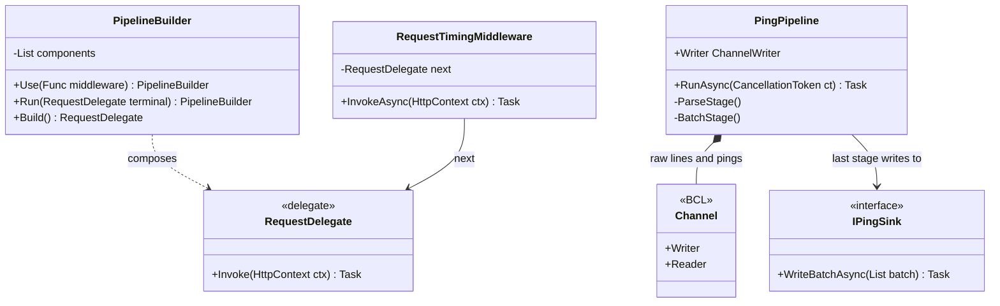
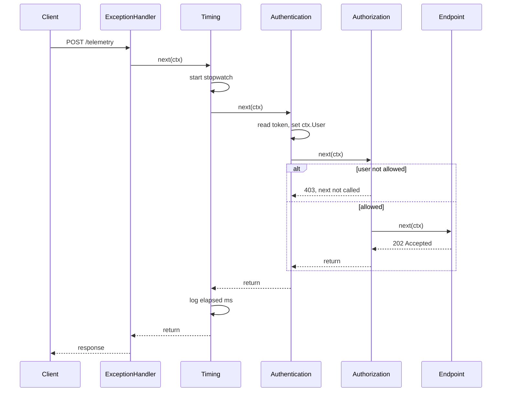
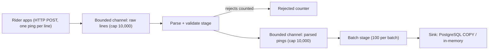

Every ASP.NET Core request walks a pipeline (exception handling, HTTPS, authentication, authorization, rate limiting, your endpoint) and back out. The same "line of small steps" shape powers data processing. This lesson builds both by hand so the framework stops being magic.

## Learning objectives

By the end of this lesson you will be able to:

1. Explain the **pipes and filters** idea and how middleware is a variation of it.
2. Build a middleware pipeline yourself from `Func<RequestDelegate, RequestDelegate>`, and explain why it is composed in reverse.
3. Write inline, convention-based and short-circuiting middleware in ASP.NET Core.
4. Order the built-in middleware correctly and explain what breaks when the order is wrong.
5. Build a multi-stage data pipeline with `System.Threading.Channels`, with backpressure, completion and error propagation.
6. Choose between middleware, endpoint filters, a handler pipeline (behaviours) and a plain method.

## Prerequisites

- [Chain of Responsibility](#/lesson/m06-chain-of-responsibility): middleware is a chain where each link decides whether to call the next.
- [Decorator](#/lesson/m06-decorator): each middleware wraps the rest of the pipeline.
- [Dependency Injection as a pattern](#/lesson/m06-dependency-injection-pattern): middleware lifetimes and per-request services.

## Explain it like I'm a beginner

**A cloud-kitchen order line.** Raw orders go in, sealed delivery bags come out. In between, stations **accept**, **cook**, **quality-check**, **pack** and **hand over**, each taking work from the counter before it and putting it on the counter after. You can add a station (say, "add cutlery") without rebuilding the others, and a failed quality check **rejects the dish** before it is packed.

- Each station is a **filter** (a stage).
- Each counter between stations is a **pipe** (in .NET, a **channel**).
- Rejecting a dish early is **short-circuiting**.
- If riders are slow to collect, the hand-over shelf fills and the kitchen must pause. That's **backpressure**, and it stops cooked food piling up and going cold.

**An office visitor with layers of desks (middleware).** A visitor to a tech park passes reception (log the visit), the security desk (bag check) and the floor desk (is there a booked meeting?) to reach the person they came to see, then passes the same desks in reverse on the way out (floor desk signs them out, security returns the bag, reception logs the exit time). Any desk can turn the visitor back, and each works **before and after** the inner desks. That shape is ASP.NET Core middleware.

## First-principles explanation

### What it is

- **Pipes and filters** (an architectural style): independent **filters** connected by **pipes**. Each filter reads, transforms and writes; filters know only the data format on the pipe, not each other.
- **Middleware pipeline**: a request/response specialisation. Each component receives the request **and the next component**, and can act before next, after next, or not call it at all (short-circuit). In ASP.NET Core a component is a `Func<RequestDelegate, RequestDelegate>`: it takes "the rest of the pipeline" and returns a delegate that wraps it.

### Why it exists — the problem

Without a pipeline, cross-cutting concerns pile into every handler:

```csharp
app.MapPost("/orders", async (HttpContext ctx) =>
{
    var sw = Stopwatch.StartNew();
    try
    {
        if (!ctx.Request.Headers.TryGetValue("X-Api-Key", out var k) || k != "...") { ctx.Response.StatusCode = 401; return; }
        var correlationId = ctx.Request.Headers["X-Correlation-Id"].FirstOrDefault() ?? Guid.NewGuid().ToString();
        // ... the actual 5 lines of business logic ...
    }
    catch (Exception ex) { /* log, write 500 */ }
    finally { /* log elapsed */ }
});
```

Multiply that by 60 endpoints, each copy drifting. A pipeline puts each concern in **one** component, applied in **one** declared order.

For data processing, one giant read-parse-validate-write loop is hard to test, can't use more cores for slow steps, and has no answer to "the database is slower than the input": it either buffers until memory runs out or blocks everything.

### How it works internally: building the middleware pipeline

The key type is:

```csharp
public delegate Task RequestDelegate(HttpContext context);
```

A middleware is a function **from the next delegate to a new delegate**:

```csharp
Func<RequestDelegate, RequestDelegate> timing = next => async ctx =>
{
    var sw = Stopwatch.StartNew();
    await next(ctx);                       // run the rest of the pipeline
    Console.WriteLine($"{ctx.Request.Path} took {sw.ElapsedMilliseconds} ms");
};
```

To build `[A, B, C]` around a terminal `T`, start from the **end**: `app = T`, then `C(app)`, `B(app)`, `A(app)`, giving `A(B(C(T)))`. Calling it runs the "befores" A, B, C, then T, then the "afters" C, B, A. **Registration order is the inbound order; the outbound order is reversed.** `ApplicationBuilder.Build()` does exactly this reverse loop.

### ASP.NET Core's flavours of middleware

| Style | Example | Notes |
|---|---|---|
| Inline | `app.Use(async (ctx, next) => { ...; await next(ctx); })` | Quick, good for small concerns. |
| Terminal | `app.Run(ctx => ctx.Response.WriteAsync("ok"))` | Never calls next. |
| Convention-based class | A class with constructor `(RequestDelegate next, ...)` and `InvokeAsync(HttpContext ctx, ...)` | Created **once** (singleton-like). Scoped services go in `InvokeAsync`'s parameters, not the constructor. |
| Factory-based (`IMiddleware`) | `class M : IMiddleware`, registered in DI | Resolved per request, so scoped constructor dependencies are fine. |
| Branching | `app.UseWhen(ctx => ctx.Request.Path.StartsWithSegments("/api"), b => ...)` | A sub-pipeline for some requests. |

### Order matters: the recommended sequence

For a typical API (from Microsoft's guidance, simplified):

1. `UseExceptionHandler` (outermost, so it catches everything below)
2. `UseHsts` (non-development)
3. `UseHttpsRedirection`
4. `UseStaticFiles` (if any; serves files early and skips auth for public assets)
5. `UseRouting` (minimal APIs add it automatically, but an explicit call fixes its position)
6. `UseCors`
7. `UseAuthentication`, then `UseAuthorization`
8. `UseRateLimiter` (after routing if you use per-endpoint policies)
9. Your custom middleware that needs the user or endpoint
10. Endpoints (`MapGet`, `MapControllers`)

What breaks when it's wrong:

- `UseAuthorization` **before** `UseAuthentication`: `User` is empty, so every `[Authorize]` endpoint returns 401.
- `UseExceptionHandler` **late**: exceptions from earlier middleware escape it.
- `UseCors` **after** authentication: preflight `OPTIONS` requests are rejected without CORS headers, and browsers block the call.
- Logging **after** a short-circuiting component never sees what it rejected.

### Data pipelines with channels

`System.Threading.Channels` provides thread-safe async queues (a `ChannelWriter<T>` and a `ChannelReader<T>`), ideal pipes between stages running as separate tasks:

- **Bounded** channels give **backpressure**: when full, `WriteAsync` waits (`BoundedChannelFullMode.Wait`), or items are dropped if you choose.
- **Completion** flows downstream: `writer.Complete()` ends the readers' `ReadAllAsync` loops.
- **Errors** flow too: `writer.Complete(exception)` makes readers throw. Upstream stages must be **cancelled**, or they wait forever on a full channel.

### When it is useful

- Cross-cutting HTTP concerns: errors, security headers, auth, correlation IDs, timing, rate limiting, tenant resolution.
- Processing streams where stages have different speeds: telemetry, file imports, log processing, ETL.
- Handler pipelines ("behaviours") around application commands: validation, transactions, retries.

### When it is unnecessary

- A concern for **one** endpoint belongs in an endpoint filter, not global middleware.
- A 200-row daily CSV: a `foreach` beats three stages and two channels.
- Workflows with branching and human approvals are state machines or sagas.

### Trade-offs

| You gain | You pay |
|---|---|
| Each concern in one place, reusable, testable alone | Order-dependent behaviour that's easy to get wrong silently |
| Add or remove steps without touching others | Harder to trace: "who set this header?" means reading the whole pipeline |
| Data stages run concurrently with backpressure | Completion, cancellation and error propagation must be designed carefully |
| Short-circuiting saves work (reject early) | Every global middleware costs a little on **every** request |

## Visual explanation

### Class diagram



How to read it: the top half is the **request pipeline**. `PipelineBuilder` stores middleware as functions and composes them into one `RequestDelegate`. `RequestTimingMiddleware` holds a reference to `next`, the rest of the pipeline. The bottom half is the **data pipeline**. `PingPipeline` owns two channels (the pipes) and runs two stages (the filters). Its last stage hands batches to an `IPingSink`, which is PostgreSQL in production and in-memory here.

### Sequence diagram: one request through the onion



The request travels **in** through each layer and the response travels **out** in reverse. Authorization can short-circuit with 403, and the endpoint never runs. Timing still logs the elapsed time, because it sits *outside* authorization. If timing were registered *after* authorization, rejected requests would never be timed. The exception handler is outermost, so an exception anywhere inside becomes a ProblemDetails 500 on the way out.

### Data pipeline flow



Each box is an independent task. If the database slows, the parsed-pings channel fills, the parser waits, the raw channel fills, and the endpoint's `TryWrite` fails, so it returns **503**. Rider apps back off and resend later instead of memory growing without limit: backpressure travelling upstream. Because a resend can repeat pings that were already accepted, make the sink idempotent (for example a unique key on `(rider_id, at)` with `ON CONFLICT DO NOTHING`).

## Step-by-step example

### Step 1 — everything in the handler

The 60-endpoint copy-paste shown above.

### Step 2 — one concern as inline middleware

```csharp
app.Use(async (ctx, next) =>
{
    var id = ctx.Request.Headers["X-Correlation-Id"].FirstOrDefault() ?? Guid.NewGuid().ToString("N");
    ctx.Response.Headers["X-Correlation-Id"] = id;
    await next(ctx);
});
```

### Step 3 — build the pipeline yourself

A 20-line `PipelineBuilder` with `Use` and `Build` (below) shows that `app.Use` is just a list of functions composed in reverse.

### Step 4 — move data processing to channels

Split the giant import loop into a parse stage and a batch-write stage, connected by a bounded channel.

## Production-style C# implementation

```text
Pipelines.Api/
  Program.cs
  Mini/PipelineBuilder.cs, MiniMiddlewares.cs
  Web/RequestTimingMiddleware.cs
  Telemetry/RiderPing.cs, PingPipeline.cs, TelemetryPipelineHost.cs
```

### A middleware pipeline from scratch

```csharp file=Mini/PipelineBuilder.cs
namespace Pipelines.Mini;

/// <summary>A minimal re-implementation of IApplicationBuilder.Use/Run/Build, using ASP.NET Core's own
/// RequestDelegate and HttpContext types, so the result can run inside a real app or a unit test.</summary>
public sealed class PipelineBuilder
{
    private readonly List<Func<RequestDelegate, RequestDelegate>> _components = new();
    private RequestDelegate? _terminal;

    public PipelineBuilder Use(Func<RequestDelegate, RequestDelegate> middleware)
    {
        _components.Add(middleware ?? throw new ArgumentNullException(nameof(middleware)));
        return this;
    }

    /// <summary>Convenience overload matching app.Use(async (ctx, next) => ...).</summary>
    public PipelineBuilder Use(Func<HttpContext, RequestDelegate, Task> inline) =>
        Use(next => ctx => inline(ctx, next));

    public PipelineBuilder Run(RequestDelegate terminal)
    {
        _terminal = terminal;
        return this;
    }

    public RequestDelegate Build()
    {
        RequestDelegate app = _terminal ?? (ctx => { ctx.Response.StatusCode = StatusCodes.Status404NotFound; return Task.CompletedTask; });
        for (var i = _components.Count - 1; i >= 0; i--)   // reverse: the first registered ends up outermost
            app = _components[i](app);
        return app;
    }
}
```

```csharp file=Mini/MiniMiddlewares.cs
using System.Diagnostics;
using System.Security.Cryptography;
using System.Text;

namespace Pipelines.Mini;

public static class MiniMiddlewares
{
    public const string CorrelationHeader = "X-Correlation-Id";

    /// <summary>Before-and-after middleware: reuses or creates a correlation id and echoes it on the response.</summary>
    public static Func<RequestDelegate, RequestDelegate> CorrelationId() => next => ctx =>
    {
        var id = ctx.Request.Headers[CorrelationHeader].FirstOrDefault();
        if (string.IsNullOrWhiteSpace(id) || id.Length > 64) id = Guid.NewGuid().ToString("N");
        ctx.Items[CorrelationHeader] = id;
        ctx.Response.Headers[CorrelationHeader] = id;
        return next(ctx);
    };

    /// <summary>Short-circuiting middleware: rejects requests without the right key; next is never called.</summary>
    public static Func<RequestDelegate, RequestDelegate> RequireApiKey(string expectedKey)
    {
        var expected = Encoding.UTF8.GetBytes(expectedKey);
        return next => ctx =>
        {
            var supplied = Encoding.UTF8.GetBytes(ctx.Request.Headers["X-Api-Key"].FirstOrDefault() ?? "");
            if (!CryptographicOperations.FixedTimeEquals(supplied, expected))   // no timing side channel
            {
                ctx.Response.StatusCode = StatusCodes.Status401Unauthorized;
                return Task.CompletedTask;
            }
            return next(ctx);
        };
    }

    /// <summary>Outermost safety net: turns an exception from any inner component into a 500.</summary>
    public static Func<RequestDelegate, RequestDelegate> CatchAll(Action<Exception> log) => next => async ctx =>
    {
        try { await next(ctx); }
        catch (Exception ex)
        {
            log(ex);
            if (!ctx.Response.HasStarted) ctx.Response.StatusCode = StatusCodes.Status500InternalServerError;
        }
    };

    public static Func<RequestDelegate, RequestDelegate> Timing(Action<string, long> report) => next => async ctx =>
    {
        var sw = Stopwatch.StartNew();
        try { await next(ctx); }
        finally { report(ctx.Request.Path, sw.ElapsedMilliseconds); }
    };
}
```

### A real ASP.NET Core convention-based middleware

```csharp file=Web/RequestTimingMiddleware.cs
using System.Diagnostics;

namespace Pipelines.Web;

/// <summary>Created once by the framework, so constructor dependencies must be singleton-safe.
/// Per-request (scoped) services would go into InvokeAsync's parameters instead.</summary>
public sealed class RequestTimingMiddleware(RequestDelegate next, ILogger<RequestTimingMiddleware> logger)
{
    public async Task InvokeAsync(HttpContext context)
    {
        var sw = Stopwatch.StartNew();
        context.Response.OnStarting(() =>
        {
            // Headers must be set before the body starts streaming; OnStarting runs at exactly that moment.
            context.Response.Headers["Server-Timing"] = $"app;dur={sw.Elapsed.TotalMilliseconds:F1}";
            return Task.CompletedTask;
        });

        await next(context);

        logger.LogInformation("{Method} {Path} -> {Status} in {Elapsed} ms",
            context.Request.Method, context.Request.Path, context.Response.StatusCode, sw.ElapsedMilliseconds);
    }
}
```

### A data pipeline with channels

```csharp file=Telemetry/RiderPing.cs
using System.Globalization;

namespace Pipelines.Telemetry;

/// <summary>One GPS location ping from a delivery rider's phone.</summary>
public sealed record RiderPing(string RiderId, DateTimeOffset At, double Latitude, double Longitude)
{
    /// <summary>Format: "RIDER-ID,2026-10-18T06:00:00Z,12.9716,77.5946" (rider, UTC time, latitude, longitude).</summary>
    public static bool TryParse(string? line, out RiderPing ping)
    {
        ping = null!;
        if (string.IsNullOrWhiteSpace(line)) return false;
        var parts = line.Split(',');
        if (parts.Length != 4 || parts[0].Length is 0 or > 32) return false;
        if (!DateTimeOffset.TryParse(parts[1], CultureInfo.InvariantCulture, DateTimeStyles.AssumeUniversal, out var at)) return false;
        if (!double.TryParse(parts[2], NumberStyles.Float, CultureInfo.InvariantCulture, out var lat) || lat is < -90 or > 90) return false;
        if (!double.TryParse(parts[3], NumberStyles.Float, CultureInfo.InvariantCulture, out var lon) || lon is < -180 or > 180) return false;
        ping = new RiderPing(parts[0], at, lat, lon);
        return true;
    }
}

public interface IPingSink
{
    Task WriteBatchAsync(IReadOnlyList<RiderPing> batch, CancellationToken ct);
}

/// <summary>Stand-in for a PostgreSQL sink (Npgsql binary COPY in production).</summary>
public sealed class InMemoryPingSink : IPingSink
{
    private readonly List<IReadOnlyList<RiderPing>> _batches = new();
    public IReadOnlyList<IReadOnlyList<RiderPing>> Batches { get { lock (_batches) return _batches.ToList(); } }

    public Task WriteBatchAsync(IReadOnlyList<RiderPing> batch, CancellationToken ct)
    {
        lock (_batches) _batches.Add(batch);
        return Task.CompletedTask;
    }
}
```

```csharp file=Telemetry/PingPipeline.cs
using System.Threading.Channels;

namespace Pipelines.Telemetry;

public sealed class PingPipelineOptions
{
    public int Capacity { get; set; } = 10_000;
    public int BatchSize { get; set; } = 100;
}

/// <summary>Two filters (parse, batch) joined by bounded channels (pipes). Singleton: one pipeline per process.</summary>
public sealed class PingPipeline
{
    private readonly Channel<string> _raw;
    private readonly Channel<RiderPing> _parsed;
    private readonly IPingSink _sink;
    private readonly int _batchSize;
    private long _accepted, _rejected;

    public PingPipeline(IPingSink sink, Microsoft.Extensions.Options.IOptions<PingPipelineOptions> options)
    {
        var o = options.Value;
        _sink = sink;
        _batchSize = o.BatchSize;
        var bounded = new BoundedChannelOptions(o.Capacity) { FullMode = BoundedChannelFullMode.Wait, SingleReader = true };
        _raw = Channel.CreateBounded<string>(bounded);
        _parsed = Channel.CreateBounded<RiderPing>(bounded);
    }

    /// <summary>Producers (the HTTP endpoint) write here. TryWrite returns false when full: backpressure.</summary>
    public ChannelWriter<string> Writer => _raw.Writer;
    public long Accepted => Interlocked.Read(ref _accepted);
    public long Rejected => Interlocked.Read(ref _rejected);

    public async Task RunAsync(CancellationToken ct)
    {
        using var cts = CancellationTokenSource.CreateLinkedTokenSource(ct);
        var parse = ParseStageAsync(cts.Token);
        var batch = BatchStageAsync(cts.Token);
        try
        {
            await Task.WhenAll(parse, batch);
        }
        catch
        {
            cts.Cancel();            // one stage failed: stop the others so nobody waits on a full channel
            throw;
        }
    }

    private async Task ParseStageAsync(CancellationToken ct)
    {
        try
        {
            await foreach (var line in _raw.Reader.ReadAllAsync(ct))
            {
                if (RiderPing.TryParse(line, out var ping))
                {
                    await _parsed.Writer.WriteAsync(ping, ct);     // waits when the next stage is behind
                    Interlocked.Increment(ref _accepted);
                }
                else Interlocked.Increment(ref _rejected);
            }
            _parsed.Writer.TryComplete();                              // input ended -> tell the next stage
        }
        catch (Exception ex)
        {
            _parsed.Writer.TryComplete(ex);                            // propagate failure downstream
            throw;
        }
    }

    private async Task BatchStageAsync(CancellationToken ct)
    {
        var batch = new List<RiderPing>(_batchSize);
        await foreach (var ping in _parsed.Reader.ReadAllAsync(ct))
        {
            batch.Add(ping);
            if (batch.Count == _batchSize)
            {
                await _sink.WriteBatchAsync(batch, ct);
                batch = new List<RiderPing>(_batchSize);
            }
        }
        if (batch.Count > 0) await _sink.WriteBatchAsync(batch, ct);  // flush the tail on completion
    }
}
```

```csharp file=Telemetry/TelemetryPipelineHost.cs
namespace Pipelines.Telemetry;

/// <summary>Runs the pipeline for the app's lifetime. On shutdown, completes the input so buffered pings drain.</summary>
public sealed class TelemetryPipelineHost(PingPipeline pipeline, ILogger<TelemetryPipelineHost> logger) : BackgroundService
{
    protected override async Task ExecuteAsync(CancellationToken stoppingToken)
    {
        stoppingToken.Register(() => pipeline.Writer.TryComplete());   // graceful drain instead of hard cancel
        try
        {
            await pipeline.RunAsync(CancellationToken.None);
            logger.LogInformation("Telemetry pipeline drained: {Accepted} accepted, {Rejected} rejected", pipeline.Accepted, pipeline.Rejected);
        }
        catch (Exception ex)
        {
            logger.LogCritical(ex, "Telemetry pipeline failed");
            throw;
        }
    }
}
```

### Wiring and middleware order

```csharp file=Program.cs
using Microsoft.AspNetCore.RateLimiting;
using Pipelines.Mini;
using Pipelines.Telemetry;
using Pipelines.Web;

var builder = WebApplication.CreateBuilder(args);

builder.Services.AddProblemDetails();
builder.Services.AddAuthentication();      // add JWT/cookie schemes for a real app
builder.Services.AddAuthorization();
builder.Services.AddRateLimiter(o =>
{
    o.RejectionStatusCode = StatusCodes.Status429TooManyRequests;
    o.AddFixedWindowLimiter("ingest", w => { w.PermitLimit = 200; w.Window = TimeSpan.FromSeconds(1); w.QueueLimit = 0; });
});

builder.Services.Configure<PingPipelineOptions>(builder.Configuration.GetSection("Telemetry"));
builder.Services.AddSingleton<IPingSink, InMemoryPingSink>();
builder.Services.AddSingleton<PingPipeline>();
builder.Services.AddHostedService<TelemetryPipelineHost>();

var app = builder.Build();

// 1. Outermost: turn any exception below into a ProblemDetails 500.
app.UseExceptionHandler();
// 2-3. Transport security.
if (!app.Environment.IsDevelopment()) app.UseHsts();
app.UseHttpsRedirection();
// 4. Timing sits outside auth so rejected requests are measured too.
app.UseMiddleware<RequestTimingMiddleware>();
// 5. Inline middleware: correlation id for every request.
app.Use(async (ctx, next) =>
{
    var id = ctx.Request.Headers[MiniMiddlewares.CorrelationHeader].FirstOrDefault() ?? Guid.NewGuid().ToString("N");
    ctx.Response.Headers[MiniMiddlewares.CorrelationHeader] = id;
    await next(ctx);
});
// 6-8. Routing, then identity, then permissions, then rate limits (per-endpoint policies need routing first).
app.UseRouting();
app.UseAuthentication();
app.UseAuthorization();
app.UseRateLimiter();

// Endpoint with backpressure: never buffer more than the pipeline can hold.
app.MapPost("/telemetry", async (HttpRequest request, PingPipeline pipeline, CancellationToken ct) =>
{
    using var reader = new StreamReader(request.Body);
    var queued = 0;
    while (await reader.ReadLineAsync(ct) is { } line)
    {
        if (!pipeline.Writer.TryWrite(line))
        {
            return Results.Problem($"Ingest is busy; {queued} lines accepted. Retry later.", statusCode: StatusCodes.Status503ServiceUnavailable,
                extensions: new Dictionary<string, object?> { ["acceptedLines"] = queued, ["retryAfterSeconds"] = 5 });
        }
        queued++;
    }
    return Results.Accepted(value: new { queued });
}).RequireRateLimiting("ingest");

// The hand-built pipeline uses the real RequestDelegate type, so it runs inside ASP.NET Core unchanged.
var mini = new PipelineBuilder()
    .Use(MiniMiddlewares.CatchAll(ex => app.Logger.LogError(ex, "mini pipeline")))
    .Use(MiniMiddlewares.CorrelationId())
    .Run(ctx => ctx.Response.WriteAsync($"Hello from the mini pipeline, correlation {ctx.Items[MiniMiddlewares.CorrelationHeader]}"))
    .Build();
app.MapGet("/mini", (HttpContext ctx) => mini(ctx));

app.MapGet("/telemetry/stats", (PingPipeline p) => Results.Ok(new { p.Accepted, p.Rejected }));

app.Run();
```

## Bad design vs good design

**Bad: authorization before authentication.**

```csharp
app.UseAuthorization();
app.UseAuthentication();   // too late: User is empty when authorization runs
```

Every protected endpoint returns 401 even with a valid token, a bug local tests on anonymous endpoints never catch.

**Bad: a convention middleware capturing a scoped service.**

```csharp
public sealed class TenantMiddleware(RequestDelegate next, AppDbContext db)   // DbContext is scoped!
```

Convention middleware is constructed **once**, so one `DbContext` serves every request. **Good:** take it in `InvokeAsync(HttpContext ctx, AppDbContext db)` (resolved per request), or implement `IMiddleware` registered as scoped.

**Bad: writing headers after the body has started.** `await next(ctx); ctx.Response.Headers["X-Elapsed"] = ...;` throws once the response has started streaming. Use `Response.OnStarting`, as `RequestTimingMiddleware` does.

**Bad: an unbounded channel between a fast producer and a slow database.** Memory grows until the pod is killed. **Good:** bounded channels and a producer that either waits or rejects with 503/429.

**Bad: a stage that dies silently.** The parser then blocks forever on a full channel and the endpoint returns 503 with nothing logged. **Good:** link cancellation, propagate with `Complete(ex)`, log at critical level.

:::callout type=tip title="Middleware, endpoint filter or behaviour?"
Use **middleware** for concerns that apply to (almost) every request and work on raw HTTP: errors, HTTPS, auth, CORS, compression, correlation IDs. Use **endpoint filters** (`AddEndpointFilter`) for concerns tied to specific endpoints and their typed arguments, such as validating a bound DTO. Use a **handler pipeline** (MediatR-style behaviours, exercise 3) for application-level concerns around commands, like transactions or auditing, that should work the same from HTTP, a queue consumer or a test.
:::

## Practical playground

The playground composes a pipeline by hand using ASP.NET Core's real `RequestDelegate` and `DefaultHttpContext`, prints the onion order, and then runs a tiny two-stage channel pipeline. Move the API-key middleware above the logger and notice that the logger no longer sees rejected requests.

:::playground type=csharp title="Build a pipeline and a channel pipeline"
```csharp file=Program.cs
using System;
using System.Collections.Generic;
using System.Linq;
using System.Threading.Channels;
using System.Threading.Tasks;
using Microsoft.AspNetCore.Http;

public static class Program
{
    public static async Task Main()
    {
        var log = new List<string>();
        var components = new List<Func<RequestDelegate, RequestDelegate>>
        {
            next => async ctx => { log.Add("logger in"); await next(ctx); log.Add($"logger out {ctx.Response.StatusCode}"); },
            next => ctx =>
            {
                if (ctx.Request.Headers["X-Api-Key"] != "rider-app-42") { ctx.Response.StatusCode = 401; log.Add("api key: rejected"); return Task.CompletedTask; }
                log.Add("api key: ok");
                return next(ctx);
            },
        };

        RequestDelegate app = ctx => { log.Add("endpoint"); ctx.Response.StatusCode = 200; return Task.CompletedTask; };
        for (var i = components.Count - 1; i >= 0; i--) app = components[i](app);

        var good = new DefaultHttpContext(); good.Request.Headers["X-Api-Key"] = "rider-app-42";
        await app(good);
        await app(new DefaultHttpContext());
        Console.WriteLine(string.Join(" | ", log));

        // Pipes and filters: parse -> sum, with a bounded channel between them.
        var pipe = Channel.CreateBounded<double>(4);
        var producer = Task.Run(async () =>
        {
            foreach (var raw in new[] { "32.5", "oops", "28.0", "999", "30.1" })   // rider speeds in km/h
                if (double.TryParse(raw, System.Globalization.CultureInfo.InvariantCulture, out var v) && v is >= 0 and <= 150)
                    await pipe.Writer.WriteAsync(v);
            pipe.Writer.Complete();
        });
        var speeds = new List<double>();
        await foreach (var v in pipe.Reader.ReadAllAsync()) speeds.Add(v);
        await producer;
        Console.WriteLine($"Accepted {speeds.Count} speed samples, average {speeds.Average():F1} km/h");
    }
}
```
:::

## Exercises

:::exercise id=m06-pipeline-ex1 difficulty=beginner kind=code title="Build the pipeline builder"
Implement `PipelineBuilder` so that middleware registered first runs first on the way in and last on the way out.
::requirements
- `Use(Func<RequestDelegate, RequestDelegate>)` adds a component and returns the builder.
- `Run(RequestDelegate)` sets the terminal delegate.
- `Build()` composes all components around the terminal. With no terminal, respond 404.
- Building twice gives two independent but equivalent pipelines.
::acceptance
- Components A, B and terminal T record `A> B> T B< A<`.
- A component that doesn't call `next` stops the pipeline.
- No components and no terminal gives status 404.
::hint
Each component is "a function that wraps the rest". What is "the rest" for the *last* component?
::hint
Start with `app = terminal`, then wrap it with the components from the **last to the first**.
::hint
```csharp
RequestDelegate app = _terminal ?? (ctx => { ctx.Response.StatusCode = 404; return Task.CompletedTask; });
for (var i = _components.Count - 1; i >= 0; i--) app = _components[i](app);
```
::hint
`DefaultHttpContext` (in `Microsoft.AspNetCore.Http`) is a real `HttpContext` that you can create in a test with `new`.
::starter
```csharp file=PipelineBuilder.cs
using System;
using System.Collections.Generic;
using System.Threading.Tasks;
using Microsoft.AspNetCore.Http;

public sealed class PipelineBuilder
{
    public PipelineBuilder Use(Func<RequestDelegate, RequestDelegate> middleware) => throw new NotImplementedException();
    public PipelineBuilder Run(RequestDelegate terminal) => throw new NotImplementedException();
    public RequestDelegate Build() => throw new NotImplementedException();
}
```
::tests
```csharp file=PipelineBuilderTests.cs
using System;
using System.Collections.Generic;
using System.Threading.Tasks;
using Microsoft.AspNetCore.Http;
using Xunit;

public class PipelineBuilderTests
{
    private static Func<RequestDelegate, RequestDelegate> Trace(string name, List<string> log) => next => async ctx =>
    {
        log.Add(name + ">");
        await next(ctx);
        log.Add(name + "<");
    };

    [Fact]
    public async Task Runs_in_onion_order()
    {
        var log = new List<string>();
        var app = new PipelineBuilder()
            .Use(Trace("A", log)).Use(Trace("B", log))
            .Run(ctx => { log.Add("T"); return Task.CompletedTask; })
            .Build();
        await app(new DefaultHttpContext());
        Assert.Equal("A> B> T B< A<", string.Join(" ", log));
    }

    [Fact]
    public async Task Short_circuit_stops_pipeline()
    {
        var log = new List<string>();
        var app = new PipelineBuilder()
            .Use(Trace("A", log))
            .Use(next => ctx => { ctx.Response.StatusCode = 401; log.Add("deny"); return Task.CompletedTask; })
            .Use(Trace("C", log))
            .Run(ctx => { log.Add("T"); return Task.CompletedTask; })
            .Build();
        var ctx = new DefaultHttpContext();
        await app(ctx);
        Assert.Equal(401, ctx.Response.StatusCode);
        Assert.Equal("A> deny A<", string.Join(" ", log));
    }

    [Fact]
    public async Task Empty_pipeline_is_404()
    {
        var ctx = new DefaultHttpContext();
        await new PipelineBuilder().Build()(ctx);
        Assert.Equal(404, ctx.Response.StatusCode);
    }

    [Fact]
    public async Task Build_twice_gives_equivalent_pipelines()
    {
        var log = new List<string>();
        var b = new PipelineBuilder().Use(Trace("A", log)).Run(_ => { log.Add("T"); return Task.CompletedTask; });
        var first = b.Build();
        var second = b.Build();
        Assert.NotSame(first, second);
        await first(new DefaultHttpContext());
        await second(new DefaultHttpContext());
        Assert.Equal("A> T A< A> T A<", string.Join(" ", log));
    }
}
```
::solution
```csharp file=PipelineBuilder.cs
using System;
using System.Collections.Generic;
using System.Threading.Tasks;
using Microsoft.AspNetCore.Http;

public sealed class PipelineBuilder
{
    private readonly List<Func<RequestDelegate, RequestDelegate>> _components = new();
    private RequestDelegate? _terminal;

    public PipelineBuilder Use(Func<RequestDelegate, RequestDelegate> middleware)
    {
        _components.Add(middleware ?? throw new ArgumentNullException(nameof(middleware)));
        return this;
    }

    public PipelineBuilder Run(RequestDelegate terminal)
    {
        _terminal = terminal ?? throw new ArgumentNullException(nameof(terminal));
        return this;
    }

    public RequestDelegate Build()
    {
        RequestDelegate app = _terminal ?? (ctx => { ctx.Response.StatusCode = StatusCodes.Status404NotFound; return Task.CompletedTask; });
        for (var i = _components.Count - 1; i >= 0; i--)
            app = _components[i](app);
        return app;
    }
}
```

This is essentially what `Microsoft.AspNetCore.Builder.ApplicationBuilder.Build()` does. Its default terminal also returns 404, with an extra check that throws if an endpoint was matched but never executed.
::mistakes
- Composing forwards (`for i = 0..n`), which makes the *last* registered component outermost, the reverse of ASP.NET Core.
- Calling the components while building, instead of composing delegates. `Build` must not execute anything.
- Sharing mutable per-request state in the builder's fields. Middleware is shared across all concurrent requests.
:::

:::exercise id=m06-pipeline-ex2 difficulty=beginner kind=code title="A short-circuiting store-access middleware"
Order tablets in partner restaurants call a food-delivery API with an `X-Store-Code` header. Write `StoreAccessMiddleware.Create(allowedStores)`. It returns a middleware that rejects requests from unknown stores with **403** and never calls `next`. For allowed stores, it stores the store code in `HttpContext.Items["store"]` and calls `next`.
::requirements
- Missing header: **400**, with `next` not called.
- Unknown store: **403**, with `next` not called.
- Store codes are matched case-insensitively (`blr-017` equals `BLR-017`). Save the code **uppercased**.
::acceptance
- Allowed store: next called once, and `Items["store"]` is `"BLR-017"`.
- Unknown store: status 403, and next not called.
- Missing header: status 400, and next not called.
::hint
The method returns `Func<RequestDelegate, RequestDelegate>`. Build the set of allowed stores *once*, outside the per-request lambda.
::hint
`new HashSet<string>(allowedStores, StringComparer.OrdinalIgnoreCase)`.
::hint
Short-circuit by setting `ctx.Response.StatusCode` and returning `Task.CompletedTask` without calling `next`.
::hint
```csharp
return next => ctx => {
    var code = ctx.Request.Headers["X-Store-Code"].FirstOrDefault();
    if (string.IsNullOrWhiteSpace(code)) { ctx.Response.StatusCode = 400; return Task.CompletedTask; }
    ...
};
```
::starter
```csharp file=StoreAccessMiddleware.cs
using System;
using System.Collections.Generic;
using System.Linq;
using System.Threading.Tasks;
using Microsoft.AspNetCore.Http;

public static class StoreAccessMiddleware
{
    public static Func<RequestDelegate, RequestDelegate> Create(IEnumerable<string> allowedStores) =>
        throw new NotImplementedException();
}
```
::tests
```csharp file=StoreAccessMiddlewareTests.cs
using System.Threading.Tasks;
using Microsoft.AspNetCore.Http;
using Xunit;

public class StoreAccessMiddlewareTests
{
    private static (RequestDelegate App, Counter Calls) Build()
    {
        var calls = new Counter();
        RequestDelegate terminal = _ => { calls.Value++; return Task.CompletedTask; };
        return (StoreAccessMiddleware.Create(new[] { "BLR-017", "MUM-204" })(terminal), calls);
    }
    public sealed class Counter { public int Value; }

    [Fact]
    public async Task Allowed_store_passes_through()
    {
        var (app, calls) = Build();
        var ctx = new DefaultHttpContext();
        ctx.Request.Headers["X-Store-Code"] = "blr-017";
        await app(ctx);
        Assert.Equal(1, calls.Value);
        Assert.Equal("BLR-017", ctx.Items["store"]);
    }

    [Fact]
    public async Task Unknown_store_is_forbidden()
    {
        var (app, calls) = Build();
        var ctx = new DefaultHttpContext();
        ctx.Request.Headers["X-Store-Code"] = "DEL-999";
        await app(ctx);
        Assert.Equal(403, ctx.Response.StatusCode);
        Assert.Equal(0, calls.Value);
    }

    [Fact]
    public async Task Missing_header_is_bad_request()
    {
        var (app, calls) = Build();
        var ctx = new DefaultHttpContext();
        await app(ctx);
        Assert.Equal(400, ctx.Response.StatusCode);
        Assert.Equal(0, calls.Value);
    }
}
```
::solution
```csharp file=StoreAccessMiddleware.cs
using System;
using System.Collections.Generic;
using System.Linq;
using System.Threading.Tasks;
using Microsoft.AspNetCore.Http;

public static class StoreAccessMiddleware
{
    public static Func<RequestDelegate, RequestDelegate> Create(IEnumerable<string> allowedStores)
    {
        var allowed = new HashSet<string>(allowedStores, StringComparer.OrdinalIgnoreCase);   // built once
        return next => ctx =>
        {
            var code = ctx.Request.Headers["X-Store-Code"].FirstOrDefault()?.Trim();
            if (string.IsNullOrEmpty(code))
            {
                ctx.Response.StatusCode = StatusCodes.Status400BadRequest;
                return Task.CompletedTask;
            }
            if (!allowed.Contains(code))
            {
                ctx.Response.StatusCode = StatusCodes.Status403Forbidden;
                return Task.CompletedTask;
            }
            ctx.Items["store"] = code.ToUpperInvariant();
            return next(ctx);
        };
    }
}
```

Register it with `app.Use(StoreAccessMiddleware.Create(stores))`. `IApplicationBuilder.Use` takes exactly this `Func<RequestDelegate, RequestDelegate>`. Note that a header like this identifies a store but doesn't **authenticate** it. Anyone can send a header. In production, combine it with real authentication (a per-device token or client certificate), and treat the store code as a claim inside that token.
::mistakes
- Building the `HashSet` per request.
- Writing a response body *and* calling `next`, so two components write to the same response.
- Using 401 for "known caller, wrong store". 401 means "who are you?" and 403 means "you can't do this".
:::

:::exercise id=m06-pipeline-ex3 difficulty=intermediate kind=code title="A handler pipeline with behaviours"
Application commands (such as `ApproveRefund`) should get validation and audit logging whether they come from HTTP, a queue or a test. Implement a MediatR-style **behaviour pipeline**.
::requirements
- `IPipelineBehavior<TRequest, TResponse>` has `Task<TResponse> Handle(TRequest request, Func<Task<TResponse>> next)`.
- `RequestPipeline.Execute(request, handler, behaviors)` runs behaviours in list order around the handler.
- `ValidationBehavior` short-circuits: if the validator returns errors, it returns `Response.Invalid(errors)` without calling `next`.
- `AuditBehavior` records `"start {name}"` before and `"end {name} {ok|invalid}"` after.
::acceptance
- With `[Audit, Validation]` and a valid request, the log is `start, handler, end ok`.
- With an invalid request, the handler never runs, and the log is `start, end invalid`.
- With no behaviours, the handler runs directly.
::hint
It's the same composition as the middleware builder, but `next` takes no arguments here.
::hint
Start with `Func<Task<TResponse>> next = () => handler(request);`, then wrap it from the last behaviour to the first.
::hint
Watch the closure. Capture the current `next` in a local before reassigning: `var inner = next; next = () => b.Handle(request, inner);`.
::hint
```csharp
Func<Task<TResponse>> next = () => handler(request);
for (var i = behaviors.Count - 1; i >= 0; i--) { var b = behaviors[i]; var inner = next; next = () => b.Handle(request, inner); }
return next();
```
::starter
```csharp file=RequestPipeline.cs
using System;
using System.Collections.Generic;
using System.Linq;
using System.Threading.Tasks;

public sealed record ApproveRefund(Guid OrderId, string ApprovedBy, decimal AmountInr);

public sealed record Response(bool Ok, IReadOnlyList<string> Errors)
{
    public static Response Success() => new(true, Array.Empty<string>());
    public static Response Invalid(IReadOnlyList<string> errors) => new(false, errors);
}

public interface IPipelineBehavior<TRequest, TResponse>
{
    Task<TResponse> Handle(TRequest request, Func<Task<TResponse>> next);
}

public static class RequestPipeline
{
    public static Task<TResponse> Execute<TRequest, TResponse>(TRequest request, Func<TRequest, Task<TResponse>> handler,
        IReadOnlyList<IPipelineBehavior<TRequest, TResponse>> behaviors) => throw new NotImplementedException();
}

public sealed class ValidationBehavior(Func<ApproveRefund, IReadOnlyList<string>> validate) : IPipelineBehavior<ApproveRefund, Response>
{
    public Task<Response> Handle(ApproveRefund request, Func<Task<Response>> next) => throw new NotImplementedException();
}

public sealed class AuditBehavior(List<string> log) : IPipelineBehavior<ApproveRefund, Response>
{
    public Task<Response> Handle(ApproveRefund request, Func<Task<Response>> next) => throw new NotImplementedException();
}
```
::tests
```csharp file=RequestPipelineTests.cs
using System;
using System.Collections.Generic;
using System.Threading.Tasks;
using Xunit;

public class RequestPipelineTests
{
    private static IReadOnlyList<string> Validate(ApproveRefund c)
    {
        var errors = new List<string>();
        if (string.IsNullOrWhiteSpace(c.ApprovedBy)) errors.Add("ApprovedBy is required.");
        if (c.AmountInr <= 0) errors.Add("Amount must be positive.");
        return errors;
    }

    [Fact]
    public async Task Valid_request_runs_handler_inside_behaviours()
    {
        var log = new List<string>();
        var behaviors = new IPipelineBehavior<ApproveRefund, Response>[] { new AuditBehavior(log), new ValidationBehavior(Validate) };
        var r = await RequestPipeline.Execute(new ApproveRefund(Guid.NewGuid(), "support.agent.17", 450m),
            _ => { log.Add("handler"); return Task.FromResult(Response.Success()); }, behaviors);
        Assert.True(r.Ok);
        Assert.Equal(new[] { "start ApproveRefund", "handler", "end ApproveRefund ok" }, log.ToArray());
    }

    [Fact]
    public async Task Invalid_request_short_circuits()
    {
        var log = new List<string>();
        var behaviors = new IPipelineBehavior<ApproveRefund, Response>[] { new AuditBehavior(log), new ValidationBehavior(Validate) };
        var r = await RequestPipeline.Execute(new ApproveRefund(Guid.NewGuid(), "", 0m),
            _ => { log.Add("handler"); return Task.FromResult(Response.Success()); }, behaviors);
        Assert.False(r.Ok);
        Assert.Equal(2, r.Errors.Count);
        Assert.Equal(new[] { "start ApproveRefund", "end ApproveRefund invalid" }, log.ToArray());
    }

    [Fact]
    public async Task No_behaviours_calls_handler()
    {
        var called = false;
        var r = await RequestPipeline.Execute(new ApproveRefund(Guid.NewGuid(), "x", 1m),
            _ => { called = true; return Task.FromResult(Response.Success()); }, Array.Empty<IPipelineBehavior<ApproveRefund, Response>>());
        Assert.True(called);
        Assert.True(r.Ok);
    }
}
```
::solution
```csharp file=RequestPipeline.cs
using System;
using System.Collections.Generic;
using System.Linq;
using System.Threading.Tasks;

public sealed record ApproveRefund(Guid OrderId, string ApprovedBy, decimal AmountInr);

public sealed record Response(bool Ok, IReadOnlyList<string> Errors)
{
    public static Response Success() => new(true, Array.Empty<string>());
    public static Response Invalid(IReadOnlyList<string> errors) => new(false, errors);
}

public interface IPipelineBehavior<TRequest, TResponse>
{
    Task<TResponse> Handle(TRequest request, Func<Task<TResponse>> next);
}

public static class RequestPipeline
{
    public static Task<TResponse> Execute<TRequest, TResponse>(TRequest request, Func<TRequest, Task<TResponse>> handler,
        IReadOnlyList<IPipelineBehavior<TRequest, TResponse>> behaviors)
    {
        Func<Task<TResponse>> next = () => handler(request);
        for (var i = behaviors.Count - 1; i >= 0; i--)
        {
            var behavior = behaviors[i];
            var inner = next;                         // capture this step's next, not the variable
            next = () => behavior.Handle(request, inner);
        }
        return next();
    }
}

public sealed class ValidationBehavior(Func<ApproveRefund, IReadOnlyList<string>> validate) : IPipelineBehavior<ApproveRefund, Response>
{
    public Task<Response> Handle(ApproveRefund request, Func<Task<Response>> next)
    {
        var errors = validate(request);
        return errors.Count > 0 ? Task.FromResult(Response.Invalid(errors)) : next();
    }
}

public sealed class AuditBehavior(List<string> log) : IPipelineBehavior<ApproveRefund, Response>
{
    public async Task<Response> Handle(ApproveRefund request, Func<Task<Response>> next)
    {
        var name = request.GetType().Name;
        log.Add($"start {name}");
        var response = await next();
        log.Add($"end {name} {(response.Ok ? "ok" : "invalid")}");
        return response;
    }
}
```

The closure bug in hint 3 is worth seeing once. Without `var inner = next;`, every lambda would read the *final* value of `next`, and calling it would recurse forever. In a real app, behaviours are registered in DI as open generics (`IPipelineBehavior<,>`), and a dispatcher resolves them in registration order. That's how MediatR-style libraries work.
::mistakes
- The closure capture bug above, which causes a stack overflow at runtime.
- Putting validation **outside** audit and then wondering why invalid commands aren't audited. Order is a design decision, so write it down.
- Swallowing exceptions in a behaviour. Let them propagate, or convert specific ones deliberately.
:::

:::exercise id=m06-pipeline-ex4 difficulty=intermediate kind=written title="Refactor: fix the pipeline and extract the cross-cutting code"
A restaurant-partner API (partners update menus and prices) has this `Program.cs` and a typical endpoint:

```csharp
app.UseAuthorization();
app.MapControllers();
app.UseAuthentication();
app.UseExceptionHandler("/error");
app.UseCors("dashboard");
app.UseHttpsRedirection();

[HttpPost("menu")]
public async Task<IActionResult> Post(MenuUpdateDto dto)
{
    var sw = Stopwatch.StartNew();
    var tenant = Request.Headers["X-Tenant"].FirstOrDefault();
    if (tenant is null) return BadRequest("tenant");
    try
    {
        if (!ModelState.IsValid) return BadRequest(ModelState);
        await _service.Save(tenant, dto);
        return Ok();
    }
    catch (Exception ex) { _log.LogError(ex, "failed"); return StatusCode(500, ex.Message); }
    finally { _log.LogInformation("menu update took {Ms}", sw.ElapsedMilliseconds); }
}
```

The same try/catch, timing and tenant code appears in 40 actions. Users report that `[Authorize]` endpoints always return 401 and that the React dashboard gets CORS errors. Write the corrected `Program.cs` order, say where each piece of the action's cross-cutting code should move, and explain each bug.
::acceptance
- A correct order, with exception handler first, authentication before authorization, and CORS before auth and endpoints.
- `MapControllers` placed after the middleware, with an explanation that in `WebApplication` endpoints run at the end of the pipeline anyway (`Map*` only registers routes), so the move is about readability.
- Timing, tenant resolution and exception handling each moved to a named middleware or filter, with a reason.
- Mention that returning `ex.Message` to clients leaks internals.
::hint
Read the order top to bottom and simulate a request: what is `User` when authorization runs?
::hint
Where does a CORS preflight `OPTIONS` request end up in the current order?
::hint
Which concerns need the raw HTTP request (middleware), and which need MVC model binding results (filters)?
::hint
Think about which endpoints need a tenant. If all of them, use middleware. If some, use an endpoint filter or attribute.
::solution
**Corrected order:**

```csharp
app.UseExceptionHandler();          // + AddProblemDetails(): outermost, catches everything below
app.UseHttpsRedirection();
app.UseRouting();
app.UseCors("dashboard");           // before auth so preflights get CORS headers
app.UseAuthentication();
app.UseAuthorization();
app.UseMiddleware<RequestTimingMiddleware>();   // or before auth, to also time rejected requests
app.UseMiddleware<TenantMiddleware>();          // needs the user, so after auth
app.MapControllers();
```

**Bugs explained:**

- `UseAuthorization` ran before `UseAuthentication`, so `User` was anonymous during authorization and every `[Authorize]` returned 401.
- `UseExceptionHandler` was registered *after* the auth middleware, so anything those components throw escaped it. (It still wrapped controller execution, because `WebApplication` runs the endpoint middleware at the very end of the pipeline, but the action's own catch got there first and leaked `ex.Message`, which can expose SQL text, file paths or connection details.)
- CORS came after auth and endpoints, so preflight `OPTIONS` requests were rejected or answered without CORS headers, and the browser blocked the calls.
- `MapControllers` in the middle is misleading rather than broken: in `WebApplication`, `Map*` only adds routes, and the endpoint middleware is appended at the end of the pipeline, so middleware registered after it still runs first. Put it last so the file reads in execution order. Ordering bugs like these pass compilation and only show up at runtime.

**Where the action's code goes:**

- *try/catch*: deleted. `AddProblemDetails()` + `UseExceptionHandler()` produces a uniform 500 with a trace ID and no internal message.
- *Timing*: `RequestTimingMiddleware` (exists once, measures everything), or OpenTelemetry's ASP.NET Core instrumentation.
- *Tenant*: `TenantMiddleware`, which reads the header or a claim, validates it, and sets a scoped `ITenantContext`. Returns 400/403 by short-circuiting. Inject `ITenantContext` into services instead of passing strings around.
- *ModelState*: `[ApiController]` already returns a 400 ValidationProblemDetails automatically, so the check can go.

The action shrinks to `await _service.Save(dto); return Ok();`.
::mistakes
- Moving model validation into global middleware. Middleware runs before model binding, so the DTO doesn't exist yet. Use filters.
- Keeping "just one" try/catch in the action "for logging". The exception handler already logs.
:::

:::exercise id=m06-pipeline-ex5 difficulty=advanced kind=code title="A channel pipeline that drains, batches and fails safely"
Implement `TelemetryPipeline.RunAsync`, a three-stage pipeline: **produce** (write input lines into a bounded channel), **parse** (valid readings to a second bounded channel, invalid ones counted), and **batch** (send batches of `batchSize` to the sink, flushing the remainder at the end).
::requirements
- Both channels are bounded to `capacity`, with `FullMode = Wait`.
- Return `PipelineStats(Accepted, Rejected, Batches)` after everything has drained.
- If the sink throws, `RunAsync` must throw that exception **promptly** (well within 5 s). It must not deadlock, even with `capacity = 2` and thousands of input lines.
- Honour the caller's `CancellationToken`.
::acceptance
- 250 valid lines with batch size 100 give batches of 100, 100 and 50.
- Invalid lines are counted as rejected and never reach the sink.
- A sink that fails on its 2nd batch makes `RunAsync` throw `InvalidOperationException` quickly, with capacity 2 and 10,000 lines.
::hint
Run the three stages as three tasks, and await them together.
::hint
Each stage must `Complete()` its output channel when its input ends, so the next stage's `ReadAllAsync` loop finishes.
::hint
Deadlock danger: if the batch stage dies, the parser blocks on `WriteAsync` into a full channel, and the producer blocks behind it. Use a linked `CancellationTokenSource`, and cancel it when any stage fails.
::hint
`Task.WhenAll` waits for *all* tasks, even after one fails. Wrap each stage so that on exception it calls `cts.Cancel()` and rethrows.
::hint
At the end, if the caller didn't cancel, rethrow the *first real* failure (not an `OperationCanceledException` caused by your own cancel). Await the batch stage first, or inspect the tasks' exceptions.
::starter
```csharp file=TelemetryPipeline.cs
using System;
using System.Collections.Generic;
using System.Globalization;
using System.Threading;
using System.Threading.Channels;
using System.Threading.Tasks;

public sealed record Reading(string RiderId, double SpeedKmh);
public sealed record PipelineStats(int Accepted, int Rejected, int Batches);
public interface ISink { Task WriteAsync(IReadOnlyList<Reading> batch, CancellationToken ct); }

public static class TelemetryPipeline
{
    /// <summary>Line format "RIDER,speedKmh"; valid when the speed parses and is between 0 and 150 km/h.</summary>
    public static bool TryParse(string line, out Reading reading)
    {
        reading = null!;
        var parts = line.Split(',');
        if (parts.Length != 2 || parts[0].Length == 0) return false;
        if (!double.TryParse(parts[1], NumberStyles.Float, CultureInfo.InvariantCulture, out var v) || v is < 0 or > 150) return false;
        reading = new Reading(parts[0], v);
        return true;
    }

    public static Task<PipelineStats> RunAsync(IEnumerable<string> lines, ISink sink, int capacity, int batchSize, CancellationToken ct) =>
        throw new NotImplementedException();
}
```
::tests
```csharp file=TelemetryPipelineTests.cs
using System;
using System.Collections.Generic;
using System.Linq;
using System.Threading;
using System.Threading.Tasks;
using Xunit;

public class TelemetryPipelineTests
{
    private sealed class RecordingSink : ISink
    {
        public List<int> Sizes { get; } = new();
        public Task WriteAsync(IReadOnlyList<Reading> batch, CancellationToken ct) { lock (Sizes) Sizes.Add(batch.Count); return Task.CompletedTask; }
    }

    private sealed class FailingSink(int failOnBatch) : ISink
    {
        private int _n;
        public async Task WriteAsync(IReadOnlyList<Reading> batch, CancellationToken ct)
        {
            await Task.Delay(1, ct);
            if (Interlocked.Increment(ref _n) == failOnBatch) throw new InvalidOperationException("database unavailable");
        }
    }

    private static IEnumerable<string> Valid(int n) => Enumerable.Range(0, n).Select(i => $"RD-{i % 7},{i % 120}.5");

    [Fact]
    public async Task Batches_and_flushes_tail()
    {
        var sink = new RecordingSink();
        var stats = await TelemetryPipeline.RunAsync(Valid(250), sink, capacity: 16, batchSize: 100, CancellationToken.None);
        Assert.Equal(new[] { 100, 100, 50 }, sink.Sizes.ToArray());
        Assert.Equal(new PipelineStats(250, 0, 3), stats);
    }

    [Fact]
    public async Task Invalid_lines_are_rejected()
    {
        var sink = new RecordingSink();
        var lines = new[] { "RD-1,32.5", "garbage", "RD-2,999", ",10", "RD-3,18" };
        var stats = await TelemetryPipeline.RunAsync(lines, sink, capacity: 2, batchSize: 10, CancellationToken.None);
        Assert.Equal(2, stats.Accepted);
        Assert.Equal(3, stats.Rejected);
        Assert.Equal(new[] { 2 }, sink.Sizes.ToArray());
    }

    [Fact]
    public async Task Sink_failure_propagates_without_deadlock()
    {
        var run = TelemetryPipeline.RunAsync(Valid(10_000), new FailingSink(failOnBatch: 2), capacity: 2, batchSize: 10, CancellationToken.None);
        var finished = await Task.WhenAny(run, Task.Delay(TimeSpan.FromSeconds(5)));
        Assert.Same(run, finished);
        var ex = await Assert.ThrowsAsync<InvalidOperationException>(() => run);
        Assert.Equal("database unavailable", ex.Message);
    }
}
```
::solution
```csharp file=TelemetryPipeline.cs
using System;
using System.Collections.Generic;
using System.Globalization;
using System.Threading;
using System.Threading.Channels;
using System.Threading.Tasks;

public sealed record Reading(string RiderId, double SpeedKmh);
public sealed record PipelineStats(int Accepted, int Rejected, int Batches);
public interface ISink { Task WriteAsync(IReadOnlyList<Reading> batch, CancellationToken ct); }

public static class TelemetryPipeline
{
    /// <summary>Line format "RIDER,speedKmh"; valid when the speed parses and is between 0 and 150 km/h.</summary>
    public static bool TryParse(string line, out Reading reading)
    {
        reading = null!;
        var parts = line.Split(',');
        if (parts.Length != 2 || parts[0].Length == 0) return false;
        if (!double.TryParse(parts[1], NumberStyles.Float, CultureInfo.InvariantCulture, out var v) || v is < 0 or > 150) return false;
        reading = new Reading(parts[0], v);
        return true;
    }

    public static async Task<PipelineStats> RunAsync(IEnumerable<string> lines, ISink sink, int capacity, int batchSize, CancellationToken ct)
    {
        var options = new BoundedChannelOptions(capacity) { FullMode = BoundedChannelFullMode.Wait, SingleReader = true, SingleWriter = true };
        var raw = Channel.CreateBounded<string>(options);
        var parsed = Channel.CreateBounded<Reading>(options);
        using var cts = CancellationTokenSource.CreateLinkedTokenSource(ct);
        var token = cts.Token;
        int accepted = 0, rejected = 0, batches = 0;

        // Wrap each stage: on failure, complete its output with the error and cancel everyone else.
        async Task Stage(Func<Task> body, ChannelWriter<string>? rawOut = null, ChannelWriter<Reading>? parsedOut = null)
        {
            try
            {
                await body();
                rawOut?.TryComplete();
                parsedOut?.TryComplete();
            }
            catch (Exception ex)
            {
                rawOut?.TryComplete(ex);
                parsedOut?.TryComplete(ex);
                cts.Cancel();
                throw;
            }
        }

        var produce = Stage(async () =>
        {
            foreach (var line in lines) await raw.Writer.WriteAsync(line, token);
        }, rawOut: raw.Writer);

        var parse = Stage(async () =>
        {
            await foreach (var line in raw.Reader.ReadAllAsync(token))
            {
                if (TryParse(line, out var r)) { await parsed.Writer.WriteAsync(r, token); accepted++; }
                else rejected++;
            }
        }, parsedOut: parsed.Writer);

        var batch = Stage(async () =>
        {
            var buffer = new List<Reading>(batchSize);
            await foreach (var r in parsed.Reader.ReadAllAsync(token))
            {
                buffer.Add(r);
                if (buffer.Count == batchSize) { await sink.WriteAsync(buffer, token); batches++; buffer = new List<Reading>(batchSize); }
            }
            if (buffer.Count > 0) { await sink.WriteAsync(buffer, token); batches++; }
        });

        try
        {
            await Task.WhenAll(produce, parse, batch);
        }
        catch when (!ct.IsCancellationRequested)
        {
            // Prefer the root cause over the OperationCanceledExceptions our own cancel caused.
            foreach (var t in new[] { batch, parse, produce })
                if (t.IsFaulted && t.Exception!.InnerException is not OperationCanceledException and { } root)
                    throw root;
            throw;
        }
        return new PipelineStats(accepted, rejected, batches);
    }
}
```

The counters can be plain `int`s because each is written by one stage and read only after `WhenAll`, which provides the memory barrier.

Real telemetry also needs **time-based flushing** ("100 pings *or* 2 seconds"): race `reader.WaitToReadAsync` against a timer, or use a `PeriodicTimer`, without losing pings when both fire together.
::alternatives
TPL Dataflow (`System.Threading.Tasks.Dataflow`: `TransformBlock`, `BatchBlock`, `ActionBlock` with `BoundedCapacity` and `PropagateCompletion`) has batching and parallelism built in and ships with modern .NET. It is heavier and more opinionated; channels are lower-level, faster and simpler to reason about, which is why most new code (including ASP.NET Core internals) uses them.
::mistakes
- Forgetting `Complete()`, so the next stage's `await foreach` waits forever and `RunAsync` never returns.
- Using unbounded channels "to be safe". That just moves the failure to an out-of-memory crash.
- Catching the sink exception and continuing silently, losing data.
:::

## Automated testing

**Middleware as pure functions.** Because a middleware is `Func<RequestDelegate, RequestDelegate>`, you can test it with a fake `next` and a `DefaultHttpContext`, with no server needed:

```csharp
[Fact]
public async Task Correlation_id_is_echoed()
{
    var ctx = new DefaultHttpContext();
    ctx.Request.Headers["X-Correlation-Id"] = "abc123";
    var called = false;
    await MiniMiddlewares.CorrelationId()(_ => { called = true; return Task.CompletedTask; })(ctx);
    Assert.True(called);
    Assert.Equal("abc123", ctx.Response.Headers["X-Correlation-Id"].ToString());
}
```

**Order tests.** Ordering bugs are integration bugs. With `WebApplicationFactory<Program>`, call a protected endpoint with a valid test token (expect 200, not 401), and send a CORS preflight (expect `Access-Control-Allow-Origin`).

**Convention middleware.** Construct it directly: `new RequestTimingMiddleware(next, NullLogger<RequestTimingMiddleware>.Instance).InvokeAsync(ctx)`.

**Channel pipelines.** Test the three behaviours that matter: correct output (batch sizes, tail flush), backpressure (a slow sink with a tiny capacity still completes), and failure (a throwing sink fails the run promptly; always use a timeout, as in exercise 5, so a deadlock fails the test instead of hanging CI).

**Extensibility.** New concerns are new components (security headers, a deduplication stage); existing ones don't change. Record the order in one place, with comments explaining *why*.

## Real-world application

- **ASP.NET Core** is the reference implementation: `UseExceptionHandler`, `UseHttpsRedirection`, `UseAuthentication`, `UseRateLimiter`, `UseOutputCache` and `UseResponseCompression` are all middleware composed with exactly the `Func<RequestDelegate, RequestDelegate>` shape you built.
- **`HttpClient` handlers** are the outbound mirror image: `DelegatingHandler`s registered with `IHttpClientFactory` (`AddHttpMessageHandler`) form a pipeline for retries, auth tokens and logging around every outgoing request.
- **IoT and telemetry ingestion** (delivery-rider and cab GPS pings, smart meters, fitness trackers) and **bulk imports** use bounded parse → validate → batch-insert stages, often ending in PostgreSQL COPY.
- **Message consumers** (RabbitMQ, Kafka) wrap handlers in behaviour pipelines for idempotency checks, tracing and retries, the same idea as exercise 3.

## Interview questions

:::interview
::q beginner
What is middleware in ASP.NET Core?
::a
A component in the request pipeline that receives the `HttpContext` and a reference to the next component. It can run code before and after calling `next`, or short-circuit by not calling it. Technically it's a `Func<RequestDelegate, RequestDelegate>`, and the framework composes all components into one `RequestDelegate`.
::q beginner
Why does middleware order matter? Give an example.
::a
Each component sees only what earlier components have set up, and wraps everything after it. If `UseAuthorization` runs before `UseAuthentication`, `HttpContext.User` is still anonymous, so protected endpoints return 401. If `UseExceptionHandler` isn't first, exceptions from earlier middleware escape it.
::q intermediate
How is the pipeline built from `app.Use` calls, and why in reverse?
::a
Each `Use` adds a `Func<RequestDelegate, RequestDelegate>` to a list. `Build()` starts with the terminal delegate (a 404 fallback or endpoint execution) and wraps it with each component from the last to the first. Reversing the order means the first registered component becomes outermost, so it runs first on the way in and last on the way out. That matches the order you read in `Program.cs`.
::q intermediate
How do you use a scoped service such as `DbContext` in convention-based middleware?
::a
Not through the constructor. Convention middleware is created once, so a scoped constructor dependency would be captured for the app's lifetime. Add it as a parameter of `InvokeAsync(HttpContext ctx, AppDbContext db)`, which the framework resolves per request. Alternatively, implement `IMiddleware` and register the class in DI with a scoped lifetime.
::q advanced
Design an ingestion path for 5,000 rider GPS pings per second (about 25,000 active riders, one ping every 5 s) that must survive a slow database without running out of memory.
::a
The endpoint writes into a **bounded** channel with `TryWrite` and returns 503/429 with `Retry-After` when full, so rider apps back off. A background service runs bounded stages: parse/validate (parallel if CPU-bound), batch (500 pings or 1 s, whichever first), bulk insert (PostgreSQL COPY). Size capacities from a memory budget (10,000 small records is a few MB, an estimate). Link cancellation, propagate errors with `Complete(ex)`, alert on them, and drain on shutdown. In-memory channels lose buffered data on a crash, so put a broker (Kafka, RabbitMQ) in front if durability matters. Expose queue depth, rejections and batch latency as metrics.
::q advanced
Middleware, endpoint filter or MediatR-style behaviour: how do you choose?
::a
**Middleware** for raw-HTTP concerns on almost all requests (exceptions, HTTPS, CORS, authentication, correlation IDs). **Endpoint filters** for endpoint-specific concerns needing bound arguments or metadata (DTO validation, resource permissions). **Behaviours** for application concerns that must work outside HTTP too (transactions, auditing, idempotency for queue consumers). Prefer the narrowest scope; global middleware costs something on every request.
:::

## Summary and revision

**Key takeaways**

- **Pipes and filters**: independent stages connected by pipes. **Middleware**: stages that wrap "the rest of the pipeline".
- A middleware is `Func<RequestDelegate, RequestDelegate>`. `Build()` composes in **reverse**, so registration order equals the inbound order.
- Order the built-in middleware deliberately: exception handler first, authentication before authorization, CORS before auth, and endpoints last.
- Convention middleware is created **once**, so take scoped services in `InvokeAsync`.
- Channels give async pipes with **backpressure** (bounded), **completion** and **error propagation**. Always cancel sibling stages on failure.
- Choose the narrowest mechanism: endpoint filter or behaviour before global middleware.

**Terminology**: pipes and filters, middleware, `RequestDelegate`, short-circuit, terminal middleware, convention-based middleware, `IMiddleware`, endpoint filter, pipeline behaviour, `Channel<T>`, bounded channel, backpressure, completion, `DelegatingHandler`.

:::flashcards
Q: What is the type of an ASP.NET Core middleware component?
A: Func<RequestDelegate, RequestDelegate> — it takes the rest of the pipeline and returns a delegate that wraps it.
Q: Why does Build() iterate the components in reverse?
A: So the first registered component ends up outermost — running first on the way in and last on the way out.
Q: What does short-circuiting mean?
A: A middleware writes the response (e.g. 401) and does not call next, so later components and the endpoint never run.
Q: Where must UseExceptionHandler go?
A: First (outermost), so it catches exceptions from every component after it.
Q: How do you use a scoped service in convention-based middleware?
A: Take it as a parameter of InvokeAsync (resolved per request), not in the constructor (created once).
Q: What gives backpressure in a channel pipeline?
A: A bounded channel: when full, WriteAsync waits (or TryWrite returns false), slowing producers.
Q: Why cancel other stages when one fails?
A: Otherwise upstream stages block forever writing into a full channel nobody reads — a deadlock.
Q: How do you set response headers after calling next?
A: You can't once the response has started; register Response.OnStarting(...) before calling next.
:::

## Knowledge check

:::quiz pass=70
::q single
Components are registered as `Use(A)`, `Use(B)`, `Run(T)`. A and B both log "in" before `next` and "out" after. What's the log for one request?
- [ ] B in, A in, T, A out, B out.
- [x] A in, B in, T, B out, A out.
- [ ] A in, A out, B in, B out, T.
- [ ] T, B, A.
> The first registered component is outermost, so the inbound order equals registration order and the outbound order is reversed.
::q single
After a deployment, every `[Authorize]` endpoint returns 401, even with valid tokens. `Program.cs` has `UseAuthorization()` on the line before `UseAuthentication()`. Why?
- [ ] The token signing key is wrong.
- [x] Authorization runs before authentication has populated `HttpContext.User`, so the user is anonymous.
- [ ] `UseAuthorization` must be called twice.
- [ ] Minimal APIs don't support authorization.
> Swap the two lines. Authentication identifies the user, and authorization decides what they may do.
::q single
A convention-based middleware takes `AppDbContext` in its constructor. What goes wrong?
- [ ] Nothing.
- [x] The middleware is created once, so one `DbContext` is shared by every request: a captive dependency with thread-safety bugs.
- [ ] It doesn't compile.
- [ ] A new `DbContext` is created per request, which is slow.
> Take scoped services as `InvokeAsync` parameters, or use `IMiddleware` registered as scoped.
::q multi
Which belong in global middleware rather than an endpoint filter? (Select all that apply.)
- [x] Converting unhandled exceptions to ProblemDetails.
- [x] Adding a correlation ID to every request and response.
- [ ] Validating the `ApproveRefundDto` of one endpoint.
- [x] HTTPS redirection.
- [ ] Checking that the current user owns the order in the route.
> Global, raw-HTTP concerns are middleware. Endpoint-specific checks that need bound arguments or route data fit endpoint filters or the handler.
::q single
A rider-ping endpoint writes into an **unbounded** channel. The database slows down during a backup window. What happens?
- [ ] Requests start failing with 503 automatically.
- [x] The channel grows without limit, memory climbs, and the process may be killed, losing everything buffered.
- [ ] The channel drops old items.
- [ ] The database speeds up.
> Unbounded channels have no backpressure. Use a bounded channel, and make the producer wait or reject (503/429) when it's full.
::q single
In a three-stage channel pipeline, the final stage throws. The other two stages aren't cancelled, and capacity is 100. What happens?
- [ ] The pipeline finishes normally.
- [x] Upstream stages fill their channels and block forever on `WriteAsync`, so `RunAsync` never completes: a deadlock.
- [ ] The exception automatically stops all stages.
- [ ] Data is written twice.
> Nobody reads the full channel any more. Link cancellation, cancel on failure, and complete channels with the exception.
::q single
You need to add `Server-Timing` with the elapsed time to every response. Where do you set the header?
- [ ] After `await next(ctx)`, directly on `Response.Headers`.
- [x] In a callback registered with `Response.OnStarting` before calling `next`.
- [ ] In the endpoint.
- [ ] In `UseExceptionHandler`.
> Once the body starts streaming, headers are sent and can't change. `OnStarting` runs right before that moment.
:::

## Completion criteria

You have finished this lesson when you can:

- [ ] Score at least 70 % on the knowledge check.
- [ ] Complete exercises 1 and 2 with all tests passing.
- [ ] Complete exercise 3 and explain the closure-capture bug.
- [ ] Write the corrected middleware order from memory (exercise 4), with a reason for each position.
- [ ] Complete exercise 5, or explain how backpressure and cancellation prevent the deadlock.
