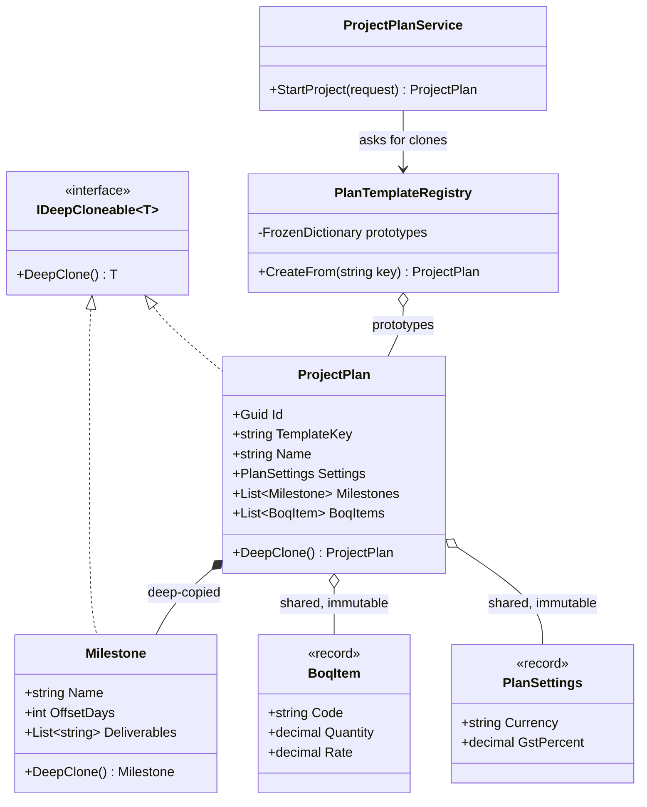
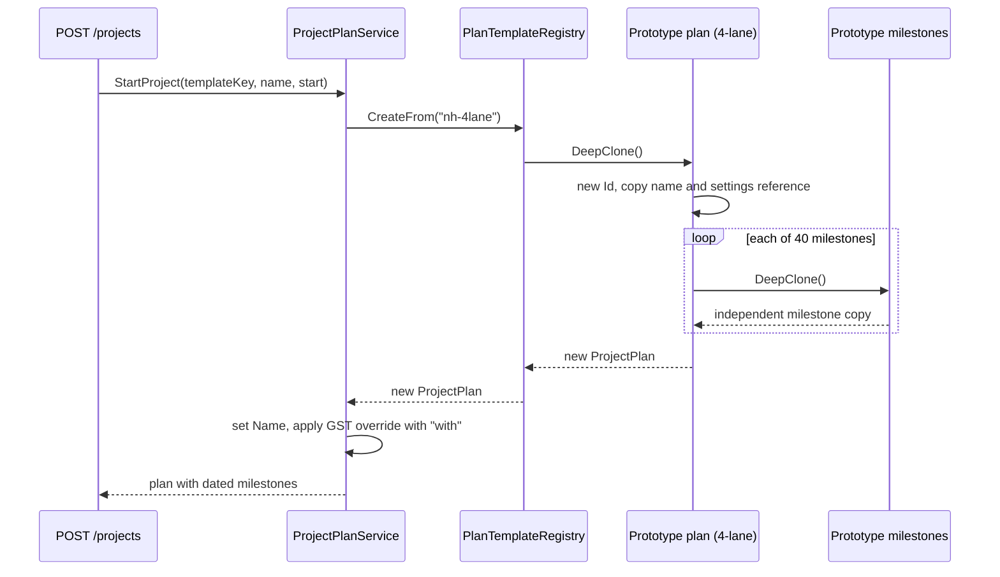
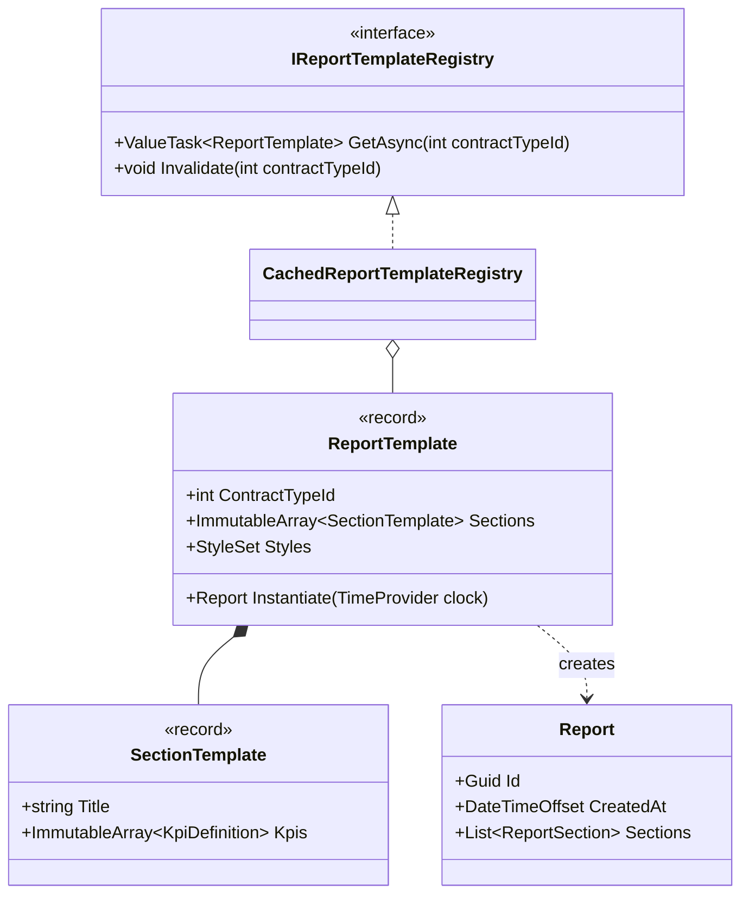

Prototype is the creational pattern that says: "don't build it again, copy one you already have". The idea is simple. The hard part is the word *copy*. In C#, copying an object that holds references can silently share data between the "original" and the "copy". Most real Prototype bugs are sharing bugs, so this lesson spends as much time on shallow versus deep copying as on the pattern itself.

## Learning objectives

By the end of this lesson you will be able to:

1. Explain the problem Prototype solves: creating many similar objects whose setup is expensive or complicated.
2. Tell a shallow copy from a deep copy, and predict which fields end up shared.
3. Explain why `ICloneable` and raw `MemberwiseClone` are poor public contracts in .NET.
4. Use C# records and `with` expressions for safe copies of immutable data, and spot when `with` is still shallow.
5. Implement deep copies with copy constructors, and keep a registry of named prototypes in ASP.NET Core.
6. Clone object graphs that contain shared references and cycles.
7. Decide when Prototype is the wrong tool and a Builder, Factory Method or plain constructor is better.

## Prerequisites

- [Value types, reference types and memory basics](#/lesson/m01-value-reference-memory): you must know that a class variable holds a *reference* (an address), not the object itself.
- [Constructors and object initialization](#/lesson/m01-constructors): we write a special constructor that copies another instance.
- [What design patterns are](#/lesson/m06-intro-patterns): helpful for the vocabulary (participants, intent).

## Explain it like I'm a beginner

Imagine a site engineer at a highway project office in Lucknow. Every new road project needs a project plan: 40 milestones (survey, land acquisition, earthwork, sub-base, bituminous layers, road markings), a bill of quantities with 120 lines, GST settings and a defect-liability period. Typing all that in from zero takes a full day.

So the office keeps a **master file**: "Standard 4-lane highway plan". For a new project, someone opens the master, does **Save As**, and edits the copy: new name, new start date, maybe a different GST rate. The master stays untouched for next time.

That is the Prototype pattern. The master file is the **prototype**. "Save As" is the **clone** operation. The office cabinet that holds several masters (4-lane highway, minor bridge, rural road) is a **prototype registry**.

Now the catch. Suppose the "copy" was not a real copy, but a shortcut (like a desktop shortcut pointing at the same file). The engineer edits milestone dates on the "copy"... and the master changes too. Next month's project starts with last month's dates. In code this is called a **shallow copy**: the outer object is new, but the things inside it are shared. A real "Save As", where every page is duplicated, is a **deep copy**.

- Shallow copy: a new folder, but the pages inside are the *same* pages.
- Deep copy: a new folder with photocopies of every page.

Analogy two: a cookie cutter versus a photocopier. A constructor is a cookie cutter: it shapes fresh dough every time using a recipe. Prototype is a photocopier: you start from a finished page and duplicate it, including the hand-written notes someone added later.

## First-principles explanation

### The original problem

The *Design Patterns* book (Gamma et al., 1994) describes Prototype as: "Specify the kinds of objects to create using a prototypical instance, and create new objects by copying this prototype." Three situations make that useful:

1. **Setup is expensive.** Building the object needs database queries, file reads or remote calls. A project template might need 5 queries and a configuration lookup. Doing that on every "new project" request is wasteful when the result is the same each time.
2. **Setup is complicated or data-driven.** The configured object is the product of many steps, or of an admin editing it in a UI. There is no single constructor call that recreates it. The only "recipe" is the existing object.
3. **The caller should not know the concrete class.** The code that needs a copy only holds an abstraction. Asking the object to copy itself (`plan.DeepClone()`) avoids a `switch` over every concrete type.

### The simplest implementation

The smallest possible Prototype in C# is a method that returns a copy of `this`:

```csharp
public sealed class Milestone
{
    public string Name { get; set; } = "";
    public int OffsetDays { get; set; }
    public Milestone Clone() => new() { Name = Name, OffsetDays = OffsetDays };
}
```

Both fields are a `string` (immutable) and an `int` (a value type), so copying them field by field gives a fully independent object. Nothing is shared that can change. For objects this simple, shallow and deep copies are the same thing.

The trouble starts the moment a field is a reference to something **mutable** (changeable), such as a `List<T>` or another class.

### Shallow versus deep copy, precisely

Every field in a C# object is either a value (an `int`, a `decimal`, a `struct`) or a reference (an address pointing at an object on the heap).

- A **shallow copy** creates a new outer object and copies every field's bits. Value fields get duplicated. Reference fields get the *same address*, so both objects point at the same inner object.
- A **deep copy** creates a new outer object and also new copies of every mutable object it reaches, recursively.

`Object.MemberwiseClone()` is .NET's built-in shallow copy. It allocates a new object of the same runtime type and copies the fields as raw memory. It does **not** run any constructor, so constructor validation and initialisation logic are skipped.

A useful rule: **sharing is safe only for immutable things.** A `string`, a `record` with only immutable members, or a `DateOnly` can be shared by a thousand copies without harm, because nobody can change them. A `List<T>` cannot be safely shared, because one `Add` affects everyone. So a correct copy is often "deep where mutable, shared where immutable". That is cheaper than copying everything and just as safe.

### Why `ICloneable` is a trap

.NET has had an `ICloneable` interface since version 1.0, with a single method `object Clone()`. Microsoft's own API documentation advises against implementing it in public APIs. Three reasons:

1. **It doesn't say shallow or deep.** The contract is silent, so callers can't rely on either. Two classes in the same codebase can implement it differently.
2. **It returns `object`.** Every caller must cast, and a wrong cast fails at runtime.
3. **It doesn't compose.** If a derived class forgets to override, `Clone()` returns the base behaviour, often a shallow copy that misses the new fields.

The usual fix is your own typed interface whose name states the guarantee, for example `IDeepCloneable<T>` with `T DeepClone()`. The name is the documentation.

### `MemberwiseClone` pitfalls

`MemberwiseClone` is `protected`, fast and tempting. Its problems:

- It is shallow. Every list, dictionary and child object is shared.
- It skips constructors. If your constructor assigns a fresh `Guid Id`, the clone keeps the *same* Id. Two "different" projects with one identity is a nasty bug in a database-backed system.
- It copies `readonly` fields too, including ones that hold a lock object, a cancellation token source or a cache. Sharing those is rarely what you want.

It is fine as a *first step* inside your own `DeepClone()`: call `MemberwiseClone()`, then replace each mutable reference with a copy. Many developers find a **copy constructor** clearer, because every field is listed in one place and the compiler's nullable analysis checks it.

### Records and `with` expressions

C# records were designed for immutable data. A `with` expression creates a copy with some properties changed, without touching the original. This is called nondestructive mutation:

```csharp
public sealed record PlanSettings(string Currency, decimal GstPercent, int DefectLiabilityMonths);

var standard = new PlanSettings("INR", 18m, 24);
var reduced  = standard with { GstPercent = 12m };   // standard still has 18 %
```

Under the hood, the compiler generates a hidden copy constructor and a `<Clone>$` method. `with` calls the clone, then sets the listed `init` properties on the copy. It is a **shallow** copy. If a record has a `List<string>` property, the original and the copy share the same list:

```csharp
public sealed record Template(string Name, List<string> Steps);
var a = new Template("Bridge", new List<string> { "Survey" });
var b = a with { Name = "Bridge v2" };
b.Steps.Add("Piling");          // a.Steps now contains "Piling" too
```

The fix is to keep records immutable all the way down. Use `IReadOnlyList<T>` filled with an array or an `ImmutableArray<T>`, and copy incoming lists in a factory method. Then a shallow `with` is perfectly safe, because there is nothing mutable left to share. You can also write your own copy constructor in a record (`protected Template(Template original)`) and the compiler will use it for `with`.

### Copy constructors

A copy constructor is a constructor that takes another instance of the same type: `private ProjectPlan(ProjectPlan source)`. Benefits:

- Every field is assigned explicitly, so new fields are easy to spot in code review.
- `readonly` and get-only properties can be assigned (they can't after `MemberwiseClone`).
- You decide per field: deep-copy mutable children, share immutable ones, *reset* identity fields like `Id` and audit timestamps.

### Participants

| Participant | Role | In our example |
|---|---|---|
| **Prototype** (interface) | Declares the cloning operation | `IDeepCloneable<T>` |
| **Concrete prototype** | Implements cloning for itself, including its children | `ProjectPlan`, `Milestone` |
| **Client** | Asks a prototype for a copy instead of calling `new` | `ProjectPlanService` |
| **Prototype registry** (optional) | Stores named prototypes and hands out clones | `PlanTemplateRegistry` |

### When it is useful

- Many objects start from the same expensive or complex configuration (document templates, project plans, game levels, default permission sets).
- An admin edits "templates" at runtime, and users create instances from them.
- You need "snapshot and change" behaviour on immutable data: records with `with`.
- You need an undo point. Cloning the current state is the simplest form of [Memento](#/lesson/m06-memento).

### When not to use it

- **Construction is cheap and clear.** A `new Invoice(customer, lines)` call is more readable than finding a template and cloning it.
- **The object owns live resources** such as a database connection, an open file, a socket or an `HttpClient`. Copying those is meaningless or dangerous. Create a new one.
- **Identity matters more than content.** Entities with database ids, concurrency tokens and audit fields need careful resetting after copying. If most fields must be reset anyway, a Builder or factory is clearer.
- **The graph is huge or open-ended.** Deep-copying an EF Core entity with lazy-loaded navigation properties can pull half the database into memory.
- **The data is already immutable.** You don't need to clone an immutable object at all. Share it. That is the [Flyweight](#/lesson/m06-flyweight) idea.

### Trade-offs

| You gain | You pay |
|---|---|
| New objects without repeating expensive setup | Every class in the graph must know how to copy itself |
| Callers don't need to know concrete types | A forgotten field in the copy logic is a silent bug |
| Runtime-editable templates (data, not code) | Deep copies of large graphs cost memory and CPU |
| Easy snapshots for undo and "what-if" | Identity, timestamps and resources need explicit resetting |

## Visual explanation

### Class diagram



How to read it: `ProjectPlan` and `Milestone` both implement `IDeepCloneable<T>`. The filled diamond from `ProjectPlan` to `Milestone` means composition: each plan owns its milestones, and because `Milestone` is mutable, cloning a plan must clone each milestone. The hollow diamonds to `BoqItem` and `PlanSettings` mean those objects are only referenced. They are immutable records, so a copy can safely point at the same instances. The registry holds one prototype per template key, and the service never calls `new ProjectPlan(...)` itself; it asks the registry.

### Sequence diagram



The prototype in the registry is never modified. Each request receives its own copy, and only then does the service customise it. The loop shows where the cost of a deep copy lives: one small allocation per mutable child. The `with` step on the settings record creates a new settings object instead of editing the shared one. That is why sharing the settings reference in the clone was safe.

## Step-by-step example

### Step 1 — the naive version: rebuild every time

```csharp
public ProjectPlan CreateHighwayPlan(string name)
{
    var plan = new ProjectPlan("nh-4lane", name);
    foreach (var row in _db.LoadMilestoneRows("nh-4lane"))   // query 1
        plan.Milestones.Add(new Milestone(row.Name, row.Offset, row.Weight));
    foreach (var row in _db.LoadBoqRows("nh-4lane"))         // query 2
        plan.BoqItems.Add(new BoqItem(row.Code, row.Desc, row.Unit, row.Qty, row.Rate));
    plan.Settings = _db.LoadSettings("nh-4lane");            // query 3
    return plan;
}
```

It works. But every "new project" click repeats the same three queries to rebuild an identical structure. With 5 templates, you have 5 near-identical methods.

### Step 2 — the shallow-copy shortcut (and its bug)

A developer caches one plan and returns `(ProjectPlan)cached.MemberwiseClone()` through a helper. The first project edits milestone 7's offset. The second project, created an hour later, starts with that edited offset. Both "copies" share one `List<Milestone>`. No exception, no log line, just wrong data.

### Step 3 — a typed, deep clone with copy constructors

Introduce `IDeepCloneable<T>`. Give `Milestone` and `ProjectPlan` private copy constructors that deep-copy mutable children, share immutable records and assign a new `Id`.

### Step 4 — a registry and a client

Load each template once at startup into `PlanTemplateRegistry`. The service asks for a clone by key and customises it. Adding a sixth template is a data change, not a new method.

## Production-style C# implementation

Project structure:

```text
Infra.Api/
  Program.cs
  Planning/
    IDeepCloneable.cs
    Milestone.cs
    ProjectPlan.cs
    PlanTemplates.cs
    PlanTemplateRegistry.cs
    ProjectPlanService.cs
Infra.Tests/
  Planning/ProjectPlanCloneTests.cs
```

```csharp file=Planning/IDeepCloneable.cs
namespace Infra.Planning;

/// <summary>
/// Typed replacement for ICloneable. The name is the contract: the returned object shares
/// no mutable state with the original.
/// </summary>
public interface IDeepCloneable<out T>
{
    T DeepClone();
}
```

```csharp file=Planning/Milestone.cs
namespace Infra.Planning;

public sealed class Milestone : IDeepCloneable<Milestone>
{
    public Milestone(string name, int offsetDays, decimal weightPercent)
    {
        ArgumentException.ThrowIfNullOrWhiteSpace(name);
        ArgumentOutOfRangeException.ThrowIfNegative(offsetDays);
        Name = name;
        OffsetDays = offsetDays;
        WeightPercent = weightPercent;
    }

    // Copy constructor: the one place that knows how to copy a Milestone.
    private Milestone(Milestone source)
    {
        Name = source.Name;
        OffsetDays = source.OffsetDays;
        WeightPercent = source.WeightPercent;
        // Strings are immutable, so copying the list (not each string) is enough.
        Deliverables = new List<string>(source.Deliverables);
    }

    public string Name { get; set; }
    /// <summary>Days after the project start date.</summary>
    public int OffsetDays { get; set; }
    /// <summary>Share of physical progress this milestone represents (0–100).</summary>
    public decimal WeightPercent { get; set; }
    public List<string> Deliverables { get; } = new();

    public Milestone DeepClone() => new(this);
}
```

```csharp file=Planning/ProjectPlan.cs
namespace Infra.Planning;

/// <summary>Immutable, so plan copies can share it safely. Change it with a "with" expression.</summary>
public sealed record PlanSettings(string Currency, decimal GstPercent, int DefectLiabilityMonths, string Region);

/// <summary>Immutable bill-of-quantities line. Shared between copies.</summary>
public sealed record BoqItem(string Code, string Description, string Unit, decimal Quantity, decimal Rate)
{
    public decimal Amount => Quantity * Rate;
}

public sealed class ProjectPlan : IDeepCloneable<ProjectPlan>
{
    public ProjectPlan(string templateKey, string name, PlanSettings settings)
    {
        ArgumentException.ThrowIfNullOrWhiteSpace(templateKey);
        ArgumentException.ThrowIfNullOrWhiteSpace(name);
        Id = Guid.NewGuid();
        TemplateKey = templateKey;
        Name = name;
        Settings = settings ?? throw new ArgumentNullException(nameof(settings));
        Milestones = new List<Milestone>();
        BoqItems = new List<BoqItem>();
    }

    private ProjectPlan(ProjectPlan source)
    {
        Id = Guid.NewGuid();                    // identity is never copied
        TemplateKey = source.TemplateKey;
        Name = source.Name;
        Settings = source.Settings;             // immutable record: share
        Milestones = source.Milestones.Select(m => m.DeepClone()).ToList();   // mutable: deep copy
        BoqItems = new List<BoqItem>(source.BoqItems);   // new list, shared immutable items
    }

    public Guid Id { get; }
    public string TemplateKey { get; }
    public string Name { get; set; }
    public PlanSettings Settings { get; set; }
    public List<Milestone> Milestones { get; }
    public List<BoqItem> BoqItems { get; }

    public decimal ContractValue => BoqItems.Sum(b => b.Amount);

    public ProjectPlan DeepClone() => new(this);
}
```

```csharp file=Planning/PlanTemplates.cs
namespace Infra.Planning;

/// <summary>Seed prototypes. In production these would be loaded once from PostgreSQL at startup.</summary>
public static class PlanTemplates
{
    public static ProjectPlan FourLaneHighway()
    {
        var plan = new ProjectPlan("nh-4lane", "Standard 4-lane highway", new PlanSettings("INR", 18m, 48, "North"));
        var survey = new Milestone("Survey and design", 0, 5m);
        survey.Deliverables.AddRange(["Topographic survey", "Alignment drawings"]);
        plan.Milestones.Add(survey);
        plan.Milestones.Add(new Milestone("Land acquisition", 30, 10m));
        plan.Milestones.Add(new Milestone("Earthwork and embankment", 120, 25m));
        plan.Milestones.Add(new Milestone("Granular sub-base and WMM", 240, 25m));
        plan.Milestones.Add(new Milestone("Bituminous layers", 360, 30m));
        plan.Milestones.Add(new Milestone("Road furniture and markings", 450, 5m));
        plan.BoqItems.Add(new BoqItem("EW-01", "Embankment construction", "cum", 85_000m, 310m));
        plan.BoqItems.Add(new BoqItem("BT-04", "Dense bituminous macadam", "cum", 9_500m, 9_800m));
        return plan;
    }

    public static ProjectPlan MinorBridge()
    {
        var plan = new ProjectPlan("minor-bridge", "Minor bridge up to 60 m", new PlanSettings("INR", 18m, 60, "Any"));
        plan.Milestones.Add(new Milestone("Foundations", 0, 35m));
        plan.Milestones.Add(new Milestone("Substructure", 90, 30m));
        plan.Milestones.Add(new Milestone("Superstructure", 180, 30m));
        plan.Milestones.Add(new Milestone("Wearing coat and railings", 260, 5m));
        plan.BoqItems.Add(new BoqItem("CN-12", "M35 concrete in superstructure", "cum", 640m, 8_900m));
        return plan;
    }
}
```

```csharp file=Planning/PlanTemplateRegistry.cs
using System.Collections.Frozen;

namespace Infra.Planning;

public sealed class UnknownTemplateException(string key)
    : Exception($"No project template is registered with key '{key}'.")
{
    public string Key { get; } = key;
}

public interface IPlanTemplateRegistry
{
    IReadOnlyCollection<string> Keys { get; }
    /// <summary>Returns a NEW, independent plan copied from the named prototype.</summary>
    ProjectPlan CreateFrom(string templateKey);
}

/// <summary>
/// Prototype registry. The stored prototypes are never handed out and never mutated after
/// construction, so concurrent CreateFrom calls only read them and are thread-safe.
/// </summary>
public sealed class PlanTemplateRegistry : IPlanTemplateRegistry
{
    private readonly FrozenDictionary<string, ProjectPlan> _prototypes;

    public PlanTemplateRegistry(IEnumerable<ProjectPlan> prototypes)
    {
        // Clone on the way in too, so the caller's later edits can't leak into the registry.
        _prototypes = prototypes.ToFrozenDictionary(p => p.TemplateKey, p => p.DeepClone(), StringComparer.OrdinalIgnoreCase);
    }

    public IReadOnlyCollection<string> Keys => _prototypes.Keys;

    public ProjectPlan CreateFrom(string templateKey) =>
        _prototypes.TryGetValue(templateKey, out var prototype)
            ? prototype.DeepClone()
            : throw new UnknownTemplateException(templateKey);
}
```

```csharp file=Planning/ProjectPlanService.cs
namespace Infra.Planning;

public sealed record CreateProjectRequest(string TemplateKey, string Name, DateOnly StartDate, decimal? GstPercentOverride);

public sealed record MilestoneDto(string Name, DateOnly DueDate, decimal WeightPercent);

public sealed record ProjectPlanDto(Guid Id, string Name, string TemplateKey, decimal ContractValue, decimal GstPercent, IReadOnlyList<MilestoneDto> Milestones);

public sealed class ProjectPlanService(IPlanTemplateRegistry registry, ILogger<ProjectPlanService> logger)
{
    public ProjectPlanDto StartProject(CreateProjectRequest request)
    {
        ArgumentNullException.ThrowIfNull(request);
        var plan = registry.CreateFrom(request.TemplateKey);   // Prototype: copy, don't rebuild
        plan.Name = request.Name;
        if (request.GstPercentOverride is { } gst)
            plan.Settings = plan.Settings with { GstPercent = gst };   // never edits the shared record

        logger.LogInformation("Created project {ProjectId} from template {Template}", plan.Id, plan.TemplateKey);

        var milestones = plan.Milestones
            .Select(m => new MilestoneDto(m.Name, request.StartDate.AddDays(m.OffsetDays), m.WeightPercent))
            .ToList();
        return new ProjectPlanDto(plan.Id, plan.Name, plan.TemplateKey, plan.ContractValue, plan.Settings.GstPercent, milestones);
    }
}
```

```csharp file=Program.cs
using Infra.Planning;

var builder = WebApplication.CreateBuilder(args);

// Prototypes are built once. The registry is a singleton because it is read-only after startup.
builder.Services.AddSingleton<IPlanTemplateRegistry>(_ =>
    new PlanTemplateRegistry([PlanTemplates.FourLaneHighway(), PlanTemplates.MinorBridge()]));
builder.Services.AddScoped<ProjectPlanService>();

var app = builder.Build();

app.MapGet("/templates", (IPlanTemplateRegistry registry) => registry.Keys);

app.MapPost("/projects", (CreateProjectRequest request, ProjectPlanService service) =>
{
    try { return Results.Ok(service.StartProject(request)); }
    catch (UnknownTemplateException ex) { return Results.Problem(ex.Message, statusCode: StatusCodes.Status404NotFound); }
});

app.Run();
```

### Design notes

- **Why a `FrozenDictionary`?** It is optimised for "build once, read many times", which is exactly a registry's access pattern. A plain `Dictionary` that nobody writes to after construction is also thread-safe for reads.
- **Why clone on registration as well as on creation?** If the registry stored the caller's object directly, the code that built it could still hold a reference and mutate it later. Cloning at the boundary removes that risk. This is a *defensive copy*.
- **Admin-editable templates.** If admins change templates at runtime, don't mutate the stored prototype. Build a new registry snapshot and swap it in atomically (for example, a `volatile` field or an `IOptionsMonitor`-style reload). Readers then see either the old snapshot or the new one, never a half-edited template.
- **Persisting a clone.** When the copied plan is saved through EF Core, it must be a *new* row. That's why `Id` is regenerated. With EF Core you would also leave navigation keys unset and let the database generate them.

## Bad design vs good design

**Bad**: cloning with `ICloneable`, `MemberwiseClone` and a JSON round-trip, chosen at random by different developers.

```csharp
public class ProjectPlan : ICloneable
{
    public Guid Id { get; set; } = Guid.NewGuid();
    public List<Milestone> Milestones { get; set; } = new();
    public object Clone() => MemberwiseClone();   // shallow, shares Milestones AND keeps the same Id
}

var copy = (ProjectPlan)template.Clone();         // cast can fail at runtime
copy.Milestones[0].OffsetDays = 99;               // template is now corrupted
```

Problems:

- The caller can't tell whether `Clone` is shallow or deep.
- The copy has the same `Id`. Saving both rows violates the primary key, or worse, an "upsert" overwrites the template.
- Mutating the copy corrupts the prototype, and every future project inherits the corruption.

A popular "fix" is `JsonSerializer.Deserialize<ProjectPlan>(JsonSerializer.Serialize(plan))`. It does produce a deep copy, but it has its own problems. It needs public setters or constructor binding. It loses private state and runtime subtypes unless you configure polymorphism. It fails on reference cycles by default. And it is far slower than a hand-written copy, because it converts the whole graph to text and back. Use it for quick tests or prototypes of your own code, not for a hot path. (`BinaryFormatter`, the old "deep clone anything" trick, was removed in .NET 9 for security reasons.)

**Good**: the implementation above. A typed `IDeepCloneable<T>` names the guarantee. Copy constructors list every field. Identity is regenerated. Immutable parts are shared on purpose, and the registry clones on the way in and on the way out.

**Is it worth it?** If you have one template and building it costs one cheap in-memory constructor call, no. Write `PlanTemplates.FourLaneHighway()` and call it every time. A factory method that builds a fresh object is simpler than a clone and has no sharing risk. Prototype earns its place when the source of truth is *data* (loaded or edited at runtime), or when building is genuinely expensive.

:::callout type=mistake title="with is shallow"
`record with { ... }` copies references, not the objects behind them. A record that holds a `List<T>`, an array or a mutable class is not immutable, and `with` copies will share it. Keep records immutable all the way down, or write the record's copy constructor yourself.
:::

:::callout type=tradeoff title="Copy-on-write instead of deep copy"
If copies are created often but rarely changed, consider making the children immutable and replacing them only when edited (copy-on-write). Creating a copy is then almost free, and only the edited milestone gets a new object. Immutable collections (`ImmutableList<T>`) give you this with structural sharing.
:::

## Practical playground

Run the code and predict each line of output *before* you look. Then change `Steps` to an `IReadOnlyList<string>` built from an array and see which lines change.

:::playground type=csharp title="Shallow vs deep copies"
```csharp file=Program.cs
using System;
using System.Collections.Generic;
using System.Linq;

public sealed record Template(string Name, List<string> Steps);

public sealed class Inspection
{
    public string Site { get; set; } = "";
    public List<string> Findings { get; } = new();

    public Inspection ShallowCopy() => (Inspection)MemberwiseClone();

    public Inspection DeepCopy()
    {
        var copy = new Inspection { Site = Site };
        copy.Findings.AddRange(Findings);
        return copy;
    }
}

public static class Program
{
    public static void Main()
    {
        var bridge = new Template("Bridge", new List<string> { "Survey" });
        var v2 = bridge with { Name = "Bridge v2" };
        v2.Steps.Add("Piling");
        Console.WriteLine($"record original steps: {string.Join(", ", bridge.Steps)}");   // shared list!

        var original = new Inspection { Site = "Km 42+300" };
        original.Findings.Add("Crack in parapet");

        var shallow = original.ShallowCopy();
        shallow.Findings.Add("Missing reflector");
        shallow.Site = "Km 43+000";
        Console.WriteLine($"after shallow edit: site={original.Site}, findings={original.Findings.Count}");

        var deep = original.DeepCopy();
        deep.Findings.Add("Pothole");
        Console.WriteLine($"after deep edit:    site={original.Site}, findings={original.Findings.Count}");
        Console.WriteLine($"same list? shallow={ReferenceEquals(original.Findings, shallow.Findings)}, deep={ReferenceEquals(original.Findings, deep.Findings)}");
    }
}
```
:::

What you should see: the record's original gains "Piling" (shared list). The shallow copy's new `Site` does **not** affect the original, because assigning a new string replaces the reference in the copy only. But its added finding **does** show up in the original, because both point at one list. Reassigning a reference and mutating the object it points to are different operations, and that distinction explains most cloning bugs.

## Exercises

:::exercise id=m06-prototype-ex1 difficulty=beginner kind=code title="Fix the shallow-copy checklist bug"
A site-inspection app keeps a template checklist ("Pre-pour concrete inspection") and gives each inspector a copy. Inspectors report that ticking an item on their copy ticks it for everyone. The class uses `MemberwiseClone`. Implement `DeepClone()` so that copies are fully independent.
::requirements
- `DeepClone` returns a new `InspectionChecklist` with the same title, the same tags and copies of every item (text and `Done` flag).
- Changing an item, adding an item or adding a tag on the copy must not affect the original, and the reverse.
- Leave `ShallowClone` as it is. A test demonstrates its bug.
::acceptance
- Ticking an item on a deep clone leaves the original item unticked.
- Adding an item to the clone leaves the original's item count unchanged.
- The clone's items are different object instances with equal values.
- A test proves that `ShallowClone` shares the item list (this one passes already).
::hint
Which fields of `InspectionChecklist` point at something mutable? List them before writing code.
::hint
`Title` is a string, which is immutable, so it can be copied as is. `Items` is a list of mutable objects. `Tags` is a list of immutable strings.
::hint
For `Items`, you need a new list *and* a new `ChecklistItem` per entry. For `Tags`, a new list holding the same strings is enough.
::hint
```text
copy = new InspectionChecklist(Title)
for each item: copy.Items.Add(new ChecklistItem(item.Text) { Done = item.Done })
copy.Tags.AddRange(Tags)
```
::starter
```csharp file=Checklist.cs
using System;
using System.Collections.Generic;
using System.Linq;

public sealed class ChecklistItem
{
    public ChecklistItem(string text) { Text = text; }
    public string Text { get; set; }
    public bool Done { get; set; }
}

public sealed class InspectionChecklist
{
    public InspectionChecklist(string title) { Title = title; }

    public string Title { get; set; }
    public List<ChecklistItem> Items { get; } = new();
    public List<string> Tags { get; } = new();

    // BUG: shallow. Items and Tags are shared with the original.
    public InspectionChecklist ShallowClone() => (InspectionChecklist)MemberwiseClone();

    public InspectionChecklist DeepClone() => throw new NotImplementedException();
}
```
::tests
```csharp file=ChecklistTests.cs
using Xunit;

public class ChecklistTests
{
    private static InspectionChecklist Template()
    {
        var c = new InspectionChecklist("Pre-pour concrete inspection");
        c.Items.Add(new ChecklistItem("Reinforcement cover checked"));
        c.Items.Add(new ChecklistItem("Formwork aligned") { Done = true });
        c.Tags.Add("concrete");
        return c;
    }

    [Fact]
    public void Shallow_clone_shares_items()
    {
        var t = Template();
        var copy = t.ShallowClone();
        Assert.Same(t.Items, copy.Items);
    }

    [Fact]
    public void Ticking_clone_item_does_not_tick_original()
    {
        var t = Template();
        var copy = t.DeepClone();
        copy.Items[0].Done = true;
        Assert.False(t.Items[0].Done);
    }

    [Fact]
    public void Adding_items_and_tags_to_clone_does_not_change_original()
    {
        var t = Template();
        var copy = t.DeepClone();
        copy.Items.Add(new ChecklistItem("Cube samples taken"));
        copy.Tags.Add("urgent");
        Assert.Equal(2, t.Items.Count);
        Assert.Single(t.Tags);
    }

    [Fact]
    public void Clone_has_equal_values_but_new_instances()
    {
        var t = Template();
        var copy = t.DeepClone();
        Assert.Equal(t.Title, copy.Title);
        Assert.Equal(t.Items.Count, copy.Items.Count);
        for (var i = 0; i < t.Items.Count; i++)
        {
            Assert.NotSame(t.Items[i], copy.Items[i]);
            Assert.Equal(t.Items[i].Text, copy.Items[i].Text);
            Assert.Equal(t.Items[i].Done, copy.Items[i].Done);
        }
        Assert.NotSame(t.Tags, copy.Tags);
        Assert.Equal("concrete", copy.Tags[0]);
    }
}
```
::solution
Copy each field according to what it holds: share immutable strings, create new lists, and create new `ChecklistItem` objects because they are mutable.

```csharp file=Checklist.cs
using System;
using System.Collections.Generic;
using System.Linq;

public sealed class ChecklistItem
{
    public ChecklistItem(string text) { Text = text; }
    public string Text { get; set; }
    public bool Done { get; set; }
}

public sealed class InspectionChecklist
{
    public InspectionChecklist(string title) { Title = title; }

    public string Title { get; set; }
    public List<ChecklistItem> Items { get; } = new();
    public List<string> Tags { get; } = new();

    public InspectionChecklist ShallowClone() => (InspectionChecklist)MemberwiseClone();

    public InspectionChecklist DeepClone()
    {
        var copy = new InspectionChecklist(Title);
        foreach (var item in Items)
            copy.Items.Add(new ChecklistItem(item.Text) { Done = item.Done });
        copy.Tags.AddRange(Tags);
        return copy;
    }
}
```

Note that `Items` and `Tags` are get-only properties with initialisers, so a `MemberwiseClone`-then-fix approach couldn't even replace them. The constructor-based copy is the natural fit.
::mistakes
- `copy.Items.AddRange(Items)`: a new list, but the *same* item objects. Ticking still leaks.
- Using `new List<ChecklistItem>(Items)` and thinking it is deep. A list's copy constructor copies references.
- Forgetting `Tags` because "strings are immutable". The strings are, but the list holding them is not.
::extensions
Add a test that would fail if someone later adds a new mutable property and forgets to copy it. Hint: serialise original and clone with `System.Text.Json` and compare the strings.
:::

:::exercise id=m06-prototype-ex2 difficulty=beginner kind=code title="Quotation revisions with records and with-expressions"
A contractor sends quotations to clients, and every change creates a new revision while old revisions stay unchanged for audit. Model a quotation as an immutable record and implement revision-producing methods using `with`.
::requirements
- `Quotation.Create` starts at revision 1 and must copy the incoming lines, so later changes to the caller's list don't affect the quotation.
- `AddLine` returns a new quotation with the extra line and `Revision + 1`. The original is unchanged.
- `ChangeRate(item, rate)` returns a new revision where only that item's rate differs. Unknown items throw `KeyNotFoundException`.
::acceptance
- Original revision 1 still has 2 lines after `AddLine` produced revision 2 with 3 lines.
- `ChangeRate("Cement", 410m)` changes the cement line's amount and keeps the other lines identical.
- Mutating the `List<QuoteLine>` passed into `Create` after the call has no effect on the quotation.
- `ChangeRate` on a missing item throws `KeyNotFoundException`.
::hint
`with` copies the record shallowly. What does that mean for the `Lines` property?
::hint
Never hand the caller's list to the record. Copy it into an array, which you then never mutate.
::hint
For `AddLine`, a collection expression builds the new list: `[.. Lines, line]`.
::hint
For `ChangeRate`, project the lines with `Select`, replacing the matching one with `l with { Rate = newRate }`, then `.ToArray()`.
::starter
```csharp file=Quotation.cs
using System;
using System.Collections.Generic;
using System.Linq;

public sealed record QuoteLine(string Item, decimal Quantity, decimal Rate)
{
    public decimal Amount => Quantity * Rate;
}

public sealed record Quotation(string Number, int Revision, string Client, IReadOnlyList<QuoteLine> Lines)
{
    public decimal Total => Lines.Sum(l => l.Amount);

    public static Quotation Create(string number, string client, IEnumerable<QuoteLine> lines) =>
        throw new NotImplementedException();

    public Quotation AddLine(QuoteLine line) => throw new NotImplementedException();

    public Quotation ChangeRate(string item, decimal newRate) => throw new NotImplementedException();
}
```
::tests
```csharp file=QuotationTests.cs
using System.Collections.Generic;
using System.Linq;
using Xunit;

public class QuotationTests
{
    private static Quotation Rev1() => Quotation.Create("Q-2026-117", "PWD Jaipur", new List<QuoteLine>
    {
        new QuoteLine("Cement", 200m, 390m),
        new QuoteLine("Steel", 12m, 61_000m),
    });

    [Fact]
    public void Create_starts_at_revision_one()
    {
        Assert.Equal(1, Rev1().Revision);
        Assert.Equal(2, Rev1().Lines.Count);
    }

    [Fact]
    public void AddLine_creates_new_revision_and_leaves_original()
    {
        var r1 = Rev1();
        var r2 = r1.AddLine(new QuoteLine("Sand", 40m, 1_450m));
        Assert.Equal(2, r2.Revision);
        Assert.Equal(3, r2.Lines.Count);
        Assert.Equal(2, r1.Lines.Count);
        Assert.Equal(1, r1.Revision);
    }

    [Fact]
    public void ChangeRate_changes_only_that_line()
    {
        var r1 = Rev1();
        var r2 = r1.ChangeRate("Cement", 410m);
        Assert.Equal(82_000m, r2.Lines.Single(l => l.Item == "Cement").Amount);
        Assert.Equal(78_000m, r1.Lines.Single(l => l.Item == "Cement").Amount);
        Assert.Equal(r1.Lines.Single(l => l.Item == "Steel"), r2.Lines.Single(l => l.Item == "Steel"));
        Assert.Equal(2, r2.Revision);
    }

    [Fact]
    public void ChangeRate_unknown_item_throws()
    {
        Assert.Throws<KeyNotFoundException>(() => Rev1().ChangeRate("Bitumen", 50_000m));
    }

    [Fact]
    public void Create_copies_the_callers_list()
    {
        var source = new List<QuoteLine> { new QuoteLine("Cement", 10m, 390m) };
        var q = Quotation.Create("Q-1", "NHAI", source);
        source.Add(new QuoteLine("Steel", 1m, 61_000m));
        source[0] = new QuoteLine("Cement", 999m, 1m);
        Assert.Single(q.Lines);
        Assert.Equal(3_900m, q.Total);
    }
}
```
::solution
Records plus immutable collections make `with` safe: the shallow copy shares only things nobody can change.

```csharp file=Quotation.cs
using System;
using System.Collections.Generic;
using System.Linq;

public sealed record QuoteLine(string Item, decimal Quantity, decimal Rate)
{
    public decimal Amount => Quantity * Rate;
}

public sealed record Quotation(string Number, int Revision, string Client, IReadOnlyList<QuoteLine> Lines)
{
    public decimal Total => Lines.Sum(l => l.Amount);

    public static Quotation Create(string number, string client, IEnumerable<QuoteLine> lines) =>
        new(number, 1, client, lines.ToArray());   // defensive copy

    public Quotation AddLine(QuoteLine line) =>
        this with { Revision = Revision + 1, Lines = [.. Lines, line] };

    public Quotation ChangeRate(string item, decimal newRate)
    {
        if (!Lines.Any(l => l.Item == item)) throw new KeyNotFoundException($"No line for '{item}'.");
        return this with
        {
            Revision = Revision + 1,
            Lines = Lines.Select(l => l.Item == item ? l with { Rate = newRate } : l).ToArray(),
        };
    }
}
```

Each revision shares the unchanged `QuoteLine` records with the previous one. That's safe and cheap, because the lines are immutable. This is structural sharing, the same idea immutable collections use.
::alternatives
`ImmutableArray<QuoteLine>` or `ImmutableList<QuoteLine>` states the immutability in the type and blocks casting back to a mutable list. The array behind an `IReadOnlyList<T>` could, in theory, be cast to `QuoteLine[]` and mutated by hostile code.
::mistakes
- `new(number, 1, client, lines.ToList())` and later calling `((List<QuoteLine>)Lines).Add(...)` inside `AddLine`. This mutates the old revision.
- Comparing records that hold lists with `==`. Record equality compares the `Lines` *reference*, so two quotations with equal lines in different arrays are not equal.
::extensions
Add `Revise(Func<Quotation, Quotation> change)` that also records `PreviousRevision` so you can walk back through the history (a simple [Memento](#/lesson/m06-memento)).
:::

:::exercise id=m06-prototype-ex3 difficulty=intermediate kind=code title="A thread-safe generic prototype registry"
Build `PrototypeRegistry<T>`: a named store of prototypes that hands out clones. It will be registered as a singleton and called concurrently from many requests.
::requirements
- `Register(key, prototype)` stores a *clone* of the prototype. Keys are case-insensitive. Registering a duplicate key throws `ArgumentException`.
- `Create(key)` returns a new clone every time. Unknown keys throw `KeyNotFoundException`.
- `Contains(key)` reports whether a key exists.
- Concurrent `Create` calls must be safe.
::acceptance
- Two `Create("Monsoon-Audit")` calls return two different instances with equal content.
- Mutating the object passed to `Register`, after registering it, doesn't change later clones.
- `create("MONSOON-AUDIT")` finds a template registered as `"monsoon-audit"`.
- 1,000 parallel `Create` calls succeed and return 1,000 distinct instances.
::hint
What could go wrong if the registry stored the exact object the caller passed in?
::hint
Use `ConcurrentDictionary<string, T>` with `StringComparer.OrdinalIgnoreCase`. `TryAdd` tells you about duplicates.
::hint
Clone in `Register` (defensive copy in) and clone in `Create` (defensive copy out). The stored object is then never visible outside the registry.
::hint
```csharp
if (!_store.TryAdd(key, prototype.Clone())) throw new ArgumentException($"Duplicate key {key}", nameof(key));
```
::starter
```csharp file=PrototypeRegistry.cs
using System;
using System.Collections.Concurrent;
using System.Collections.Generic;

public interface IPrototype<T> where T : IPrototype<T>
{
    T Clone();
}

public sealed class FormTemplate : IPrototype<FormTemplate>
{
    public FormTemplate(string name) { Name = name; }
    public string Name { get; set; }
    public List<string> Fields { get; } = new();

    public FormTemplate Clone()
    {
        var c = new FormTemplate(Name);
        c.Fields.AddRange(Fields);
        return c;
    }
}

public sealed class PrototypeRegistry<T> where T : class, IPrototype<T>
{
    public void Register(string key, T prototype) => throw new NotImplementedException();
    public T Create(string key) => throw new NotImplementedException();
    public bool Contains(string key) => throw new NotImplementedException();
}
```
::tests
```csharp file=PrototypeRegistryTests.cs
using System;
using System.Collections.Concurrent;
using System.Collections.Generic;
using System.Linq;
using System.Threading.Tasks;
using Xunit;

public class PrototypeRegistryTests
{
    private static FormTemplate Audit()
    {
        var t = new FormTemplate("Monsoon drainage audit");
        t.Fields.AddRange(["Culvert id", "Silt depth (mm)", "Photo"]);
        return t;
    }

    [Fact]
    public void Create_returns_new_instance_each_time()
    {
        var r = new PrototypeRegistry<FormTemplate>();
        r.Register("monsoon-audit", Audit());
        var a = r.Create("monsoon-audit");
        var b = r.Create("monsoon-audit");
        Assert.NotSame(a, b);
        Assert.Equal(a.Fields, b.Fields);
    }

    [Fact]
    public void Register_stores_a_copy()
    {
        var r = new PrototypeRegistry<FormTemplate>();
        var original = Audit();
        r.Register("monsoon-audit", original);
        original.Fields.Add("Hacked field");
        original.Name = "Changed";
        var created = r.Create("monsoon-audit");
        Assert.Equal(3, created.Fields.Count);
        Assert.Equal("Monsoon drainage audit", created.Name);
    }

    [Fact]
    public void Mutating_a_created_copy_does_not_affect_the_next()
    {
        var r = new PrototypeRegistry<FormTemplate>();
        r.Register("monsoon-audit", Audit());
        r.Create("monsoon-audit").Fields.Clear();
        Assert.Equal(3, r.Create("monsoon-audit").Fields.Count);
    }

    [Fact]
    public void Keys_are_case_insensitive()
    {
        var r = new PrototypeRegistry<FormTemplate>();
        r.Register("monsoon-audit", Audit());
        Assert.True(r.Contains("MONSOON-AUDIT"));
        Assert.NotNull(r.Create("Monsoon-Audit"));
    }

    [Fact]
    public void Duplicate_key_throws()
    {
        var r = new PrototypeRegistry<FormTemplate>();
        r.Register("monsoon-audit", Audit());
        Assert.Throws<ArgumentException>(() => r.Register("MONSOON-audit", Audit()));
    }

    [Fact]
    public void Unknown_key_throws()
    {
        var r = new PrototypeRegistry<FormTemplate>();
        Assert.Throws<KeyNotFoundException>(() => r.Create("nope"));
        Assert.False(r.Contains("nope"));
    }

    [Fact]
    public void Parallel_creates_are_safe_and_distinct()
    {
        var r = new PrototypeRegistry<FormTemplate>();
        r.Register("monsoon-audit", Audit());
        var bag = new ConcurrentBag<FormTemplate>();
        Parallel.For(0, 1000, _ => bag.Add(r.Create("monsoon-audit")));
        Assert.Equal(1000, bag.Count);
        Assert.Equal(1000, bag.Distinct(ReferenceEqualityComparer.Instance).Count());
    }
}
```
::solution
```csharp file=PrototypeRegistry.cs
using System;
using System.Collections.Concurrent;
using System.Collections.Generic;

public interface IPrototype<T> where T : IPrototype<T>
{
    T Clone();
}

public sealed class FormTemplate : IPrototype<FormTemplate>
{
    public FormTemplate(string name) { Name = name; }
    public string Name { get; set; }
    public List<string> Fields { get; } = new();

    public FormTemplate Clone()
    {
        var c = new FormTemplate(Name);
        c.Fields.AddRange(Fields);
        return c;
    }
}

public sealed class PrototypeRegistry<T> where T : class, IPrototype<T>
{
    private readonly ConcurrentDictionary<string, T> _store = new(StringComparer.OrdinalIgnoreCase);

    public void Register(string key, T prototype)
    {
        ArgumentException.ThrowIfNullOrWhiteSpace(key);
        ArgumentNullException.ThrowIfNull(prototype);
        if (!_store.TryAdd(key, prototype.Clone()))
            throw new ArgumentException($"A prototype is already registered as '{key}'.", nameof(key));
    }

    public T Create(string key) =>
        _store.TryGetValue(key, out var prototype)
            ? prototype.Clone()
            : throw new KeyNotFoundException($"No prototype registered as '{key}'.");

    public bool Contains(string key) => _store.ContainsKey(key);
}
```

Concurrent `Create` calls only *read* the stored prototype, and `Clone` only reads it too, so no lock is needed around cloning. The `ConcurrentDictionary` protects registration that might happen while others are reading.
::alternatives
If all prototypes are known at startup, take them in the constructor and use a `FrozenDictionary`, as the main lesson does. It's simpler, and nothing can register later by mistake.
::mistakes
- Storing the caller's object directly. The test that mutates `original` after registration catches this.
- Using a plain `Dictionary` with registrations happening at runtime. Concurrent writes and reads on `Dictionary` can corrupt it.
- Wrapping `Create` in a global `lock`. It is correct but serialises every request for no benefit.
::extensions
Add `Replace(key, prototype)` for admin edits, and prove with a test that a `Create` running during a replace returns either the old or the new template, never a mix.
:::

:::exercise id=m06-prototype-ex4 difficulty=intermediate kind=design title="Refactor: stop rebuilding the report template on every request"
You inherit this endpoint in a monthly progress report (MPR) tool. Each call to `/reports/new` takes about 300 ms (an estimate from the team's logs), and most of that time is spent rebuilding the same template:

```csharp
app.MapPost("/reports/new", async (int contractTypeId, AppDb db) =>
{
    var sections = await db.Sections.Where(s => s.ContractTypeId == contractTypeId).ToListAsync();     // query 1
    var kpis     = await db.Kpis.Where(k => k.ContractTypeId == contractTypeId).ToListAsync();         // query 2
    var styles   = await db.Styles.SingleAsync(s => s.IsDefault);                                      // query 3
    var report = new Report { Styles = styles, CreatedAt = DateTime.Now };
    foreach (var s in sections) report.Sections.Add(new ReportSection { Title = s.Title, Kpis = kpis.Where(k => k.SectionId == s.Id).ToList() });
    db.Reports.Add(report);
    await db.SaveChangesAsync();
    return report.Id;
});
```

Templates change roughly once a month, when an admin edits them. Redesign this with Prototype. Produce a class diagram, say where cloning happens, how admin edits invalidate the prototype, and which fields must be reset on each copy.
::acceptance
- The three template queries no longer run per request in the common case.
- Admin edits are visible to the next new report within a defined time, or immediately.
- Each new report gets a fresh identity and creation time, and shares no mutable objects with the template or with other reports.
- The design says which objects are deep-copied and which are shared, and why.
::hint
What is the "prototype" here? It's not `Report` as an EF entity. Think about what is identical across all new reports for one contract type.
::hint
Separate the *template* (read-only, cached, per contract type) from the *report instance* (an entity that will be saved).
::hint
A `ReportTemplateRegistry` keyed by contract type, loaded lazily and replaced as a whole snapshot when an admin saves a change.
::hint
Make template pieces immutable records (`SectionTemplate`, `KpiDefinition`, `StyleSet`). Then `CreateReport()` builds new mutable `ReportSection` entities from them, and the immutable definitions can be shared.
::solution


- **Prototype**: `ReportTemplate`, an immutable record per contract type. It is loaded once (three queries), cached in `IMemoryCache` with a 10-minute absolute expiry as a safety net, and evicted immediately by `Invalidate` when the admin endpoint saves a change.
- **Cloning**: `Instantiate` creates a new `Report` entity with `Id` and `CreatedAt` from an injected `TimeProvider`. It creates a new `ReportSection` per `SectionTemplate`, because sections are mutable entities that users will fill in. `KpiDefinition` and `StyleSet` are immutable, so they are shared (or referenced by id in the database).
- **Reset on copy**: `Id`, `CreatedAt`, `CreatedBy`, status (`Draft`), any concurrency token, and all user-entered values.
- **Result**: the common path is one cache lookup plus one insert. Remember that the 300 ms figure was an estimate, so measure before and after.

Note the subtle change: this isn't "clone an entity" but "instantiate from an immutable prototype". In .NET this is usually safer than cloning EF entities, which carry change-tracking state.
::mistakes
- Caching the EF `Report` entity and calling `MemberwiseClone` on it. The clone carries the same `Id`, and EF may treat it as the already-tracked entity.
- Caching per request (scoped), which gives no benefit.
- Forgetting invalidation, so admins wait for an app restart to see their edits.
::extensions
Templates are per tenant in a multi-tenant SaaS. Extend the cache key and explain how you'd prevent one tenant's template from leaking to another.
:::

:::exercise id=m06-prototype-ex5 difficulty=advanced kind=code title="Deep-clone a graph with shared references and cycles"
A metro planning tool stores a network of stations. Each station has a list of linked stations, so links go in both directions (A links to B, and B links back to A), which creates cycles. Some links point to stations outside the network's `Stations` list, such as an interchange owned by a neighbouring network. Implement `RailNetwork.DeepClone()`.
::requirements
- Every reachable station is copied **exactly once**. If two stations link to the same station, their copies link to the same copy.
- Cycles are preserved and don't cause infinite loops.
- Stations reachable only through links are cloned too, but are not added to the copy's `Stations` list.
- It must handle a chain of 100,000 stations without a stack overflow. Use iteration, not recursion.
- The clone must share no `Station` or `List<Station>` objects with the original.
::acceptance
- For a two-station cycle A ⇄ B, `clone.A.Links[0].Links[0]` is the same object as `clone.A`.
- An interchange linked from 3 stations is a single object in the clone.
- Renaming a station in the clone leaves the original's name unchanged.
- A 100,000-station chain is cloned without crashing.
::hint
A naive recursive `Clone()` on `Station` loops forever on the first cycle. What do you need to remember while copying?
::hint
Keep a map from original station to its copy. Before copying a station, check whether you've already copied it.
::hint
Use `Dictionary<Station, Station>` with `ReferenceEqualityComparer.Instance`, so identity, not value equality, decides "same station".
::hint
Two phases with a work queue. A helper `CopyOf(s)` returns the existing copy or creates an empty one (name only) and enqueues the original. Then, while the queue is not empty, dequeue an original and fill its copy's `Links` using `CopyOf` for each link.
::hint
```csharp
var map = new Dictionary<Station, Station>(ReferenceEqualityComparer.Instance);
var queue = new Queue<Station>();
Station CopyOf(Station s) { if (!map.TryGetValue(s, out var c)) { c = new Station(s.Name); map[s] = c; queue.Enqueue(s); } return c; }
```
::starter
```csharp file=RailNetwork.cs
using System;
using System.Collections.Generic;
using System.Linq;

public sealed class Station
{
    public Station(string name) { Name = name; }
    public string Name { get; set; }
    public List<Station> Links { get; } = new();
}

public sealed class RailNetwork
{
    public List<Station> Stations { get; } = new();

    public static void Connect(Station a, Station b) { a.Links.Add(b); b.Links.Add(a); }

    public RailNetwork DeepClone() => throw new NotImplementedException();
}
```
::tests
```csharp file=RailNetworkTests.cs
using System.Collections.Generic;
using System.Linq;
using Xunit;

public class RailNetworkTests
{
    [Fact]
    public void Preserves_two_station_cycle()
    {
        var n = new RailNetwork();
        var a = new Station("Rajiv Chowk");
        var b = new Station("Barakhamba");
        RailNetwork.Connect(a, b);
        n.Stations.AddRange([a, b]);

        var c = n.DeepClone();
        var ca = c.Stations[0];
        Assert.NotSame(a, ca);
        Assert.Same(ca, ca.Links[0].Links[0]);
        Assert.Same(c.Stations[1], ca.Links[0]);
    }

    [Fact]
    public void Shared_station_is_cloned_once_including_external_ones()
    {
        var n = new RailNetwork();
        var interchange = new Station("Kashmere Gate");   // not in n.Stations
        var s1 = new Station("A"); var s2 = new Station("B"); var s3 = new Station("C");
        foreach (var s in new[] { s1, s2, s3 }) { s.Links.Add(interchange); n.Stations.Add(s); }

        var c = n.DeepClone();
        var copies = c.Stations.Select(s => s.Links[0]).Distinct(ReferenceEqualityComparer.Instance).ToList();
        Assert.Single(copies);
        Assert.NotSame(interchange, copies[0]);
        Assert.Equal(3, c.Stations.Count);
        Assert.Equal("Kashmere Gate", ((Station)copies[0]!).Name);
    }

    [Fact]
    public void Clone_is_independent()
    {
        var n = new RailNetwork();
        var a = new Station("Dwarka"); var b = new Station("Janakpuri");
        RailNetwork.Connect(a, b);
        n.Stations.AddRange([a, b]);

        var c = n.DeepClone();
        c.Stations[0].Name = "Renamed";
        c.Stations[0].Links.Clear();
        Assert.Equal("Dwarka", a.Name);
        Assert.Single(a.Links);
        Assert.NotSame(n.Stations, c.Stations);
    }

    [Fact]
    public void Long_chain_does_not_overflow()
    {
        var n = new RailNetwork();
        var prev = new Station("S0");
        n.Stations.Add(prev);
        for (var i = 1; i < 100_000; i++)
        {
            var s = new Station("S" + i);
            RailNetwork.Connect(prev, s);
            prev = s;
        }
        var c = n.DeepClone();
        var walker = c.Stations[0];
        var count = 1;
        Station? previous = null;
        while (true)
        {
            var next = walker.Links.FirstOrDefault(l => !ReferenceEquals(l, previous));
            if (next is null) break;
            previous = walker; walker = next; count++;
        }
        Assert.Equal(100_000, count);
        Assert.Equal("S99999", walker.Name);
    }
}
```
::solution
The key idea is an **identity map** from original to copy. It gives three properties at once: each station is copied once, shared references stay shared, and cycles end because the second visit finds the existing copy. A work queue replaces recursion, so depth no longer matters.

```csharp file=RailNetwork.cs
using System;
using System.Collections.Generic;
using System.Linq;

public sealed class Station
{
    public Station(string name) { Name = name; }
    public string Name { get; set; }
    public List<Station> Links { get; } = new();
}

public sealed class RailNetwork
{
    public List<Station> Stations { get; } = new();

    public static void Connect(Station a, Station b) { a.Links.Add(b); b.Links.Add(a); }

    public RailNetwork DeepClone()
    {
        var map = new Dictionary<Station, Station>(ReferenceEqualityComparer.Instance);
        var pending = new Queue<Station>();

        Station CopyOf(Station original)
        {
            if (!map.TryGetValue(original, out var copy))
            {
                copy = new Station(original.Name);
                map[original] = copy;
                pending.Enqueue(original);
            }
            return copy;
        }

        var result = new RailNetwork();
        foreach (var s in Stations) result.Stations.Add(CopyOf(s));

        while (pending.Count > 0)
        {
            var original = pending.Dequeue();
            var copy = map[original];
            foreach (var link in original.Links) copy.Links.Add(CopyOf(link));
        }
        return result;
    }
}
```

`System.Text.Json` solves the same problem with `ReferenceHandler.Preserve`, and serializers in general keep exactly this kind of map internally. Writing it yourself shows why "just deep-copy everything recursively" is not a complete answer for graphs.
::alternatives
If the graph is large and copies are rarely modified, store links as station *ids* (`List<int>`) in an immutable structure. Then cloning is unnecessary, since you can share the graph and copy only what you change.
::mistakes
- Using a default `Dictionary<Station, Station>`. It works here only because `Station` doesn't override `Equals`. Add a value-based `Equals` later and two distinct stations named "Central" would merge. Be explicit with `ReferenceEqualityComparer`.
- Recursion: correct for small graphs, a process-killing `StackOverflowException` for long chains. That exception can't be caught.
- Adding link-only stations to `Stations`, which changes the network's meaning.
::extensions
Make `DeepClone` accept a predicate that decides which stations to copy and which to share (for example, share stations owned by other networks). This is a "partial deep copy", common when cloning aggregates in domain-driven design.
:::

## Automated testing

Cloning code is easy to get almost right, so test it directly. Four kinds of tests catch nearly all bugs.

**1. Independence tests.** Mutate the clone and assert the original didn't change, *for every mutable member*. Also mutate the original and check the clone. These two directions catch different bugs.

```csharp
[Fact]
public void Editing_cloned_milestone_does_not_change_template()
{
    var template = PlanTemplates.FourLaneHighway();
    var copy = template.DeepClone();
    copy.Milestones[0].OffsetDays = 999;
    copy.Milestones[0].Deliverables.Add("Extra");
    Assert.Equal(0, template.Milestones[0].OffsetDays);
    Assert.Equal(2, template.Milestones[0].Deliverables.Count);
}
```

**2. Identity tests.** Assert that fields that must be reset are reset (`Assert.NotEqual(template.Id, copy.Id)`), and that fields shared on purpose are shared (`Assert.Same(template.Settings, copy.Settings)`). The second assertion documents a design decision: if someone later makes `PlanSettings` mutable, this test reminds them to revisit the copy logic.

**3. Completeness guard.** The worst cloning bug is a new property that someone forgets to copy. A guard test serialises both objects and compares them, ignoring identity fields:

```csharp
[Fact]
public void Clone_copies_every_public_value()
{
    var template = PlanTemplates.FourLaneHighway();
    var copy = template.DeepClone();
    static string Json(ProjectPlan p) =>
        System.Text.Json.JsonSerializer.Serialize(p).Replace(p.Id.ToString(), "ID");
    Assert.Equal(Json(template), Json(copy));
}
```

**4. Registry and concurrency tests.** Two `CreateFrom` calls return different instances. Unknown keys raise the domain exception. A `Parallel.For` with a few thousand calls finishes with distinct results.

For the API, an integration test with `WebApplicationFactory<Program>` posts two projects from the same template, edits the first, and checks that the second still has the template's values. That catches sharing bugs that only appear across requests, such as a scoped service accidentally holding a prototype reference.

**Extensibility.** Adding a template means adding data (a new seed or database row), not code. Adding a new *mutable* child type, say `RiskRegisterEntry`, means giving it a `DeepClone` and adding one line to `ProjectPlan`'s copy constructor. The completeness guard fails until you do.

## Real-world application

- **ASP.NET Core and .NET itself.** `HttpRequestMessage` can't be re-sent, so resilience handlers that retry must build a fresh copy of the request each time, a hand-rolled prototype step. `JsonSerializerOptions` becomes immutable once used, and the documented way to get a variation is the copy constructor `new JsonSerializerOptions(existing)`. That's Prototype in the BCL.
- **Records everywhere.** Modern .NET code uses records with `with` for DTOs, configuration snapshots, domain events and Redux-style UI state (Blazor apps often hold immutable state records and create the next state with `with`).
- **Document and form templates.** Tender documents, inspection checklists, contract templates, email templates: a "master" is copied and then filled in.
- **Games and simulations.** Spawning 500 enemies from one configured prototype is a classic use, and so is cloning a simulation state to explore "what if" branches.
- **Infrastructure project tools.** Project plans, BOQ templates and quality-assurance checklists per work type (road, bridge, building) are natural prototypes. Admins edit the master, and engineers instantiate per site.

### Comparison with similar patterns

| Pattern | Creates objects by | Choose it when |
|---|---|---|
| **Prototype** | Copying an existing, configured instance | The configured object *is* the recipe (runtime-edited, data-driven or expensive to rebuild) |
| [Factory Method](#/lesson/m06-factory-method) | A method that calls a constructor | Subclasses or configuration decide *which class* to create |
| [Abstract Factory](#/lesson/m06-abstract-factory) | A family of factory methods | You need consistent families of related objects |
| [Builder](#/lesson/m06-builder) | Step-by-step construction | Construction is complex but the steps are known in code |
| [Memento](#/lesson/m06-memento) | Capturing state to restore later | The goal is undo or restore, not new independent objects |
| [Flyweight](#/lesson/m06-flyweight) | Sharing one immutable instance | Many objects can share state that never changes, so no copy is needed |

Prototype and Abstract Factory can be combined. A factory that holds prototype instances and clones them is a "prototype-based factory", which removes the need for one factory subclass per product. Builder and Prototype also combine. Clone a prototype, then hand it to a builder for the remaining customisation.

## Interview questions

:::interview
::q beginner
What is the Prototype pattern, and what problem does it solve?
::a
It creates new objects by copying an existing, fully configured instance (the prototype) instead of constructing them from scratch. It solves three problems: expensive setup (database loads, parsing) that would otherwise repeat; complex or runtime-configured objects that have no simple constructor recipe; and creating objects without knowing their concrete class, because the object clones itself. A registry of named prototypes is a common addition.
::q beginner
What is the difference between a shallow and a deep copy?
::a
A shallow copy duplicates the outer object's fields. Value-type fields are independent, but reference fields still point to the *same* inner objects, so changes to a shared list show up in both. A deep copy also duplicates the mutable objects those references point to, recursively, so nothing changeable is shared. `MemberwiseClone` and record `with` expressions are shallow. Sharing is safe only for immutable objects such as strings or immutable records.
::q intermediate
Why is implementing `ICloneable` discouraged in .NET?
::a
Its contract doesn't say whether `Clone` is shallow or deep, so callers can't rely on either. It returns `object`, so every call needs a cast that can fail at runtime. And derived classes can silently inherit an incomplete implementation. Microsoft's documentation recommends against it in public APIs. A typed interface such as `IDeepCloneable<T>` with `T DeepClone()`, or a copy constructor, states the guarantee and is type-safe.
::q intermediate
A record has a `List<string> Tags` property. You create `var b = a with { Name = "x" };` and then `b.Tags.Add("new")`. What happens, and how do you fix it?
::a
`a.Tags` also contains "new", because `with` performs a shallow copy, so both records reference the same list. Fixes: make the property immutable (`IReadOnlyList<string>` backed by an array copied in a factory, or `ImmutableArray<string>`) so sharing is harmless. Or write a custom copy constructor in the record (`protected MyRecord(MyRecord original)`) that copies the list; the compiler uses it for `with`. Also note that record equality compares `Tags` by reference, which surprises people.
::q advanced
How would you deep-clone an object graph with cycles and shared references, and what are the risks of a serializer round-trip instead?
::a
Use an identity map from original to copy (a `Dictionary` with `ReferenceEqualityComparer`). Before copying a node, look it up. If found, reuse the copy; otherwise create it, store it, and process its children. To avoid stack overflows on deep graphs, use an explicit queue or stack instead of recursion. A JSON round-trip handles cycles only with `ReferenceHandler.Preserve`. It loses private fields and derived types without extra configuration, needs settable properties, ignores invariants enforced in constructors, and is much slower because it goes through text. `BinaryFormatter` is removed in .NET 9. Serializer cloning is fine for tests, not for hot paths or rich domain objects.
::q advanced
You cache a prototype EF Core entity and clone it for each new record. What can go wrong, and what would you do instead?
::a
A shallow clone keeps the primary key and concurrency token, so `Add` can conflict with the original or overwrite it. Navigation properties may be shared or lazily loaded during cloning, which can pull large graphs from the database. Cloned entities may also carry stale foreign keys or tenant ids. Safer: keep the template as an immutable, persistence-free model (records), cached as a snapshot. Have an `Instantiate()` method that creates fresh entities with new ids, current timestamps from `TimeProvider`, and a `Draft` status. Invalidate the snapshot when admins edit the template. In short: prototype the *definition*, not the tracked entity.
:::

## Summary and revision

**Key takeaways**

- Prototype creates objects by copying a configured instance. Use it when setup is expensive, data-driven or edited at runtime.
- The real work is defining "copy": deep-copy what is mutable, share what is immutable, and reset identity (`Id`, timestamps, status).
- `MemberwiseClone` and record `with` are shallow. `ICloneable` is ambiguous and untyped; prefer `IDeepCloneable<T>` or copy constructors.
- Records plus immutable collections make shallow copies safe and cheap through structural sharing.
- A prototype registry should clone on the way in and on the way out, and never hand out the stored instance.
- For graphs, use an identity map and iteration. Test independence, identity and completeness.
- Don't clone objects that own resources (connections, streams, `HttpClient`), and don't clone tracked EF entities.

**Terminology**: prototype, concrete prototype, prototype registry, shallow copy, deep copy, copy constructor, nondestructive mutation (`with`), defensive copy, structural sharing, identity map.

:::flashcards
Q: What does Object.MemberwiseClone do?
A: Allocates a new object of the same type and copies every field bit for bit (shallow). It does not run constructors, so references are shared and identity fields like Id are duplicated.
Q: Is a record with-expression a deep or shallow copy?
A: Shallow. Reference-type properties (lists, arrays, mutable classes) are shared between the original and the copy.
Q: When is sharing a reference between a prototype and its clone safe?
A: When the referenced object is immutable (string, DateOnly, an immutable record, ImmutableArray).
Q: Name three problems with ICloneable.
A: It doesn't specify shallow vs deep, it returns object (casts), and subclasses can silently inherit an incomplete Clone.
Q: Why should a prototype registry clone on Register as well as on Create?
A: So the caller who built the prototype can't mutate the stored instance later (defensive copy in), and no caller can mutate it after Create (defensive copy out).
Q: Which fields usually must be reset, not copied, when cloning an entity?
A: Identity (Id), creation/audit timestamps, status, concurrency tokens, and any resources it owns.
Q: How do you clone a graph with cycles?
A: Keep an identity map (original → copy, with ReferenceEqualityComparer) and process nodes with a queue; reuse an existing copy when you meet a node again.
Q: Prototype vs Factory Method in one line?
A: Factory Method decides which class to construct; Prototype copies an already-configured instance.
:::

## Knowledge check

:::quiz pass=70
::q single
A `ProjectPlan` caches a template and returns `(ProjectPlan)MemberwiseClone()`. Two engineers create projects, and the second one's milestone dates match the first one's edits. Why?
- [ ] `MemberwiseClone` is not thread-safe.
- [x] The clone shares the same `List<Milestone>` and `Milestone` objects with the template, so edits to one project changed the template.
- [ ] The milestones were cached in the database.
- [ ] `MemberwiseClone` re-ran the constructor with old values.
> `MemberwiseClone` is shallow. The list reference is copied, not the list, so every "copy" edits the one shared list. It doesn't run constructors at all.
::q single
`var b = a with { Region = "South" };` where `a` is a record with a `string Region` and an `ImmutableArray<string> Codes`. Which statement is true?
- [ ] `b.Codes` is a deep copy of `a.Codes`.
- [x] `b` shares `a`'s codes, which is safe because `ImmutableArray` can't be changed.
- [ ] Changing `b.Region` later also changes `a.Region`.
- [ ] `with` is not allowed on records with collections.
> `with` is shallow, but sharing immutable data is harmless. That is why immutable records and `with` work well together.
::q multi
Which fields should a deep clone of a database-backed `Contract` entity normally reset rather than copy? (Select all that apply.)
- [x] `Id`
- [x] `CreatedAt`
- [ ] `PaymentTerms` (an immutable value object)
- [x] `RowVersion` (concurrency token)
- [x] `Status` (to `Draft`)
> Identity, timestamps, concurrency tokens and lifecycle status describe *this* row, not the template. An immutable value object can be shared or copied as is.
::q single
Your prototype registry is a singleton, holds prototypes in a `Dictionary` filled at startup, and only ever reads from it after that. Is a lock needed around `Create`?
- [ ] Yes, every singleton needs locks.
- [x] No. Concurrent reads of a dictionary (and of the prototype being cloned) are safe when nothing writes.
- [ ] Yes, because `DeepClone` modifies the prototype.
- [ ] No, because ASP.NET Core runs one request at a time.
> Read-only shared data is thread-safe. Locks are needed only if registration or editing can happen while others read. ASP.NET Core handles requests concurrently.
::q single
Which situation fits Prototype best?
- [ ] Creating a new `SqlConnection` for each query.
- [ ] Choosing between card and UPI payment at checkout.
- [x] Admins maintain inspection-form templates in a UI, and inspectors create their own copies to fill in.
- [ ] Creating a `DateOnly` for today.
> The admin-edited template *is* the recipe, and it is data, not code. Connections own resources, which should never be cloned, and payment choice is Strategy.
::q single
A teammate proposes deep cloning by JSON round-trip on a hot path that copies a domain object with private fields and a derived-type property. What's the best response?
- [ ] Great idea; it is always correct.
- [x] It may drop private state and derived types, needs extra configuration for cycles, and is slow. Write explicit copy logic and keep JSON cloning for tests.
- [ ] Use `BinaryFormatter` instead.
- [ ] Use `ICloneable` instead.
> Serializer cloning is convenient but lossy and slow. `BinaryFormatter` is removed in .NET 9, and `ICloneable` doesn't guarantee depth.
::q single
A recursive `DeepClone` works in unit tests but crashes production with a `StackOverflowException` on a 200,000-node chain. What's the fix?
- [ ] Catch `StackOverflowException`.
- [ ] Increase the thread pool size.
- [x] Replace recursion with an explicit queue or stack plus an identity map.
- [ ] Use `MemberwiseClone`.
> Stack overflow can't be caught in .NET, and the process dies. Iterating with an explicit work list removes the depth limit.
:::

## Completion criteria

You have finished this lesson when you can:

- [ ] Score at least 70 % on the knowledge check.
- [ ] Complete exercises 1 and 2 with all tests passing in the downloaded project.
- [ ] Complete exercise 3 or 5, and compare your design with the solution.
- [ ] Explain, using the master-file analogy, why `MemberwiseClone` and `with` are shallow, and when that is perfectly fine.
- [ ] Name two situations where you would *not* use Prototype.
