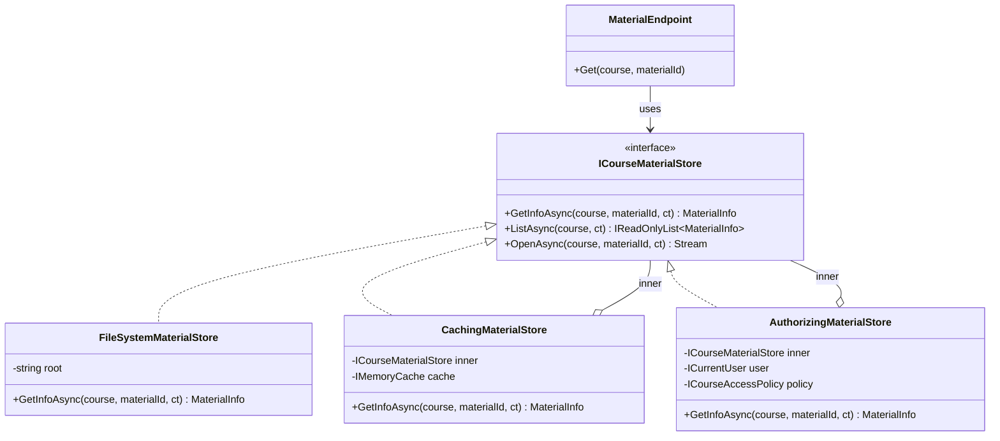
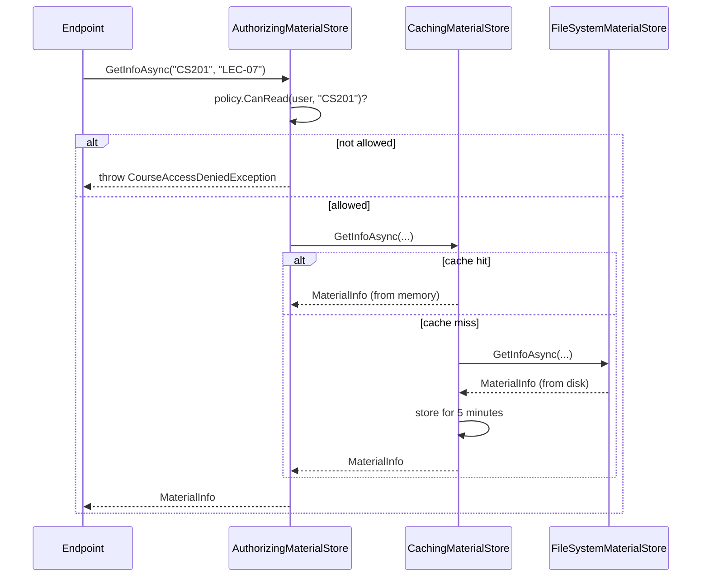
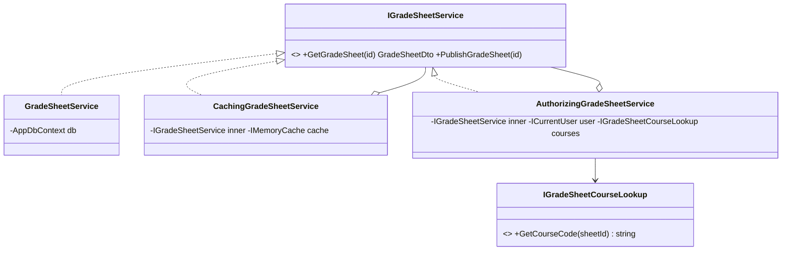

You use proxies every day without noticing. An `HttpClient`-based typed client stands in for a service on another machine. An EF Core navigation property that loads itself on first access is a proxy. A gRPC client stub is a proxy. This lesson shows the five common kinds, how to build each one in C#, and how to stop a "helpful" proxy from quietly hiding a performance or security bug.

## Learning objectives

By the end of this lesson you will be able to:

1. Explain the problem Proxy solves: controlling access to an object without changing it or its callers.
2. Name the participants (subject interface, real subject, proxy, client) and draw them.
3. Build virtual (lazy), protection, caching, remote and logging proxies in C#.
4. Generate a proxy at runtime with `System.Reflection.DispatchProxy`, including for `async` methods.
5. Explain how EF Core lazy-loading proxies work and why they cause N+1 queries.
6. Wire proxies in ASP.NET Core dependency injection in the right order (authorization *outside* caching).
7. Tell Proxy apart from Decorator, Adapter and Facade, and say when a proxy is the wrong tool.

## Prerequisites

- [Interfaces and abstract classes](#/lesson/m01-interfaces-abstract): a proxy implements the same interface as the thing it stands in for.
- [Dependency injection](#/lesson/m03-dependency-injection): we compose proxies in `Program.cs`.
- [Decorator](#/lesson/m06-decorator): Proxy has the same shape. Reading Decorator first makes the comparison at the end easier, but it is not required.

## Explain it like I'm a beginner

Think of a college library's **course-reserve desk**. A second-year student wants the printed notes for *CS201 Data Structures, lecture 7*. They don't walk into the closed stacks themselves. They ask the **librarian** at the desk.

From the student's point of view the desk behaves just like the stacks: you ask for notes, you get notes. But the librarian does useful things on the way:

- **Checks your ID card.** If you are not enrolled in CS201, you don't get its notes. (protection proxy)
- **Keeps copies of popular notes** behind the desk, so they don't walk to the stacks for every request. (caching proxy)
- **Writes every request in a register**: who, what, when. (logging proxy)
- **Orders it from the main campus library in Bengaluru** when this branch doesn't have it, without you needing to know it came from another city. (remote proxy)
- **Doesn't unpack the heavy box of old exam papers until someone actually asks** for something inside it. (virtual, or lazy, proxy)

The student's process doesn't change. The stacks don't change. A stand-in sits between them and controls access.

That stand-in is a **Proxy**: an object with the *same interface* as the real object, which holds (or knows how to reach) the real object and decides when and whether to pass each call through.

## First-principles explanation

### The original problem

The Gang of Four book (1994) introduced Proxy with a document editor. A document contains large images. Opening the document should be fast, so the editor shouldn't load every image from disk at open time. But the editor's layout code expects an image object it can ask for its size and tell to draw itself.

The fix: put a lightweight `ImageProxy` in the document. It knows the file name and the image size (cheap to store), and creates the real `Image` only when `Draw()` is first called. The layout code never knows the difference.

The general problem is this: **you need to add control around an object (when it is created, who may use it, where it lives, how often it is really called) without changing the object and without changing the code that calls it.**

### The simplest implementation

The smallest possible proxy is one class that implements the same interface and forwards:

```csharp
public interface ICourseArchive { byte[] Open(string materialId); }

public sealed class ArchiveProxy(Func<ICourseArchive> create) : ICourseArchive
{
    private ICourseArchive? _real;                      // not created yet
    public byte[] Open(string materialId) => (_real ??= create()).Open(materialId);
}
```

That is a complete virtual proxy (it is not thread-safe yet; we fix that with `Lazy<T>` later). Every other kind of proxy follows the same skeleton: *implement the interface, hold the real subject, do something before or instead of forwarding.*

### Participants

| Participant | Role | In our example |
|---|---|---|
| **Subject** | The interface both the real object and the proxy implement. | `ICourseMaterialStore` |
| **Real subject** | The object doing the actual work. | `FileSystemMaterialStore` |
| **Proxy** | Implements Subject, holds or locates the real subject, controls access to it. | `AuthorizingMaterialStore`, `CachingMaterialStore` |
| **Client** | Talks only to Subject. Doesn't know whether it has a proxy. | The minimal API endpoint |

### The five kinds of proxy

1. **Virtual proxy (lazy proxy).** Delays creating an expensive object until it is needed. Example: a 180 MB interactive 3D anatomy model or a 1,200-page course pack that most page views never open. In .NET, `Lazy<T>` is the built-in building block.
2. **Protection proxy.** Checks permissions before forwarding. Example: only students enrolled in course `CS201` (and its teachers) can read its materials.
3. **Remote proxy.** Makes an object on another machine look local. Example: a typed `HttpClient` or a gRPC client that implements `ICourseMaterialStore` by calling an API in another region. The client calls a method; the proxy turns it into a network request (serialisation, retries, timeouts).
4. **Caching proxy.** Remembers results of expensive calls. Example: GST rate lookups, or a slow university student-information-system API that answers in 2–3 seconds but whose data changes rarely.
5. **Logging / monitoring proxy (sometimes called a smart reference).** Records calls, timings or reference counts. Example: logging each call's duration so you can see which storage call is slow.

### How it works internally

A hand-written proxy is plain polymorphism: the client holds an `ICourseMaterialStore` reference, and at runtime that reference points at the proxy object. The .NET runtime dispatches `GetInfoAsync` to the proxy's method (an interface call through the type's method table), and the proxy calls the inner object's method. The extra cost is one more virtual call, which is nanoseconds. That is negligible next to a disk read or a network call measured in milliseconds.

A *generated* proxy works differently. `DispatchProxy.Create<TInterface, TProxy>()` builds a new class at runtime (using `System.Reflection.Emit`) that implements `TInterface`. Every method on that generated class packs its arguments into an `object?[]` and calls your `Invoke(MethodInfo, object?[])` override. You decide what to do, usually `targetMethod.Invoke(inner, args)`. This is more flexible (one proxy class for every interface) but slower per call, because of reflection, boxing of value-type arguments and the argument array. For calls that hit a database, that overhead rarely matters; in a tight in-memory loop it would. Measure before you decide.

EF Core lazy loading uses a third technique: **subclassing**. With `UseLazyLoadingProxies()` (from the `Microsoft.EntityFrameworkCore.Proxies` package), EF Core generates a subclass of your entity at runtime (it uses the Castle.Core library). It overrides every `virtual` navigation property so the first `get` runs a query. That is why lazy loading requires navigation properties to be `virtual` and the entity class to be non-sealed.

### What happens without it

Without a proxy, the control logic goes into one of two wrong places:

- **Into every caller.** Each endpoint checks permissions, checks the cache, and logs. Twelve endpoints means twelve copies. When the rule changes ("teaching assistants may read draft answer keys too"), someone misses one copy, and that is a security bug.
- **Into the real object.** `FileSystemMaterialStore` now knows about users, HTTP claims and caching. It can't be reused in a background job that has no user, and you can't test file reading without setting up a fake user.

### When it is useful

- The real object is **expensive to create** and often not needed (virtual).
- Access needs a **check that must never be skipped** (protection).
- The real object is **far away** and you want the client to stay simple (remote).
- Results are **expensive and reusable** for a while (caching).
- You need **cross-cutting visibility** (timings, audit) without touching business code (logging).

### When not to use it

- **The check belongs to the domain.** "A fee refund above ₹50,000 needs two approvers" is a business rule, not an access control wrapper. Put it in the domain or application service where it is visible and tested with the rest of the rules.
- **The hiding hurts.** A remote proxy that looks exactly like a local object invites people to call it in a loop. A call that takes 40 ms over the network, made 500 times, is 20 seconds. Remote boundaries should often *look* remote: async, batch-friendly methods and explicit timeouts.
- **The framework already does it.** Use ASP.NET Core authorization policies for endpoint-level checks, `HybridCache` or output caching for HTTP responses, and OpenTelemetry instrumentation for timings, before hand-rolling a proxy.
- **One caller, one use.** If only one method in one service needs a cached value, a local `IMemoryCache` call is simpler than a new class.

### Trade-offs it introduces

| You gain | You pay |
|---|---|
| Control logic in one place, applied to every caller | One more layer to read and debug |
| Real subject stays focused and reusable | Order of nested proxies matters, and getting it wrong is subtle |
| Behaviour can be added or removed in DI configuration | Hidden cost: lazy or remote calls look cheap but aren't |
| Testable separately with fakes | Caching proxies bring staleness and invalidation problems |

## Visual explanation

### Class diagram



How to read it: all three classes implement `ICourseMaterialStore` (dotted lines with hollow triangles). The two proxies also *hold* an `ICourseMaterialStore` (the hollow diamond means "has a reference to"). The endpoint depends only on the interface. Because the proxies hold the interface rather than the concrete `FileSystemMaterialStore`, they can be nested: authorization wraps caching, which wraps the real store.

### Sequence diagram



The key point is **order**. The permission check runs *before* the cache is consulted. If the order were reversed (caching outside authorization) and the cache key didn't include the user, the second user to ask would get the cached material *without any permission check*. This is a real class of bug: a cache in front of an access check leaks data. Rule: **protection proxies go outermost.**

## Step-by-step example

We'll start from a naive endpoint and pull each concern into a proxy.

### Step 1 — the naive endpoint

```csharp
app.MapGet("/courses/{c}/materials/{id}", async (string c, string id, HttpContext http, IMemoryCache cache) =>
{
    var courses = http.User.FindAll("course").Select(c => c.Value);
    if (!courses.Contains(c)) return Results.StatusCode(403);

    var key = $"{c}/{id}";
    if (!cache.TryGetValue(key, out MaterialInfo? info))
    {
        var sw = Stopwatch.StartNew();
        var path = Path.Combine("/data/materials", c, id + ".pdf");
        info = File.Exists(path) ? new MaterialInfo(c, id, new FileInfo(path).Length, File.GetLastWriteTimeUtc(path)) : null;
        Console.WriteLine($"disk read {sw.ElapsedMilliseconds} ms");
        cache.Set(key, info, TimeSpan.FromMinutes(5));
    }
    return info is null ? Results.NotFound() : Results.Ok(info);
});
```

Four jobs in one lambda: authorization, caching, timing and file access. The `/list` and `/download` endpoints will copy-paste the first three. Notice also the path is built from user input without validation: `no = "../../etc/passwd"` walks out of the folder. Mixing concerns makes this kind of bug easy to miss.

### Step 2 — extract the subject interface and the real subject

Move file access behind `ICourseMaterialStore` and into `FileSystemMaterialStore`. That class knows nothing about users or caches. Validate the material id in exactly one place.

### Step 3 — add a caching proxy

`CachingMaterialStore : ICourseMaterialStore` holds an inner `ICourseMaterialStore` and an `IMemoryCache`. It caches metadata (small, read often) but *not* file streams (large, single-use).

### Step 4 — add a protection proxy

`AuthorizingMaterialStore : ICourseMaterialStore` asks an `ICourseAccessPolicy` whether the current user may read the course, then forwards. It goes outermost.

### Step 5 — add a logging proxy without writing a class per interface

Use `DispatchProxy` to build one `TimingProxy<T>` that works for any interface. Then wire everything in `Program.cs`. The endpoint shrinks to "call the store, map the result to HTTP".

## Production-style C# implementation

```text
Infra.Api/
  Program.cs
  Materials/
    MaterialModels.cs            MaterialInfo, ICourseMaterialStore, exceptions
    FileSystemMaterialStore.cs   real subject
    CachingMaterialStore.cs      caching proxy
    Access.cs                   ICurrentUser, ICourseAccessPolicy
    AuthorizingMaterialStore.cs  protection proxy
  Diagnostics/
    TimingProxy.cs              DispatchProxy-based logging proxy
```

```csharp file=Materials/MaterialModels.cs
namespace Infra.Materials;

public sealed record MaterialInfo(string CourseCode, string MaterialId, long SizeBytes, DateTimeOffset LastModified);

/// <summary>Subject: everything the app needs from course-material storage.</summary>
public interface ICourseMaterialStore
{
    Task<MaterialInfo?> GetInfoAsync(string courseCode, string materialId, CancellationToken ct);
    Task<IReadOnlyList<MaterialInfo>> ListAsync(string courseCode, CancellationToken ct);
    /// <summary>Caller owns and must dispose the returned stream.</summary>
    Task<Stream?> OpenAsync(string courseCode, string materialId, CancellationToken ct);
}

public sealed class CourseAccessDeniedException(string user, string course)
    : Exception($"User '{user}' is not enrolled in course '{course}'.");

public sealed class MaterialStoreOptions
{
    public string Root { get; set; } = "materials";
}
```

```csharp file=Materials/FileSystemMaterialStore.cs
using System.Text.RegularExpressions;
using Microsoft.Extensions.Options;

namespace Infra.Materials;

/// <summary>Real subject. Knows about files only: no users, no caching.</summary>
public sealed partial class FileSystemMaterialStore(IOptions<MaterialStoreOptions> options) : ICourseMaterialStore
{
    private readonly string _root = Path.GetFullPath(options.Value.Root);

    [GeneratedRegex("^[A-Za-z0-9-]{1,40}$")]
    private static partial Regex SafeName();

    public Task<MaterialInfo?> GetInfoAsync(string courseCode, string materialId, CancellationToken ct)
    {
        var file = new FileInfo(PathFor(courseCode, materialId));
        MaterialInfo? info = file.Exists
            ? new MaterialInfo(courseCode, materialId, file.Length, file.LastWriteTimeUtc)
            : null;
        return Task.FromResult(info);
    }

    public Task<IReadOnlyList<MaterialInfo>> ListAsync(string courseCode, CancellationToken ct)
    {
        var dir = new DirectoryInfo(Path.Combine(_root, Check(courseCode)));
        IReadOnlyList<MaterialInfo> list = dir.Exists
            ? dir.EnumerateFiles("*.pdf")
                 .Select(f => new MaterialInfo(courseCode, Path.GetFileNameWithoutExtension(f.Name), f.Length, f.LastWriteTimeUtc))
                 .OrderBy(d => d.MaterialId, StringComparer.Ordinal)
                 .ToList()
            : [];
        return Task.FromResult(list);
    }

    public Task<Stream?> OpenAsync(string courseCode, string materialId, CancellationToken ct)
    {
        var path = PathFor(courseCode, materialId);
        Stream? s = File.Exists(path)
            ? new FileStream(path, FileMode.Open, FileAccess.Read, FileShare.Read, 81920, useAsync: true)
            : null;
        return Task.FromResult(s);
    }

    private string PathFor(string courseCode, string materialId) =>
        Path.Combine(_root, Check(courseCode), Check(materialId) + ".pdf");

    // Only letters, digits and dashes: blocks "../" path traversal in one place.
    private static string Check(string part) =>
        SafeName().IsMatch(part) ? part : throw new ArgumentException($"Invalid name '{part}'.", nameof(part));
}
```

```csharp file=Materials/CachingMaterialStore.cs
using Microsoft.Extensions.Caching.Memory;

namespace Infra.Materials;

/// <summary>Caching proxy. Caches small metadata; never caches streams.</summary>
public sealed class CachingMaterialStore(ICourseMaterialStore inner, IMemoryCache cache, TimeSpan ttl) : ICourseMaterialStore
{
    public async Task<MaterialInfo?> GetInfoAsync(string courseCode, string materialId, CancellationToken ct)
    {
        var key = $"material-info:{courseCode}:{materialId}";
        if (cache.TryGetValue(key, out MaterialInfo? hit)) return hit;

        var info = await inner.GetInfoAsync(courseCode, materialId, ct);
        if (info is not null)   // do not cache "not found": a material uploaded a second later should appear
            cache.Set(key, info, new MemoryCacheEntryOptions { AbsoluteExpirationRelativeToNow = ttl, Size = 1 });
        return info;
    }

    public async Task<IReadOnlyList<MaterialInfo>> ListAsync(string courseCode, CancellationToken ct)
    {
        var key = $"material-list:{courseCode}";
        if (cache.TryGetValue(key, out IReadOnlyList<MaterialInfo>? hit) && hit is not null) return hit;

        var list = await inner.ListAsync(courseCode, ct);
        cache.Set(key, list, new MemoryCacheEntryOptions { AbsoluteExpirationRelativeToNow = ttl, Size = list.Count + 1 });
        return list;
    }

    // Streams are large and single-use: always go to the real store.
    public Task<Stream?> OpenAsync(string courseCode, string materialId, CancellationToken ct) =>
        inner.OpenAsync(courseCode, materialId, ct);
}
```

```csharp file=Materials/Access.cs
using System.Security.Claims;

namespace Infra.Materials;

public interface ICurrentUser
{
    string Name { get; }
    ClaimsPrincipal Principal { get; }
}

public sealed class HttpCurrentUser(IHttpContextAccessor accessor) : ICurrentUser
{
    public ClaimsPrincipal Principal => accessor.HttpContext?.User ?? new ClaimsPrincipal(new ClaimsIdentity());
    public string Name => Principal.Identity?.Name ?? "anonymous";
}

public interface ICourseAccessPolicy
{
    bool CanRead(ClaimsPrincipal user, string courseCode);
}

/// <summary>A user may read a course's materials if they carry a "course" claim for it (they are enrolled or teach it), or the "CourseAdmin" role.</summary>
public sealed class ClaimsCourseAccessPolicy : ICourseAccessPolicy
{
    public bool CanRead(ClaimsPrincipal user, string courseCode) =>
        user.IsInRole("CourseAdmin") ||
        user.FindAll("course").Any(c => string.Equals(c.Value, courseCode, StringComparison.OrdinalIgnoreCase));
}
```

```csharp file=Materials/AuthorizingMaterialStore.cs
namespace Infra.Materials;

/// <summary>Protection proxy. Must be the OUTERMOST wrapper so no cache can answer before the check.</summary>
public sealed class AuthorizingMaterialStore(ICourseMaterialStore inner, ICurrentUser user, ICourseAccessPolicy policy) : ICourseMaterialStore
{
    public Task<MaterialInfo?> GetInfoAsync(string courseCode, string materialId, CancellationToken ct)
    {
        Demand(courseCode);
        return inner.GetInfoAsync(courseCode, materialId, ct);
    }

    public Task<IReadOnlyList<MaterialInfo>> ListAsync(string courseCode, CancellationToken ct)
    {
        Demand(courseCode);
        return inner.ListAsync(courseCode, ct);
    }

    public Task<Stream?> OpenAsync(string courseCode, string materialId, CancellationToken ct)
    {
        Demand(courseCode);
        return inner.OpenAsync(courseCode, materialId, ct);
    }

    private void Demand(string courseCode)
    {
        if (!policy.CanRead(user.Principal, courseCode))
            throw new CourseAccessDeniedException(user.Name, courseCode);
    }
}
```

```csharp file=Diagnostics/TimingProxy.cs
using System.Diagnostics;
using System.Reflection;
using System.Runtime.ExceptionServices;

namespace Infra.Diagnostics;

/// <summary>Logging proxy generated at runtime for ANY interface T. Logs each call's duration.</summary>
public class TimingProxy<T> : DispatchProxy where T : class
{
    private T _inner = default!;
    private ILogger _logger = default!;

    public static T Wrap(T inner, ILogger logger)
    {
        ArgumentNullException.ThrowIfNull(inner);
        T proxy = Create<T, TimingProxy<T>>();          // T must be an interface
        var self = (TimingProxy<T>)(object)proxy;
        self._inner = inner;
        self._logger = logger;
        return proxy;
    }

    protected override object? Invoke(MethodInfo? targetMethod, object?[]? args)
    {
        ArgumentNullException.ThrowIfNull(targetMethod);
        var sw = Stopwatch.StartNew();
        object? result;
        try
        {
            result = targetMethod.Invoke(_inner, args);
        }
        catch (TargetInvocationException tie) when (tie.InnerException is not null)
        {
            Log(targetMethod, sw, tie.InnerException);
            ExceptionDispatchInfo.Throw(tie.InnerException);   // rethrow the ORIGINAL exception, original stack
            throw;
        }

        if (result is Task task)
            // For logs a continuation is fine: we don't need the log line to exist before the caller resumes.
            task.ContinueWith(t => Log(targetMethod, sw, t.Exception?.InnerException), TaskScheduler.Default);
        else
            Log(targetMethod, sw, null);
        return result;
    }

    private void Log(MethodInfo m, Stopwatch sw, Exception? error)
    {
        if (error is null)
            _logger.LogInformation("{Interface}.{Method} took {ElapsedMs} ms", typeof(T).Name, m.Name, sw.ElapsedMilliseconds);
        else
            _logger.LogWarning(error, "{Interface}.{Method} failed after {ElapsedMs} ms", typeof(T).Name, m.Name, sw.ElapsedMilliseconds);
    }
}
```

```csharp file=Program.cs
using Infra.Diagnostics;
using Infra.Materials;
using Microsoft.Extensions.Caching.Memory;

var builder = WebApplication.CreateBuilder(args);

builder.Services.AddMemoryCache(o => o.SizeLimit = 50_000);
builder.Services.AddHttpContextAccessor();
builder.Services.Configure<MaterialStoreOptions>(builder.Configuration.GetSection("Materials"));

// Real subject and caching proxy are user-independent, so they can be singletons.
builder.Services.AddSingleton<FileSystemMaterialStore>();
builder.Services.AddSingleton(sp => new CachingMaterialStore(
    sp.GetRequiredService<FileSystemMaterialStore>(),
    sp.GetRequiredService<IMemoryCache>(),
    TimeSpan.FromMinutes(5)));

builder.Services.AddScoped<ICurrentUser, HttpCurrentUser>();
builder.Services.AddSingleton<ICourseAccessPolicy, ClaimsCourseAccessPolicy>();

// What callers get: Authorization -> Timing -> Caching -> FileSystem. Protection is outermost.
builder.Services.AddScoped<ICourseMaterialStore>(sp =>
{
    ICourseMaterialStore store = sp.GetRequiredService<CachingMaterialStore>();
    store = TimingProxy<ICourseMaterialStore>.Wrap(store, sp.GetRequiredService<ILoggerFactory>().CreateLogger("Materials.Timing"));
    return new AuthorizingMaterialStore(store, sp.GetRequiredService<ICurrentUser>(), sp.GetRequiredService<ICourseAccessPolicy>());
});

var app = builder.Build();

// Map the proxy's exceptions to HTTP status codes in one place. Kept inline for brevity; in a real app
// prefer builder.Services.AddProblemDetails() plus an IExceptionHandler so errors come back as RFC 9457 problem details.
app.Use(async (ctx, next) =>
{
    try { await next(ctx); }
    catch (CourseAccessDeniedException ex) { ctx.Response.StatusCode = 403; await ctx.Response.WriteAsync(ex.Message); }
    catch (ArgumentException ex) { ctx.Response.StatusCode = 400; await ctx.Response.WriteAsync(ex.Message); }
});

app.MapGet("/courses/{course}/materials", async (string course, ICourseMaterialStore store, CancellationToken ct) =>
    Results.Ok(await store.ListAsync(course, ct)));

app.MapGet("/courses/{course}/materials/{id}", async (string course, string id, ICourseMaterialStore store, CancellationToken ct) =>
    await store.GetInfoAsync(course, id, ct) is { } info ? Results.Ok(info) : Results.NotFound());

app.MapGet("/courses/{course}/materials/{id}/file", async (string course, string id, ICourseMaterialStore store, CancellationToken ct) =>
    await store.OpenAsync(course, id, ct) is { } stream
        ? Results.Stream(stream, "application/pdf", fileDownloadName: $"{id}.pdf")
        : Results.NotFound());

app.Run();
```

Four design decisions are worth calling out:

- **Lifetimes.** The real store and caching proxy are singletons because they hold no per-user state. The protection proxy is scoped because it needs the current user. A singleton protection proxy holding a scoped `ICurrentUser` would be a captive dependency: every request would see the first request's user.
- **What not to cache.** Streams are never cached. "Not found" isn't cached either, so a material uploaded one second after a miss appears immediately. Caching negatives (with a short TTL) is a valid choice when misses are expensive and frequent, but make it on purpose.
- **Staleness.** If a new revision is uploaded, the metadata can be up to 5 minutes stale. If that is unacceptable, the upload path must remove `material-info:{course}:{id}` and `material-list:{course}` from the cache, or you shorten the TTL. A caching proxy always forces this conversation.
- **403 or 404?** The middleware maps a denial to 403. For private resources many APIs return 404 instead, so an outsider can't even confirm that a hidden course or file exists. Pick one rule and apply it everywhere.

:::callout type=note title="Libraries that remove the boilerplate"
Scrutor's `services.Decorate<ICourseMaterialStore, CachingMaterialStore>()` wraps an existing registration without the lambda. Castle DynamicProxy offers interceptors that are faster and richer than `DispatchProxy`. Both are fine in production; this lesson uses only the BCL so the code compiles anywhere.
:::

### Remote proxy in one screen

A typed `HttpClient` that implements the same interface is a remote proxy. The endpoint code is unchanged if you swap it in:

```csharp
public sealed class HttpMaterialStore(HttpClient http) : ICourseMaterialStore
{
    public async Task<MaterialInfo?> GetInfoAsync(string c, string id, CancellationToken ct)
    {
        using var resp = await http.GetAsync($"courses/{Uri.EscapeDataString(c)}/materials/{Uri.EscapeDataString(id)}", ct);
        if (resp.StatusCode == System.Net.HttpStatusCode.NotFound) return null;
        resp.EnsureSuccessStatusCode();
        return await resp.Content.ReadFromJsonAsync<MaterialInfo>(ct);
    }
    // ListAsync and OpenAsync follow the same shape.
}
// builder.Services.AddHttpClient<ICourseMaterialStore, HttpMaterialStore>(c => c.BaseAddress = new("https://materials.example.internal/"))
//     .AddStandardResilienceHandler();   // Microsoft.Extensions.Http.Resilience: timeouts, retries with backoff, circuit breaker
```

Notice what the interface *forces* here: `CancellationToken` parameters and `Task` return types. Because `ICourseMaterialStore` was async from the start, a remote implementation fits. A synchronous `MaterialInfo GetInfo(...)` interface would have forced the remote proxy to block on network I/O. Design the subject for the slowest implementation you expect.

### EF Core lazy-loading proxies

EF Core's lazy loading is the most widely used virtual proxy in .NET:

```csharp
// Requires Microsoft.EntityFrameworkCore.Proxies
options.UseNpgsql(connectionString).UseLazyLoadingProxies();

public class Course
{
    public int Id { get; set; }
    public string Title { get; set; } = "";
    public virtual ICollection<Material> Materials { get; set; } = [];   // virtual: the proxy overrides it
}
```

When you load a `Course`, EF Core gives you an instance of a generated subclass (something like `Castle.Proxies.CourseProxy`). The first time you read `course.Materials`, the overridden getter runs `SELECT ... FROM materials WHERE course_id = @id`.

That convenience is also the danger:

```csharp
foreach (var c in await db.Courses.ToListAsync())      // 1 query
    total += c.Materials.Count;                         // +1 query PER course
```

With 300 courses, that is 301 round trips to PostgreSQL: the N+1 problem (see [N+1 query problems](#/lesson/m09-n-plus-one)). If each round trip takes 1 ms on the same network, that is 0.3 s; across regions at 30 ms it is 9 s. The fix is to load what you need up front: `Include(c => c.Materials)` or, better here, a projection `Select(c => c.Materials.Count)` that becomes one SQL query. Many teams leave lazy loading off in web APIs for this reason. Also note that a lazy proxy needs its `DbContext` alive: touching a navigation after the request's context is disposed throws.

## Bad design vs good design

**Bad:** the Step 1 lambda, copied into three endpoints, plus a background "nightly course-material index" job that reads files directly and therefore skips the cache *and* the permission check. Problems:

- The permission rule exists three times. One copy is already different (`/download` forgot the `CourseAdmin` role).
- The job and the API read files with different path logic; only one validates names.
- Timing is `Console.WriteLine`, so it never reaches the log system.

**Good:** one real subject, two hand-written proxies, one generated proxy, composed in one place. The job resolves `FileSystemMaterialStore` (or `CachingMaterialStore`) directly because it runs as a trusted system process, and that choice is visible in its constructor.

**A second bad design, subtler:** caching outside authorization.

```csharp
// WRONG ORDER: cache answers before anyone checks permissions.
ICourseMaterialStore store = new CachingMaterialStore(new AuthorizingMaterialStore(real, user, policy), cache, ttl);
```

User A (allowed) loads `LEC-07`; it is now cached. User B (not allowed) asks for it; the caching proxy returns the cached copy and never calls the authorizing proxy. Only an end-to-end test with two users catches this, which is why the automated testing section includes one.

**Is the improvement worth it?** For one endpoint with no reuse, the naive version is shorter and fine. Pull out proxies when the same control applies to several entry points, or when the real subject must be reusable without it.

## Practical playground

The playground shows a virtual proxy and a protection proxy for a large PDF course pack. Run it and watch *when* the "Loading..." line prints. Then try swapping the wrapping order and predict the output before running.

:::playground type=csharp title="Virtual and protection proxies"
```csharp file=Program.cs
using System;
using System.Collections.Generic;

public interface ICoursePack
{
    string Name { get; }
    int PageCount();
}

public sealed class PdfCoursePack : ICoursePack
{
    private readonly int _pages;
    public string Name { get; }
    public PdfCoursePack(string name)
    {
        Console.WriteLine($"  Loading {name} from storage (imagine 180 MB and 6 seconds)...");
        Name = name;
        _pages = 1_240;
    }
    public int PageCount() => _pages;
}

// Virtual proxy: Name is cheap and known up front; the heavy pack loads on first real use.
public sealed class LazyCoursePack(string name, Func<ICoursePack> load) : ICoursePack
{
    private readonly Lazy<ICoursePack> _real = new(load);
    public string Name => name;
    public int PageCount() => _real.Value.PageCount();
}

// Protection proxy: only users on the allow-list may open the pack.
public sealed class GuardedCoursePack(ICoursePack inner, string user, ISet<string> allowed) : ICoursePack
{
    public string Name => inner.Name;
    public int PageCount() =>
        allowed.Contains(user) ? inner.PageCount() : throw new UnauthorizedAccessException($"{user} may not open {Name}");
}

public static class Program
{
    public static void Main()
    {
        var allowed = new HashSet<string> { "meera" };
        ICoursePack Build(string user) =>
            new GuardedCoursePack(new LazyCoursePack("CS201-course-pack.pdf", () => new PdfCoursePack("CS201-course-pack.pdf")), user, allowed);

        var forRavi = Build("ravi");
        Console.WriteLine($"Opened course page, showing {forRavi.Name}");
        try { forRavi.PageCount(); }
        catch (UnauthorizedAccessException ex) { Console.WriteLine($"Denied: {ex.Message} (and nothing was loaded)"); }

        var forMeera = Build("meera");
        Console.WriteLine("Meera opens the course pack:");
        Console.WriteLine($"  {forMeera.PageCount()} pages");
        Console.WriteLine($"  {forMeera.PageCount()} pages (second call, no reload)");
    }
}
```
:::

## Exercises

:::exercise id=m06-proxy-ex1 difficulty=beginner kind=code title="A thread-safe virtual proxy for a course video library"
A course's video library holds 240 recorded lectures. Building the real `VideoLibrary` scans object storage and takes several seconds. The course home page shows the library's title on every page load but rarely needs the video count.

Implement `LazyVideoLibrary` so that the real library is created only when `VideoCount` is first read, and exactly once even when many threads ask at the same time.
::requirements
- `Title` is known up front and never triggers loading.
- `VideoCount` creates the real library on first access and reuses it afterwards.
- `IsLoaded` reports whether the real library has been created.
- 50 parallel reads of `VideoCount` call the factory exactly once.
::acceptance
- Constructing the proxy does not call the factory.
- Reading `Title` does not call the factory.
- Reading `VideoCount` three times calls the factory once.
- The parallel test calls the factory once.
::hint
The proxy needs two pieces of data in its constructor: the cheap value (title) and a way to create the expensive object later.
::hint
.NET has a type built exactly for "create on first use, once": look at `System.Lazy<T>`.
::hint
`Lazy<T>`'s default thread-safety mode is `LazyThreadSafetyMode.ExecutionAndPublication`, which guarantees the factory runs once even under a race.
::hint
`IsLoaded` maps directly onto `Lazy<T>.IsValueCreated`.
::hint
```csharp
private readonly Lazy<IVideoLibrary> _real = new(factory, LazyThreadSafetyMode.ExecutionAndPublication);
public int VideoCount => _real.Value.VideoCount;
```
::starter
```csharp file=LazyVideoLibrary.cs
using System;
using System.Threading;

public interface IVideoLibrary
{
    string Title { get; }
    int VideoCount { get; }
}

public sealed class VideoLibrary : IVideoLibrary
{
    public VideoLibrary(string title, int videoCount)
    {
        Thread.Sleep(20); // stands in for an expensive storage scan
        Title = title;
        VideoCount = videoCount;
    }
    public string Title { get; }
    public int VideoCount { get; }
}

public sealed class LazyVideoLibrary : IVideoLibrary
{
    public LazyVideoLibrary(string title, Func<IVideoLibrary> factory)
    {
        // TODO: store what you need. Do NOT call the factory here.
    }

    public string Title => throw new NotImplementedException();
    public int VideoCount => throw new NotImplementedException();
    public bool IsLoaded => throw new NotImplementedException();
}
```
::tests
```csharp file=LazyVideoLibraryTests.cs
using System.Threading;
using System.Threading.Tasks;
using Xunit;

public class LazyVideoLibraryTests
{
    private int _calls;
    private LazyVideoLibrary Make() =>
        new("CS201 Data Structures", () => { Interlocked.Increment(ref _calls); return new VideoLibrary("CS201 Data Structures", 240); });

    [Fact]
    public void Constructing_does_not_load()
    {
        var p = Make();
        Assert.Equal(0, _calls);
        Assert.False(p.IsLoaded);
    }

    [Fact]
    public void Title_does_not_load()
    {
        var p = Make();
        Assert.Equal("CS201 Data Structures", p.Title);
        Assert.Equal(0, _calls);
    }

    [Fact]
    public void VideoCount_loads_once()
    {
        var p = Make();
        Assert.Equal(240, p.VideoCount);
        Assert.Equal(240, p.VideoCount);
        Assert.Equal(240, p.VideoCount);
        Assert.Equal(1, _calls);
        Assert.True(p.IsLoaded);
    }

    [Fact]
    public void Parallel_reads_load_once()
    {
        var p = Make();
        Parallel.For(0, 50, _ => Assert.Equal(240, p.VideoCount));
        Assert.Equal(1, _calls);
    }
}
```
::solution
Wrap the factory in a `Lazy<T>` with `ExecutionAndPublication`. Keep the title as a plain field so it never touches the lazy value.

```csharp file=LazyVideoLibrary.cs
using System;
using System.Threading;

public interface IVideoLibrary
{
    string Title { get; }
    int VideoCount { get; }
}

public sealed class VideoLibrary : IVideoLibrary
{
    public VideoLibrary(string title, int videoCount)
    {
        Thread.Sleep(20); // stands in for an expensive storage scan
        Title = title;
        VideoCount = videoCount;
    }
    public string Title { get; }
    public int VideoCount { get; }
}

public sealed class LazyVideoLibrary : IVideoLibrary
{
    private readonly Lazy<IVideoLibrary> _real;

    public LazyVideoLibrary(string title, Func<IVideoLibrary> factory)
    {
        ArgumentNullException.ThrowIfNull(factory);
        Title = title;
        _real = new Lazy<IVideoLibrary>(factory, LazyThreadSafetyMode.ExecutionAndPublication);
    }

    public string Title { get; }
    public int VideoCount => _real.Value.VideoCount;
    public bool IsLoaded => _real.IsValueCreated;
}
```

Why not `_real ??= factory()`? Two threads can both see `null` and both call the factory. With a 6-second load that wastes 6 seconds of work and, worse, two different library objects may be handed out.
::alternatives
`LazyThreadSafetyMode.PublicationOnly` lets several threads run the factory but publishes only the first result. It avoids holding a lock during the factory call, which is useful if the factory could deadlock, but it wastes work. For a slow storage scan, `ExecutionAndPublication` is the right default.
::mistakes
- Calling the factory in the constructor "to be safe", which removes the whole benefit.
- Forwarding `Title` through the lazy value, so the course page triggers the expensive load on every page view.
- Using `LazyThreadSafetyMode.None` in code that is reached from parallel requests.
- Forgetting that `Lazy<T>` caches exceptions in `ExecutionAndPublication` mode: if the first load throws, every later access throws the same exception. Decide whether that is acceptable.
::extensions
Make the factory async (`Func<Task<IVideoLibrary>>`) and expose `Task<int> GetVideoCountAsync()`. Hint: `Lazy<Task<T>>` works, but think about what happens when the first task faults.
:::

:::exercise id=m06-proxy-ex2 difficulty=beginner kind=written title="Name the proxy and the pattern"
For each scenario, say whether it is a Proxy, and if so which kind (virtual, protection, remote, caching, logging). If it is *not* a Proxy, name the pattern it is.

1. A `GstinLookupClient` implements `IGstinLookup` by calling a government HTTP API.
2. `ReadOnlyCollection<T>` wraps a `List<T>` and throws on `Add`.
3. A class implements `IPaymentGateway` by translating calls into a vendor SDK whose method names and types are completely different.
4. A `RetryingSmsSender` wraps `ISmsSender` and retries failed sends three times with backoff. It is registered alongside `MetricsSmsSender`, which also wraps `ISmsSender`.
5. An EF Core `Student` entity whose `virtual Enrollments` collection loads on first access.
6. `StudentDashboardService` exposes one method that calls five other services and combines the results.
::acceptance
- Each answer names Proxy-kind or the other pattern.
- Each answer gives a one-line reason based on *intent* and *interface*, not just structure.
- Item 4 discusses why the line between Decorator and Proxy is about intent.
::hint
First question for each: does the wrapper have the *same* interface as the thing it wraps?
::hint
If the interface differs, it's not a Proxy. If it's the same, ask whether the wrapper *controls access* (when, whether, where) or *adds features* that callers compose.
::hint
Item 2 is debated. Think about what `ReadOnlyCollection` is controlling.
::hint
Item 6 has no "real subject" with the same interface at all. What pattern simplifies many services behind one entry point?
::solution
1. **Remote proxy.** Same interface as a local lookup would have; it hides the network.
2. **Protection proxy** (a defensible answer). It exposes the list's read operations and blocks writes, controlling *what* callers may do. Some authors call it a read-only wrapper or an adapter to `IList<T>` semantics; the intent, restricting access, is proxy-like.
3. **Adapter.** The interfaces differ; its job is translation.
4. **Decorator.** Same interface, but the intent is to *add behaviour* (retries, metrics), and several wrappers are stacked and composed by configuration. A retrying wrapper is sometimes called a "smart proxy"; the code would look identical. Name it by intent: features you stack = Decorator; access you control = Proxy.
5. **Virtual proxy** (lazy loading), generated by EF Core as a runtime subclass.
6. **Facade.** It gives a simple entry point over a subsystem. There is no single real subject with the same interface.
::mistakes
- Classifying purely by structure ("it wraps something, so it's a proxy").
- Calling the Adapter a proxy because both forward calls.
- Treating Facade as a proxy because it "sits in front" of services.
:::

:::exercise id=m06-proxy-ex3 difficulty=intermediate kind=code title="Caching proxy with TTL, no cached failures and single-flight"
`IGstRateService.GetRateAsync(hsnCode)` calls a slow external tariff API (about 800 ms per call, estimated) to get the GST rate for an HSN/SAC code. Rates change rarely. Build `CachingGstRateService`, a caching proxy, that:

1. Caches each code's rate for a configurable TTL.
2. Treats `" 9954 "` and `"9954"` as the same key (trim).
3. Never caches failures: if the inner call throws, the next call tries again.
4. Lets many concurrent callers for the same code share **one** in-flight inner call (single-flight), so a burst of 200 requests after a deploy doesn't send 200 calls to the API.
5. Uses an injected `TimeProvider` so tests control time.
::acceptance
- Two calls within the TTL produce one inner call.
- A call after the TTL produces a second inner call.
- A failed inner call is retried on the next request.
- Two concurrent calls while the first is still in flight produce one inner call and both get the result.
::hint
What should the cache store: the rate (a `decimal`) or the *work in progress*? Think about requirement 4.
::hint
Store `Task<decimal>` in the cache. A second caller arriving while the first call is running can simply await the same task.
::hint
Keep an entry record `(Task<decimal> Value, DateTimeOffset ExpiresAt)` in a dictionary guarded by a lock. Take the lock only to read or replace the entry, never while awaiting.
::hint
If the awaited task faults, remove the entry, but only if it is still the *same* entry (`ReferenceEquals`), so you don't delete a newer, good one.
::hint
```csharp
Entry entry;
lock (_gate)
{
    if (!_entries.TryGetValue(key, out entry!) || entry.ExpiresAt <= now)
        _entries[key] = entry = new Entry(_inner.GetRateAsync(key, CancellationToken.None), now + _ttl);
}
try { return await entry.Value.WaitAsync(ct); }
catch when (entry.Value.IsFaulted || entry.Value.IsCanceled) { /* evict if same entry */ throw; }
```
::starter
```csharp file=CachingGstRateService.cs
using System;
using System.Collections.Generic;
using System.Threading;
using System.Threading.Tasks;

public interface IGstRateService
{
    Task<decimal> GetRateAsync(string hsnCode, CancellationToken ct = default);
}

public sealed class CachingGstRateService : IGstRateService
{
    public CachingGstRateService(IGstRateService inner, TimeProvider clock, TimeSpan ttl)
    {
        // TODO
    }

    public Task<decimal> GetRateAsync(string hsnCode, CancellationToken ct = default) =>
        throw new NotImplementedException();
}
```
::tests
```csharp file=CachingGstRateServiceTests.cs
using System;
using System.Threading;
using System.Threading.Tasks;
using Xunit;

public sealed class ManualClock : TimeProvider
{
    public DateTimeOffset Now { get; set; } = new(2026, 4, 1, 9, 0, 0, TimeSpan.Zero);
    public override DateTimeOffset GetUtcNow() => Now;
}

public sealed class FakeRates : IGstRateService
{
    public int Calls;
    public Func<string, Task<decimal>> Behaviour = _ => Task.FromResult(18m);
    public Task<decimal> GetRateAsync(string hsnCode, CancellationToken ct = default)
    {
        Interlocked.Increment(ref Calls);
        return Behaviour(hsnCode);
    }
}

public class CachingGstRateServiceTests
{
    private readonly ManualClock _clock = new();
    private readonly FakeRates _inner = new();
    private CachingGstRateService Make() => new(_inner, _clock, TimeSpan.FromMinutes(10));

    [Fact]
    public async Task Second_call_within_ttl_is_cached()
    {
        var svc = Make();
        Assert.Equal(18m, await svc.GetRateAsync("9954"));
        _clock.Now = _clock.Now.AddMinutes(9);
        Assert.Equal(18m, await svc.GetRateAsync("9954"));
        Assert.Equal(1, _inner.Calls);
    }

    [Fact]
    public async Task Call_after_ttl_refreshes()
    {
        var svc = Make();
        await svc.GetRateAsync("9954");
        _clock.Now = _clock.Now.AddMinutes(11);
        await svc.GetRateAsync("9954");
        Assert.Equal(2, _inner.Calls);
    }

    [Fact]
    public async Task Keys_are_trimmed()
    {
        var svc = Make();
        await svc.GetRateAsync(" 9954 ");
        await svc.GetRateAsync("9954");
        Assert.Equal(1, _inner.Calls);
    }

    [Fact]
    public async Task Failures_are_not_cached()
    {
        var svc = Make();
        var first = true;
        _inner.Behaviour = _ =>
        {
            if (first) { first = false; return Task.FromException<decimal>(new TimeoutException("tariff API timed out")); }
            return Task.FromResult(12m);
        };
        await Assert.ThrowsAsync<TimeoutException>(() => svc.GetRateAsync("7308"));
        Assert.Equal(12m, await svc.GetRateAsync("7308"));
        Assert.Equal(2, _inner.Calls);
    }

    [Fact]
    public async Task Concurrent_callers_share_one_inner_call()
    {
        var svc = Make();
        var tcs = new TaskCompletionSource<decimal>(TaskCreationOptions.RunContinuationsAsynchronously);
        _inner.Behaviour = _ => tcs.Task;
        var a = svc.GetRateAsync("9954");
        var b = svc.GetRateAsync("9954");
        tcs.SetResult(18m);
        Assert.Equal(18m, await a);
        Assert.Equal(18m, await b);
        Assert.Equal(1, _inner.Calls);
    }
}
```
::solution
Cache the *task*, not the value. That gives single-flight for free: everyone who arrives while the call is running awaits the same task.

```csharp file=CachingGstRateService.cs
using System;
using System.Collections.Generic;
using System.Threading;
using System.Threading.Tasks;

public interface IGstRateService
{
    Task<decimal> GetRateAsync(string hsnCode, CancellationToken ct = default);
}

public sealed class CachingGstRateService : IGstRateService
{
    private sealed record Entry(Task<decimal> Value, DateTimeOffset ExpiresAt);

    private readonly IGstRateService _inner;
    private readonly TimeProvider _clock;
    private readonly TimeSpan _ttl;
    private readonly Dictionary<string, Entry> _entries = new(StringComparer.OrdinalIgnoreCase);
    private readonly object _gate = new();

    public CachingGstRateService(IGstRateService inner, TimeProvider clock, TimeSpan ttl)
    {
        _inner = inner ?? throw new ArgumentNullException(nameof(inner));
        _clock = clock ?? throw new ArgumentNullException(nameof(clock));
        if (ttl <= TimeSpan.Zero) throw new ArgumentOutOfRangeException(nameof(ttl));
        _ttl = ttl;
    }

    public async Task<decimal> GetRateAsync(string hsnCode, CancellationToken ct = default)
    {
        ArgumentException.ThrowIfNullOrWhiteSpace(hsnCode);
        var key = hsnCode.Trim();
        var now = _clock.GetUtcNow();

        Entry entry;
        lock (_gate)
        {
            if (!_entries.TryGetValue(key, out entry!) || entry.ExpiresAt <= now)
            {
                // CancellationToken.None: one caller giving up must not cancel the shared call for everyone else.
                entry = new Entry(_inner.GetRateAsync(key, CancellationToken.None), now + _ttl);
                _entries[key] = entry;
            }
        }

        try
        {
            return await entry.Value.WaitAsync(ct);
        }
        catch when (entry.Value.IsFaulted || entry.Value.IsCanceled)
        {
            lock (_gate)
            {
                if (_entries.TryGetValue(key, out var current) && ReferenceEquals(current, entry))
                    _entries.Remove(key);
            }
            throw;
        }
    }
}
```

Notes:
- `WaitAsync(ct)` lets an individual caller stop waiting without cancelling the shared task.
- The `catch when` filter evicts only when the *shared task* failed. If the caller's own token was cancelled, the shared call may still succeed for others, so we keep it.
- The dictionary grows with the number of distinct HSN codes. There are a few thousand, so that's fine here. For unbounded keys use `IMemoryCache` with a size limit.
::alternatives
On .NET 9 and later, `HybridCache.GetOrCreateAsync` (package `Microsoft.Extensions.Caching.Hybrid`) gives single-flight (stampede protection), TTLs and an optional distributed second level out of the box. Prefer it in a real app; this exercise shows what it does underneath. `IMemoryCache.GetOrCreateAsync` alone does **not** prevent concurrent duplicate calls.
::mistakes
- Caching the `decimal` after awaiting, so 200 concurrent callers all miss and all call the API.
- Caching a faulted task, so one timeout poisons the cache for 10 minutes.
- Passing the first caller's `CancellationToken` to the shared call: if that user closes the browser, everyone waiting gets cancelled.
- Awaiting while holding the lock (not allowed with `lock` in C#, and a deadlock risk with other primitives).
::extensions
Add `Invalidate(string hsnCode)` and a test proving a call after invalidation goes to the inner service. Then add a maximum entry count with least-recently-used eviction.
:::

:::exercise id=m06-proxy-ex4 difficulty=intermediate kind=design title="Refactor: pull access control and caching out of a service"
You inherit this application service from a college's exam-results module. Faculty may read grade sheets only for courses they teach; the exam cell may read all of them:

```csharp
public class GradeSheetService(AppDbContext db, IHttpContextAccessor http, IMemoryCache cache, ILogger<GradeSheetService> log)
{
    public async Task<GradeSheetDto?> GetGradeSheet(int sheetId)
    {
        var sw = Stopwatch.StartNew();
        var user = http.HttpContext!.User;
        if (cache.TryGetValue($"sheet:{sheetId}", out GradeSheetDto? cached)) return cached;
        var sheet = await db.GradeSheets.Include(s => s.Entries).FirstOrDefaultAsync(s => s.Id == sheetId);
        if (sheet is null) return null;
        if (!user.HasClaim("course", sheet.CourseCode) && !user.IsInRole("ExamCell")) throw new UnauthorizedAccessException();
        var dto = GradeSheetDto.From(sheet);
        cache.Set($"sheet:{sheetId}", dto, TimeSpan.FromMinutes(30));
        log.LogInformation("GetGradeSheet {Id} took {Ms}", sheetId, sw.ElapsedMilliseconds);
        return dto;
    }
    // PublishGradeSheet, ListGradeSheets, ... follow the same shape.
}
```

Redesign it using proxies. Produce a class diagram, the wrapping order, DI lifetimes, and name the security bug in the current code.
::acceptance
- Identifies the bug: the cache check runs *before* the permission check, so a cached grade sheet is returned to any user.
- The real subject has no dependency on `IHttpContextAccessor`, `IMemoryCache` or timing.
- The protection proxy is outermost, and the diagram shows the order.
- Explains that the permission check needs the sheet's course, and how the proxy gets it without loading the sheet twice.
- States which writes (for example `PublishGradeSheet`) must invalidate the cache.
::hint
Trace the code for two users: A (allowed) requests grade sheet 77, then B (not allowed) requests grade sheet 77. What does B get?
::hint
The protection check depends on *data* (the sheet's course code), not just the sheet id. The proxy needs a cheap way to learn the course.
::hint
Options: a small `IGradeSheetCourseLookup.GetCourseCode(sheetId)` (cached; a sheet's course never changes), or check after loading in the protection proxy (load via inner, check, then return).
::hint
Order: `AuthorizingGradeSheetService → TimingProxy → CachingGradeSheetService → GradeSheetService`. Caching and the real service can be scoped (they use `DbContext`) or the cache can be a singleton `IMemoryCache` used by a scoped proxy.
::solution
**The bug:** `cache.TryGetValue` returns before the permission check. After faculty member A loads grade sheet 77, faculty member B (who teaches another course) gets it from cache for 30 minutes: other students' marks leak. This is an authorization bypass.



Wrapping order for callers: `AuthorizingGradeSheetService → TimingProxy<IGradeSheetService> → CachingGradeSheetService → GradeSheetService`.

- `AuthorizingGradeSheetService` (scoped): calls `courses.GetCourseCode(sheetId)`, a one-column query cached for hours because a grade sheet never moves to another course, then checks the `course` claim or `ExamCell` role, then forwards.
- `CachingGradeSheetService` (scoped, uses the singleton `IMemoryCache`): caches `GradeSheetDto` by id. `PublishGradeSheet` forwards, then removes `sheet:{id}`; `ListGradeSheets` caches per course with a short TTL or not at all.
- `GradeSheetService` (scoped, holds `DbContext`): pure data access and mapping.
- Timing: the `DispatchProxy` from the lesson, or OpenTelemetry instrumentation of EF Core, which is usually better.

The background "semester results export" job resolves `GradeSheetService` directly, without the protection proxy, because it runs as a system identity. That choice is explicit in its constructor.
::alternatives
Move the course check into an ASP.NET Core resource-based authorization handler (`IAuthorizationService.AuthorizeAsync(user, sheet, "CanReadGradeSheet")`). That is the framework's built-in protection mechanism and integrates with policies. The proxy is still valuable when the same service is called from several hosts (API, gRPC, Blazor Server) that must all enforce it.
::mistakes
- Moving the cache to the outside "for performance".
- Including the user id in the cache key to "fix" the bug, which multiplies memory use and still hides that the check is in the wrong place.
- Forgetting cache invalidation on `PublishGradeSheet`, so a just-published sheet still shows "Draft" for 30 minutes.
:::

:::exercise id=m06-proxy-ex5 difficulty=advanced kind=code title="An audit proxy with DispatchProxy that handles async correctly"
Write `AuditProxy<T>`, a runtime-generated proxy for **any** interface, that records one `CallRecord` per call into an `ICallSink`.

- For synchronous methods, record after the call returns or throws.
- For `Task` and `Task<TResult>` methods, record only **after the task completes**, and the record must exist *by the time the caller's `await` resumes* (tests check immediately after awaiting).
- Exceptions must reach the caller with their **original type**, not wrapped in `TargetInvocationException`.
- Results of `Task<TResult>` must pass through unchanged.
::acceptance
- `Add(2, 3)` returns 5 and records `Add` as succeeded.
- A sync method that throws `InvalidOperationException` rethrows `InvalidOperationException` and records a failure with the message.
- `await DoubleAsync(21)` returns 42 and the success record exists right after the await.
- `await FailAsync()` throws `TimeoutException` and the failure record exists right after the await.
- `Wrap(null!, sink)` throws `ArgumentNullException`.
::hint
`DispatchProxy.Create<TInterface, TProxy>()` gives you an instance; cast it to your proxy type to set the inner object and the sink.
::hint
`MethodInfo.Invoke` wraps exceptions in `TargetInvocationException`. Unwrap with `ExceptionDispatchInfo.Throw(inner)` to keep the original stack trace.
::hint
`task.ContinueWith(...)` is not enough: the continuation may run *after* the caller resumes. Instead, return a *new* task that awaits the original, records, then completes.
::hint
For `Task<TResult>` you need a generic helper `async Task<TR> WrapOf<TR>(Task<TR> t, string name)`. You only know `TR` at runtime, so call it with `MakeGenericMethod(returnType.GetGenericArguments()[0])`.
::hint
```csharp
if (result is Task task)
{
    var rt = targetMethod.ReturnType;
    if (rt.IsGenericType && rt.GetGenericTypeDefinition() == typeof(Task<>))
        return WrapOfMethod.MakeGenericMethod(rt.GetGenericArguments()[0]).Invoke(this, new object[] { task, targetMethod.Name });
    return WrapTask(task, targetMethod.Name);
}
```
::starter
```csharp file=AuditProxy.cs
using System;
using System.Collections.Generic;
using System.Reflection;
using System.Threading.Tasks;

public sealed record CallRecord(string Method, bool Succeeded, string? Error);

public interface ICallSink
{
    void Record(CallRecord record);
}

public sealed class ListSink : ICallSink
{
    private readonly List<CallRecord> _records = new();
    public IReadOnlyList<CallRecord> Records { get { lock (_records) return _records.ToArray(); } }
    public void Record(CallRecord record) { lock (_records) _records.Add(record); }
}

public class AuditProxy<T> : DispatchProxy where T : class
{
    public static T Wrap(T inner, ICallSink sink) => throw new NotImplementedException();

    protected override object? Invoke(MethodInfo? targetMethod, object?[]? args) =>
        throw new NotImplementedException();
}
```
::tests
```csharp file=AuditProxyTests.cs
using System;
using System.Threading.Tasks;
using Xunit;

public interface IGradingService
{
    int Add(int a, int b);
    void Explode();
    Task<int> DoubleAsync(int x);
    Task FailAsync();
}

public sealed class GradingService : IGradingService
{
    public int Add(int a, int b) => a + b;
    public void Explode() => throw new InvalidOperationException("grading engine offline");
    public async Task<int> DoubleAsync(int x) { await Task.Delay(20); return x * 2; }
    public async Task FailAsync() { await Task.Delay(20); throw new TimeoutException("plagiarism-check API timeout"); }
}

public class AuditProxyTests
{
    private readonly ListSink _sink = new();
    private IGradingService Make() => AuditProxy<IGradingService>.Wrap(new GradingService(), _sink);

    [Fact]
    public void Sync_success_is_recorded()
    {
        Assert.Equal(5, Make().Add(2, 3));
        var r = Assert.Single(_sink.Records);
        Assert.Equal("Add", r.Method);
        Assert.True(r.Succeeded);
    }

    [Fact]
    public void Sync_exception_keeps_original_type()
    {
        var ex = Assert.Throws<InvalidOperationException>(() => Make().Explode());
        Assert.Equal("grading engine offline", ex.Message);
        var r = Assert.Single(_sink.Records);
        Assert.False(r.Succeeded);
        Assert.Equal("grading engine offline", r.Error);
    }

    [Fact]
    public async Task Async_result_passes_through_and_is_recorded_before_resume()
    {
        Assert.Equal(42, await Make().DoubleAsync(21));
        var r = Assert.Single(_sink.Records);
        Assert.Equal("DoubleAsync", r.Method);
        Assert.True(r.Succeeded);
    }

    [Fact]
    public async Task Async_failure_is_recorded_before_resume()
    {
        await Assert.ThrowsAsync<TimeoutException>(() => Make().FailAsync());
        var r = Assert.Single(_sink.Records);
        Assert.False(r.Succeeded);
        Assert.Equal("plagiarism-check API timeout", r.Error);
    }

    [Fact]
    public void Null_inner_is_rejected() =>
        Assert.Throws<ArgumentNullException>(() => AuditProxy<IGradingService>.Wrap(null!, _sink));
}
```
::solution
The key idea: for async methods, *replace* the returned task with one that records before completing.

```csharp file=AuditProxy.cs
using System;
using System.Collections.Generic;
using System.Reflection;
using System.Runtime.ExceptionServices;
using System.Threading.Tasks;

public sealed record CallRecord(string Method, bool Succeeded, string? Error);

public interface ICallSink
{
    void Record(CallRecord record);
}

public sealed class ListSink : ICallSink
{
    private readonly List<CallRecord> _records = new();
    public IReadOnlyList<CallRecord> Records { get { lock (_records) return _records.ToArray(); } }
    public void Record(CallRecord record) { lock (_records) _records.Add(record); }
}

public class AuditProxy<T> : DispatchProxy where T : class
{
    private static readonly MethodInfo WrapOfMethod =
        typeof(AuditProxy<T>).GetMethod(nameof(WrapTaskOf), BindingFlags.NonPublic | BindingFlags.Instance)!;

    private T _inner = default!;
    private ICallSink _sink = default!;

    public static T Wrap(T inner, ICallSink sink)
    {
        ArgumentNullException.ThrowIfNull(inner);
        ArgumentNullException.ThrowIfNull(sink);
        T proxy = Create<T, AuditProxy<T>>();
        var self = (AuditProxy<T>)(object)proxy;
        self._inner = inner;
        self._sink = sink;
        return proxy;
    }

    protected override object? Invoke(MethodInfo? targetMethod, object?[]? args)
    {
        ArgumentNullException.ThrowIfNull(targetMethod);
        object? result;
        try
        {
            result = targetMethod.Invoke(_inner, args);
        }
        catch (TargetInvocationException tie) when (tie.InnerException is not null)
        {
            _sink.Record(new CallRecord(targetMethod.Name, false, tie.InnerException.Message));
            ExceptionDispatchInfo.Throw(tie.InnerException);
            throw; // unreachable, keeps the compiler happy
        }

        if (result is Task task)
        {
            var rt = targetMethod.ReturnType;
            if (rt.IsGenericType && rt.GetGenericTypeDefinition() == typeof(Task<>))
                return WrapOfMethod.MakeGenericMethod(rt.GetGenericArguments()[0])
                                   .Invoke(this, new object[] { task, targetMethod.Name });
            return WrapTask(task, targetMethod.Name);
        }

        _sink.Record(new CallRecord(targetMethod.Name, true, null));
        return result;
    }

    private async Task WrapTask(Task task, string name)
    {
        try
        {
            await task.ConfigureAwait(false);
            _sink.Record(new CallRecord(name, true, null));
        }
        catch (Exception ex)
        {
            _sink.Record(new CallRecord(name, false, ex.Message));
            throw;
        }
    }

    private async Task<TR> WrapTaskOf<TR>(Task<TR> task, string name)
    {
        try
        {
            var value = await task.ConfigureAwait(false);
            _sink.Record(new CallRecord(name, true, null));
            return value;
        }
        catch (Exception ex)
        {
            _sink.Record(new CallRecord(name, false, ex.Message));
            throw;
        }
    }
}
```

Why the generic helper? A method declared as returning `Task<int>` must return a `Task<int>`. If you returned a plain `Task` from `WrapTask`, the generated proxy's cast to `Task<int>` would fail at runtime. `MakeGenericMethod` builds the right `WrapTaskOf<int>` on demand. You could cache the constructed `MethodInfo` per return type in a `ConcurrentDictionary` to avoid repeated reflection.
::alternatives
- Castle DynamicProxy's `IAsyncInterceptor` (via Castle.Core.AsyncInterceptor) handles the async plumbing for you.
- Source generators can produce a strongly typed proxy at compile time: no reflection, no boxing, and trimming/AOT-friendly. `DispatchProxy` relies on runtime code generation, which is a concern for Native AOT.
- `ValueTask` and `ValueTask<T>` return types need the same treatment; this solution doesn't handle them.
::mistakes
- Using `ContinueWith` to record: tests checking right after `await` become flaky.
- Rethrowing `tie` itself, so callers catch `TargetInvocationException` and their `catch (InvalidOperationException)` blocks never run.
- `throw tie.InnerException;`, which works but resets the stack trace.
- Marking the proxy class `sealed` or giving it no parameterless constructor; `DispatchProxy.Create` requires both to be possible.
::extensions
Add argument logging with a redaction rule: any parameter named `password`, `otp` or `pan` is logged as `***`.
:::

## Automated testing

Test proxies at three levels.

**1. Each proxy alone, with a hand-written fake inner subject.** The fake counts calls, which is what you assert for caching and lazy proxies:

```csharp
sealed class CountingStore : ICourseMaterialStore
{
    public int InfoCalls;
    public Task<MaterialInfo?> GetInfoAsync(string p, string n, CancellationToken ct)
    { InfoCalls++; return Task.FromResult<MaterialInfo?>(new(p, n, 1024, DateTimeOffset.UnixEpoch)); }
    public Task<IReadOnlyList<MaterialInfo>> ListAsync(string p, CancellationToken ct) => Task.FromResult<IReadOnlyList<MaterialInfo>>([]);
    public Task<Stream?> OpenAsync(string p, string n, CancellationToken ct) => Task.FromResult<Stream?>(new MemoryStream());
}

[Fact]
public async Task Caching_proxy_calls_inner_once()
{
    var inner = new CountingStore();
    var sut = new CachingMaterialStore(inner, new MemoryCache(new MemoryCacheOptions()), TimeSpan.FromMinutes(5));
    await sut.GetInfoAsync("CS201", "LEC-07", default);
    await sut.GetInfoAsync("CS201", "LEC-07", default);
    Assert.Equal(1, inner.InfoCalls);
}
```

For the protection proxy, assert both directions: an allowed user reaches the inner store, and a denied user throws **and the inner store is never called** (`InfoCalls == 0`). The second assertion is what proves the check runs before forwarding.

**2. The composition.** Build the same chain `Program.cs` builds and run the two-user test: user A (allowed) reads a material, then user B (denied) reads the same material and must get `CourseAccessDeniedException`. This is the test that catches the wrong wrapping order. Better still, resolve `ICourseMaterialStore` from a real `ServiceCollection` configured by the same extension method production uses, so the test checks the real wiring.

**3. The real subject.** Test `FileSystemMaterialStore` against a temporary folder (`Directory.CreateTempSubdirectory()`), including the path traversal case: `GetInfoAsync("CS201", "../secrets")` must throw `ArgumentException`.

**Extensibility check:** adding a new kind of control (for example a rate-limiting proxy per user) should require one new class and one line in the composition, with zero changes to `FileSystemMaterialStore` or the endpoints. If it needs more, the subject interface is probably leaking implementation details.

## Real-world application

- **EF Core lazy loading** (`UseLazyLoadingProxies`) is a virtual proxy implemented as a runtime subclass. Change-tracking proxies (`UseChangeTrackingProxies`) are another proxy flavour that intercepts property setters.
- **gRPC client stubs and typed `HttpClient`s** are remote proxies. Refit generates them from an interface definition.
- **`Lazy<T>`** and `AsyncLazy`-style helpers are reusable virtual-proxy building blocks.
- **Reverse proxies** such as YARP, NGINX or IIS ARR apply the same idea at the network level: same protocol as the backend, plus TLS termination, authentication, caching and logging. The name is not a coincidence (see [API gateways, reverse proxies and load balancers](#/lesson/m10-gateways-proxies-lb)).
- **Learning platforms (LMS) and online-course sites:** controlling which students can read which course's materials, caching course catalogues, lazily loading large video and PDF assets, and fetching media from a central store are classic protection, caching, virtual and remote proxies.
- **WCF and .NET Remoting** (older) generated transparent remote proxies; their history is a lesson in why remote calls should not *look* local.

## Interview questions

:::interview
::q beginner
What is the Proxy pattern and what problem does it solve?
::a
A proxy is an object with the same interface as a real object, standing in front of it to control access. It lets you add lazy creation, permission checks, caching, remote access or logging without changing the real object or its callers. The client can't tell whether it holds the real object or the proxy.
::q beginner
Name four kinds of proxy, with a .NET example each.
::a
**Virtual/lazy**: EF Core lazy-loading navigation properties, or a wrapper around `Lazy<T>`. **Remote**: a gRPC client stub or a typed `HttpClient` implementing a service interface. **Protection**: a wrapper that checks the user's claims before forwarding, or `ReadOnlyCollection<T>` blocking writes. **Caching**: a wrapper that stores results in `IMemoryCache` or `HybridCache`. **Logging/smart reference**: a `DispatchProxy` that logs timings.
::q intermediate
Proxy and Decorator have the same class diagram. How do you tell them apart?
::a
By intent and by who controls composition. A **Decorator** adds responsibilities, and clients or configuration stack several decorators freely (retry + metrics + logging). A **Proxy** controls *access* to one subject: whether, when and where calls happen. A proxy often manages the subject's lifecycle itself (a virtual proxy creates it; a remote proxy owns the connection), while a decorator is always handed an existing object. In code they may be identical; name them by what they are for, because the name tells readers what the wrapper must guarantee.
::q intermediate
You add a caching proxy and an authorization proxy around a repository. Which goes outside, and why?
::a
Authorization goes outermost. If caching is outside, the cache can answer before the permission check runs, and a value loaded by an allowed user is served to a denied one. Putting the user in the cache key hides the problem and multiplies memory use. Test it with two users hitting the same resource.
::q advanced
Why do EF Core lazy-loading proxies cause performance problems in web APIs, and what do you do instead?
::a
Each first access to a navigation property issues a query, invisibly, so a loop over N entities issues N extra queries (N+1). Lazy loading also needs the `DbContext` to still be alive, which breaks after the request or when serialising. JSON serialisers can trigger loading of whole object graphs. Instead: disable lazy loading, use projections (`Select` into DTOs) so the needed data comes back in one SQL query, `Include` where a full graph is needed, `AsSplitQuery` for large collections, and log SQL in development to spot N+1 early.
::q advanced
Compare a hand-written proxy, `DispatchProxy`, Castle DynamicProxy and a source-generated proxy.
::a
**Hand-written**: fastest and clearest, fully type-safe, but one class per interface, so boilerplate grows with interface size. **DispatchProxy**: built into the BCL, one class for any interface; costs reflection, an `object[]` allocation and boxing per call; needs care with async; relies on runtime code generation, which doesn't fit Native AOT. **Castle DynamicProxy**: mature, faster interception, class proxies as well as interface proxies (EF Core uses it), async helpers available; it's an extra dependency and also uses runtime code generation. **Source generators**: compile-time proxies with no reflection, AOT and trimming friendly, but you must write or adopt a generator. For hot paths or AOT, prefer hand-written or source-generated proxies; for cross-cutting diagnostics on I/O-bound services, the runtime options are fine.
:::

## Summary and revision

**Key takeaways**

- A Proxy has the same interface as the real subject and controls access to it.
- Five common kinds: virtual (lazy), protection, remote, caching, logging.
- Protection proxies go outermost; a cache in front of an access check leaks data.
- `Lazy<T>` gives thread-safe virtual proxies. `DispatchProxy` generates proxies for any interface, but async methods need their returned task replaced, not just observed.
- EF Core lazy loading is a virtual proxy via runtime subclassing; it makes N+1 queries easy.
- Proxy vs Decorator: same shape, different intent (control access vs add behaviour). Adapter changes the interface. Facade simplifies a subsystem.
- Design the subject interface for the slowest implementation (async, cancellable) so remote and caching proxies fit.

**Terminology**: subject, real subject, proxy, virtual proxy, protection proxy, remote proxy, caching proxy, smart reference, DispatchProxy, single-flight, N+1.

:::flashcards
Q: What are the participants of Proxy?
A: Subject (interface), real subject, proxy (same interface, holds or locates the real subject) and client.
Q: Which .NET type is a ready-made building block for a thread-safe virtual proxy?
A: Lazy<T> with LazyThreadSafetyMode.ExecutionAndPublication (the default).
Q: Caching proxy and protection proxy: which goes outside?
A: Protection. Otherwise a cached value can be returned before the permission check runs.
Q: Why must EF Core lazy-loaded navigation properties be virtual?
A: EF Core generates a runtime subclass that overrides them to run a query on first access.
Q: What does DispatchProxy.Invoke receive?
A: The MethodInfo being called and the arguments as object?[]; you decide whether and how to call the real object.
Q: Why is ContinueWith not enough for an async-aware audit proxy?
A: The continuation may run after the caller resumes. Return a new task that awaits the original and records before completing.
Q: Proxy vs Decorator in one line?
A: Proxy controls access to a subject; Decorator adds stackable behaviour to it. Same structure, different intent.
Q: What is single-flight in a caching proxy?
A: Concurrent requests for the same key share one in-flight call, usually by caching the Task instead of the value.
:::

## Knowledge check

:::quiz pass=70
::q single
A course catalogue shows 300 courses. Each course has a 40 MB PDF syllabus pack, but students open on average 2 packs per visit. Which proxy fits best for the document objects?
- [x] Virtual (lazy) proxy
- [ ] Remote proxy
- [ ] Protection proxy
- [ ] Logging proxy
> The cost is in creating or loading an object most users never touch. A virtual proxy holds cheap metadata and loads the document on first real use.
::q single
After a release, a student reports that CS201 students can see CS305's assignment solutions, but only files someone enrolled in CS305 opened in the previous few minutes. What is the most likely cause?
- [ ] The file system store has a path traversal bug.
- [x] The caching proxy wraps the protection proxy instead of the other way round.
- [ ] The cache TTL is too short.
- [ ] The DI lifetime of the real store is singleton.
> "Only recently viewed" is the fingerprint of a cache answering before the permission check. Swap the order so protection is outermost.
::q multi
Which statements about `DispatchProxy` are true? (Select all that apply.)
- [x] It generates a class at runtime that implements the given interface.
- [x] `MethodInfo.Invoke` inside it wraps exceptions in `TargetInvocationException`.
- [ ] It can proxy sealed classes.
- [x] Each call passes arguments as an `object?[]`, which boxes value types.
- [ ] It is resolved at compile time, so it's ideal for Native AOT.
> `DispatchProxy` proxies interfaces only, uses runtime code generation, and has per-call reflection overhead. Unwrap `TargetInvocationException` to preserve exception types.
::q single
A `Course` list page with lazy loading enabled runs 1 query to load 250 courses, then shows each course's instructor name. SQL logs show 251 queries. What is the best fix?
- [ ] Increase the connection pool size.
- [ ] Cache each instructor in a caching proxy.
- [x] Project the needed columns in the original query (for example `Select(c => new { c.Title, Instructor = c.Instructor.Name })`).
- [ ] Make the navigation property non-virtual and keep everything else the same.
> The lazy-loading proxy issues one query per navigation access (N+1). Loading the data in one query removes the round trips. Making the property non-virtual alone would just leave it empty.
::q single
`RetryingSmsSender` and `MetricsSmsSender` both implement `ISmsSender`, wrap another `ISmsSender`, and are stacked in different orders per environment. Which name best describes them?
- [ ] Protection proxies
- [x] Decorators
- [ ] Adapters
- [ ] Remote proxies
> They add behaviour and are composed freely by configuration. That is Decorator's intent, even though the structure matches Proxy.
::q single
Your caching proxy stores the `decimal` result after awaiting the inner call. A deploy restarts the app and 200 requests arrive in the same second for the same key. What happens?
- [ ] One inner call, 199 cache hits.
- [x] Up to 200 inner calls, because every request misses before the first one finishes.
- [ ] The proxy deadlocks.
- [ ] The cache throws because of concurrent writes.
> Without single-flight, every request that arrives before the first result is stored misses. Caching the in-flight `Task` (or using `HybridCache`) collapses them into one call.
::q single
When is a hand-written proxy the WRONG choice?
- [ ] The same permission rule must apply to API, gRPC and background entry points.
- [ ] The real subject is a slow remote service whose results can be reused.
- [x] A rule like "fee refunds above ₹50,000 need two approvers" that is part of the business domain.
- [ ] An expensive object that most requests never use.
> Business rules belong in the domain or application layer where they are visible and tested with other rules. Proxies are for access control and cross-cutting concerns around a subject.
:::

## Completion criteria

You have finished this lesson when you can:

- [ ] Score at least 70 % on the knowledge check.
- [ ] Complete exercises 1 and 3 with all tests passing.
- [ ] Complete exercise 4 and explain the security bug to someone else in under a minute.
- [ ] Draw the class and sequence diagrams for a protection + caching proxy chain from memory.
- [ ] Explain, with numbers, how lazy loading turns one query into N+1.
