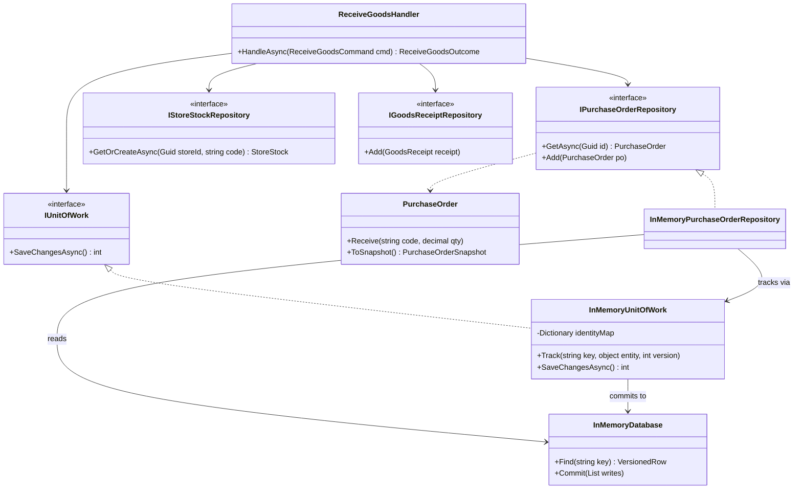
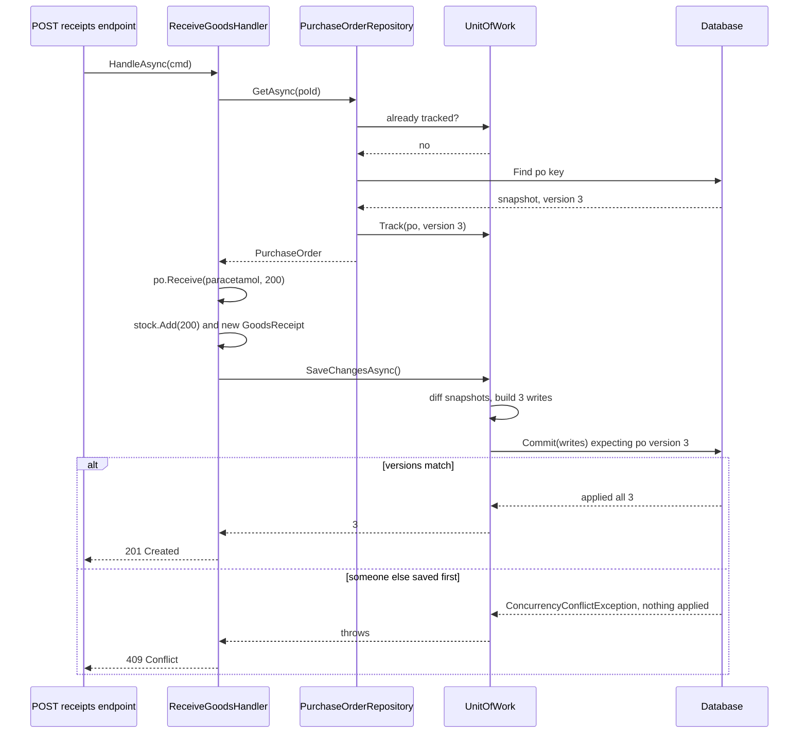

Repository and Unit of Work are among the most used, and most argued-about, patterns in .NET. This lesson builds both by hand to show the machinery, then looks honestly at their limits: in EF Core, `DbContext` already *is* a unit of work.

## Learning objectives

By the end of this lesson you will be able to:

1. Explain the two problems these patterns solve: persistence details leaking into business code, and half-saved business operations.
2. Name the participants: repository, unit of work, identity map and change tracking.
3. Build an in-memory repository and unit of work with all-or-nothing commits and optimistic concurrency.
4. Explain why `DbContext` already is a unit of work, and why a generic `IRepository<T>` over it is usually an anti-pattern.
5. Decide when a repository adds real value (aggregates, testing seams, multiple stores) and when to use `DbContext` directly or a query object.
6. Use transactions correctly: when `SaveChanges` is enough and when you need an explicit transaction.

## Prerequisites

- [Facade](#/lesson/m06-facade): a repository is a facade over a data-access technology.
- [Specification](#/lesson/m06-specification): one way to keep repository interfaces small.
- [Dependency Inversion Principle](#/lesson/m04-dip): the domain owns the repository interface; infrastructure implements it.

## Explain it like I'm a beginner

Think of a neighbourhood **pharmacy** that is part of a chain. A distributor delivers 200 strips of paracetamol 500 mg against a purchase order. The pharmacist must do three things:

1. Mark 200 strips as received on the purchase order.
2. Add 200 strips to this store's stock register.
3. Write a Goods Receipt Note (GRN) so head-office accounts can pay the distributor.

(A real pharmacy also records the batch number and expiry date of every receipt. We leave that out to keep the code small; it doesn't change the patterns.)

Two ideas keep this sane.

**The stockroom desk (Repository).** Staff at the billing counter don't dig through the stockroom shelves or the filing cabinet. They ask at the desk: "Give me purchase order 4512." The desk hides *where* and *how* things are stored; to the staff it's a simple collection.

**The worksheet (Unit of Work).** Updating three registers one at a time means a power cut after step 1 leaves the PO "received" with no stock. So every change goes on a worksheet first, and the whole worksheet is copied into the registers in one go. If anything is wrong (someone else already received that PO), **nothing** is copied.

- The desk is the **repository**: it makes stored objects look like an in-memory collection.
- The worksheet is the **unit of work**: it records every change in one business operation and commits them together.
- "Have I already fetched PO 4512 today? Then use the same file" is the **identity map**.

## First-principles explanation

### What they are

- **Repository** (Fowler, Evans): mediates between the domain and data mapping "using a collection-like interface". Domain code says `orders.GetAsync(id)` and never sees SQL or ORM details.
- **Unit of Work** (Fowler): tracks *new*, *changed* and *deleted* objects in a business transaction and writes them out together, usually in one database transaction.
- **Identity Map**: within one unit of work, the same row always maps to the *same object*, so two copies can't overwrite each other.

### Why they exist — the problem

1. **Leaking persistence.** Business rules ("can't receive more than ordered") get tangled with SQL and mapping code, so testing the rule means touching all of it.
2. **Half-finished operations.** If each step saves immediately, a failure between steps leaves the PO received but no stock and no GRN.
3. **Lost updates.** Two pharmacists both read "300 remaining", both receive 200, both save. The PO shows 100 remaining when the second receipt should have been rejected.

### How they work internally

A unit of work is a small engine with four parts:

1. **Identity map**: key → loaded object.
2. **Change tracking**: a snapshot and version for each loaded object.
3. **Commit**: diff against snapshots, send all changes in one transaction, and check each stored version still equals the loaded one (**optimistic concurrency**). Any failure rolls back everything.
4. **After commit**: refresh snapshots and versions.

That's exactly what EF Core's `DbContext` does: its `ChangeTracker` is the identity map plus snapshots, and `SaveChanges` detects changes, opens a transaction, checks concurrency tokens and commits. **With EF Core you already have a unit of work.** The only question is whether you want a repository in front of it.

### When a repository adds value

- **Aggregates with invariants.** `IPurchaseOrderRepository.GetAsync` always includes the lines, so nobody gets a PO with an empty `Lines` list by accident.
- **A domain that shouldn't depend on EF Core** (layered or clean architecture).
- **A testing seam** for application services, without a database.
- **Multiple stores** (PostgreSQL plus a document store or API) behind one interface.

### When it doesn't

- **Thin CRUD or admin screens.** Wrapping `DbSet<T>` in `IRepository<T>` hides EF Core features (projections, `AsNoTracking`, `Include`) behind a weaker API.
- **Reads and reports.** Use a **query object** (one query, one DTO) or `DbContext` with projection.
- **A generic `IRepository<T>` exposing `IQueryable<T>`**, which leaks the ORM anyway.

### Trade-offs

| You gain | You pay |
|---|---|
| Domain code free of persistence details | Another layer to write and keep in sync |
| One place that defines how an aggregate is loaded | Read-heavy screens fight the abstraction; use query objects |
| Easy unit tests with in-memory fakes | Fakes can behave differently from the real database (transactions, collation, constraints) |
| All-or-nothing saves (unit of work) | Long-lived units of work hold stale data and cause conflicts; keep them per request |

## Visual explanation

### Class diagram



How to read it: the handler (application layer) depends only on four **interfaces**, which the domain owns. The in-memory classes on the right are infrastructure. Repositories *read* from the database but don't write to it. Instead they register what they load or add with the **unit of work**. Only the unit of work writes, in one `Commit`. With EF Core, `InMemoryUnitOfWork` and `InMemoryDatabase` together are replaced by a single `DbContext`.

### Sequence diagram



Notice that between `GetAsync` and `SaveChangesAsync` **nothing touches the database**; changes live in the unit of work. The commit is guarded by the version read at load time: if another request received against the same PO meanwhile, the version is now 4, the whole commit is refused, and the client gets a 409.

## Step-by-step example

### Step 1 — the naive version

```csharp
public async Task ReceiveAsync(Guid poId, string code, decimal qty)
{
    var po = await _db.QuerySingleAsync<PoRow>("select * from purchase_orders where id = @poId", new { poId });
    await _db.ExecuteAsync("update po_lines set received = received + @qty where po_id = @poId and code = @code", ...);
    await _db.ExecuteAsync("update store_stock set on_hand = on_hand + @qty where ...", ...);   // crash here?
    await _db.ExecuteAsync("insert into goods_receipts ...", ...);
}
```

Three writes, no transaction, no over-receipt rule.

### Step 2 — move the rule into the domain

`PurchaseOrder.Receive(code, qty)` enforces the remaining quantity, testable without a database.

### Step 3 — repositories for loading and adding aggregates

`IPurchaseOrderRepository.GetAsync(id)` returns a complete `PurchaseOrder` with its lines.

### Step 4 — a unit of work for saving

The handler makes all its changes, then calls `SaveChangesAsync()` once. Either everything is stored or nothing is.

## Production-style C# implementation

Because EF Core isn't available to this course's code checker, the compiled implementation below uses an **in-memory database and unit of work that work the way EF Core does internally**. EF Core equivalents follow as clearly labelled snippets.

```text
PharmacyStores.Api/
  Program.cs
  Domain/PurchaseOrder.cs, StoreStock.cs, GoodsReceipt.cs, Abstractions.cs
  Infrastructure/InMemoryDatabase.cs, InMemoryUnitOfWork.cs, InMemoryRepositories.cs, LowStockQuery.cs
  Application/ReceiveGoodsHandler.cs
```

### Domain

```csharp file=Domain/PurchaseOrder.cs
namespace PharmacyStores.Domain;

public sealed class DomainRuleException(string message) : Exception(message);

public sealed record PurchaseOrderLineSnapshot(string ItemCode, decimal OrderedQty, decimal ReceivedQty);
public sealed record PurchaseOrderSnapshot(Guid Id, Guid StoreId, string Supplier, IReadOnlyList<PurchaseOrderLineSnapshot> Lines);

/// <summary>Aggregate root. Lines are only changed through Receive, so the over-receipt rule can't be bypassed.</summary>
public sealed class PurchaseOrder
{
    private readonly List<Line> _lines;

    private PurchaseOrder(Guid id, Guid storeId, string supplier, List<Line> lines)
    { Id = id; StoreId = storeId; Supplier = supplier; _lines = lines; }

    public Guid Id { get; }
    public Guid StoreId { get; }
    public string Supplier { get; }
    public IReadOnlyList<(string ItemCode, decimal Ordered, decimal Received)> Lines =>
        _lines.Select(l => (l.ItemCode, l.Ordered, l.Received)).ToList();

    public static PurchaseOrder Create(Guid storeId, string supplier, IEnumerable<(string Code, decimal Qty)> lines)
    {
        var list = lines.Select(l => l.Qty > 0 ? new Line(l.Code, l.Qty, 0m) : throw new DomainRuleException("Ordered quantity must be positive.")).ToList();
        if (list.Count == 0) throw new DomainRuleException("A purchase order needs at least one line.");
        return new PurchaseOrder(Guid.NewGuid(), storeId, supplier, list);
    }

    public void Receive(string itemCode, decimal quantity)
    {
        if (quantity <= 0) throw new DomainRuleException("Received quantity must be positive.");
        var line = _lines.FirstOrDefault(l => l.ItemCode == itemCode)
                   ?? throw new DomainRuleException($"Item {itemCode} is not on this purchase order.");
        if (line.Received + quantity > line.Ordered)
            throw new DomainRuleException($"Cannot receive {quantity}; only {line.Ordered - line.Received} {itemCode} remaining.");
        line.Received += quantity;
    }

    // Snapshot/restore methods let the infrastructure store the aggregate without public setters.
    public PurchaseOrderSnapshot ToSnapshot() =>
        new(Id, StoreId, Supplier, _lines.Select(l => new PurchaseOrderLineSnapshot(l.ItemCode, l.Ordered, l.Received)).ToList());

    public static PurchaseOrder Restore(PurchaseOrderSnapshot s) =>
        new(s.Id, s.StoreId, s.Supplier, s.Lines.Select(l => new Line(l.ItemCode, l.OrderedQty, l.ReceivedQty)).ToList());

    private sealed class Line(string code, decimal ordered, decimal received)
    {
        public string ItemCode { get; } = code;
        public decimal Ordered { get; } = ordered;
        public decimal Received { get; set; } = received;
    }
}
```

```csharp file=Domain/StoreStock.cs
namespace PharmacyStores.Domain;

public sealed record StoreStockSnapshot(Guid StoreId, string ItemCode, decimal OnHand, decimal ReorderLevel);

public sealed class StoreStock
{
    private StoreStock(Guid storeId, string code, decimal onHand, decimal reorderLevel)
    { StoreId = storeId; ItemCode = code; OnHand = onHand; ReorderLevel = reorderLevel; }

    public Guid StoreId { get; }
    public string ItemCode { get; }
    public decimal OnHand { get; private set; }
    public decimal ReorderLevel { get; private set; }

    public static StoreStock Empty(Guid storeId, string code) => new(storeId, code, 0m, 0m);
    public void Add(decimal qty) { if (qty <= 0) throw new DomainRuleException("Quantity must be positive."); OnHand += qty; }

    public StoreStockSnapshot ToSnapshot() => new(StoreId, ItemCode, OnHand, ReorderLevel);
    public static StoreStock Restore(StoreStockSnapshot s) => new(s.StoreId, s.ItemCode, s.OnHand, s.ReorderLevel);
}

public sealed record GoodsReceipt(Guid Id, Guid PurchaseOrderId, Guid StoreId, string ItemCode, decimal Quantity, DateTimeOffset ReceivedAt);
```

```csharp file=Domain/Abstractions.cs
namespace PharmacyStores.Domain;

// Owned by the domain/application layer; implemented by infrastructure (Dependency Inversion).
public interface IPurchaseOrderRepository
{
    Task<PurchaseOrder?> GetAsync(Guid id, CancellationToken ct);
    void Add(PurchaseOrder purchaseOrder);
}

public interface IStoreStockRepository
{
    Task<StoreStock> GetOrCreateAsync(Guid storeId, string itemCode, CancellationToken ct);
}

public interface IGoodsReceiptRepository
{
    void Add(GoodsReceipt receipt);
}

public interface IUnitOfWork
{
    /// <summary>Saves every tracked change atomically. Throws ConcurrencyConflictException if any
    /// tracked row was changed by someone else since it was loaded; in that case nothing is saved.</summary>
    Task<int> SaveChangesAsync(CancellationToken ct);
}

public sealed class ConcurrencyConflictException(string key) : Exception($"Row {key} was modified by another operation.")
{
    public string Key { get; } = key;
}
```

### Infrastructure: the in-memory database and unit of work

```csharp file=Infrastructure/InMemoryDatabase.cs
using PharmacyStores.Domain;

namespace PharmacyStores.Infrastructure;

public sealed record VersionedRow(object Row, int Version);
/// <summary>ExpectedVersion 0 means "must not exist yet" (an insert).</summary>
public sealed record RowWrite(string Key, object Row, int ExpectedVersion);

/// <summary>Stands in for PostgreSQL: rows are immutable snapshots, and Commit is atomic with
/// per-row version checks (like a WHERE version = @expected clause inside one transaction).</summary>
public sealed class InMemoryDatabase
{
    private readonly object _gate = new();
    private readonly Dictionary<string, VersionedRow> _rows = new(StringComparer.Ordinal);

    public VersionedRow? Find(string key) { lock (_gate) return _rows.GetValueOrDefault(key); }

    public IReadOnlyList<T> Scan<T>(string keyPrefix)
    {
        lock (_gate)
            return _rows.Where(kv => kv.Key.StartsWith(keyPrefix, StringComparison.Ordinal))
                        .Select(kv => kv.Value.Row).OfType<T>().ToList();
    }

    public void Commit(IReadOnlyList<RowWrite> writes)
    {
        lock (_gate)
        {
            // Phase 1: validate everything. Phase 2: apply everything. Never half.
            foreach (var w in writes)
            {
                var current = _rows.GetValueOrDefault(w.Key)?.Version ?? 0;
                if (current != w.ExpectedVersion) throw new ConcurrencyConflictException(w.Key);
            }
            foreach (var w in writes) _rows[w.Key] = new VersionedRow(w.Row, w.ExpectedVersion + 1);
        }
    }
}
```

```csharp file=Infrastructure/InMemoryUnitOfWork.cs
using System.Text.Json;
using PharmacyStores.Domain;

namespace PharmacyStores.Infrastructure;

/// <summary>Identity map + snapshot change tracking + atomic commit. Registered as scoped: one per request.</summary>
public sealed class InMemoryUnitOfWork(InMemoryDatabase db) : IUnitOfWork
{
    private sealed class Entry(object entity, int version, Func<object> snapshot)
    {
        public object Entity { get; } = entity;
        public Func<object> Snapshot { get; } = snapshot;
        public int Version { get; set; } = version;
        public string? OriginalJson { get; set; }
    }

    private readonly Dictionary<string, Entry> _identityMap = new(StringComparer.Ordinal);

    public bool TryGetTracked<T>(string key, out T entity) where T : class
    {
        if (_identityMap.TryGetValue(key, out var e) && e.Entity is T t) { entity = t; return true; }
        entity = null!;
        return false;
    }

    /// <summary>version 0 = new entity (insert). Loaded entities keep their JSON snapshot for change detection.</summary>
    public void Track(string key, object entity, int version, Func<object> snapshot)
    {
        if (_identityMap.ContainsKey(key)) throw new InvalidOperationException($"{key} is already tracked.");
        _identityMap[key] = new Entry(entity, version, snapshot)
        {
            OriginalJson = version == 0 ? null : Serialize(snapshot()),
        };
    }

    public Task<int> SaveChangesAsync(CancellationToken ct)
    {
        ct.ThrowIfCancellationRequested();
        var pending = new List<(string Key, Entry Entry, object Row, string Json)>();
        foreach (var (key, entry) in _identityMap)
        {
            var row = entry.Snapshot();
            var json = Serialize(row);
            if (json != entry.OriginalJson) pending.Add((key, entry, row, json));   // new or changed only
        }
        if (pending.Count == 0) return Task.FromResult(0);

        db.Commit(pending.Select(p => new RowWrite(p.Key, p.Row, p.Entry.Version)).ToList());

        foreach (var p in pending) { p.Entry.Version++; p.Entry.OriginalJson = p.Json; }
        return Task.FromResult(pending.Count);
    }

    private static string Serialize(object row) => JsonSerializer.Serialize(row, row.GetType());
}
```

### Infrastructure: repositories and a query object

```csharp file=Infrastructure/InMemoryRepositories.cs
using PharmacyStores.Domain;

namespace PharmacyStores.Infrastructure;

internal static class Keys
{
    public static string Po(Guid id) => $"po:{id}";
    public static string Stock(Guid storeId, string code) => $"stock:{storeId}:{code}";
    public static string Receipt(Guid id) => $"grn:{id}";
}

public sealed class InMemoryPurchaseOrderRepository(InMemoryUnitOfWork uow, InMemoryDatabase db) : IPurchaseOrderRepository
{
    public Task<PurchaseOrder?> GetAsync(Guid id, CancellationToken ct)
    {
        var key = Keys.Po(id);
        if (uow.TryGetTracked<PurchaseOrder>(key, out var tracked)) return Task.FromResult<PurchaseOrder?>(tracked);
        if (db.Find(key) is not { Row: PurchaseOrderSnapshot snap } row) return Task.FromResult<PurchaseOrder?>(null);

        var po = PurchaseOrder.Restore(snap);
        uow.Track(key, po, row.Version, () => po.ToSnapshot());
        return Task.FromResult<PurchaseOrder?>(po);
    }

    public void Add(PurchaseOrder purchaseOrder) =>
        uow.Track(Keys.Po(purchaseOrder.Id), purchaseOrder, 0, () => purchaseOrder.ToSnapshot());
}

public sealed class InMemoryStoreStockRepository(InMemoryUnitOfWork uow, InMemoryDatabase db) : IStoreStockRepository
{
    public Task<StoreStock> GetOrCreateAsync(Guid storeId, string itemCode, CancellationToken ct)
    {
        var key = Keys.Stock(storeId, itemCode);
        if (uow.TryGetTracked<StoreStock>(key, out var tracked)) return Task.FromResult(tracked);

        var row = db.Find(key);
        var stock = row is { Row: StoreStockSnapshot s } ? StoreStock.Restore(s) : StoreStock.Empty(storeId, itemCode);
        uow.Track(key, stock, row?.Version ?? 0, () => stock.ToSnapshot());
        return Task.FromResult(stock);
    }
}

public sealed class InMemoryGoodsReceiptRepository(InMemoryUnitOfWork uow) : IGoodsReceiptRepository
{
    public void Add(GoodsReceipt receipt) => uow.Track(Keys.Receipt(receipt.Id), receipt, 0, () => receipt);
}
```

```csharp file=Infrastructure/LowStockQuery.cs
namespace PharmacyStores.Infrastructure;

public sealed record LowStockRow(string ItemCode, decimal OnHand, decimal ReorderLevel, decimal Shortfall);

/// <summary>Query object: one read, one DTO shape. No aggregates, no change tracking, no repository.</summary>
public interface ILowStockQuery
{
    Task<IReadOnlyList<LowStockRow>> RunAsync(Guid storeId, CancellationToken ct);
}

public sealed class InMemoryLowStockQuery(InMemoryDatabase db) : ILowStockQuery
{
    public Task<IReadOnlyList<LowStockRow>> RunAsync(Guid storeId, CancellationToken ct)
    {
        IReadOnlyList<LowStockRow> rows = db.Scan<PharmacyStores.Domain.StoreStockSnapshot>($"stock:{storeId}:")
            .Where(s => s.OnHand < s.ReorderLevel)
            .Select(s => new LowStockRow(s.ItemCode, s.OnHand, s.ReorderLevel, s.ReorderLevel - s.OnHand))
            .OrderByDescending(r => r.Shortfall)
            .ToList();
        return Task.FromResult(rows);
    }
}
```

### Application service

```csharp file=Application/ReceiveGoodsHandler.cs
using PharmacyStores.Domain;

namespace PharmacyStores.Application;

public sealed record ReceiveGoodsCommand(Guid PurchaseOrderId, string ItemCode, decimal Quantity);

public abstract record ReceiveGoodsOutcome
{
    public sealed record Received(Guid ReceiptId) : ReceiveGoodsOutcome;
    public sealed record NotFound : ReceiveGoodsOutcome;
    public sealed record Rejected(string Reason) : ReceiveGoodsOutcome;
    public sealed record Conflict : ReceiveGoodsOutcome;
}

public sealed class ReceiveGoodsHandler(
    IPurchaseOrderRepository purchaseOrders,
    IStoreStockRepository stock,
    IGoodsReceiptRepository receipts,
    IUnitOfWork unitOfWork,
    TimeProvider clock)
{
    public async Task<ReceiveGoodsOutcome> HandleAsync(ReceiveGoodsCommand cmd, CancellationToken ct)
    {
        var po = await purchaseOrders.GetAsync(cmd.PurchaseOrderId, ct);
        if (po is null) return new ReceiveGoodsOutcome.NotFound();

        try { po.Receive(cmd.ItemCode, cmd.Quantity); }
        catch (DomainRuleException ex) { return new ReceiveGoodsOutcome.Rejected(ex.Message); }

        var storeStock = await stock.GetOrCreateAsync(po.StoreId, cmd.ItemCode, ct);
        storeStock.Add(cmd.Quantity);

        var receipt = new GoodsReceipt(Guid.NewGuid(), po.Id, po.StoreId, cmd.ItemCode, cmd.Quantity, clock.GetUtcNow());
        receipts.Add(receipt);

        try { await unitOfWork.SaveChangesAsync(ct); }          // one commit for PO + stock + GRN
        catch (ConcurrencyConflictException) { return new ReceiveGoodsOutcome.Conflict(); }

        return new ReceiveGoodsOutcome.Received(receipt.Id);
    }
}
```

### Composition root

```csharp file=Program.cs
using PharmacyStores.Application;
using PharmacyStores.Domain;
using PharmacyStores.Infrastructure;

var builder = WebApplication.CreateBuilder(args);

builder.Services.AddSingleton(TimeProvider.System);
builder.Services.AddSingleton<InMemoryDatabase>();                     // in production: the DbContext's database
builder.Services.AddScoped<InMemoryUnitOfWork>();                       // one unit of work per HTTP request
builder.Services.AddScoped<IUnitOfWork>(sp => sp.GetRequiredService<InMemoryUnitOfWork>());   // same instance
builder.Services.AddScoped<IPurchaseOrderRepository, InMemoryPurchaseOrderRepository>();
builder.Services.AddScoped<IStoreStockRepository, InMemoryStoreStockRepository>();
builder.Services.AddScoped<IGoodsReceiptRepository, InMemoryGoodsReceiptRepository>();
builder.Services.AddScoped<ILowStockQuery, InMemoryLowStockQuery>();
builder.Services.AddScoped<ReceiveGoodsHandler>();

var app = builder.Build();

app.MapPost("/purchase-orders/{id:guid}/receipts", async (Guid id, ReceiveGoodsCommand body, ReceiveGoodsHandler handler, CancellationToken ct) =>
    await handler.HandleAsync(body with { PurchaseOrderId = id }, ct) switch
    {
        ReceiveGoodsOutcome.Received r => Results.Created($"/goods-receipts/{r.ReceiptId}", r),
        ReceiveGoodsOutcome.NotFound => Results.Problem("Purchase order not found.", statusCode: 404),
        ReceiveGoodsOutcome.Rejected r => Results.Problem(r.Reason, statusCode: 422),
        ReceiveGoodsOutcome.Conflict => Results.Problem("The purchase order changed; reload and retry.", statusCode: 409),
        _ => Results.StatusCode(500),
    });

app.MapGet("/stores/{storeId:guid}/low-stock", async (Guid storeId, ILowStockQuery query, CancellationToken ct) =>
    Results.Ok(await query.RunAsync(storeId, ct)));

app.Run();
```

The key line forwards `IUnitOfWork` to the **same scoped** `InMemoryUnitOfWork` the repositories use. A separate registration would make the handler save a *different*, empty unit of work.

### The EF Core version (not compiled here)

With EF Core, most of the infrastructure above disappears:

```csharp
// Illustrative EF Core code: not compiled by the checker.
public sealed class StoresDbContext(DbContextOptions<StoresDbContext> o) : DbContext(o), IUnitOfWork
{
    public DbSet<PurchaseOrder> PurchaseOrders => Set<PurchaseOrder>();
    public DbSet<StoreStock> StoreStock => Set<StoreStock>();
    public DbSet<GoodsReceipt> GoodsReceipts => Set<GoodsReceipt>();

    protected override void OnModelCreating(ModelBuilder b)
    {
        b.Entity<PurchaseOrder>().OwnsMany(p => p.Lines);   // lines live and die with the PO; assumes Lines is an
                                                        // IReadOnlyCollection<PurchaseOrderLine> backed by the _lines field
        b.Entity<PurchaseOrder>().Property<uint>("Version").IsRowVersion(); // Npgsql maps a uint row version to PostgreSQL's xmin
    }
    // SaveChangesAsync(ct) already exists: DbContext IS the unit of work.
}

public sealed class EfPurchaseOrderRepository(StoresDbContext db) : IPurchaseOrderRepository
{
    public Task<PurchaseOrder?> GetAsync(Guid id, CancellationToken ct) =>
        db.PurchaseOrders.FirstOrDefaultAsync(p => p.Id == id, ct);   // owned Lines load with the owner automatically;
                                                                 // non-owned children would need Include here
    public void Add(PurchaseOrder po) => db.PurchaseOrders.Add(po);
}
```

`SaveChangesAsync` wraps all INSERT/UPDATE statements in one transaction when no transaction is active. A stale `xmin` makes EF Core throw `DbUpdateConcurrencyException`, the real-world counterpart of `ConcurrencyConflictException`.

**When you need an explicit transaction.** One `SaveChanges` is already atomic. You need `BeginTransactionAsync` only when one business operation spans **several** `SaveChanges` calls, or mixes EF Core with raw SQL. With retrying execution strategies (`EnableRetryOnFailure`), wrap the whole thing so a retry replays every step:

```csharp
// Illustrative: not compiled.
var strategy = db.Database.CreateExecutionStrategy();
await strategy.ExecuteAsync(async () =>
{
    await using var tx = await db.Database.BeginTransactionAsync(ct);
    await db.Database.ExecuteSqlInterpolatedAsync($"select pg_advisory_xact_lock({storeLockId})", ct);
    // ... changes ...
    await db.SaveChangesAsync(ct);
    await tx.CommitAsync(ct);
});
```

Don't call an external API (payment gateway, SMS) inside a database transaction. The transaction would hold locks for the API's latency, and a rollback can't un-send an SMS. Use an outbox (exercise 6) instead.

## Bad design vs good design

**Bad: the generic repository over EF Core.**

```csharp
public interface IRepository<T> where T : class
{
    IQueryable<T> Query();
    Task<T?> GetByIdAsync(object id);
    void Add(T entity); void Update(T entity); void Delete(T entity);
    Task SaveAsync();            // each repository saves on its own!
}
```

Problems:

- `Query()` leaks `IQueryable<T>`: callers write EF-specific LINQ, so the abstraction hides nothing, and fakes behave differently from the real provider.
- `SaveAsync` per repository breaks the unit of work: two transactions again, or, with a shared `DbContext`, one repository silently saving another's changes.
- `GetByIdAsync` on `PurchaseOrderLine` lets code edit a line without its root, bypassing `Receive`'s rule.

**Good:** one repository per **aggregate root** with intention-revealing methods; saving happens once, through the unit of work; screens read through query objects.

**Also good, often better for small apps:** inject `DbContext` straight into vertical-slice handlers and test against real PostgreSQL in a container. Many experienced .NET teams choose this deliberately.

:::callout type=tradeoff title="'We might switch databases' is rarely a good reason"
Database swaps are rare, and dialects and transaction semantics differ anyway. Add a repository for **aggregate integrity, domain isolation and testability**, benefits you get every day.
:::

## Practical playground

The playground shows the essential mechanics in one file. A tiny unit of work tracks two changes, a second unit of work commits first, and the first commit is rejected as a whole. Change the order of the two commits to see both succeed.

:::playground type=csharp title="Unit of work with optimistic concurrency"
```csharp file=Program.cs
using System;
using System.Collections.Generic;
using System.Linq;

public sealed class ConflictException(string key) : Exception($"Conflict on {key}");

public sealed class Store
{
    private readonly Dictionary<string, (decimal Value, int Version)> _rows = new();
    public (decimal Value, int Version) Read(string key) => _rows.TryGetValue(key, out var r) ? r : (0m, 0);
    public void Commit(IEnumerable<(string Key, decimal Value, int Expected)> writes)
    {
        var list = writes.ToList();
        foreach (var w in list) if (Read(w.Key).Version != w.Expected) throw new ConflictException(w.Key);
        foreach (var w in list) _rows[w.Key] = (w.Value, w.Expected + 1);
    }
}

public sealed class UnitOfWork(Store store)
{
    private readonly Dictionary<string, (decimal Value, int Version)> _tracked = new();
    public decimal Get(string key)
    {
        if (!_tracked.TryGetValue(key, out var t)) _tracked[key] = t = store.Read(key);   // identity map
        return t.Value;
    }
    public void Set(string key, decimal value) { Get(key); _tracked[key] = (value, _tracked[key].Version); }
    public void Commit() => store.Commit(_tracked.Select(t => (t.Key, t.Value.Value, t.Value.Version)));
}

public static class Program
{
    public static void Main()
    {
        var store = new Store();
        store.Commit(new[] { ("po:4512:paracetamol-remaining", 300m, 0), ("stock:paracetamol", 50m, 0) });

        var pharmacistA = new UnitOfWork(store);
        var pharmacistB = new UnitOfWork(store);

        foreach (var uow in new[] { pharmacistA, pharmacistB })
        {
            uow.Set("po:4512:paracetamol-remaining", uow.Get("po:4512:paracetamol-remaining") - 200m);
            uow.Set("stock:paracetamol", uow.Get("stock:paracetamol") + 200m);
        }

        pharmacistB.Commit();
        Console.WriteLine("B committed.");
        try { pharmacistA.Commit(); }
        catch (ConflictException ex) { Console.WriteLine($"A rejected as a whole: {ex.Message}"); }

        Console.WriteLine($"Remaining on PO: {store.Read("po:4512:paracetamol-remaining").Value}, stock: {store.Read("stock:paracetamol").Value}");
    }
}
```
:::

## Exercises

:::exercise id=m06-repository-uow-ex1 difficulty=beginner kind=code title="All-or-nothing commit"
Implement `SimpleUnitOfWork`, which records changes to a `Dictionary<string, decimal>` (a pharmacy's stock ledger) and applies them only on `Commit()`, all or nothing.
::requirements
- `RegisterNew(key, value)`: the key must not already exist in the ledger at commit time.
- `RegisterUpdate(key, value)`: the key must exist at commit time.
- `RegisterDelete(key)`: the key must exist at commit time.
- Nothing touches the ledger before `Commit()`. If any change is invalid, `Commit()` throws `InvalidOperationException` and applies **none**.
- After a successful commit, the pending list is empty. `Discard()` clears it without applying.
::acceptance
- Pending changes are invisible in the ledger until commit.
- A commit with one invalid change leaves the ledger exactly as before.
- `PendingCount` is 0 after `Commit()` or `Discard()`.
::hint
Store pending changes as a list of small records: `(Kind, Key, Value)`.
::hint
Use two passes: validate every change first, then apply every change.
::hint
Validation must consider the ledger *as it is now*, not after earlier pending changes. Keep it simple: one change per key per unit of work.
::hint
```csharp
foreach (var c in _pending) if (!IsValid(c)) throw new InvalidOperationException(...);
foreach (var c in _pending) Apply(c);
_pending.Clear();
```
::starter
```csharp file=SimpleUnitOfWork.cs
using System;
using System.Collections.Generic;

public sealed class SimpleUnitOfWork(Dictionary<string, decimal> ledger)
{
    public int PendingCount => throw new NotImplementedException();
    public void RegisterNew(string key, decimal value) => throw new NotImplementedException();
    public void RegisterUpdate(string key, decimal value) => throw new NotImplementedException();
    public void RegisterDelete(string key) => throw new NotImplementedException();
    public void Commit() => throw new NotImplementedException();
    public void Discard() => throw new NotImplementedException();
}
```
::tests
```csharp file=SimpleUnitOfWorkTests.cs
using System;
using System.Collections.Generic;
using Xunit;

public class SimpleUnitOfWorkTests
{
    private static Dictionary<string, decimal> Ledger() => new() { ["paracetamol"] = 100m, ["insulin"] = 5m };

    [Fact]
    public void Changes_invisible_until_commit()
    {
        var ledger = Ledger();
        var uow = new SimpleUnitOfWork(ledger);
        uow.RegisterUpdate("paracetamol", 300m);
        uow.RegisterNew("cetirizine", 40m);
        Assert.Equal(100m, ledger["paracetamol"]);
        Assert.False(ledger.ContainsKey("cetirizine"));
        uow.Commit();
        Assert.Equal(300m, ledger["paracetamol"]);
        Assert.Equal(40m, ledger["cetirizine"]);
        Assert.Equal(0, uow.PendingCount);
    }

    [Fact]
    public void One_invalid_change_applies_nothing()
    {
        var ledger = Ledger();
        var uow = new SimpleUnitOfWork(ledger);
        uow.RegisterUpdate("paracetamol", 999m);
        uow.RegisterDelete("amoxicillin");     // does not exist
        Assert.Throws<InvalidOperationException>(() => uow.Commit());
        Assert.Equal(100m, ledger["paracetamol"]);
        Assert.Equal(2, ledger.Count);
    }

    [Fact]
    public void New_with_existing_key_is_invalid()
    {
        var ledger = Ledger();
        var uow = new SimpleUnitOfWork(ledger);
        uow.RegisterNew("insulin", 1m);
        Assert.Throws<InvalidOperationException>(() => uow.Commit());
        Assert.Equal(5m, ledger["insulin"]);
    }

    [Fact]
    public void Delete_and_discard()
    {
        var ledger = Ledger();
        var uow = new SimpleUnitOfWork(ledger);
        uow.RegisterDelete("insulin");
        uow.Discard();
        Assert.Equal(0, uow.PendingCount);
        uow.Commit();
        Assert.True(ledger.ContainsKey("insulin"));
        uow.RegisterDelete("insulin");
        uow.Commit();
        Assert.False(ledger.ContainsKey("insulin"));
    }
}
```
::solution
```csharp file=SimpleUnitOfWork.cs
using System;
using System.Collections.Generic;

public sealed class SimpleUnitOfWork(Dictionary<string, decimal> ledger)
{
    private enum Kind { New, Update, Delete }
    private sealed record Change(Kind Kind, string Key, decimal Value);
    private readonly List<Change> _pending = new();

    public int PendingCount => _pending.Count;
    public void RegisterNew(string key, decimal value) => _pending.Add(new(Kind.New, key, value));
    public void RegisterUpdate(string key, decimal value) => _pending.Add(new(Kind.Update, key, value));
    public void RegisterDelete(string key) => _pending.Add(new(Kind.Delete, key, 0m));

    public void Commit()
    {
        foreach (var c in _pending)
        {
            var exists = ledger.ContainsKey(c.Key);
            var ok = c.Kind == Kind.New ? !exists : exists;
            if (!ok) throw new InvalidOperationException($"{c.Kind} of '{c.Key}' is not valid against the current ledger.");
        }
        foreach (var c in _pending)
        {
            if (c.Kind == Kind.Delete) ledger.Remove(c.Key);
            else ledger[c.Key] = c.Value;
        }
        _pending.Clear();
    }

    public void Discard() => _pending.Clear();
}
```

Validate-then-apply is how you get atomicity without a database. A real database gives you the same guarantee with a transaction and rollback.
::mistakes
- Applying each change as you validate it. The first valid change is then already written when the second fails.
- Clearing pending changes when commit *fails*. The caller may want to inspect or retry; this solution keeps them.
- Writing to the ledger inside `RegisterUpdate`. Then it's not a unit of work at all.
:::

:::exercise id=m06-repository-uow-ex2 difficulty=beginner kind=code title="Identity map in a repository"
`MedicineRepository.Get(code)` loads a `Medicine` from an `IMedicineSource`. Within one repository instance (one unit of work), the same code must always return the **same object**, and the source must be hit only once per code.
::requirements
- Two `Get("PCM-500")` calls on one repository return the same instance (`Assert.Same`).
- The source's `Load` is called once per distinct code per repository instance.
- A new repository instance (a new request) loads again.
- `Get` for an unknown code returns `null`, and a second call doesn't hit the source again.
::acceptance
- Tests with a counting fake source pass.
- Edits made through one reference are visible through the other, because it's the same object.
::hint
A `Dictionary<string, Medicine?>` inside the repository is the identity map.
::hint
Remember misses too: store `null` for an unknown code so you don't query again.
::hint
`if (_map.TryGetValue(code, out var m)) return m; m = source.Load(code); _map[code] = m; return m;`
::starter
```csharp file=MedicineRepository.cs
using System;
using System.Collections.Generic;

public sealed class Medicine(string code, string name, decimal pricePerStrip)
{
    public string Code { get; } = code;
    public string Name { get; } = name;
    public decimal PricePerStrip { get; set; } = pricePerStrip;
}

public interface IMedicineSource { Medicine? Load(string code); }

public sealed class MedicineRepository(IMedicineSource source)
{
    public Medicine? Get(string code) => throw new NotImplementedException();
}
```
::tests
```csharp file=MedicineRepositoryTests.cs
using System.Collections.Generic;
using Xunit;

public class MedicineRepositoryTests
{
    private sealed class CountingSource : IMedicineSource
    {
        public int Loads;
        public Medicine? Load(string code)
        {
            Loads++;
            return code == "PCM-500" ? new Medicine(code, "Paracetamol 500 mg, strip of 10", 30m) : null;   // new object each load, like a DB
        }
    }

    [Fact]
    public void Same_instance_within_one_repository()
    {
        var src = new CountingSource();
        var repo = new MedicineRepository(src);
        var a = repo.Get("PCM-500");
        var b = repo.Get("PCM-500");
        Assert.Same(a, b);
        Assert.Equal(1, src.Loads);
    }

    [Fact]
    public void Edits_visible_through_both_references()
    {
        var repo = new MedicineRepository(new CountingSource());
        repo.Get("PCM-500")!.PricePerStrip = 32m;
        Assert.Equal(32m, repo.Get("PCM-500")!.PricePerStrip);
    }

    [Fact]
    public void New_repository_loads_again()
    {
        var src = new CountingSource();
        var first = new MedicineRepository(src).Get("PCM-500");
        var second = new MedicineRepository(src).Get("PCM-500");
        Assert.NotSame(first, second);
        Assert.Equal(2, src.Loads);
    }

    [Fact]
    public void Misses_are_remembered()
    {
        var src = new CountingSource();
        var repo = new MedicineRepository(src);
        Assert.Null(repo.Get("UNKNOWN"));
        Assert.Null(repo.Get("UNKNOWN"));
        Assert.Equal(1, src.Loads);
    }
}
```
::solution
```csharp file=MedicineRepository.cs
using System;
using System.Collections.Generic;

public sealed class Medicine(string code, string name, decimal pricePerStrip)
{
    public string Code { get; } = code;
    public string Name { get; } = name;
    public decimal PricePerStrip { get; set; } = pricePerStrip;
}

public interface IMedicineSource { Medicine? Load(string code); }

public sealed class MedicineRepository(IMedicineSource source)
{
    private readonly Dictionary<string, Medicine?> _identityMap = new(StringComparer.Ordinal);

    public Medicine? Get(string code)
    {
        if (_identityMap.TryGetValue(code, out var cached)) return cached;
        var loaded = source.Load(code);
        _identityMap[code] = loaded;
        return loaded;
    }
}
```

Why it matters: without an identity map, two parts of one request could each load "Paracetamol 500 mg", change different fields, and the second save would overwrite the first. EF Core's change tracker does this for you: `FindAsync` checks tracked entities before querying, and every tracked query resolves each row to the same instance.
::mistakes
- Making the map `static`. It then becomes a process-wide cache shared across requests and threads, with stale data and race conditions. An identity map lives exactly as long as one unit of work.
- Using a case-insensitive comparer when the database key is case-sensitive, or the other way round.
:::

:::exercise id=m06-repository-uow-ex3 difficulty=intermediate kind=code title="Optimistic concurrency in a unit of work"
Two pharmacists receive paracetamol against the same PO at the same time. Implement `VersionedUnitOfWork` so the second commit is rejected and nothing it wrote is applied.
::requirements
- `VersionedStore` (given) holds `(decimal Value, int Version)` per key. `Read` returns version 0 for a missing key.
- `Get(key)` reads through an identity map and remembers the version read.
- `Set(key, value)` changes the tracked value (tracking the key first if needed).
- `Commit()` validates that every **changed** key still has the version read. Then it writes all changed keys with `version + 1`. On any mismatch, it throws `ConcurrencyException` and writes nothing.
- Keys that were read but not changed are not written and not checked.
::acceptance
- Two units of work change the same key: the first commit wins, the second throws, and its other changes aren't applied.
- Two units of work change *different* keys: both commit.
- Reading without changing never conflicts.
::hint
Track three things per key: the original value, the current value and the version read.
::hint
"Changed" means `current != original`.
::hint
Validation and apply must happen under the store's lock, so add a `TryApply` method or use `lock (store.Gate)`. The given store exposes `Gate` for this.
::hint
```csharp
lock (store.Gate) {
  foreach (var (k, t) in changed) if (store.Read(k).Version != t.Version) throw new ConcurrencyException(k);
  foreach (var (k, t) in changed) store.Write(k, t.Current, t.Version + 1);
}
```
::starter
```csharp file=VersionedUnitOfWork.cs
using System;
using System.Collections.Generic;

public sealed class ConcurrencyException(string key) : Exception($"Conflict on {key}") { public string Key { get; } = key; }

public sealed class VersionedStore
{
    private readonly Dictionary<string, (decimal Value, int Version)> _rows = new();
    public object Gate { get; } = new();
    public (decimal Value, int Version) Read(string key) { lock (Gate) return _rows.TryGetValue(key, out var r) ? r : (0m, 0); }
    public void Write(string key, decimal value, int version) { lock (Gate) _rows[key] = (value, version); }
}

public sealed class VersionedUnitOfWork(VersionedStore store)
{
    public decimal Get(string key) => throw new NotImplementedException();
    public void Set(string key, decimal value) => throw new NotImplementedException();
    public void Commit() => throw new NotImplementedException();
}
```
::tests
```csharp file=VersionedUnitOfWorkTests.cs
using Xunit;

public class VersionedUnitOfWorkTests
{
    private static VersionedStore Seed()
    {
        var s = new VersionedStore();
        s.Write("po:4512:remaining", 300m, 1);
        s.Write("stock:paracetamol", 50m, 1);
        s.Write("stock:insulin", 8m, 1);
        return s;
    }

    [Fact]
    public void Second_writer_on_same_key_is_rejected_entirely()
    {
        var store = Seed();
        var a = new VersionedUnitOfWork(store);
        var b = new VersionedUnitOfWork(store);
        a.Set("po:4512:remaining", a.Get("po:4512:remaining") - 200m);
        a.Set("stock:paracetamol", a.Get("stock:paracetamol") + 200m);
        b.Set("po:4512:remaining", b.Get("po:4512:remaining") - 200m);
        b.Set("stock:paracetamol", b.Get("stock:paracetamol") + 200m);

        a.Commit();
        Assert.Throws<ConcurrencyException>(() => b.Commit());
        Assert.Equal(100m, store.Read("po:4512:remaining").Value);
        Assert.Equal(250m, store.Read("stock:paracetamol").Value);
        Assert.Equal(2, store.Read("stock:paracetamol").Version);
    }

    [Fact]
    public void Different_keys_both_commit()
    {
        var store = Seed();
        var a = new VersionedUnitOfWork(store);
        var b = new VersionedUnitOfWork(store);
        a.Set("stock:paracetamol", 60m);
        b.Set("stock:insulin", 9m);
        a.Commit(); b.Commit();
        Assert.Equal(60m, store.Read("stock:paracetamol").Value);
        Assert.Equal(9m, store.Read("stock:insulin").Value);
    }

    [Fact]
    public void Reads_do_not_conflict()
    {
        var store = Seed();
        var reader = new VersionedUnitOfWork(store);
        _ = reader.Get("stock:paracetamol");
        reader.Set("stock:insulin", 10m);
        var writer = new VersionedUnitOfWork(store);
        writer.Set("stock:paracetamol", 70m);
        writer.Commit();
        reader.Commit();     // only insulin changed in reader; paracetamol was merely read
        Assert.Equal(10m, store.Read("stock:insulin").Value);
        Assert.Equal(70m, store.Read("stock:paracetamol").Value);
    }

    [Fact]
    public void New_key_is_inserted_with_version_1()
    {
        var store = Seed();
        var u = new VersionedUnitOfWork(store);
        u.Set("stock:cetirizine", 40m);
        u.Commit();
        Assert.Equal((40m, 1), store.Read("stock:cetirizine"));
    }
}
```
::solution
```csharp file=VersionedUnitOfWork.cs
using System;
using System.Collections.Generic;
using System.Linq;

public sealed class ConcurrencyException(string key) : Exception($"Conflict on {key}") { public string Key { get; } = key; }

public sealed class VersionedStore
{
    private readonly Dictionary<string, (decimal Value, int Version)> _rows = new();
    public object Gate { get; } = new();
    public (decimal Value, int Version) Read(string key) { lock (Gate) return _rows.TryGetValue(key, out var r) ? r : (0m, 0); }
    public void Write(string key, decimal value, int version) { lock (Gate) _rows[key] = (value, version); }
}

public sealed class VersionedUnitOfWork(VersionedStore store)
{
    private sealed class Tracked(decimal original, int version)
    {
        public decimal Original { get; set; } = original;
        public decimal Current { get; set; } = original;
        public int Version { get; set; } = version;
    }

    private readonly Dictionary<string, Tracked> _map = new();

    private Tracked Track(string key)
    {
        if (!_map.TryGetValue(key, out var t))
        {
            var (value, version) = store.Read(key);
            _map[key] = t = new Tracked(value, version);
        }
        return t;
    }

    public decimal Get(string key) => Track(key).Current;
    public void Set(string key, decimal value) => Track(key).Current = value;

    public void Commit()
    {
        var changed = _map.Where(kv => kv.Value.Current != kv.Value.Original).ToList();
        lock (store.Gate)        // Monitor is re-entrant, so Read/Write's own locks are fine here
        {
            foreach (var (key, t) in changed)
                if (store.Read(key).Version != t.Version) throw new ConcurrencyException(key);
            foreach (var (key, t) in changed)
                store.Write(key, t.Current, t.Version + 1);
        }
        foreach (var (_, t) in changed) { t.Version++; t.Original = t.Current; }
    }
}
```

In SQL this is `UPDATE ... SET version = version + 1 WHERE key = @k AND version = @expected`. Zero affected rows means someone else won; EF Core then throws `DbUpdateConcurrencyException`. With Npgsql, PostgreSQL's `xmin` column can serve as the version.
::mistakes
- Checking versions for keys that were only read, which makes reads cause conflicts.
- Validating outside the lock (a time-of-check/time-of-use race).
- Not refreshing `Version` after commit, so a second `Commit()` conflicts with itself.
::extensions
Instead of throwing, return a list of conflicting keys so the API can tell the user exactly which item changed.
:::

:::exercise id=m06-repository-uow-ex4 difficulty=intermediate kind=written title="Refactor: should this repository exist?"
A five-person team's internal tool for a pharmacy chain's head office (ASP.NET Core, EF Core, PostgreSQL) has this data layer:

```csharp
public interface IRepository<T> where T : class
{
    IQueryable<T> GetAll();
    Task<T?> GetByIdAsync(int id);
    Task AddAsync(T entity);      // calls SaveChangesAsync internally
    Task UpdateAsync(T entity);   // calls SaveChangesAsync internally
    Task DeleteAsync(T entity);   // calls SaveChangesAsync internally
}
public class Repository<T>(AppDbContext db) : IRepository<T> where T : class { /* forwards to db.Set<T>() */ }
```

There are 31 `IRepository<X>` registrations. `SupplierInvoiceService` adds an invoice line, updates the invoice total and writes an audit row through three repositories. Last month an exception after the second call left an invoice total that didn't match its lines. Write a refactoring proposal (300–500 words): what to remove, keep and add, and why.
::acceptance
- Identify why the invoice total got out of sync (per-call `SaveChangesAsync`).
- Explain what `GetAll(): IQueryable<T>` does to the abstraction.
- Recommend a concrete target design and migration steps that can be done incrementally.
- State at least one situation where you **would** keep a repository.
::hint
Count the number of database transactions `SupplierInvoiceService` performs today.
::hint
Who already tracks changes and saves atomically in this app?
::hint
Separate the write side (aggregates such as the supplier invoice) from the read side (31 list screens).
::hint
An incremental plan: stop the per-call saves first, because it's the bug, and only then remove the generic layer feature by feature.
::solution
**Diagnosis.** Each `AddAsync`/`UpdateAsync` calls `SaveChangesAsync`, so one operation became three transactions, and the exception left two of three committed. `DbContext` already is a unit of work; the generic repository defeated it.

**Abstraction leak.** Services write `Include` and projections against `GetAll()`'s `IQueryable<T>`, so they depend on EF Core anyway. The interface hides nothing; it adds 31 registrations and an extra hop.

**Target design.**
1. *Write side*: specific repositories for the 3–5 real aggregates (`ISupplierInvoiceRepository.GetAsync(id)` with the right `Include`s), with no save methods. Save once via `IUnitOfWork`, implemented by `AppDbContext`. Move "invoice total equals sum of lines" into the aggregate.
2. *Read side*: query objects, or `AppDbContext` with `AsNoTracking()` and `Select` into DTOs.
3. *Simple CRUD* (lookups, settings): `AppDbContext` directly.

**Migration steps.**
1. Remove `SaveChangesAsync` from the repository methods and save once per service operation. This fixes the bug immediately.
2. Add an integration test (Testcontainers PostgreSQL) that injects a failure mid-operation and asserts nothing was saved.
3. Introduce aggregate repositories feature by feature; move read paths to queries; delete the generic repository when unused.

**When to keep a repository.** For aggregates whose loading rules matter, when the domain must not reference EF Core, or when data also lives elsewhere (scanned invoice PDFs in object storage).
::mistakes
- A big-bang PR deleting all repositories at once.
- Keeping `SaveChangesAsync` inside repositories "for convenience".
- Arguing to keep the generic repository because "we might switch databases".
:::

:::exercise id=m06-repository-uow-ex5 difficulty=intermediate kind=sql title="Write the low-stock query object in SQL"
The low-stock report doesn't need aggregates or change tracking. It's a read model. Write the query a query object would run: for **store 1**, list medicines whose `on_hand` is below `reorder_level`, with the medicine name, `on_hand`, `reorder_level` and `shortfall` (`reorder_level - on_hand`). Order by shortfall descending, then medicine code ascending.
::acceptance
- Only store 1, and only rows with `on_hand < reorder_level`.
- Columns in order: `medicine_code`, `name`, `on_hand`, `reorder_level`, `shortfall`.
- Ordered by `shortfall` descending, then `medicine_code`.
::hint
You need a join between `store_stock` and `medicines`.
::hint
Filter with `WHERE s.store_id = 1 AND s.on_hand < s.reorder_level`.
::hint
Compute `s.reorder_level - s.on_hand AS shortfall` in the `SELECT` and order by it.
::setup
```sql
CREATE TABLE medicines (code text PRIMARY KEY, name text NOT NULL, unit text NOT NULL);
CREATE TABLE store_stock (store_id int NOT NULL, medicine_code text NOT NULL REFERENCES medicines(code),
  on_hand numeric(12,2) NOT NULL, reorder_level numeric(12,2) NOT NULL, PRIMARY KEY (store_id, medicine_code));
INSERT INTO medicines VALUES ('PCM-500','Paracetamol 500 mg','strip'),('INS-GLA','Insulin glargine pen','pen'),
  ('AMX-500','Amoxicillin 500 mg','strip'),('CTZ-10','Cetirizine 10 mg','strip'),('ORS-1L','ORS sachet','sachet');
INSERT INTO store_stock VALUES (1,'PCM-500',120,500),(1,'INS-GLA',18,15),(1,'AMX-500',40,80),
  (1,'CTZ-10',60,100),(1,'ORS-1L',2,10),(2,'PCM-500',10,400);
```
::check
```sql
SELECT s.medicine_code, m.name, s.on_hand, s.reorder_level, s.reorder_level - s.on_hand AS shortfall
FROM store_stock s
JOIN medicines m ON m.code = s.medicine_code
WHERE s.store_id = 1 AND s.on_hand < s.reorder_level
ORDER BY shortfall DESC, s.medicine_code;
```
::solution
```sql
SELECT s.medicine_code, m.name, s.on_hand, s.reorder_level, s.reorder_level - s.on_hand AS shortfall
FROM store_stock s
JOIN medicines m ON m.code = s.medicine_code
WHERE s.store_id = 1 AND s.on_hand < s.reorder_level
ORDER BY shortfall DESC, s.medicine_code;
```

The result has four rows: paracetamol (380), amoxicillin (40), cetirizine (40) and ORS (8). Amoxicillin and cetirizine tie, so they are ordered by code. Insulin is above its reorder level, and store 2's paracetamol is excluded. In C#, the query object would run this with Dapper, or with EF Core using `AsNoTracking()` plus `Select` into `LowStockRow`. No repository, no aggregate and no unit of work are involved.
::mistakes
- Forgetting the tie-breaker. Equal shortfalls then come back in an unpredictable order.
- Loading `StoreStock` aggregates through the repository and filtering in C#. That's correct, but wasteful, and it tracks entities you'll never save.
:::

:::exercise id=m06-repository-uow-ex6 difficulty=advanced kind=code title="Transactional outbox in the unit of work"
Accounts must be notified of each receipt via a message broker. Publishing after `Commit()` can lose the message on a crash; publishing before can announce a rolled-back receipt. Implement an **outbox**: the unit of work writes tracked aggregates' domain events as outbox rows **in the same atomic commit**.
::requirements
- Aggregates implement `IHasDomainEvents` with `DomainEvents` and `ClearDomainEvents()`.
- `OutboxUnitOfWork.Commit()` builds one atomic change set: the changed aggregate rows plus one outbox row per event, keyed `outbox:{sequence}`.
- If the store rejects the commit (`ConcurrencyException`), there are no outbox rows and the events are **not** cleared, so the caller can retry.
- After a successful commit, events are cleared, and committing again writes nothing new.
::acceptance
- Receiving paracetamol produces one `outbox:` row containing the event text.
- A conflicting commit leaves zero outbox rows and the store unchanged.
- A second `Commit()` after success writes no duplicate outbox rows.
::hint
The store already has an atomic `CommitAll(writes)` with version checks. Your job is to build the right list of writes.
::hint
Collect events *before* calling `CommitAll`, add them to the same list, and clear them only *after* it returns successfully.
::hint
Outbox rows are inserts, so their expected version is 0. Use a counter from the store (`NextSequence()`) for unique keys.
::hint
```csharp
var writes = changedAggregates.Select(a => new Write(a.Key, a.Value, a.Version)).ToList();
foreach (var e in events) writes.Add(new Write($"outbox:{store.NextSequence()}", e, 0));
store.CommitAll(writes);   // throws => nothing applied, events kept
```
::hint
Track aggregates with their loaded version, and compare a `Serialize()` string to detect changes, just like the lesson's `InMemoryUnitOfWork`.
::starter
```csharp file=Outbox.cs
using System;
using System.Collections.Generic;
using System.Linq;

public sealed class ConcurrencyException(string key) : Exception($"Conflict on {key}");
public sealed record Write(string Key, string Value, int ExpectedVersion);

public sealed class OutboxStore
{
    private readonly Dictionary<string, (string Value, int Version)> _rows = new();
    private long _seq;
    public long NextSequence() => System.Threading.Interlocked.Increment(ref _seq);
    public (string Value, int Version)? Read(string key) { lock (_rows) return _rows.TryGetValue(key, out var r) ? r : null; }
    public IReadOnlyList<string> Keys(string prefix) { lock (_rows) return _rows.Keys.Where(k => k.StartsWith(prefix)).OrderBy(k => k).ToList(); }
    public void CommitAll(IReadOnlyList<Write> writes)
    {
        lock (_rows)
        {
            foreach (var w in writes) if ((_rows.TryGetValue(w.Key, out var r) ? r.Version : 0) != w.ExpectedVersion) throw new ConcurrencyException(w.Key);
            foreach (var w in writes) _rows[w.Key] = (w.Value, w.ExpectedVersion + 1);
        }
    }
}

public interface IHasDomainEvents
{
    string Key { get; }
    IReadOnlyList<string> DomainEvents { get; }
    void ClearDomainEvents();
    string Serialize();
}

public sealed class StockItem(string storeCode, string item, decimal onHand) : IHasDomainEvents
{
    private readonly List<string> _events = new();
    public string Key => $"stock:{storeCode}:{item}";
    public decimal OnHand { get; private set; } = onHand;
    public IReadOnlyList<string> DomainEvents => _events;
    public void ClearDomainEvents() => _events.Clear();
    public string Serialize() => OnHand.ToString(System.Globalization.CultureInfo.InvariantCulture);
    public void Receive(decimal qty, string grn) { OnHand += qty; _events.Add($"GoodsReceived {grn} {item} {qty}"); }
    public static StockItem Parse(string storeCode, string item, string value) => new(storeCode, item, decimal.Parse(value, System.Globalization.CultureInfo.InvariantCulture));
}

public sealed class OutboxUnitOfWork(OutboxStore store)
{
    /// <summary>Loads (or returns the already-tracked) stock item; version 0 if it doesn't exist yet.</summary>
    public StockItem GetStock(string storeCode, string item) => throw new NotImplementedException();
    public void Commit() => throw new NotImplementedException();
}
```
::tests
```csharp file=OutboxTests.cs
using Xunit;

public class OutboxTests
{
    private static OutboxStore Seed()
    {
        var s = new OutboxStore();
        s.CommitAll(new[] { new Write("stock:BLR01:paracetamol", "100", 0) });
        return s;
    }

    [Fact]
    public void Event_written_with_state_change()
    {
        var store = Seed();
        var uow = new OutboxUnitOfWork(store);
        uow.GetStock("BLR01", "paracetamol").Receive(200m, "GRN-77");
        uow.Commit();
        Assert.Equal("300", store.Read("stock:BLR01:paracetamol")!.Value.Value);
        var key = Assert.Single(store.Keys("outbox:"));
        Assert.Equal("GoodsReceived GRN-77 paracetamol 200", store.Read(key)!.Value.Value);
    }

    [Fact]
    public void Conflict_writes_no_outbox_rows_and_keeps_events()
    {
        var store = Seed();
        var a = new OutboxUnitOfWork(store);
        var b = new OutboxUnitOfWork(store);
        var stockA = a.GetStock("BLR01", "paracetamol");
        b.GetStock("BLR01", "paracetamol").Receive(50m, "GRN-1");
        stockA.Receive(200m, "GRN-2");
        b.Commit();
        Assert.Throws<ConcurrencyException>(() => a.Commit());
        Assert.Single(store.Keys("outbox:"));                 // only B's event
        Assert.Equal("150", store.Read("stock:BLR01:paracetamol")!.Value.Value);
        Assert.Single(stockA.DomainEvents);                   // kept for retry
    }

    [Fact]
    public void Second_commit_writes_nothing_new()
    {
        var store = Seed();
        var uow = new OutboxUnitOfWork(store);
        uow.GetStock("BLR01", "paracetamol").Receive(10m, "GRN-9");
        uow.Commit();
        uow.Commit();
        Assert.Single(store.Keys("outbox:"));
        Assert.Equal(2, store.Read("stock:BLR01:paracetamol")!.Value.Version);
    }

    [Fact]
    public void Same_instance_returned_within_unit_of_work()
    {
        var uow = new OutboxUnitOfWork(Seed());
        Assert.Same(uow.GetStock("BLR01", "paracetamol"), uow.GetStock("BLR01", "paracetamol"));
    }
}
```
::solution
```csharp file=Outbox.cs
using System;
using System.Collections.Generic;
using System.Linq;

public sealed class ConcurrencyException(string key) : Exception($"Conflict on {key}");
public sealed record Write(string Key, string Value, int ExpectedVersion);

public sealed class OutboxStore
{
    private readonly Dictionary<string, (string Value, int Version)> _rows = new();
    private long _seq;
    public long NextSequence() => System.Threading.Interlocked.Increment(ref _seq);
    public (string Value, int Version)? Read(string key) { lock (_rows) return _rows.TryGetValue(key, out var r) ? r : null; }
    public IReadOnlyList<string> Keys(string prefix) { lock (_rows) return _rows.Keys.Where(k => k.StartsWith(prefix)).OrderBy(k => k).ToList(); }
    public void CommitAll(IReadOnlyList<Write> writes)
    {
        lock (_rows)
        {
            foreach (var w in writes) if ((_rows.TryGetValue(w.Key, out var r) ? r.Version : 0) != w.ExpectedVersion) throw new ConcurrencyException(w.Key);
            foreach (var w in writes) _rows[w.Key] = (w.Value, w.ExpectedVersion + 1);
        }
    }
}

public interface IHasDomainEvents
{
    string Key { get; }
    IReadOnlyList<string> DomainEvents { get; }
    void ClearDomainEvents();
    string Serialize();
}

public sealed class StockItem(string storeCode, string item, decimal onHand) : IHasDomainEvents
{
    private readonly List<string> _events = new();
    public string Key => $"stock:{storeCode}:{item}";
    public decimal OnHand { get; private set; } = onHand;
    public IReadOnlyList<string> DomainEvents => _events;
    public void ClearDomainEvents() => _events.Clear();
    public string Serialize() => OnHand.ToString(System.Globalization.CultureInfo.InvariantCulture);
    public void Receive(decimal qty, string grn) { OnHand += qty; _events.Add($"GoodsReceived {grn} {item} {qty}"); }
    public static StockItem Parse(string storeCode, string item, string value) => new(storeCode, item, decimal.Parse(value, System.Globalization.CultureInfo.InvariantCulture));
}

public sealed class OutboxUnitOfWork(OutboxStore store)
{
    private sealed class Entry(IHasDomainEvents aggregate, int version, string? original)
    {
        public IHasDomainEvents Aggregate { get; } = aggregate;
        public int Version { get; set; } = version;
        public string? Original { get; set; } = original;
    }

    private readonly Dictionary<string, Entry> _tracked = new();

    public StockItem GetStock(string storeCode, string item)
    {
        var key = $"stock:{storeCode}:{item}";
        if (_tracked.TryGetValue(key, out var e)) return (StockItem)e.Aggregate;
        var row = store.Read(key);
        var stock = row is { } r ? StockItem.Parse(storeCode, item, r.Value) : new StockItem(storeCode, item, 0m);
        _tracked[key] = new Entry(stock, row?.Version ?? 0, row?.Value);
        return stock;
    }

    public void Commit()
    {
        var changed = _tracked.Values.Where(e => e.Aggregate.Serialize() != e.Original).ToList();
        var events = _tracked.Values.SelectMany(e => e.Aggregate.DomainEvents).ToList();
        if (changed.Count == 0 && events.Count == 0) return;

        var writes = changed.Select(e => new Write(e.Aggregate.Key, e.Aggregate.Serialize(), e.Version)).ToList();
        foreach (var ev in events) writes.Add(new Write($"outbox:{store.NextSequence():D10}", ev, 0));

        store.CommitAll(writes);          // atomic: throws => nothing applied, events still on the aggregates

        foreach (var e in changed) { e.Version++; e.Original = e.Aggregate.Serialize(); }
        foreach (var e in _tracked.Values) e.Aggregate.ClearDomainEvents();
    }
}
```

In production a `BackgroundService` publishes unsent rows and marks them sent. Delivery is **at-least-once** (a crash between publish and mark resends), so consumers must be idempotent. With EF Core, a `SaveChangesInterceptor` adds `OutboxMessage` entities before saving.
::mistakes
- Clearing events before the commit succeeds. A conflict then loses them forever.
- Publishing to the broker inside `Commit()`. That brings back the dual-write problem the outbox exists to remove.
- Unpadded sequence keys: as strings, `outbox:10` sorts before `outbox:9`.
::extensions
Add a `OutboxDispatcher` that reads `outbox:` rows in order, calls an `IPublisher` fake, and records `sent:` markers. Test that a publisher failure leaves the row for the next run.
:::

## Automated testing

**Domain rules without any persistence.** `PurchaseOrder.Receive` is plain C#, so test over-receipt, unknown items and zero quantities directly. These tests are fast and stable.

**Application services with in-memory repositories.** Use the lesson's `InMemoryUnitOfWork` and friends, or hand-written fakes, to test `ReceiveGoodsHandler`:

```csharp
[Fact]
public async Task Receipt_updates_po_stock_and_grn_atomically()
{
    var db = new InMemoryDatabase();
    var seed = new InMemoryUnitOfWork(db);
    var po = PurchaseOrder.Create(storeId, "Sri Sai Pharma Distributors, Hyderabad", new[] { ("PCM-500", 500m) });
    new InMemoryPurchaseOrderRepository(seed, db).Add(po);
    await seed.SaveChangesAsync(default);

    var uow = new InMemoryUnitOfWork(db);
    var handler = new ReceiveGoodsHandler(new InMemoryPurchaseOrderRepository(uow, db),
        new InMemoryStoreStockRepository(uow, db), new InMemoryGoodsReceiptRepository(uow), uow, TimeProvider.System);

    var outcome = await handler.HandleAsync(new ReceiveGoodsCommand(po.Id, "PCM-500", 200m), default);

    Assert.IsType<ReceiveGoodsOutcome.Received>(outcome);
    Assert.Single(db.Scan<GoodsReceipt>("grn:"));
}
```

**The real database for persistence code.** Mappings, `Include`s, concurrency tokens and transactions can only be trusted against PostgreSQL itself: start a disposable PostgreSQL 17 with Testcontainers, apply migrations, and test the "two concurrent receipts" scenario for real. The EF Core InMemory provider has no transactions or constraints, so it can't stand in.

**Wiring test.** Resolve `ReceiveGoodsHandler` from the real `ServiceCollection` inside a scope, and assert that `IUnitOfWork` and the repositories' unit of work are the **same instance**. That catches the "two units of work" registration bug.

**Extending the design.** New aggregates get their own repository, new screens get query objects, and auditing goes into the unit of work (or an EF Core interceptor), not each repository.

## Real-world application

- **Pharmacy, grocery and retail inventory systems**: a goods receipt updates the purchase order, stock per store, batch and expiry records and the supplier's payable in one operation. Unit of work, and optimistic concurrency on high-contention rows such as stock, prevent the classic month-end reconciliation mess.
- **E-commerce checkouts**: order, payment intent and inventory reservation commit together. Notifications go through an outbox.
- **Clean-architecture templates** commonly put repository interfaces in the domain or application layer and EF Core implementations in infrastructure. Vertical-slice templates often use `DbContext` directly. Both are common in production .NET.
- **Ledgers** often use hand-written SQL in explicit transactions; the unit-of-work *idea* still applies without the classes.

## Interview questions

:::interview
::q beginner
What is the difference between a repository and a unit of work?
::a
A repository gives collection-like access to one kind of aggregate (`GetAsync`, `Add`) and hides how it's loaded and mapped. A unit of work tracks every change made during one business operation, across many repositories, and commits them together atomically. Repositories register changes. The unit of work saves them.
::q beginner
In EF Core, which class plays the unit-of-work role?
::a
`DbContext`. Its change tracker is the identity map and change list, and `SaveChanges` writes all pending inserts, updates and deletes in a single transaction (unless one is already active). Each `DbSet<T>` gives collection-like access similar to a repository.
::q intermediate
Why is a generic `IRepository<T>` with `IQueryable<T> GetAll()` and `Save()` over EF Core often called an anti-pattern?
::a
It duplicates `DbSet<T>` and `DbContext` with fewer features. `IQueryable<T>` leaks EF Core semantics to every caller, and fakes behave differently from the real provider. A per-repository `Save` breaks the unit of work (several transactions, or one save unexpectedly saving another's changes). `GetById` for non-root entities bypasses aggregate rules.
::q intermediate
When does a repository over EF Core genuinely add value?
::a
For aggregate roots (guaranteed complete loading, only invariant-respecting operations), when the domain must not depend on EF Core, for fast unit tests of application services, and when an aggregate spans several stores. Reads use query objects or `DbContext` projections.
::q advanced
Two pharmacists receive goods against the same purchase order simultaneously. Walk through how you'd prevent the lost update in PostgreSQL with EF Core.
::a
Optimistic concurrency: map PostgreSQL's `xmin` (Npgsql `IsRowVersion()`) or a `version` column as a concurrency token. EF Core adds `WHERE xmin = @original`; the second save affects zero rows and throws `DbUpdateConcurrencyException`. Return 409, or reload and retry if safe; the over-receipt rule in the aggregate re-checks fresh data. Under extreme contention, use `SELECT ... FOR UPDATE` in an explicit transaction, or append receipt rows instead of updating a shared counter.
::q advanced
How do you publish an integration event reliably when a unit of work commits?
::a
The transactional outbox: insert an outbox row in the same transaction as the business changes; a background dispatcher publishes unsent rows and marks them sent. You can't commit without the event or publish a rolled-back one. Delivery is at-least-once, so consumers deduplicate on event ID. Never call the broker inside the transaction.
:::

## Summary and revision

**Key takeaways**

- A **repository** hides persistence behind a collection-like interface, ideally one per aggregate root.
- A **unit of work** tracks changes in one business operation and commits them all or not at all, with optimistic concurrency to prevent lost updates.
- **EF Core's `DbContext` already is a unit of work.** Don't call `SaveChanges` inside repositories.
- **Generic repositories** over EF Core usually add cost without protection. Prefer specific aggregate repositories, or `DbContext` directly.
- Use **query objects** for reads and reports. Use an **explicit transaction** only when one operation spans several saves or raw SQL.
- Use an **outbox** for events, never a broker call inside a transaction.

**Terminology**: repository, unit of work, identity map, change tracking, aggregate root, optimistic concurrency, concurrency token, `xmin`, query object, transactional outbox, execution strategy.

:::flashcards
Q: Repository in one sentence?
A: A collection-like interface (Get, Add) for one kind of aggregate that hides how it is stored and mapped.
Q: Unit of Work in one sentence?
A: Tracks every change made during one business operation and commits them together, all or nothing.
Q: What is an identity map?
A: A per-unit-of-work dictionary ensuring each row is loaded into exactly one object instance.
Q: Which EF Core class is already a unit of work?
A: DbContext — its ChangeTracker tracks changes and SaveChanges commits them in one transaction.
Q: Biggest bug in many generic repositories?
A: Calling SaveChanges inside Add/Update/Delete, which splits one business operation into several transactions.
Q: How does optimistic concurrency detect a lost update?
A: UPDATE ... WHERE version = @loadedVersion; zero affected rows means someone else changed it first.
Q: When do you need an explicit transaction in EF Core?
A: When one business operation spans several SaveChanges calls or mixes EF Core with raw SQL.
:::

## Knowledge check

:::quiz pass=70
::q single
A service calls `orderRepo.AddAsync(order)` and then `stockRepo.UpdateAsync(stock)`, and each method calls `SaveChangesAsync` internally. The second call throws. What state is the database in?
- [ ] Neither change is saved, because EF Core rolls back both.
- [x] The order is saved and the stock isn't. They were two separate transactions.
- [ ] Both are saved.
- [ ] The database is locked until restart.
> Each `SaveChangesAsync` is its own transaction, so saving inside repositories defeats the unit of work.
::q single
Your handler, its three repositories and `IUnitOfWork` are all registered as scoped, but `IUnitOfWork` was registered as `AddScoped<IUnitOfWork, InMemoryUnitOfWork>()` separately from `AddScoped<InMemoryUnitOfWork>()`. What happens when the handler saves?
- [ ] Everything works.
- [x] The handler saves a different, empty unit of work, so the repositories' changes are never written.
- [ ] DI throws at startup.
- [ ] Changes are saved twice.
> Two registrations create two scoped instances. Forward the interface to the same instance: `AddScoped<IUnitOfWork>(sp => sp.GetRequiredService<InMemoryUnitOfWork>())`.
::q multi
Which are good reasons to add a repository in front of EF Core? (Select all that apply.)
- [x] Guarantee an aggregate is always loaded with its owned children.
- [x] Keep the domain project free of EF Core references.
- [ ] We might replace PostgreSQL next year.
- [x] Let application services be unit-tested with in-memory fakes.
- [ ] To expose `IQueryable<T>` to the UI layer.
> Database swaps are rare, and exposing `IQueryable` leaks the ORM.
::q single
A dashboard shows 12 KPIs computed from five tables. How should it read data?
- [ ] Load each aggregate through its repository and compute in C#.
- [x] A query object (or `DbContext` with `AsNoTracking` and projections) that returns a DTO.
- [ ] A generic repository with `GetAll()`.
- [ ] Open a unit of work and call `SaveChanges` afterwards.
> Read models don't need aggregates or change tracking. A focused query is faster and clearer.
::q single
Two pharmacists save receipts for the same PO at the same moment. Which mechanism makes the second save fail instead of silently overwriting?
- [ ] The identity map.
- [x] An optimistic concurrency token checked in the UPDATE's WHERE clause.
- [ ] A generic repository.
- [ ] `AsNoTracking()`.
> The identity map works within one unit of work only. Across concurrent requests, a version or `xmin` check detects that the row changed since it was read.
::q single
After committing a goods receipt, you must notify the accounts system through a message broker. What's the most reliable approach?
- [ ] Publish to the broker inside the database transaction.
- [ ] Publish after commit and hope the process doesn't crash in between.
- [x] Write an outbox row in the same transaction, and publish from a background dispatcher.
- [ ] Publish before commit, and publish a "cancel" message if the commit fails.
> The outbox makes the event part of the same atomic commit. A dispatcher delivers it at least once, so consumers must be idempotent.
:::

## Completion criteria

You have finished this lesson when you can:

- [ ] Score at least 70 % on the knowledge check.
- [ ] Complete exercises 1 and 2 with all tests passing.
- [ ] Complete exercise 3 or 6 and explain how the commit stays atomic.
- [ ] Explain, in under two minutes, why `DbContext` already is a unit of work and when you would still write a repository.
- [ ] Write the refactoring proposal in exercise 4 and compare it with the model answer.
