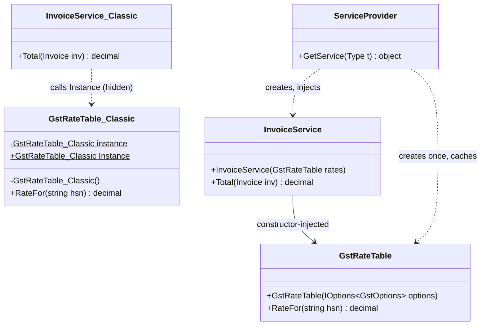
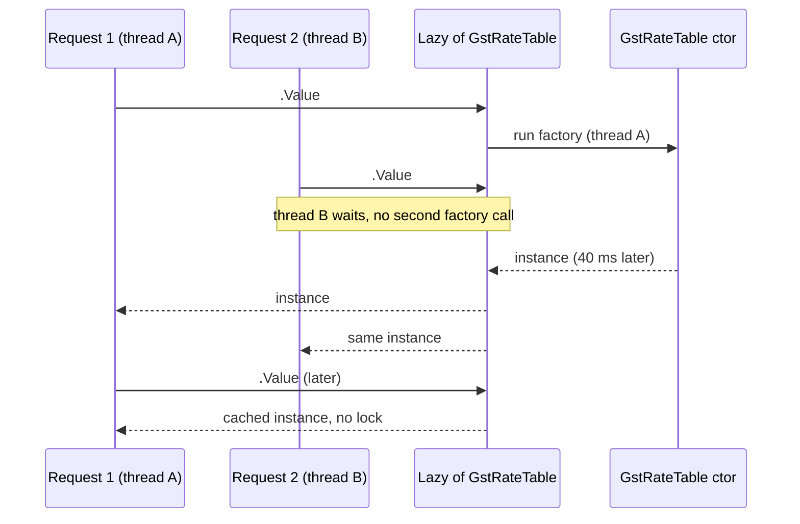

Singleton is the simplest pattern to write and the easiest to misuse. In older C# codebases you will find `Something.Instance` everywhere. In modern ASP.NET Core code you will almost never write one by hand, because the dependency injection container gives you the useful half of the pattern without the harmful half. This lesson teaches both halves, so you can read old code and write new code well.

## Learning objectives

By the end of this lesson you will be able to:

1. State the two promises a Singleton makes, and explain why the second one causes most of the trouble.
2. Write a thread-safe Singleton in C# three ways: static initializer, `Lazy<T>` and double-checked locking. Say which one you'd choose and why.
3. Explain the difference between a static class, a classic Singleton and a DI singleton.
4. Register and use singleton services in ASP.NET Core and keep their state thread-safe.
5. Recognise and fix a captive dependency (a singleton holding a scoped service).
6. Refactor a `.Instance` singleton into an injected service that unit tests can replace.

## Prerequisites

- [Classes and objects](#/lesson/m01-classes-objects): you should know what `static` means.
- [Dependency injection](#/lesson/m03-dependency-injection) and [service lifetimes](#/lesson/m03-service-lifetimes): we compare the pattern with `AddSingleton`.
- [Designing for testability](#/lesson/m04-testability): the main cost of Singleton is a testing cost.

## Explain it like I'm a beginner

A company has one official seal (the rubber stamp that goes on contracts). There must be exactly one. If two existed, nobody could tell which contracts were genuine. So the seal is kept at the front office, and anyone who needs it walks there and uses it.

That is a Singleton: **exactly one object of a kind, and one well-known place where everyone gets it.**

- "Exactly one" is useful. Some things really should exist once: the company seal, the cache of exchange rates, the pool of database connections.
- "One well-known place everyone walks to" is where trouble starts. Every department now depends on the front office. If you want to train a new employee with a *practice* seal, you can't, because every process says "go to the front office". And if the front office stamps documents for two people at once, the stamps can smudge.

In code, the front office is a `static Instance` property. Any class, anywhere, can call `Seal.Instance` without asking permission or declaring that it needs it. That makes the class hard to test and easy to break when two threads use it at once.

The modern fix is to keep "exactly one" and drop "everyone walks to the front office". Instead, a manager (the DI container) creates the one seal and **hands it** to each department that says, in its constructor, "I need a seal". In a training session, the manager hands out the practice seal instead. Same rule, much less pain.

## First-principles explanation

### What it is

The GoF intent: *ensure a class has only one instance, and provide a global point of access to it.* That sentence contains two separate promises:

1. **Single instance.** The class controls its own creation, so a second instance can't be made.
2. **Global access.** Any code can reach the instance through a static member.

Promise 1 is often what you want. Promise 2 is a global variable with better manners.

### The original problem

The 1994 book's examples were things a system has one of: a print spooler, a file system, a window manager. Creating two would be a bug. It also mattered that creation was *lazy* (only on first use) and *controlled* (the class decides how).

Modern equivalents in a business application:

- A **cache** that must be shared, such as a payment gateway's OAuth access token. If each request fetched its own token, a site doing 300 checkouts a minute would make 300 token calls a minute, and many gateways rate-limit their token endpoints.
- A **read-only lookup table** that is expensive to build, such as GST rates by product code (HSN code) loaded from configuration.
- A **pool or connection manager**: `HttpClient` handlers, a Redis connection multiplexer.

### The simplest implementation (and why it's broken)

```csharp
public sealed class GstRateTable
{
    private static GstRateTable? _instance;
    private GstRateTable() { /* load 1,200 HSN rates from a file: ~40 ms (estimate) */ }

    public static GstRateTable Instance
    {
        get
        {
            if (_instance == null)            // (1) thread A checks: null
                _instance = new GstRateTable(); // (2) thread B also checked null before A assigned
            return _instance;
        }
    }
}
```

The private constructor enforces promise 1 and the static property gives promise 2. But it isn't thread-safe. In ASP.NET Core, many requests run at the same time on thread-pool threads. Two requests can both see `null` at step 1 and both run the constructor. Usually you only waste 40 ms. But if the constructor registers something, opens a connection or starts a timer, you now have two of them, and one is silently lost.

### Thread-safe versions in C#

**Version A: static readonly initializer (the default choice for a classic singleton).**

```csharp
public sealed class GstRateTable
{
    public static GstRateTable Instance { get; } = new();
    private GstRateTable() { }
}
```

The .NET runtime guarantees a type's static initializer runs **once**, and other threads wait until it finishes. You write no locking code at all. The catch is timing: without an explicit static constructor, the type is marked `beforefieldinit`, which allows the runtime to run the initializer at any time before the first static field access, possibly earlier than you expect. Adding an empty `static GstRateTable() { }` makes it run exactly at first use. A second catch: if the initializer throws, you get a `TypeInitializationException`, and the type stays broken for the life of the process. Every later access throws again.

**Version B: `Lazy<T>` (when you want explicit laziness and clearer failure behavior).**

```csharp
public sealed class GstRateTable
{
    private static readonly Lazy<GstRateTable> _lazy = new(() => new GstRateTable());
    public static GstRateTable Instance => _lazy.Value;
    private GstRateTable() { }
}
```

`Lazy<T>` defaults to `LazyThreadSafetyMode.ExecutionAndPublication`: exactly one thread runs the factory, and the others wait for its result. In that mode, if the factory throws, `Lazy<T>` **caches the exception**, and every later `.Value` rethrows it. If you want a failed initialization to be retried, use `LazyThreadSafetyMode.PublicationOnly`. In that mode several threads may run the factory at the same time and the first result wins, so the factory must be safe to run more than once.

**Version C: double-checked locking (know it, rarely write it).**

```csharp
public sealed class GstRateTable
{
    private static volatile GstRateTable? _instance;
    private static readonly Lock _gate = new();   // System.Threading.Lock, .NET 9+

    public static GstRateTable Instance
    {
        get
        {
            if (_instance is null)                 // first check, no lock: the fast path
            {
                lock (_gate)
                {
                    if (_instance is null)         // second check, inside the lock
                        _instance = new GstRateTable();
                }
            }
            return _instance;
        }
    }
    private GstRateTable() { }
}
```

Why two checks? The first avoids taking a lock on every call after initialization. The second stops two threads that both passed the first check from both creating an instance. Why `volatile`? Without it, the language specification doesn't guarantee that another thread sees a fully constructed object when it sees a non-null reference, because the CPU and the JIT may reorder writes. On .NET this pattern works with `volatile`, but it is easy to get subtly wrong, and versions A and B do the same job with less code. Read it in interviews and legacy code; prefer `Lazy<T>` in new code.

:::callout type=note title="Lock objects in .NET 9 and later"
.NET 9 added `System.Threading.Lock`. Using `lock` on a `Lock` instance is clearer and can be faster than locking on a plain `object`. Never lock on `this` or on a `Type`, because outside code can lock on the same object.
:::

### Static class vs Singleton

A static class also gives you "one of" and "global access". So why use a Singleton at all?

| | `static class` | Classic Singleton | DI singleton (`AddSingleton`) |
|---|---|---|---|
| Can implement an interface | No | Yes | Yes |
| Can be passed as a parameter | No | Yes | Yes |
| Can be replaced in a unit test | No | Hard (global) | Easy (register a fake) |
| Lazy creation | Static ctor only | Yes | Yes (on first resolve) |
| Constructor dependencies | No | Must fetch them itself | Injected by the container |
| Disposal at shutdown | No | Manual | Automatic, if the container created it |
| Good for | Pure functions: `Math`, `GstMath.Round(amount)` | Legacy code, libraries without DI | Shared services in an ASP.NET Core app |

Rule of thumb: **a static class for stateless helper functions with no dependencies; a DI singleton for anything that has state, dependencies or a reason to be faked.** The classic Singleton sits in between, and in an app with a DI container it rarely wins.

### The modern alternative: the DI singleton lifetime

```csharp
builder.Services.AddSingleton<GstRateTable>();
```

The container creates one `GstRateTable` the first time someone needs it, injects its constructor dependencies, gives the same instance to every consumer, and disposes it when the app shuts down. The class itself is ordinary: public constructor, no static field. It keeps promise 1 (one instance, *per container*) and replaces promise 2 (global access) with explicit constructor injection.

"Per container" is a feature. Each integration test that boots the app with `WebApplicationFactory` gets its own container, so it gets its own fresh singletons. With a static `Instance`, every test in the process shares one object.

### Testability problems of the classic version

- **Hidden dependency.** `OtpSender` calls `SmsQuota.Instance.TryConsume()` inside a method. Its constructor doesn't mention it, so nobody reading the class signature knows it depends on SMS quota.
- **Shared state between tests.** Test 1 uses up the quota; test 2 fails, but only when run after test 1. xUnit runs test classes in different collections in parallel, so the failures are intermittent.
- **No substitution.** You can't hand `OtpSender` a fake quota that says "limit reached" without adding a static setter, which is a test-only back door into production code.
- **Order-dependent initialization.** If `Instance` reads configuration in its constructor, the first caller decides when that happens, which may be before configuration has loaded.

### Thread safety doesn't end at creation

A thread-safe *creation* says nothing about thread-safe *use*. A singleton is shared by every request at the same time. So:

- Prefer **immutable** state (`FrozenDictionary`, `ImmutableArray`, records) that's built once in the constructor.
- If state must change, use **concurrent types** (`ConcurrentDictionary`, `Interlocked`) or a lock around every read-modify-write.
- Never keep **per-request data** (current user, tenant, order) in a singleton field. Two requests will overwrite each other's data.

### Captive dependencies

A **captive dependency** is a service with a long lifetime holding on to a service with a shorter one. The classic case is a singleton that takes a scoped `DbContext` in its constructor. The singleton is created once, so it captures *the first request's* `DbContext` and keeps it forever. `DbContext` isn't thread-safe, and the first request's scope has since been disposed. The result is random "a second operation was started on this context" errors, or an `ObjectDisposedException`, under load.

ASP.NET Core catches this in the **Development** environment: `WebApplication.CreateBuilder` turns on scope validation (`ValidateScopes`) and build-time validation (`ValidateOnBuild`), so the app fails at startup with *"Cannot consume scoped service … from singleton …"*. In Production these checks are off by default, so the bug only shows up under load. Fixes, in order of preference:

1. **Pass the scoped data in as a method argument** instead of a constructor dependency (the singleton gets the tenant ID per call).
2. **Make the consumer scoped** too, if it doesn't really need to be a singleton.
3. **Inject `IServiceScopeFactory`** and create a scope per unit of work. This is the standard approach in a `BackgroundService`.
4. **Use a factory**: `IDbContextFactory<T>` creates a short-lived `DbContext` per operation.

```csharp
// Inside a singleton or BackgroundService: one scope per unit of work.
public sealed class NightlyGstReconciliation(IServiceScopeFactory scopes) : BackgroundService
{
    protected override async Task ExecuteAsync(CancellationToken ct)
    {
        while (!ct.IsCancellationRequested)
        {
            await using (var scope = scopes.CreateAsyncScope())
            {
                var repo = scope.ServiceProvider.GetRequiredService<IInvoiceRepository>(); // scoped, fresh
                await repo.ReconcileAsync(ct);
            }
            await Task.Delay(TimeSpan.FromHours(24), ct);
        }
    }
}
```

### Participants

| Role | Classic GoF | Modern ASP.NET Core |
|---|---|---|
| **Singleton** | Class with private constructor, static `Instance`, lazy creation | Ordinary class with a public constructor, registered with `AddSingleton` |
| **Client** | Calls `Singleton.Instance` directly | Declares the dependency in its constructor |
| **Creator / owner** | The singleton class itself | The DI container (composition root in `Program.cs`) |

### When not to use it

- **To share per-request or per-user data.** Use scoped services or pass parameters.
- **As a convenient global** ("I don't want to pass this through three constructors"). That's a design smell, not a reason; see [service locator](#/lesson/m04-di-vs-service-locator).
- **For stateless helpers.** A static method or a static class is simpler.
- **For mutable state across multiple servers.** A singleton is one per *process*. With 4 instances behind a load balancer you have 4 "singletons". A rate-limit counter or a shopping cart in a singleton is wrong as soon as you scale out; use Redis or the database.

## Visual explanation

### Class diagram: classic vs DI



The top half is the classic shape: a static field and property (the `$` marks static members), a private constructor, and a client with a dotted "uses" line that does *not* appear in its constructor. That hidden arrow is the testability problem. The bottom half is the DI version: the table has a public constructor, and the client declares the dependency. Creation responsibility moves out of `GstRateTable` and into the container. Only the container knows there is exactly one.

### Sequence diagram: two requests race for first use



This is what `ExecutionAndPublication` buys you. Thread A starts the factory. Thread B arrives during construction and blocks instead of building a second table. When construction finishes, both get the same reference. Every later call takes the fast path and returns the cached value without locking. The DI container does the equivalent for `AddSingleton` services the first time they are resolved.

## Step-by-step example

We'll take a realistic legacy class and move it, step by step, to the modern shape.

### Step 1 — the legacy singleton

A checkout calls a payment gateway. Every gateway call needs an OAuth access token that's valid for 60 minutes. Someone wrote:

```csharp
public sealed class TokenHolder
{
    public static readonly TokenHolder Instance = new();
    private TokenHolder() { }
    public string? Token;
    public DateTime Expires;

    public string Get()
    {
        if (Token == null || DateTime.UtcNow > Expires)
        {
            var http = new HttpClient();                 // new client each refresh
            Token = http.GetStringAsync("https://gw.example/token").Result; // blocking!
            Expires = DateTime.UtcNow.AddMinutes(60);
        }
        return Token;
    }
}
```

Problems: public mutable fields, a blocking `.Result` on a thread-pool thread, `DateTime.UtcNow` hard-wired (untestable expiry), a new `HttpClient` per refresh, and a race: 50 requests arriving when the token expires all fetch a new one at once. That "thundering herd" is exactly what the singleton was meant to prevent.

### Step 2 — extract dependencies

Name what the class needs: something that fetches a token (`IPaymentTokenClient`) and a clock (`TimeProvider`). Put them in a public constructor. The class no longer creates them.

### Step 3 — make it safe for concurrent use

Keep the current token in a `volatile` field so readers always see the latest one. Guard the *refresh* with a `SemaphoreSlim(1, 1)`, an async-friendly lock. Inside the lock, check again: another request may have refreshed while you were waiting. That is double-checked locking again, now for refresh instead of creation.

### Step 4 — refresh early

Treat a token as stale 60 seconds before its real expiry. A request that grabs a token with 2 seconds left could otherwise fail halfway through a payment call.

### Step 5 — register as a DI singleton

`AddSingleton<PaymentTokenCache>()`. The container enforces "one per app", and every consumer declares it in its constructor. Tests construct `PaymentTokenCache` directly with a fake client and a fake clock.

## Production-style C# implementation

```text
Shop.Api/
  Program.cs
  Payments/PaymentToken.cs
  Payments/HttpPaymentTokenClient.cs
  Payments/PaymentTokenCache.cs
  Payments/CheckoutPaymentService.cs
  Pricing/GstRateTable.cs
```

```csharp file=Payments/PaymentToken.cs
namespace Shop.Payments;

public sealed record PaymentToken(string Value, DateTimeOffset ExpiresAt);

/// <summary>Fetches a fresh access token from the payment gateway.</summary>
public interface IPaymentTokenClient
{
    Task<PaymentToken> RequestTokenAsync(CancellationToken ct);
}
```

```csharp file=Payments/HttpPaymentTokenClient.cs
using System.Net.Http.Json;
using System.Text.Json.Serialization;
using Microsoft.Extensions.Options;

namespace Shop.Payments;

public sealed class PaymentGatewayOptions
{
    public string ClientId { get; set; } = "";
    public string ClientSecret { get; set; } = "";
    public Uri TokenEndpoint { get; set; } = new("https://auth.gateway.example/oauth/token");
}

/// <summary>Singleton-safe: it asks IHttpClientFactory for a client per call instead of
/// holding one HttpClient forever (which would miss DNS changes).</summary>
public sealed class HttpPaymentTokenClient(IHttpClientFactory httpFactory, IOptions<PaymentGatewayOptions> options,
    TimeProvider clock) : IPaymentTokenClient
{
    private sealed record TokenResponse(
        [property: JsonPropertyName("access_token")] string AccessToken,
        [property: JsonPropertyName("expires_in")] int ExpiresInSeconds);

    public async Task<PaymentToken> RequestTokenAsync(CancellationToken ct)
    {
        var o = options.Value;
        var client = httpFactory.CreateClient("payment-auth");
        using var form = new FormUrlEncodedContent(
        [
            new KeyValuePair<string?, string?>("grant_type", "client_credentials"),
            new KeyValuePair<string?, string?>("client_id", o.ClientId),
            new KeyValuePair<string?, string?>("client_secret", o.ClientSecret),
        ]);
        using var response = await client.PostAsync(o.TokenEndpoint, form, ct);
        response.EnsureSuccessStatusCode();
        var body = await response.Content.ReadFromJsonAsync<TokenResponse>(ct)
                   ?? throw new InvalidOperationException("Gateway returned an empty token response.");
        return new PaymentToken(body.AccessToken, clock.GetUtcNow().AddSeconds(body.ExpiresInSeconds));
    }
}
```

```csharp file=Payments/PaymentTokenCache.cs
using System.Diagnostics.CodeAnalysis;
using Microsoft.Extensions.Logging;

namespace Shop.Payments;

/// <summary>One shared token for the whole app. Registered with AddSingleton.
/// Thread-safe: many requests read at once; only one refreshes at a time.</summary>
public sealed class PaymentTokenCache(IPaymentTokenClient client, TimeProvider clock, ILogger<PaymentTokenCache> logger)
    : IDisposable
{
    private static readonly TimeSpan RefreshSkew = TimeSpan.FromSeconds(60);
    private readonly SemaphoreSlim _refreshGate = new(1, 1);
    private volatile PaymentToken? _current;

    public async ValueTask<string> GetAccessTokenAsync(CancellationToken ct)
    {
        var token = _current;
        if (IsFresh(token)) return token.Value;            // fast path: no locking

        await _refreshGate.WaitAsync(ct);
        try
        {
            token = _current;
            if (IsFresh(token)) return token.Value;        // someone refreshed while we waited

            logger.LogInformation("Refreshing payment gateway access token");
            token = await client.RequestTokenAsync(ct);
            _current = token;
            return token.Value;
        }
        finally
        {
            _refreshGate.Release();
        }
    }

    /// <summary>Call when the gateway answers 401, so the next caller refreshes.</summary>
    public void Invalidate() => _current = null;

    private bool IsFresh([NotNullWhen(true)] PaymentToken? t) =>
        t is not null && clock.GetUtcNow() < t.ExpiresAt - RefreshSkew;

    public void Dispose() => _refreshGate.Dispose();
}
```

```csharp file=Pricing/GstRateTable.cs
using System.Collections.Frozen;
using Microsoft.Extensions.Options;

namespace Shop.Pricing;

public sealed class GstOptions
{
    /// <summary>Rate in percent by HSN code, e.g. "6109": 5. Values here are illustrative.</summary>
    public Dictionary<string, decimal> RatesByHsn { get; set; } = new();
}

/// <summary>Built once, never modified: safe to share as a singleton without locks.</summary>
public sealed class GstRateTable
{
    private readonly FrozenDictionary<string, decimal> _rates;

    public GstRateTable(IOptions<GstOptions> options)
    {
        var source = options.Value.RatesByHsn;
        if (source.Count == 0) throw new InvalidOperationException("GST rate table is empty; check the Gst:RatesByHsn configuration.");
        _rates = source.ToFrozenDictionary(StringComparer.OrdinalIgnoreCase);
    }

    public decimal RateFor(string hsnCode) =>
        _rates.TryGetValue(hsnCode, out var rate) ? rate : throw new KeyNotFoundException($"No GST rate for HSN {hsnCode}.");

    public decimal TaxOn(decimal netAmount, string hsnCode) =>
        Math.Round(netAmount * RateFor(hsnCode) / 100m, 2, MidpointRounding.AwayFromZero);
}
```

```csharp file=Payments/CheckoutPaymentService.cs
using Shop.Pricing;

namespace Shop.Payments;

public sealed record ChargeQuote(decimal Net, decimal Gst, decimal Total);

/// <summary>Scoped (one per request). It may depend on singletons; the reverse is not allowed.</summary>
public sealed class CheckoutPaymentService(PaymentTokenCache tokens, GstRateTable gst)
{
    public async Task<(ChargeQuote Quote, string BearerToken)> PrepareChargeAsync(decimal net, string hsnCode, CancellationToken ct)
    {
        if (net <= 0) throw new ArgumentOutOfRangeException(nameof(net), "Amount must be positive.");
        var tax = gst.TaxOn(net, hsnCode);
        var token = await tokens.GetAccessTokenAsync(ct);
        return (new ChargeQuote(net, tax, net + tax), token);
    }
}
```

```csharp file=Program.cs
using Shop.Payments;
using Shop.Pricing;

var builder = WebApplication.CreateBuilder(args);

builder.Services.AddSingleton(TimeProvider.System);
builder.Services.Configure<PaymentGatewayOptions>(builder.Configuration.GetSection("PaymentGateway"));
builder.Services.Configure<GstOptions>(builder.Configuration.GetSection("Gst"));
builder.Services.AddHttpClient("payment-auth", c => c.Timeout = TimeSpan.FromSeconds(10));

// Singletons: one per app, shared by all requests, must be thread-safe.
builder.Services.AddSingleton<IPaymentTokenClient, HttpPaymentTokenClient>();
builder.Services.AddSingleton<PaymentTokenCache>();
builder.Services.AddSingleton<GstRateTable>();

// Scoped: one per request. Can safely depend on the singletons above.
builder.Services.AddScoped<CheckoutPaymentService>();

var app = builder.Build();

app.MapPost("/checkout/quote", async (decimal net, string hsn, CheckoutPaymentService payments, CancellationToken ct) =>
{
    try
    {
        var (quote, _) = await payments.PrepareChargeAsync(net, hsn, ct);   // never return the token to the client
        return Results.Ok(quote);
    }
    catch (KeyNotFoundException ex) { return Results.Problem(ex.Message, statusCode: StatusCodes.Status400BadRequest); }
    catch (ArgumentOutOfRangeException ex) { return Results.Problem(ex.Message, statusCode: StatusCodes.Status400BadRequest); }
});

app.Run();
```

Design notes:

- **Two kinds of singleton state.** `GstRateTable` is immutable after construction, so it needs no locks. `PaymentTokenCache` changes over time, so reads use a `volatile` field and refreshes are serialized with a semaphore.
- **Scoped depends on singleton, never the reverse.** `CheckoutPaymentService` is scoped and uses two singletons. If `PaymentTokenCache` took a scoped dependency, it would be a captive dependency and Development-mode validation would refuse to start the app.
- **`HttpPaymentTokenClient` is a singleton but doesn't hold an `HttpClient`.** It asks `IHttpClientFactory` for one per call, so connection handlers are pooled and rotated. Holding one `HttpClient` forever in a singleton can miss DNS changes, unless it is configured with a `SocketsHttpHandler` and a `PooledConnectionLifetime`.
- **Multi-instance reality.** With 4 app instances, each has its own token cache and makes its own token calls, at most once an hour each. That's fine. If the gateway allowed only one active token per client ID, you would need a distributed cache and a distributed lock instead, and the in-process singleton would no longer be the right tool.

## Bad design vs good design

**Bad:**

```csharp
public sealed class SmsQuota
{
    public static SmsQuota Instance { get; } = new();
    private int _sentToday;
    public int DailyLimit = 500;
    public bool TryConsume() { if (_sentToday >= DailyLimit) return false; _sentToday++; return true; }
}

public class OtpSender
{
    public bool Send(string mobile) => SmsQuota.Instance.TryConsume() && /* send */ true;
}
```

- `_sentToday++` isn't atomic. Under load, two threads can read 499, both increment, and you send 501 messages.
- The count never resets at midnight. A reset would need a clock, which the class has no way of receiving.
- `OtpSender`'s constructor hides that it depends on quota. Tests can't give it a quota of 2 to test the "limit reached" path, and they share `_sentToday` with each other.
- `DailyLimit` is a public field that anyone can change at runtime.

**Good:**

```csharp
public interface ISmsQuota { bool TryConsume(); }

public sealed class DailySmsQuota(int dailyLimit, TimeProvider clock) : ISmsQuota
{
    private readonly Lock _gate = new();
    private DateOnly _day;
    private int _sent;

    public bool TryConsume()
    {
        lock (_gate)
        {
            var today = DateOnly.FromDateTime(clock.GetUtcNow().UtcDateTime);
            if (today != _day) { _day = today; _sent = 0; }
            if (_sent >= dailyLimit) return false;
            _sent++;
            return true;
        }
    }
}

// Program.cs
builder.Services.AddSingleton<ISmsQuota>(sp => new DailySmsQuota(500, sp.GetRequiredService<TimeProvider>()));
builder.Services.AddScoped<OtpSender>();   // OtpSender(ISmsQuota quota, ...)
```

Still exactly one quota per app. But it is thread-safe, resets daily, can be tested with a fake clock and a limit of 2, and its consumers say so in their constructors. (It's still per process. With several servers, the real fix is a shared counter in Redis.)

:::callout type=tradeoff title="When a classic Singleton is still fine"
In a small console tool, a library that must work without a DI container, or for a truly immutable, dependency-free object (`Comparer<T>.Default`, `Array.Empty<T>()`, `EventArgs.Empty`), a `static readonly` instance is simple and harmless. The harm comes from *mutable* global state and *hidden* dependencies, not from the word "static".
:::

## Practical playground

This program shows three things: `Lazy<T>` running a factory once under parallel access, a DI singleton being shared within a container, and two containers each having their *own* singleton. Run it, then try the TODO.

:::playground type=csharp title="One instance — per what?"
```csharp file=Program.cs
using System;
using System.Threading;
using System.Threading.Tasks;
using Microsoft.Extensions.DependencyInjection;

public sealed class RateTable
{
    private static int _created;
    public static int Created => _created;
    public Guid Id { get; } = Guid.NewGuid();
    public RateTable() { Interlocked.Increment(ref _created); Thread.Sleep(50); }
}

public static class Program
{
    private static readonly Lazy<RateTable> Lazy = new(() => new RateTable());

    public static void Main()
    {
        // 1. Lazy<T>: 32 parallel callers, one construction.
        Parallel.For(0, 32, i => { var table = Lazy.Value; });
        Console.WriteLine($"Lazy: constructed {RateTable.Created} time(s)");

        // 2. DI singleton: same instance within one container.
        var services = new ServiceCollection().AddSingleton<RateTable>();
        using var sp1 = services.BuildServiceProvider();
        Console.WriteLine($"Same in container 1: {ReferenceEquals(sp1.GetRequiredService<RateTable>(), sp1.GetRequiredService<RateTable>())}");

        // 3. A second container has its own singleton (this is why integration tests stay isolated).
        using var sp2 = services.BuildServiceProvider();
        Console.WriteLine($"Same across containers: {sp1.GetRequiredService<RateTable>().Id == sp2.GetRequiredService<RateTable>().Id}");
        Console.WriteLine($"Total constructed: {RateTable.Created}");

        // TODO: register a scoped service, inject it into a singleton, build with
        // new ServiceProviderOptions { ValidateScopes = true, ValidateOnBuild = true } and read the error.
    }
}
```
:::

## Exercises

:::exercise id=m06-singleton-ex1 difficulty=beginner kind=code title="Make a lazy singleton thread-safe"
`HolidayCalendar` loads India's public holidays for the year. Loading is slow (simulated with a 30 ms sleep), and it must happen only once, even when 64 requests arrive together at startup. Implement `HolidayCalendar.Instance` so that it is lazy and thread-safe.
::requirements
- The constructor stays private.
- `LoadCount` must be 1 after any number of parallel accesses.
- `IsHoliday(new DateOnly(2026, 1, 26))` returns true (Republic Day).
::acceptance
- 64 parallel calls to `Instance` all return the same reference.
- `LoadCount` is exactly 1.
- No `lock` statement is needed in your code.
::hint
.NET has a type whose whole job is "create this once, on first use, safely". What is it called?
::hint
`Lazy<T>` with the default thread-safety mode runs the factory exactly once; other threads wait.
::hint
Store a `private static readonly Lazy<HolidayCalendar>` and make `Instance` return its `.Value`.
::hint
```csharp
private static readonly Lazy<HolidayCalendar> _lazy = new(() => new HolidayCalendar());
public static HolidayCalendar Instance => _lazy.Value;
```
::starter
```csharp file=HolidayCalendar.cs
using System;
using System.Collections.Generic;
using System.Threading;

public sealed class HolidayCalendar
{
    private static int _loadCount;
    public static int LoadCount => _loadCount;

    private readonly HashSet<DateOnly> _holidays;

    private HolidayCalendar()
    {
        Interlocked.Increment(ref _loadCount);
        Thread.Sleep(30);   // simulate reading a file or calling an API
        _holidays = new HashSet<DateOnly> { new(2026, 1, 26), new(2026, 8, 15), new(2026, 10, 2) };
    }

    public static HolidayCalendar Instance => throw new NotImplementedException();

    public bool IsHoliday(DateOnly date) => _holidays.Contains(date);
}
```
::tests
```csharp file=HolidayCalendarTests.cs
using System;
using System.Collections.Concurrent;
using System.Linq;
using System.Threading.Tasks;
using Xunit;

public class HolidayCalendarTests
{
    [Fact]
    public void Parallel_access_creates_one_instance()
    {
        var seen = new ConcurrentBag<HolidayCalendar>();
        Parallel.For(0, 64, _ => seen.Add(HolidayCalendar.Instance));
        Assert.Single(seen.Distinct());
        Assert.Equal(1, HolidayCalendar.LoadCount);
    }

    [Fact]
    public void Knows_republic_day() =>
        Assert.True(HolidayCalendar.Instance.IsHoliday(new DateOnly(2026, 1, 26)));
}
```
::solution
```csharp file=HolidayCalendar.cs
using System;
using System.Collections.Generic;
using System.Threading;

public sealed class HolidayCalendar
{
    private static int _loadCount;
    public static int LoadCount => _loadCount;

    private static readonly Lazy<HolidayCalendar> _lazy = new(() => new HolidayCalendar());

    private readonly HashSet<DateOnly> _holidays;

    private HolidayCalendar()
    {
        Interlocked.Increment(ref _loadCount);
        Thread.Sleep(30);
        _holidays = new HashSet<DateOnly> { new(2026, 1, 26), new(2026, 8, 15), new(2026, 10, 2) };
    }

    public static HolidayCalendar Instance => _lazy.Value;

    public bool IsHoliday(DateOnly date) => _holidays.Contains(date);
}
```

`Lazy<T>` defaults to `ExecutionAndPublication`, so one thread runs the constructor while the other 63 wait for its result. `public static HolidayCalendar Instance { get; } = new();` would also pass, using the runtime's type-initializer guarantee.

Notice the irony: the test reads the static `LoadCount`, which is shared by every test in the process. That is exactly the testability problem this lesson warns about. The next exercise removes it.
::mistakes
- Using `if (_instance == null) _instance = new()`. It usually passes on a laptop and fails under real load.
- Using `LazyThreadSafetyMode.PublicationOnly`, which may run the constructor several times (only one result is kept).
- Making the `HashSet` public. Shared mutable state in a singleton must not be exposed.
::extensions
Load holidays per year (`For(int year)`) using a `ConcurrentDictionary<int, Lazy<HashSet<DateOnly>>>` so each year loads once.
:::

:::exercise id=m06-singleton-ex2 difficulty=beginner kind=code title="Refactor a .Instance singleton into an injected service"
This legacy code is in production:

```csharp
public sealed class SmsQuota
{
    public static SmsQuota Instance { get; } = new();
    private int _sent;
    public bool TryConsume() => ++_sent <= 500;
}
public class OtpSender
{
    public string Send(string mobile) => SmsQuota.Instance.TryConsume() ? "sent" : "quota-exceeded";
}
```

Refactor it so that the quota is an `ISmsQuota` passed into `OtpSender`, the limit and clock are constructor parameters, the count resets each UTC day, and `AddSmsServices` registers the quota as a singleton and `OtpSender` as scoped.
::requirements
- `DailySmsQuota(int dailyLimit, TimeProvider clock)` implements `ISmsQuota` and is thread-safe.
- `OtpSender(ISmsQuota quota)` returns `"sent"` or `"quota-exceeded"`.
- `SmsRegistration.AddSmsServices(IServiceCollection, int dailyLimit)` wires it up. `TimeProvider` is registered by the caller.
::acceptance
- With a limit of 2, the third OTP of the day returns `quota-exceeded`.
- After the clock moves to the next day, sending works again.
- Two `OtpSender`s built from one quota share the same count.
- Resolving `ISmsQuota` in two different scopes gives the same instance; `OtpSender` differs per scope.
::hint
Start from the test: what would you need to pass in to test "limit reached" with a limit of 2? That list is your constructor.
::hint
The clock is `TimeProvider`. Tests can subclass it and override `GetUtcNow()`.
::hint
Keep `_day` and `_sent` together under one lock, so "check the day, reset, check the limit, increment" is one atomic step.
::hint
Register the quota with a factory lambda, because `dailyLimit` is a plain `int` the container can't supply: `services.AddSingleton<ISmsQuota>(sp => new DailySmsQuota(dailyLimit, sp.GetRequiredService<TimeProvider>()));`
::starter
```csharp file=SmsQuota.cs
using System;
using System.Threading;
using Microsoft.Extensions.DependencyInjection;

public interface ISmsQuota
{
    bool TryConsume();
}

public sealed class DailySmsQuota : ISmsQuota
{
    public DailySmsQuota(int dailyLimit, TimeProvider clock) { }
    public bool TryConsume() => throw new NotImplementedException();
}

public sealed class OtpSender
{
    public OtpSender(ISmsQuota quota) { }
    public string Send(string mobile) => throw new NotImplementedException();
}

public static class SmsRegistration
{
    public static IServiceCollection AddSmsServices(this IServiceCollection services, int dailyLimit) =>
        throw new NotImplementedException();
}
```
::tests
```csharp file=SmsQuotaTests.cs
using System;
using Microsoft.Extensions.DependencyInjection;
using Xunit;

public class SmsQuotaTests
{
    private sealed class ManualClock : TimeProvider
    {
        public DateTimeOffset Now { get; set; } = new(2026, 3, 10, 9, 0, 0, TimeSpan.Zero);
        public override DateTimeOffset GetUtcNow() => Now;
    }

    [Fact]
    public void Third_message_exceeds_limit_of_two()
    {
        var sender = new OtpSender(new DailySmsQuota(2, new ManualClock()));
        Assert.Equal("sent", sender.Send("9876543210"));
        Assert.Equal("sent", sender.Send("9876543210"));
        Assert.Equal("quota-exceeded", sender.Send("9876543210"));
    }

    [Fact]
    public void Quota_resets_next_day()
    {
        var clock = new ManualClock();
        var quota = new DailySmsQuota(1, clock);
        Assert.True(quota.TryConsume());
        Assert.False(quota.TryConsume());
        clock.Now = clock.Now.AddDays(1);
        Assert.True(quota.TryConsume());
    }

    [Fact]
    public void Senders_share_one_quota()
    {
        var quota = new DailySmsQuota(1, new ManualClock());
        Assert.Equal("sent", new OtpSender(quota).Send("9876543210"));
        Assert.Equal("quota-exceeded", new OtpSender(quota).Send("9123456780"));
    }

    [Fact]
    public void Registration_uses_singleton_quota_and_scoped_sender()
    {
        var services = new ServiceCollection();
        services.AddSingleton<TimeProvider>(new ManualClock());
        services.AddSmsServices(500);
        using var sp = services.BuildServiceProvider(new ServiceProviderOptions { ValidateScopes = true, ValidateOnBuild = true });
        using var s1 = sp.CreateScope();
        using var s2 = sp.CreateScope();
        Assert.Same(s1.ServiceProvider.GetRequiredService<ISmsQuota>(), s2.ServiceProvider.GetRequiredService<ISmsQuota>());
        Assert.NotSame(s1.ServiceProvider.GetRequiredService<OtpSender>(), s2.ServiceProvider.GetRequiredService<OtpSender>());
    }
}
```
::solution
```csharp file=SmsQuota.cs
using System;
using System.Threading;
using Microsoft.Extensions.DependencyInjection;

public interface ISmsQuota
{
    bool TryConsume();
}

public sealed class DailySmsQuota(int dailyLimit, TimeProvider clock) : ISmsQuota
{
    private readonly Lock _gate = new();
    private DateOnly _day;
    private int _sent;

    public bool TryConsume()
    {
        lock (_gate)
        {
            var today = DateOnly.FromDateTime(clock.GetUtcNow().UtcDateTime);
            if (today != _day) { _day = today; _sent = 0; }
            if (_sent >= dailyLimit) return false;
            _sent++;
            return true;
        }
    }
}

public sealed class OtpSender(ISmsQuota quota)
{
    public string Send(string mobile) => quota.TryConsume() ? "sent" : "quota-exceeded";
}

public static class SmsRegistration
{
    public static IServiceCollection AddSmsServices(this IServiceCollection services, int dailyLimit)
    {
        services.AddSingleton<ISmsQuota>(sp => new DailySmsQuota(dailyLimit, sp.GetRequiredService<TimeProvider>()));
        services.AddScoped<OtpSender>();
        return services;
    }
}
```

"Exactly one per app" is now the container's job, declared in one line. `DailySmsQuota` is an ordinary class, so each test makes its own with its own clock, and no state leaks between tests.
::alternatives
Bind the limit from configuration with `IOptions<SmsOptions>` instead of an `int`, so operations can change it without a deploy. With several app instances, replace the in-memory count with an atomic Redis `INCR` on a key like `sms:2026-03-10` that expires after 48 hours.
::mistakes
- Keeping a static `Instance` "for backward compatibility" that creates its own `DailySmsQuota`. Now there are two quotas.
- Registering `DailySmsQuota` as scoped. Each request would get a fresh count of zero, so the quota would never be reached.
- Resetting with `DateTime.Now`, which ties the reset to the server's time zone and makes the test impossible.
:::

:::exercise id=m06-singleton-ex3 difficulty=intermediate kind=code title="Fix a captive dependency in a report cache"
A multi-tenant reporting app caches generated reports. The first version looked like this:

```csharp
public sealed class ReportCache(TenantContext tenant)  // registered as singleton!
{
    private readonly ConcurrentDictionary<string, string> _items = new();
    public string GetOrAdd(string key, Func<string> build) => _items.GetOrAdd($"{tenant.TenantId}:{key}", _ => build());
}
```

`TenantContext` is scoped and set by middleware from the request's host name. In production, every tenant started seeing the *first* tenant's reports. Redesign it so the cache is still one shared singleton, but tenants never mix.
::requirements
- `ReportCache` is a singleton with **no** scoped dependencies. The tenant ID becomes a method parameter.
- `ReportService` is scoped, takes `TenantContext` and `IReportCache`, and builds each report at most once per tenant and month.
- `ReportingRegistration.AddReporting` registers everything so that `ValidateScopes` and `ValidateOnBuild` both pass.
::acceptance
- The service provider builds with scope and build validation turned on.
- Two scopes with tenants `noida` and `pune` get different report text from the same singleton cache.
- Asking twice for the same tenant and month builds the report once.
- The original bad registration is rejected by validation (shown by a provided test).
::hint
The bug is a *lifetime* problem: something that lives forever is holding something that should live for one request.
::hint
A singleton must not keep request data in a field. What if it received the tenant as an argument on each call?
::hint
`IReportCache.GetOrAdd(string tenantId, string key, Func<string> build)`. The scoped `ReportService` reads `TenantContext` and passes the ID in.
::hint
Registrations: `AddScoped<TenantContext>()`, `AddSingleton<IReportCache, ReportCache>()`, `AddScoped<ReportService>()`.
::starter
```csharp file=Reporting.cs
using System;
using System.Collections.Concurrent;
using System.Threading;
using Microsoft.Extensions.DependencyInjection;

public sealed class TenantContext
{
    public string TenantId { get; set; } = "";
}

public interface IReportCache
{
    string GetOrAdd(string tenantId, string key, Func<string> build);
}

public sealed class ReportCache : IReportCache
{
    public string GetOrAdd(string tenantId, string key, Func<string> build) => throw new NotImplementedException();
}

public sealed class ReportService
{
    public static int BuildCount;
    public ReportService(TenantContext tenant, IReportCache cache) { }
    public string MonthlyReport(int month) => throw new NotImplementedException();
}

/// <summary>The original, broken design. Kept so a test can show validation rejects it.</summary>
public sealed class CapturingReportCache(TenantContext tenant)
{
    public string Tenant => tenant.TenantId;
}

public static class ReportingRegistration
{
    public static IServiceCollection AddReporting(this IServiceCollection services) => throw new NotImplementedException();
}
```
::tests
```csharp file=ReportingTests.cs
using System;
using Microsoft.Extensions.DependencyInjection;
using Xunit;

public class ReportingTests
{
    private static readonly ServiceProviderOptions Strict = new() { ValidateScopes = true, ValidateOnBuild = true };

    private static ServiceProvider Build() => new ServiceCollection().AddReporting().BuildServiceProvider(Strict);

    private static string ReportFor(ServiceProvider sp, string tenant, int month)
    {
        using var scope = sp.CreateScope();
        scope.ServiceProvider.GetRequiredService<TenantContext>().TenantId = tenant;
        return scope.ServiceProvider.GetRequiredService<ReportService>().MonthlyReport(month);
    }

    [Fact]
    public void Builds_with_validation() { using var sp = Build(); }

    [Fact]
    public void Tenants_do_not_mix()
    {
        using var sp = Build();
        Assert.Contains("noida", ReportFor(sp, "noida", 4));
        Assert.Contains("pune", ReportFor(sp, "pune", 4));
    }

    [Fact]
    public void Same_tenant_and_month_built_once()
    {
        using var sp = Build();
        var before = ReportService.BuildCount;
        ReportFor(sp, "gurgaon", 7);
        ReportFor(sp, "gurgaon", 7);
        Assert.Equal(before + 1, ReportService.BuildCount);
    }

    [Fact]
    public void Original_captive_registration_is_rejected()
    {
        var services = new ServiceCollection().AddScoped<TenantContext>().AddSingleton<CapturingReportCache>();
        Assert.Throws<AggregateException>(() => services.BuildServiceProvider(Strict));
    }
}
```
::solution
```csharp file=Reporting.cs
using System;
using System.Collections.Concurrent;
using System.Threading;
using Microsoft.Extensions.DependencyInjection;

public sealed class TenantContext
{
    public string TenantId { get; set; } = "";
}

public interface IReportCache
{
    string GetOrAdd(string tenantId, string key, Func<string> build);
}

/// <summary>Singleton. Holds no request data; the tenant is part of every key.</summary>
public sealed class ReportCache : IReportCache
{
    private readonly ConcurrentDictionary<(string Tenant, string Key), Lazy<string>> _items = new();

    public string GetOrAdd(string tenantId, string key, Func<string> build)
    {
        if (string.IsNullOrWhiteSpace(tenantId)) throw new ArgumentException("Tenant is required.", nameof(tenantId));
        // Lazy<string> makes sure 'build' runs once even if two requests race for the same key.
        return _items.GetOrAdd((tenantId, key), _ => new Lazy<string>(build)).Value;
    }
}

/// <summary>Scoped. Reads the tenant for this request and passes it to the singleton.</summary>
public sealed class ReportService(TenantContext tenant, IReportCache cache)
{
    public static int BuildCount;

    public string MonthlyReport(int month) =>
        cache.GetOrAdd(tenant.TenantId, $"monthly-{month}", () =>
        {
            Interlocked.Increment(ref BuildCount);
            return $"Report for {tenant.TenantId}, month {month}";
        });
}

public sealed class CapturingReportCache(TenantContext tenant)
{
    public string Tenant => tenant.TenantId;
}

public static class ReportingRegistration
{
    public static IServiceCollection AddReporting(this IServiceCollection services)
    {
        services.AddScoped<TenantContext>();
        services.AddSingleton<IReportCache, ReportCache>();
        services.AddScoped<ReportService>();
        return services;
    }
}
```

The rule to remember: **data that belongs to a request travels as a method argument into a singleton, never as a constructor dependency.** The `Lazy<string>` inside `GetOrAdd` handles a subtle point: `ConcurrentDictionary.GetOrAdd` with a factory can run the factory more than once under a race. Wrapping it in `Lazy` means only one build happens.
::alternatives
Use `IMemoryCache` (a singleton provided by the framework) with keys like `report:{tenant}:{key}`, which adds expiry and size limits. For several servers, use `HybridCache` with a distributed backend so tenants share cached reports across instances.
::mistakes
- "Fixing" the error by making `ReportCache` scoped. The app starts, but every request gets an empty cache, so nothing is ever cached.
- Resolving `TenantContext` from the root `IServiceProvider` inside the singleton. That's still the wrong scope, and validation rejects it.
- Building the cache key without the tenant ID, which leaks data between customers.
:::

:::exercise id=m06-singleton-ex4 difficulty=intermediate kind=written title="Static class, classic singleton or DI singleton?"
For each item, choose a **static class**, a **classic Singleton**, a **DI singleton**, a **scoped service**, or **"not in-process at all"**, and justify it in one or two sentences.

1. `GstMath.RoundToPaise(decimal)`: pure arithmetic, no state.
2. An `IEmailTemplateRenderer` that parses 30 Razor-like templates at startup and then only reads them.
3. The current user's permissions for this request.
4. A rate limiter allowing 100 requests per minute per API key, with 6 app instances behind a load balancer.
5. A logging helper in a NuGet library that must work in apps with and without DI.
6. A `DbContext`.
::acceptance
- Each item has a choice and a reason based on state, dependencies, testability or scale-out.
- Item 4 recognises that an in-process singleton is wrong across 6 instances.
- Item 6 names the correct default lifetime and the captive-dependency risk.
::hint
Ask three questions per item: does it have state? Does it have dependencies? Does a test need to replace it?
::hint
"Per request" data can never live in a singleton.
::hint
A singleton is one per *process*. What happens to "100 per minute" when there are six processes?
::hint
For the library case, consider who controls the app's composition root.
::solution
1. **Static class.** No state, no dependencies, nothing to fake. A static method is simplest and fastest.
2. **DI singleton.** It is expensive to build, read-only afterwards (thread-safe if stored immutably), and it depends on configuration and file access. Tests may want a fake renderer.
3. **Scoped service** (or claims on `HttpContext.User`). It belongs to one request. In a singleton, two users' permissions would overwrite each other, which is a security bug.
4. **Not in-process.** Six instances mean six separate counters, so the real limit becomes up to 600 per minute. Use a shared store (Redis) or the gateway's rate limiting. ASP.NET Core's built-in rate limiter is per instance, which is fine for protecting one server but not for an exact per-key business quota.
5. **Classic Singleton or a static default**, with an *option* to inject. Libraries often expose `SomeLogger.Default` plus a constructor that takes `ILoggerFactory`. The library can't assume a container, but apps that have one should be able to inject.
6. **Scoped** (the default with `AddDbContext`). It isn't thread-safe and tracks changes for one unit of work. Never capture it in a singleton; use `IDbContextFactory<T>` or a scope per operation instead.
::mistakes
- Choosing a DI singleton for item 3 "because it's faster". Correctness and security come first.
- Forgetting item 4's multi-instance problem.
:::

:::exercise id=m06-singleton-ex5 difficulty=advanced kind=code title="Single-flight exchange-rate cache"
An invoicing service converts USD, EUR and AED invoices to INR. A rates API charges per call and takes ~300 ms (estimate). Build `ExchangeRateCache`, a DI-singleton-friendly class with:

- `Task<decimal> GetRateAsync(string pair, CancellationToken ct)`, for example `"USD-INR"`.
- **Single-flight:** if 20 requests ask for `USD-INR` while it isn't cached, the API is called once and all 20 get the result.
- **TTL:** a rate is reused for 10 minutes (use the injected `TimeProvider`), then fetched again.
- **No cached failures:** if the fetch throws, callers see the exception, and the *next* call tries again.
::acceptance
- 20 concurrent calls for one pair produce 1 API call.
- Different pairs are fetched independently.
- After 10 minutes, the next call fetches again.
- A failed fetch isn't cached.
::hint
You need one in-flight operation *per key* that everyone can await. What type represents "an operation in progress that many can await"?
::hint
A `Task<decimal>` can be awaited by many callers. Store tasks, not values, in a `ConcurrentDictionary`.
::hint
`ConcurrentDictionary.GetOrAdd(key, factory)` can run the factory twice under a race. Wrap the task in `Lazy<Task<...>>` so only one fetch starts.
::hint
Store `(Lazy<Task<decimal>> Fetch, DateTimeOffset FetchedAt)` per key. On read: if it has expired or its task faulted, replace it using `TryUpdate` (compare-and-swap) or `TryRemove` with the exact entry.
::hint
To avoid caching failures: after awaiting, if the task faulted, remove *that exact entry* with `TryRemove(KeyValuePair.Create(key, entry))`, so you never remove a newer entry another caller just added.
::starter
```csharp file=ExchangeRateCache.cs
using System;
using System.Collections.Concurrent;
using System.Threading;
using System.Threading.Tasks;

public interface IRateSource
{
    Task<decimal> FetchAsync(string pair, CancellationToken ct);
}

public sealed class ExchangeRateCache
{
    public static readonly TimeSpan Ttl = TimeSpan.FromMinutes(10);

    public ExchangeRateCache(IRateSource source, TimeProvider clock) { }

    public Task<decimal> GetRateAsync(string pair, CancellationToken ct) => throw new NotImplementedException();
}
```
::tests
```csharp file=ExchangeRateCacheTests.cs
using System;
using System.Collections.Concurrent;
using System.Linq;
using System.Threading;
using System.Threading.Tasks;
using Xunit;

public class ExchangeRateCacheTests
{
    private sealed class ManualClock : TimeProvider
    {
        public DateTimeOffset Now { get; set; } = new(2026, 5, 1, 10, 0, 0, TimeSpan.Zero);
        public override DateTimeOffset GetUtcNow() => Now;
    }

    private sealed class GatedSource : IRateSource
    {
        public readonly TaskCompletionSource Gate = new(TaskCreationOptions.RunContinuationsAsynchronously);
        public readonly ConcurrentDictionary<string, int> Calls = new();
        public int FailuresLeft;
        public async Task<decimal> FetchAsync(string pair, CancellationToken ct)
        {
            Calls.AddOrUpdate(pair, 1, (_, n) => n + 1);
            await Gate.Task;
            if (Interlocked.Decrement(ref FailuresLeft) >= 0) throw new InvalidOperationException("rates API down");
            return pair == "USD-INR" ? 88.50m : 96.10m;
        }
    }

    [Fact]
    public async Task Concurrent_callers_share_one_fetch()
    {
        var source = new GatedSource();
        var cache = new ExchangeRateCache(source, new ManualClock());
        var tasks = Enumerable.Range(0, 20).Select(_ => cache.GetRateAsync("USD-INR", CancellationToken.None)).ToArray();
        source.Gate.SetResult();
        var results = await Task.WhenAll(tasks);
        Assert.All(results, r => Assert.Equal(88.50m, r));
        Assert.Equal(1, source.Calls["USD-INR"]);
    }

    [Fact]
    public async Task Pairs_are_independent()
    {
        var source = new GatedSource();
        source.Gate.SetResult();
        var cache = new ExchangeRateCache(source, new ManualClock());
        Assert.Equal(88.50m, await cache.GetRateAsync("USD-INR", CancellationToken.None));
        Assert.Equal(96.10m, await cache.GetRateAsync("EUR-INR", CancellationToken.None));
        Assert.Equal(1, source.Calls["EUR-INR"]);
    }

    [Fact]
    public async Task Refetches_after_ttl()
    {
        var source = new GatedSource();
        source.Gate.SetResult();
        var clock = new ManualClock();
        var cache = new ExchangeRateCache(source, clock);
        await cache.GetRateAsync("USD-INR", CancellationToken.None);
        clock.Now += TimeSpan.FromMinutes(9);
        await cache.GetRateAsync("USD-INR", CancellationToken.None);
        Assert.Equal(1, source.Calls["USD-INR"]);
        clock.Now += TimeSpan.FromMinutes(2);
        await cache.GetRateAsync("USD-INR", CancellationToken.None);
        Assert.Equal(2, source.Calls["USD-INR"]);
    }

    [Fact]
    public async Task Failures_are_not_cached()
    {
        var source = new GatedSource { FailuresLeft = 1 };
        source.Gate.SetResult();
        var cache = new ExchangeRateCache(source, new ManualClock());
        await Assert.ThrowsAsync<InvalidOperationException>(() => cache.GetRateAsync("USD-INR", CancellationToken.None));
        Assert.Equal(88.50m, await cache.GetRateAsync("USD-INR", CancellationToken.None));
        Assert.Equal(2, source.Calls["USD-INR"]);
    }
}
```
::solution
```csharp file=ExchangeRateCache.cs
using System;
using System.Collections.Concurrent;
using System.Collections.Generic;
using System.Threading;
using System.Threading.Tasks;

public interface IRateSource
{
    Task<decimal> FetchAsync(string pair, CancellationToken ct);
}

/// <summary>Register with AddSingleton. Thread-safe, single-flight per key, TTL-based, failures not cached.</summary>
public sealed class ExchangeRateCache(IRateSource source, TimeProvider clock)
{
    public static readonly TimeSpan Ttl = TimeSpan.FromMinutes(10);

    private sealed record Entry(Lazy<Task<decimal>> Fetch, DateTimeOffset FetchedAt);

    private readonly ConcurrentDictionary<string, Entry> _entries = new(StringComparer.OrdinalIgnoreCase);

    public async Task<decimal> GetRateAsync(string pair, CancellationToken ct)
    {
        while (true)
        {
            var now = clock.GetUtcNow();
            var entry = _entries.GetOrAdd(pair, p => NewEntry(p, now));

            if (now - entry.FetchedAt >= Ttl)
            {
                // Expired: swap in a fresh entry only if nobody else already did (compare-and-swap).
                _entries.TryUpdate(pair, NewEntry(pair, now), entry);
                continue;
            }

            try
            {
                return await entry.Fetch.Value.WaitAsync(ct);
            }
            catch when (entry.Fetch.Value.IsFaulted)
            {
                // Remove exactly this failed entry, so the next caller retries.
                _entries.TryRemove(KeyValuePair.Create(pair, entry));
                throw;
            }
        }
    }

    // CancellationToken.None: one caller cancelling must not cancel the shared fetch for everyone else.
    private Entry NewEntry(string pair, DateTimeOffset now) =>
        new(new Lazy<Task<decimal>>(() => source.FetchAsync(pair, CancellationToken.None)), now);
}
```

Key decisions:

- **Store the task, not the value.** A `Task<decimal>` is a "promise of a rate" that any number of callers can await. That's what makes it single-flight.
- **`Lazy<Task<…>>`** stops `GetOrAdd` from starting two fetches when two threads race to add the same key.
- **Compare-and-swap (`TryUpdate`, `TryRemove` with a key/value pair)** replaces or removes only the entry we looked at, never a newer one added by another thread.
- **Per-caller cancellation with `WaitAsync(ct)`**: a caller that gives up stops waiting, but the shared fetch continues for the others.
::alternatives
`HybridCache` (.NET 9+) offers stampede protection (single-flight) plus memory and distributed tiers with less code. `IMemoryCache.GetOrCreateAsync` does *not* prevent stampedes on its own. Write the hand-rolled version when you need exact control, or when learning how the libraries work.
::mistakes
- Caching `decimal` values and checking "is it cached?" before fetching. Twenty callers all see "not cached" and all fetch.
- Passing the first caller's `CancellationToken` into the shared fetch. If that caller disconnects, everyone else's request fails.
- `_entries.TryRemove(pair, out _)` on failure. This can delete a *new, healthy* entry that another thread just added.
::extensions
Add stale-while-revalidate: after the TTL, return the old rate immediately and refresh in the background, but never serve a rate older than 30 minutes.
:::

## Automated testing

Three kinds of tests cover singletons well.

**1. Unit tests on the class itself.** Because a DI singleton is an ordinary class, you construct a fresh one per test with fakes. No shared state, no ordering problems.

```csharp
public class PaymentTokenCacheTests
{
    private sealed class ManualClock : TimeProvider
    {
        public DateTimeOffset Now { get; set; } = DateTimeOffset.Parse("2026-06-01T10:00:00Z");
        public override DateTimeOffset GetUtcNow() => Now;
    }

    private sealed class CountingClient(TimeProvider clock) : IPaymentTokenClient
    {
        public int Calls;
        public Task<PaymentToken> RequestTokenAsync(CancellationToken ct) =>
            Task.FromResult(new PaymentToken($"t{Interlocked.Increment(ref Calls)}", clock.GetUtcNow().AddMinutes(60)));
    }

    [Fact]
    public async Task Reuses_token_until_skew_window_then_refreshes()
    {
        var clock = new ManualClock();
        var client = new CountingClient(clock);
        var cache = new PaymentTokenCache(client, clock, NullLogger<PaymentTokenCache>.Instance);

        Assert.Equal("t1", await cache.GetAccessTokenAsync(default));
        clock.Now += TimeSpan.FromMinutes(58);                 // 2 min left: still fresh
        Assert.Equal("t1", await cache.GetAccessTokenAsync(default));
        clock.Now += TimeSpan.FromMinutes(1.5);                // 30 s left: inside the 60 s skew
        Assert.Equal("t2", await cache.GetAccessTokenAsync(default));
    }
}
```

**2. A concurrency test.** Start 50 calls at once against a fake client that blocks on a `TaskCompletionSource`, release it, and assert one fetch. This is the test that catches the thundering herd.

**3. A wiring test.** Build the real `ServiceCollection` with `ValidateScopes = true` and `ValidateOnBuild = true` and resolve the important services. This catches captive dependencies in CI even though Production doesn't validate. Also assert the lifetime you rely on:

```csharp
var descriptor = services.Single(d => d.ServiceType == typeof(PaymentTokenCache));
Assert.Equal(ServiceLifetime.Singleton, descriptor.Lifetime);
```

**Testing legacy `.Instance` code** you can't refactor yet: put tests that touch it in one xUnit collection (`[Collection("SmsQuota")]`) so they don't run in parallel, and reset its state in the test constructor if it exposes a way to. Treat that as a temporary measure while you introduce a seam.

## Real-world application

- **ASP.NET Core's own singletons**: `IOptionsMonitor<T>`, `IMemoryCache`, `ILoggerFactory`, `IHttpClientFactory`, `HybridCache`, `TimeProvider.System`, `ObjectPool<T>` providers. All are registered as DI singletons, not exposed as static `Instance` properties, so you can replace them in tests.
- **Shared immutable instances in the BCL**: `Array.Empty<T>()`, `EventArgs.Empty`, `StringComparer.Ordinal`, `Comparer<T>.Default`. These are static and fine, because they're immutable and have no dependencies.
- **Connection managers**: a Redis connection multiplexer is designed to be created once and shared for the life of the app; data-source objects in database drivers manage a connection pool the same way. Both are typically registered as DI singletons.
- **Payment and SaaS integrations**: OAuth client-credential tokens are cached per process exactly as in this lesson, with early refresh and single-flight.
- **Infrastructure project platforms** often load slow-changing master data (states, districts, rate schedules, contract types) into an immutable singleton at startup, and reload it on a timer or when configuration changes via `IOptionsMonitor`.

## Interview questions

:::interview
::q beginner
What is the Singleton pattern, and what are its two promises?
::a
It makes sure a class has exactly one instance and gives a global point of access to it. Promise 1 (single instance) is often useful, for shared caches or expensive read-only data. Promise 2 (global access) is what causes trouble: hidden dependencies, shared state between tests, and code that can't be substituted.
::q beginner
How do you implement a thread-safe singleton in C#?
::a
The simplest way is `public static Foo Instance { get; } = new();` with a private constructor: the runtime runs static initializers once, thread-safely. For explicit laziness, use `private static readonly Lazy<Foo> _lazy = new(() => new Foo());` and return `_lazy.Value`. Its default mode, `ExecutionAndPublication`, runs the factory once. Double-checked locking with a `volatile` field also works, but it is easy to get wrong and rarely needed. In ASP.NET Core apps, prefer `services.AddSingleton<Foo>()`.
::q intermediate
What's the difference between a static class and a singleton?
::a
A static class can't implement interfaces, can't be passed as an argument, can't have constructor dependencies, and can't be replaced in tests. It suits pure helper functions. A singleton is an object, so it can implement an interface, be injected and be faked. A DI singleton adds container-managed creation, dependency injection and disposal at shutdown.
::q intermediate
What is a captive dependency, and how does ASP.NET Core help you catch it?
::a
A longer-lived service holding a shorter-lived one, typically a singleton with a scoped `DbContext` in its constructor. The singleton keeps the first scope's instance forever, which leads to thread-safety bugs and disposed-object errors. In the Development environment, `WebApplication.CreateBuilder` enables `ValidateScopes` and `ValidateOnBuild`, so the app fails at startup. Fixes: pass request data as method arguments, make the consumer scoped, or use `IServiceScopeFactory` or `IDbContextFactory<T>` to create short-lived instances per operation.
::q advanced
Your token-cache singleton works on one server. You scale to 8 instances and the payment gateway starts rejecting tokens. What happened, and what would you do?
::a
A DI singleton is one per process, so there are now 8 caches, each fetching its own token. If the gateway allows only one active token per client ID, each new token revokes the previous one, and the instances keep invalidating each other. Options: (1) check whether the gateway allows several concurrent tokens or separate client IDs per instance; (2) move the token into a distributed cache (Redis) with a distributed lock so only one instance refreshes, and the others read it; (3) put a small token-broker service in front. Also handle 401 responses by invalidating and refreshing once, with jitter, to avoid a herd across instances.
::q advanced
When would you still write a classic static Singleton in modern .NET?
::a
For immutable, dependency-free objects where a shared instance is purely an allocation optimisation (`Array.Empty<T>()`, a `NullLogger.Instance`, a default comparer); in libraries that must work without a DI container, usually alongside an injectable constructor; and in small tools or scripts where a container adds nothing. Avoid it for anything with mutable state, I/O, configuration or a reason to be faked in tests.
:::

## Summary and revision

**Key takeaways**

- Singleton makes two promises: one instance, and global access. Keep the first; avoid the second.
- Thread-safe classic versions in C#: a static readonly initializer (simplest), `Lazy<T>` (explicit laziness, cached exceptions by default), double-checked locking with `volatile` (know it, rarely write it).
- In ASP.NET Core, use `AddSingleton`. The class stays ordinary and testable, and "one instance" becomes one per container.
- Thread-safe creation isn't thread-safe use. Prefer immutable state; otherwise use concurrent types or locks. Never store per-request data in a singleton.
- A singleton must not depend on a scoped service (captive dependency). Pass request data as arguments or create scopes explicitly.
- A singleton is per process. Shared state across several servers needs an external store.

**Terminology**: single instance, global access point, lazy initialization, `beforefieldinit`, double-checked locking, `volatile`, `LazyThreadSafetyMode`, service lifetime, captive dependency, scope validation, single-flight, thundering herd.

:::flashcards
Q: What are the two promises of the GoF Singleton?
A: Exactly one instance, and a global point of access. The second one causes most of the problems.
Q: Simplest thread-safe singleton in C#?
A: public static Foo Instance { get; } = new(); with a private constructor — the runtime runs static initializers once.
Q: Default thread-safety mode of Lazy<T>, and what happens if the factory throws?
A: ExecutionAndPublication: the factory runs once; the exception is cached and rethrown on every later .Value.
Q: Why does double-checked locking need volatile?
A: Without it, another thread could see a non-null reference before the object's construction is visible to it, due to reordering.
Q: What is a captive dependency?
A: A longer-lived service (e.g. singleton) holding a shorter-lived one (e.g. a scoped DbContext) for its whole life.
Q: How do you use a scoped service from a BackgroundService?
A: Inject IServiceScopeFactory and create a scope (CreateAsyncScope) per unit of work.
Q: Is a DI singleton one per process?
A: One per container. Usually one container per process — so with 4 servers you have 4 "singletons".
Q: Static class or singleton for a pure rounding helper?
A: Static class — no state, no dependencies, nothing to fake.
:::

## Knowledge check

:::quiz pass=70
::q single
A singleton `ReportCache` takes `AppDbContext` (scoped) in its constructor. In Production, users report random "second operation started on this context" errors. What is the root cause?
- [ ] `AppDbContext` should be a singleton too.
- [x] The singleton captured one `DbContext` and shares it across concurrent requests (a captive dependency).
- [ ] The cache needs a bigger memory limit.
- [ ] ASP.NET Core doesn't support singletons.
> `DbContext` isn't thread-safe and belongs to one scope. Fix it with `IDbContextFactory<T>`, a scope per operation, or by making the consumer scoped.
::q single
Which singleton implementation re-runs its factory on the next access if the first attempt threw an exception?
- [ ] `Lazy<T>` with the default mode
- [x] `Lazy<T>` with `LazyThreadSafetyMode.PublicationOnly`
- [ ] A `static readonly` field initializer
- [ ] None of them
> The default `ExecutionAndPublication` caches the exception. A static initializer that throws leaves the type permanently broken (`TypeInitializationException`). `PublicationOnly` doesn't cache exceptions, but it may run the factory several times concurrently.
::q single
You run your API on 5 instances. A singleton counts "orders today" in memory to enforce a limit of 1,000 orders per day. What happens?
- [ ] The limit works exactly.
- [x] Each instance counts separately, so up to about 5,000 orders can get through.
- [ ] The app fails to start.
- [ ] The counts are synchronised automatically.
> A singleton is per process. Business-wide counters need a shared store such as Redis or the database.
::q multi
Which are good reasons to prefer `AddSingleton<T>()` over a static `Instance` property? (Select all that apply.)
- [x] Tests can register a fake implementation.
- [x] Dependencies are injected through the constructor.
- [x] The container disposes it at shutdown, if it created it.
- [ ] It makes the object thread-safe automatically.
> DI controls creation and lifetime. It does nothing for thread safety: shared state still needs immutable or concurrent types.
::q single
Why does the classic double-checked locking singleton check for `null` twice?
- [ ] The first check is for debugging.
- [x] The first check avoids locking once initialized; the second stops two threads that passed the first check from both creating an instance.
- [ ] The CLR requires two checks inside `lock`.
- [ ] To handle exceptions from the constructor.
> The outer check is the fast path. The inner check, under the lock, is the correctness check.
::q single
A helper `GstMath.RoundToPaise(decimal)` is pure arithmetic with no state. What is the best choice?
- [x] A static method on a static class.
- [ ] A classic singleton.
- [ ] A DI singleton behind an interface.
- [ ] A scoped service.
> With no state, no dependencies and nothing to fake, a static method is simplest. Adding an interface and DI here is ceremony without benefit.
::q single
`PaymentTokenCache` is a singleton. 50 requests arrive just as the token expires. Without a refresh gate, what happens?
- [ ] One request refreshes; the others wait.
- [x] Many requests call the token endpoint at once (a thundering herd), which may hit the gateway's rate limits.
- [ ] Requests fail with a compile error.
- [ ] The DI container serialises the calls.
> A semaphore with a second freshness check inside it ensures one refresh while the others wait and then reuse the new token.
:::

## Completion criteria

You have finished this lesson when you can:

- [ ] Score at least 70 % on the knowledge check.
- [ ] Complete exercises 1 and 2. Your downloaded projects' `dotnet test` should pass.
- [ ] Complete exercise 3 or 5 and compare your answer with the solution.
- [ ] Explain, in under two minutes, why `AddSingleton` is usually better than a static `Instance`, and what a captive dependency is.
