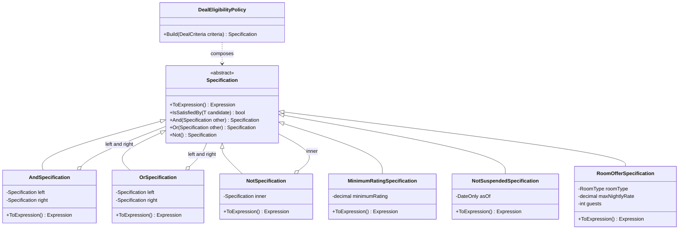
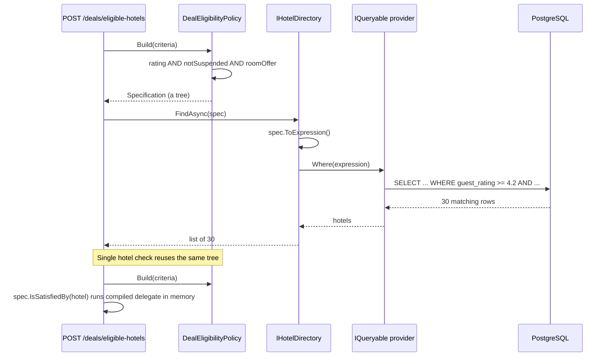
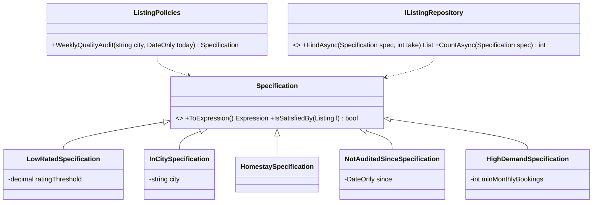

Every business has yes/no rules: "Is this hotel good enough for the deals page?" "Is this loan high-risk?" The Specification pattern gives each rule a name and a home, and lets you snap rules together like LEGO bricks.

## Learning objectives

By the end of this lesson you will be able to:

1. Recognise the problem: one business rule copied into `if` statements, LINQ and SQL, drifting apart.
2. Build a specification base class with `And`, `Or` and `Not`.
3. Write specifications as expression trees, so one rule runs in memory **and** translates to SQL via EF Core.
4. Combine expression trees by rebinding parameters.
5. Use specifications in ASP.NET Core to filter many objects and to check one.
6. Unit-test specifications and the policy that composes them.
7. Decide when inline LINQ is better.

## Prerequisites

- [Composite](#/lesson/m06-composite): an `And` of two specifications is a composite of specifications.
- [Open/Closed Principle](#/lesson/m04-ocp): new rules arrive as new classes, not edits to old ones.
- LINQ `Where` and lambdas. Expression trees (code described as data that a LINQ provider reads and translates) are explained from scratch.

## Explain it like I'm a beginner

Imagine a hotel booking website running a **"Monsoon Weekend Deals"** page. Not every hotel may appear on it. The marketing team writes down the rules:

1. Guest rating of at least 4.2 out of 5.
2. Not currently suspended (temporarily removed from the site, say after hygiene complaints).
3. Has at least one Deluxe room for 2 guests at ₹6,000 a night or less.

The website uses this list in two different ways:

- **Checking one hotel.** The manager of a Goa resort clicks "Join this deal"; the site ticks each rule for *this one hotel* and says yes or no.
- **Searching the catalogue.** "Which of our 20,000 partner hotels qualify?" The rules go to the database, which pulls out the matching rows to build the deals page.

The *same three rules* serve both jobs. Write them twice and someday one copy gets updated ("rating at least 4.3 now") and the other doesn't. Then a hotel is told "you're in" but never shows up on the page.

The Specification idea: **write each rule once, on its own named card.** Cards clip together ("rule 1 AND (rule 2 OR rule 3)"), and a bundle is itself a card. The same bundle goes to the "join this deal" check (in memory) or to the catalogue search (a database query).

Each card is a **specification**. Clipping cards is **composition** with And, Or and Not. The database version is the specification **translated to a query**.

## First-principles explanation

### What it is

A specification is an object that encapsulates one business rule as a predicate (a function that returns true or false) over a candidate object. Eric Evans and Martin Fowler described it in their *Specifications* paper and in *Domain-Driven Design*. They gave it three uses:

1. **Validation**: does this object meet the rule? (`IsSatisfiedBy(candidate)`)
2. **Selection**: find all objects that meet the rule (a query).
3. **Building to order**: describe what an object must be like before you create it (rarer in practice).

### Why it exists — the problem

Business rules leak. In a typical booking codebase the rating rule appears in the "join deal" service (`if`), in a repository query (`Where`), in a reporting SQL view and in the front-end. Four copies, four chances to disagree. When "suspended" changes to mean "suspended *and the suspension has not expired*", one copy gets updated and the others become bugs.

A second problem is **method explosion** in repositories: `GetDealHotels`, `GetDealHotelsInCity`, `GetDealHotelsWithDeluxeRooms`… Every new combination needs a new method.

Specification fixes both. Each rule exists once, as a class. Combinations are built at the call site with `&`, `|` and `!`.

### How it works internally

There are two styles, and the difference matters.

**Style 1 — plain predicate.** The specification has `bool IsSatisfiedBy(T candidate)`. It's perfect for in-memory checks, but a database can't run your C# method. To filter 20,000 hotels you would load all 20,000 (plus their rooms) first: roughly 20–40 MB per request at 1–2 KB per row (an estimate), to return 30 matches.

**Style 2 — expression tree.** The specification returns `Expression<Func<T, bool>>`. An expression tree is the *description* of a lambda as data, not compiled code. When you write

```csharp
Expression<Func<Hotel, bool>> rule = h => h.GuestRating >= 4.2m;
```

the compiler builds a small tree of objects: a `BinaryExpression` (GreaterThanOrEqual) with a `MemberExpression` (`h.GuestRating`) on the left and a `ConstantExpression` (4.2) on the right. EF Core walks that tree and writes `WHERE h.guest_rating >= 4.2`. Calling `.Compile()` on the same tree gives a normal delegate for in-memory use. **One rule, two engines.**

**Combining expressions** is the subtle part. Lambdas `h => A(h)` and `x => B(x)` each have their *own* parameter object. Gluing their bodies with `AndAlso` leaves a reference to `x` that the new lambda doesn't declare. Two fixes exist:

- `Expression.Invoke(right, left.Parameters[0])` ("call the second lambda with my parameter"). It works in memory, but some providers translate invocation nodes poorly or throw.
- **Parameter rebinding**: an `ExpressionVisitor` rewrites every `x` in the second body to `h`, then the bodies are joined. The result is one clean lambda any provider can read. This lesson uses this approach.

### What happens without it

Either rules get duplicated, or a helper like `IsDealEligible(Hotel h)` is called inside a database query. EF Core can't translate your own C# method inside a `Where`, so the query throws "could not be translated". (EF Core only evaluates untranslatable code on the client in the *final* `Select` projection; it no longer silently filters in memory, as EF Core 2 did.) The common panic fix, adding `.ToList()` before the `Where`, loads far too many rows.

### When it is useful

- The same rule is needed **both** for checking one object and for querying many.
- Rules are **combined in many ways**: per deal, per tenant, per user-selected filter.
- Rules are **domain language** ("deal-eligible", "overdue") that the code should name.
- You want to unit-test rules **without a database**.

### When it is unnecessary

- A rule is used in exactly one query. `Where(h => h.City == "Goa")` inline is clearer than a class.
- Filters are simple, user-driven search fields (name contains, price range). A small query object or plain LINQ is enough.
- Data access is hand-written SQL (Dapper, raw Npgsql). Expression trees don't help without a SQL translator.

### Trade-offs it introduces

| You gain | You pay |
|---|---|
| One definition of each rule, reused in memory and in queries | Expression trees are harder to read and debug than plain methods |
| Combinations without new repository methods | Only expressions the provider can translate are allowed — no calls to your own helper methods inside them |
| Rules named in business language and tested alone | More small classes; a team must agree where they live |
| Rules can be passed around and logged as data | Combining expressions needs a parameter-rebinding helper that must be correct |
| Any combination the caller builds becomes a query | A combination nobody planned for may have no supporting index; watch slow-query logs |

## Visual explanation

### Class diagram



How to read it: `Specification` is generic over `T` (here `Hotel`; Mermaid omits the type parameter). Everything is built on one abstract method, `ToExpression()`. The **combinators** (And, Or, Not) *hold* other specifications (hollow diamonds), which makes a specification tree a [Composite](#/lesson/m06-composite). The **leaf rules** each wrap one business rule and its parameters (a 4.2 rating, a date, a room type and price). `DealEligibilityPolicy` alone knows *which* rules a deal needs and builds the tree.

### Sequence diagram



The first half is **selection**: the policy builds a tree, the directory turns it into one expression, and the provider (EF Core in production, LINQ-to-Objects here) translates it, so only matching rows cross the network. The second half is **validation**: the *same* tree is compiled and run in memory against one hotel, for example when its manager clicks "Join this deal".

## Step-by-step example

### Step 1 — the naive version

```csharp
public sealed class DealService(AppDbContext db)
{
    public async Task<List<Hotel>> EligibleAsync(decimal minRating, DateOnly today) =>
        await db.Hotels
            .Where(h => h.GuestRating >= minRating
                     && (h.SuspendedUntil == null || h.SuspendedUntil < today)
                     && h.Rooms.Any(r => r.Type == RoomType.Deluxe && r.MaxGuests >= 2 && r.NightlyRateRupees <= 6_000m))
            .ToListAsync();

    public bool CanJoin(Hotel h, decimal minRating, DateOnly today) =>
        h.GuestRating >= minRating
        && (h.SuspendedUntil == null || h.SuspendedUntil < today)
        && h.Rooms.Any(r => r.Type == RoomType.Deluxe && r.MaxGuests >= 2 && r.NightlyRateRupees <= 6_000m);
}
```

It works, but the rule is written twice in one class, and a third copy arrives with the first marketing report.

### Step 2 — name each rule

Give each condition a class that returns an expression:

```csharp
public sealed class MinimumRatingSpecification(decimal minimumRating) : Specification<Hotel>
{
    public override Expression<Func<Hotel, bool>> ToExpression()
    {
        var min = minimumRating;                // copy to a local: the tree captures a simple value
        return h => h.GuestRating >= min;
    }
}
```

Why copy into a local? Then the tree captures a simple value (which becomes a query parameter), not a reference to the whole specification object.

### Step 3 — combine with And, Or and Not

Add `And`, `Or` and `Not` to the base class, plus the C# operators `&`, `|` and `!` so call sites read naturally:

```csharp
var eligible = new MinimumRatingSpecification(4.2m)
             & new NotSuspendedSpecification(today)
             & new RoomOfferSpecification(RoomType.Deluxe, maxNightlyRate: 6_000m, guests: 2);
```

### Step 4 — use it both ways

```csharp
var list = await directory.FindAsync(eligible, take: 100, ct);   // selection: translated to a query
bool ok  = eligible.IsSatisfiedBy(hotel);                        // validation: in memory
```

The rest of this lesson builds the production version of these four steps.

## Production-style C# implementation

Project structure:

```text
Stays.Api/
  Program.cs
  Specifications/
    Specification.cs          (base class, And/Or/Not, parameter rebinding)
    QueryableSpecificationExtensions.cs
  Hotels/
    Hotel.cs
    HotelSpecifications.cs
    DealEligibilityPolicy.cs
    IHotelDirectory.cs        (+ in-memory implementation)
Stays.Tests/
  HotelSpecificationTests.cs
  DealEligibilityPolicyTests.cs
```

### The base class and combinators

```csharp file=Specifications/Specification.cs
using System.Linq.Expressions;

namespace Stays.Specifications;

/// <summary>A named business rule over T, expressed as an expression tree so it can be
/// evaluated in memory (IsSatisfiedBy) or translated by a LINQ provider (ToExpression).</summary>
public abstract class Specification<T>
{
    private Func<T, bool>? _compiled;

    public abstract Expression<Func<T, bool>> ToExpression();

    /// <summary>Compiles the expression once per instance and caches the delegate.
    /// A race between two threads just compiles twice; both results are equivalent.</summary>
    public bool IsSatisfiedBy(T candidate)
    {
        ArgumentNullException.ThrowIfNull(candidate);
        _compiled ??= ToExpression().Compile();
        return _compiled(candidate);
    }

    public Specification<T> And(Specification<T> other) => new AndSpecification<T>(this, other);
    public Specification<T> Or(Specification<T> other) => new OrSpecification<T>(this, other);
    public Specification<T> Not() => new NotSpecification<T>(this);

    public static Specification<T> operator &(Specification<T> left, Specification<T> right) => left.And(right);
    public static Specification<T> operator |(Specification<T> left, Specification<T> right) => left.Or(right);
    public static Specification<T> operator !(Specification<T> spec) => spec.Not();

    /// <summary>The neutral element for And: always true. Useful as a starting point when
    /// rules are added conditionally.</summary>
    public static Specification<T> All { get; } = new LambdaSpecification<T>(_ => true);
}

/// <summary>Adapter for one-off rules; prefer named subclasses for business rules.</summary>
public sealed class LambdaSpecification<T>(Expression<Func<T, bool>> expression) : Specification<T>
{
    public override Expression<Func<T, bool>> ToExpression() => expression;
}

internal sealed class AndSpecification<T>(Specification<T> left, Specification<T> right) : Specification<T>
{
    public override Expression<Func<T, bool>> ToExpression() =>
        ExpressionCombiner.Combine(left.ToExpression(), right.ToExpression(), Expression.AndAlso);
}

internal sealed class OrSpecification<T>(Specification<T> left, Specification<T> right) : Specification<T>
{
    public override Expression<Func<T, bool>> ToExpression() =>
        ExpressionCombiner.Combine(left.ToExpression(), right.ToExpression(), Expression.OrElse);
}

internal sealed class NotSpecification<T>(Specification<T> inner) : Specification<T>
{
    public override Expression<Func<T, bool>> ToExpression()
    {
        var e = inner.ToExpression();
        return Expression.Lambda<Func<T, bool>>(Expression.Not(e.Body), e.Parameters);
    }
}

/// <summary>Joins two single-parameter lambdas into one by rewriting the right lambda's
/// parameter to the left lambda's parameter. No Expression.Invoke, so LINQ providers
/// such as EF Core see one plain predicate.</summary>
internal static class ExpressionCombiner
{
    public static Expression<Func<T, bool>> Combine<T>(
        Expression<Func<T, bool>> left,
        Expression<Func<T, bool>> right,
        Func<Expression, Expression, BinaryExpression> merge)
    {
        var parameter = left.Parameters[0];
        var rightBody = new ParameterReplacer(right.Parameters[0], parameter).Visit(right.Body);
        return Expression.Lambda<Func<T, bool>>(merge(left.Body, rightBody), parameter);
    }

    private sealed class ParameterReplacer(ParameterExpression from, ParameterExpression to) : ExpressionVisitor
    {
        protected override Expression VisitParameter(ParameterExpression node) =>
            node == from ? to : base.VisitParameter(node);
    }
}
```

Points worth noticing:

- `IsSatisfiedBy` compiles the tree **once per instance** and caches it, because compiling generates IL at runtime and is far costlier than invoking. The cache only pays off when one instance checks many candidates. A policy that builds a fresh tree per request compiles per request; on a hot path, cache built specifications per criteria, and measure before optimising.
- The combinators are `internal`; callers only see `Specification<T>` and the operators.
- `All` (always true) lets a policy add rules conditionally without `null` checks. EF Core simplifies `TRUE AND x` away, so it costs nothing in SQL.

### Applying a specification to a query

```csharp file=Specifications/QueryableSpecificationExtensions.cs
namespace Stays.Specifications;

public static class QueryableSpecificationExtensions
{
    /// <summary>Filters any IQueryable (EF Core DbSet, in-memory AsQueryable, ...) by a specification.</summary>
    public static IQueryable<T> Satisfying<T>(this IQueryable<T> source, Specification<T> spec) =>
        source.Where(spec.ToExpression());

    /// <summary>In-memory filtering that reuses the specification's cached compiled delegate.</summary>
    public static IEnumerable<T> Satisfying<T>(this IEnumerable<T> source, Specification<T> spec) =>
        source.Where(spec.IsSatisfiedBy);
}
```

Why not `Where(spec)`? `Queryable.Where` needs an `Expression<Func<T,bool>>`, and C# can't infer `T` through a user-defined conversion. A clearly named extension avoids the confusion. Because `IQueryable<T>` is more specific than `IEnumerable<T>`, a `DbSet` always picks the query-translating overload.

### The domain and the rules

```csharp file=Hotels/Hotel.cs
namespace Stays.Hotels;

public enum RoomType { Standard, Deluxe, Suite, Dormitory }

public sealed record Room(RoomType Type, decimal NightlyRateRupees, int MaxGuests);

public sealed class Hotel
{
    public required Guid Id { get; init; }
    public required string Name { get; init; }
    public required string City { get; init; }           // e.g. "Goa", "Udaipur", "Manali"
    public decimal GuestRating { get; init; }            // 0.0 to 5.0
    public DateOnly? SuspendedUntil { get; init; }       // null = not suspended
    public List<Room> Rooms { get; init; } = [];
}

/// <summary>What a deal campaign demands. Arrives in the request body.</summary>
public sealed record DealCriteria(
    decimal MinimumRating,
    RoomType RoomType,
    decimal MaxNightlyRateRupees,
    int Guests,
    string[]? RestrictToCities);
```

```csharp file=Hotels/HotelSpecifications.cs
using System.Linq.Expressions;
using Stays.Specifications;

namespace Stays.Hotels;

public sealed class MinimumRatingSpecification(decimal minimumRating) : Specification<Hotel>
{
    public override Expression<Func<Hotel, bool>> ToExpression()
    {
        var min = minimumRating;
        return h => h.GuestRating >= min;
    }
}

/// <summary>A hotel is suspended on day D if SuspendedUntil is on or after D.</summary>
public sealed class NotSuspendedSpecification(DateOnly asOf) : Specification<Hotel>
{
    public override Expression<Func<Hotel, bool>> ToExpression()
    {
        var day = asOf;
        return h => h.SuspendedUntil == null || h.SuspendedUntil < day;
    }
}

public sealed class InCitiesSpecification(IReadOnlyCollection<string> cities) : Specification<Hotel>
{
    public override Expression<Func<Hotel, bool>> ToExpression()
    {
        var allowed = cities.ToArray();           // EF Core translates array Contains to IN (...) or, on PostgreSQL, = ANY(@array)
        return h => allowed.Contains(h.City);
    }
}

/// <summary>At least one room of the given type that sleeps the party and fits the nightly budget.</summary>
public sealed class RoomOfferSpecification(RoomType roomType, decimal maxNightlyRate, int guests)
    : Specification<Hotel>
{
    public override Expression<Func<Hotel, bool>> ToExpression()
    {
        var type = roomType;
        var max = maxNightlyRate;
        var party = guests;
        return h => h.Rooms.Any(r => r.Type == type && r.MaxGuests >= party && r.NightlyRateRupees <= max);
    }
}
```

Every expression uses only what a SQL translator understands: comparisons, `null` checks, array `Contains` and `Any` over a navigation. No custom methods and no `DateTime.Now`; "today" is passed in, so rules are deterministic and testable.

### The policy that composes rules

```csharp file=Hotels/DealEligibilityPolicy.cs
using Stays.Specifications;

namespace Stays.Hotels;

/// <summary>Owns the knowledge of WHICH rules a deal needs. Individual rules don't know about each other.</summary>
public sealed class DealEligibilityPolicy(TimeProvider clock)
{
    public Specification<Hotel> Build(DealCriteria criteria)
    {
        Validate(criteria);
        var today = Today();
        var spec = Specification<Hotel>.All
                 & new MinimumRatingSpecification(criteria.MinimumRating)
                 & new NotSuspendedSpecification(today)
                 & new RoomOfferSpecification(criteria.RoomType, criteria.MaxNightlyRateRupees, criteria.Guests);

        if (criteria.RestrictToCities is { Length: > 0 } cities)
            spec &= new InCitiesSpecification(cities);

        return spec;
    }

    /// <summary>Names of the individual rules a single hotel fails, for a helpful error message.</summary>
    public IReadOnlyList<string> FailedRules(DealCriteria criteria, Hotel hotel)
    {
        Validate(criteria);
        var today = Today();
        var rules = new List<(string Name, Specification<Hotel> Spec)>
        {
            ($"Guest rating of at least {criteria.MinimumRating}", new MinimumRatingSpecification(criteria.MinimumRating)),
            ("Not currently suspended", new NotSuspendedSpecification(today)),
            ($"A {criteria.RoomType} room for {criteria.Guests} at ₹{criteria.MaxNightlyRateRupees:N0} a night or less",
                new RoomOfferSpecification(criteria.RoomType, criteria.MaxNightlyRateRupees, criteria.Guests)),
        };
        if (criteria.RestrictToCities is { Length: > 0 } cities)
            rules.Add(($"Located in {string.Join("/", cities)}", new InCitiesSpecification(cities)));

        return rules.Where(r => !r.Spec.IsSatisfiedBy(hotel)).Select(r => r.Name).ToList();
    }

    // "Today" for an Indian deals page is the IST date, not the UTC date (they differ before 05:30 IST).
    private DateOnly Today()
    {
        var ist = TimeZoneInfo.FindSystemTimeZoneById("Asia/Kolkata");
        return DateOnly.FromDateTime(TimeZoneInfo.ConvertTime(clock.GetUtcNow(), ist).DateTime);
    }

    // Criteria come from a request body: reject nonsense before it becomes a query.
    private static void Validate(DealCriteria criteria)
    {
        ArgumentNullException.ThrowIfNull(criteria);
        if (criteria.MinimumRating is < 0m or > 5m)
            throw new ArgumentOutOfRangeException(nameof(criteria), "Rating must be between 0 and 5.");
        if (criteria.MaxNightlyRateRupees <= 0m)
            throw new ArgumentOutOfRangeException(nameof(criteria), "Nightly rate must be positive.");
        if (criteria.Guests is < 1 or > 10)
            throw new ArgumentOutOfRangeException(nameof(criteria), "Guests must be between 1 and 10.");
    }
}
```

When marketing adds a rule ("free cancellation up to 24 hours before check-in"), only the policy changes. Two senior details: the policy validates criteria, because they come from a request body and end up in a query; and it decides what "today" means. A UTC server and an Indian deals page disagree about the date for five and a half hours every night, so the business time zone is chosen explicitly. (`FindSystemTimeZoneById("Asia/Kolkata")` works on Windows too since .NET 6, which maps IANA ids.)

### The directory (repository) that accepts specifications

```csharp file=Hotels/IHotelDirectory.cs
using Stays.Specifications;

namespace Stays.Hotels;

public interface IHotelDirectory
{
    Task<IReadOnlyList<Hotel>> FindAsync(Specification<Hotel> spec, int take, CancellationToken ct);
    Task<Hotel?> GetAsync(Guid id, CancellationToken ct);
}

/// <summary>Runnable stand-in for the EF Core implementation. AsQueryable() makes LINQ-to-Objects
/// interpret the same expression tree that EF Core would translate to SQL.</summary>
public sealed class InMemoryHotelDirectory(IEnumerable<Hotel> seed) : IHotelDirectory
{
    private readonly List<Hotel> _rows = seed.ToList();

    public Task<IReadOnlyList<Hotel>> FindAsync(Specification<Hotel> spec, int take, CancellationToken ct)
    {
        IReadOnlyList<Hotel> result = _rows.AsQueryable()
            .Satisfying(spec)
            .OrderByDescending(h => h.GuestRating)
            .ThenBy(h => h.Id)
            .Take(take)
            .ToList();
        return Task.FromResult(result);
    }

    public Task<Hotel?> GetAsync(Guid id, CancellationToken ct) =>
        Task.FromResult(_rows.FirstOrDefault(h => h.Id == id));

    public static IEnumerable<Hotel> Sample()
    {
        var d = new DateOnly(2026, 1, 1);
        yield return new Hotel { Id = Guid.Parse("00000000-0000-0000-0000-000000000001"), Name = "Sea Breeze Residency", City = "Goa", GuestRating = 4.6m,
            Rooms = [new(RoomType.Deluxe, 5_500m, 2), new(RoomType.Suite, 11_000m, 4)] };
        yield return new Hotel { Id = Guid.Parse("00000000-0000-0000-0000-000000000002"), Name = "Lakeview Palace", City = "Udaipur", GuestRating = 4.4m,
            SuspendedUntil = d.AddYears(1), Rooms = [new(RoomType.Deluxe, 4_800m, 2)] };
        yield return new Hotel { Id = Guid.Parse("00000000-0000-0000-0000-000000000003"), Name = "Pine Crest Lodge", City = "Manali", GuestRating = 4.3m,
            Rooms = [new(RoomType.Suite, 9_000m, 3)] };
    }
}
```

The EF Core version is almost identical (illustrative, **not compiled** here):

```csharp
// EF Core implementation (illustrative, not compiled here)
public sealed class EfHotelDirectory(StaysDbContext db) : IHotelDirectory
{
    public async Task<IReadOnlyList<Hotel>> FindAsync(Specification<Hotel> spec, int take, CancellationToken ct) =>
        await db.Hotels
            .AsNoTracking()
            .Satisfying(spec)                       // same extension, same expression tree
            .OrderByDescending(h => h.GuestRating).ThenBy(h => h.Id)
            .Take(take)
            .ToListAsync(ct);
    // Npgsql generates roughly:
    // SELECT ... FROM hotels h
    // WHERE h.guest_rating >= @min AND (h.suspended_until IS NULL OR h.suspended_until < @day)
    //   AND EXISTS (SELECT 1 FROM rooms r WHERE r.hotel_id = h.id AND r.type = @type
    //               AND r.max_guests >= @party AND r.nightly_rate_rupees <= @max)
    // ORDER BY h.guest_rating DESC, h.id LIMIT @take
}
```

Values captured from locals become SQL **parameters**, so PostgreSQL can reuse the plan and there is no SQL injection risk. Two production notes. First, a translatable query is not automatically a fast one: the `EXISTS` needs an index such as `rooms (hotel_id, type, nightly_rate_rupees)`, and the outer filter benefits from one on `hotels (guest_rating)`. Check `EXPLAIN (ANALYZE, BUFFERS)` for each named policy. Second, page with a stable order (`ThenBy(h => h.Id)`) and a `take` limit, because a specification that matches 15,000 hotels still must not return 15,000 rows.

### Wiring it into ASP.NET Core

```csharp file=Program.cs
using Stays.Hotels;

var builder = WebApplication.CreateBuilder(args);

builder.Services.AddSingleton(TimeProvider.System);
builder.Services.AddSingleton<DealEligibilityPolicy>();
// Swap for EfHotelDirectory (scoped, like its DbContext) in production.
builder.Services.AddSingleton<IHotelDirectory>(new InMemoryHotelDirectory(InMemoryHotelDirectory.Sample()));
builder.Services.AddProblemDetails();

var app = builder.Build();

// Selection: "which hotels go on this deals page?"
app.MapPost("/deals/eligible-hotels", async (DealCriteria criteria, DealEligibilityPolicy policy,
    IHotelDirectory directory, CancellationToken ct) =>
{
    try
    {
        var spec = policy.Build(criteria);
        var matches = await directory.FindAsync(spec, take: 100, ct);
        return Results.Ok(matches.Select(h => new { h.Id, h.Name, h.City, h.GuestRating }));
    }
    catch (ArgumentOutOfRangeException ex)
    {
        return Results.Problem(ex.Message, statusCode: 400);
    }
});

// Validation: "may THIS hotel join the deal?"
app.MapPost("/deals/check-hotel/{hotelId:guid}", async (Guid hotelId, DealCriteria criteria,
    DealEligibilityPolicy policy, IHotelDirectory directory, CancellationToken ct) =>
{
    var hotel = await directory.GetAsync(hotelId, ct);
    if (hotel is null) return Results.Problem($"Hotel {hotelId} not found.", statusCode: 404);

    try
    {
        var failed = policy.FailedRules(criteria, hotel);
        return failed.Count == 0
            ? Results.Ok(new { eligible = true })
            : Results.Problem(title: "Hotel is not eligible for this deal", statusCode: 422,
                  extensions: new Dictionary<string, object?> { ["failedRules"] = failed });
    }
    catch (ArgumentOutOfRangeException ex)
    {
        return Results.Problem(ex.Message, statusCode: 400);
    }
});

app.Run();
```

Bad criteria (a rating of 7, zero guests) return **400**; a valid request for a hotel that fails the rules returns **422** with the list of failed rules, so the hotel manager knows exactly what to fix.

## Bad design vs good design

**Bad: a helper method used inside a query.**

```csharp
public static bool IsDealEligible(Hotel h, decimal min) => h.GuestRating >= min && h.SuspendedUntil == null;

// Somewhere in a repository:
var list = await db.Hotels.Where(h => IsDealEligible(h, 4.2m)).ToListAsync();   // EF Core: "could not be translated"
```

EF Core can't translate an unknown method, so this throws at runtime. The usual panic "fix" is `db.Hotels.ToList().Where(...)`, which loads the whole table on every request: fine with 50 test rows, a disaster with 20,000 hotels and 300,000 room rows.

**Bad: the repository-method explosion.**

```csharp
Task<List<Hotel>> GetDealHotelsAsync(decimal minRating);
Task<List<Hotel>> GetDealHotelsInCityAsync(decimal minRating, string city);
Task<List<Hotel>> GetDealHotelsWithRoomAsync(decimal minRating, RoomType type, decimal maxRate);
Task<List<Hotel>> GetDealHotelsInCityWithRoomAsync(decimal minRating, string city, RoomType type, decimal maxRate);
// ... 2^n combinations
```

**Good:** one `FindAsync(Specification<Hotel>)`, rules as classes, and a policy that combines them. Still one round trip, and the rules are reused in memory.

**Is it worth it?** One rule in one query: inline LINQ wins. Several rules reused in two engines and combined per deal: Specification wins. A middle ground is a static class of `Expression<Func<Hotel,bool>>` fields: reuse without a class hierarchy, but no `And`/`Or`.

:::callout type=mistake title="Specifications are not validators for request input"
"Hotel name must not be empty" is **input validation**; it belongs in DataAnnotations or an endpoint filter. Specifications express **domain rules** about entities ("deal-eligible", "overdue") that are also needed in queries.
:::

:::callout type=warning title="Navigation properties must be loaded for in-memory checks"
In SQL, `RoomOfferSpecification` becomes an `EXISTS` subquery. In memory, `IsSatisfiedBy(hotel)` needs `Rooms` loaded (`.Include(h => h.Rooms)` in EF Core), or it sees an empty list and wrongly returns false. That is exactly how a hotel gets told "you have no Deluxe rooms" when it has twelve.
:::

:::callout type=note title="Not and NULL in SQL"
C# has two-valued logic; SQL has three (true, false, unknown). `!(h.City == "Goa")` on a nullable column is unknown in SQL when `City` is `NULL`, so the row would silently disappear. EF Core compensates by default and adds `OR city IS NULL` to match C# semantics. Keep that default (don't turn on `UseRelationalNulls()` casually), and prefer non-nullable columns for fields that rules filter on.
:::

## Practical playground

The playground composes three rules, runs them in memory and through `AsQueryable()`, and prints the combined tree. Try negating a rule with `!` and watch the printed tree change.

:::playground type=csharp title="Compose deal eligibility rules"
```csharp file=Program.cs
using System;
using System.Collections.Generic;
using System.Linq;
using System.Linq.Expressions;

public sealed record Hotel(string Name, string City, decimal Rating, bool Suspended, int CheapDeluxeRooms);

public abstract class Spec<T>
{
    public abstract Expression<Func<T, bool>> ToExpression();
    public bool IsSatisfiedBy(T c) => ToExpression().Compile()(c);
    public static Spec<T> operator &(Spec<T> a, Spec<T> b) => new Combined<T>(a, b, Expression.AndAlso);
    public static Spec<T> operator |(Spec<T> a, Spec<T> b) => new Combined<T>(a, b, Expression.OrElse);
    public static Spec<T> operator !(Spec<T> a) => new Negated<T>(a);
}

public sealed class Rule<T>(Expression<Func<T, bool>> e) : Spec<T>
{
    public override Expression<Func<T, bool>> ToExpression() => e;
}

public sealed class Combined<T>(Spec<T> l, Spec<T> r, Func<Expression, Expression, BinaryExpression> op) : Spec<T>
{
    public override Expression<Func<T, bool>> ToExpression()
    {
        var le = l.ToExpression(); var re = r.ToExpression();
        var body = new Swap(re.Parameters[0], le.Parameters[0]).Visit(re.Body);
        return Expression.Lambda<Func<T, bool>>(op(le.Body, body), le.Parameters);
    }
}

public sealed class Negated<T>(Spec<T> inner) : Spec<T>
{
    public override Expression<Func<T, bool>> ToExpression()
    {
        var e = inner.ToExpression();
        return Expression.Lambda<Func<T, bool>>(Expression.Not(e.Body), e.Parameters);
    }
}

public sealed class Swap(ParameterExpression from, ParameterExpression to) : ExpressionVisitor
{
    protected override Expression VisitParameter(ParameterExpression node) => node == from ? to : node;
}

public static class Program
{
    public static void Main()
    {
        var wellRated = new Rule<Hotel>(h => h.Rating >= 4.2m);
        var active = new Rule<Hotel>(h => !h.Suspended);
        var hasDeal = new Rule<Hotel>(x => x.CheapDeluxeRooms >= 1);   // different parameter name on purpose

        var eligible = wellRated & active & hasDeal;
        Console.WriteLine("Expression: " + eligible.ToExpression());

        var catalogue = new List<Hotel>
        {
            new("Sea Breeze Residency", "Goa", 4.6m, false, 3),
            new("Lakeview Palace", "Udaipur", 4.4m, true, 2),
            new("Pine Crest Lodge", "Manali", 4.3m, false, 0),
            new("City Inn Express", "Pune", 3.9m, false, 5),
        };

        Console.WriteLine("In memory:  " + string.Join(", ", catalogue.Where(eligible.IsSatisfiedBy).Select(h => h.Name)));
        Console.WriteLine("Queryable:  " + string.Join(", ", catalogue.AsQueryable().Where(eligible.ToExpression()).Select(h => h.Name)));
    }
}
```
:::

Both lines print only "Sea Breeze Residency": Lakeview Palace is suspended, Pine Crest Lodge has no Deluxe room under ₹6,000, and City Inn Express is rated 3.9. Try `wellRated & (active | hasDeal)` and see how the list and the printed tree change.

## Exercises

:::exercise id=m06-specification-ex1 difficulty=beginner kind=code title="Complete Or and Not"
The starter has a working `Specification<T>` base class and `And`. `Or` and `Not` throw `NotImplementedException`. Implement both so they work in memory **and** produce a single-parameter expression that a LINQ provider can use.
::requirements
- `OrSpecification<T>.ToExpression()` combines both sides with `Expression.OrElse`.
- `NotSpecification<T>.ToExpression()` negates the inner body with `Expression.Not`.
- Results must have exactly one lambda parameter. Reuse the provided `ParameterReplacer`.
::acceptance
- `(MinRating(4.5) | InCity("Goa"))` accepts a 3.8-rated Goa hotel and a 4.7-rated Jaipur hotel, and rejects a 3.8-rated Jaipur hotel.
- `!MinRating(4.5)` accepts a 3.8 rating and rejects 4.7.
- Filtering a list with `.AsQueryable().Where(spec.ToExpression())` gives the same answer as `IsSatisfiedBy`.
::hint
Look at how `AndSpecification` is written. `Or` is the same shape with one word changed.
::hint
For `Not`, you don't need to rebind anything: there is only one lambda, so keep its parameter list.
::hint
`Expression.Lambda<Func<T,bool>>(Expression.Not(e.Body), e.Parameters)`.
::hint
For `Or`: get both expressions, replace the right parameter with the left one using `ParameterReplacer`, then call `Expression.OrElse(left.Body, rightBody)`.
::starter
```csharp file=Specifications.cs
using System;
using System.Linq;
using System.Linq.Expressions;

public sealed record Hotel(string Name, string City, decimal Rating);

public abstract class Specification<T>
{
    public abstract Expression<Func<T, bool>> ToExpression();
    public bool IsSatisfiedBy(T candidate) => ToExpression().Compile()(candidate);
    public static Specification<T> operator &(Specification<T> a, Specification<T> b) => new AndSpecification<T>(a, b);
    public static Specification<T> operator |(Specification<T> a, Specification<T> b) => new OrSpecification<T>(a, b);
    public static Specification<T> operator !(Specification<T> a) => new NotSpecification<T>(a);
}

public sealed class ParameterReplacer(ParameterExpression from, ParameterExpression to) : ExpressionVisitor
{
    protected override Expression VisitParameter(ParameterExpression node) => node == from ? to : base.VisitParameter(node);
}

public sealed class AndSpecification<T>(Specification<T> left, Specification<T> right) : Specification<T>
{
    public override Expression<Func<T, bool>> ToExpression()
    {
        var l = left.ToExpression();
        var r = right.ToExpression();
        var rBody = new ParameterReplacer(r.Parameters[0], l.Parameters[0]).Visit(r.Body);
        return Expression.Lambda<Func<T, bool>>(Expression.AndAlso(l.Body, rBody), l.Parameters);
    }
}

public sealed class OrSpecification<T>(Specification<T> left, Specification<T> right) : Specification<T>
{
    public override Expression<Func<T, bool>> ToExpression() => throw new NotImplementedException();
}

public sealed class NotSpecification<T>(Specification<T> inner) : Specification<T>
{
    public override Expression<Func<T, bool>> ToExpression() => throw new NotImplementedException();
}

public sealed class MinRating(decimal rating) : Specification<Hotel>
{
    public override Expression<Func<Hotel, bool>> ToExpression() { var min = rating; return h => h.Rating >= min; }
}

public sealed class InCity(string city) : Specification<Hotel>
{
    public override Expression<Func<Hotel, bool>> ToExpression() { var c = city; return x => x.City == c; }
}
```
::tests
```csharp file=SpecificationTests.cs
using System.Linq;
using Xunit;

public class SpecificationTests
{
    private static readonly Hotel ModestGoa = new("A", "Goa", 3.8m);
    private static readonly Hotel TopJaipur = new("B", "Jaipur", 4.7m);
    private static readonly Hotel ModestJaipur = new("C", "Jaipur", 3.8m);

    [Fact]
    public void Or_accepts_either_side()
    {
        var spec = new MinRating(4.5m) | new InCity("Goa");
        Assert.True(spec.IsSatisfiedBy(ModestGoa));
        Assert.True(spec.IsSatisfiedBy(TopJaipur));
        Assert.False(spec.IsSatisfiedBy(ModestJaipur));
    }

    [Fact]
    public void Not_inverts()
    {
        var spec = !new MinRating(4.5m);
        Assert.True(spec.IsSatisfiedBy(ModestJaipur));
        Assert.False(spec.IsSatisfiedBy(TopJaipur));
    }

    [Fact]
    public void Combined_expression_has_one_parameter()
    {
        var e = (new MinRating(4.5m) | !new InCity("Goa")).ToExpression();
        Assert.Single(e.Parameters);
    }

    [Fact]
    public void Queryable_matches_in_memory()
    {
        var spec = (new MinRating(4.5m) | new InCity("Goa")) & !new InCity("Kochi");
        var all = new[] { ModestGoa, TopJaipur, ModestJaipur, new Hotel("D", "Kochi", 4.9m) };
        var viaQuery = all.AsQueryable().Where(spec.ToExpression()).Select(h => h.Name).ToArray();
        var inMemory = all.Where(spec.IsSatisfiedBy).Select(h => h.Name).ToArray();
        Assert.Equal(inMemory, viaQuery);
        Assert.Equal(new[] { "A", "B" }, viaQuery);
    }
}
```
::solution
`Or` mirrors `And`. `Not` wraps the single body.

```csharp file=Specifications.cs
using System;
using System.Linq;
using System.Linq.Expressions;

public sealed record Hotel(string Name, string City, decimal Rating);

public abstract class Specification<T>
{
    public abstract Expression<Func<T, bool>> ToExpression();
    public bool IsSatisfiedBy(T candidate) => ToExpression().Compile()(candidate);
    public static Specification<T> operator &(Specification<T> a, Specification<T> b) => new AndSpecification<T>(a, b);
    public static Specification<T> operator |(Specification<T> a, Specification<T> b) => new OrSpecification<T>(a, b);
    public static Specification<T> operator !(Specification<T> a) => new NotSpecification<T>(a);
}

public sealed class ParameterReplacer(ParameterExpression from, ParameterExpression to) : ExpressionVisitor
{
    protected override Expression VisitParameter(ParameterExpression node) => node == from ? to : base.VisitParameter(node);
}

public sealed class AndSpecification<T>(Specification<T> left, Specification<T> right) : Specification<T>
{
    public override Expression<Func<T, bool>> ToExpression()
    {
        var l = left.ToExpression();
        var r = right.ToExpression();
        var rBody = new ParameterReplacer(r.Parameters[0], l.Parameters[0]).Visit(r.Body);
        return Expression.Lambda<Func<T, bool>>(Expression.AndAlso(l.Body, rBody), l.Parameters);
    }
}

public sealed class OrSpecification<T>(Specification<T> left, Specification<T> right) : Specification<T>
{
    public override Expression<Func<T, bool>> ToExpression()
    {
        var l = left.ToExpression();
        var r = right.ToExpression();
        var rBody = new ParameterReplacer(r.Parameters[0], l.Parameters[0]).Visit(r.Body);
        return Expression.Lambda<Func<T, bool>>(Expression.OrElse(l.Body, rBody), l.Parameters);
    }
}

public sealed class NotSpecification<T>(Specification<T> inner) : Specification<T>
{
    public override Expression<Func<T, bool>> ToExpression()
    {
        var e = inner.ToExpression();
        return Expression.Lambda<Func<T, bool>>(Expression.Not(e.Body), e.Parameters);
    }
}

public sealed class MinRating(decimal rating) : Specification<Hotel>
{
    public override Expression<Func<Hotel, bool>> ToExpression() { var min = rating; return h => h.Rating >= min; }
}

public sealed class InCity(string city) : Specification<Hotel>
{
    public override Expression<Func<Hotel, bool>> ToExpression() { var c = city; return x => x.City == c; }
}
```

Note that `InCity` deliberately names its parameter `x` while `MinRating` uses `h`. Without rebinding, the combined tree would reference `x`, which the outer lambda never declares. `Compile()` would then throw "variable 'x' referenced from scope '' but it is not defined".
::mistakes
- Using `Expression.Or` (bitwise `|`) instead of `Expression.OrElse` (short-circuit `||`).
- Building `Expression.Lambda(..., r.Parameters)` with the *right* parameter after rewriting the body to the left one.
- Gluing bodies together without rebinding, then wondering why `Compile()` throws a scope error.
::extensions
Add `AndNot(other)` as a convenience (`a & !b`). Add a test that prints `ToExpression().ToString()` and checks it contains `OrElse`.
:::

:::exercise id=m06-specification-ex2 difficulty=beginner kind=code title="Specifications for upcoming check-ins"
The hotel front desk needs an "Arriving this week" list, and the app needs a guard that blocks "modify booking" on bookings that are cancelled or already past. Write two leaf specifications over `Booking`, and use them both in memory and against an `IQueryable`.
::requirements
- `UpcomingBookingSpecification(today)`: status is `Confirmed` **and** the check-in date is on or after `today`.
- `CheckInWithinDaysSpecification(today, days)`: the check-in date is between `today` and `today + days`, inclusive.
- `today` is passed in. Don't use `DateTime.Now` inside the expression.
::acceptance
- A confirmed booking checking in tomorrow is both upcoming and within 7 days.
- A confirmed booking whose check-in was yesterday is not upcoming.
- A `Pending` booking (payment not completed) is never upcoming, whatever its date.
- `(upcoming & withinWeek)` over a list of 5 bookings returns exactly the expected two ids.
::hint
Each specification returns a lambda `b => ...`. Copy constructor parameters into locals first.
::hint
`DateOnly` supports `<=` and `>=`. Use `today.AddDays(days)` for the upper bound, and compute it *outside* the lambda.
::hint
For "upcoming", compare the enum and the date: `b.Status == BookingStatus.Confirmed && b.CheckIn >= day`.
::hint
```csharp
var from = today; var to = today.AddDays(days);
return b => b.CheckIn >= from && b.CheckIn <= to;
```
::starter
```csharp file=BookingSpecs.cs
using System;
using System.Linq;
using System.Linq.Expressions;

public enum BookingStatus { Pending, Confirmed, Cancelled, CheckedOut }
public sealed record Booking(int Id, string Guest, BookingStatus Status, DateOnly CheckIn);

public abstract class Specification<T>
{
    public abstract Expression<Func<T, bool>> ToExpression();
    public bool IsSatisfiedBy(T candidate) => ToExpression().Compile()(candidate);
    public static Specification<T> operator &(Specification<T> a, Specification<T> b) => new AndSpecification<T>(a, b);
}

public sealed class AndSpecification<T>(Specification<T> left, Specification<T> right) : Specification<T>
{
    public override Expression<Func<T, bool>> ToExpression()
    {
        var l = left.ToExpression(); var r = right.ToExpression();
        var body = new Rebind(r.Parameters[0], l.Parameters[0]).Visit(r.Body);
        return Expression.Lambda<Func<T, bool>>(Expression.AndAlso(l.Body, body), l.Parameters);
    }
    private sealed class Rebind(ParameterExpression from, ParameterExpression to) : ExpressionVisitor
    {
        protected override Expression VisitParameter(ParameterExpression node) => node == from ? to : node;
    }
}

public sealed class UpcomingBookingSpecification(DateOnly today) : Specification<Booking>
{
    public override Expression<Func<Booking, bool>> ToExpression() => throw new NotImplementedException();
}

public sealed class CheckInWithinDaysSpecification(DateOnly today, int days) : Specification<Booking>
{
    public override Expression<Func<Booking, bool>> ToExpression() => throw new NotImplementedException();
}
```
::tests
```csharp file=BookingSpecsTests.cs
using System;
using System.Linq;
using Xunit;

public class BookingSpecsTests
{
    private static readonly DateOnly Today = new(2026, 10, 18);

    [Fact]
    public void Confirmed_checking_in_tomorrow_is_upcoming_and_within_week()
    {
        var b = new Booking(1, "Asha Rao", BookingStatus.Confirmed, Today.AddDays(1));
        Assert.True(new UpcomingBookingSpecification(Today).IsSatisfiedBy(b));
        Assert.True(new CheckInWithinDaysSpecification(Today, 7).IsSatisfiedBy(b));
    }

    [Fact]
    public void Checked_in_yesterday_is_not_upcoming() =>
        Assert.False(new UpcomingBookingSpecification(Today).IsSatisfiedBy(new Booking(2, "Old", BookingStatus.Confirmed, Today.AddDays(-1))));

    [Fact]
    public void Pending_is_never_upcoming() =>
        Assert.False(new UpcomingBookingSpecification(Today).IsSatisfiedBy(new Booking(3, "Unpaid", BookingStatus.Pending, Today.AddDays(5))));

    [Fact]
    public void Today_and_last_day_are_included()
    {
        var spec = new CheckInWithinDaysSpecification(Today, 7);
        Assert.True(spec.IsSatisfiedBy(new Booking(4, "a", BookingStatus.Confirmed, Today)));
        Assert.True(spec.IsSatisfiedBy(new Booking(5, "b", BookingStatus.Confirmed, Today.AddDays(7))));
        Assert.False(spec.IsSatisfiedBy(new Booking(6, "c", BookingStatus.Confirmed, Today.AddDays(8))));
    }

    [Fact]
    public void Composed_query_returns_expected_ids()
    {
        var bookings = new[]
        {
            new Booking(10, "Rahul Mehta, 2 nights", BookingStatus.Confirmed, Today.AddDays(2)),
            new Booking(11, "Emma Clarke, 5 nights", BookingStatus.Confirmed, Today.AddDays(30)),
            new Booking(12, "Priya Nair, 1 night", BookingStatus.Pending, Today.AddDays(3)),
            new Booking(13, "Kenji Sato, 3 nights", BookingStatus.Confirmed, Today.AddDays(7)),
            new Booking(14, "Arjun Das, 2 nights", BookingStatus.Confirmed, Today.AddDays(-2)),
        };
        var spec = new UpcomingBookingSpecification(Today) & new CheckInWithinDaysSpecification(Today, 7);
        var ids = bookings.AsQueryable().Where(spec.ToExpression()).Select(b => b.Id).ToArray();
        Assert.Equal(new[] { 10, 13 }, ids);
    }
}
```
::solution
```csharp file=BookingSpecs.cs
using System;
using System.Linq;
using System.Linq.Expressions;

public enum BookingStatus { Pending, Confirmed, Cancelled, CheckedOut }
public sealed record Booking(int Id, string Guest, BookingStatus Status, DateOnly CheckIn);

public abstract class Specification<T>
{
    public abstract Expression<Func<T, bool>> ToExpression();
    public bool IsSatisfiedBy(T candidate) => ToExpression().Compile()(candidate);
    public static Specification<T> operator &(Specification<T> a, Specification<T> b) => new AndSpecification<T>(a, b);
}

public sealed class AndSpecification<T>(Specification<T> left, Specification<T> right) : Specification<T>
{
    public override Expression<Func<T, bool>> ToExpression()
    {
        var l = left.ToExpression(); var r = right.ToExpression();
        var body = new Rebind(r.Parameters[0], l.Parameters[0]).Visit(r.Body);
        return Expression.Lambda<Func<T, bool>>(Expression.AndAlso(l.Body, body), l.Parameters);
    }
    private sealed class Rebind(ParameterExpression from, ParameterExpression to) : ExpressionVisitor
    {
        protected override Expression VisitParameter(ParameterExpression node) => node == from ? to : node;
    }
}

public sealed class UpcomingBookingSpecification(DateOnly today) : Specification<Booking>
{
    public override Expression<Func<Booking, bool>> ToExpression()
    {
        var day = today;
        return b => b.Status == BookingStatus.Confirmed && b.CheckIn >= day;
    }
}

public sealed class CheckInWithinDaysSpecification(DateOnly today, int days) : Specification<Booking>
{
    public override Expression<Func<Booking, bool>> ToExpression()
    {
        if (days < 0) throw new ArgumentOutOfRangeException(nameof(days));
        var from = today;
        var to = today.AddDays(days);
        return b => b.CheckIn >= from && b.CheckIn <= to;
    }
}
```

`today.AddDays(days)` is computed **before** the lambda, so the tree stays trivial and the database receives one parameter value per bound. Booking 12 is excluded because it is still `Pending`, 11 is too far out, and 14 has already passed.
::mistakes
- Calling `DateTime.Now` inside the lambda. A UTC server flips "today" at 05:30 IST, and tests become flaky. For hotels, "today" is the *hotel's* local date: a Dubai property and a Delhi property disagree for 90 minutes a day.
- Using `<` for the upper bound, which drops guests arriving on the 7th day.
- Folding "is confirmed" into `CheckInWithinDays`, which stops it being reused elsewhere (for example in a housekeeping forecast that counts pending bookings too).
:::

:::exercise id=m06-specification-ex3 difficulty=intermediate kind=code title="Make combined specifications translator-friendly"
A colleague wrote `ExpressionCombiner.AndAlso` with `Expression.Invoke`. It passes in-memory tests, but LINQ providers may reject it. Rewrite `AndAlso` and `OrElse` so the result has **no `InvocationExpression`** and exactly **one parameter**, even when the lambdas use different parameter names.
::requirements
- Keep the method signatures unchanged.
- Implement a parameter-replacing `ExpressionVisitor`.
- Nested combinations, such as `AndAlso(OrElse(a, b), c)`, must also be invocation-free.
::acceptance
- The tests' `InvocationFinder` finds zero invocations in combined trees.
- `Parameters.Count == 1`, and the body references only that parameter.
- The combined predicate gives correct results in memory.
::hint
What does `Expression.Invoke(right, left.Parameters[0])` mean in words? "Call the right lambda with my parameter." What would inlining that call look like?
::hint
Inlining means taking `right.Body` and substituting `left.Parameters[0]` wherever `right.Parameters[0]` appears.
::hint
Subclass `ExpressionVisitor` and override `VisitParameter`: return the replacement when `node == from`.
::hint
```csharp
var p = left.Parameters[0];
var body = new Replace(right.Parameters[0], p).Visit(right.Body)!;
return Expression.Lambda<Func<T,bool>>(Expression.AndAlso(left.Body, body), p);
```
::hint
Write one private `Combine(left, right, Func<Expression, Expression, BinaryExpression> op)` and pass `Expression.AndAlso` or `Expression.OrElse`, so the two public methods don't duplicate logic.
::starter
```csharp file=ExpressionCombiner.cs
using System;
using System.Linq.Expressions;

public static class ExpressionCombiner
{
    // Current (problematic) version, kept here for reference:
    //   var invoked = Expression.Invoke(right, left.Parameters[0]);
    //   return Expression.Lambda<Func<T, bool>>(Expression.AndAlso(left.Body, invoked), left.Parameters);

    public static Expression<Func<T, bool>> AndAlso<T>(Expression<Func<T, bool>> left, Expression<Func<T, bool>> right) =>
        throw new NotImplementedException();

    public static Expression<Func<T, bool>> OrElse<T>(Expression<Func<T, bool>> left, Expression<Func<T, bool>> right) =>
        throw new NotImplementedException();
}
```
::tests
```csharp file=ExpressionCombinerTests.cs
using System;
using System.Linq.Expressions;
using Xunit;

public sealed record Stay(string City, decimal NightlyRate, int Year);

public class ExpressionCombinerTests
{
    private sealed class InvocationFinder : ExpressionVisitor
    {
        public int Invocations;
        public readonly System.Collections.Generic.HashSet<ParameterExpression> Parameters = new();
        protected override Expression VisitInvocation(InvocationExpression node) { Invocations++; return base.VisitInvocation(node); }
        protected override Expression VisitParameter(ParameterExpression node) { Parameters.Add(node); return base.VisitParameter(node); }
    }

    private static readonly Expression<Func<Stay, bool>> InGoa = s => s.City == "Goa";
    private static readonly Expression<Func<Stay, bool>> IsPremium = x => x.NightlyRate >= 8000m;
    private static readonly Expression<Func<Stay, bool>> IsRecent = y => y.Year >= 2020;

    [Fact]
    public void AndAlso_has_no_invocation_and_one_parameter()
    {
        var e = ExpressionCombiner.AndAlso(InGoa, IsPremium);
        var f = new InvocationFinder(); f.Visit(e.Body);
        Assert.Equal(0, f.Invocations);
        Assert.Single(e.Parameters);
        Assert.Single(f.Parameters);
        Assert.Same(e.Parameters[0], Assert.Single(f.Parameters));
    }

    [Fact]
    public void Nested_combination_is_flat()
    {
        var e = ExpressionCombiner.AndAlso(ExpressionCombiner.OrElse(InGoa, IsPremium), IsRecent);
        var f = new InvocationFinder(); f.Visit(e.Body);
        Assert.Equal(0, f.Invocations);
        Assert.Single(f.Parameters);
    }

    [Theory]
    [InlineData("Goa", 9000, 2022, true)]
    [InlineData("Goa", 3000, 2022, true)]
    [InlineData("Jaipur", 9000, 2022, true)]
    [InlineData("Jaipur", 3000, 2022, false)]
    [InlineData("Goa", 9000, 2015, false)]
    public void Evaluates_correctly(string city, int rate, int year, bool expected)
    {
        var e = ExpressionCombiner.AndAlso(ExpressionCombiner.OrElse(InGoa, IsPremium), IsRecent);
        Assert.Equal(expected, e.Compile()(new Stay(city, rate, year)));
    }
}
```
::solution
```csharp file=ExpressionCombiner.cs
using System;
using System.Linq.Expressions;

public static class ExpressionCombiner
{
    public static Expression<Func<T, bool>> AndAlso<T>(Expression<Func<T, bool>> left, Expression<Func<T, bool>> right) =>
        Combine(left, right, Expression.AndAlso);

    public static Expression<Func<T, bool>> OrElse<T>(Expression<Func<T, bool>> left, Expression<Func<T, bool>> right) =>
        Combine(left, right, Expression.OrElse);

    private static Expression<Func<T, bool>> Combine<T>(
        Expression<Func<T, bool>> left, Expression<Func<T, bool>> right,
        Func<Expression, Expression, BinaryExpression> op)
    {
        ArgumentNullException.ThrowIfNull(left);
        ArgumentNullException.ThrowIfNull(right);
        var parameter = left.Parameters[0];
        var rightBody = new ParameterReplacer(right.Parameters[0], parameter).Visit(right.Body)!;
        return Expression.Lambda<Func<T, bool>>(op(left.Body, rightBody), parameter);
    }

    private sealed class ParameterReplacer(ParameterExpression from, ParameterExpression to) : ExpressionVisitor
    {
        protected override Expression VisitParameter(ParameterExpression node) =>
            node == from ? to : base.VisitParameter(node);
    }
}
```

Why nested combinations stay flat: the inner `OrElse` already produced a single-parameter lambda. The outer `AndAlso` rewrites `IsRecent`'s `y` to that same parameter, so the whole tree shares one `ParameterExpression` instance.
::alternatives
Create a fresh `Expression.Parameter(typeof(T), "h")` and rewrite **both** sides to it: symmetric, with a predictable name in logs.
::mistakes
- Comparing parameters by `Name` instead of by reference. Two different lambdas can both call their parameter `h`. Reference equality is the correct test.
- Worrying about nested lambdas such as `Rooms.Any(r => ...)`: their own parameters are different objects, so reference comparison leaves them alone.
:::

:::exercise id=m06-specification-ex4 difficulty=intermediate kind=design title="Refactor a repository with exploding query methods"
You inherit this interface from a booking platform's quality team. It tracks 48,000 listed properties (hotels and homestays) across India:

```csharp
public interface IListingRepository
{
    Task<List<Listing>> GetLowRatedAsync();
    Task<List<Listing>> GetLowRatedInCityAsync(string city);
    Task<List<Listing>> GetLowRatedHomestaysAsync();
    Task<List<Listing>> GetLowRatedHomestaysInCityAsync(string city);
    Task<List<Listing>> GetUnauditedSinceAsync(DateOnly since);
    Task<List<Listing>> GetUnauditedLowRatedInCityAsync(DateOnly since, string city);
    Task<List<Listing>> GetHighDemandLowRatedOrUnauditedAsync(int minMonthlyBookings, DateOnly since);
}
```

The methods repeat the same `Where` fragments, and "low-rated" is `GuestRating < 3.5` in one and `<= 3.5` in another. Redesign with specifications: a class diagram plus who owns which rule.
::acceptance
- One definition each of "low-rated", "in city", "homestay", "not audited since" and "high demand".
- The repository exposes at most two query methods.
- Show how `GetHighDemandLowRatedOrUnauditedAsync` is expressed with `&` and `|` at the call site.
- Say where the "which rules does the weekly quality-audit list need" decision lives.
::hint
List the distinct *conditions* hidden in the method names. There are five.
::hint
Each condition becomes a leaf specification with its parameters (city, date, booking count) in the constructor.
::hint
The repository needs `FindAsync(Specification<Listing> spec, int take)` and maybe `CountAsync(spec)`.
::hint
Combinations that business people name ("weekly quality-audit list") deserve a policy or factory method, such as `ListingPolicies.WeeklyQualityAudit(city, today)`. Ad-hoc ones are built inline.
::solution


Ownership:

- `LowRatedSpecification` owns the one definition of "low-rated". Agree `GuestRating < 3.5` with the quality team and delete the `<=` variant: the refactor uncovered a real bug (listings rated exactly 3.5 were audited by one screen and skipped by another).
- Each leaf owns one condition. `ListingPolicies` owns *named combinations* like the weekly quality-audit list.
- The repository owns *how* to run a specification (translation, paging, `AsNoTracking`), not *which* rules apply.

The old seventh method becomes:

```csharp
var spec = new HighDemandSpecification(300)
         & (new LowRatedSpecification() | new NotAuditedSinceSpecification(today.AddMonths(-6)));
var list = await repo.FindAsync(spec, take: 500, ct);
```
::mistakes
- Accepting a raw `Expression<Func<Listing,bool>>`: it works, but the domain vocabulary is lost.
- One specification per old method (`LowRatedHomestaysInCitySpecification`) just moves the explosion.
- Forgetting paging. A spec that matches 30,000 listings still needs a `take`.
:::

:::exercise id=m06-specification-ex5 difficulty=advanced kind=code title="Explainable specifications"
Hotels that are left off the deals page keep asking support "Why isn't my property listed?" Build an in-memory specification tree that **explains** its failures.
::requirements
- `Rule<T>(string description, Func<T,bool> predicate)` is the leaf.
- `And`, `Or` and `Not` are created with the operators `&`, `|` and `!`.
- `Description` text: a leaf uses its description; And is `"(A and B)"`; Or is `"(A or B)"`; Not is `"not A"`.
- `WhyNot(candidate)` returns an empty list when satisfied. Otherwise:
  - Leaf: `[description]`.
  - And: the concatenated `WhyNot` of each *failing* child, left first. Passing children contribute nothing.
  - Or: one reason, `"needs one of: " + left.Description + " | " + right.Description`.
  - Not: one reason, `"must not be: " + inner.Description`.
::acceptance
- A property rated 3.9 that is also suspended gives two reasons, rating first.
- An Or where both sides fail gives one "needs one of" reason.
- A Not over a satisfied rule gives one "must not be" reason.
- A satisfied tree gives an empty list.
::hint
This is a [Composite](#/lesson/m06-composite): every node answers the same two questions, `IsSatisfiedBy` and `WhyNot`.
::hint
Make `Spec<T>` abstract with `abstract bool IsSatisfiedBy(T c)`, `abstract string Description { get; }` and `abstract IReadOnlyList<string> WhyNot(T c)`.
::hint
For And: `if (IsSatisfiedBy(c)) return []; return left.WhyNot(c).Concat(right.WhyNot(c)).ToList();`. A passing child already returns an empty list, so this is correct.
::hint
For Or and Not, check satisfaction first, then return a single-element list built from the children's `Description`.
::hint
Operators go on the base class: `public static Spec<T> operator &(Spec<T> a, Spec<T> b) => new AndSpec<T>(a, b);`
::starter
```csharp file=Explainable.cs
using System;
using System.Collections.Generic;
using System.Linq;

public sealed record Property(string Name, decimal Rating, bool Suspended, int CompletedStays, bool IsNewPartner);

public abstract class Spec<T>
{
    public abstract string Description { get; }
    public abstract bool IsSatisfiedBy(T candidate);
    public abstract IReadOnlyList<string> WhyNot(T candidate);

    public static Spec<T> operator &(Spec<T> a, Spec<T> b) => throw new NotImplementedException();
    public static Spec<T> operator |(Spec<T> a, Spec<T> b) => throw new NotImplementedException();
    public static Spec<T> operator !(Spec<T> a) => throw new NotImplementedException();
}

public sealed class Rule<T>(string description, Func<T, bool> predicate) : Spec<T>
{
    public override string Description => throw new NotImplementedException();
    public override bool IsSatisfiedBy(T candidate) => throw new NotImplementedException();
    public override IReadOnlyList<string> WhyNot(T candidate) => throw new NotImplementedException();
}
```
::tests
```csharp file=ExplainableTests.cs
using Xunit;

public class ExplainableTests
{
    private static readonly Spec<Property> Rating = new Rule<Property>("rating >= 4.2", p => p.Rating >= 4.2m);
    private static readonly Spec<Property> NotSuspended = new Rule<Property>("not suspended", p => !p.Suspended);
    private static readonly Spec<Property> Track = new Rule<Property>("50+ completed stays", p => p.CompletedStays >= 50);
    private static readonly Spec<Property> NewPartner = new Rule<Property>("new-partner programme", p => p.IsNewPartner);

    [Fact]
    public void And_lists_each_failing_rule_in_order()
    {
        var spec = Rating & NotSuspended & Track;
        var reasons = spec.WhyNot(new Property("X", 3.9m, true, 120, false));
        Assert.Equal(new[] { "rating >= 4.2", "not suspended" }, reasons);
    }

    [Fact]
    public void Or_failing_gives_one_reason()
    {
        var spec = Track | NewPartner;   // new partners are exempt from the track-record rule
        var reasons = spec.WhyNot(new Property("Y", 4.5m, false, 10, false));
        Assert.Equal("needs one of: 50+ completed stays | new-partner programme", Assert.Single(reasons));
    }

    [Fact]
    public void Not_failing_gives_one_reason()
    {
        var spec = !NewPartner;
        Assert.Equal("must not be: new-partner programme", Assert.Single(spec.WhyNot(new Property("Z", 4.5m, false, 0, true))));
    }

    [Fact]
    public void Descriptions_compose()
    {
        var spec = Rating & (Track | NewPartner) & !NotSuspended;
        Assert.Equal("((rating >= 4.2 and (50+ completed stays or new-partner programme)) and not not suspended)", spec.Description);
    }

    [Fact]
    public void Satisfied_tree_has_no_reasons()
    {
        var spec = Rating & NotSuspended & (Track | NewPartner);
        var p = new Property("OK", 4.8m, false, 0, true);
        Assert.True(spec.IsSatisfiedBy(p));
        Assert.Empty(spec.WhyNot(p));
    }
}
```
::solution
```csharp file=Explainable.cs
using System;
using System.Collections.Generic;
using System.Linq;

public sealed record Property(string Name, decimal Rating, bool Suspended, int CompletedStays, bool IsNewPartner);

public abstract class Spec<T>
{
    public abstract string Description { get; }
    public abstract bool IsSatisfiedBy(T candidate);
    public abstract IReadOnlyList<string> WhyNot(T candidate);

    public static Spec<T> operator &(Spec<T> a, Spec<T> b) => new AndSpec<T>(a, b);
    public static Spec<T> operator |(Spec<T> a, Spec<T> b) => new OrSpec<T>(a, b);
    public static Spec<T> operator !(Spec<T> a) => new NotSpec<T>(a);
}

public sealed class Rule<T>(string description, Func<T, bool> predicate) : Spec<T>
{
    public override string Description => description;
    public override bool IsSatisfiedBy(T candidate) => predicate(candidate);
    public override IReadOnlyList<string> WhyNot(T candidate) => IsSatisfiedBy(candidate) ? [] : [description];
}

internal sealed class AndSpec<T>(Spec<T> left, Spec<T> right) : Spec<T>
{
    public override string Description => $"({left.Description} and {right.Description})";
    public override bool IsSatisfiedBy(T c) => left.IsSatisfiedBy(c) && right.IsSatisfiedBy(c);
    public override IReadOnlyList<string> WhyNot(T c) =>
        IsSatisfiedBy(c) ? [] : left.WhyNot(c).Concat(right.WhyNot(c)).ToList();
}

internal sealed class OrSpec<T>(Spec<T> left, Spec<T> right) : Spec<T>
{
    public override string Description => $"({left.Description} or {right.Description})";
    public override bool IsSatisfiedBy(T c) => left.IsSatisfiedBy(c) || right.IsSatisfiedBy(c);
    public override IReadOnlyList<string> WhyNot(T c) =>
        IsSatisfiedBy(c) ? [] : [$"needs one of: {left.Description} | {right.Description}"];
}

internal sealed class NotSpec<T>(Spec<T> inner) : Spec<T>
{
    public override string Description => $"not {inner.Description}";
    public override bool IsSatisfiedBy(T c) => !inner.IsSatisfiedBy(c);
    public override IReadOnlyList<string> WhyNot(T c) =>
        IsSatisfiedBy(c) ? [] : [$"must not be: {inner.Description}"];
}
```

Why do And and Or explain differently? An And fails if **any** child fails, so each failing child is a separate, fixable reason. An Or fails only when **all** children fail, and fixing **one** is enough; listing both as independent reasons would suggest both are required.
::alternatives
To keep SQL translation too, give each node an expression **and** a description: `Rule<T>(string description, Expression<Func<T,bool>> e)` with a cached compiled delegate. One tree then powers both the deals page and the explanation.
::mistakes
- In `Not`, listing the inner rule's *own* failure reasons. When `Not` fails, the inner rule **passed**, so it has no failure reasons.
- Returning `null` instead of an empty list.
- Showing internal rule text to partners verbatim. Descriptions are shown to hotel managers, so word them for that audience and never leak other partners' data in them.
::extensions
Return a structured tree, `Explanation(string Rule, bool Passed, IReadOnlyList<Explanation> Children)`, so the partner dashboard can render ticks and crosses for every rule, not just failures.
:::

## Automated testing

Specifications are among the easiest things in a codebase to test. They are pure functions with no I/O. Test at four levels.

**1. Each leaf in memory**, with boundary values:

```csharp
public class MinimumRatingSpecificationTests
{
    [Theory]
    [InlineData(4.19, false)]
    [InlineData(4.20, true)]      // boundary: "at least"
    [InlineData(4.80, true)]
    public void Boundary(decimal rating, bool expected)
    {
        var h = new Hotel { Id = Guid.NewGuid(), Name = "T", City = "Goa", GuestRating = rating };
        Assert.Equal(expected, new MinimumRatingSpecification(4.2m).IsSatisfiedBy(h));
    }
}
```

**2. Equivalence of the two engines.** Run the same spec through `IsSatisfiedBy` and through `AsQueryable().Where(spec.ToExpression())` over a fixture list, and assert the results match. This catches combinator bugs, such as a broken parameter rebinding.

**3. Translation tests against a real database.** LINQ-to-Objects accepts *any* expression; only a real provider tells you whether it translates. With EF Core, run each policy's specification against PostgreSQL 17 in Testcontainers (a throwaway database in Docker) so untranslatable rules fail in CI, and snapshot `ToQueryString()` to review SQL changes in pull requests. Do not use the EF Core in-memory provider for this: it is LINQ-to-Objects underneath and accepts things PostgreSQL will reject.

**4. The policy.** Inject a fake `TimeProvider` (any subclass that overrides `GetUtcNow()`, or `FakeTimeProvider` from `Microsoft.Extensions.TimeProvider.Testing`) and assert that a deal with `RestrictToCities = ["Goa"]` excludes the Udaipur hotel, and that one without restriction includes it. Add a test at 23:00 UTC to prove "today" is the IST date (already the next day).

**Extensibility:** new rules are new classes, so the base class, directory and existing rules stay untouched. Libraries such as Ardalis.Specification also put `OrderBy`, `Include` and `Take` into the specification, turning it into a full query object; convenient, but it mixes "which rows" with "how to fetch them".

Edge cases: empty navigation collections (a hotel with no rooms yet), decimal and date boundaries, and `All` (it must match everything).

## Real-world application

- **Travel and hotel booking platforms** check deal and collection eligibility (rating, suspension, price band, free cancellation) for one property when its manager applies, and use the same rules to build the deals page. It's the textbook case for this lesson.
- **Online stores**: "eligible for free delivery" or "eligible for return" is checked on one order at checkout and used to query orders for reports and campaigns.
- **Lending and insurance**: "high-risk applicant" is checked on one application at submission and used to query the portfolio for risk reports.
- **Multi-tenant access control**: a `VisibleToUserSpecification(userId, tenantId)` is ANDed into every list query, and audited in one place.
- **EF Core global query filters** (`HasQueryFilter(h => !h.IsDeleted)`) apply the same idea, expression-based rules added to every query, at the model level. EF Core 10 adds named filters, so a soft-delete filter and a tenant filter can be switched off independently with `IgnoreQueryFilters(["SoftDelete"])`.

## Interview questions

:::interview
::q beginner
What is the Specification pattern, in one or two sentences?
::a
It wraps a single business rule, a yes/no question about a candidate object, in its own named object with an `IsSatisfiedBy` method. Specifications can be combined with And, Or and Not, so complex rules are built from simple, reusable, testable pieces.
::q beginner
Why do .NET implementations usually return `Expression<Func<T,bool>>` rather than just implementing `bool IsSatisfiedBy(T)`?
::a
An expression tree is data describing the lambda. A LINQ provider like EF Core can translate it into SQL, so filtering happens in the database. The same tree can be compiled to a delegate for in-memory checks. A plain method can only run in memory, which would force you to load whole tables to filter them.
::q intermediate
What goes wrong if you combine two expressions by gluing their bodies with `Expression.AndAlso(a.Body, b.Body)`?
::a
Each lambda has its own `ParameterExpression`. The combined body references both, but the new lambda declares only one, so `Compile()` throws a scope error and providers fail. Rewrite the second body's parameter to the first's with an `ExpressionVisitor` (preferred over `Expression.Invoke`, which some providers handle poorly).
::q intermediate
How do Specification and Strategy differ? They both put a rule in a class.
::a
A [Strategy](#/lesson/m06-strategy) encapsulates *how to do* a step and returns a value or does work. A Specification answers *whether a candidate qualifies*. Specifications are **combined** (And/Or/Not) and often **translated** into queries; strategies are **selected** one at a time. A hotel pricing engine might use specifications for "is this booking eligible for the member rate?" and a strategy for how much the rate is.
::q advanced
Your specifications work in unit tests but one throws "could not be translated" in production. How do you prevent this class of bug?
::a
Unit tests use LINQ-to-Objects, which accepts any C#. Add integration tests that run each specification against the real provider (PostgreSQL in Testcontainers) and snapshot `ToQueryString()`. Restrict spec expressions to member access, comparisons, null checks, array `Contains` and `Any`/`All` on navigations; no custom methods or `DateTime.Now`. For rules that can't translate, split the spec into a database part and an explicit in-memory refinement on the (already small) result.
::q advanced
When would you not use specifications even though your domain has lots of rules?
::a
When non-developers author rules that change weekly (use a rules table or engine). When data access is raw SQL. When each rule is used once (inline LINQ). When the "rules" are really user search filters, like the price slider and star checkboxes on a hotel search page (a query object). Specifications earn their keep when a domain rule is reused across validation and querying and combined in many ways.
::q advanced
A new combination of specifications made the deals page take 4 seconds. What do you check?
::a
Get the generated SQL (`ToQueryString()` or EF Core logging) and run `EXPLAIN (ANALYZE, BUFFERS)` in PostgreSQL. Typical causes: the `EXISTS` over rooms has no index on `(hotel_id, type, nightly_rate_rupees)`; an `Or` across two columns defeats a single-column index (consider a partial or composite index, or splitting into a `UNION`); or `Not` on a nullable column added `IS NULL` checks. Specifications make any combination *possible*; you still have to make the important ones *fast*, and monitor slow-query logs for the rest.
:::

## Summary and revision

**Key takeaways**

- A specification is a named, single-purpose business rule with `IsSatisfiedBy`, combinable with And, Or and Not.
- Returning `Expression<Func<T,bool>>` gives "one rule, two engines": SQL via a LINQ provider, and in-memory via `Compile()`.
- Combine expressions by **rebinding parameters**. Avoid gluing bodies, and prefer rebinding over `Expression.Invoke`.
- Keep expressions translatable: no custom method calls, and no clock reads inside the lambda. Decide "today" (and its time zone) in the policy.
- A policy decides *which* rules apply. Leaf specifications don't know about each other, and the repository only knows *how* to run them.
- Translatable is not the same as fast: index the combinations that matter and check them with `EXPLAIN`.
- For one-off filters or raw SQL data access, skip the pattern.

**Terminology**: specification, predicate, expression tree, LINQ provider, parameter rebinding, `ExpressionVisitor`, composite specification, query object, global query filter.

:::flashcards
Q: What three uses did Evans and Fowler give specifications?
A: Validation (does this object qualify?), selection (query for objects that qualify), and building to order (describe what to create).
Q: Why return Expression<Func<T,bool>> instead of Func<T,bool>?
A: An expression tree can be translated to SQL by a LINQ provider and also compiled for in-memory use; a delegate can only run in memory.
Q: How do you combine two lambda expressions safely?
A: Rewrite the second lambda's parameter to the first's with an ExpressionVisitor, then join the bodies with AndAlso/OrElse under one parameter.
Q: Why copy constructor values into locals before building the lambda?
A: The tree then captures a simple value, which providers turn into a query parameter, instead of a reference to the whole specification object.
Q: What compiles in unit tests but fails in EF Core?
A: Calls to your own methods (and other untranslatable constructs) inside the expression. LINQ-to-Objects runs anything; providers must translate.
Q: Specification vs Strategy?
A: Specification answers "does it qualify?" (boolean, combinable, queryable). Strategy answers "how do we do this step?" (one selected algorithm).
Q: Where does the decision "which rules does this deal need" live?
A: In a policy or factory that composes specifications, not in the leaves and not in the repository.
Q: Why must Rooms be loaded before IsSatisfiedBy runs a room-offer rule in memory?
A: In memory, Any over an unloaded navigation sees an empty list and returns false; in SQL the same rule is an EXISTS subquery that needs no loading.
:::

## Knowledge check

:::quiz pass=70
::q single
A teammate's repository method does `db.Hotels.Where(h => DealHelper.IsEligible(h, 4.2m))`. It passes unit tests that use an in-memory list but throws in production. Why?
- [ ] EF Core doesn't support `decimal` comparisons.
- [x] The provider can't translate a call to a custom C# method into SQL. In-memory LINQ can run any method.
- [ ] The helper must be `async`.
- [ ] `Where` only accepts specifications.
> LINQ-to-Objects executes any delegate. EF Core must translate the tree into SQL and doesn't know what `IsEligible` does.
::q single
You combine `h => h.GuestRating >= 4.2m` and `x => x.City == "Goa"` by calling `Expression.AndAlso(left.Body, right.Body)` and wrapping the result in a lambda with `left.Parameters`. What happens when you call `Compile()`?
- [ ] It works because both parameters are `Hotel`.
- [x] It throws, because the body references parameter `x`, which the new lambda doesn't declare.
- [ ] It silently ignores the right side.
- [ ] It works but is slow.
> Parameters are matched by object identity, not by name or type. Rebind `x` to `h` with an `ExpressionVisitor` first.
::q multi
Which of these belong inside an expression-based specification that must run on PostgreSQL through EF Core? (Select all that apply.)
- [x] `h.SuspendedUntil == null || h.SuspendedUntil < day` where `day` is a local variable.
- [x] `allowedCities.Contains(h.City)` where `allowedCities` is a `string[]`.
- [ ] `h.Name.ToTitleCaseCustom() == "Sea Breeze"` using your own extension method.
- [ ] `h.ListedOn > DateTime.Now.AddDays(-30)` to keep things simple.
- [x] `h.Rooms.Any(r => r.NightlyRateRupees <= max)`.
> Comparisons, null checks, array `Contains` and `Any` translate. Custom methods don't. `DateTime.Now` may translate, but ties the rule to the server clock and time zone and makes tests flaky.
::q single
Where should the decision "deals for hill stations also require the hotel to be in Manali, Shimla or Ooty" live?
- [ ] Inside `MinimumRatingSpecification`.
- [ ] Inside the repository's `FindAsync`.
- [x] In the policy that composes specifications for a deal.
- [ ] In the endpoint, as an `if` after loading results.
> Leaves stay single-purpose and the repository just runs what it's given. The policy knows which rules a deal needs.
::q single
A homestay fails an `Or` rule: "50+ completed stays OR in the new-partner programme". What's the most helpful explanation?
- [ ] Two separate reasons: "needs 50+ completed stays" and "needs to be a new partner".
- [x] One reason saying they need to satisfy either condition.
- [ ] No reason, because Or rules can't be explained.
- [ ] "Eligibility failed".
> An Or fails only when every branch fails, and fixing *any one* branch is enough. Listing them as independent reasons suggests both are required.
::q single
Your team has one admin screen that filters bookings by an optional date range and an optional guest name. Nothing else reuses those filters. Which approach fits best?
- [ ] A full specification hierarchy with And/Or/Not and an `ExpressionVisitor`.
- [x] Plain LINQ with conditional `Where` calls, or a small query object.
- [ ] A rules engine.
- [ ] Stored procedures for each combination.
> These are user search filters used in one place. Specification pays off when domain rules are reused and combined across validation and querying.
::q single
The "Join this deal" check tells a Goa resort "no Deluxe room at ₹6,000 or less", yet the deals page query lists the same resort. What is the most likely cause?
- [ ] PostgreSQL rounds decimals differently from C#.
- [x] The hotel was loaded without `Include(h => h.Rooms)`, so the in-memory `Any` saw an empty list.
- [ ] `Expression.OrElse` short-circuits in SQL but not in memory.
- [ ] The specification cached a stale compiled delegate from another hotel.
> In SQL the rule is an `EXISTS` subquery and needs no loading. In memory it runs over whatever `Rooms` contains, and an unloaded navigation is empty.
:::

## Completion criteria

You have finished this lesson when you can:

- [ ] Score at least 70 % on the knowledge check.
- [ ] Complete exercises 1 and 2 with all tests passing.
- [ ] Complete exercise 3 or 5 and explain why parameter rebinding (or Or-specific explanations) matters.
- [ ] Sketch, from memory, the class diagram of a specification base class with And, Or and Not.
- [ ] Explain in under two minutes when you would use inline LINQ instead of a specification.
