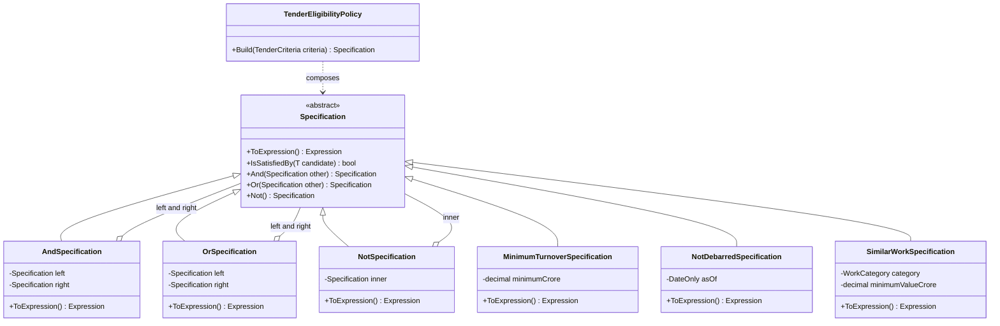
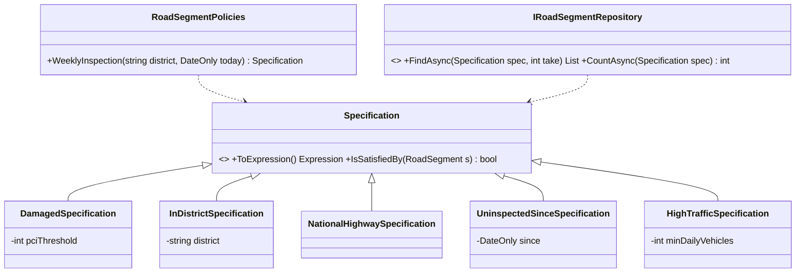

Every business has yes/no rules: "Is this contractor eligible to bid?" "Is this loan high-risk?" The Specification pattern gives each rule a name and a home, and lets you snap rules together like LEGO bricks.

## Learning objectives

By the end of this lesson you will be able to:

1. Recognise the problem: one business rule copied into `if` statements, LINQ and SQL, drifting apart.
2. Build a specification base class with `And`, `Or` and `Not`.
3. Write specifications as expression trees, so one rule runs in memory **and** translates to SQL via EF Core.
4. Combine expression trees by rebinding parameters.
5. Use specifications in ASP.NET Core to filter many objects and to check one.
6. Unit-test specifications and the policy that composes them.
7. Decide when inline LINQ is better.

## Prerequisites

- [Composite](#/lesson/m06-composite): an `And` of two specifications is a composite of specifications.
- [Interpreter](#/lesson/m06-interpreter): expression trees are a small language that a LINQ provider interprets.
- [Open/Closed Principle](#/lesson/m04-ocp): new rules arrive as new classes, not edits to old ones.

You should know LINQ `Where` and lambdas. Expression trees are explained from scratch.

## Explain it like I'm a beginner

Imagine a state highways department that publishes a tender to build a 12 km road. Only some contractors may bid. The tender notice lists the rules:

1. Annual turnover of at least ₹50 crore.
2. Not currently debarred (banned) by any department.
3. Completed at least one similar road project worth ₹20 crore or more in the last 7 years.

A clerk uses this list in two different ways:

- **Checking one bidder.** A contractor walks in; the clerk ticks each rule for *this one contractor*.
- **Searching the register.** "Which of our 20,000 registered contractors qualify?" The rules go to the records room, which pulls out matching files.

The *same three rules* serve both jobs. Write them twice and someday one copy gets updated and the other doesn't.

The Specification idea: **write each rule once, on its own named card.** Cards clip together ("rule 1 AND (rule 2 OR rule 3)"), and a bundle is itself a card. The same bundle goes to the clerk's desk (in memory) or the records room (a database query).

Each card is a **specification**. Clipping cards is **composition** with And, Or and Not. The records-room version is the specification **translated to a query**.

## First-principles explanation

### What it is

A specification is an object that encapsulates one business rule as a predicate (a function that returns true or false) over a candidate object. Eric Evans and Martin Fowler described it in their *Specifications* paper and in *Domain-Driven Design*. They gave it three uses:

1. **Validation**: does this object meet the rule? (`IsSatisfiedBy(candidate)`)
2. **Selection**: find all objects that meet the rule (a query).
3. **Construction to order**: describe what an object must be like before you build it (rarer in practice).

### Why it exists — the problem

Business rules leak. In a typical tendering codebase the turnover rule appears in the bid-submission service (`if`), in a repository query (`Where`), in a reporting SQL view and in the front-end. Four copies, four chances to disagree. When "debarred" changes to mean "debarred *and the ban has not expired*", one copy gets updated and the others become bugs.

A second problem is **method explosion** in repositories: `GetEligibleContractors`, `GetEligibleContractorsInState`, `GetEligibleContractorsInStateWithSimilarWork`… Every new combination needs a new method.

Specification fixes both. Each rule exists once, as a class. Combinations are built at the call site with `&`, `|` and `!`.

### How it works internally

There are two styles, and the difference matters.

**Style 1 — plain predicate.** The specification has `bool IsSatisfiedBy(T candidate)`. It's perfect for in-memory checks, but a database can't run your C# method. To filter 20,000 contractors you would load all 20,000 first: roughly 20–40 MB per request at 1–2 KB per row (an estimate), to return 30 matches.

**Style 2 — expression tree.** The specification returns `Expression<Func<T, bool>>`. An expression tree is the *description* of a lambda as data, not compiled code. When you write

```csharp
Expression<Func<Contractor, bool>> rule = c => c.AnnualTurnoverCrore >= 50m;
```

the compiler builds a small tree of objects: a `BinaryExpression` (GreaterThanOrEqual) with a `MemberExpression` (`c.AnnualTurnoverCrore`) on the left and a `ConstantExpression` (50) on the right. EF Core walks that tree and writes `WHERE c.annual_turnover_crore >= 50`. Calling `.Compile()` on the same tree gives a normal delegate for in-memory use. **One rule, two engines.**

**Combining expressions** is the subtle part. Lambdas `c => A(c)` and `x => B(x)` each have their *own* parameter object. Gluing their bodies with `AndAlso` leaves a reference to `x` that the new lambda doesn't declare. Two fixes exist:

- `Expression.Invoke(right, left.Parameters[0])` ("call the second lambda with my parameter"). It works in memory, but some providers translate invocation nodes poorly or throw.
- **Parameter rebinding**: an `ExpressionVisitor` rewrites every `x` in the second body to `c`, then the bodies are joined. The result is one clean lambda any provider can read. This lesson uses this approach.

### What happens without it

Either rules get duplicated, or a helper like `IsEligible(Contractor c)` is called inside a database query. EF Core can't translate your own C# method, so the query throws "could not be translated", or the filter quietly runs in memory after loading far too many rows.

### When it is useful

- The same rule is needed **both** for checking one object and for querying many.
- Rules are **combined in many ways**: per tender, per tenant, per user-selected filter.
- Rules are **domain language** ("eligible", "overdue") that the code should name.
- You want to unit-test rules **without a database**.

### When it is unnecessary

- A rule is used in exactly one query. `Where(c => c.State == "MH")` inline is clearer than a class.
- Filters are simple, user-driven search fields (name contains, date range). A small query object or plain LINQ is enough.
- Data access is hand-written SQL (Dapper, raw Npgsql). Expression trees don't help without a SQL translator.

### Trade-offs it introduces

| You gain | You pay |
|---|---|
| One definition of each rule, reused in memory and in queries | Expression trees are harder to read and debug than plain methods |
| Combinations without new repository methods | Only expressions the provider can translate are allowed — no calls to your own helper methods inside them |
| Rules named in business language and tested alone | More small classes; a team must agree where they live |
| Rules can be passed around and logged as data | Combining expressions needs a parameter-rebinding helper that must be correct |

## Visual explanation

### Class diagram



How to read it: `Specification` is generic over `T` (here `Contractor`; Mermaid omits the type parameter). Everything is built on one abstract method, `ToExpression()`. The **combinators** (And, Or, Not) *hold* other specifications (hollow diamonds), which makes a specification tree a [Composite](#/lesson/m06-composite). The **leaf rules** each wrap one business rule and its parameters (₹50 crore, a date, a category). `TenderEligibilityPolicy` alone knows *which* rules a tender needs and builds the tree.

### Sequence diagram


The first half is **selection**: the policy builds a tree, the directory turns it into one expression, and the provider (EF Core in production, LINQ-to-Objects here) translates it, so only matching rows cross the network. The second half is **validation**: the *same* tree is compiled and run in memory against one bidder.

## Step-by-step example

### Step 1 — the naive version

```csharp
public sealed class BidService(AppDbContext db)
{
    public async Task<List<Contractor>> EligibleAsync(decimal minTurnover, DateOnly today) =>
        await db.Contractors
            .Where(c => c.AnnualTurnoverCrore >= minTurnover
                     && (c.DebarredUntil == null || c.DebarredUntil < today)
                     && c.CompletedWorks.Any(w => w.Category == WorkCategory.Road && w.ValueCrore >= 20m))
            .ToListAsync();

    public bool CanBid(Contractor c, decimal minTurnover, DateOnly today) =>
        c.AnnualTurnoverCrore >= minTurnover
        && (c.DebarredUntil == null || c.DebarredUntil < today)
        && c.CompletedWorks.Any(w => w.Category == WorkCategory.Road && w.ValueCrore >= 20m);
}
```

It works, but the rule is written twice in one class, and a third copy arrives with the first report.

### Step 2 — name each rule

Give each condition a class that returns an expression:

```csharp
public sealed class MinimumTurnoverSpecification(decimal minimumCrore) : Specification<Contractor>
{
    public override Expression<Func<Contractor, bool>> ToExpression()
    {
        var min = minimumCrore;                 // copy to a local: the tree captures a simple value
        return c => c.AnnualTurnoverCrore >= min;
    }
}
```

Why copy into a local? Then the tree captures a simple value (which becomes a query parameter), not a reference to the whole specification object.

### Step 3 — combine with And, Or and Not

Add `And`, `Or` and `Not` to the base class, plus the C# operators `&`, `|` and `!` so call sites read naturally:

```csharp
var eligible = new MinimumTurnoverSpecification(50m)
             & new NotDebarredSpecification(today)
             & new SimilarWorkSpecification(WorkCategory.Road, 20m, today.AddYears(-7));
```

### Step 4 — use it both ways

```csharp
var list = await directory.FindAsync(eligible, ct);   // selection: translated to a query
bool ok  = eligible.IsSatisfiedBy(bidder);            // validation: in memory
```

The rest of this lesson builds the production version of these four steps.

## Production-style C# implementation

Project structure:

```text
Tendering.Api/
  Program.cs
  Specifications/
    Specification.cs          (base class, And/Or/Not, parameter rebinding)
    QueryableSpecificationExtensions.cs
  Contractors/
    Contractor.cs
    ContractorSpecifications.cs
    TenderEligibilityPolicy.cs
    IContractorDirectory.cs   (+ in-memory implementation)
Tendering.Tests/
  ContractorSpecificationTests.cs
  TenderEligibilityPolicyTests.cs
```

### The base class and combinators

```csharp file=Specifications/Specification.cs
using System.Linq.Expressions;

namespace Tendering.Specifications;

/// <summary>A named business rule over T, expressed as an expression tree so it can be
/// evaluated in memory (IsSatisfiedBy) or translated by a LINQ provider (ToExpression).</summary>
public abstract class Specification<T>
{
    private Func<T, bool>? _compiled;

    public abstract Expression<Func<T, bool>> ToExpression();

    /// <summary>Compiles the expression once per instance and caches the delegate.</summary>
    public bool IsSatisfiedBy(T candidate)
    {
        ArgumentNullException.ThrowIfNull(candidate);
        _compiled ??= ToExpression().Compile();
        return _compiled(candidate);
    }

    public Specification<T> And(Specification<T> other) => new AndSpecification<T>(this, other);
    public Specification<T> Or(Specification<T> other) => new OrSpecification<T>(this, other);
    public Specification<T> Not() => new NotSpecification<T>(this);

    public static Specification<T> operator &(Specification<T> left, Specification<T> right) => left.And(right);
    public static Specification<T> operator |(Specification<T> left, Specification<T> right) => left.Or(right);
    public static Specification<T> operator !(Specification<T> spec) => spec.Not();

    /// <summary>The neutral element for And: always true. Useful as a starting point when
    /// rules are added conditionally.</summary>
    public static Specification<T> All { get; } = new LambdaSpecification<T>(_ => true);
}

/// <summary>Adapter for one-off rules; prefer named subclasses for business rules.</summary>
public sealed class LambdaSpecification<T>(Expression<Func<T, bool>> expression) : Specification<T>
{
    public override Expression<Func<T, bool>> ToExpression() => expression;
}

internal sealed class AndSpecification<T>(Specification<T> left, Specification<T> right) : Specification<T>
{
    public override Expression<Func<T, bool>> ToExpression() =>
        ExpressionCombiner.Combine(left.ToExpression(), right.ToExpression(), Expression.AndAlso);
}

internal sealed class OrSpecification<T>(Specification<T> left, Specification<T> right) : Specification<T>
{
    public override Expression<Func<T, bool>> ToExpression() =>
        ExpressionCombiner.Combine(left.ToExpression(), right.ToExpression(), Expression.OrElse);
}

internal sealed class NotSpecification<T>(Specification<T> inner) : Specification<T>
{
    public override Expression<Func<T, bool>> ToExpression()
    {
        var e = inner.ToExpression();
        return Expression.Lambda<Func<T, bool>>(Expression.Not(e.Body), e.Parameters);
    }
}

/// <summary>Joins two single-parameter lambdas into one by rewriting the right lambda's
/// parameter to the left lambda's parameter. No Expression.Invoke, so LINQ providers
/// such as EF Core see one plain predicate.</summary>
internal static class ExpressionCombiner
{
    public static Expression<Func<T, bool>> Combine<T>(
        Expression<Func<T, bool>> left,
        Expression<Func<T, bool>> right,
        Func<Expression, Expression, BinaryExpression> merge)
    {
        var parameter = left.Parameters[0];
        var rightBody = new ParameterReplacer(right.Parameters[0], parameter).Visit(right.Body);
        return Expression.Lambda<Func<T, bool>>(merge(left.Body, rightBody), parameter);
    }

    private sealed class ParameterReplacer(ParameterExpression from, ParameterExpression to) : ExpressionVisitor
    {
        protected override Expression VisitParameter(ParameterExpression node) =>
            node == from ? to : base.VisitParameter(node);
    }
}
```

Points worth noticing:

- `IsSatisfiedBy` compiles the tree **once per instance** and caches it, because compiling generates IL at runtime and is far costlier than invoking.
- The combinators are `internal`; callers only see `Specification<T>` and the operators.
- `All` (always true) lets a policy add rules conditionally without `null` checks.

### Applying a specification to a query

```csharp file=Specifications/QueryableSpecificationExtensions.cs
namespace Tendering.Specifications;

public static class QueryableSpecificationExtensions
{
    /// <summary>Filters any IQueryable (EF Core DbSet, in-memory AsQueryable, ...) by a specification.</summary>
    public static IQueryable<T> Satisfying<T>(this IQueryable<T> source, Specification<T> spec) =>
        source.Where(spec.ToExpression());

    /// <summary>In-memory filtering that reuses the specification's cached compiled delegate.</summary>
    public static IEnumerable<T> Satisfying<T>(this IEnumerable<T> source, Specification<T> spec) =>
        source.Where(spec.IsSatisfiedBy);
}
```

Why not `Where(spec)`? `Queryable.Where` needs an `Expression<Func<T,bool>>`, and C# can't infer `T` through a user-defined conversion. A clearly named extension avoids the confusion.

### The domain and the rules

```csharp file=Contractors/Contractor.cs
namespace Tendering.Contractors;

public enum WorkCategory { Road, Bridge, Building, Water }

public sealed record CompletedWork(WorkCategory Category, decimal ValueCrore, DateOnly CompletedOn);

public sealed class Contractor
{
    public required Guid Id { get; init; }
    public required string Name { get; init; }
    public required string State { get; init; }          // e.g. "MH", "BR", "HP"
    public decimal AnnualTurnoverCrore { get; init; }
    public DateOnly? DebarredUntil { get; init; }        // null = never debarred
    public List<CompletedWork> CompletedWorks { get; init; } = [];
}

/// <summary>What a tender notice demands. Arrives in the request body.</summary>
public sealed record TenderCriteria(
    decimal MinimumTurnoverCrore,
    WorkCategory SimilarWorkCategory,
    decimal SimilarWorkMinimumCrore,
    int SimilarWorkWithinYears,
    string[]? RestrictToStates);
```

```csharp file=Contractors/ContractorSpecifications.cs
using System.Linq.Expressions;
using Tendering.Specifications;

namespace Tendering.Contractors;

public sealed class MinimumTurnoverSpecification(decimal minimumCrore) : Specification<Contractor>
{
    public override Expression<Func<Contractor, bool>> ToExpression()
    {
        var min = minimumCrore;
        return c => c.AnnualTurnoverCrore >= min;
    }
}

/// <summary>A contractor is debarred on day D if DebarredUntil is on or after D.</summary>
public sealed class NotDebarredSpecification(DateOnly asOf) : Specification<Contractor>
{
    public override Expression<Func<Contractor, bool>> ToExpression()
    {
        var day = asOf;
        return c => c.DebarredUntil == null || c.DebarredUntil < day;
    }
}

public sealed class RegisteredInStatesSpecification(IReadOnlyCollection<string> states) : Specification<Contractor>
{
    public override Expression<Func<Contractor, bool>> ToExpression()
    {
        var allowed = states.ToArray();           // EF Core translates array Contains to IN (...) / = ANY(...)
        return c => allowed.Contains(c.State);
    }
}

public sealed class SimilarWorkSpecification(WorkCategory category, decimal minimumValueCrore, DateOnly since)
    : Specification<Contractor>
{
    public override Expression<Func<Contractor, bool>> ToExpression()
    {
        var cat = category;
        var min = minimumValueCrore;
        var from = since;
        return c => c.CompletedWorks.Any(w => w.Category == cat && w.ValueCrore >= min && w.CompletedOn >= from);
    }
}
```

Every expression uses only what a SQL translator understands: comparisons, `null` checks, array `Contains` and `Any` over a navigation. No custom methods and no `DateTime.Now`; "today" is passed in, so rules are deterministic.

### The policy that composes rules

```csharp file=Contractors/TenderEligibilityPolicy.cs
using Tendering.Specifications;

namespace Tendering.Contractors;

/// <summary>Owns the knowledge of WHICH rules a tender needs. Individual rules don't know about each other.</summary>
public sealed class TenderEligibilityPolicy(TimeProvider clock)
{
    public Specification<Contractor> Build(TenderCriteria criteria)
    {
        ArgumentNullException.ThrowIfNull(criteria);
        if (criteria.MinimumTurnoverCrore < 0) throw new ArgumentOutOfRangeException(nameof(criteria), "Turnover cannot be negative.");

        var today = DateOnly.FromDateTime(clock.GetUtcNow().UtcDateTime);
        var spec = Specification<Contractor>.All
                 & new MinimumTurnoverSpecification(criteria.MinimumTurnoverCrore)
                 & new NotDebarredSpecification(today)
                 & new SimilarWorkSpecification(criteria.SimilarWorkCategory,
                                                criteria.SimilarWorkMinimumCrore,
                                                today.AddYears(-criteria.SimilarWorkWithinYears));

        if (criteria.RestrictToStates is { Length: > 0 } states)
            spec &= new RegisteredInStatesSpecification(states);

        return spec;
    }

    /// <summary>Names of the individual rules a single bidder fails, for a helpful error message.</summary>
    public IReadOnlyList<string> FailedRules(TenderCriteria criteria, Contractor bidder)
    {
        var today = DateOnly.FromDateTime(clock.GetUtcNow().UtcDateTime);
        var rules = new List<(string Name, Specification<Contractor> Spec)>
        {
            ($"Turnover of at least ₹{criteria.MinimumTurnoverCrore} crore", new MinimumTurnoverSpecification(criteria.MinimumTurnoverCrore)),
            ("Not currently debarred", new NotDebarredSpecification(today)),
            ($"Similar {criteria.SimilarWorkCategory} work of ₹{criteria.SimilarWorkMinimumCrore} crore in {criteria.SimilarWorkWithinYears} years",
                new SimilarWorkSpecification(criteria.SimilarWorkCategory, criteria.SimilarWorkMinimumCrore, today.AddYears(-criteria.SimilarWorkWithinYears))),
        };
        if (criteria.RestrictToStates is { Length: > 0 } states)
            rules.Add(($"Registered in {string.Join("/", states)}", new RegisteredInStatesSpecification(states)));

        return rules.Where(r => !r.Spec.IsSatisfiedBy(bidder)).Select(r => r.Name).ToList();
    }
}
```

When the department adds a rule ("valid GST registration"), only the policy changes.

### The directory (repository) that accepts specifications

```csharp file=Contractors/IContractorDirectory.cs
using Tendering.Specifications;

namespace Tendering.Contractors;

public interface IContractorDirectory
{
    Task<IReadOnlyList<Contractor>> FindAsync(Specification<Contractor> spec, int take, CancellationToken ct);
    Task<Contractor?> GetAsync(Guid id, CancellationToken ct);
}

/// <summary>Runnable stand-in for the EF Core implementation. AsQueryable() makes LINQ-to-Objects
/// interpret the same expression tree that EF Core would translate to SQL.</summary>
public sealed class InMemoryContractorDirectory(IEnumerable<Contractor> seed) : IContractorDirectory
{
    private readonly List<Contractor> _rows = seed.ToList();

    public Task<IReadOnlyList<Contractor>> FindAsync(Specification<Contractor> spec, int take, CancellationToken ct)
    {
        IReadOnlyList<Contractor> result = _rows.AsQueryable()
            .Satisfying(spec)
            .OrderByDescending(c => c.AnnualTurnoverCrore)
            .ThenBy(c => c.Id)
            .Take(take)
            .ToList();
        return Task.FromResult(result);
    }

    public Task<Contractor?> GetAsync(Guid id, CancellationToken ct) =>
        Task.FromResult(_rows.FirstOrDefault(c => c.Id == id));

    public static IEnumerable<Contractor> Sample()
    {
        var d = new DateOnly(2026, 1, 1);
        yield return new Contractor { Id = Guid.Parse("00000000-0000-0000-0000-000000000001"), Name = "Sahyadri Infra", State = "MH", AnnualTurnoverCrore = 120m,
            CompletedWorks = [new(WorkCategory.Road, 45m, d.AddYears(-2))] };
        yield return new Contractor { Id = Guid.Parse("00000000-0000-0000-0000-000000000002"), Name = "Ganga Builders", State = "BR", AnnualTurnoverCrore = 65m,
            DebarredUntil = d.AddYears(1), CompletedWorks = [new(WorkCategory.Road, 30m, d.AddYears(-1))] };
        yield return new Contractor { Id = Guid.Parse("00000000-0000-0000-0000-000000000003"), Name = "Shivalik Constructions", State = "HP", AnnualTurnoverCrore = 55m,
            CompletedWorks = [new(WorkCategory.Bridge, 25m, d.AddYears(-3))] };
    }
}
```

The EF Core version is almost identical (illustrative, **not compiled** here):

```csharp
// EF Core implementation (illustrative, not compiled here)
public sealed class EfContractorDirectory(TenderingDbContext db) : IContractorDirectory
{
    public async Task<IReadOnlyList<Contractor>> FindAsync(Specification<Contractor> spec, int take, CancellationToken ct) =>
        await db.Contractors
            .AsNoTracking()
            .Satisfying(spec)                       // same extension, same expression tree
            .OrderByDescending(c => c.AnnualTurnoverCrore).ThenBy(c => c.Id)
            .Take(take)
            .ToListAsync(ct);
    // Npgsql generates roughly:
    // SELECT ... FROM contractors c
    // WHERE c.annual_turnover_crore >= @min AND (c.debarred_until IS NULL OR c.debarred_until < @day)
    //   AND EXISTS (SELECT 1 FROM completed_works w WHERE w.contractor_id = c.id AND w.category = @cat ...)
    // ORDER BY c.annual_turnover_crore DESC, c.id LIMIT @take
}
```

### Wiring it into ASP.NET Core

```csharp file=Program.cs
using Tendering.Contractors;

var builder = WebApplication.CreateBuilder(args);

builder.Services.AddSingleton(TimeProvider.System);
builder.Services.AddSingleton<TenderEligibilityPolicy>();
// Swap for EfContractorDirectory (scoped) in production.
builder.Services.AddSingleton<IContractorDirectory>(new InMemoryContractorDirectory(InMemoryContractorDirectory.Sample()));
builder.Services.AddProblemDetails();

var app = builder.Build();

// Selection: "who could bid on this tender?"
app.MapPost("/tenders/eligible-contractors", async (TenderCriteria criteria, TenderEligibilityPolicy policy,
    IContractorDirectory directory, CancellationToken ct) =>
{
    var spec = policy.Build(criteria);
    var matches = await directory.FindAsync(spec, take: 100, ct);
    return Results.Ok(matches.Select(c => new { c.Id, c.Name, c.State, c.AnnualTurnoverCrore }));
});

// Validation: "may THIS contractor bid?"
app.MapPost("/tenders/check-bidder/{contractorId:guid}", async (Guid contractorId, TenderCriteria criteria,
    TenderEligibilityPolicy policy, IContractorDirectory directory, CancellationToken ct) =>
{
    var bidder = await directory.GetAsync(contractorId, ct);
    if (bidder is null) return Results.Problem($"Contractor {contractorId} not found.", statusCode: 404);

    var failed = policy.FailedRules(criteria, bidder);
    return failed.Count == 0
        ? Results.Ok(new { eligible = true })
        : Results.Problem(title: "Bidder is not eligible", statusCode: 422,
              extensions: new Dictionary<string, object?> { ["failedRules"] = failed });
});

app.Run();
```

## Bad design vs good design

**Bad: a helper method used inside a query.**

```csharp
public static bool IsEligible(Contractor c, decimal min) => c.AnnualTurnoverCrore >= min && c.DebarredUntil == null;

// Somewhere in a repository:
var list = await db.Contractors.Where(c => IsEligible(c, 50m)).ToListAsync();   // EF Core: "could not be translated"
```

EF Core can't translate an unknown method, so this throws at runtime. The usual panic "fix" is `db.Contractors.ToList().Where(...)`, which loads the whole table on every request: fine with 50 test rows, a disaster with 200,000.

**Bad: the repository-method explosion.**

```csharp
Task<List<Contractor>> GetEligibleAsync(decimal min);
Task<List<Contractor>> GetEligibleInStateAsync(decimal min, string state);
Task<List<Contractor>> GetEligibleWithSimilarWorkAsync(decimal min, WorkCategory cat, decimal value);
Task<List<Contractor>> GetEligibleInStateWithSimilarWorkAsync(decimal min, string state, WorkCategory cat, decimal value);
// ... 2^n combinations
```

**Good:** one `FindAsync(Specification<Contractor>)`, rules as classes, and a policy that combines them. Still one round trip, and the rules are reused in memory.

**Is it worth it?** One rule in one query: inline LINQ wins. Several rules reused in two engines and combined per tender: Specification wins. A middle ground is a static class of `Expression<Func<Contractor,bool>>` fields: reuse without a class hierarchy, but no `And`/`Or`.

:::callout type=mistake title="Specifications are not validators for request input"
"Name must not be empty" is **input validation**; it belongs in DataAnnotations or an endpoint filter. Specifications express **domain rules** about entities ("eligible", "overdue") that are also needed in queries.
:::

:::callout type=warning title="Navigation properties must be loaded for in-memory checks"
In SQL, `SimilarWorkSpecification` becomes an `EXISTS` subquery. In memory, `IsSatisfiedBy(bidder)` needs `CompletedWorks` loaded (`.Include(c => c.CompletedWorks)` in EF Core), or it sees an empty list and wrongly returns false.
:::

## Practical playground

The playground composes three rules, runs them in memory and through `AsQueryable()`, and prints the combined tree. Try negating a rule with `!` and watch the printed tree change.

:::playground type=csharp title="Compose tender eligibility rules"
```csharp file=Program.cs
using System;
using System.Collections.Generic;
using System.Linq;
using System.Linq.Expressions;

public sealed record Contractor(string Name, string State, decimal TurnoverCrore, bool Debarred, int RoadProjects);

public abstract class Spec<T>
{
    public abstract Expression<Func<T, bool>> ToExpression();
    public bool IsSatisfiedBy(T c) => ToExpression().Compile()(c);
    public static Spec<T> operator &(Spec<T> a, Spec<T> b) => new Combined<T>(a, b, Expression.AndAlso);
    public static Spec<T> operator |(Spec<T> a, Spec<T> b) => new Combined<T>(a, b, Expression.OrElse);
    public static Spec<T> operator !(Spec<T> a) => new Negated<T>(a);
}

public sealed class Rule<T>(Expression<Func<T, bool>> e) : Spec<T>
{
    public override Expression<Func<T, bool>> ToExpression() => e;
}

public sealed class Combined<T>(Spec<T> l, Spec<T> r, Func<Expression, Expression, BinaryExpression> op) : Spec<T>
{
    public override Expression<Func<T, bool>> ToExpression()
    {
        var le = l.ToExpression(); var re = r.ToExpression();
        var body = new Swap(re.Parameters[0], le.Parameters[0]).Visit(re.Body);
        return Expression.Lambda<Func<T, bool>>(op(le.Body, body), le.Parameters);
    }
}

public sealed class Negated<T>(Spec<T> inner) : Spec<T>
{
    public override Expression<Func<T, bool>> ToExpression()
    {
        var e = inner.ToExpression();
        return Expression.Lambda<Func<T, bool>>(Expression.Not(e.Body), e.Parameters);
    }
}

public sealed class Swap(ParameterExpression from, ParameterExpression to) : ExpressionVisitor
{
    protected override Expression VisitParameter(ParameterExpression node) => node == from ? to : node;
}

public static class Program
{
    public static void Main()
    {
        var turnover = new Rule<Contractor>(c => c.TurnoverCrore >= 50m);
        var clean = new Rule<Contractor>(c => !c.Debarred);
        var experienced = new Rule<Contractor>(x => x.RoadProjects >= 1);   // different parameter name on purpose

        var eligible = turnover & clean & experienced;
        Console.WriteLine("Expression: " + eligible.ToExpression());

        var register = new List<Contractor>
        {
            new("Sahyadri Infra", "MH", 120m, false, 3),
            new("Ganga Builders", "BR", 65m, true, 2),
            new("Shivalik Constructions", "HP", 55m, false, 0),
            new("Narmada Roads", "MP", 40m, false, 5),
        };

        Console.WriteLine("In memory:  " + string.Join(", ", register.Where(eligible.IsSatisfiedBy).Select(c => c.Name)));
        Console.WriteLine("Queryable:  " + string.Join(", ", register.AsQueryable().Where(eligible.ToExpression()).Select(c => c.Name)));
    }
}
```
:::

## Exercises

:::exercise id=m06-specification-ex1 difficulty=beginner kind=code title="Complete Or and Not"
The starter has a working `Specification<T>` base class and `And`. `Or` and `Not` throw `NotImplementedException`. Implement both so they work in memory **and** produce a single-parameter expression that a LINQ provider can use.
::requirements
- `OrSpecification<T>.ToExpression()` combines both sides with `Expression.OrElse`.
- `NotSpecification<T>.ToExpression()` negates the inner body with `Expression.Not`.
- Results must have exactly one lambda parameter. Reuse the provided `ParameterReplacer`.
::acceptance
- `(MinTurnover(100) | State("HP"))` accepts a ₹40 crore HP contractor and a ₹150 crore MH contractor, and rejects a ₹40 crore MH contractor.
- `!MinTurnover(100)` accepts ₹40 crore and rejects ₹150 crore.
- Filtering a list with `.AsQueryable().Where(spec.ToExpression())` gives the same answer as `IsSatisfiedBy`.
::hint
Look at how `AndSpecification` is written. `Or` is the same shape with one word changed.
::hint
For `Not`, you don't need to rebind anything: there is only one lambda, so keep its parameter list.
::hint
`Expression.Lambda<Func<T,bool>>(Expression.Not(e.Body), e.Parameters)`.
::hint
For `Or`: get both expressions, replace the right parameter with the left one using `ParameterReplacer`, then call `Expression.OrElse(left.Body, rightBody)`.
::starter
```csharp file=Specifications.cs
using System;
using System.Linq;
using System.Linq.Expressions;

public sealed record Contractor(string Name, string State, decimal TurnoverCrore);

public abstract class Specification<T>
{
    public abstract Expression<Func<T, bool>> ToExpression();
    public bool IsSatisfiedBy(T candidate) => ToExpression().Compile()(candidate);
    public static Specification<T> operator &(Specification<T> a, Specification<T> b) => new AndSpecification<T>(a, b);
    public static Specification<T> operator |(Specification<T> a, Specification<T> b) => new OrSpecification<T>(a, b);
    public static Specification<T> operator !(Specification<T> a) => new NotSpecification<T>(a);
}

public sealed class ParameterReplacer(ParameterExpression from, ParameterExpression to) : ExpressionVisitor
{
    protected override Expression VisitParameter(ParameterExpression node) => node == from ? to : base.VisitParameter(node);
}

public sealed class AndSpecification<T>(Specification<T> left, Specification<T> right) : Specification<T>
{
    public override Expression<Func<T, bool>> ToExpression()
    {
        var l = left.ToExpression();
        var r = right.ToExpression();
        var rBody = new ParameterReplacer(r.Parameters[0], l.Parameters[0]).Visit(r.Body);
        return Expression.Lambda<Func<T, bool>>(Expression.AndAlso(l.Body, rBody), l.Parameters);
    }
}

public sealed class OrSpecification<T>(Specification<T> left, Specification<T> right) : Specification<T>
{
    public override Expression<Func<T, bool>> ToExpression() => throw new NotImplementedException();
}

public sealed class NotSpecification<T>(Specification<T> inner) : Specification<T>
{
    public override Expression<Func<T, bool>> ToExpression() => throw new NotImplementedException();
}

public sealed class MinTurnover(decimal crore) : Specification<Contractor>
{
    public override Expression<Func<Contractor, bool>> ToExpression() { var min = crore; return c => c.TurnoverCrore >= min; }
}

public sealed class InState(string state) : Specification<Contractor>
{
    public override Expression<Func<Contractor, bool>> ToExpression() { var s = state; return x => x.State == s; }
}
```
::tests
```csharp file=SpecificationTests.cs
using System.Linq;
using Xunit;

public class SpecificationTests
{
    private static readonly Contractor SmallHp = new("A", "HP", 40m);
    private static readonly Contractor BigMh = new("B", "MH", 150m);
    private static readonly Contractor SmallMh = new("C", "MH", 40m);

    [Fact]
    public void Or_accepts_either_side()
    {
        var spec = new MinTurnover(100m) | new InState("HP");
        Assert.True(spec.IsSatisfiedBy(SmallHp));
        Assert.True(spec.IsSatisfiedBy(BigMh));
        Assert.False(spec.IsSatisfiedBy(SmallMh));
    }

    [Fact]
    public void Not_inverts()
    {
        var spec = !new MinTurnover(100m);
        Assert.True(spec.IsSatisfiedBy(SmallMh));
        Assert.False(spec.IsSatisfiedBy(BigMh));
    }

    [Fact]
    public void Combined_expression_has_one_parameter()
    {
        var e = (new MinTurnover(100m) | !new InState("HP")).ToExpression();
        Assert.Single(e.Parameters);
    }

    [Fact]
    public void Queryable_matches_in_memory()
    {
        var spec = (new MinTurnover(100m) | new InState("HP")) & !new InState("BR");
        var all = new[] { SmallHp, BigMh, SmallMh, new Contractor("D", "BR", 500m) };
        var viaQuery = all.AsQueryable().Where(spec.ToExpression()).Select(c => c.Name).ToArray();
        var inMemory = all.Where(spec.IsSatisfiedBy).Select(c => c.Name).ToArray();
        Assert.Equal(inMemory, viaQuery);
        Assert.Equal(new[] { "A", "B" }, viaQuery);
    }
}
```
::solution
`Or` mirrors `And`. `Not` wraps the single body.

```csharp file=Specifications.cs
using System;
using System.Linq;
using System.Linq.Expressions;

public sealed record Contractor(string Name, string State, decimal TurnoverCrore);

public abstract class Specification<T>
{
    public abstract Expression<Func<T, bool>> ToExpression();
    public bool IsSatisfiedBy(T candidate) => ToExpression().Compile()(candidate);
    public static Specification<T> operator &(Specification<T> a, Specification<T> b) => new AndSpecification<T>(a, b);
    public static Specification<T> operator |(Specification<T> a, Specification<T> b) => new OrSpecification<T>(a, b);
    public static Specification<T> operator !(Specification<T> a) => new NotSpecification<T>(a);
}

public sealed class ParameterReplacer(ParameterExpression from, ParameterExpression to) : ExpressionVisitor
{
    protected override Expression VisitParameter(ParameterExpression node) => node == from ? to : base.VisitParameter(node);
}

public sealed class AndSpecification<T>(Specification<T> left, Specification<T> right) : Specification<T>
{
    public override Expression<Func<T, bool>> ToExpression()
    {
        var l = left.ToExpression();
        var r = right.ToExpression();
        var rBody = new ParameterReplacer(r.Parameters[0], l.Parameters[0]).Visit(r.Body);
        return Expression.Lambda<Func<T, bool>>(Expression.AndAlso(l.Body, rBody), l.Parameters);
    }
}

public sealed class OrSpecification<T>(Specification<T> left, Specification<T> right) : Specification<T>
{
    public override Expression<Func<T, bool>> ToExpression()
    {
        var l = left.ToExpression();
        var r = right.ToExpression();
        var rBody = new ParameterReplacer(r.Parameters[0], l.Parameters[0]).Visit(r.Body);
        return Expression.Lambda<Func<T, bool>>(Expression.OrElse(l.Body, rBody), l.Parameters);
    }
}

public sealed class NotSpecification<T>(Specification<T> inner) : Specification<T>
{
    public override Expression<Func<T, bool>> ToExpression()
    {
        var e = inner.ToExpression();
        return Expression.Lambda<Func<T, bool>>(Expression.Not(e.Body), e.Parameters);
    }
}

public sealed class MinTurnover(decimal crore) : Specification<Contractor>
{
    public override Expression<Func<Contractor, bool>> ToExpression() { var min = crore; return c => c.TurnoverCrore >= min; }
}

public sealed class InState(string state) : Specification<Contractor>
{
    public override Expression<Func<Contractor, bool>> ToExpression() { var s = state; return x => x.State == s; }
}
```

Note that `InState` deliberately names its parameter `x` while `MinTurnover` uses `c`. Without rebinding, the combined tree would reference `x`, which the outer lambda never declares. `Compile()` would then throw "variable 'x' referenced from scope '' but it is not defined".
::mistakes
- Using `Expression.Or` (bitwise `|`) instead of `Expression.OrElse` (short-circuit `||`).
- Building `Expression.Lambda(..., r.Parameters)` with the *right* parameter after rewriting the body to the left one.
- Gluing bodies together without rebinding, then wondering why `Compile()` throws a scope error.
::extensions
Add `AndNot(other)` as a convenience (`a & !b`). Add a test that prints `ToExpression().ToString()` and checks it contains `OrElse`.
:::

:::exercise id=m06-specification-ex2 difficulty=beginner kind=code title="Specifications for open tenders closing soon"
The procurement portal needs a "Closing this week" list and a guard that blocks bid submission on closed tenders. Write two leaf specifications over `Tender`, and use them both in memory and against an `IQueryable`.
::requirements
- `OpenTenderSpecification`: status is `Published` **and** the closing date is on or after `today`.
- `ClosingWithinDaysSpecification(today, days)`: the closing date is between `today` and `today + days`, inclusive.
- `today` is passed in. Don't use `DateTime.Now` inside the expression.
::acceptance
- A published tender closing tomorrow is both open and closing within 7 days.
- A published tender that closed yesterday is not open.
- A `Draft` tender is never open, whatever its date.
- `(open & closingSoon)` over a list of 5 tenders returns exactly the expected two ids.
::hint
Each specification returns a lambda `t => ...`. Copy constructor parameters into locals first.
::hint
`DateOnly` supports `<=` and `>=`. Use `today.AddDays(days)` for the upper bound, and compute it *outside* the lambda.
::hint
For "open", compare the enum and the date: `t.Status == TenderStatus.Published && t.ClosesOn >= day`.
::hint
```csharp
var from = today; var to = today.AddDays(days);
return t => t.ClosesOn >= from && t.ClosesOn <= to;
```
::starter
```csharp file=TenderSpecs.cs
using System;
using System.Linq;
using System.Linq.Expressions;

public enum TenderStatus { Draft, Published, Cancelled, Awarded }
public sealed record Tender(int Id, string Title, TenderStatus Status, DateOnly ClosesOn);

public abstract class Specification<T>
{
    public abstract Expression<Func<T, bool>> ToExpression();
    public bool IsSatisfiedBy(T candidate) => ToExpression().Compile()(candidate);
    public static Specification<T> operator &(Specification<T> a, Specification<T> b) => new AndSpecification<T>(a, b);
}

public sealed class AndSpecification<T>(Specification<T> left, Specification<T> right) : Specification<T>
{
    public override Expression<Func<T, bool>> ToExpression()
    {
        var l = left.ToExpression(); var r = right.ToExpression();
        var body = new Rebind(r.Parameters[0], l.Parameters[0]).Visit(r.Body);
        return Expression.Lambda<Func<T, bool>>(Expression.AndAlso(l.Body, body), l.Parameters);
    }
    private sealed class Rebind(ParameterExpression from, ParameterExpression to) : ExpressionVisitor
    {
        protected override Expression VisitParameter(ParameterExpression node) => node == from ? to : node;
    }
}

public sealed class OpenTenderSpecification(DateOnly today) : Specification<Tender>
{
    public override Expression<Func<Tender, bool>> ToExpression() => throw new NotImplementedException();
}

public sealed class ClosingWithinDaysSpecification(DateOnly today, int days) : Specification<Tender>
{
    public override Expression<Func<Tender, bool>> ToExpression() => throw new NotImplementedException();
}
```
::tests
```csharp file=TenderSpecsTests.cs
using System;
using System.Linq;
using Xunit;

public class TenderSpecsTests
{
    private static readonly DateOnly Today = new(2026, 10, 18);

    [Fact]
    public void Published_closing_tomorrow_is_open_and_closing_soon()
    {
        var t = new Tender(1, "NH-48 resurfacing", TenderStatus.Published, Today.AddDays(1));
        Assert.True(new OpenTenderSpecification(Today).IsSatisfiedBy(t));
        Assert.True(new ClosingWithinDaysSpecification(Today, 7).IsSatisfiedBy(t));
    }

    [Fact]
    public void Closed_yesterday_is_not_open() =>
        Assert.False(new OpenTenderSpecification(Today).IsSatisfiedBy(new Tender(2, "Old", TenderStatus.Published, Today.AddDays(-1))));

    [Fact]
    public void Draft_is_never_open() =>
        Assert.False(new OpenTenderSpecification(Today).IsSatisfiedBy(new Tender(3, "Draft", TenderStatus.Draft, Today.AddDays(5))));

    [Fact]
    public void Closing_today_and_on_last_day_are_included()
    {
        var spec = new ClosingWithinDaysSpecification(Today, 7);
        Assert.True(spec.IsSatisfiedBy(new Tender(4, "a", TenderStatus.Published, Today)));
        Assert.True(spec.IsSatisfiedBy(new Tender(5, "b", TenderStatus.Published, Today.AddDays(7))));
        Assert.False(spec.IsSatisfiedBy(new Tender(6, "c", TenderStatus.Published, Today.AddDays(8))));
    }

    [Fact]
    public void Composed_query_returns_expected_ids()
    {
        var tenders = new[]
        {
            new Tender(10, "Bridge repair, Patna", TenderStatus.Published, Today.AddDays(2)),
            new Tender(11, "Water pipeline, Shimla", TenderStatus.Published, Today.AddDays(30)),
            new Tender(12, "Flyover, Pune", TenderStatus.Draft, Today.AddDays(3)),
            new Tender(13, "Drainage, Gurgaon", TenderStatus.Published, Today.AddDays(7)),
            new Tender(14, "Ring road, Nagpur", TenderStatus.Published, Today.AddDays(-2)),
        };
        var spec = new OpenTenderSpecification(Today) & new ClosingWithinDaysSpecification(Today, 7);
        var ids = tenders.AsQueryable().Where(spec.ToExpression()).Select(t => t.Id).ToArray();
        Assert.Equal(new[] { 10, 13 }, ids);
    }
}
```
::solution
```csharp file=TenderSpecs.cs
using System;
using System.Linq;
using System.Linq.Expressions;

public enum TenderStatus { Draft, Published, Cancelled, Awarded }
public sealed record Tender(int Id, string Title, TenderStatus Status, DateOnly ClosesOn);

public abstract class Specification<T>
{
    public abstract Expression<Func<T, bool>> ToExpression();
    public bool IsSatisfiedBy(T candidate) => ToExpression().Compile()(candidate);
    public static Specification<T> operator &(Specification<T> a, Specification<T> b) => new AndSpecification<T>(a, b);
}

public sealed class AndSpecification<T>(Specification<T> left, Specification<T> right) : Specification<T>
{
    public override Expression<Func<T, bool>> ToExpression()
    {
        var l = left.ToExpression(); var r = right.ToExpression();
        var body = new Rebind(r.Parameters[0], l.Parameters[0]).Visit(r.Body);
        return Expression.Lambda<Func<T, bool>>(Expression.AndAlso(l.Body, body), l.Parameters);
    }
    private sealed class Rebind(ParameterExpression from, ParameterExpression to) : ExpressionVisitor
    {
        protected override Expression VisitParameter(ParameterExpression node) => node == from ? to : node;
    }
}

public sealed class OpenTenderSpecification(DateOnly today) : Specification<Tender>
{
    public override Expression<Func<Tender, bool>> ToExpression()
    {
        var day = today;
        return t => t.Status == TenderStatus.Published && t.ClosesOn >= day;
    }
}

public sealed class ClosingWithinDaysSpecification(DateOnly today, int days) : Specification<Tender>
{
    public override Expression<Func<Tender, bool>> ToExpression()
    {
        if (days < 0) throw new ArgumentOutOfRangeException(nameof(days));
        var from = today;
        var to = today.AddDays(days);
        return t => t.ClosesOn >= from && t.ClosesOn <= to;
    }
}
```

`today.AddDays(days)` is computed **before** the lambda, so the tree stays trivial and the database receives one parameter value.
::mistakes
- Calling `DateTime.Now` inside the lambda. A UTC server flips "today" at 05:30 IST, and tests become flaky.
- Using `<` for the upper bound, which drops tenders closing on the 7th day.
- Folding "is published" into `ClosingWithinDays`, which stops it being reused elsewhere.
:::

:::exercise id=m06-specification-ex3 difficulty=intermediate kind=code title="Make combined specifications translator-friendly"
A colleague wrote `ExpressionCombiner.AndAlso` with `Expression.Invoke`. It passes in-memory tests, but LINQ providers may reject it. Rewrite `AndAlso` and `OrElse` so the result has **no `InvocationExpression`** and exactly **one parameter**, even when the lambdas use different parameter names.
::requirements
- Keep the method signatures unchanged.
- Implement a parameter-replacing `ExpressionVisitor`.
- Nested combinations, such as `AndAlso(OrElse(a, b), c)`, must also be invocation-free.
::acceptance
- The tests' `InvocationFinder` finds zero invocations in combined trees.
- `Parameters.Count == 1`, and the body references only that parameter.
- The combined predicate gives correct results in memory.
::hint
What does `Expression.Invoke(right, left.Parameters[0])` mean in words? "Call the right lambda with my parameter." What would inlining that call look like?
::hint
Inlining means taking `right.Body` and substituting `left.Parameters[0]` wherever `right.Parameters[0]` appears.
::hint
Subclass `ExpressionVisitor` and override `VisitParameter`: return the replacement when `node == from`.
::hint
```csharp
var p = left.Parameters[0];
var body = new Replace(right.Parameters[0], p).Visit(right.Body)!;
return Expression.Lambda<Func<T,bool>>(Expression.AndAlso(left.Body, body), p);
```
::hint
Write one private `Combine(left, right, Func<Expression, Expression, BinaryExpression> op)` and pass `Expression.AndAlso` or `Expression.OrElse`, so the two public methods don't duplicate logic.
::starter
```csharp file=ExpressionCombiner.cs
using System;
using System.Linq.Expressions;

public static class ExpressionCombiner
{
    // Current (problematic) version, kept here for reference:
    //   var invoked = Expression.Invoke(right, left.Parameters[0]);
    //   return Expression.Lambda<Func<T, bool>>(Expression.AndAlso(left.Body, invoked), left.Parameters);

    public static Expression<Func<T, bool>> AndAlso<T>(Expression<Func<T, bool>> left, Expression<Func<T, bool>> right) =>
        throw new NotImplementedException();

    public static Expression<Func<T, bool>> OrElse<T>(Expression<Func<T, bool>> left, Expression<Func<T, bool>> right) =>
        throw new NotImplementedException();
}
```
::tests
```csharp file=ExpressionCombinerTests.cs
using System;
using System.Linq.Expressions;
using Xunit;

public sealed record Work(string Category, decimal ValueCrore, int Year);

public class ExpressionCombinerTests
{
    private sealed class InvocationFinder : ExpressionVisitor
    {
        public int Invocations;
        public readonly System.Collections.Generic.HashSet<ParameterExpression> Parameters = new();
        protected override Expression VisitInvocation(InvocationExpression node) { Invocations++; return base.VisitInvocation(node); }
        protected override Expression VisitParameter(ParameterExpression node) { Parameters.Add(node); return base.VisitParameter(node); }
    }

    private static readonly Expression<Func<Work, bool>> IsRoad = w => w.Category == "Road";
    private static readonly Expression<Func<Work, bool>> IsBig = x => x.ValueCrore >= 20m;
    private static readonly Expression<Func<Work, bool>> IsRecent = y => y.Year >= 2020;

    [Fact]
    public void AndAlso_has_no_invocation_and_one_parameter()
    {
        var e = ExpressionCombiner.AndAlso(IsRoad, IsBig);
        var f = new InvocationFinder(); f.Visit(e.Body);
        Assert.Equal(0, f.Invocations);
        Assert.Single(e.Parameters);
        Assert.Single(f.Parameters);
        Assert.Same(e.Parameters[0], Assert.Single(f.Parameters));
    }

    [Fact]
    public void Nested_combination_is_flat()
    {
        var e = ExpressionCombiner.AndAlso(ExpressionCombiner.OrElse(IsRoad, IsBig), IsRecent);
        var f = new InvocationFinder(); f.Visit(e.Body);
        Assert.Equal(0, f.Invocations);
        Assert.Single(f.Parameters);
    }

    [Theory]
    [InlineData("Road", 25, 2022, true)]
    [InlineData("Road", 5, 2022, true)]
    [InlineData("Bridge", 25, 2022, true)]
    [InlineData("Bridge", 5, 2022, false)]
    [InlineData("Road", 25, 2015, false)]
    public void Evaluates_correctly(string category, int value, int year, bool expected)
    {
        var e = ExpressionCombiner.AndAlso(ExpressionCombiner.OrElse(IsRoad, IsBig), IsRecent);
        Assert.Equal(expected, e.Compile()(new Work(category, value, year)));
    }
}
```
::solution
```csharp file=ExpressionCombiner.cs
using System;
using System.Linq.Expressions;

public static class ExpressionCombiner
{
    public static Expression<Func<T, bool>> AndAlso<T>(Expression<Func<T, bool>> left, Expression<Func<T, bool>> right) =>
        Combine(left, right, Expression.AndAlso);

    public static Expression<Func<T, bool>> OrElse<T>(Expression<Func<T, bool>> left, Expression<Func<T, bool>> right) =>
        Combine(left, right, Expression.OrElse);

    private static Expression<Func<T, bool>> Combine<T>(
        Expression<Func<T, bool>> left, Expression<Func<T, bool>> right,
        Func<Expression, Expression, BinaryExpression> op)
    {
        ArgumentNullException.ThrowIfNull(left);
        ArgumentNullException.ThrowIfNull(right);
        var parameter = left.Parameters[0];
        var rightBody = new ParameterReplacer(right.Parameters[0], parameter).Visit(right.Body)!;
        return Expression.Lambda<Func<T, bool>>(op(left.Body, rightBody), parameter);
    }

    private sealed class ParameterReplacer(ParameterExpression from, ParameterExpression to) : ExpressionVisitor
    {
        protected override Expression VisitParameter(ParameterExpression node) =>
            node == from ? to : base.VisitParameter(node);
    }
}
```

Why nested combinations stay flat: the inner `OrElse` already produced a single-parameter lambda. The outer `AndAlso` rewrites `IsRecent`'s `y` to that same parameter, so the whole tree shares one `ParameterExpression` instance.
::alternatives
Create a fresh `Expression.Parameter(typeof(T), "c")` and rewrite **both** sides to it: symmetric, with a predictable name in logs.
::mistakes
- Comparing parameters by `Name` instead of by reference. Two different lambdas can both call their parameter `c`. Reference equality is the correct test.
- Worrying about nested lambdas such as `Works.Any(w => ...)`: their own parameters are different objects, so reference comparison leaves them alone.
:::

:::exercise id=m06-specification-ex4 difficulty=intermediate kind=design title="Refactor a repository with exploding query methods"
You inherit this interface from a road-maintenance system. It tracks 48,000 road segments across a state:

```csharp
public interface IRoadSegmentRepository
{
    Task<List<RoadSegment>> GetDamagedAsync();
    Task<List<RoadSegment>> GetDamagedInDistrictAsync(string district);
    Task<List<RoadSegment>> GetDamagedNationalHighwaysAsync();
    Task<List<RoadSegment>> GetDamagedNationalHighwaysInDistrictAsync(string district);
    Task<List<RoadSegment>> GetUninspectedSinceAsync(DateOnly since);
    Task<List<RoadSegment>> GetUninspectedDamagedInDistrictAsync(DateOnly since, string district);
    Task<List<RoadSegment>> GetHighTrafficDamagedOrUninspectedAsync(int minDailyVehicles, DateOnly since);
}
```

The methods repeat the same `Where` fragments, and "damaged" is `PciScore < 40` in one and `<= 40` in another. Redesign with specifications: a class diagram plus who owns which rule.
::acceptance
- One definition each of "damaged", "in district", "national highway", "uninspected since" and "high traffic".
- The repository exposes at most two query methods.
- Show how `GetHighTrafficDamagedOrUninspectedAsync` is expressed with `&` and `|` at the call site.
- Say where the "which rules does the weekly inspection report need" decision lives.
::hint
List the distinct *conditions* hidden in the method names. There are five.
::hint
Each condition becomes a leaf specification with its parameters (district, date, vehicle count) in the constructor.
::hint
The repository needs `FindAsync(Specification<RoadSegment> spec, int take)` and maybe `CountAsync(spec)`.
::hint
Combinations that business people name ("weekly inspection list") deserve a policy or factory method, such as `RoadSegmentPolicies.WeeklyInspection(district, today)`. Ad-hoc ones are built inline.
::solution


Ownership:

- `DamagedSpecification` owns the one definition of "damaged". Agree `PciScore < 40` with the asset team and delete the `<=` variant: the refactor uncovered a real bug.
- Each leaf owns one condition. `RoadSegmentPolicies` owns *named combinations* like the weekly inspection list.
- The repository owns *how* to run a specification (translation, paging, `AsNoTracking`), not *which* rules apply.

The old seventh method becomes:

```csharp
var spec = new HighTrafficSpecification(10_000)
         & (new DamagedSpecification() | new UninspectedSinceSpecification(today.AddMonths(-6)));
var list = await repo.FindAsync(spec, take: 500, ct);
```
::mistakes
- Accepting a raw `Expression<Func<RoadSegment,bool>>`: it works, but the domain vocabulary is lost.
- One specification per old method (`DamagedNationalHighwaysInDistrictSpecification`) just moves the explosion.
- Forgetting paging. A spec that matches 30,000 segments still needs a `take`.
:::

:::exercise id=m06-specification-ex5 difficulty=advanced kind=code title="Explainable specifications"
Rejected bidders keep asking "Why can't I bid?" Build an in-memory specification tree that **explains** its failures.
::requirements
- `Rule<T>(string description, Func<T,bool> predicate)` is the leaf.
- `And`, `Or` and `Not` are created with the operators `&`, `|` and `!`.
- `Description` text: a leaf uses its description; And is `"(A and B)"`; Or is `"(A or B)"`; Not is `"not A"`.
- `WhyNot(candidate)` returns an empty list when satisfied. Otherwise:
  - Leaf: `[description]`.
  - And: the concatenated `WhyNot` of each *failing* child, left first. Passing children contribute nothing.
  - Or: one reason, `"needs one of: " + left.Description + " | " + right.Description`.
  - Not: one reason, `"must not be: " + inner.Description`.
::acceptance
- Turnover ₹40 crore and debarred gives two reasons, turnover first.
- An Or where both sides fail gives one "needs one of" reason.
- A Not over a satisfied rule gives one "must not be" reason.
- A satisfied tree gives an empty list.
::hint
This is a [Composite](#/lesson/m06-composite): every node answers the same two questions, `IsSatisfiedBy` and `WhyNot`.
::hint
Make `Spec<T>` abstract with `abstract bool IsSatisfiedBy(T c)`, `abstract string Description { get; }` and `abstract IReadOnlyList<string> WhyNot(T c)`.
::hint
For And: `if (IsSatisfiedBy(c)) return []; return left.WhyNot(c).Concat(right.WhyNot(c)).ToList();`. A passing child already returns an empty list, so this is correct.
::hint
For Or and Not, check satisfaction first, then return a single-element list built from the children's `Description`.
::hint
Operators go on the base class: `public static Spec<T> operator &(Spec<T> a, Spec<T> b) => new AndSpec<T>(a, b);`
::starter
```csharp file=Explainable.cs
using System;
using System.Collections.Generic;
using System.Linq;

public sealed record Bidder(string Name, decimal TurnoverCrore, bool Debarred, int SimilarProjects, bool IsMsme);

public abstract class Spec<T>
{
    public abstract string Description { get; }
    public abstract bool IsSatisfiedBy(T candidate);
    public abstract IReadOnlyList<string> WhyNot(T candidate);

    public static Spec<T> operator &(Spec<T> a, Spec<T> b) => throw new NotImplementedException();
    public static Spec<T> operator |(Spec<T> a, Spec<T> b) => throw new NotImplementedException();
    public static Spec<T> operator !(Spec<T> a) => throw new NotImplementedException();
}

public sealed class Rule<T>(string description, Func<T, bool> predicate) : Spec<T>
{
    public override string Description => throw new NotImplementedException();
    public override bool IsSatisfiedBy(T candidate) => throw new NotImplementedException();
    public override IReadOnlyList<string> WhyNot(T candidate) => throw new NotImplementedException();
}
```
::tests
```csharp file=ExplainableTests.cs
using Xunit;

public class ExplainableTests
{
    private static readonly Spec<Bidder> Turnover = new Rule<Bidder>("turnover >= 50 crore", b => b.TurnoverCrore >= 50m);
    private static readonly Spec<Bidder> NotDebarred = new Rule<Bidder>("not debarred", b => !b.Debarred);
    private static readonly Spec<Bidder> Experience = new Rule<Bidder>("2+ similar projects", b => b.SimilarProjects >= 2);
    private static readonly Spec<Bidder> Msme = new Rule<Bidder>("registered MSME", b => b.IsMsme);

    [Fact]
    public void And_lists_each_failing_rule_in_order()
    {
        var spec = Turnover & NotDebarred & Experience;
        var reasons = spec.WhyNot(new Bidder("X", 40m, true, 5, false));
        Assert.Equal(new[] { "turnover >= 50 crore", "not debarred" }, reasons);
    }

    [Fact]
    public void Or_failing_gives_one_reason()
    {
        var spec = Experience | Msme;   // MSMEs are exempt from the experience rule
        var reasons = spec.WhyNot(new Bidder("Y", 60m, false, 0, false));
        Assert.Equal("needs one of: 2+ similar projects | registered MSME", Assert.Single(reasons));
    }

    [Fact]
    public void Not_failing_gives_one_reason()
    {
        var spec = !Msme;
        Assert.Equal("must not be: registered MSME", Assert.Single(spec.WhyNot(new Bidder("Z", 60m, false, 0, true))));
    }

    [Fact]
    public void Descriptions_compose()
    {
        var spec = Turnover & (Experience | Msme) & !NotDebarred;
        Assert.Equal("((turnover >= 50 crore and (2+ similar projects or registered MSME)) and not not debarred)", spec.Description);
    }

    [Fact]
    public void Satisfied_tree_has_no_reasons()
    {
        var spec = Turnover & NotDebarred & (Experience | Msme);
        var b = new Bidder("OK", 80m, false, 0, true);
        Assert.True(spec.IsSatisfiedBy(b));
        Assert.Empty(spec.WhyNot(b));
    }
}
```
::solution
```csharp file=Explainable.cs
using System;
using System.Collections.Generic;
using System.Linq;

public sealed record Bidder(string Name, decimal TurnoverCrore, bool Debarred, int SimilarProjects, bool IsMsme);

public abstract class Spec<T>
{
    public abstract string Description { get; }
    public abstract bool IsSatisfiedBy(T candidate);
    public abstract IReadOnlyList<string> WhyNot(T candidate);

    public static Spec<T> operator &(Spec<T> a, Spec<T> b) => new AndSpec<T>(a, b);
    public static Spec<T> operator |(Spec<T> a, Spec<T> b) => new OrSpec<T>(a, b);
    public static Spec<T> operator !(Spec<T> a) => new NotSpec<T>(a);
}

public sealed class Rule<T>(string description, Func<T, bool> predicate) : Spec<T>
{
    public override string Description => description;
    public override bool IsSatisfiedBy(T candidate) => predicate(candidate);
    public override IReadOnlyList<string> WhyNot(T candidate) => IsSatisfiedBy(candidate) ? [] : [description];
}

internal sealed class AndSpec<T>(Spec<T> left, Spec<T> right) : Spec<T>
{
    public override string Description => $"({left.Description} and {right.Description})";
    public override bool IsSatisfiedBy(T c) => left.IsSatisfiedBy(c) && right.IsSatisfiedBy(c);
    public override IReadOnlyList<string> WhyNot(T c) =>
        IsSatisfiedBy(c) ? [] : left.WhyNot(c).Concat(right.WhyNot(c)).ToList();
}

internal sealed class OrSpec<T>(Spec<T> left, Spec<T> right) : Spec<T>
{
    public override string Description => $"({left.Description} or {right.Description})";
    public override bool IsSatisfiedBy(T c) => left.IsSatisfiedBy(c) || right.IsSatisfiedBy(c);
    public override IReadOnlyList<string> WhyNot(T c) =>
        IsSatisfiedBy(c) ? [] : [$"needs one of: {left.Description} | {right.Description}"];
}

internal sealed class NotSpec<T>(Spec<T> inner) : Spec<T>
{
    public override string Description => $"not {inner.Description}";
    public override bool IsSatisfiedBy(T c) => !inner.IsSatisfiedBy(c);
    public override IReadOnlyList<string> WhyNot(T c) =>
        IsSatisfiedBy(c) ? [] : [$"must not be: {inner.Description}"];
}
```

Why do And and Or explain differently? An And fails if **any** child fails, so each failing child is a separate, fixable reason. An Or fails only when **all** children fail, and fixing **one** is enough; listing both as independent reasons would suggest both are required.
::alternatives
To keep SQL translation too, give each node an expression **and** a description: `Rule<T>(string description, Expression<Func<T,bool>> e)` with a cached compiled delegate. One tree then powers both the search page and the explanation.
::mistakes
- In `Not`, listing the inner rule's *own* failure reasons. When `Not` fails, the inner rule **passed**, so it has no failure reasons.
- Returning `null` instead of an empty list.
::extensions
Return a structured tree, `Explanation(string Rule, bool Passed, IReadOnlyList<Explanation> Children)`, so the UI can render ticks and crosses for every rule, not just failures.
:::

## Automated testing

Specifications are among the easiest things in a codebase to test. They are pure functions with no I/O. Test at three levels.

**1. Each leaf in memory**, with boundary values:

```csharp
public class MinimumTurnoverSpecificationTests
{
    [Theory]
    [InlineData(49.99, false)]
    [InlineData(50.00, true)]     // boundary: "at least"
    [InlineData(120.0, true)]
    public void Boundary(decimal turnover, bool expected)
    {
        var c = new Contractor { Id = Guid.NewGuid(), Name = "T", State = "MH", AnnualTurnoverCrore = turnover };
        Assert.Equal(expected, new MinimumTurnoverSpecification(50m).IsSatisfiedBy(c));
    }
}
```

**2. Equivalence of the two engines.** Run the same spec through `IsSatisfiedBy` and through `AsQueryable().Where(spec.ToExpression())` over a fixture list, and assert the results match. This catches combinator bugs, such as a broken parameter rebinding.

**3. Translation tests against a real database.** LINQ-to-Objects accepts *any* expression; only a real provider tells you whether it translates. With EF Core, run each policy's specification against PostgreSQL in Testcontainers (a throwaway database in Docker) so untranslatable rules fail in CI, and snapshot `ToQueryString()` to review SQL changes.

**Extensibility:** new rules are new classes, so the base class, directory and existing rules stay untouched. Libraries such as Ardalis.Specification also put `OrderBy`, `Include` and `Take` into the specification, turning it into a full query object; convenient, but it mixes "which rows" with "how to fetch them".

**4. The policy.** Inject a fake `TimeProvider` (any subclass that overrides `GetUtcNow()`) and assert that a tender with `RestrictToStates = ["HP"]` excludes an MH contractor, and that one without restriction includes them.

Edge cases: empty navigation collections, decimal and date boundaries, and `All` (it must match everything).

## Real-world application

- **Procurement and tender portals** check bidder eligibility rules (turnover, experience, blacklisting, MSME exemptions) and also list "who can bid". It's the textbook case for this lesson.
- **Lending and insurance**: "high-risk applicant" is checked on one application at submission and used to query the portfolio for risk reports.
- **Multi-tenant access control**: a `VisibleToUserSpecification(userId, tenantId)` is ANDed into every list query, and audited in one place.
- **EF Core global query filters** (`HasQueryFilter(c => !c.IsDeleted)`) apply the same idea, expression-based rules added to every query, at the model level.

## Interview questions

:::interview
::q beginner
What is the Specification pattern, in one or two sentences?
::a
It wraps a single business rule, a yes/no question about a candidate object, in its own named object with an `IsSatisfiedBy` method. Specifications can be combined with And, Or and Not, so complex rules are built from simple, reusable, testable pieces.
::q beginner
Why do .NET implementations usually return `Expression<Func<T,bool>>` rather than just implementing `bool IsSatisfiedBy(T)`?
::a
An expression tree is data describing the lambda. A LINQ provider like EF Core can translate it into SQL, so filtering happens in the database. The same tree can be compiled to a delegate for in-memory checks. A plain method can only run in memory, which would force you to load whole tables to filter them.
::q intermediate
What goes wrong if you combine two expressions by gluing their bodies with `Expression.AndAlso(a.Body, b.Body)`?
::a
Each lambda has its own `ParameterExpression`. The combined body references both, but the new lambda declares only one, so `Compile()` throws a scope error and providers fail. Rewrite the second body's parameter to the first's with an `ExpressionVisitor` (preferred over `Expression.Invoke`, which some providers handle poorly).
::q intermediate
How do Specification and Strategy differ? They both put a rule in a class.
::a
A [Strategy](#/lesson/m06-strategy) encapsulates *how to do* a step and returns a value or does work. A Specification answers *whether a candidate qualifies*. Specifications are **combined** (And/Or/Not) and often **translated** into queries; strategies are **selected** one at a time. A pricing engine might use specifications for eligibility and a strategy for the amount.
::q advanced
Your specifications work in unit tests but one throws "could not be translated" in production. How do you prevent this class of bug?
::a
Unit tests use LINQ-to-Objects, which accepts any C#. Add integration tests that run each specification against the real provider (PostgreSQL in Testcontainers) and snapshot `ToQueryString()`. Restrict spec expressions to member access, comparisons, null checks, array `Contains` and `Any`/`All` on navigations; no custom methods or `DateTime.Now`. For rules that can't translate, split the spec into a database part and an explicit in-memory refinement.
::q advanced
When would you not use specifications even though your domain has lots of rules?
::a
When non-developers author rules that change weekly (use a rules table or engine). When data access is raw SQL. When each rule is used once (inline LINQ). When the "rules" are really user search filters (a query object). Specifications earn their keep when a domain rule is reused across validation and querying and combined in many ways.
:::

## Summary and revision

**Key takeaways**

- A specification is a named, single-purpose business rule with `IsSatisfiedBy`, combinable with And, Or and Not.
- Returning `Expression<Func<T,bool>>` gives "one rule, two engines": SQL via a LINQ provider, and in-memory via `Compile()`.
- Combine expressions by **rebinding parameters**. Avoid gluing bodies, and prefer rebinding over `Expression.Invoke`.
- Keep expressions translatable: no custom method calls, and no clock reads inside the lambda.
- A policy decides *which* rules apply. Leaf specifications don't know about each other, and the repository only knows *how* to run them.
- For one-off filters or raw SQL data access, skip the pattern.

**Terminology**: specification, predicate, expression tree, LINQ provider, parameter rebinding, `ExpressionVisitor`, composite specification, query object, global query filter.

:::flashcards
Q: What three uses did Evans and Fowler give specifications?
A: Validation (does this object qualify?), selection (query for objects that qualify), and construction-to-order (describe what to build).
Q: Why return Expression<Func<T,bool>> instead of Func<T,bool>?
A: An expression tree can be translated to SQL by a LINQ provider and also compiled for in-memory use; a delegate can only run in memory.
Q: How do you combine two lambda expressions safely?
A: Rewrite the second lambda's parameter to the first's with an ExpressionVisitor, then join the bodies with AndAlso/OrElse under one parameter.
Q: Why copy constructor values into locals before building the lambda?
A: The tree then captures a simple value, which providers turn into a query parameter, instead of a reference to the whole specification object.
Q: What compiles in unit tests but fails in EF Core?
A: Calls to your own methods (and other untranslatable constructs) inside the expression. LINQ-to-Objects runs anything; providers must translate.
Q: Specification vs Strategy?
A: Specification answers "does it qualify?" (boolean, combinable, queryable). Strategy answers "how do we do this step?" (one selected algorithm).
Q: Where does the decision "which rules does this tender need" live?
A: In a policy or factory that composes specifications, not in the leaves and not in the repository.
:::

## Knowledge check

:::quiz pass=70
::q single
A teammate's repository method does `db.Contractors.Where(c => EligibilityHelper.IsEligible(c, 50m))`. It passes unit tests that use an in-memory list but throws in production. Why?
- [ ] EF Core doesn't support `decimal` comparisons.
- [x] The provider can't translate a call to a custom C# method into SQL. In-memory LINQ can run any method.
- [ ] The helper must be `async`.
- [ ] `Where` only accepts specifications.
> LINQ-to-Objects executes any delegate. EF Core must translate the tree into SQL and doesn't know what `IsEligible` does.
::q single
You combine `c => c.Turnover >= 50` and `x => x.State == "HP"` by calling `Expression.AndAlso(left.Body, right.Body)` and wrapping the result in a lambda with `left.Parameters`. What happens when you call `Compile()`?
- [ ] It works because both parameters are `Contractor`.
- [x] It throws, because the body references parameter `x`, which the new lambda doesn't declare.
- [ ] It silently ignores the right side.
- [ ] It works but is slow.
> Parameters are matched by object identity, not by name or type. Rebind `x` to `c` with an `ExpressionVisitor` first.
::q multi
Which of these belong inside an expression-based specification that must run on PostgreSQL through EF Core? (Select all that apply.)
- [x] `c.DebarredUntil == null || c.DebarredUntil < day` where `day` is a local variable.
- [x] `allowedStates.Contains(c.State)` where `allowedStates` is a `string[]`.
- [ ] `c.Name.ToTitleCaseCustom() == "Sahyadri"` using your own extension method.
- [ ] `c.CreatedOn > DateTime.Now.AddDays(-30)` to keep things simple.
- [x] `c.CompletedWorks.Any(w => w.ValueCrore >= min)`.
> Comparisons, null checks, array `Contains` and `Any` translate. Custom methods don't. `DateTime.Now` may translate, but ties the rule to the server clock and makes tests flaky.
::q single
Where should the decision "tenders for hill states also require the contractor to be registered in that state" live?
- [ ] Inside `MinimumTurnoverSpecification`.
- [ ] Inside the repository's `FindAsync`.
- [x] In the policy that composes specifications for a tender.
- [ ] In the endpoint, as an `if` after loading results.
> Leaves stay single-purpose and the repository just runs what it's given. The policy knows which rules a tender needs.
::q single
A bidder fails an `Or` rule: "2+ similar projects OR registered MSME". What's the most helpful explanation?
- [ ] Two separate reasons: "needs 2+ similar projects" and "needs to be an MSME".
- [x] One reason saying they need to satisfy either condition.
- [ ] No reason, because Or rules can't be explained.
- [ ] "Eligibility failed".
> An Or fails only when every branch fails, and fixing *any one* branch is enough. Listing them as independent reasons suggests both are required.
::q single
Your team has one screen that filters invoices by an optional date range and an optional vendor name. Nothing else reuses those filters. Which approach fits best?
- [ ] A full specification hierarchy with And/Or/Not and an `ExpressionVisitor`.
- [x] Plain LINQ with conditional `Where` calls, or a small query object.
- [ ] A rules engine.
- [ ] Stored procedures for each combination.
> These are user search filters used in one place. Specification pays off when domain rules are reused and combined across validation and querying.
:::

## Completion criteria

You have finished this lesson when you can:

- [ ] Score at least 70 % on the knowledge check.
- [ ] Complete exercises 1 and 2 with all tests passing.
- [ ] Complete exercise 3 or 5 and explain why parameter rebinding (or Or-specific explanations) matters.
- [ ] Sketch, from memory, the class diagram of a specification base class with And, Or and Not.
- [ ] Explain in under two minutes when you would use inline LINQ instead of a specification.
