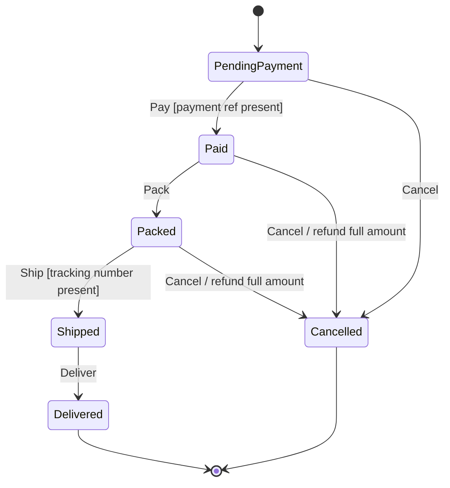
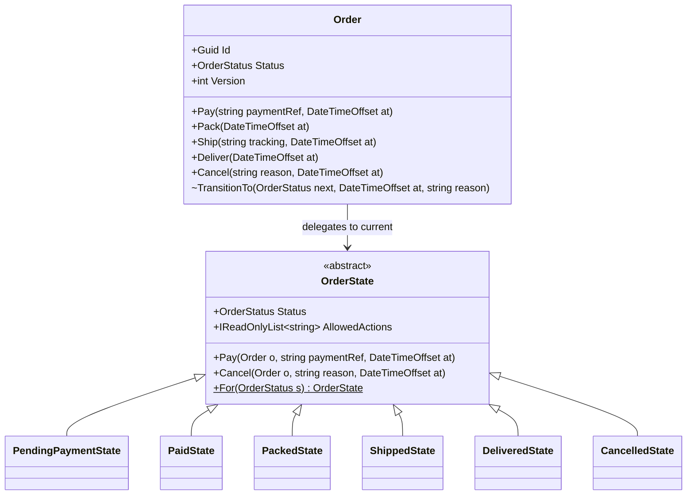
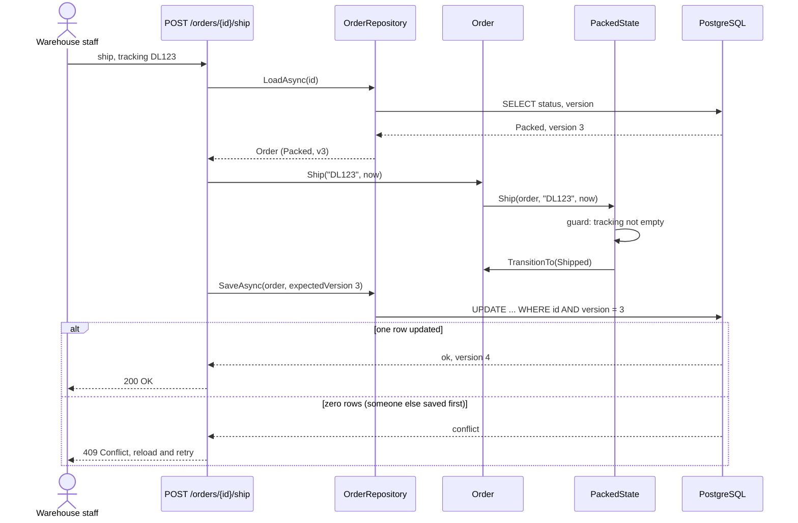
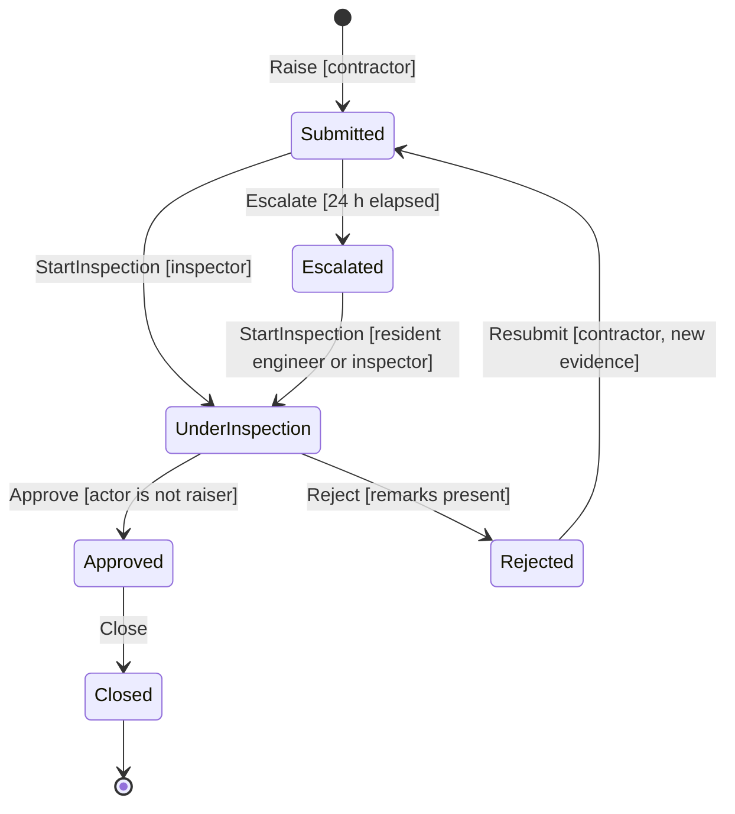

Almost every business object has a lifecycle. An order is placed, paid, packed, shipped and delivered. A leave request is drafted, submitted, approved or rejected. A drawing is submitted for review and returned for revision. What you are allowed to do with the object depends on where it is in that lifecycle. The State pattern gives each stage its own small class, so the rules for "what can happen now" live in one obvious place instead of being scattered through `if` statements.

## Learning objectives

By the end of this lesson you will be able to:

1. Spot the smell State fixes: the same `switch (status)` repeated in many methods, or a soup of boolean flags.
2. Name the participants (context, state interface, concrete states) and draw a state diagram, class diagram and sequence diagram for one lifecycle.
3. Implement an order lifecycle with state classes in C#, and an approval workflow with a transition table.
4. Persist state safely in PostgreSQL, and rebuild the state object when loading.
5. Guard against invalid transitions and against two users changing the same object at once (optimistic concurrency).
6. Choose between state classes, a transition table and a plain `switch`, and tell State apart from Strategy.

## Prerequisites

- [Strategy](#/lesson/m06-strategy): State has the same class shape; we compare them at the end.
- [State machine diagrams](#/lesson/m05-state-diagrams): states, transitions and guards in UML.
- [Encapsulation and invariant protection](#/lesson/m07-encapsulation-invariants): private setters and guard clauses.

## Explain it like I'm a beginner

Think of a railway level crossing gate. The same button press does different things depending on the gate's situation:

- If the gate is **open** and a train is coming, pressing "close" lowers it.
- If the gate is **closed**, pressing "close" does nothing.
- If the gate is **moving**, pressing "open" must wait until it stops.

The button is the same. The *situation* (the state) decides what happens.

Now an online order. "Cancel" means different things at different times:

- **Waiting for payment**: just cancel it. Nothing to refund.
- **Paid**: cancel it and refund ₹1,499 to the customer's UPI.
- **Shipped**: you can't cancel; the customer must request a return.
- **Delivered** or **Cancelled**: nothing more can happen.

The naive code puts a `switch (status)` inside `Cancel()`, another inside `Ship()`, another inside `Pay()`. Each new status means editing every one of those switches, and forgetting one creates a bug such as "you can ship a cancelled order".

The State idea: **give each situation its own class**. `PaidState` knows what cancel, pack and ship mean while the order is paid. `ShippedState` knows what they mean while it is shipped. The order itself just says "whatever state I'm in, you handle this".

- The order is the **context**.
- "Something that handles actions for one stage" is the **state interface**.
- `PaidState`, `ShippedState` and the others are **concrete states**.

## First-principles explanation

### What it is

State lets an object alter its behaviour when its internal state changes. The object appears to change its class. The context delegates state-dependent requests to a state object, and replaces that state object when a transition happens.

### The original problem

The Gang of Four example was a TCP connection. `Open()`, `Close()` and `Acknowledge()` behave differently in *Established*, *Listening* and *Closed*. Writing those as conditionals in every method made the connection class large and fragile. Moving each state's behaviour into its own class made each state readable on its own, and made adding a state a local change.

### How it works internally

1. The context (`Order`) has a reference to a current state, or a status value it maps to a state object.
2. Every state-dependent method on the context forwards the call: `public void Cancel(...) => State.Cancel(this, ...)`.
3. The concrete state checks its rules and, if the action is valid, asks the context to move to the next status.
4. Actions that are not valid in a state fall back to a base implementation that throws "invalid transition".

The fourth point is what makes the pattern safe. **Invalid by default** means a new action is forbidden everywhere until a state explicitly allows it.

### Three ways to build a state machine

| Approach | What it looks like | Best when |
|---|---|---|
| `switch` on an enum | `switch (Status) { case Paid: ... }` in a method or two | 2–4 states, little behaviour, one or two methods care |
| Transition table | Data: `(from, trigger) → (to, guard)` | Many states, but transitions mostly just change the status; you want to list "allowed actions" for the UI or load rules from configuration |
| State classes (GoF) | One class per state with real behaviour | States differ in **behaviour**, not just in allowed moves (refunds, notifications, calculations) |

Many real systems combine them: a table for the workflow's shape, and small state-specific behaviour in classes or handlers.

### Persisting state

Objects in memory are easy. Real lifecycles span days, so the state must live in the database. Three rules:

1. **Store the status, not the state object.** Save `status = 'Paid'` as text (readable in SQL, stable when enum values are reordered). When you load, map the status back to its state object. State classes should usually be **stateless**: any data (payment reference, tracking number) lives on the context, so one shared instance per state is enough.
2. **Constrain it in the database too.** A `CHECK (status IN (...))` constraint stops a bad deploy or a manual script from writing "Shiped".
3. **Guard against races.** Two warehouse staff press "Ship" on the same order at the same moment. Both load `Packed`, both pass the rule check, both save `Shipped`, and the customer gets two tracking numbers. Use **optimistic concurrency**: a `version` column checked in the `UPDATE ... WHERE id = @id AND version = @expected`. The second save affects zero rows and returns `409 Conflict`. In PostgreSQL you can also use the system column `xmin` as the concurrency token, which EF Core's Npgsql provider supports.

Keep a **history table** (`order_status_history`) as well: who moved it, from what, to what, when. Auditors, support staff and "why is this order stuck?" queries all need it.

### When it is useful

- An object has a clear lifecycle with **four or more** states.
- Several methods behave differently depending on the state.
- Invalid transitions are costly: double refunds, shipping cancelled orders, approving your own request.

### When it is unnecessary

- Two or three states with one method that cares. A `switch` expression is clearer.
- The "states" are really **configuration choices** that don't change over the object's life (payment provider, tax regime). That's Strategy.
- Long-running, multi-step processes across services with timers and compensation. That's a workflow engine or a [saga](#/lesson/m12-sagas), though each step may still use a small state machine.

### Trade-offs

| You gain | You pay |
|---|---|
| Each state's rules in one class | More classes; the whole lifecycle is spread across files (keep a diagram) |
| Invalid transitions forbidden by default | A new action means a new base method plus overrides |
| Adding a state rarely touches others | Persisting and rehydrating state needs care |
| Easy to test one state at a time | Transitions between states are implicit unless you also keep a table or diagram |

## Visual explanation

### State diagram: the order lifecycle



Read each arrow as "trigger [guard] / effect". `Pay` from `PendingPayment` is allowed only when a payment reference is supplied. `Cancel` from `Paid` or `Packed` has an **effect**: a refund is due. There is no arrow labelled `Cancel` out of `Shipped`, so that action must be rejected. Every missing arrow is a rule. This diagram is the specification; the code below implements exactly these arrows.

### Class diagram



`Order` is the **context**. It stores the status and the data, and forwards every lifecycle method to the state object for its current status. `OrderState` is an abstract base whose methods all throw "invalid transition" by default. Each concrete state overrides only the actions its arrows allow. `For(status)` maps a stored status to its shared, stateless state object. That is how a freshly loaded order gets the right behaviour. `TransitionTo` is `internal` (shown as `~`), so only states can move the order, never a controller.

### Sequence diagram



The order is loaded with its version. The controller calls `Ship`, the order forwards it to `PackedState`, which checks the guard and moves the order to `Shipped`. The save only succeeds if nobody else changed the order since it was loaded. The state classes protect **logical** validity ("can a packed order be shipped?"); the version check protects against **concurrent** changes ("is it still packed?"). You need both.

## Step-by-step example

### Step 1 — the naive version

```csharp
public void Cancel(string reason)
{
    if (Status == "Shipped" || Status == "Delivered") throw new InvalidOperationException();
    if (Status == "Paid" || Status == "Packed") RefundDue = Total;
    Status = "Cancelled";
}

public void Ship(string tracking)
{
    if (Status != "Packed") throw new InvalidOperationException();
    Tracking = tracking;
    Status = "Shipped";
}
// ...the same pattern in Pay, Pack, Deliver
```

With five methods and six states, the rules are spread across 30 combinations. Adding "OnHold" (fraud review) means opening every method. Note the bug waiting to happen: `Cancel` lists the states where cancel is *forbidden*. A new status is therefore *allowed* to cancel by default.

### Step 2 — a base class where everything is forbidden

Create `OrderState` with one virtual method per action, each throwing `InvalidTransitionException`. This flips the default: a new state allows nothing until you say so.

### Step 3 — one class per state, overriding only its arrows

`PaidState` overrides `Pack` and `Cancel`. `ShippedState` overrides only `Deliver`. `DeliveredState` overrides nothing. You can check each class against the state diagram arrow by arrow.

### Step 4 — the context forwards and exposes allowed actions

`Order.Ship(...)` becomes one line: `State.Ship(this, ...)`. The order also exposes `AllowedActions` from its current state, so the UI can show only the buttons that make sense.

### Step 5 — persistence and concurrency

The repository stores status as text with a version column. Loading maps the text back to the enum, and `OrderState.For(status)` gives the behaviour. Saving checks the version.

### Step 6 — a simpler workflow as a table

Drawing approval (Draft → Under review → Approved, or Returned for revision) has no state-specific behaviour beyond "which moves are allowed, and who may make them". A transition table is shorter and doubles as documentation.

## Production-style C# implementation

```text
Shop.Api/
  Program.cs
  Orders/
    OrderStatus.cs
    Order.cs
    OrderStates.cs
    OrderRepository.cs
  Approvals/
    DrawingApprovalWorkflow.cs
```

```csharp file=Orders/OrderStatus.cs
namespace Shop.Orders;

public enum OrderStatus { PendingPayment, Paid, Packed, Shipped, Delivered, Cancelled }

public sealed class InvalidTransitionException(string state, string action)
    : InvalidOperationException($"Cannot {action} when the status is {state}.")
{
    public string State { get; } = state;
    public string Action { get; } = action;
}

public sealed record StatusChange(OrderStatus From, OrderStatus To, DateTimeOffset At, string Reason);
```

```csharp file=Orders/Order.cs
namespace Shop.Orders;

/// <summary>Context. Holds the data; forwards lifecycle actions to the state for its current status.</summary>
public sealed class Order
{
    private readonly List<StatusChange> _pendingHistory = [];

    /// <summary>Used both for new orders and for rehydrating from the database.</summary>
    public Order(Guid id, decimal totalInr, OrderStatus status = OrderStatus.PendingPayment, int version = 0,
                 string? paymentRef = null, string? trackingNumber = null, decimal refundDueInr = 0m)
    {
        if (totalInr <= 0) throw new ArgumentOutOfRangeException(nameof(totalInr));
        Id = id; TotalInr = totalInr; Status = status; Version = version;
        PaymentRef = paymentRef; TrackingNumber = trackingNumber; RefundDueInr = refundDueInr;
    }

    public Guid Id { get; }
    public decimal TotalInr { get; }
    public OrderStatus Status { get; private set; }
    public int Version { get; private set; }
    public string? PaymentRef { get; private set; }
    public string? TrackingNumber { get; private set; }
    public decimal RefundDueInr { get; private set; }

    /// <summary>Transitions made since load, for the history table.</summary>
    public IReadOnlyList<StatusChange> PendingHistory => _pendingHistory;
    public IReadOnlyList<string> AllowedActions => State.AllowedActions;

    private OrderState State => OrderState.For(Status);

    public void Pay(string paymentRef, DateTimeOffset at) => State.Pay(this, paymentRef, at);
    public void Pack(DateTimeOffset at) => State.Pack(this, at);
    public void Ship(string trackingNumber, DateTimeOffset at) => State.Ship(this, trackingNumber, at);
    public void Deliver(DateTimeOffset at) => State.Deliver(this, at);
    public void Cancel(string reason, DateTimeOffset at) => State.Cancel(this, reason, at);

    // Only state classes (same assembly) can move the order or set lifecycle data.
    internal void TransitionTo(OrderStatus next, DateTimeOffset at, string reason)
    {
        _pendingHistory.Add(new StatusChange(Status, next, at, reason));
        Status = next;
    }
    internal void SetPaymentRef(string reference) => PaymentRef = reference;
    internal void SetTracking(string tracking) => TrackingNumber = tracking;
    internal void SetRefundDue(decimal amount) => RefundDueInr = amount;
    internal void MarkSaved(int newVersion) { Version = newVersion; _pendingHistory.Clear(); }
}
```

```csharp file=Orders/OrderStates.cs
namespace Shop.Orders;

/// <summary>
/// State base. Every action is INVALID unless a concrete state overrides it.
/// States are stateless: all data lives on Order, so one shared instance per status is enough.
/// </summary>
public abstract class OrderState
{
    public abstract OrderStatus Status { get; }
    public virtual IReadOnlyList<string> AllowedActions => [];

    public virtual void Pay(Order o, string paymentRef, DateTimeOffset at) => throw Invalid("pay");
    public virtual void Pack(Order o, DateTimeOffset at) => throw Invalid("pack");
    public virtual void Ship(Order o, string trackingNumber, DateTimeOffset at) => throw Invalid("ship");
    public virtual void Deliver(Order o, DateTimeOffset at) => throw Invalid("deliver");
    public virtual void Cancel(Order o, string reason, DateTimeOffset at) => throw Invalid("cancel");

    protected InvalidTransitionException Invalid(string action) => new(Status.ToString(), action);

    private static readonly IReadOnlyDictionary<OrderStatus, OrderState> ByStatus =
        new OrderState[]
        {
            new PendingPaymentState(), new PaidState(), new PackedState(),
            new ShippedState(), new DeliveredState(), new CancelledState(),
        }.ToDictionary(s => s.Status);

    public static OrderState For(OrderStatus status) =>
        ByStatus.TryGetValue(status, out var s) ? s : throw new ArgumentOutOfRangeException(nameof(status), status, "No state class.");
}

public sealed class PendingPaymentState : OrderState
{
    public override OrderStatus Status => OrderStatus.PendingPayment;
    public override IReadOnlyList<string> AllowedActions => ["pay", "cancel"];

    public override void Pay(Order o, string paymentRef, DateTimeOffset at)
    {
        if (string.IsNullOrWhiteSpace(paymentRef)) throw new ArgumentException("Payment reference is required.", nameof(paymentRef));
        o.SetPaymentRef(paymentRef);
        o.TransitionTo(OrderStatus.Paid, at, $"payment {paymentRef}");
    }

    public override void Cancel(Order o, string reason, DateTimeOffset at) =>
        o.TransitionTo(OrderStatus.Cancelled, at, reason);       // nothing paid, nothing to refund
}

public sealed class PaidState : OrderState
{
    public override OrderStatus Status => OrderStatus.Paid;
    public override IReadOnlyList<string> AllowedActions => ["pack", "cancel"];

    public override void Pack(Order o, DateTimeOffset at) => o.TransitionTo(OrderStatus.Packed, at, "packed");

    public override void Cancel(Order o, string reason, DateTimeOffset at)
    {
        o.SetRefundDue(o.TotalInr);
        o.TransitionTo(OrderStatus.Cancelled, at, reason);
    }
}

public sealed class PackedState : OrderState
{
    public override OrderStatus Status => OrderStatus.Packed;
    public override IReadOnlyList<string> AllowedActions => ["ship", "cancel"];

    public override void Ship(Order o, string trackingNumber, DateTimeOffset at)
    {
        if (string.IsNullOrWhiteSpace(trackingNumber)) throw new ArgumentException("Tracking number is required.", nameof(trackingNumber));
        o.SetTracking(trackingNumber);
        o.TransitionTo(OrderStatus.Shipped, at, $"shipped {trackingNumber}");
    }

    public override void Cancel(Order o, string reason, DateTimeOffset at)
    {
        o.SetRefundDue(o.TotalInr);
        o.TransitionTo(OrderStatus.Cancelled, at, reason);
    }
}

public sealed class ShippedState : OrderState
{
    public override OrderStatus Status => OrderStatus.Shipped;
    public override IReadOnlyList<string> AllowedActions => ["deliver"];
    public override void Deliver(Order o, DateTimeOffset at) => o.TransitionTo(OrderStatus.Delivered, at, "delivered");
}

public sealed class DeliveredState : OrderState
{
    public override OrderStatus Status => OrderStatus.Delivered;      // terminal: returns are a separate process
}

public sealed class CancelledState : OrderState
{
    public override OrderStatus Status => OrderStatus.Cancelled;      // terminal
}
```

The repository stores the status as **text** and checks the version on save. This in-memory version mimics what the PostgreSQL version does with a conditional `UPDATE`.

```csharp file=Orders/OrderRepository.cs
using System.Collections.Concurrent;

namespace Shop.Orders;

public sealed class ConcurrencyConflictException(Guid id) : Exception($"Order {id} was changed by someone else. Reload and retry.");

public interface IOrderRepository
{
    Task<Order?> LoadAsync(Guid id, CancellationToken ct);
    Task SaveAsync(Order order, CancellationToken ct);
}

/// <summary>Stores rows the way a database would: status as text, plus a version number.</summary>
public sealed class InMemoryOrderRepository : IOrderRepository
{
    private sealed record OrderRow(Guid Id, decimal TotalInr, string Status, int Version, string? PaymentRef, string? Tracking, decimal RefundDue);

    private readonly ConcurrentDictionary<Guid, OrderRow> _rows = new();
    private readonly ConcurrentQueue<(Guid OrderId, StatusChange Change)> _history = new();

    public Task<Order?> LoadAsync(Guid id, CancellationToken ct)
    {
        if (!_rows.TryGetValue(id, out var r)) return Task.FromResult<Order?>(null);
        var status = Enum.Parse<OrderStatus>(r.Status);          // text → enum → state object (via OrderState.For)
        return Task.FromResult<Order?>(new Order(r.Id, r.TotalInr, status, r.Version, r.PaymentRef, r.Tracking, r.RefundDue));
    }

    public Task SaveAsync(Order order, CancellationToken ct)
    {
        var newRow = new OrderRow(order.Id, order.TotalInr, order.Status.ToString(), order.Version + 1,
                                  order.PaymentRef, order.TrackingNumber, order.RefundDueInr);

        // Equivalent SQL: UPDATE orders SET ..., version = version + 1 WHERE id = @id AND version = @expected
        var saved = order.Version == 0
            ? _rows.TryAdd(order.Id, newRow)
            : _rows.TryGetValue(order.Id, out var current) && current.Version == order.Version
              && _rows.TryUpdate(order.Id, newRow, current);
        if (!saved) throw new ConcurrencyConflictException(order.Id);

        foreach (var change in order.PendingHistory) _history.Enqueue((order.Id, change));
        order.MarkSaved(newRow.Version);
        return Task.CompletedTask;
    }
}
```

The matching PostgreSQL schema:

```sql
CREATE TABLE orders (
    id              uuid PRIMARY KEY,
    total_inr       numeric(12,2) NOT NULL CHECK (total_inr > 0),
    status          text NOT NULL CHECK (status IN ('PendingPayment','Paid','Packed','Shipped','Delivered','Cancelled')),
    version         integer NOT NULL DEFAULT 1,
    payment_ref     text,
    tracking_number text,
    refund_due_inr  numeric(12,2) NOT NULL DEFAULT 0,
    -- a shipped order must have a tracking number, whatever the application does
    CONSTRAINT shipped_has_tracking CHECK (status NOT IN ('Shipped','Delivered') OR tracking_number IS NOT NULL)
);

CREATE TABLE order_status_history (
    order_id    uuid NOT NULL REFERENCES orders(id),
    from_status text NOT NULL,
    to_status   text NOT NULL,
    changed_at  timestamptz NOT NULL,
    reason      text NOT NULL
);
CREATE INDEX ON order_status_history (order_id, changed_at);

-- Guarded save: zero rows updated means a concurrent change; the API returns 409.
UPDATE orders
SET status = 'Shipped', tracking_number = 'DL123', version = version + 1
WHERE id = $1 AND version = $2
RETURNING version;
```

### A transition table for a simpler workflow

```csharp file=Approvals/DrawingApprovalWorkflow.cs
using Shop.Orders;

namespace Shop.Approvals;

public enum DrawingStatus { Draft, UnderReview, Approved, ReturnedForRevision }
public enum DrawingTrigger { Submit, Approve, Return, Revise }

/// <summary>Who is acting, and on whose drawing. Guards read this.</summary>
public sealed record DrawingActor(string UserId, string AuthorId, bool IsReviewer);

/// <summary>
/// Transition table: the whole workflow is visible in one array.
/// Use this shape when states differ only in which moves are allowed, not in behaviour.
/// </summary>
public static class DrawingApprovalWorkflow
{
    private sealed record Transition(DrawingStatus From, DrawingTrigger Trigger, DrawingStatus To, Func<DrawingActor, string?>? Guard = null);

    private static readonly Func<DrawingActor, string?> ReviewerNotAuthor =
        a => !a.IsReviewer ? "Only reviewers can do this." : a.UserId == a.AuthorId ? "You cannot review your own drawing." : null;

    private static readonly Func<DrawingActor, string?> AuthorOnly =
        a => a.UserId == a.AuthorId ? null : "Only the author can do this.";

    private static readonly Transition[] Table =
    [
        new(DrawingStatus.Draft,               DrawingTrigger.Submit,  DrawingStatus.UnderReview,         AuthorOnly),
        new(DrawingStatus.UnderReview,         DrawingTrigger.Approve, DrawingStatus.Approved,            ReviewerNotAuthor),
        new(DrawingStatus.UnderReview,         DrawingTrigger.Return,  DrawingStatus.ReturnedForRevision, ReviewerNotAuthor),
        new(DrawingStatus.ReturnedForRevision, DrawingTrigger.Revise,  DrawingStatus.Draft,               AuthorOnly),
    ];

    public static DrawingStatus Fire(DrawingStatus current, DrawingTrigger trigger, DrawingActor actor)
    {
        var t = Table.FirstOrDefault(x => x.From == current && x.Trigger == trigger)
                ?? throw new InvalidTransitionException(current.ToString(), trigger.ToString().ToLowerInvariant());
        if (t.Guard?.Invoke(actor) is { } reason) throw new UnauthorizedAccessException(reason);
        return t.To;
    }

    /// <summary>Drives the UI: show only buttons this user may press now.</summary>
    public static IEnumerable<DrawingTrigger> Permitted(DrawingStatus current, DrawingActor actor) =>
        Table.Where(t => t.From == current && t.Guard?.Invoke(actor) is null).Select(t => t.Trigger);
}
```

```csharp file=Program.cs
using Microsoft.AspNetCore.Mvc;
using Shop.Approvals;
using Shop.Orders;

var builder = WebApplication.CreateBuilder(args);
builder.Services.AddSingleton(TimeProvider.System);
builder.Services.AddSingleton<IOrderRepository, InMemoryOrderRepository>();
builder.Services.AddProblemDetails();

var app = builder.Build();

// One helper: load, apply a state action, save; map failures to HTTP status codes.
async Task<IResult> Act(Guid id, IOrderRepository repo, CancellationToken ct, Action<Order> action)
{
    var order = await repo.LoadAsync(id, ct);
    if (order is null) return Results.NotFound();
    try
    {
        action(order);
        await repo.SaveAsync(order, ct);
        return Results.Ok(new { order.Id, status = order.Status.ToString(), order.Version, order.AllowedActions, order.RefundDueInr });
    }
    catch (InvalidTransitionException ex) { return Results.Problem(ex.Message, statusCode: StatusCodes.Status409Conflict); }
    catch (ConcurrencyConflictException ex) { return Results.Problem(ex.Message, statusCode: StatusCodes.Status409Conflict); }
    catch (ArgumentException ex) { return Results.Problem(ex.Message, statusCode: StatusCodes.Status400BadRequest); }
}

app.MapPost("/orders", async (decimal totalInr, IOrderRepository repo, CancellationToken ct) =>
{
    var order = new Order(Guid.NewGuid(), totalInr);
    await repo.SaveAsync(order, ct);
    return Results.Created($"/orders/{order.Id}", new { order.Id, order.AllowedActions });
});

app.MapGet("/orders/{id:guid}", async (Guid id, IOrderRepository repo, CancellationToken ct) =>
    await repo.LoadAsync(id, ct) is { } o
        ? Results.Ok(new { o.Id, status = o.Status.ToString(), o.Version, o.AllowedActions })
        : Results.NotFound());

app.MapPost("/orders/{id:guid}/pay", (Guid id, [FromQuery] string paymentRef, IOrderRepository repo, TimeProvider clock, CancellationToken ct) =>
    Act(id, repo, ct, o => o.Pay(paymentRef, clock.GetUtcNow())));
app.MapPost("/orders/{id:guid}/pack", (Guid id, IOrderRepository repo, TimeProvider clock, CancellationToken ct) =>
    Act(id, repo, ct, o => o.Pack(clock.GetUtcNow())));
app.MapPost("/orders/{id:guid}/ship", (Guid id, [FromQuery] string tracking, IOrderRepository repo, TimeProvider clock, CancellationToken ct) =>
    Act(id, repo, ct, o => o.Ship(tracking, clock.GetUtcNow())));
app.MapPost("/orders/{id:guid}/deliver", (Guid id, IOrderRepository repo, TimeProvider clock, CancellationToken ct) =>
    Act(id, repo, ct, o => o.Deliver(clock.GetUtcNow())));
app.MapPost("/orders/{id:guid}/cancel", (Guid id, [FromQuery] string reason, IOrderRepository repo, TimeProvider clock, CancellationToken ct) =>
    Act(id, repo, ct, o => o.Cancel(reason, clock.GetUtcNow())));

app.MapPost("/drawings/fire", (DrawingStatus current, DrawingTrigger trigger, DrawingActor actor) =>
{
    try { return Results.Ok(new { status = DrawingApprovalWorkflow.Fire(current, trigger, actor).ToString() }); }
    catch (InvalidTransitionException ex) { return Results.Problem(ex.Message, statusCode: 409); }
    catch (UnauthorizedAccessException ex) { return Results.Problem(ex.Message, statusCode: 403); }
});

app.Run();
```

**Why 409 Conflict for an invalid transition?** The request is well-formed (so not 400) and the user may be allowed to perform the action in general (so not 403). It conflicts with the resource's **current state**, which is exactly what 409 means. Return the current status and allowed actions in the response so the client can refresh its buttons.

## Bad design vs good design

**Bad: boolean-flag soup.**

```csharp
public bool IsPaid, IsPacked, IsShipped, IsDelivered, IsCancelled;
```

Five booleans allow 32 combinations, but only 6 are meaningful. Nothing stops `IsCancelled && IsShipped`. Every method checks a different subset of flags. Reports disagree about which orders are "open". One `status` column with a `CHECK` constraint makes impossible combinations impossible.

**Bad: public setter on status.** `order.Status = OrderStatus.Shipped;` in a controller skips every guard. Keep the setter private and expose intent-revealing methods (`Ship`, `Cancel`).

**Good:** the implementation above. Invalid by default, one class per state, a private setter, a version check, and a history table.

**Is the full pattern worth it?** For a three-state "Active / Suspended / Closed" flag where only one method cares, no. A `switch` expression plus a private setter is enough:

```csharp
public void Suspend() => Status = Status switch
{
    AccountStatus.Active => AccountStatus.Suspended,
    _ => throw new InvalidTransitionException(Status.ToString(), "suspend"),
};
```

Move to a table when the number of transitions grows, and to state classes when states gain real behaviour.

:::callout type=tradeoff title="State classes vs a transition table"
State classes put behaviour next to the state ("cancelling a paid order creates a refund"), but the lifecycle's overall shape is spread across files. A transition table shows the whole shape in one screen and can generate the UI's allowed buttons, but behaviour has to live somewhere else (often in handlers keyed by transition). Libraries such as Stateless for .NET offer a fluent table with guards and entry/exit actions; they are worth considering when the table grows beyond what you want to maintain by hand.
:::

## Practical playground

The playground has a small ticket lifecycle with state classes. Try:

1. Call `Resolve()` on a `New` ticket and read the error.
2. Add an `OnHold` state that allows `Resume` (back to `InProgress`) and `Close`. Notice that no other state class changes.
3. Change `TicketState.Close` in the base class to *allow* closing by default, then add a state. Think about why "forbidden by default" is safer.

:::playground type=csharp title="Ticket lifecycle with state classes"
```csharp file=Program.cs
using System;

public sealed class Ticket
{
    public TicketState State { get; private set; } = new NewState();
    public string? Assignee { get; private set; }
    public void Assign(string who) => State.Assign(this, who);
    public void Resolve() => State.Resolve(this);
    public void Close() => State.Close(this);
    internal void MoveTo(TicketState next, string? assignee = null)
    {
        Console.WriteLine($"  {State.Name} -> {next.Name}");
        State = next;
        if (assignee is not null) Assignee = assignee;
    }
}

public abstract class TicketState
{
    public abstract string Name { get; }
    public virtual void Assign(Ticket t, string who) => throw Invalid("assign");
    public virtual void Resolve(Ticket t) => throw Invalid("resolve");
    public virtual void Close(Ticket t) => throw Invalid("close");
    protected InvalidOperationException Invalid(string action) => new($"Cannot {action} a ticket that is {Name}.");
}

public sealed class NewState : TicketState
{
    public override string Name => "New";
    public override void Assign(Ticket t, string who) => t.MoveTo(new InProgressState(), who);
}

public sealed class InProgressState : TicketState
{
    public override string Name => "InProgress";
    public override void Resolve(Ticket t) => t.MoveTo(new ResolvedState());
}

public sealed class ResolvedState : TicketState
{
    public override string Name => "Resolved";
    public override void Close(Ticket t) => t.MoveTo(new ClosedState());
}

public sealed class ClosedState : TicketState { public override string Name => "Closed"; }

public static class Program
{
    public static void Main()
    {
        var t = new Ticket();
        try { t.Resolve(); } catch (InvalidOperationException ex) { Console.WriteLine("  Rejected: " + ex.Message); }
        t.Assign("ravi@site-office");
        t.Resolve();
        t.Close();
        try { t.Assign("meera"); } catch (InvalidOperationException ex) { Console.WriteLine("  Rejected: " + ex.Message); }
        Console.WriteLine($"Final: {t.State.Name}, assignee {t.Assignee}");
    }
}
```
:::

## Exercises

:::exercise id=m06-state-ex1 difficulty=beginner kind=code title="Leave request transition table"
Implement a leave request workflow as a transition table.

| From | Trigger | To | Guard |
|---|---|---|---|
| Draft | Submit | Submitted | — |
| Draft | Cancel | Cancelled | — |
| Submitted | Approve | Approved | — |
| Submitted | Reject | Rejected | — |
| Submitted | Cancel | Cancelled | — |
| Approved | Cancel | Cancelled | only before the leave starts (`Today < StartDate`) |
::acceptance
- `Fire(Draft, Submit)` returns `Submitted`.
- `Fire(Rejected, Approve)` throws `InvalidTransitionException`.
- Cancelling an approved leave on or after its start date throws `InvalidTransitionException`.
- `Permitted(Submitted, ctx)` returns `Approve, Reject, Cancel` in table order.
::hint
Represent each row as a small record. What fields does a row need?
::hint
`record Row(LeaveStatus From, LeaveTrigger Trigger, LeaveStatus To, Func<LeaveContext, bool>? Guard)`.
::hint
`Fire` finds the row matching `From` and `Trigger` and checks the guard; `Permitted` filters rows by `From` and guard.
::hint
```csharp
var row = Rows.FirstOrDefault(r => r.From == current && r.Trigger == trigger && (r.Guard is null || r.Guard(ctx)));
return row?.To ?? throw new InvalidTransitionException(current.ToString(), trigger.ToString());
```
::starter
```csharp file=LeaveWorkflow.cs
using System;
using System.Collections.Generic;
using System.Linq;

public enum LeaveStatus { Draft, Submitted, Approved, Rejected, Cancelled }
public enum LeaveTrigger { Submit, Approve, Reject, Cancel }

public sealed record LeaveContext(DateOnly Today, DateOnly StartDate);

public sealed class InvalidTransitionException(string state, string trigger)
    : InvalidOperationException($"Cannot {trigger} a leave request that is {state}.");

public static class LeaveWorkflow
{
    public static LeaveStatus Fire(LeaveStatus current, LeaveTrigger trigger, LeaveContext ctx) =>
        throw new NotImplementedException();

    public static IReadOnlyList<LeaveTrigger> Permitted(LeaveStatus current, LeaveContext ctx) =>
        throw new NotImplementedException();
}
```
::tests
```csharp file=LeaveWorkflowTests.cs
using System;
using System.Collections.Generic;
using Xunit;

public class LeaveWorkflowTests
{
    private static readonly LeaveContext BeforeStart = new(new DateOnly(2026, 10, 18), new DateOnly(2026, 11, 2));
    private static readonly LeaveContext OnStart = new(new DateOnly(2026, 11, 2), new DateOnly(2026, 11, 2));

    [Theory]
    [InlineData(LeaveStatus.Draft, LeaveTrigger.Submit, LeaveStatus.Submitted)]
    [InlineData(LeaveStatus.Draft, LeaveTrigger.Cancel, LeaveStatus.Cancelled)]
    [InlineData(LeaveStatus.Submitted, LeaveTrigger.Approve, LeaveStatus.Approved)]
    [InlineData(LeaveStatus.Submitted, LeaveTrigger.Reject, LeaveStatus.Rejected)]
    [InlineData(LeaveStatus.Approved, LeaveTrigger.Cancel, LeaveStatus.Cancelled)]
    public void Valid_transitions(LeaveStatus from, LeaveTrigger trigger, LeaveStatus to) =>
        Assert.Equal(to, LeaveWorkflow.Fire(from, trigger, BeforeStart));

    [Fact]
    public void Invalid_transition_throws() =>
        Assert.Throws<InvalidTransitionException>(() => LeaveWorkflow.Fire(LeaveStatus.Rejected, LeaveTrigger.Approve, BeforeStart));

    [Fact]
    public void Cannot_cancel_approved_leave_once_started() =>
        Assert.Throws<InvalidTransitionException>(() => LeaveWorkflow.Fire(LeaveStatus.Approved, LeaveTrigger.Cancel, OnStart));

    [Fact]
    public void Permitted_lists_triggers_in_table_order() =>
        Assert.Equal(new List<LeaveTrigger> { LeaveTrigger.Approve, LeaveTrigger.Reject, LeaveTrigger.Cancel },
                     LeaveWorkflow.Permitted(LeaveStatus.Submitted, BeforeStart));

    [Fact]
    public void Terminal_states_permit_nothing()
    {
        Assert.Empty(LeaveWorkflow.Permitted(LeaveStatus.Cancelled, BeforeStart));
        Assert.Empty(LeaveWorkflow.Permitted(LeaveStatus.Approved, OnStart));
    }
}
```
::solution
```csharp file=LeaveWorkflow.cs
using System;
using System.Collections.Generic;
using System.Linq;

public enum LeaveStatus { Draft, Submitted, Approved, Rejected, Cancelled }
public enum LeaveTrigger { Submit, Approve, Reject, Cancel }

public sealed record LeaveContext(DateOnly Today, DateOnly StartDate);

public sealed class InvalidTransitionException(string state, string trigger)
    : InvalidOperationException($"Cannot {trigger} a leave request that is {state}.");

public static class LeaveWorkflow
{
    private sealed record Row(LeaveStatus From, LeaveTrigger Trigger, LeaveStatus To, Func<LeaveContext, bool>? Guard = null);

    private static readonly Row[] Rows =
    {
        new(LeaveStatus.Draft,     LeaveTrigger.Submit,  LeaveStatus.Submitted),
        new(LeaveStatus.Draft,     LeaveTrigger.Cancel,  LeaveStatus.Cancelled),
        new(LeaveStatus.Submitted, LeaveTrigger.Approve, LeaveStatus.Approved),
        new(LeaveStatus.Submitted, LeaveTrigger.Reject,  LeaveStatus.Rejected),
        new(LeaveStatus.Submitted, LeaveTrigger.Cancel,  LeaveStatus.Cancelled),
        new(LeaveStatus.Approved,  LeaveTrigger.Cancel,  LeaveStatus.Cancelled, c => c.Today < c.StartDate),
    };

    private static bool Allowed(Row r, LeaveContext ctx) => r.Guard is null || r.Guard(ctx);

    public static LeaveStatus Fire(LeaveStatus current, LeaveTrigger trigger, LeaveContext ctx)
    {
        var row = Rows.FirstOrDefault(r => r.From == current && r.Trigger == trigger && Allowed(r, ctx));
        return row?.To ?? throw new InvalidTransitionException(current.ToString(), trigger.ToString().ToLowerInvariant());
    }

    public static IReadOnlyList<LeaveTrigger> Permitted(LeaveStatus current, LeaveContext ctx) =>
        Rows.Where(r => r.From == current && Allowed(r, ctx)).Select(r => r.Trigger).ToList();
}
```
The table *is* the specification: a reviewer can compare it line by line with the HR policy. `Permitted` drives the UI so users never see a button that would fail.
::mistakes
- Using `DateTime.Now` inside the guard instead of passing "today" in, which makes the test depend on the calendar.
- Writing the guard as `Today <= StartDate`, which allows cancelling on the first day of leave.
- Returning `current` silently for invalid triggers. Callers then believe the action worked.
::extensions
Add a `Withdraw` trigger from `Submitted` back to `Draft` that only the applicant may use; add the actor to `LeaveContext`.
:::

:::exercise id=m06-state-ex2 difficulty=beginner kind=code title="Metro gate with state classes"
A metro station entry gate is **Locked** or **Unlocked**. Implement the two state classes. Each method returns the next state.

| State | Event | Effect | Next |
|---|---|---|---|
| Locked | valid card | charge fare | Unlocked |
| Locked | invalid card | raise alarm | Locked |
| Locked | push through | raise alarm (tailgating) | Locked |
| Unlocked | valid card | nothing (no second fare) | Unlocked |
| Unlocked | invalid card | nothing | Unlocked |
| Unlocked | push through | count entry | Locked |
::acceptance
- Valid card then pass: `FaresCharged = 1`, `Entries = 1`, final state `Locked`.
- Two valid taps before passing charge only one fare.
- Pushing a locked gate raises an alarm and stays locked.
::hint
The gate (context) only stores the current state and counters. Rules live in the states.
::hint
Each state method returns an `IGateState`. Returning `this` means "stay in this state".
::hint
States can be shared singletons (`LockedState.Instance`) because they hold no data.
::hint
```csharp
public IGateState TapCard(Gate g, bool valid)
{
    if (!valid) { g.Alarms++; return this; }
    g.FaresCharged++;
    return UnlockedState.Instance;
}
```
::starter
```csharp file=MetroGate.cs
using System;

public interface IGateState
{
    string Name { get; }
    IGateState TapCard(Gate gate, bool valid);
    IGateState Push(Gate gate);
}

public sealed class Gate
{
    public IGateState State { get; private set; } = LockedState.Instance;
    public int FaresCharged { get; internal set; }
    public int Entries { get; internal set; }
    public int Alarms { get; internal set; }

    public void TapCard(bool valid) => State = State.TapCard(this, valid);
    public void Push() => State = State.Push(this);
}

public sealed class LockedState : IGateState
{
    public static readonly LockedState Instance = new();
    public string Name => "Locked";
    public IGateState TapCard(Gate gate, bool valid) => throw new NotImplementedException();
    public IGateState Push(Gate gate) => throw new NotImplementedException();
}

public sealed class UnlockedState : IGateState
{
    public static readonly UnlockedState Instance = new();
    public string Name => "Unlocked";
    public IGateState TapCard(Gate gate, bool valid) => throw new NotImplementedException();
    public IGateState Push(Gate gate) => throw new NotImplementedException();
}
```
::tests
```csharp file=MetroGateTests.cs
using Xunit;

public class MetroGateTests
{
    [Fact]
    public void Tap_then_pass()
    {
        var g = new Gate();
        g.TapCard(valid: true);
        Assert.Equal("Unlocked", g.State.Name);
        g.Push();
        Assert.Equal("Locked", g.State.Name);
        Assert.Equal(1, g.FaresCharged);
        Assert.Equal(1, g.Entries);
    }

    [Fact]
    public void Double_tap_charges_once()
    {
        var g = new Gate();
        g.TapCard(true); g.TapCard(true);
        Assert.Equal(1, g.FaresCharged);
    }

    [Fact]
    public void Push_when_locked_raises_alarm()
    {
        var g = new Gate();
        g.Push();
        Assert.Equal(1, g.Alarms);
        Assert.Equal("Locked", g.State.Name);
        Assert.Equal(0, g.Entries);
    }

    [Fact]
    public void Invalid_card_when_locked_raises_alarm()
    {
        var g = new Gate();
        g.TapCard(false);
        Assert.Equal(1, g.Alarms);
        Assert.Equal(0, g.FaresCharged);
    }

    [Fact]
    public void Invalid_card_when_unlocked_is_ignored()
    {
        var g = new Gate();
        g.TapCard(true); g.TapCard(false);
        Assert.Equal("Unlocked", g.State.Name);
        Assert.Equal(0, g.Alarms);
    }
}
```
::solution
```csharp file=MetroGate.cs
using System;

public interface IGateState
{
    string Name { get; }
    IGateState TapCard(Gate gate, bool valid);
    IGateState Push(Gate gate);
}

public sealed class Gate
{
    public IGateState State { get; private set; } = LockedState.Instance;
    public int FaresCharged { get; internal set; }
    public int Entries { get; internal set; }
    public int Alarms { get; internal set; }

    public void TapCard(bool valid) => State = State.TapCard(this, valid);
    public void Push() => State = State.Push(this);
}

public sealed class LockedState : IGateState
{
    public static readonly LockedState Instance = new();
    public string Name => "Locked";

    public IGateState TapCard(Gate gate, bool valid)
    {
        if (!valid) { gate.Alarms++; return this; }
        gate.FaresCharged++;
        return UnlockedState.Instance;
    }

    public IGateState Push(Gate gate)
    {
        gate.Alarms++;          // tailgating attempt
        return this;
    }
}

public sealed class UnlockedState : IGateState
{
    public static readonly UnlockedState Instance = new();
    public string Name => "Unlocked";

    public IGateState TapCard(Gate gate, bool valid) => this;   // already open: never charge twice

    public IGateState Push(Gate gate)
    {
        gate.Entries++;
        return LockedState.Instance;
    }
}
```
This variant lets each state **choose its successor** by returning it. The production `Order` instead asks the context to `TransitionTo(status)`, which suits persistence because the status enum is what you store.
::mistakes
- Putting `if (State is LockedState)` checks inside `Gate`, which brings back the switch the pattern removes.
- Creating `new UnlockedState()` on every tap. Harmless here, but shared instances make it clear states hold no data.
:::

:::exercise id=m06-state-ex3 difficulty=intermediate kind=code title="Order states with guards and refunds"
Implement the `Paid`, `Packed` and `Shipped` states of an order. The base class already forbids everything.
::requirements
- **Paid**: `Pack` → Packed. `Cancel` → Cancelled with `RefundDue = Total`.
- **Packed**: `Ship(tracking)` → Shipped; blank tracking throws `ArgumentException` and changes nothing. `Cancel` → Cancelled with full refund.
- **Shipped**: `Deliver` → Delivered. `Cancel` stays forbidden.
- Every successful transition appends `"From->To"` to `History`.
::acceptance
- A ₹1,499 order paid then cancelled has `RefundDue = 1499` and history `PendingPayment->Paid`, `Paid->Cancelled`.
- Shipping with `"  "` throws and the order stays `Packed`.
- Cancelling a shipped order throws `InvalidTransitionException`.
- The full happy path ends `Delivered` with four history entries.
::hint
Each concrete state overrides only the methods its arrows allow. Leave the rest to the base class.
::hint
Use `o.MoveTo(OrderStatus.X)` (provided on `Order`) to change status and record history.
::hint
Check the guard **before** touching the order, so a failed guard leaves no partial changes.
::hint
```csharp
public override void Ship(Order o, string tracking)
{
    if (string.IsNullOrWhiteSpace(tracking)) throw new ArgumentException("Tracking required", nameof(tracking));
    o.Tracking = tracking;
    o.MoveTo(OrderStatus.Shipped);
}
```
::starter
```csharp file=OrderStates.cs
using System;
using System.Collections.Generic;

public enum OrderStatus { PendingPayment, Paid, Packed, Shipped, Delivered, Cancelled }

public sealed class InvalidTransitionException(OrderStatus s, string action)
    : InvalidOperationException($"Cannot {action} when {s}.");

public sealed class Order(decimal total)
{
    public decimal Total { get; } = total;
    public OrderStatus Status { get; private set; } = OrderStatus.PendingPayment;
    public decimal RefundDue { get; internal set; }
    public string? Tracking { get; internal set; }
    public List<string> History { get; } = new();

    private OrderState State => OrderState.For(Status);
    public void Pay() => State.Pay(this);
    public void Pack() => State.Pack(this);
    public void Ship(string tracking) => State.Ship(this, tracking);
    public void Deliver() => State.Deliver(this);
    public void Cancel() => State.Cancel(this);

    internal void MoveTo(OrderStatus next) { History.Add($"{Status}->{next}"); Status = next; }
}

public abstract class OrderState
{
    public abstract OrderStatus Status { get; }
    public virtual void Pay(Order o) => throw new InvalidTransitionException(Status, "pay");
    public virtual void Pack(Order o) => throw new InvalidTransitionException(Status, "pack");
    public virtual void Ship(Order o, string tracking) => throw new InvalidTransitionException(Status, "ship");
    public virtual void Deliver(Order o) => throw new InvalidTransitionException(Status, "deliver");
    public virtual void Cancel(Order o) => throw new InvalidTransitionException(Status, "cancel");

    public static OrderState For(OrderStatus s) => s switch
    {
        OrderStatus.PendingPayment => new PendingPaymentState(),
        OrderStatus.Paid => new PaidState(),
        OrderStatus.Packed => new PackedState(),
        OrderStatus.Shipped => new ShippedState(),
        _ => new TerminalState(s),
    };
}

public sealed class PendingPaymentState : OrderState
{
    public override OrderStatus Status => OrderStatus.PendingPayment;
    public override void Pay(Order o) => o.MoveTo(OrderStatus.Paid);
    public override void Cancel(Order o) => o.MoveTo(OrderStatus.Cancelled);
}

public sealed class PaidState : OrderState
{
    public override OrderStatus Status => OrderStatus.Paid;
    public override void Pack(Order o) => throw new NotImplementedException();
    public override void Cancel(Order o) => throw new NotImplementedException();
}

public sealed class PackedState : OrderState
{
    public override OrderStatus Status => OrderStatus.Packed;
    public override void Ship(Order o, string tracking) => throw new NotImplementedException();
    public override void Cancel(Order o) => throw new NotImplementedException();
}

public sealed class ShippedState : OrderState
{
    public override OrderStatus Status => OrderStatus.Shipped;
    public override void Deliver(Order o) => throw new NotImplementedException();
}

public sealed class TerminalState(OrderStatus s) : OrderState
{
    public override OrderStatus Status => s;
}
```
::tests
```csharp file=OrderStatesTests.cs
using System;
using System.Collections.Generic;
using Xunit;

public class OrderStatesTests
{
    [Fact]
    public void Paid_then_cancelled_refunds_in_full()
    {
        var o = new Order(1499m);
        o.Pay(); o.Cancel();
        Assert.Equal(OrderStatus.Cancelled, o.Status);
        Assert.Equal(1499m, o.RefundDue);
        Assert.Equal(new List<string> { "PendingPayment->Paid", "Paid->Cancelled" }, o.History);
    }

    [Fact]
    public void Packed_cancel_refunds_too()
    {
        var o = new Order(800m);
        o.Pay(); o.Pack(); o.Cancel();
        Assert.Equal(800m, o.RefundDue);
    }

    [Fact]
    public void Blank_tracking_is_rejected_and_nothing_changes()
    {
        var o = new Order(500m);
        o.Pay(); o.Pack();
        Assert.Throws<ArgumentException>(() => o.Ship("  "));
        Assert.Equal(OrderStatus.Packed, o.Status);
        Assert.Null(o.Tracking);
    }

    [Fact]
    public void Shipped_cannot_be_cancelled()
    {
        var o = new Order(500m);
        o.Pay(); o.Pack(); o.Ship("DL123");
        Assert.Throws<InvalidTransitionException>(() => o.Cancel());
        Assert.Equal(OrderStatus.Shipped, o.Status);
    }

    [Fact]
    public void Happy_path_reaches_delivered()
    {
        var o = new Order(500m);
        o.Pay(); o.Pack(); o.Ship("DL123"); o.Deliver();
        Assert.Equal(OrderStatus.Delivered, o.Status);
        Assert.Equal(4, o.History.Count);
        Assert.Equal("DL123", o.Tracking);
        Assert.Equal(0m, o.RefundDue);
    }

    [Fact]
    public void Delivered_is_terminal() 
    {
        var o = new Order(500m);
        o.Pay(); o.Pack(); o.Ship("DL123"); o.Deliver();
        Assert.Throws<InvalidTransitionException>(() => o.Deliver());
    }
}
```
::solution
```csharp file=OrderStates.cs
using System;
using System.Collections.Generic;

public enum OrderStatus { PendingPayment, Paid, Packed, Shipped, Delivered, Cancelled }

public sealed class InvalidTransitionException(OrderStatus s, string action)
    : InvalidOperationException($"Cannot {action} when {s}.");

public sealed class Order(decimal total)
{
    public decimal Total { get; } = total;
    public OrderStatus Status { get; private set; } = OrderStatus.PendingPayment;
    public decimal RefundDue { get; internal set; }
    public string? Tracking { get; internal set; }
    public List<string> History { get; } = new();

    private OrderState State => OrderState.For(Status);
    public void Pay() => State.Pay(this);
    public void Pack() => State.Pack(this);
    public void Ship(string tracking) => State.Ship(this, tracking);
    public void Deliver() => State.Deliver(this);
    public void Cancel() => State.Cancel(this);

    internal void MoveTo(OrderStatus next) { History.Add($"{Status}->{next}"); Status = next; }
}

public abstract class OrderState
{
    public abstract OrderStatus Status { get; }
    public virtual void Pay(Order o) => throw new InvalidTransitionException(Status, "pay");
    public virtual void Pack(Order o) => throw new InvalidTransitionException(Status, "pack");
    public virtual void Ship(Order o, string tracking) => throw new InvalidTransitionException(Status, "ship");
    public virtual void Deliver(Order o) => throw new InvalidTransitionException(Status, "deliver");
    public virtual void Cancel(Order o) => throw new InvalidTransitionException(Status, "cancel");

    public static OrderState For(OrderStatus s) => s switch
    {
        OrderStatus.PendingPayment => new PendingPaymentState(),
        OrderStatus.Paid => new PaidState(),
        OrderStatus.Packed => new PackedState(),
        OrderStatus.Shipped => new ShippedState(),
        _ => new TerminalState(s),
    };
}

public sealed class PendingPaymentState : OrderState
{
    public override OrderStatus Status => OrderStatus.PendingPayment;
    public override void Pay(Order o) => o.MoveTo(OrderStatus.Paid);
    public override void Cancel(Order o) => o.MoveTo(OrderStatus.Cancelled);
}

public sealed class PaidState : OrderState
{
    public override OrderStatus Status => OrderStatus.Paid;
    public override void Pack(Order o) => o.MoveTo(OrderStatus.Packed);
    public override void Cancel(Order o)
    {
        o.RefundDue = o.Total;
        o.MoveTo(OrderStatus.Cancelled);
    }
}

public sealed class PackedState : OrderState
{
    public override OrderStatus Status => OrderStatus.Packed;

    public override void Ship(Order o, string tracking)
    {
        if (string.IsNullOrWhiteSpace(tracking)) throw new ArgumentException("Tracking number is required.", nameof(tracking));
        o.Tracking = tracking.Trim();
        o.MoveTo(OrderStatus.Shipped);
    }

    public override void Cancel(Order o)
    {
        o.RefundDue = o.Total;
        o.MoveTo(OrderStatus.Cancelled);
    }
}

public sealed class ShippedState : OrderState
{
    public override OrderStatus Status => OrderStatus.Shipped;
    public override void Deliver(Order o) => o.MoveTo(OrderStatus.Delivered);
}

public sealed class TerminalState(OrderStatus s) : OrderState
{
    public override OrderStatus Status => s;
}
```
`PaidState.Cancel` and `PackedState.Cancel` are identical. If a third state needed the same logic, move it into a protected helper on the base class (`CancelWithFullRefund(o)`), not into a shared `if` in `Order`.
::mistakes
- Setting `Tracking` before validating it, which leaves a half-updated order on failure.
- Overriding `Cancel` in `ShippedState` to "do nothing". Silent no-ops look like success to the caller.
- Calculating the refund in the controller, which duplicates the rule wherever cancel is called.
:::

:::exercise id=m06-state-ex4 difficulty=intermediate kind=sql title="Find orders stuck in Packed"
Operations wants a list of orders that are **currently** `Packed` and entered `Packed` more than 48 hours before `2026-10-18 12:00:00+05:30`. Return `id` and `packed_at` (the time the order most recently entered `Packed`), oldest first.
::setup
```sql
CREATE TABLE orders (
  id int PRIMARY KEY,
  status text NOT NULL CHECK (status IN ('PendingPayment','Paid','Packed','Shipped','Delivered','Cancelled')),
  version int NOT NULL
);
CREATE TABLE order_status_history (
  order_id int NOT NULL REFERENCES orders(id),
  from_status text NOT NULL,
  to_status text NOT NULL,
  changed_at timestamptz NOT NULL
);
INSERT INTO orders VALUES (1001,'Packed',3),(1002,'Packed',3),(1003,'Shipped',4),(1004,'Paid',2),(1005,'Packed',3);
INSERT INTO order_status_history VALUES
 (1001,'PendingPayment','Paid','2026-10-15 08:10+05:30'),
 (1001,'Paid','Packed','2026-10-15 09:00+05:30'),
 (1002,'PendingPayment','Paid','2026-10-17 19:00+05:30'),
 (1002,'Paid','Packed','2026-10-17 20:00+05:30'),
 (1003,'PendingPayment','Paid','2026-10-13 10:00+05:30'),
 (1003,'Paid','Packed','2026-10-14 10:00+05:30'),
 (1003,'Packed','Shipped','2026-10-15 10:00+05:30'),
 (1004,'PendingPayment','Paid','2026-10-10 10:00+05:30'),
 (1005,'PendingPayment','Paid','2026-10-16 10:00+05:30'),
 (1005,'Paid','Packed','2026-10-16 11:59+05:30');
```
::check
```sql
SELECT o.id, max(h.changed_at) AS packed_at
FROM orders o
JOIN order_status_history h ON h.order_id = o.id AND h.to_status = 'Packed'
WHERE o.status = 'Packed'
GROUP BY o.id
HAVING max(h.changed_at) < timestamptz '2026-10-18 12:00:00+05:30' - interval '48 hours'
ORDER BY packed_at;
```
::acceptance
- Returns orders 1001 and 1005, in that order.
- Order 1003 is excluded even though it was packed long ago, because it is no longer `Packed`.
- Uses a fixed reference time, not `now()`, so the result is repeatable.
::hint
Two conditions come from two tables: the current status from `orders`, the time from `order_status_history`.
::hint
An order could enter `Packed` more than once (for example after a fraud hold). Which of those times matters?
::hint
Join on `to_status = 'Packed'`, group by order, and filter on `max(changed_at)` in a `HAVING` clause.
::hint
`timestamptz '2026-10-18 12:00:00+05:30' - interval '48 hours'` gives the cut-off: 2026-10-16 12:00 IST.
::solution
```sql
SELECT o.id, max(h.changed_at) AS packed_at
FROM orders o
JOIN order_status_history h ON h.order_id = o.id AND h.to_status = 'Packed'
WHERE o.status = 'Packed'
GROUP BY o.id
HAVING max(h.changed_at) < timestamptz '2026-10-18 12:00:00+05:30' - interval '48 hours'
ORDER BY packed_at;
```
Order 1005 entered `Packed` at 11:59 on 16 October, one minute before the cut-off, so it is included. In production, an index on `order_status_history (order_id, changed_at)` and a partial index `ON orders (id) WHERE status = 'Packed'` keep this fast as history grows. A scheduled job can run this query and raise alerts, which is how "timeouts" are usually added to state machines that live in a database.
::mistakes
- Filtering only on history (`to_status = 'Packed'`) and forgetting the current status, which includes order 1003.
- Using `now()`, which makes the result change every time it is run.
- Using `min(changed_at)` when an order has re-entered `Packed`.
:::

:::exercise id=m06-state-ex5 difficulty=advanced kind=design title="Refactor a boolean-flag RFI workflow"
On a highway project, contractors raise a **Request for Inspection (RFI)** before covering work (for example, before laying bitumen over a prepared base). The current code:

```csharp
public class Rfi
{
    public bool IsSubmitted, IsInspected, IsApproved, IsRejected, IsClosed;
    public string? InspectorId;
    public DateTime? InspectedAt;
}

public void Approve(Rfi rfi, string userId)
{
    if (!rfi.IsSubmitted) throw new Exception("not submitted");
    if (rfi.IsClosed) throw new Exception("closed");
    rfi.IsInspected = true; rfi.IsApproved = true;
    rfi.InspectorId = userId; rfi.InspectedAt = DateTime.Now;
    _db.SaveChanges();
}
// Reject, Resubmit, Close, Escalate follow the same pattern
```

Production data contains RFIs where `IsApproved` and `IsRejected` are both true, and RFIs approved by the contractor who raised them. Two inspectors sometimes act on the same RFI within seconds. RFIs not inspected within 24 hours must be escalated to the resident engineer.

Design the replacement.
::acceptance
- A state diagram covering Submitted, UnderInspection, Approved, Rejected, Resubmitted (or a loop back), Escalated and Closed, with guards.
- A choice between state classes and a transition table, with a reason.
- A database design: status column with constraints, version column, history table.
- How concurrent inspector actions are handled, and what the API returns.
- How the 24-hour escalation is triggered without a timer per RFI in memory.
- A migration plan for existing rows with contradictory flags.
::hint
Start with the diagram. Every pair of flags that can't both be true is a sign they are really one status.
::hint
"Approved by the contractor who raised it" is a guard on the transition, not a state.
::hint
Concurrency: optimistic version check plus 409. Escalation: a scheduled query like the one in exercise 4, firing an `Escalate` trigger through the same state machine.
::hint
Migration: map flags to a status with a `CASE` expression ordered by priority (Closed > Approved > Rejected > Submitted) and put contradictions in a review report before the cut-over.
::solution


**Classes or table?** A **transition table** for the shape (seven states, nine transitions, guards on actor role) because the UI needs "allowed actions" and the QA team wants to review the rules as data. Two transitions have real behaviour (Approve records inspector and timestamp and unlocks the next activity; Reject requires remarks and notifies the contractor). Put that behaviour in small handlers keyed by trigger, or in methods on the `Rfi` entity called after the table approves the move. If more states gain behaviour, switch to state classes.

**Database**
- `rfis.status text NOT NULL CHECK (status IN (...))`, `version int`, `raised_by`, `inspected_by`, `inspected_at timestamptz`.
- `CHECK (status <> 'Approved' OR inspected_by IS NOT NULL)` and `CHECK (inspected_by IS NULL OR inspected_by <> raised_by)` so the database rejects impossible rows even if code regresses.
- `rfi_status_history(rfi_id, from_status, to_status, actor, at, remarks)` for audit.

**Concurrency**: `UPDATE rfis SET status = 'Approved', version = version + 1, ... WHERE id = @id AND version = @v`. Zero rows → `409 Conflict` with the current status and allowed actions, so the second inspector sees "already approved by X at 14:02" instead of overwriting it.

**Escalation**: a `BackgroundService` runs every 5 minutes: `SELECT id, version FROM rfis WHERE status = 'Submitted' AND submitted_at < now() - interval '24 hours'`. For each row it fires `Escalate` through the same workflow and guarded update. If an inspector started inspection meanwhile, the version check fails and the escalation is skipped. No in-memory timers, survives restarts, scales to many RFIs.

**Migration**: compute a status with `CASE WHEN is_closed THEN 'Closed' WHEN is_approved AND NOT is_rejected THEN 'Approved' WHEN is_rejected AND NOT is_approved THEN 'Rejected' WHEN is_inspected THEN 'UnderInspection' WHEN is_submitted THEN 'Submitted' END`; rows where both approved and rejected are true, or approved by the raiser, go to a report for the quality team to resolve before the constraints are switched on. Keep the old columns read-only for one release, then drop them.
::mistakes
- Modelling "Escalated" as a boolean next to the status, which recreates the flag soup.
- Using an in-memory `Timer` per RFI for the 24-hour rule; timers vanish on restart and don't scale across servers.
- Letting the escalation job write the status directly instead of going through the same guarded transition.
- Adding constraints before cleaning the data, which makes the migration fail halfway.
:::

## Automated testing

State machines reward systematic tests.

**1. Every valid transition, as a table-driven test.** One `[Theory]` row per arrow in the diagram: from, action, expected status. If someone deletes an override, a row fails.

**2. Every invalid transition.** The arrows you *didn't* draw are rules too. Generate all combinations of status × action, subtract the valid ones, and assert each remaining combination throws `InvalidTransitionException` and leaves the order unchanged.

```csharp
public static IEnumerable<(OrderStatus From, string Action)> InvalidPairs()
{
    var valid = new HashSet<(OrderStatus, string)>
    {
        (OrderStatus.PendingPayment, "pay"), (OrderStatus.PendingPayment, "cancel"),
        (OrderStatus.Paid, "pack"), (OrderStatus.Paid, "cancel"),
        (OrderStatus.Packed, "ship"), (OrderStatus.Packed, "cancel"),
        (OrderStatus.Shipped, "deliver"),
    };
    string[] actions = ["pay", "pack", "ship", "deliver", "cancel"];
    foreach (var s in Enum.GetValues<OrderStatus>())
        foreach (var a in actions)
            if (!valid.Contains((s, a))) yield return (s, a);
}
```

With 6 states and 5 actions there are 30 pairs: 7 valid, 23 invalid. Testing all 23 takes milliseconds and catches the "new status is allowed to cancel by default" bug.

**3. Guards and effects.** Blank tracking number, refund amounts, self-approval in the drawing workflow.

**4. Rehydration.** Save an order in each status, load it, and check that `AllowedActions` match. This catches a status string that no longer parses after someone renames an enum member, which is why storing text and testing round trips matters.

**5. Concurrency.** Load the same order twice, save the first copy, then assert that saving the second throws `ConcurrencyConflictException`. With a real PostgreSQL in integration tests (for example, in a container), run the same test against the conditional `UPDATE`.

**Extensibility check.** Add an `OnHold` state in a test branch. Only the new class, its `For` mapping and the valid-pairs table should change. If `Order` or other states change, the design has leaked.

## Real-world application

- **E-commerce and food delivery**: order, payment, shipment and return lifecycles. Each is usually its own small state machine, linked by events.
- **Approvals**: leave requests, purchase orders, expense claims, drawing and RFI approvals on construction projects. Guards check roles ("not your own request") and amounts.
- **Payments**: a payment intent moves through created → authorised → captured → refunded. Payment providers document such lifecycles publicly, and integrating code must reject out-of-order webhooks using the same "invalid by default" idea.
- **Infrastructure**: TCP connections (the GoF example), circuit breakers (Closed → Open → Half-open) and ASP.NET Core's own connection handling are state machines.
- **Government services**: a grievance or application typically moves through registered → assigned → in progress → resolved → closed, with escalation timers per stage, implemented exactly like exercise 5.

## Interview questions

:::interview
::q beginner
What problem does the State pattern solve?
::a
It removes repeated `switch (status)` or boolean-flag checks from every method of an object whose behaviour depends on its lifecycle stage. Each stage becomes a class that implements the actions valid in that stage. The context forwards calls to the current state, and invalid actions are rejected by default.
::q beginner
What are the participants?
::a
**Context**: the object with the lifecycle (an `Order`); it holds the current status and data and forwards calls. **State interface or abstract class**: one method per action, defaulting to "invalid". **Concrete states**: one per stage, overriding only allowed actions and triggering transitions.
::q intermediate
State and Strategy have the same class diagram. How do they differ?
::a
In Strategy, the client or configuration chooses the algorithm, it rarely changes during the object's life, and strategies don't know about each other. In State, the object's lifecycle drives the change, transitions happen as a result of actions, and states know which state comes next. Ask: "does this change because someone picked it, or because something happened to the object?"
::q intermediate
How do you persist an object that uses the State pattern?
::a
Store the status as a stable value (text is safest), not the state object. When loading, map the status to its state object, ideally a shared stateless instance. Keep data on the context. Add a database `CHECK` constraint on the status and invariant constraints (shipped implies tracking number). Use a version column for optimistic concurrency, and a history table for audit.
::q advanced
Two users approve the same purchase order within a second. Both see "Submitted". What happens in your design?
::a
Both requests load version 5 and the state check passes for both. The first `UPDATE ... WHERE id = @id AND version = 5` succeeds and sets version 6. The second matches zero rows, so the repository throws a concurrency exception and the API returns `409 Conflict` with the current status ("Approved by Priya at 10:41"). Without the version check, both would succeed, and any side effects (notifications, budget commitments) would run twice. Side effects should also be triggered after commit via an outbox, so a failed save never leaves a sent email.
::q advanced
When would you use a workflow engine instead of a hand-written state machine?
::a
When the process spans multiple services and long periods, needs durable timers ("escalate after 3 days"), compensation steps, human tasks with assignment and reminders, versioning of the process while instances are in flight, or a visual designer for business users. For a single aggregate with a handful of states, a hand-written state machine (classes or table) plus a scheduled job for timeouts is simpler, faster and easier to test.
:::

## Summary and revision

**Key takeaways**

- State moves "what can happen now" into one class per lifecycle stage, so behaviour changes with status without a `switch` in every method.
- Make every action **invalid by default** and override only the allowed transitions.
- Use a transition table when states differ only in allowed moves; use state classes when states have their own behaviour; use a `switch` for tiny cases.
- Persist the status as text, rebuild the state object on load, constrain the column in PostgreSQL, keep a history table.
- Logical validity (state rules) and concurrent validity (version check) are separate problems. Solve both, and return `409 Conflict` for either.

**Terminology**: context, concrete state, transition, trigger, guard, effect, terminal state, transition table, rehydration, optimistic concurrency, status history.

:::flashcards
Q: What are the participants of the State pattern?
A: Context, state interface (or abstract base), concrete states.
Q: Why make every action invalid by default in the base state?
A: A new state or action is then forbidden until explicitly allowed, instead of silently permitted.
Q: State vs Strategy in one line?
A: Strategy is chosen by the client; State changes itself as the object moves through its lifecycle.
Q: How should state be persisted?
A: As a stable status value (text) on the row; map it back to a (stateless) state object on load.
Q: Which HTTP status fits "cannot ship a cancelled order"?
A: 409 Conflict — the request conflicts with the resource's current state.
Q: How do you stop two users making the same transition at once?
A: Optimistic concurrency: UPDATE ... WHERE id = @id AND version = @expected; zero rows means conflict.
Q: When is a transition table better than state classes?
A: When states differ only in which moves are allowed (plus guards), and you want the whole workflow visible as data.
Q: How are time-based transitions (escalate after 24 h) usually implemented?
A: A scheduled job queries overdue rows and fires the transition through the same guarded state machine.
:::

## Knowledge check

:::quiz pass=70
::q single
An `Order` has five methods, each starting with `switch (Status)`. Product adds an `OnHold` status for fraud review. What is the main risk of the current design?
- [ ] The code will run more slowly.
- [x] Some of the five switches will be forgotten, so OnHold orders may be shippable or cancellable by accident.
- [ ] Enums cannot have new values.
- [ ] The database will reject the new status.
> Scattered switches spread one rule across many places. State classes (invalid by default) make a new state forbid everything until you allow it.
::q single
Which situation is better modelled with Strategy than State?
- [ ] A leave request moving from Draft to Submitted to Approved.
- [x] Choosing a GST calculation method based on the supplier's registration type, fixed when the invoice is created.
- [ ] An RFI escalating after 24 hours.
- [ ] A TCP connection moving from Listening to Established.
> The calculation is chosen once and doesn't change through a lifecycle. That's Strategy.
::q single
How should the current state of an order be stored in PostgreSQL?
- [ ] As a serialised `PaidState` object in a JSON column.
- [x] As a text status column with a CHECK constraint, mapped back to a state object on load.
- [ ] As five boolean columns.
- [ ] It should not be stored; recompute it from the history on every request.
> Text is readable, stable under enum reordering and constrainable. Boolean flags allow impossible combinations.
::q single
Two warehouse staff press "Ship" on the same packed order at the same time. Both pass the state check. What prevents a double shipment?
- [ ] The state classes.
- [ ] Making `ShippedState` a singleton.
- [x] A version check in the UPDATE, so the second save affects zero rows and returns 409.
- [ ] A `lock` statement in the controller.
> State rules check logic against a loaded copy; only the database can detect that the row changed since it was loaded. A C# `lock` doesn't work across multiple servers.
::q multi
Which are good reasons to choose a transition table over state classes? (Select all that apply.)
- [x] The UI must show allowed actions for the current status.
- [x] States differ only in which transitions are allowed, plus role-based guards.
- [ ] Each state has complex, different calculation logic.
- [x] Business analysts want to review the workflow as a list of rows.
> Tables shine for shape and allowed moves. Rich per-state behaviour is where classes earn their keep.
::q single
A "Cancel" request arrives for a delivered order. What should the API do?
- [ ] Return 200 and do nothing.
- [ ] Return 500 because an exception was thrown.
- [x] Return 409 Conflict with the current status and allowed actions.
- [ ] Return 404 Not Found.
> The order exists and the request is well-formed, but it conflicts with the current state. Silent success hides the problem from the user.
::q single
An RFI must escalate if not inspected within 24 hours, across 3 API servers. What is the most robust approach?
- [ ] A `System.Threading.Timer` per RFI on the server that created it.
- [x] A scheduled background job that queries overdue RFIs and fires `Escalate` through the guarded transition.
- [ ] A JavaScript timer in the inspector's browser.
- [ ] A database trigger that sends emails.
> Durable, restart-safe and multi-server safe. The version check stops the escalation if an inspector acted at the same moment.
:::

## Completion criteria

You have finished this lesson when you can:

- [ ] Score at least 70 % on the knowledge check.
- [ ] Complete exercises 1 and 2 with all tests passing.
- [ ] Complete exercise 3 and explain why guards run before any change.
- [ ] Write the query in exercise 4 without looking at the hints.
- [ ] Draw the state diagram for exercise 5 and explain how concurrency and escalation are handled.
