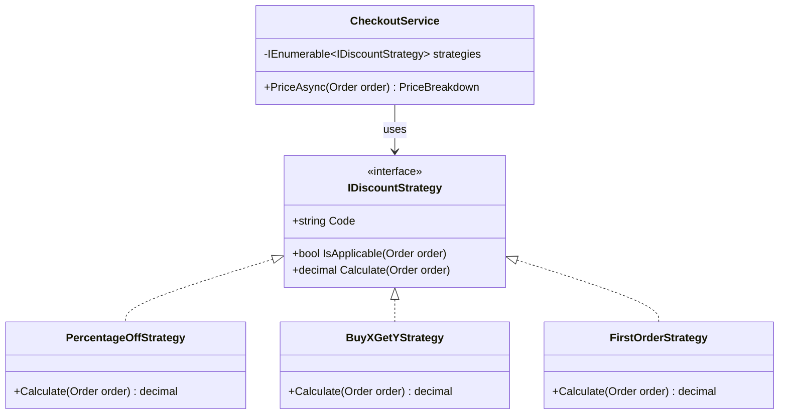
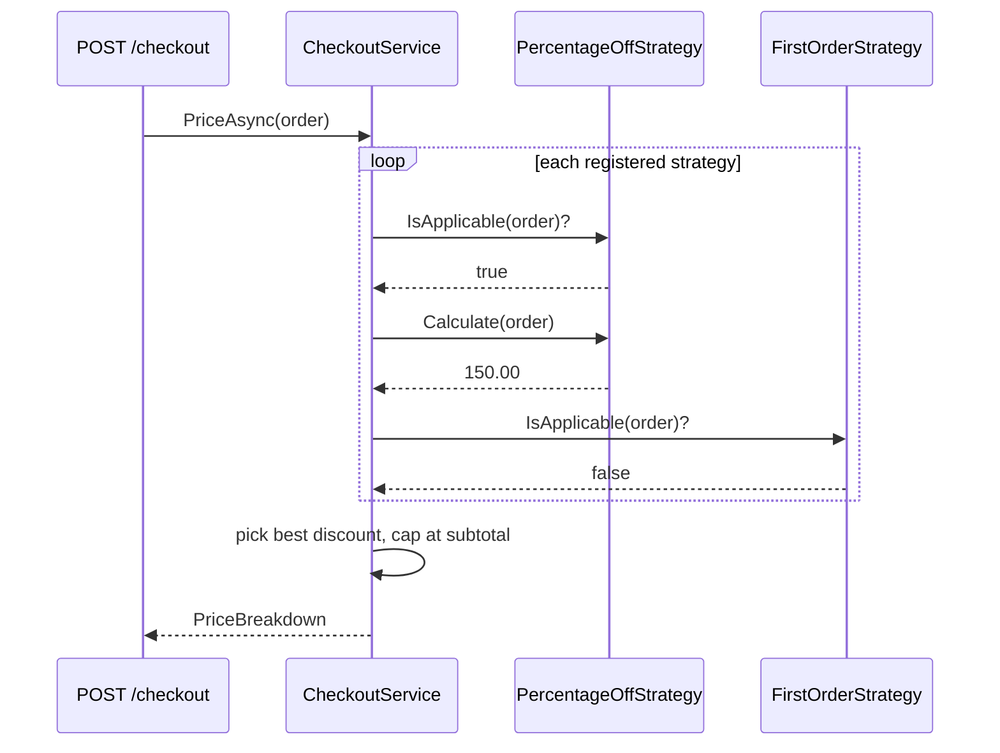
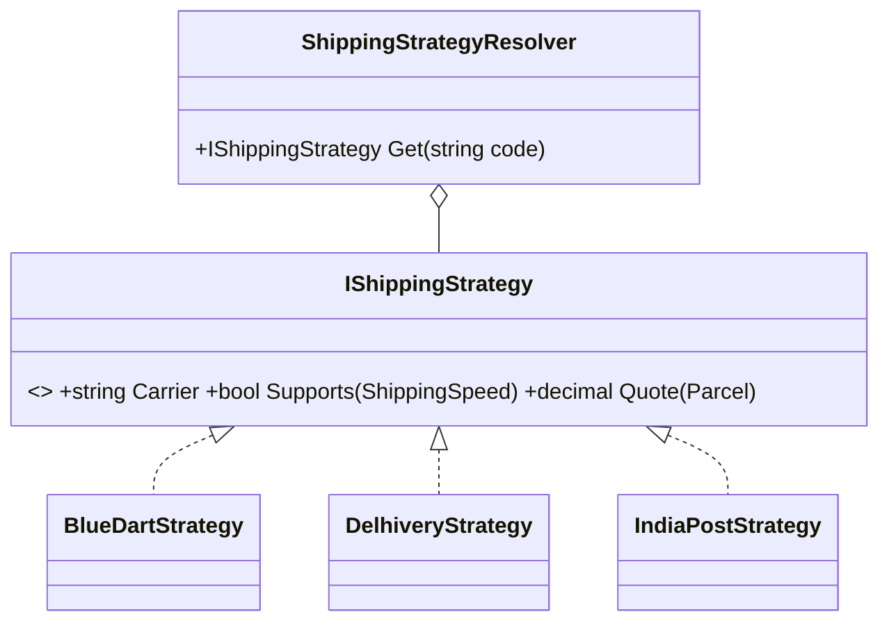

The Strategy pattern is usually the first behavioral pattern people learn. It is also the one they use most at work. Pricing rules, tax calculators, shipping-cost calculators, payment providers, retry policies, file-export formats and sorting rules are all, at heart, strategies.

## Learning objectives

By the end of this lesson you will be able to:

1. Spot the code smell that Strategy fixes: a growing `if/else` or `switch` that picks *how* to do a job.
2. Name the three participants (context, strategy interface, concrete strategies) and say what each one is for.
3. Build a pricing engine in C# where each discount rule is its own class.
4. Register and choose strategies in ASP.NET Core with dependency injection, including keyed services.
5. Unit-test each strategy on its own, and test the context with a fake strategy.
6. Decide when Strategy is overkill and a plain `switch` or a delegate is the better choice.
7. Tell Strategy apart from State, Template Method and Factory Method.

## Prerequisites

- [Interfaces and abstract classes](#/lesson/m01-interfaces-abstract): you need to be comfortable writing and implementing an interface.
- [Dependency injection](#/lesson/m03-dependency-injection): we register strategies in the DI container.
- [Open/Closed Principle](#/lesson/m04-ocp): Strategy is the most common way to follow it.

If you have not done these yet, you can still follow along. Just read the beginner section slowly.

## Explain it like I'm a beginner

Picture a taxi app. You open it to get from Gurgaon to the airport, and it asks how you want to pay: **cash**, **card** or **UPI**.

The trip is the same whichever you pick. Same car, same route, same driver. Only one step changes: *how the payment happens*.

Now picture the app's code as one long method:

> if cash → mark as "collect from rider"; else if card → call the card gateway; else if UPI → create a UPI collect request…

Every new payment method means opening that method and adding another branch. The method grows. Each change risks breaking the methods that already work. And you can't test "UPI" without dragging "card" and "cash" along with it.

The Strategy idea is simple. **Put each way of paying in its own small box, and make all the boxes plug into the same socket.** The trip code only knows about the socket ("something that can take a payment"). At runtime you plug in the box the rider chose.

- The socket is an **interface** (the strategy interface).
- Each box is a **class** that implements it (a concrete strategy).
- The trip code that holds a box and uses it is the **context**.

Analogy: a phone charger. Your phone (the context) has one USB-C port (the interface). A wall charger, a power bank and a car charger (concrete strategies) all fit it. The phone doesn't care which one is plugged in, and a new kind of charger doesn't need a new phone.

## First-principles explanation

### What it is

Strategy defines a family of algorithms, puts each one in its own class, and makes them interchangeable. The client picks one, and can swap it without changing the code that uses it (the *context*).

### Why it exists — the problem

Most business logic follows a pattern: "do the same overall job, but one step varies by some rule". Three costs show up when the varying step is written inline as conditionals:

1. **Change risk.** Adding variant number 7 means editing the method that holds variants 1–6. Every edit can break something that already works.
2. **Testing cost.** To test one variant, you build all the inputs the shared method needs. The test also passes through every branch condition before it reaches yours.
3. **Merge conflicts and ownership.** Two developers adding two new variants both edit the same `switch`. In a team of 8, that one file becomes a bottleneck.

### How it works internally

Nothing magic happens. Strategy is ordinary polymorphism (one call, many behaviors), used on purpose:

1. You declare an interface with one method: the step that varies, for example `decimal Apply(Order order)`.
2. Each variant implements the interface.
3. The context holds a reference to the interface type. When it calls `strategy.Apply(order)`, the .NET runtime looks up the real object's method in its type's method table (virtual dispatch) and calls the right one. On modern .NET this costs nanoseconds. That's irrelevant next to a database call that takes milliseconds.
4. Something, usually the DI container or a small factory, decides which concrete strategy to hand the context.

### What happens without it

You get "conditional sprawl". In real codebases we see pricing methods with 400+ lines and 30 branches. The branches share hidden local variables, so changing branch 12 quietly changes the result of branch 19.

### When it is useful

- At least **two or three** variants exist today, and more are likely to come.
- Variants are **chosen at runtime**: by user choice, configuration, tenant, country or feature flag.
- Each variant has **enough logic** to deserve its own tests (more than a one-liner).
- Different people or teams **own** different variants.

### When it is unnecessary

- There are two variants and no realistic third. A plain `if` is clearer.
- The variant is a single expression. A `Func<Order, decimal>` delegate or a `switch` expression does the same job with less ceremony.
- The choice never changes at runtime and is not tested on its own.

### Trade-offs it introduces

| You gain | You pay |
|---|---|
| Add variants without editing old code | More files and types to navigate |
| Test each variant on its own | Someone must still *choose* the strategy (factory, DI or a dictionary) |
| Clear ownership per variant | Shared logic between strategies needs a home (a base class or helper) |
| Swap behavior at runtime | All strategies must fit one interface. A variant that needs extra inputs forces the interface to change |

## Visual explanation

### Class diagram



How to read it: `CheckoutService` (the context) depends only on `IDiscountStrategy`. The arrow points *at the interface*, not at any concrete class. The three discount classes implement the interface (dotted line with a hollow triangle). To add a fourth discount, you add one box and one arrow. `CheckoutService` doesn't change.

### Sequence diagram



This shows the runtime flow. The context asks every strategy whether it applies, collects the amounts, and applies a business rule: here, "the customer gets the single best discount". That rule lives in the context, not in any strategy. **Deciding which strategy wins is the context's job. Computing an amount is each strategy's job.**

## Step-by-step example

We will grow one example in four steps.

### Step 1 — the naive version

```csharp
public decimal CalculateDiscount(Order order, string code)
{
    if (code == "PCT10") return order.Subtotal * 0.10m;
    else if (code == "FIRST") return order.IsFirstOrder ? 200m : 0m;
    else if (code == "B2G1")
    {
        var cheapest = order.Lines.OrderBy(l => l.UnitPrice).First();
        return order.Lines.Sum(l => l.Quantity) >= 3 ? cheapest.UnitPrice : 0m;
    }
    return 0m;
}
```

It works, and with three rules it's fine. Hold that thought: we'll come back to whether Strategy is worth it.

### Step 2 — extract the interface

Ask: what do all branches have in common? Each takes an order and returns an amount. That becomes the interface:

```csharp
public interface IDiscountStrategy
{
    string Code { get; }
    decimal Calculate(Order order);
}
```

### Step 3 — one class per branch

Move each branch body into its own class. Now each one can have its own constructor dependencies. For example, `FirstOrderStrategy` might need an `ICustomerHistory` service, while the others don't. With the `if/else` version, every dependency is forced onto the one shared method.

### Step 4 — a context that chooses

The context gets every strategy from DI, keeps the applicable ones, and applies the business rule "best single discount, never more than the subtotal". The full version is in the next section.

## Production-style C# implementation

Project structure (one ASP.NET Core project; the pricing feature lives in its own folder):

```text
Shop.Api/
  Program.cs
  Pricing/
    Order.cs
    IDiscountStrategy.cs
    Strategies/PercentageOffStrategy.cs
    Strategies/BuyXGetYStrategy.cs
    Strategies/FirstOrderStrategy.cs
    CheckoutService.cs
Shop.Tests/
  Pricing/DiscountStrategyTests.cs
  Pricing/CheckoutServiceTests.cs
```

```csharp file=Pricing/Order.cs
namespace Shop.Pricing;

public sealed record OrderLine(string Sku, decimal UnitPrice, int Quantity)
{
    public decimal Total => UnitPrice * Quantity;
}

public sealed record Order(Guid CustomerId, IReadOnlyList<OrderLine> Lines, bool IsFirstOrder)
{
    public decimal Subtotal => Lines.Sum(l => l.Total);
}

public sealed record AppliedDiscount(string Code, decimal Amount);

public sealed record PriceBreakdown(decimal Subtotal, AppliedDiscount? Discount, decimal Total);
```

```csharp file=Pricing/IDiscountStrategy.cs
namespace Shop.Pricing;

/// <summary>One way of computing a discount. Implementations must be stateless and thread-safe,
/// because they are registered as singletons.</summary>
public interface IDiscountStrategy
{
    string Code { get; }
    bool IsApplicable(Order order);
    /// <summary>Returns a non-negative amount. Must not exceed the order subtotal.</summary>
    decimal Calculate(Order order);
}
```

```csharp file=Pricing/Strategies/PercentageOffStrategy.cs
using Microsoft.Extensions.Options;

namespace Shop.Pricing.Strategies;

public sealed class PercentageOffOptions
{
    public decimal Percent { get; set; } = 10m;      // 10 means 10 %
    public decimal MinimumSubtotal { get; set; } = 1000m;
}

public sealed class PercentageOffStrategy(IOptions<PercentageOffOptions> options) : IDiscountStrategy
{
    private readonly PercentageOffOptions _o = options.Value;
    public string Code => "PCT";
    public bool IsApplicable(Order order) => order.Subtotal >= _o.MinimumSubtotal;
    public decimal Calculate(Order order) => Math.Round(order.Subtotal * _o.Percent / 100m, 2, MidpointRounding.ToEven);
}
```

```csharp file=Pricing/Strategies/BuyXGetYStrategy.cs
namespace Shop.Pricing.Strategies;

/// <summary>Buy 2, get the cheapest unit free, once per 3 units.</summary>
public sealed class BuyXGetYStrategy : IDiscountStrategy
{
    public string Code => "B2G1";
    public bool IsApplicable(Order order) => order.Lines.Sum(l => l.Quantity) >= 3;

    public decimal Calculate(Order order)
    {
        // Expand to unit prices, cheapest first; every 3rd unit (by cheapness) is free.
        var units = order.Lines.SelectMany(l => Enumerable.Repeat(l.UnitPrice, l.Quantity))
                               .OrderBy(p => p).ToList();
        var freeCount = units.Count / 3;
        return units.Take(freeCount).Sum();
    }
}
```

```csharp file=Pricing/Strategies/FirstOrderStrategy.cs
namespace Shop.Pricing.Strategies;

public sealed class FirstOrderStrategy : IDiscountStrategy
{
    private const decimal FlatAmount = 200m;
    public string Code => "FIRST";
    public bool IsApplicable(Order order) => order.IsFirstOrder;
    public decimal Calculate(Order order) => Math.Min(FlatAmount, order.Subtotal);
}
```

```csharp file=Pricing/CheckoutService.cs
using Microsoft.Extensions.Logging;

namespace Shop.Pricing;

public sealed class CheckoutService(IEnumerable<IDiscountStrategy> strategies, ILogger<CheckoutService> logger)
{
    private readonly IReadOnlyList<IDiscountStrategy> _strategies = strategies.ToList();

    /// <summary>Business rule: the customer receives the single best applicable discount,
    /// never more than the subtotal.</summary>
    public PriceBreakdown Price(Order order)
    {
        ArgumentNullException.ThrowIfNull(order);
        if (order.Lines.Count == 0) throw new ArgumentException("Order has no lines.", nameof(order));

        AppliedDiscount? best = null;
        foreach (var s in _strategies)
        {
            if (!s.IsApplicable(order)) continue;
            var amount = s.Calculate(order);
            if (amount < 0) throw new InvalidOperationException($"Strategy {s.Code} returned a negative discount.");
            if (best is null || amount > best.Amount) best = new AppliedDiscount(s.Code, amount);
        }

        if (best is not null && best.Amount > order.Subtotal) best = best with { Amount = order.Subtotal };
        logger.LogInformation("Priced order for {CustomerId}: subtotal {Subtotal}, discount {Code} {Amount}",
            order.CustomerId, order.Subtotal, best?.Code ?? "none", best?.Amount ?? 0m);

        return new PriceBreakdown(order.Subtotal, best, order.Subtotal - (best?.Amount ?? 0m));
    }
}
```

```csharp file=Program.cs
using Shop.Pricing;
using Shop.Pricing.Strategies;

var builder = WebApplication.CreateBuilder(args);

builder.Services.Configure<PercentageOffOptions>(builder.Configuration.GetSection("Pricing:PercentageOff"));
// Strategies are stateless, so singletons are safe and cheap.
builder.Services.AddSingleton<IDiscountStrategy, PercentageOffStrategy>();
builder.Services.AddSingleton<IDiscountStrategy, BuyXGetYStrategy>();
builder.Services.AddSingleton<IDiscountStrategy, FirstOrderStrategy>();
builder.Services.AddSingleton<CheckoutService>();

var app = builder.Build();

app.MapPost("/checkout/price", (Order order, CheckoutService checkout) =>
{
    try { return Results.Ok(checkout.Price(order)); }
    catch (ArgumentException ex) { return Results.Problem(ex.Message, statusCode: StatusCodes.Status400BadRequest); }
});

app.Run();
```

**Why `IEnumerable<IDiscountStrategy>`?** When you register several implementations of the same interface, the .NET DI container injects all of them, in registration order, as an `IEnumerable<T>`. So adding a new rule means one new class plus one registration line.

### Choosing exactly one strategy: keyed services

Sometimes the caller picks the strategy itself, as with "pay by UPI". In .NET 8 and later you can register keyed services:

```csharp
public interface IPaymentStrategy { Task<string> ChargeAsync(decimal amount, CancellationToken ct); }

builder.Services.AddKeyedSingleton<IPaymentStrategy, CardPaymentStrategy>("card");
builder.Services.AddKeyedSingleton<IPaymentStrategy, UpiPaymentStrategy>("upi");

app.MapPost("/pay/{method}", async (string method, decimal amount, IServiceProvider sp, CancellationToken ct) =>
{
    var strategy = sp.GetKeyedService<IPaymentStrategy>(method);
    return strategy is null
        ? Results.Problem($"Unknown payment method '{method}'.", statusCode: 400)
        : Results.Ok(await strategy.ChargeAsync(amount, ct));
});
```

Resolving from `IServiceProvider` inside an endpoint is acceptable here because the key really is only known at request time. Don't scatter `GetService` calls through your domain code; that is the Service Locator anti-pattern ([see the lesson](#/lesson/m04-di-vs-service-locator)). A cleaner option is a small `PaymentStrategyResolver` class that wraps this lookup and can be faked in tests.

## Bad design vs good design

**Bad**: the `if/else` from Step 1, grown to 12 codes, with a `bool isFestival` parameter and a static `DateTime.Now` check buried in branch 9.

Problems:

- You can't test branch 9 without controlling the system clock.
- Adding a code means editing a method that 11 other rules depend on.
- The "best single discount" rule is mixed in with the calculations, so nobody can find it.

**Good**: the implementation above. Each rule is a class, the selection rule is in the context, and time-dependent rules take an injected `TimeProvider` (.NET 8+).

**Is the improvement worth it?** With **2–3 simple rules**, honestly, often not. A `switch` expression is shorter and just as clear:

```csharp
decimal Discount(Order o, string code) => code switch
{
    "PCT10" => o.Subtotal * 0.10m,
    "FIRST" when o.IsFirstOrder => 200m,
    _ => 0m,
};
```

Switch to Strategy when rules get their own dependencies, need tests of their own, change on different schedules, or there are more than ~4 of them. That is a guideline, not a law.

:::callout type=tradeoff title="Delegates are strategies too"
In C#, `Func<Order, decimal>` is a one-method strategy interface. A `Dictionary<string, Func<Order, decimal>>` gives you runtime selection with no extra classes. Use classes when a strategy needs constructor dependencies, configuration, logging, or more than one method (like `IsApplicable` + `Calculate`).
:::

## Practical playground

Open the starter below in the editor. Then click **Download as .NET project** and run `dotnet test`. The tests for the Buy-2-Get-1 rule fail until you implement it.

:::playground type=csharp title="Discount strategies"
```csharp file=Program.cs
using System;
using System.Collections.Generic;
using System.Linq;

public sealed record OrderLine(string Sku, decimal UnitPrice, int Quantity);
public sealed record Order(IReadOnlyList<OrderLine> Lines, bool IsFirstOrder)
{
    public decimal Subtotal => Lines.Sum(l => l.UnitPrice * l.Quantity);
}

public interface IDiscountStrategy
{
    string Code { get; }
    bool IsApplicable(Order order);
    decimal Calculate(Order order);
}

public sealed class FirstOrderStrategy : IDiscountStrategy
{
    public string Code => "FIRST";
    public bool IsApplicable(Order order) => order.IsFirstOrder;
    public decimal Calculate(Order order) => Math.Min(200m, order.Subtotal);
}

public sealed class BuyXGetYStrategy : IDiscountStrategy
{
    public string Code => "B2G1";
    public bool IsApplicable(Order order) => order.Lines.Sum(l => l.Quantity) >= 3;
    public decimal Calculate(Order order) => throw new NotImplementedException("Make every 3rd cheapest unit free");
}

public static class Program
{
    public static void Main()
    {
        var order = new Order(new[] { new OrderLine("TSHIRT", 499m, 2), new OrderLine("CAP", 299m, 1) }, IsFirstOrder: true);
        IDiscountStrategy[] strategies = { new FirstOrderStrategy(), new BuyXGetYStrategy() };
        foreach (var s in strategies.Where(s => s.IsApplicable(order)))
            Console.WriteLine($"{s.Code}: {s.Calculate(order)}");
    }
}
```
:::

## Exercises

:::exercise id=m06-strategy-ex1 difficulty=beginner kind=code title="Implement Buy-2-Get-1"
Implement `BuyXGetYStrategy.Calculate` so that for every 3 units in the order, the cheapest unit is free.
::requirements
- Units are counted across all lines.
- With 3 units, 1 is free. With 6 units, the 2 cheapest are free. With 5 units, only 1 is free.
::acceptance
- 2 × ₹499 + 1 × ₹299 gives a discount of ₹299.
- 6 × ₹100 gives a discount of ₹200.
- 2 units total means `IsApplicable` returns false.
::hint
Think of the order as a flat list of unit prices instead of lines.
::hint
`SelectMany` plus `Enumerable.Repeat(price, quantity)` flattens lines into units.
::hint
Sort the unit prices ascending, then take `units.Count / 3` of them (integer division) and sum.
::hint
```csharp
var units = order.Lines.SelectMany(l => Enumerable.Repeat(l.UnitPrice, l.Quantity)).OrderBy(p => p).ToList();
```
::starter
```csharp file=BuyXGetYStrategy.cs
using System;
using System.Collections.Generic;
using System.Linq;

public sealed record OrderLine(string Sku, decimal UnitPrice, int Quantity);
public sealed record Order(IReadOnlyList<OrderLine> Lines, bool IsFirstOrder)
{
    public decimal Subtotal => Lines.Sum(l => l.UnitPrice * l.Quantity);
}
public interface IDiscountStrategy { string Code { get; } bool IsApplicable(Order order); decimal Calculate(Order order); }

public sealed class BuyXGetYStrategy : IDiscountStrategy
{
    public string Code => "B2G1";
    public bool IsApplicable(Order order) => order.Lines.Sum(l => l.Quantity) >= 3;
    public decimal Calculate(Order order) => throw new NotImplementedException();
}
```
::tests
```csharp file=BuyXGetYStrategyTests.cs
using Xunit;

public class BuyXGetYStrategyTests
{
    private static Order O(params OrderLine[] lines) => new(lines, false);

    [Fact] public void Three_units_cheapest_free() =>
        Assert.Equal(299m, new BuyXGetYStrategy().Calculate(O(new OrderLine("T", 499m, 2), new OrderLine("C", 299m, 1))));

    [Fact] public void Six_units_two_free() =>
        Assert.Equal(200m, new BuyXGetYStrategy().Calculate(O(new OrderLine("A", 100m, 6))));

    [Fact] public void Five_units_one_free() =>
        Assert.Equal(100m, new BuyXGetYStrategy().Calculate(O(new OrderLine("A", 100m, 4), new OrderLine("B", 300m, 1))));

    [Fact] public void Two_units_not_applicable() =>
        Assert.False(new BuyXGetYStrategy().IsApplicable(O(new OrderLine("A", 100m, 2))));
}
```
::solution
Flatten lines to unit prices, sort ascending, and sum the cheapest `count / 3` units.

```csharp file=BuyXGetYStrategy.cs
using System;
using System.Collections.Generic;
using System.Linq;

public sealed record OrderLine(string Sku, decimal UnitPrice, int Quantity);
public sealed record Order(IReadOnlyList<OrderLine> Lines, bool IsFirstOrder)
{
    public decimal Subtotal => Lines.Sum(l => l.UnitPrice * l.Quantity);
}
public interface IDiscountStrategy { string Code { get; } bool IsApplicable(Order order); decimal Calculate(Order order); }

public sealed class BuyXGetYStrategy : IDiscountStrategy
{
    public string Code => "B2G1";
    public bool IsApplicable(Order order) => order.Lines.Sum(l => l.Quantity) >= 3;

    public decimal Calculate(Order order)
    {
        var units = order.Lines.SelectMany(l => Enumerable.Repeat(l.UnitPrice, l.Quantity))
                               .OrderBy(p => p).ToList();
        return units.Take(units.Count / 3).Sum();
    }
}
```

Why sort ascending? The business gives away the *cheapest* items, which limits its cost. If marketing changes the rule to "most expensive free", only this one class changes. That is the point of the pattern.
::mistakes
- Counting lines instead of units (2 lines can hold 10 units).
- Making the cheapest *line* free instead of one unit of it.
- Using `Math.Round(count / 3.0)` — 5 units would give 2 free items.
::extensions
Make X and Y configurable (`Buy 3 get 2`) through an options class, and add tests for the new parameters.
:::

:::exercise id=m06-strategy-ex2 difficulty=beginner kind=code title="Add a festival discount without touching CheckoutService"
Add a `FestivalStrategy` that gives 15 % off between two configurable dates. Do not modify `CheckoutService`.
::acceptance
- Inside the date window, the discount is 15 % of the subtotal.
- Outside the window, `IsApplicable` returns false.
- The current time comes from an injected `TimeProvider`, not `DateTime.Now`.
- `CheckoutService` has zero changed lines (check with `git diff`).
::hint
Your new class implements `IDiscountStrategy`. What else must change for DI to find it?
::hint
Inject `TimeProvider` (built into .NET 8+) so tests can control the date.
::hint
In tests, write a tiny `FixedTimeProvider : TimeProvider` that overrides `GetUtcNow()`.
::solution
```csharp
public sealed class FestivalOptions { public DateOnly Start { get; set; } public DateOnly End { get; set; } public decimal Percent { get; set; } = 15m; }

public sealed class FestivalStrategy(IOptions<FestivalOptions> options, TimeProvider clock) : IDiscountStrategy
{
    private readonly FestivalOptions _o = options.Value;
    public string Code => "FESTIVAL";
    public bool IsApplicable(Order order)
    {
        var today = DateOnly.FromDateTime(clock.GetUtcNow().UtcDateTime);
        return today >= _o.Start && today <= _o.End;
    }
    public decimal Calculate(Order order) => Math.Round(order.Subtotal * _o.Percent / 100m, 2);
}

// Program.cs — the only other change:
builder.Services.Configure<FestivalOptions>(builder.Configuration.GetSection("Pricing:Festival"));
builder.Services.AddSingleton(TimeProvider.System);
builder.Services.AddSingleton<IDiscountStrategy, FestivalStrategy>();
```
The open/closed principle in action: new behavior, no edits to the existing pricing code.
::mistakes
- Calling `DateTime.Now` inside the strategy, which makes it untestable and time-zone dependent.
- Forgetting the DI registration, so the strategy silently never runs. Add a test that resolves all strategies from a real `ServiceCollection`.
:::

:::exercise id=m06-strategy-ex3 difficulty=intermediate kind=code title="Stackable vs exclusive discounts"
Product now says: "Discounts marked *stackable* add up. Then the customer also gets the best *exclusive* discount. The total discount can never exceed 50 % of the subtotal."
Change the design so this rule fits cleanly.
::acceptance
- Strategies declare whether they are stackable.
- The selection rule lives in exactly one place.
- Tests cover: only stackable, only exclusive, both, and the 50 % cap.
::hint
Is "how discounts combine" a calculation (strategy) or a policy (context)?
::hint
Add `bool IsStackable { get; }` to the interface, or create a separate `IDiscountCombinationPolicy`.
::hint
The combination rule is itself a strategy: `IDiscountCombinationPolicy` with `BestSinglePolicy` and `StackPlusBestPolicy`. `CheckoutService` then depends on two abstractions.
::solution
Pull the combination rule out into its own strategy:

```csharp
public interface IDiscountCombinationPolicy
{
    IReadOnlyList<AppliedDiscount> Combine(Order order, IReadOnlyList<(IDiscountStrategy S, decimal Amount)> candidates);
}

public sealed class StackPlusBestExclusivePolicy : IDiscountCombinationPolicy
{
    public IReadOnlyList<AppliedDiscount> Combine(Order order, IReadOnlyList<(IDiscountStrategy S, decimal Amount)> c)
    {
        var picked = c.Where(x => x.S is IStackable).Select(x => new AppliedDiscount(x.S.Code, x.Amount)).ToList();
        var bestExclusive = c.Where(x => x.S is not IStackable).OrderByDescending(x => x.Amount).FirstOrDefault();
        if (bestExclusive.S is not null) picked.Add(new(bestExclusive.S.Code, bestExclusive.Amount));
        var cap = order.Subtotal * 0.5m;
        var running = 0m;
        var result = new List<AppliedDiscount>();
        foreach (var d in picked.OrderByDescending(d => d.Amount))
        {
            var amt = Math.Min(d.Amount, cap - running);
            if (amt <= 0) break;
            result.Add(d with { Amount = amt }); running += amt;
        }
        return result;
    }
}
public interface IStackable { }   // marker interface, or use a bool property
```

`CheckoutService` now just gathers candidates and delegates the rule. You can A/B test two policies by registering a different one.
::alternatives
A `bool IsStackable` property is simpler than a marker interface and easier to set from configuration. Choose the property if marketing configures discounts in a database.
::mistakes
- Putting the 50 % cap inside each strategy. Each one then has to know about the others.
:::

:::exercise id=m06-strategy-ex4 difficulty=intermediate kind=design title="Refactor shipping cost calculation"
You inherit this method:

```csharp
decimal Shipping(string carrier, decimal kg, string pincode, bool express) {
  if (carrier == "BlueDart") { var c = 60 + kg * 30; if (express) c *= 1.8m; return c; }
  if (carrier == "Delhivery") { var c = kg <= 0.5m ? 45 : 45 + Math.Ceiling((kg - 0.5m) / 0.5m) * 20; return express ? c + 70 : c; }
  if (carrier == "IndiaPost") { if (express) throw new NotSupportedException(); return 40 + kg * 15; }
  throw new ArgumentException(carrier);
}
```

Draw the class diagram for a Strategy-based design, and list which class owns which rule.
::acceptance
- One strategy per carrier, plus a way to ask "does this carrier support express?"
- Selection by carrier code, with a clear error for unknown codes.
- No carrier class knows about any other carrier.
::hint
Notice IndiaPost doesn't support express. That's a capability, and it belongs on the interface.
::hint
`ShippingQuote Quote(Parcel p)` plus `bool Supports(ShippingSpeed s)`.
::hint
Use a resolver: `IShippingStrategyResolver.Get(string carrierCode)`, backed by keyed services or a dictionary built from `IEnumerable<IShippingStrategy>`.
::solution

Each carrier's rate card lives in its class. `Supports(Express)` replaces the `throw` for IndiaPost. The resolver builds a dictionary keyed by `Carrier` from the injected `IEnumerable<IShippingStrategy>` and throws `UnknownCarrierException` for missing codes. `Parcel` is a record holding the weight, pincode and speed, so adding a new input later doesn't change every method signature.
:::

:::exercise id=m06-strategy-ex5 difficulty=advanced kind=code title="Per-tenant strategies with safe fallbacks"
In a multi-tenant SaaS, each tenant can configure its own pricing strategy in the database (`"PCT"`, `"B2G1"` or `"TIERED"`). Design and implement resolution that:
1. Picks the strategy from the tenant's settings on each request.
2. Caches the tenant settings for 5 minutes.
3. Falls back to "no discount" and logs a warning when the configured code is unknown. It must never throw at checkout.
::acceptance
- Tenant A configured as `PCT` gets the percentage discount, tenant B with `TIERED` gets tiered.
- An unknown code returns 0 discount and logs one warning per cache period, not per request.
- Unit tests use fakes for the tenant settings source and a `FakeTimeProvider` or equivalent.
::hint
There are two moving parts here: *which tenant* (scoped, per request) and *which strategy* (singleton). Keep them apart.
::hint
A `NoDiscountStrategy` is a Null Object ([see the lesson](#/lesson/m06-null-object)). It removes `null` checks.
::hint
`ITenantContext` (scoped) → `ITenantSettingsStore` (cached) → `IDiscountStrategyResolver` (singleton dictionary of strategies by code).
::hint
Log the warning when you *load* settings into the cache, not when you resolve. That gives you one log line per cache period.
::solution
```csharp
public interface ITenantContext { string TenantId { get; } }
public interface ITenantSettingsStore { Task<string> GetDiscountCodeAsync(string tenantId, CancellationToken ct); }

public sealed class NoDiscountStrategy : IDiscountStrategy
{
    public static readonly NoDiscountStrategy Instance = new();
    public string Code => "NONE";
    public bool IsApplicable(Order order) => false;
    public decimal Calculate(Order order) => 0m;
}

public sealed class DiscountStrategyResolver(IEnumerable<IDiscountStrategy> all)
{
    private readonly Dictionary<string, IDiscountStrategy> _byCode = all.ToDictionary(s => s.Code, StringComparer.OrdinalIgnoreCase);
    public bool TryGet(string code, out IDiscountStrategy strategy)
    {
        if (_byCode.TryGetValue(code, out var s)) { strategy = s; return true; }
        strategy = NoDiscountStrategy.Instance; return false;
    }
}

public sealed class CachedTenantSettingsStore(ITenantSettingsStore inner, IMemoryCache cache, DiscountStrategyResolver resolver, ILogger<CachedTenantSettingsStore> log)
{
    public async Task<IDiscountStrategy> GetStrategyAsync(string tenantId, CancellationToken ct) =>
        (await cache.GetOrCreateAsync($"tenant-discount:{tenantId}", async e =>
        {
            e.AbsoluteExpirationRelativeToNow = TimeSpan.FromMinutes(5);
            var code = await inner.GetDiscountCodeAsync(tenantId, ct);
            if (!resolver.TryGet(code, out var s))
                log.LogWarning("Tenant {TenantId} configured unknown discount code {Code}; using none", tenantId, code);
            return s;
        }))!;
}
```
The decorator-style cache wraps the real store (see [Decorator](#/lesson/m06-decorator)). The resolver is a singleton because strategies are stateless. Only `ITenantContext` is scoped.
::mistakes
- Making strategies scoped because "tenant is scoped". The strategy doesn't need the tenant; only the resolver input does.
- Throwing at checkout for bad configuration. A misconfigured promo should never block a sale.
:::

## Automated testing

Test at two levels.

**1. Each strategy in isolation:** pure inputs in, numbers out. These tests are fast and need no mocks.

```csharp
public class FirstOrderStrategyTests
{
    [Theory]
    [InlineData(1000, true, 200)]
    [InlineData(150, true, 150)]   // capped at subtotal
    [InlineData(1000, false, 0)]
    public void Calculates(decimal subtotal, bool first, decimal expected)
    {
        var order = new Order(Guid.NewGuid(), new[] { new OrderLine("X", subtotal, 1) }, first);
        var s = new FirstOrderStrategy();
        Assert.Equal(expected, s.IsApplicable(order) ? s.Calculate(order) : 0m);
    }
}
```

**2. The context with fake strategies:** test the *selection rule* without depending on real pricing math.

```csharp
public class CheckoutServiceTests
{
    private sealed class Fixed(string code, decimal amount, bool applies = true) : IDiscountStrategy
    {
        public string Code => code;
        public bool IsApplicable(Order o) => applies;
        public decimal Calculate(Order o) => amount;
    }

    private static readonly Order Order100 = new(Guid.NewGuid(), new[] { new OrderLine("X", 100m, 1) }, false);

    [Fact]
    public void Picks_best_single_discount()
    {
        var svc = new CheckoutService(new IDiscountStrategy[] { new Fixed("A", 10), new Fixed("B", 30), new Fixed("C", 20) },
                                      NullLogger<CheckoutService>.Instance);
        var result = svc.Price(Order100);
        Assert.Equal("B", result.Discount!.Code);
        Assert.Equal(70m, result.Total);
    }

    [Fact]
    public void Caps_discount_at_subtotal() =>
        Assert.Equal(0m, new CheckoutService(new[] { new Fixed("BIG", 500) }, NullLogger<CheckoutService>.Instance).Price(Order100).Total);

    [Fact]
    public void Negative_discount_is_a_bug() =>
        Assert.Throws<InvalidOperationException>(() =>
            new CheckoutService(new[] { new Fixed("NEG", -1) }, NullLogger<CheckoutService>.Instance).Price(Order100));
}
```

**3. A wiring test**: resolve `IEnumerable<IDiscountStrategy>` from the real `ServiceCollection` and assert the expected codes are present. This catches the "forgot to register" bug.

Edge cases to cover: empty order, zero-price items, ties between strategies (which one wins should be deterministic — here, the first registered), and rounding (use `decimal`, never `double`, for money).

## Real-world application

- **ASP.NET Core itself** uses strategies everywhere. `IPasswordHasher<TUser>`, `IAuthenticationHandler` (one per scheme: cookies, JWT, OpenID Connect), output formatters (JSON vs XML) and `ILoggerProvider` are all swappable implementations behind one interface.
- **Payment platforms** route a charge to card, UPI, net-banking or wallet providers through a common `IPaymentProvider`, often chosen by currency, amount and provider health.
- **Tax engines** pick GST, VAT or US sales-tax calculators by jurisdiction.
- **Retry policies** in Polly (`ResiliencePipeline`) are strategies for "what to do when a call fails".
- **Infrastructure-project platforms** often compute progress percentages differently per contract type (EPC, HAM, item-rate). Each formula is a strategy chosen by contract type.

## Interview questions

:::interview
::q beginner
What problem does the Strategy pattern solve?
::a
It removes conditional logic that chooses *how* to do a step. Each variant goes into its own class behind a shared interface, so you can add or swap variants without editing the code that uses them. Benefits: each variant can be tested on its own, it follows the open/closed principle, and the choice can change at runtime.
::q beginner
What are the participants?
::a
**Context**: holds a reference to a strategy and delegates the varying step to it. **Strategy interface**: the common contract. **Concrete strategies**: the implementations. Usually there is also a **selector** (factory, DI container or resolver) that decides which concrete strategy to use.
::q intermediate
How is Strategy different from State?
::a
Both have the same class shape. The difference is *who chooses* and *why*. In Strategy, the client or configuration picks the algorithm, and strategies usually don't know about each other. In State, the object changes its own state object as events happen, and states often trigger the transitions themselves (`Draft → Submitted → Approved`). Rule of thumb: if the variant changes because of the object's lifecycle, it is State. If it changes because someone chose it, it is Strategy.
::q intermediate
How do you choose a strategy at runtime in ASP.NET Core?
::a
Options: inject `IEnumerable<IStrategy>` and filter (by `Code` or `IsApplicable`); keyed services (`AddKeyedSingleton` + `[FromKeyedServices]` or `GetKeyedService`) in .NET 8+; or a small resolver that builds a dictionary once. Avoid scattering `IServiceProvider.GetService` calls through domain code, which is the service locator anti-pattern. Also pick lifetimes carefully: stateless strategies can be singletons, but a singleton strategy must not capture a scoped dependency such as a `DbContext`.
::q advanced
Your company has 40 discount rules managed by marketing, changing weekly. Is a class per rule still right?
::a
Probably not for every rule. When rules are *data* (percent, thresholds, dates, eligible SKUs), store them as configuration and have a few *parameterised* strategies interpret them (`PercentageRule`, `TieredRule`, `BundleRule`). Use code-level strategies for the different *kinds* of calculation, and data for the instances. Add a rule engine or the Specification pattern for eligibility. Add versioning and audit, since price changes are financially sensitive. Only reach for a full rules engine when non-developers need to author entirely new rule *types*, which is rare and costly to get right.
:::

## Summary and revision

**Key takeaways**

- Strategy turns "if this kind, do this; if that kind, do that" into separate classes behind one interface.
- The context owns the *policy* (which strategy, how results combine). Strategies own the *calculation*.
- In .NET, register strategies with DI. Use `IEnumerable<T>` to get all of them, or keyed services to get one by key.
- A delegate or `switch` expression is often enough for two or three tiny variants.
- Test strategies alone, and test the context with fakes.

**Terminology**: context, strategy interface, concrete strategy, resolver, keyed service, open/closed principle, Null Object.

:::flashcards
Q: What are the three participants of Strategy?
A: Context, strategy interface, concrete strategies (plus usually a selector/resolver).
Q: In Strategy, where should the rule "only the best discount applies" live?
A: In the context (or a separate combination policy), not inside individual strategies.
Q: How does .NET DI give you all implementations of an interface?
A: Register each with Add*<IFoo, Impl>() and inject IEnumerable<IFoo>; they come in registration order.
Q: Strategy vs State in one sentence?
A: Strategy is chosen by the client; State changes itself as the object moves through its lifecycle.
Q: When is Strategy overkill?
A: Two or three tiny, stable variants with no dependencies — use a switch expression or a delegate.
Q: Why inject TimeProvider into a date-based strategy?
A: So tests can control "now" and the strategy is not tied to the machine clock or time zone.
:::

## Knowledge check

:::quiz pass=70
::q single
A method has a `switch` with 9 cases, each calculating a shipping price in a different way. Two new carriers are planned next quarter. What is the most direct benefit of applying Strategy?
- [ ] The code will run faster.
- [x] New carriers can be added as new classes without editing the existing pricing code.
- [ ] It removes the need for unit tests.
- [ ] It guarantees there will be no bugs.
> Strategy is about changeability and testability. The cost of virtual dispatch is negligible, and the pattern doesn't remove the need for tests.
::q single
Where should the rule "the total discount can never exceed 50 % of the subtotal" live?
- [ ] Inside every concrete discount strategy.
- [x] In the context or a dedicated combination policy.
- [ ] In the controller.
- [ ] In the database.
> A rule about how strategies *combine* is a policy above them. Putting it in each strategy forces every strategy to know about the others.
::q multi
Which are reasonable ways to choose a strategy at runtime in ASP.NET Core? (Select all that apply.)
- [x] Inject `IEnumerable<IStrategy>` and pick by a `Code` property.
- [x] Use keyed services registered with `AddKeyedSingleton`.
- [ ] Call `new` on every concrete class inside the controller.
- [x] A resolver class that builds a dictionary from the injected strategies.
> Calling `new` in the controller hard-wires every dependency and defeats the point of the pattern.
::q single
Which situation is a better fit for State than Strategy?
- [ ] Choosing between card and UPI payment.
- [ ] Choosing a compression algorithm from configuration.
- [x] A leave request whose allowed actions change as it moves Draft → Submitted → Approved.
- [ ] Choosing a tax calculator by country.
> The behavior changes because the object's own lifecycle moves forward. That is the signature of State.
::q single
Your strategies are registered as singletons. One of them needs a `DbContext`. What is the problem?
- [ ] There is no problem.
- [x] A singleton capturing a scoped `DbContext` shares it across requests (a captive dependency), which is not thread-safe.
- [ ] Singletons can't have constructor parameters.
- [ ] `DbContext` can only be used in controllers.
> Either make that strategy scoped (and everything that holds it), or inject an `IDbContextFactory<T>` and create a short-lived context per call.
::q single
You have exactly two variants that are one line each and have never changed in three years. Best choice?
- [ ] Strategy with DI and keyed services.
- [x] A simple conditional or switch expression.
- [ ] Abstract Factory.
- [ ] A rules engine.
> Patterns have a cost. YAGNI applies: refactor to Strategy if and when variants start to grow.
:::

## Completion criteria

You have finished this lesson when you can:

- [ ] Score at least 70 % on the knowledge check.
- [ ] Complete exercises 1 and 2. Your downloaded project's `dotnet test` should pass.
- [ ] Complete at least one of exercises 3–5 and compare your answer with the solution.
- [ ] Explain out loud, in under two minutes, when you would *not* use Strategy.
