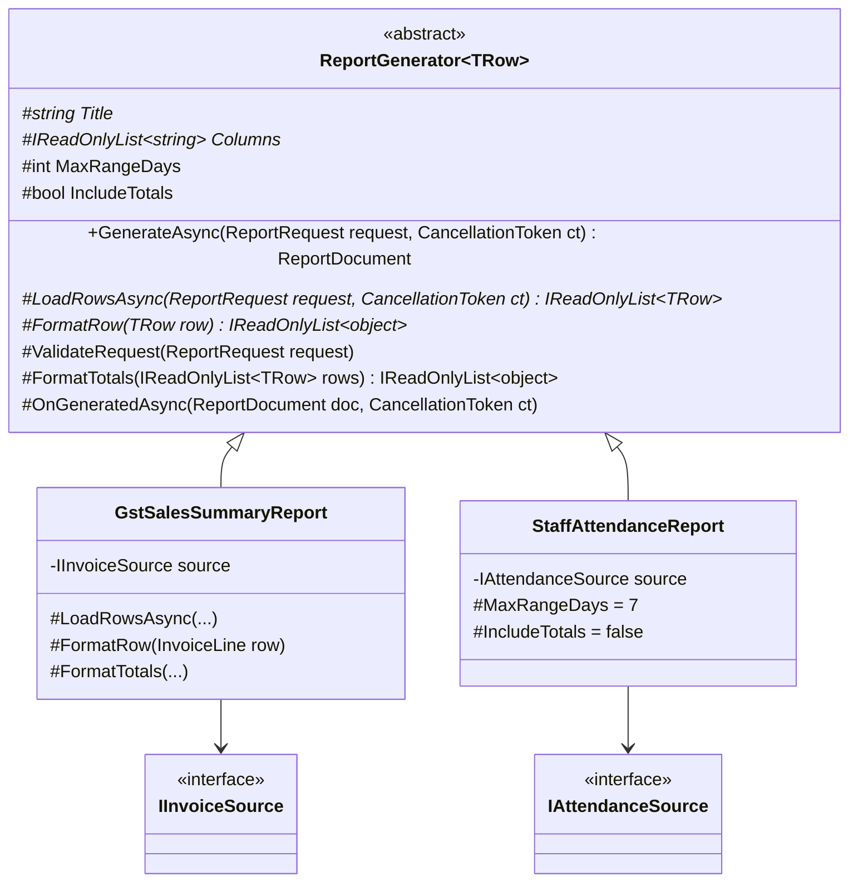
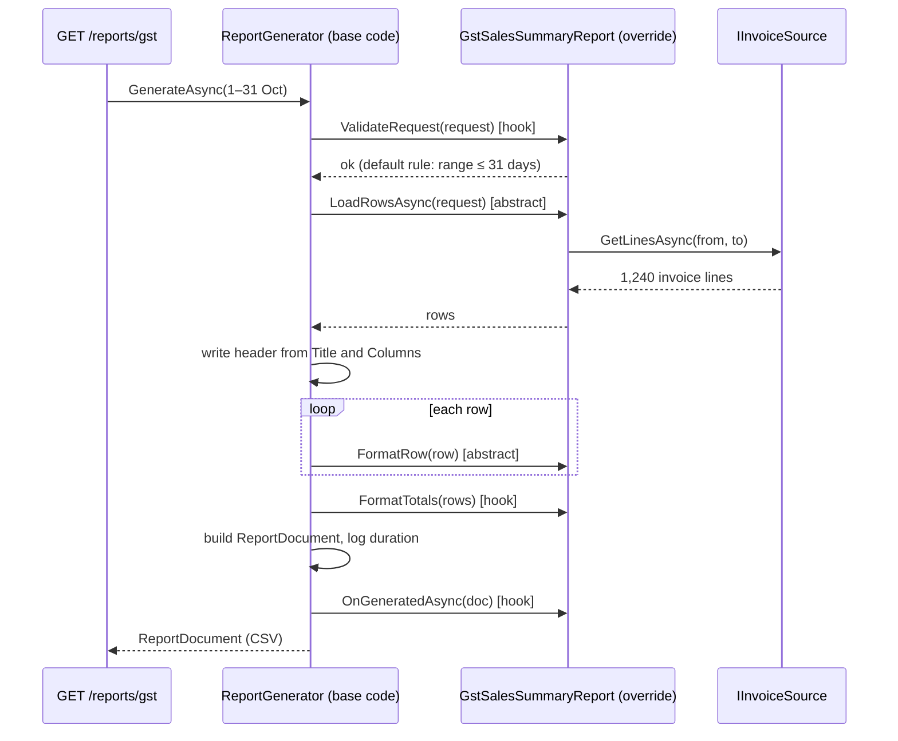
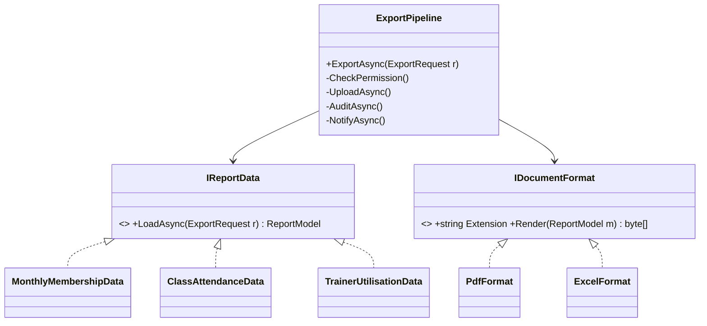

Many jobs follow the same recipe with a few ingredients swapped. Every report validates its date range, loads data, writes a header, writes rows, adds totals and saves a file. Only the data and the columns differ. Template Method writes the recipe once, in a base class, and lets each subclass supply only the steps that are different.

## Learning objectives

By the end of this lesson you will be able to:

1. Recognise the duplication Template Method removes: several classes that repeat the same sequence of steps.
2. Name the parts: template method, primitive (abstract) steps, hooks, and concrete subclasses.
3. Build a report-generation pipeline in C# where the base class fixes the order and subclasses supply the data and columns.
4. Read `BackgroundService.ExecuteAsync` as a Template Method and build a safe periodic-worker base class on top of it.
5. Test the template with a recording subclass, and each concrete step on its own.
6. Decide between Template Method (inheritance) and Strategy (composition), and refactor from one to the other.

## Prerequisites

- [Encapsulation, abstraction, inheritance and polymorphism](#/lesson/m01-oop-pillars): `virtual`, `abstract` and `override`.
- [Interfaces and abstract classes](#/lesson/m01-interfaces-abstract): abstract base classes.
- [Background services and hosted workers](#/lesson/m03-background-services): helpful for the `BackgroundService` section.

## Explain it like I'm a beginner

Think of a chai stall that makes masala chai and ginger chai. The steps are the same:

1. Boil water.
2. Add tea leaves.
3. **Add the special ingredient.**
4. Add milk and sugar.
5. Strain and serve.

Only step 3 changes: masala for one, crushed ginger for the other. The stall owner writes the five steps on a card and tells each helper, "follow the card; you only decide what goes in at step 3". Nobody forgets to strain the tea, and nobody adds milk before the leaves.

In code:

- The card with the fixed order is the **template method**.
- Step 3, which each helper must fill in, is an **abstract step**.
- An optional step like "add extra sugar if the customer asks" is a **hook**: there is a default (do nothing), and helpers can change it if they want.
- Each kind of chai is a **subclass**.

The important part is that **the base class is in charge of the order**. Subclasses fill in blanks; they don't rewrite the recipe.

## First-principles explanation

### What it is

Template Method defines the skeleton of an algorithm in a base-class method, deferring some steps to subclasses. Subclasses redefine certain steps without changing the algorithm's structure.

### The original problem

The Gang of Four example was an application framework that opens documents. "Open a document" always means: check it can be opened, create the document object, read it, add it to the window list. Only "create" and "read" differ between a drawing app and a spreadsheet app. If every application wrote the whole sequence, each would get the order slightly wrong, and a bug fix in the sequence would need to be made in every app. The framework instead owned the sequence and called the app's code at the right moments. This is the **Hollywood principle**: "don't call us, we'll call you". The base class calls the subclass, not the other way round.

### How it works internally

1. The base class has a public, **non-virtual** method (the template) that calls a series of steps in a fixed order.
2. Steps that every subclass must provide are `protected abstract`.
3. Steps with a sensible default are `protected virtual` (**hooks**).
4. Shared logic that must not change (logging, timing, validation, error handling) is written directly in the template or in `private` helpers.

At runtime, the template calls `this.LoadRowsAsync(...)`. Because the method is virtual, .NET dispatches to the subclass's override. That's ordinary polymorphism.

In C#, the template should not be `virtual`, and the subclasses should not be able to skip it. If the base class is itself a subclass (as with `BackgroundService` below), you can mark the template override `sealed` so further subclasses can't replace it.

### Abstract steps vs hooks

| | Abstract step | Hook |
|---|---|---|
| C# keyword | `protected abstract` | `protected virtual` with a default body |
| Subclass must override? | Yes, or it won't compile | No |
| Typical use | The part that genuinely differs (load the data, format a row) | Optional customisation (include totals?, extra validation, "after save" notification) |
| Risk | — | Too many hooks make the base class hard to understand |

### When it is useful

- Several classes perform the **same sequence** of steps, and only a few steps differ.
- The sequence contains rules that must **not** be skipped: validation, auditing, timing, error handling, resource cleanup.
- You are writing a **framework or base class** others will extend (as Microsoft did with `BackgroundService`).

### When it is unnecessary or harmful

- Only **one** implementation exists. An ordinary class is simpler.
- The steps vary **independently**. If reports vary by data source *and* by output format, inheritance needs one subclass per combination (3 sources × 3 formats = 9 classes). Composition with Strategy needs 3 + 3 = 6 small classes and no hierarchy.
- Subclasses need to change the **order** of steps. Then the template isn't really fixed, and you should use a pipeline of steps instead ([Pipeline](#/lesson/m06-pipeline)).
- The hierarchy is getting deep (base → CsvReport → GstCsvReport → MonthlyGstCsvReport). Deep inheritance couples every level to every other level (the *fragile base class* problem: a change to the base can break subclasses you have never seen).

### Trade-offs

| You gain | You pay |
|---|---|
| The sequence and its safety rules exist once | Subclasses are tightly coupled to the base class's design |
| Subclasses are small: only the differences | Inheritance is a one-shot choice: a class has one base class in C# |
| Easy to add another variant of the same kind | Variation along two axes leads to class explosion |
| Framework authors can guarantee behaviour around user code | Control flow jumps between base and subclass, which is harder to follow |

### Template Method vs Strategy in one picture

Template Method varies a step **by inheritance**: "be a kind of report and override `LoadRowsAsync`". Strategy varies a step **by composition**: "be given an `IReportSource` and call it". Both remove duplication. Template Method is simpler when there is one axis of variation and the base class owns important invariants. Strategy wins when steps vary independently, need to be swapped at runtime, or need their own dependencies and tests.

## Visual explanation

### Class diagram



How to read it: `ReportGenerator<TRow>` is abstract. `GenerateAsync` (public, no asterisk) is the **template method**; it is not virtual. Members marked `*` are **abstract steps**: every report must say what its title and columns are, how to load rows and how to format one row. The other protected members (`MaxRangeDays`, `IncludeTotals`, `ValidateRequest`, `FormatTotals`, `OnGeneratedAsync`) are **hooks** with defaults. The GST report overrides `FormatTotals` to add tax totals; the attendance report changes two hooks: a 7-day maximum range and no totals row. Neither subclass can change the order of the steps.

### Sequence diagram



The base class drives every step. The subclass is called only at the points the base class chose. This is the Hollywood principle in action: the GST report never calls "write header" or "build document" itself, so it can't forget to, and it can't do them in the wrong order. Logging and timing happen in the base class for every report, including ones written next year by someone else.

## Step-by-step example

A fitness chain with 40 gyms needs two CSV reports: a monthly **GST sales summary** for the accounts team, and a weekly **staff attendance** report (trainers and front-desk staff, hours per branch) for branch managers.

### Step 1 — the naive version: two copy-pasted classes

```csharp
public async Task<string> GstReportAsync(DateOnly from, DateOnly to)
{
    if (to < from) throw new ArgumentException("bad range");
    var lines = await _invoices.GetLinesAsync(from, to);
    var sb = new StringBuilder("GST sales summary\n");
    sb.AppendLine("Invoice,Date,Taxable,CGST,SGST,IGST");
    foreach (var l in lines) sb.AppendLine($"{l.InvoiceNo},{l.Date},{l.Taxable},{l.Cgst},{l.Sgst},{l.Igst}");
    sb.AppendLine($"Total,,{lines.Sum(l => l.Taxable)},...");
    return sb.ToString();
}

public async Task<string> AttendanceReportAsync(DateOnly from, DateOnly to)
{
    // same validation (but someone forgot the 7-day limit), same header logic,
    // different rows, and a CSV escaping bug: a staff name "Singh, R." breaks the columns
}
```

Two problems are already visible. The validation rules have drifted apart, and CSV escaping is missing in one copy. A third report will copy one of them, bugs included.

### Step 2 — find the fixed sequence

Both methods: validate → load → header → rows → optional totals → document. That sequence becomes `GenerateAsync` in an abstract base class.

### Step 3 — mark what varies

Title, columns, loading and row formatting differ in every report: **abstract**. The maximum range, whether to include totals, and what to do after generation have sensible defaults: **hooks**.

### Step 4 — move shared rules into the base

CSV escaping, the date-range check, logging and timing move into the base class. Every report now escapes commas and quotes correctly, including future ones.

### Step 5 — the same idea in hosted services

`BackgroundService` in .NET is a Template Method. `StartAsync` and `StopAsync` are written by Microsoft and handle cancellation and shutdown; you override only `ExecuteAsync`. We'll go one level further and write a `PeriodicWorker` base that owns the timer loop, DI scope and error handling, so each scheduled job only implements `RunOnceAsync`.

## Production-style C# implementation

```text
Reports.Api/
  Program.cs
  Reporting/
    ReportModels.cs
    ReportGenerator.cs
    GstSalesSummaryReport.cs
    StaffAttendanceReport.cs
  Workers/
    PeriodicWorker.cs
    NightlyGstReportWorker.cs
```

```csharp file=Reporting/ReportModels.cs
namespace Reports.Reporting;

public sealed record ReportRequest(DateOnly From, DateOnly To, string RequestedBy);

public sealed record ReportDocument(string Title, string FileName, string ContentType, string Content, int RowCount);

public sealed record InvoiceLine(string InvoiceNo, DateOnly Date, string CustomerGstin, decimal Taxable, decimal Cgst, decimal Sgst, decimal Igst);

public sealed record AttendanceRow(DateOnly Date, string Branch, string StaffName, decimal HoursWorked);

public interface IInvoiceSource
{
    Task<IReadOnlyList<InvoiceLine>> GetLinesAsync(DateOnly from, DateOnly to, CancellationToken ct);
}

public interface IAttendanceSource
{
    Task<IReadOnlyList<AttendanceRow>> GetRowsAsync(DateOnly from, DateOnly to, CancellationToken ct);
}

public interface IReportArchive
{
    Task SaveAsync(ReportDocument document, CancellationToken ct);
}
```

```csharp file=Reporting/ReportGenerator.cs
using System.Diagnostics;
using System.Globalization;
using System.Text;
using Microsoft.Extensions.Logging;

namespace Reports.Reporting;

/// <summary>
/// Template Method base. GenerateAsync fixes the order of steps and owns the shared rules
/// (range validation, CSV escaping, logging, timing). Subclasses supply the varying steps.
/// </summary>
public abstract class ReportGenerator<TRow>(ILogger logger)
{
    // ---------- the template method: public and NOT virtual ----------
    public async Task<ReportDocument> GenerateAsync(ReportRequest request, CancellationToken ct)
    {
        ArgumentNullException.ThrowIfNull(request);
        var stopwatch = Stopwatch.StartNew();

        ValidateRequest(request);                                         // hook
        var rows = await LoadRowsAsync(request, ct);                      // abstract

        var csv = new StringBuilder();
        csv.AppendLine(CsvLine([Title]));
        csv.AppendLine(CsvLine([$"Period: {request.From:yyyy-MM-dd} to {request.To:yyyy-MM-dd}"]));
        csv.AppendLine(CsvLine(Columns));
        foreach (var row in rows) csv.AppendLine(CsvLine(FormatRow(row)));   // abstract, per row
        if (IncludeTotals && rows.Count > 0) csv.AppendLine(CsvLine(FormatTotals(rows)));   // hooks

        var document = new ReportDocument(Title, $"{FileStem}_{request.From:yyyyMMdd}_{request.To:yyyyMMdd}.csv",
                                          "text/csv", csv.ToString(), rows.Count);
        await OnGeneratedAsync(document, ct);                             // hook

        logger.LogInformation("Generated {Report} with {Rows} rows for {User} in {Ms} ms",
            Title, rows.Count, request.RequestedBy, stopwatch.ElapsedMilliseconds);
        return document;
    }

    // ---------- abstract steps: every report must supply these ----------
    protected abstract string Title { get; }
    protected abstract string FileStem { get; }
    protected abstract IReadOnlyList<string> Columns { get; }
    protected abstract Task<IReadOnlyList<TRow>> LoadRowsAsync(ReportRequest request, CancellationToken ct);
    protected abstract IReadOnlyList<object?> FormatRow(TRow row);

    // ---------- hooks: sensible defaults, override if needed ----------
    protected virtual int MaxRangeDays => 31;
    protected virtual bool IncludeTotals => true;

    protected virtual void ValidateRequest(ReportRequest request)
    {
        if (request.To < request.From) throw new ArgumentException("'To' must not be before 'From'.");
        var days = request.To.DayNumber - request.From.DayNumber + 1;
        if (days > MaxRangeDays) throw new ArgumentException($"{Title} supports at most {MaxRangeDays} days; requested {days}.");
    }

    protected virtual IReadOnlyList<object?> FormatTotals(IReadOnlyList<TRow> rows) => ["Total rows", rows.Count];

    protected virtual Task OnGeneratedAsync(ReportDocument document, CancellationToken ct) => Task.CompletedTask;

    // ---------- shared, non-overridable helpers ----------
    private static string CsvLine(IEnumerable<object?> cells) => string.Join(",", cells.Select(Escape));

    private static string Escape(object? cell)
    {
        var text = cell switch
        {
            null => "",
            decimal d => d.ToString("0.00", CultureInfo.InvariantCulture),
            DateOnly date => date.ToString("yyyy-MM-dd", CultureInfo.InvariantCulture),
            IFormattable f => f.ToString(null, CultureInfo.InvariantCulture),
            _ => cell.ToString() ?? "",
        };
        // RFC 4180: quote fields containing comma, quote or newline; double any quotes.
        return text.IndexOfAny([',', '"', '\n', '\r']) >= 0 ? $"\"{text.Replace("\"", "\"\"")}\"" : text;
    }
}
```

Two details make this a *good* template:

- `GenerateAsync` is not `virtual`, so no subclass can skip validation or escaping.
- CSV escaping and number formatting use `CultureInfo.InvariantCulture`. On a server configured for a culture that writes `1.234,56`, a report built with the current culture would put commas inside numbers and break every column. Putting this in the base class fixes it for all reports at once.

```csharp file=Reporting/GstSalesSummaryReport.cs
using Microsoft.Extensions.Logging;

namespace Reports.Reporting;

public sealed class GstSalesSummaryReport(IInvoiceSource source, IReportArchive archive, ILogger<GstSalesSummaryReport> logger)
    : ReportGenerator<InvoiceLine>(logger)
{
    protected override string Title => "GST sales summary";
    protected override string FileStem => "gst_sales";
    protected override IReadOnlyList<string> Columns => ["Invoice", "Date", "Customer GSTIN", "Taxable", "CGST", "SGST", "IGST", "Invoice total"];

    protected override Task<IReadOnlyList<InvoiceLine>> LoadRowsAsync(ReportRequest request, CancellationToken ct) =>
        source.GetLinesAsync(request.From, request.To, ct);

    protected override IReadOnlyList<object?> FormatRow(InvoiceLine l) =>
        [l.InvoiceNo, l.Date, l.CustomerGstin, l.Taxable, l.Cgst, l.Sgst, l.Igst, l.Taxable + l.Cgst + l.Sgst + l.Igst];

    // Hook override: tax totals instead of a row count.
    protected override IReadOnlyList<object?> FormatTotals(IReadOnlyList<InvoiceLine> rows) =>
        ["Total", null, null, rows.Sum(r => r.Taxable), rows.Sum(r => r.Cgst), rows.Sum(r => r.Sgst), rows.Sum(r => r.Igst),
         rows.Sum(r => r.Taxable + r.Cgst + r.Sgst + r.Igst)];

    // Hook override: accounts must keep every generated GST report.
    protected override Task OnGeneratedAsync(ReportDocument document, CancellationToken ct) => archive.SaveAsync(document, ct);
}
```

```csharp file=Reporting/StaffAttendanceReport.cs
using Microsoft.Extensions.Logging;

namespace Reports.Reporting;

public sealed class StaffAttendanceReport(IAttendanceSource source, ILogger<StaffAttendanceReport> logger)
    : ReportGenerator<AttendanceRow>(logger)
{
    protected override string Title => "Staff attendance";
    protected override string FileStem => "attendance";
    protected override IReadOnlyList<string> Columns => ["Date", "Branch", "Staff", "Hours"];

    protected override int MaxRangeDays => 7;        // hook: weekly report only
    protected override bool IncludeTotals => false;  // hook: no totals row

    protected override async Task<IReadOnlyList<AttendanceRow>> LoadRowsAsync(ReportRequest request, CancellationToken ct) =>
        (await source.GetRowsAsync(request.From, request.To, ct))
            .OrderBy(r => r.Date).ThenBy(r => r.Branch).ThenBy(r => r.StaffName).ToList();

    protected override IReadOnlyList<object?> FormatRow(AttendanceRow r) => [r.Date, r.Branch, r.StaffName, r.HoursWorked];
}
```

### `BackgroundService` is a Template Method

Microsoft's `BackgroundService` (in `Microsoft.Extensions.Hosting`) looks roughly like this, simplified from the public source:

```csharp
public abstract class BackgroundService : IHostedService, IDisposable
{
    private Task? _executeTask;
    private CancellationTokenSource? _stoppingCts;

    protected abstract Task ExecuteAsync(CancellationToken stoppingToken);   // the one step you supply

    public virtual Task StartAsync(CancellationToken cancellationToken)
    {
        _stoppingCts = CancellationTokenSource.CreateLinkedTokenSource(cancellationToken);
        _executeTask = ExecuteAsync(_stoppingCts.Token);
        return _executeTask.IsCompleted ? _executeTask : Task.CompletedTask;
    }

    public virtual async Task StopAsync(CancellationToken cancellationToken)
    {
        if (_executeTask is null) return;
        _stoppingCts!.Cancel();                    // signal your ExecuteAsync to stop
        await Task.WhenAny(_executeTask, Task.Delay(Timeout.Infinite, cancellationToken));
    }
    // ...
}
```

The host calls `StartAsync` and `StopAsync`. Those methods own the tricky parts: linking cancellation tokens, not blocking startup, and waiting for your work to finish on shutdown. You fill in one abstract step. (In recent .NET versions, `ExecuteAsync` is started on a background thread so a synchronous first part can't block host startup; the principle is the same.)

Most periodic jobs then repeat the same loop inside `ExecuteAsync`: wait for a tick, create a DI scope, run, catch and log errors so one failure doesn't kill the worker. That repeated loop is itself a template. Here it is once:

```csharp file=Workers/PeriodicWorker.cs
using Microsoft.Extensions.Logging;

namespace Reports.Workers;

/// <summary>
/// A second-level template on top of BackgroundService. ExecuteAsync is sealed: subclasses cannot
/// break the loop, scope handling or error isolation. They supply RunOnceAsync and, optionally, the interval.
/// </summary>
public abstract class PeriodicWorker(IServiceScopeFactory scopes, TimeProvider clock, ILogger logger) : BackgroundService
{
    protected abstract string JobName { get; }
    protected abstract Task RunOnceAsync(IServiceProvider services, CancellationToken ct);
    protected virtual TimeSpan Interval => TimeSpan.FromHours(1);
    protected virtual bool RunImmediatelyOnStart => false;

    protected sealed override async Task ExecuteAsync(CancellationToken stoppingToken)
    {
        using var timer = new PeriodicTimer(Interval, clock);
        if (RunImmediatelyOnStart) await RunSafelyAsync(stoppingToken);
        try
        {
            while (await timer.WaitForNextTickAsync(stoppingToken))
                await RunSafelyAsync(stoppingToken);
        }
        catch (OperationCanceledException) when (stoppingToken.IsCancellationRequested)
        {
            logger.LogInformation("{Job} stopping", JobName);
        }
    }

    private async Task RunSafelyAsync(CancellationToken ct)
    {
        try
        {
            await using var scope = scopes.CreateAsyncScope();     // scoped services (DbContext) per run
            await RunOnceAsync(scope.ServiceProvider, ct);
        }
        catch (Exception ex) when (ex is not OperationCanceledException)
        {
            // Without this, one exception would end ExecuteAsync and, by default since .NET 6, stop the host.
            logger.LogError(ex, "{Job} run failed; will retry next interval", JobName);
        }
    }
}
```

```csharp file=Workers/NightlyGstReportWorker.cs
using Microsoft.Extensions.Logging;
using Reports.Reporting;

namespace Reports.Workers;

public sealed class NightlyGstReportWorker(IServiceScopeFactory scopes, TimeProvider clock, ILogger<NightlyGstReportWorker> logger)
    : PeriodicWorker(scopes, clock, logger)
{
    protected override string JobName => "Nightly GST report";
    protected override TimeSpan Interval => TimeSpan.FromHours(24);

    protected override async Task RunOnceAsync(IServiceProvider services, CancellationToken ct)
    {
        var today = DateOnly.FromDateTime(clock.GetUtcNow().UtcDateTime);
        var monthStart = new DateOnly(today.Year, today.Month, 1);
        var report = services.GetRequiredService<GstSalesSummaryReport>();
        await report.GenerateAsync(new ReportRequest(monthStart, today, "system:nightly"), ct);
    }
}
```

One production caveat the template cannot hide: if the API runs on three replicas, every replica runs its own `NightlyGstReportWorker`, so the report is generated three times. Either run scheduled jobs in a single dedicated worker process, or take a PostgreSQL advisory lock (`pg_try_advisory_lock`) at the start of `RunOnceAsync` and skip the run when another instance holds it. Make the run idempotent as well (overwrite the same archive file name), so a retry after a crash does no harm.

```csharp file=Program.cs
using System.Collections.Concurrent;
using System.Text;
using Reports.Reporting;
using Reports.Workers;

var builder = WebApplication.CreateBuilder(args);

builder.Services.AddSingleton(TimeProvider.System);
builder.Services.AddSingleton<IInvoiceSource, SampleInvoiceSource>();
builder.Services.AddSingleton<IAttendanceSource, SampleAttendanceSource>();
builder.Services.AddSingleton<IReportArchive, InMemoryReportArchive>();
builder.Services.AddScoped<GstSalesSummaryReport>();
builder.Services.AddScoped<StaffAttendanceReport>();
builder.Services.AddHostedService<NightlyGstReportWorker>();

var app = builder.Build();

app.MapGet("/reports/gst", (DateOnly from, DateOnly to, GstSalesSummaryReport report, CancellationToken ct) =>
    Download(report.GenerateAsync(new ReportRequest(from, to, "api"), ct)));

app.MapGet("/reports/attendance", (DateOnly from, DateOnly to, StaffAttendanceReport report, CancellationToken ct) =>
    Download(report.GenerateAsync(new ReportRequest(from, to, "api"), ct)));

app.Run();

static async Task<IResult> Download(Task<ReportDocument> generating)
{
    try
    {
        var doc = await generating;
        return Results.File(Encoding.UTF8.GetBytes(doc.Content), doc.ContentType, doc.FileName);
    }
    catch (ArgumentException ex) { return Results.Problem(ex.Message, statusCode: 400); }
}

// ----- development stand-ins; production versions query PostgreSQL -----
sealed class SampleInvoiceSource : IInvoiceSource
{
    public Task<IReadOnlyList<InvoiceLine>> GetLinesAsync(DateOnly from, DateOnly to, CancellationToken ct) =>
        Task.FromResult<IReadOnlyList<InvoiceLine>>(
        [
            new("INV-0041", from, "06ABCDE1234F1Z5", 100000m, 9000m, 9000m, 0m),
            new("INV-0042", from.AddDays(1), "27PQRSX9876K1Z2", 50000m, 0m, 0m, 9000m),
        ]);
}

sealed class SampleAttendanceSource : IAttendanceSource
{
    public Task<IReadOnlyList<AttendanceRow>> GetRowsAsync(DateOnly from, DateOnly to, CancellationToken ct) =>
        Task.FromResult<IReadOnlyList<AttendanceRow>>([new(from, "Koramangala", "Singh, R.", 9m), new(from, "Koramangala", "Meena K", 8.5m)]);
}

sealed class InMemoryReportArchive : IReportArchive
{
    private readonly ConcurrentBag<ReportDocument> _docs = [];
    public Task SaveAsync(ReportDocument document, CancellationToken ct) { _docs.Add(document); return Task.CompletedTask; }
}
```

The attendance sample includes a staff member named `Singh, R.` on purpose: the base class's escaping turns it into `"Singh, R."`, so the CSV still has four columns.

## Bad design vs good design

**Bad 1: copy-pasted pipelines.** Shown in Step 1. Rules drift, bugs are fixed in one copy only.

**Bad 2: a "template" that subclasses can override.** If `GenerateAsync` were `virtual`, a subclass could override it to skip validation "just for this report". Six months later nobody knows which reports are validated. Keep the template non-virtual (or `sealed override`).

**Bad 3: subclasses calling `base` in the right order.** A design that says "override `Generate()`, and remember to call `base.WriteHeader()` first and `base.Audit()` last" is a template with the responsibility pushed back onto every subclass. It fails silently when someone forgets.

**Bad 4: hook overload.** A base class with 25 virtual methods (`BeforeHeader`, `AfterHeader`, `BeforeRow`, `ShouldIncludeRow`, …) is a framework nobody can learn. Each hook should exist because at least one real subclass needs it.

**Good:** a non-virtual template with a handful of abstract steps and a few hooks, shared rules in the base class, and subclasses that read like a short specification of one report.

**When is Strategy better?** Suppose the business now wants every report in CSV, Excel and JSON. With inheritance you would need `GstCsvReport`, `GstExcelReport`, `GstJsonReport`, `AttendanceCsvReport`, … That's 2 reports × 3 formats = 6 classes, and adding a report type adds 3 more. With composition, the template stays, but "format" becomes an injected `IReportFormat` strategy: 2 report sources + 3 formats = 5 small classes, combinable freely. Exercise 5 does exactly this refactoring.

:::callout type=tip title="A delegate can be a one-step template"
If only one small step varies, you don't need a class hierarchy. A method like `Task<T> WithRetryAsync<T>(Func<CancellationToken, Task<T>> work)` is a template where the varying step is passed in as a delegate. Use a base class when there are several related steps and hooks, or when the variant needs its own dependencies.
:::

## Practical playground

The playground has a data-import template: read lines, parse, validate, save, report. Two importers fill in the steps for different file layouts. Try:

1. Add a `SkipHeaderLine` hook (default `true`) and override it in one importer.
2. Make `Import` virtual and override it in a subclass to skip validation. Notice how easily the safety rule disappears, then undo the change.
3. Add a third importer for a pipe-separated file. Count how many lines of code you needed.

:::playground type=csharp title="Import template"
```csharp file=Program.cs
using System;
using System.Collections.Generic;
using System.Linq;

public sealed record Reading(string MeterId, decimal Units);

public abstract class MeterImporter
{
    // Template method: fixed order, not virtual.
    public IReadOnlyList<Reading> Import(string fileContent)
    {
        var lines = fileContent.Split('\n', StringSplitOptions.RemoveEmptyEntries).Skip(1);   // skip header
        var ok = new List<Reading>();
        var rejected = 0;
        foreach (var line in lines)
        {
            var r = Parse(line.Trim());                      // abstract step
            if (r is null || !IsValid(r)) { rejected++; continue; }   // hook
            ok.Add(r);
        }
        OnFinished(ok.Count, rejected);                       // hook
        return ok;
    }

    protected abstract Reading? Parse(string line);
    protected virtual bool IsValid(Reading r) => r.Units >= 0;
    protected virtual void OnFinished(int accepted, int rejected) =>
        Console.WriteLine($"  {GetType().Name}: {accepted} accepted, {rejected} rejected");
}

public sealed class CsvMeterImporter : MeterImporter
{
    protected override Reading? Parse(string line)
    {
        var p = line.Split(',');
        return p.Length == 2 && decimal.TryParse(p[1], out var u) ? new Reading(p[0], u) : null;
    }
}

public sealed class FixedWidthMeterImporter : MeterImporter
{
    // columns: 0-7 meter id, 8-15 units
    protected override Reading? Parse(string line) =>
        line.Length >= 16 && decimal.TryParse(line.Substring(8, 8), out var u) ? new Reading(line[..8].Trim(), u) : null;

    protected override bool IsValid(Reading r) => base.IsValid(r) && r.Units < 10_000;   // stricter hook
}

public static class Program
{
    public static void Main()
    {
        var csv = "meter,units\nMTR-001,245.5\nMTR-002,-3\nMTR-003,abc\nMTR-004,118\n";
        var fixedWidth = "METER   UNITS\nMTR-0101  0312.0\nMTR-0102 99999.0\nMTR-0103  0007.5\n";
        new CsvMeterImporter().Import(csv);
        new FixedWidthMeterImporter().Import(fixedWidth);
    }
}
```
:::

## Exercises

:::exercise id=m06-template-method-ex1 difficulty=beginner kind=code title="Write a concrete report"
The base class `CsvReport<TRow>` (provided) already has the template method. Implement `WaterBillReport`, which lists water bills for a municipal ward.
::requirements
- Title `Water bills`, columns `Consumer`, `Units (kL)`, `Amount`.
- Rows come from the constructor's list, sorted by consumer number.
- Override the `IncludeTotals` hook to `true` and `FormatTotals` to output `Total`, the sum of units and the sum of amounts.
::acceptance
- The first line is `Water bills`; the second is `Consumer,Units (kL),Amount`.
- Rows are sorted by consumer number.
- The last line is `Total,30.5,610.00` for the sample data.
::hint
You only override members. Don't write any loop that builds the CSV; the base class does that.
::hint
Which members are `abstract` in `CsvReport<TRow>`? Those are the ones the compiler will force you to implement.
::hint
Sorting belongs in `LoadRows`; formatting belongs in `FormatRow`.
::hint
```csharp
protected override IReadOnlyList<object?> FormatTotals(IReadOnlyList<WaterBill> rows) =>
    new object?[] { "Total", rows.Sum(r => r.UnitsKl), rows.Sum(r => r.AmountInr) };
```
::starter
```csharp file=WaterBillReport.cs
using System;
using System.Collections.Generic;
using System.Globalization;
using System.Linq;
using System.Text;

public sealed record WaterBill(string ConsumerNo, decimal UnitsKl, decimal AmountInr);

public abstract class CsvReport<TRow>
{
    public string Render()
    {
        var rows = LoadRows();
        var sb = new StringBuilder();
        sb.Append(Title).Append('\n');
        sb.Append(string.Join(",", Columns)).Append('\n');
        foreach (var r in rows) sb.Append(Line(FormatRow(r))).Append('\n');
        if (IncludeTotals) sb.Append(Line(FormatTotals(rows))).Append('\n');
        return sb.ToString();
    }

    protected abstract string Title { get; }
    protected abstract IReadOnlyList<string> Columns { get; }
    protected abstract IReadOnlyList<TRow> LoadRows();
    protected abstract IReadOnlyList<object?> FormatRow(TRow row);

    protected virtual bool IncludeTotals => false;
    protected virtual IReadOnlyList<object?> FormatTotals(IReadOnlyList<TRow> rows) => new object?[] { "Rows", rows.Count };

    // Invariant culture keeps "30.5" as "30.5" on every server, whatever its regional settings.
    private static string Line(IEnumerable<object?> cells) =>
        string.Join(",", cells.Select(c => Convert.ToString(c, CultureInfo.InvariantCulture) ?? ""));
}

public sealed class WaterBillReport(IReadOnlyList<WaterBill> bills) : CsvReport<WaterBill>
{
    protected override string Title => throw new NotImplementedException();
    protected override IReadOnlyList<string> Columns => throw new NotImplementedException();
    protected override IReadOnlyList<WaterBill> LoadRows() => throw new NotImplementedException();
    protected override IReadOnlyList<object?> FormatRow(WaterBill row) => throw new NotImplementedException();
}
```
::tests
```csharp file=WaterBillReportTests.cs
using System;
using System.Collections.Generic;
using Xunit;

public class WaterBillReportTests
{
    private static readonly IReadOnlyList<WaterBill> Sample = new[]
    {
        new WaterBill("W14-0203", 12.5m, 250.00m),
        new WaterBill("W14-0101", 18.0m, 360.00m),
    };

    private static string[] Lines() => new WaterBillReport(Sample).Render().TrimEnd('\n').Split('\n');

    [Fact] public void Title_and_header()
    {
        var l = Lines();
        Assert.Equal("Water bills", l[0]);
        Assert.Equal("Consumer,Units (kL),Amount", l[1]);
    }

    [Fact] public void Rows_sorted_by_consumer()
    {
        var l = Lines();
        Assert.StartsWith("W14-0101,", l[2]);
        Assert.StartsWith("W14-0203,", l[3]);
    }

    [Fact] public void Totals_line_is_last()
    {
        var l = Lines();
        Assert.Equal(5, l.Length);
        Assert.Equal("Total,30.5,610.00", l[4]);
    }
}
```
::solution
```csharp file=WaterBillReport.cs
using System;
using System.Collections.Generic;
using System.Globalization;
using System.Linq;
using System.Text;

public sealed record WaterBill(string ConsumerNo, decimal UnitsKl, decimal AmountInr);

public abstract class CsvReport<TRow>
{
    public string Render()
    {
        var rows = LoadRows();
        var sb = new StringBuilder();
        sb.Append(Title).Append('\n');
        sb.Append(string.Join(",", Columns)).Append('\n');
        foreach (var r in rows) sb.Append(Line(FormatRow(r))).Append('\n');
        if (IncludeTotals) sb.Append(Line(FormatTotals(rows))).Append('\n');
        return sb.ToString();
    }

    protected abstract string Title { get; }
    protected abstract IReadOnlyList<string> Columns { get; }
    protected abstract IReadOnlyList<TRow> LoadRows();
    protected abstract IReadOnlyList<object?> FormatRow(TRow row);

    protected virtual bool IncludeTotals => false;
    protected virtual IReadOnlyList<object?> FormatTotals(IReadOnlyList<TRow> rows) => new object?[] { "Rows", rows.Count };

    // Invariant culture keeps "30.5" as "30.5" on every server, whatever its regional settings.
    private static string Line(IEnumerable<object?> cells) =>
        string.Join(",", cells.Select(c => Convert.ToString(c, CultureInfo.InvariantCulture) ?? ""));
}

public sealed class WaterBillReport(IReadOnlyList<WaterBill> bills) : CsvReport<WaterBill>
{
    protected override string Title => "Water bills";
    protected override IReadOnlyList<string> Columns => new[] { "Consumer", "Units (kL)", "Amount" };

    protected override IReadOnlyList<WaterBill> LoadRows() =>
        bills.OrderBy(b => b.ConsumerNo, StringComparer.Ordinal).ToList();

    protected override IReadOnlyList<object?> FormatRow(WaterBill b) => new object?[] { b.ConsumerNo, b.UnitsKl, b.AmountInr };

    protected override bool IncludeTotals => true;

    protected override IReadOnlyList<object?> FormatTotals(IReadOnlyList<WaterBill> rows) =>
        new object?[] { "Total", rows.Sum(r => r.UnitsKl), rows.Sum(r => r.AmountInr) };
}
```
The subclass is a short description of one report. Everything about *how* a CSV report is assembled stays in the base class.
::mistakes
- Overriding `Render()` (it isn't virtual, so the compiler stops you; that's the point).
- Sorting in `FormatRow`, which sees one row at a time.
- Using culture-sensitive `ToString()` in the subclass; the base class already handles formatting.
:::

:::exercise id=m06-template-method-ex2 difficulty=beginner kind=code title="Write the template method itself"
Now be the framework author. Implement `DocumentExporter.Export()`, the template that calls the steps in the right order.
::requirements
- Order: `Validate()` → `LoadContent()` → `Transform(content)` → (only if `ShouldWatermark` is true) `ApplyWatermark(content)` → `Save(content)` → `OnExported()`.
- `Validate`, `Transform`, `ApplyWatermark` and `OnExported` are hooks with defaults; `LoadContent` and `Save` are abstract.
- If `Validate()` throws, nothing else runs.
::acceptance
- With the watermark hook off, the recording subclass logs `validate, load, transform, save, exported`.
- With the hook on, `watermark` appears between `transform` and `save`, and the saved content ends with `[DRAFT]`.
- A failing `Validate` stops everything after it.
::hint
A template method is an ordinary method that calls other methods in sequence.
::hint
Each step's output feeds the next: `var content = LoadContent(); content = Transform(content);`.
::hint
The hook decides whether a step runs: `if (ShouldWatermark) content = ApplyWatermark(content);`.
::hint
```csharp
Validate();
var content = Transform(LoadContent());
if (ShouldWatermark) content = ApplyWatermark(content);
Save(content);
OnExported();
```
::starter
```csharp file=DocumentExporter.cs
using System;

public abstract class DocumentExporter
{
    public void Export() => throw new NotImplementedException();

    protected abstract string LoadContent();
    protected abstract void Save(string content);

    protected virtual void Validate() { }
    protected virtual string Transform(string content) => content;
    protected virtual bool ShouldWatermark => false;
    protected virtual string ApplyWatermark(string content) => content + " [DRAFT]";
    protected virtual void OnExported() { }
}
```
::tests
```csharp file=DocumentExporterTests.cs
using System;
using System.Collections.Generic;
using Xunit;

public class DocumentExporterTests
{
    private sealed class Recording(bool watermark, bool failValidation = false) : DocumentExporter
    {
        public List<string> Log { get; } = new();
        public string? Saved { get; private set; }
        protected override bool ShouldWatermark => watermark;
        protected override void Validate() { Log.Add("validate"); if (failValidation) throw new InvalidOperationException("no title"); }
        protected override string LoadContent() { Log.Add("load"); return "MPR Oct 2026"; }
        protected override string Transform(string c) { Log.Add("transform"); return c.ToUpperInvariant(); }
        protected override string ApplyWatermark(string c) { Log.Add("watermark"); return base.ApplyWatermark(c); }
        protected override void Save(string c) { Log.Add("save"); Saved = c; }
        protected override void OnExported() => Log.Add("exported");
    }

    [Fact]
    public void Steps_run_in_order_without_watermark()
    {
        var e = new Recording(watermark: false);
        e.Export();
        Assert.Equal(new List<string> { "validate", "load", "transform", "save", "exported" }, e.Log);
        Assert.Equal("MPR OCT 2026", e.Saved);
    }

    [Fact]
    public void Watermark_hook_inserts_step()
    {
        var e = new Recording(watermark: true);
        e.Export();
        Assert.Equal(new List<string> { "validate", "load", "transform", "watermark", "save", "exported" }, e.Log);
        Assert.EndsWith("[DRAFT]", e.Saved);
    }

    [Fact]
    public void Failed_validation_stops_everything()
    {
        var e = new Recording(watermark: false, failValidation: true);
        Assert.Throws<InvalidOperationException>(() => e.Export());
        Assert.Equal(new List<string> { "validate" }, e.Log);
        Assert.Null(e.Saved);
    }
}
```
::solution
```csharp file=DocumentExporter.cs
using System;

public abstract class DocumentExporter
{
    /// <summary>Template method. Deliberately not virtual.</summary>
    public void Export()
    {
        Validate();
        var content = LoadContent();
        content = Transform(content);
        if (ShouldWatermark) content = ApplyWatermark(content);
        Save(content);
        OnExported();
    }

    protected abstract string LoadContent();
    protected abstract void Save(string content);

    protected virtual void Validate() { }
    protected virtual string Transform(string content) => content;
    protected virtual bool ShouldWatermark => false;
    protected virtual string ApplyWatermark(string content) => content + " [DRAFT]";
    protected virtual void OnExported() { }
}
```
The recording subclass in the tests is the standard way to test a template: it proves the **order** and the **conditions**, independent of any real export logic.
::mistakes
- Making `Export` virtual "for flexibility".
- Calling `OnExported()` in a `finally` block, so it runs even when the save failed. Decide deliberately whether a hook means "after success" or "always".
:::

:::exercise id=m06-template-method-ex3 difficulty=intermediate kind=code title="A retrying job base class"
Several jobs call flaky external systems (an e-invoicing portal, an SMS gateway). Implement `RetryingJob.RunAsync()`, a template that wraps the subclass's work with retries.
::requirements
- Call `BeforeRunAsync()` once, then `ExecuteCoreAsync(attempt)` (abstract) up to `MaxAttempts` (hook, default 3).
- Retry only when the `IsTransient(exception)` hook returns true (default: `TimeoutException` or `HttpRequestException`). Non-transient exceptions are rethrown immediately.
- Between attempts, call `DelayAsync(attempt)` (hook; tests override it to do nothing).
- After the last failed attempt, call `OnGaveUpAsync(exception)` (hook) and rethrow the last exception.
- Return the number of attempts used on success.
::acceptance
- A job that fails twice with `TimeoutException` then succeeds returns 3 and delays twice.
- A job that throws `ArgumentException` runs once and rethrows it.
- A job that always times out calls `OnGaveUpAsync` once and throws `TimeoutException`.
- Overriding `MaxAttempts` to 5 allows five attempts.
::hint
This is a `for` loop around one abstract call, with a `try/catch` inside.
::hint
Use an exception filter: `catch (Exception ex) when (IsTransient(ex) && attempt < MaxAttempts)`.
::hint
A second `catch` handles the "gave up" case; non-transient exceptions match neither filter and propagate on their own.
::hint
```csharp
for (var attempt = 1; ; attempt++)
{
    try { await ExecuteCoreAsync(attempt, ct); return attempt; }
    catch (Exception ex) when (IsTransient(ex) && attempt < MaxAttempts) { await DelayAsync(attempt, ct); }
    catch (Exception ex) when (IsTransient(ex)) { await OnGaveUpAsync(ex, ct); throw; }
}
```
::starter
```csharp file=RetryingJob.cs
using System;
using System.Net.Http;
using System.Threading;
using System.Threading.Tasks;

public abstract class RetryingJob
{
    public Task<int> RunAsync(CancellationToken ct) => throw new NotImplementedException();

    protected abstract Task ExecuteCoreAsync(int attempt, CancellationToken ct);

    protected virtual int MaxAttempts => 3;
    protected virtual bool IsTransient(Exception ex) => ex is TimeoutException or HttpRequestException;
    protected virtual Task BeforeRunAsync(CancellationToken ct) => Task.CompletedTask;
    protected virtual Task DelayAsync(int attempt, CancellationToken ct) => Task.Delay(TimeSpan.FromSeconds(Math.Pow(2, attempt)), ct);
    protected virtual Task OnGaveUpAsync(Exception last, CancellationToken ct) => Task.CompletedTask;
}
```
::tests
```csharp file=RetryingJobTests.cs
using System;
using System.Threading;
using System.Threading.Tasks;
using Xunit;

public class RetryingJobTests
{
    private sealed class FakeJob(Func<int, Exception?> failOn, int maxAttempts = 3) : RetryingJob
    {
        public int Executions, Delays, GaveUp, Before;
        protected override int MaxAttempts => maxAttempts;
        protected override Task BeforeRunAsync(CancellationToken ct) { Before++; return Task.CompletedTask; }
        protected override Task ExecuteCoreAsync(int attempt, CancellationToken ct)
        {
            Executions++;
            var ex = failOn(attempt);
            return ex is null ? Task.CompletedTask : Task.FromException(ex);
        }
        protected override Task DelayAsync(int attempt, CancellationToken ct) { Delays++; return Task.CompletedTask; }
        protected override Task OnGaveUpAsync(Exception last, CancellationToken ct) { GaveUp++; return Task.CompletedTask; }
    }

    [Fact]
    public async Task Retries_transient_failures_until_success()
    {
        var job = new FakeJob(a => a <= 2 ? new TimeoutException() : null);
        Assert.Equal(3, await job.RunAsync(CancellationToken.None));
        Assert.Equal(2, job.Delays);
        Assert.Equal(1, job.Before);
        Assert.Equal(0, job.GaveUp);
    }

    [Fact]
    public async Task Non_transient_failure_is_not_retried()
    {
        var job = new FakeJob(_ => new ArgumentException("bad GSTIN"));
        await Assert.ThrowsAsync<ArgumentException>(() => job.RunAsync(CancellationToken.None));
        Assert.Equal(1, job.Executions);
        Assert.Equal(0, job.Delays);
    }

    [Fact]
    public async Task Gives_up_after_max_attempts()
    {
        var job = new FakeJob(_ => new TimeoutException("portal down"));
        await Assert.ThrowsAsync<TimeoutException>(() => job.RunAsync(CancellationToken.None));
        Assert.Equal(3, job.Executions);
        Assert.Equal(1, job.GaveUp);
    }

    [Fact]
    public async Task MaxAttempts_hook_is_respected()
    {
        var job = new FakeJob(_ => new TimeoutException(), maxAttempts: 5);
        await Assert.ThrowsAsync<TimeoutException>(() => job.RunAsync(CancellationToken.None));
        Assert.Equal(5, job.Executions);
        Assert.Equal(4, job.Delays);
    }
}
```
::solution
```csharp file=RetryingJob.cs
using System;
using System.Net.Http;
using System.Threading;
using System.Threading.Tasks;

public abstract class RetryingJob
{
    public async Task<int> RunAsync(CancellationToken ct)
    {
        await BeforeRunAsync(ct);
        for (var attempt = 1; ; attempt++)
        {
            ct.ThrowIfCancellationRequested();
            try
            {
                await ExecuteCoreAsync(attempt, ct);
                return attempt;
            }
            catch (Exception ex) when (IsTransient(ex) && attempt < MaxAttempts)
            {
                await DelayAsync(attempt, ct);
            }
            catch (Exception ex) when (IsTransient(ex))
            {
                await OnGaveUpAsync(ex, ct);
                throw;
            }
        }
    }

    protected abstract Task ExecuteCoreAsync(int attempt, CancellationToken ct);

    protected virtual int MaxAttempts => 3;
    protected virtual bool IsTransient(Exception ex) => ex is TimeoutException or HttpRequestException;
    protected virtual Task BeforeRunAsync(CancellationToken ct) => Task.CompletedTask;
    protected virtual Task DelayAsync(int attempt, CancellationToken ct) => Task.Delay(TimeSpan.FromSeconds(Math.Pow(2, attempt)), ct);
    protected virtual Task OnGaveUpAsync(Exception last, CancellationToken ct) => Task.CompletedTask;
}
```
Making `DelayAsync` a hook is what makes the template testable: tests override it to return immediately instead of waiting 2 s and 4 s.
::alternatives
In production, retries are usually composed rather than inherited: a resilience pipeline (for example `Microsoft.Extensions.Resilience`, built on Polly) wraps any delegate or `HttpClient`. That is Strategy/Decorator rather than Template Method, and it avoids forcing every job into one base class. A base class is still reasonable when all your jobs share more than retries (scope creation, auditing, metrics).
::mistakes
- Retrying non-transient errors such as validation failures.
- `catch (Exception ex) { throw ex; }`, which loses the stack trace.
- Hard-coding `Task.Delay` in the template, making tests slow.
:::

:::exercise id=m06-template-method-ex4 difficulty=intermediate kind=design title="Refactor three exporters with copied pipelines"
A gym chain's admin app has three classes: `MonthlyMembershipPdfExporter`, `MonthlyMembershipExcelExporter` and `ClassAttendancePdfExporter`. Each is 300 lines and repeats: check permissions, load data, apply the branch's currency and number format, build the document, upload to blob storage, write an audit row, email a link. Two of them forgot the audit row. Redesign them.
::acceptance
- A diagram showing which steps are fixed, which vary, and how.
- A decision on Template Method, Strategy or a combination, justified by the axes of variation.
- Permission check and audit cannot be skipped by any exporter.
- Adding a fourth report (say, "Trainer utilisation") in PDF and Excel costs a stated, small number of classes.
::hint
List the axes of variation. How many are there?
::hint
There are two independent axes: **what** data (membership sales, class attendance, trainer utilisation) and **which format** (PDF, Excel).
::hint
Keep a template for the fixed sequence (permissions → load → build → upload → audit → notify), but inject the *data* and the *format* as strategies rather than subclassing for each combination.
::hint
`ExportPipeline` (template, sealed sequence) + `IReportData` (membership sales, class attendance, trainer utilisation) + `IDocumentFormat` (PDF, Excel). New report: 1 class. New format: 1 class.
::solution


- **Fixed sequence** (permissions, currency/units, upload, audit, notify) lives in `ExportPipeline.ExportAsync`, a non-virtual method. Audit can no longer be forgotten.
- **Two independent axes** are strategies, injected or chosen by key: `IReportData` and `IDocumentFormat`. This is a *Template Method whose steps are strategies*: the order is fixed by the template; the content of two steps is composed.
- **Cost of growth**: a new report = 1 `IReportData` class, available in every format. A new format (CSV) = 1 class, available for every report. Pure inheritance would need one subclass per pair: 3 reports × 2 formats = 6 today, 4 × 3 = 12 after both additions.
- **Where Template Method alone would be fine**: if every report were PDF only, a `PdfExporter` base with abstract `LoadAsync` and `BuildPages` would be simpler.
::mistakes
- Creating `MembershipPdfExporter : PdfExporter : ExporterBase`, a three-level hierarchy that explodes with each format.
- Making audit a hook with an empty default, which is exactly how two exporters "forgot" it.
- Putting the format choice inside each data class (`if (format == "pdf")`), which brings the duplication back.
:::

:::exercise id=m06-template-method-ex5 difficulty=advanced kind=code title="Refactor inheritance to composition"
You have `GstCsvReport`, `GstJsonReport`, `AttendanceCsvReport` and `AttendanceJsonReport`, each subclassing a template. Replace them with a `ReportPipeline<TRow>` that keeps the fixed steps (validate range, sort, render) but takes the data source and output format as strategies.
::requirements
- `ReportPipeline<TRow>(IReportSource<TRow> source, IReportFormat format, int maxRangeDays)`.
- `Generate(from, to)`: throw `ArgumentException` if `to < from` or the range exceeds `maxRangeDays`; load rows; sort by `source.SortKey`; convert each row to cells with `source.ToCells`; return `format.Render(source.Columns, cells)`.
- Implement `CsvFormat` (comma-separated, header line first, `\n` line endings, quoting fields that contain commas) and `JsonFormat` (an array of objects keyed by column name, using `System.Text.Json`).
::acceptance
- The same `CsvFormat` instance renders both a GST source and an attendance source.
- Rows are sorted by `SortKey` regardless of source order.
- A 10-day range with `maxRangeDays: 7` throws.
- `JsonFormat` output deserialises to a list of dictionaries with the expected keys.
::hint
The fixed sequence still exists. Where does it live now?
::hint
The pipeline is a template whose variable steps are *objects* passed in, instead of *overrides*.
::hint
`IReportSource<TRow>` needs: `Columns`, `Load(from, to)`, `SortKey(row)`, `ToCells(row)`. `IReportFormat` needs: `Render(columns, rows of cells)`.
::hint
For JSON: build `List<Dictionary<string, string>>` by zipping columns with cells, then `JsonSerializer.Serialize`.
::hint
```csharp
var rows = source.Load(from, to).OrderBy(source.SortKey, StringComparer.Ordinal)
                 .Select(source.ToCells).ToList();
return format.Render(source.Columns, rows);
```
::starter
```csharp file=ReportPipeline.cs
using System;
using System.Collections.Generic;
using System.Linq;
using System.Text;
using System.Text.Json;

public interface IReportSource<TRow>
{
    IReadOnlyList<string> Columns { get; }
    IReadOnlyList<TRow> Load(DateOnly from, DateOnly to);
    string SortKey(TRow row);
    IReadOnlyList<string> ToCells(TRow row);
}

public interface IReportFormat
{
    string Render(IReadOnlyList<string> columns, IReadOnlyList<IReadOnlyList<string>> rows);
}

public sealed class ReportPipeline<TRow>(IReportSource<TRow> source, IReportFormat format, int maxRangeDays)
{
    public string Generate(DateOnly from, DateOnly to) => throw new NotImplementedException();
}

public sealed class CsvFormat : IReportFormat
{
    public string Render(IReadOnlyList<string> columns, IReadOnlyList<IReadOnlyList<string>> rows) => throw new NotImplementedException();
}

public sealed class JsonFormat : IReportFormat
{
    public string Render(IReadOnlyList<string> columns, IReadOnlyList<IReadOnlyList<string>> rows) => throw new NotImplementedException();
}
```
::tests
```csharp file=ReportPipelineTests.cs
using System;
using System.Collections.Generic;
using System.Linq;
using System.Text.Json;
using Xunit;

public class ReportPipelineTests
{
    private sealed record Invoice(string No, decimal Taxable);
    private sealed record Attendance(string Staff, decimal Hours);

    private sealed class GstSource : IReportSource<Invoice>
    {
        public IReadOnlyList<string> Columns => new[] { "Invoice", "Taxable" };
        public IReadOnlyList<Invoice> Load(DateOnly from, DateOnly to) => new[] { new Invoice("INV-9", 500m), new Invoice("INV-1", 1200m) };
        public string SortKey(Invoice r) => r.No;
        public IReadOnlyList<string> ToCells(Invoice r) => new[] { r.No, r.Taxable.ToString("0.00", System.Globalization.CultureInfo.InvariantCulture) };
    }

    private sealed class AttendanceSource : IReportSource<Attendance>
    {
        public IReadOnlyList<string> Columns => new[] { "Staff", "Hours" };
        public IReadOnlyList<Attendance> Load(DateOnly from, DateOnly to) => new[] { new Attendance("Singh, R.", 9m), new Attendance("Meena K", 8.5m) };
        public string SortKey(Attendance r) => r.Staff;
        public IReadOnlyList<string> ToCells(Attendance r) => new[] { r.Staff, r.Hours.ToString(System.Globalization.CultureInfo.InvariantCulture) };
    }

    private static readonly DateOnly D1 = new(2026, 10, 1);

    [Fact]
    public void Same_csv_format_serves_two_sources()
    {
        var csv = new CsvFormat();
        var gst = new ReportPipeline<Invoice>(new GstSource(), csv, 31).Generate(D1, D1.AddDays(30));
        var att = new ReportPipeline<Attendance>(new AttendanceSource(), csv, 7).Generate(D1, D1.AddDays(6));
        Assert.Equal("Invoice,Taxable\nINV-1,1200.00\nINV-9,500.00\n", gst);
        Assert.Equal("Staff,Hours\nMeena K,8.5\n\"Singh, R.\",9\n", att);
    }

    [Fact]
    public void Range_limit_enforced()
    {
        var p = new ReportPipeline<Attendance>(new AttendanceSource(), new CsvFormat(), 7);
        Assert.Throws<ArgumentException>(() => p.Generate(D1, D1.AddDays(9)));
        Assert.Throws<ArgumentException>(() => p.Generate(D1, D1.AddDays(-1)));
    }

    [Fact]
    public void Json_format_produces_objects_keyed_by_column()
    {
        var json = new ReportPipeline<Invoice>(new GstSource(), new JsonFormat(), 31).Generate(D1, D1);
        var rows = JsonSerializer.Deserialize<List<Dictionary<string, string>>>(json)!;
        Assert.Equal(2, rows.Count);
        Assert.Equal("INV-1", rows[0]["Invoice"]);
        Assert.Equal("500.00", rows[1]["Taxable"]);
    }
}
```
::solution
```csharp file=ReportPipeline.cs
using System;
using System.Collections.Generic;
using System.Linq;
using System.Text;
using System.Text.Json;

public interface IReportSource<TRow>
{
    IReadOnlyList<string> Columns { get; }
    IReadOnlyList<TRow> Load(DateOnly from, DateOnly to);
    string SortKey(TRow row);
    IReadOnlyList<string> ToCells(TRow row);
}

public interface IReportFormat
{
    string Render(IReadOnlyList<string> columns, IReadOnlyList<IReadOnlyList<string>> rows);
}

/// <summary>Still a template: the order of steps is fixed here. The varying steps are injected objects.</summary>
public sealed class ReportPipeline<TRow>(IReportSource<TRow> source, IReportFormat format, int maxRangeDays)
{
    public string Generate(DateOnly from, DateOnly to)
    {
        if (to < from) throw new ArgumentException("'to' is before 'from'.");
        var days = to.DayNumber - from.DayNumber + 1;
        if (days > maxRangeDays) throw new ArgumentException($"Range of {days} days exceeds {maxRangeDays}.");

        IReadOnlyList<IReadOnlyList<string>> rows = source.Load(from, to)
            .OrderBy(source.SortKey, StringComparer.Ordinal)
            .Select(source.ToCells)
            .ToList();

        return format.Render(source.Columns, rows);
    }
}

public sealed class CsvFormat : IReportFormat
{
    public string Render(IReadOnlyList<string> columns, IReadOnlyList<IReadOnlyList<string>> rows)
    {
        var sb = new StringBuilder();
        sb.Append(Line(columns)).Append('\n');
        foreach (var row in rows) sb.Append(Line(row)).Append('\n');
        return sb.ToString();
    }

    private static string Line(IEnumerable<string> cells) => string.Join(",", cells.Select(Escape));

    private static string Escape(string s) =>
        s.IndexOfAny(new[] { ',', '"', '\n', '\r' }) >= 0 ? "\"" + s.Replace("\"", "\"\"") + "\"" : s;
}

public sealed class JsonFormat : IReportFormat
{
    public string Render(IReadOnlyList<string> columns, IReadOnlyList<IReadOnlyList<string>> rows)
    {
        var objects = rows.Select(r => columns.Zip(r).ToDictionary(p => p.First, p => p.Second)).ToList();
        return JsonSerializer.Serialize(objects);
    }
}
```
Notice that the pattern didn't disappear: `Generate` is still a template method with a fixed order. What changed is **how** the variable steps are supplied. Two sources × two formats now need 2 + 2 classes instead of 4 subclasses, and each piece is testable alone.
::alternatives
If only formats varied and there were a single data source, keeping Template Method (`abstract Render`) would be simpler. Composition pays off when there are two or more independent axes, or when the variable step must be chosen at runtime (user picks CSV or JSON).
::mistakes
- Moving validation into each source, so the "max range" rule drifts again.
- Letting `IReportFormat` sort rows, mixing presentation with data order.
- Hand-building JSON with string concatenation; quotes in a staff member's name break it.
:::

## Automated testing

**1. Test the template's order with a recording subclass.** Exercise 2's `Recording` class is the standard tool: each override appends its name to a log, and the test asserts the exact sequence. Add cases for each hook that changes the flow (`ShouldWatermark`, `IncludeTotals`) and for failures (validation throws → nothing else runs).

**2. Test each concrete subclass through the public template.** Protected steps can't be called from tests, and that's fine. Call `GenerateAsync` with fake sources and assert on the output document. For the GST report:

```csharp
[Fact]
public async Task Gst_report_has_totals_and_is_archived()
{
    var archive = new RecordingArchive();
    var report = new GstSalesSummaryReport(new FixedInvoices(), archive, NullLogger<GstSalesSummaryReport>.Instance);
    var doc = await report.GenerateAsync(new ReportRequest(new(2026, 10, 1), new(2026, 10, 31), "test"), CancellationToken.None);
    var lines = doc.Content.TrimEnd().Split('\n');
    Assert.StartsWith("Total,,,150000.00,9000.00,9000.00,9000.00,177000.00", lines[^1].TrimEnd('\r'));
    Assert.Single(archive.Saved);
}
```

**3. Test the shared rules once, in the base class.** Use a minimal test subclass to check range validation, CSV escaping (`Singh, R.` and a value containing `"`), and invariant-culture number formatting. Because these rules live in one place, one set of tests covers every report.

**4. Test `PeriodicWorker` without waiting for real time.** The base class takes a `TimeProvider`. With `FakeTimeProvider` (from the `Microsoft.Extensions.TimeProvider.Testing` package) you can advance time by 24 hours instantly. Without it, test `RunOnceAsync` of each concrete worker directly, using a `ServiceCollection` built for the test, and test the base loop separately with a subclass whose `RunOnceAsync` throws once to prove the loop survives.

**Extensibility check.** Add a third report in the test project (a `TestOnlyReport`) with three overrides. If the test passes without touching `ReportGenerator`, the template is doing its job.

## Real-world application

- **`BackgroundService.ExecuteAsync`**: you supply the work; the base class owns start, stop and cancellation.
- **ASP.NET Core authentication handlers**: `AuthenticationHandler<TOptions>` implements `AuthenticateAsync` and calls your `HandleAuthenticateAsync`; `HandleChallengeAsync` and `HandleForbiddenAsync` are hooks with defaults.
- **Authorisation**: `AuthorizationHandler<TRequirement>` implements `HandleAsync` and calls your `HandleRequirementAsync` for each matching requirement.
- **Streams**: `System.IO.Stream` provides `CopyToAsync`, `ReadAsync` overloads and more on top of a few core methods that subclasses implement.
- **`JsonConverter<T>`**: the serialiser drives the process and calls your `Read` and `Write` overrides.
- **Business reporting**: monthly membership and sales reports, GST summaries and compliance returns in many organisations share a "validate → load → compute → render → archive" skeleton, which is a natural template, often combined with format strategies as in exercise 4.

## Interview questions

:::interview
::q beginner
What is the Template Method pattern?
::a
A base class defines the steps of an algorithm in a fixed order in one method (the template). Some steps are abstract and must be implemented by subclasses; others are hooks with defaults that subclasses may override. Subclasses change individual steps, never the order.
::q beginner
What is the difference between an abstract step and a hook?
::a
An abstract step has no implementation and every subclass must override it (`protected abstract`). A hook has a default implementation, often empty or a sensible rule, and subclasses override it only if they need to (`protected virtual`).
::q intermediate
Why should the template method not be virtual?
::a
Because the point of the pattern is that the base class guarantees the sequence and its rules (validation, auditing, cleanup). If the template is virtual, a subclass can override it and skip those steps. In C#, simply don't mark it `virtual`; if it overrides a base method (as with `BackgroundService.ExecuteAsync`), mark it `sealed override`.
::q intermediate
Template Method vs Strategy: how do you choose?
::a
Both let one step vary. Template Method uses inheritance: simple when there's one axis of variation, few variants, and the base class must enforce invariants. Strategy uses composition: better when steps vary independently (data source *and* format), must be chosen at runtime, need their own dependencies, or when you'd otherwise build a deep hierarchy. A common hybrid is a fixed template whose steps are injected strategies.
::q advanced
Explain how `BackgroundService` uses Template Method, and what goes wrong if your `ExecuteAsync` throws.
::a
`BackgroundService` implements `IHostedService.StartAsync` and `StopAsync`. `StartAsync` creates a linked cancellation token and starts your abstract `ExecuteAsync`; `StopAsync` cancels that token and waits for your task. You only supply `ExecuteAsync`. If it throws an unhandled exception, the task faults; since .NET 6 the default `BackgroundServiceExceptionBehavior` is `StopHost`, so the whole application stops (previously the exception was only logged and the worker silently died). That's why a second-level template such as `PeriodicWorker` catches and logs per-run exceptions, so one failed run doesn't end the worker or the host.
::q advanced
What is the fragile base class problem, and how does it affect Template Method?
::a
Subclasses depend on the base class's internal behaviour, such as which hooks are called, when, and with what state. A seemingly safe change in the base, like calling a hook twice, reordering steps or adding a new abstract method, can break subclasses the base author never saw, or force every subclass to change. Mitigations: keep the template small and documented, make most members non-virtual, add new hooks with safe defaults instead of new abstract methods, avoid deep hierarchies, and prefer composition when the base class is shared across teams.
:::

## Summary and revision

**Key takeaways**

- Template Method puts the fixed sequence of steps in a non-virtual base-class method and lets subclasses fill in the steps that vary.
- Abstract steps must be implemented; hooks have defaults. Keep both lists short.
- Put shared rules (validation, escaping, logging, auditing, error isolation) in the template so no subclass can skip them.
- `BackgroundService.ExecuteAsync` is a Template Method; a `PeriodicWorker` base with a sealed `ExecuteAsync` is a useful second level.
- When variation has two or more independent axes, keep the template but inject the variable steps as strategies.

**Terminology**: template method, primitive (abstract) operation, hook, Hollywood principle, fragile base class, `sealed override`, composition over inheritance.

:::flashcards
Q: What does the template method do?
A: Calls the algorithm's steps in a fixed order; it lives in the base class and is not virtual.
Q: Abstract step vs hook?
A: Abstract: subclasses must implement it. Hook: has a default; subclasses may override it.
Q: What is the Hollywood principle?
A: "Don't call us, we'll call you": the base class (framework) calls subclass code at the points it chooses.
Q: Which method do you override in BackgroundService?
A: ExecuteAsync(CancellationToken stoppingToken); StartAsync/StopAsync are provided by the base class.
Q: What happens by default (since .NET 6) if ExecuteAsync throws?
A: The host stops (BackgroundServiceExceptionBehavior.StopHost).
Q: When does Template Method cause class explosion?
A: When steps vary along independent axes (e.g. data × format): one subclass per combination.
Q: How do you stop a subclass from overriding an inherited template method?
A: Mark the override sealed (sealed override).
:::

## Knowledge check

:::quiz pass=70
::q single
Three report classes each validate the date range, load data, write a CSV header, write rows and add a totals line. Only the data and columns differ. What does Template Method give you first?
- [ ] Faster CSV generation.
- [x] One place for the sequence and shared rules, so validation and escaping can't drift between reports.
- [ ] The ability to change report order at runtime.
- [ ] Removal of all inheritance.
> The benefit is removing duplicated sequence logic and enforcing shared rules.
::q single
A teammate makes `GenerateAsync` virtual so one report can "skip validation". What is the problem?
- [ ] Virtual methods are slower.
- [x] The base class can no longer guarantee its rules; any subclass can bypass them.
- [ ] C# doesn't allow virtual async methods.
- [ ] Nothing; flexibility is always good.
> If a report needs different validation, override the `ValidateRequest` hook. The template itself should stay non-virtual.
::q single
Reports now vary by data (GST, attendance, membership renewals) and by format (CSV, Excel, JSON). How many classes do you need with pure inheritance vs a template plus two strategy interfaces?
- [ ] 6 vs 6
- [x] 9 subclasses vs 3 + 3 = 6 strategy classes
- [ ] 3 vs 9
- [ ] 1 vs 1
> Inheritance multiplies (3 × 3); composition adds (3 + 3) and allows any combination at runtime.
::q single
Your `BackgroundService` sends reminder SMS every hour. One run throws because the gateway returned 500, and the whole API goes down. Why?
- [ ] SMS gateways can't be called from background services.
- [x] The exception escaped `ExecuteAsync`, and the default behaviour since .NET 6 is to stop the host.
- [ ] Hosted services always restart the process on errors.
- [ ] PeriodicTimer throws on errors.
> Catch and log per-run exceptions inside the loop (as `PeriodicWorker` does), or set the exception behaviour deliberately.
::q multi
Which are examples of Template Method in .NET / ASP.NET Core? (Select all that apply.)
- [x] `BackgroundService.ExecuteAsync`
- [x] `AuthenticationHandler<TOptions>.HandleAuthenticateAsync`
- [ ] `IServiceCollection.AddSingleton`
- [x] `AuthorizationHandler<TRequirement>.HandleRequirementAsync`
> In each case the framework's base class drives the process and calls your override. `AddSingleton` is a registration method, not a template.
::q single
How should you test that a template calls its steps in the right order?
- [ ] Use reflection to call the protected methods.
- [x] Write a small test subclass that records each step call, then run the public template method.
- [ ] Read the code carefully instead.
- [ ] Make all steps public.
> A recording subclass tests the order and the conditions without exposing internals.
::q single
Only one exporter exists and none is planned. Should you introduce a Template Method base class?
- [ ] Yes, always prepare for extension.
- [x] No; write a normal class and extract a template when a second similar exporter appears.
- [ ] Yes, but make every method virtual.
- [ ] No; use Singleton instead.
> A base class with one subclass is speculative generality. Extract the template when the duplication is real.
:::

## Completion criteria

You have finished this lesson when you can:

- [ ] Score at least 70 % on the knowledge check.
- [ ] Complete exercises 1 and 2 with all tests passing.
- [ ] Complete exercise 3 or 5 and explain why the delay is a hook.
- [ ] Justify your design in exercise 4 using the number of axes of variation.
- [ ] Explain, in under two minutes, how `BackgroundService` is a Template Method and why `PeriodicWorker.ExecuteAsync` is sealed.
