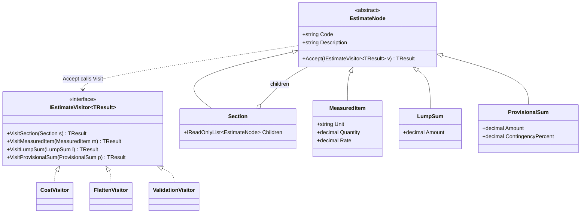
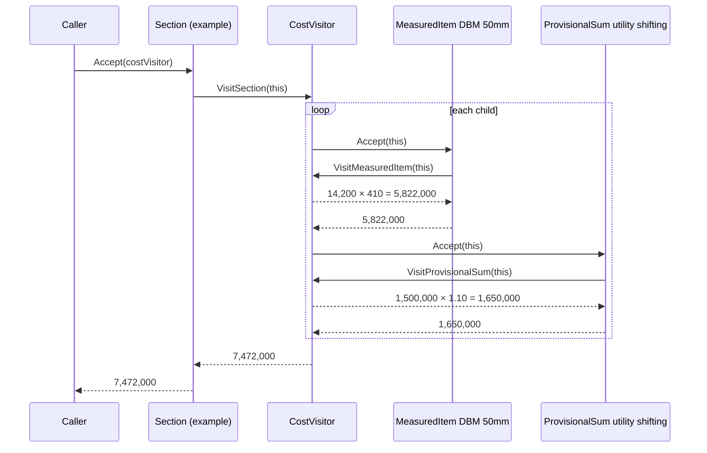
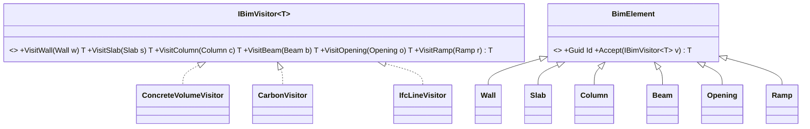

Visitor has a reputation for being the hardest GoF pattern. The mechanics are only about ten lines. What makes it hard is understanding *why* those ten lines are needed. Once you understand double dispatch, you'll recognise Visitor all over .NET: in `ExpressionVisitor`, which EF Core relies on to rewrite LINQ queries, in Roslyn's syntax walkers, and in every compiler and report generator that walks a tree. This lesson builds a cost-estimate tree for a road project with three visitors, uses `ExpressionVisitor` to compose query filters, and then honestly compares Visitor with a modern C# `switch` expression.

## Learning objectives

By the end of this lesson you will be able to:

1. Explain the problem Visitor solves: adding *operations* to a stable set of *types* without editing those types.
2. Explain single vs double dispatch, and why method overloading alone can't pick a method by an object's runtime type.
3. Implement a generic visitor (`IVisitor<TResult>`) over a composite tree, including a stateful visitor and a transforming visitor.
4. Use `System.Linq.Expressions.ExpressionVisitor` to rewrite expression trees, for example to combine two predicates for EF Core.
5. Replace a visitor with a C# pattern-matching `switch` expression, and say what you lose and gain.
6. Explain the expression problem, and decide which side your design should favour.

## Prerequisites

- [Encapsulation, abstraction, inheritance and polymorphism](#/lesson/m01-oop-pillars): virtual methods are half of double dispatch.
- [Composite](#/lesson/m06-composite): visitors usually walk composite trees.
- [Open/Closed Principle](#/lesson/m04-ocp): Visitor makes operations open for extension, but makes types closed.

## Explain it like I'm a beginner

Imagine a tax inspector visiting a market. The market has different kinds of stalls: a vegetable stall, a jewellery shop, a restaurant. The inspector must calculate tax, but the rule is different for each kind: 0 % on fresh vegetables, 3 % on gold, 5 % on restaurant food (simplified numbers, for illustration).

The inspector walks up to each stall and says: "Hello, I'm the tax inspector." The stall owner replies: "I'm a **jewellery** shop. Here are my books." Now the inspector knows exactly which rule to use.

Next month a **fire-safety inspector** visits the same market. Same stalls, same "hello", but she checks different things for each kind of stall. Then a **health inspector**. Each inspector is a new *operation*. The stalls never change. They only need to know one trick: "when an inspector arrives, tell them what kind of stall I am."

That's the Visitor pattern:

- The **stalls** are the *elements*, a fixed family of types.
- Each **inspector** is a *visitor*, one operation, with a separate method for each kind of element.
- "Tell them what kind of stall I am" is the `Accept` method. The stall calls `inspector.VisitJewellery(this)`.

Why is the handshake needed? Because when the inspector looks at a list of "stalls", all she sees is "a stall". The stall itself knows its real kind, so it calls the right method on the inspector. Two decisions, one by the stall and one by the inspector, pick the right code. That is called **double dispatch**.

Now the software version. A road project estimate is a tree: sections (Earthworks, Pavement, Drainage) that contain items. Some items are measured (12,400 m³ of excavation at ₹185/m³), some are lump sums (₹8 lakh for site mobilisation), and some are provisional sums (₹15 lakh for utility shifting, plus 10 % contingency). Over the life of the project you'll want many operations on the same tree: total cost, CSV export, validation, GST breakdown, comparison with the tender estimate. With Visitor, each of these is one new class. The node types don't change.

## First-principles explanation

### The original problem

You have a **stable** set of types: estimate nodes, syntax-tree nodes, document elements, shapes. You keep adding **operations** on them. You have two obvious options, and both hurt:

1. **Put each operation in the types** as a virtual method: `GetCost()`, `ToCsv()`, `Validate()`, `GetGst()`. Every new operation means editing every type. The node classes fill up with unrelated concerns, so a pricing record ends up knowing about CSV escaping. Different teams fight over the same files.
2. **Put each operation outside**, with type checks: `if (node is Section s) ... else if (node is MeasuredItem m) ...`. This works, but it is copied in every operation. When a new node type appears, you have to find every chain by hand, and the compiler won't help.

Visitor gives a third option. Each operation is one class with **one method per node type**, and the compiler forces every visitor to handle every type.

### Single vs double dispatch

C# picks virtual methods by the runtime type of **one** object, the receiver. That is *single dispatch*:

```csharp
EstimateNode n = new LumpSum("MOB", "Mobilisation", 800_000m);
n.Accept(visitor);   // runtime type of n (LumpSum) picks LumpSum.Accept
```

Method **overloading**, on the other hand, is resolved at **compile time** from the *static* type of the argument:

```csharp
void Visit(Section s) { ... }
void Visit(LumpSum l) { ... }
EstimateNode n = new LumpSum(...);
Visit(n);   // compile error: no overload takes EstimateNode. The compiler can't see that n is a LumpSum.
```

So with an `EstimateNode` in hand, you can't call "the right `Visit` overload" directly. Double dispatch chains two single dispatches:

1. `node.Accept(visitor)`: the virtual call selects `LumpSum.Accept` from the **node's** runtime type.
2. Inside `LumpSum.Accept`, `this` has static type `LumpSum`, so it calls `visitor.VisitLumpSum(this)`. That call is virtual on the **visitor's** runtime type, so `CostVisitor` or `CsvVisitor` is picked.

Two virtual calls, and the code that runs depends on both runtime types. (C# also has `dynamic` dispatch, which can choose overloads at runtime, but it is slower and loses compile-time checking. Avoid it for this.)

### Participants

| Participant | Job | Example |
|---|---|---|
| **Visitor** (interface) | One `Visit` method per concrete element type | `IEstimateVisitor<TResult>` |
| **Concrete visitor** | One operation, implemented for every element type | `CostVisitor`, `FlattenVisitor`, `ValidationVisitor` |
| **Element** (base) | Declares `Accept(visitor)` | `EstimateNode` |
| **Concrete elements** | Implement `Accept` by calling the matching `Visit` method | `Section`, `MeasuredItem`, `LumpSum`, `ProvisionalSum` |
| **Object structure** | The collection or tree being walked | the estimate tree (a [Composite](#/lesson/m06-composite)) |

### The simplest implementation

```csharp
public interface IShapeVisitor<T> { T VisitCircle(Circle c); T VisitRect(Rect r); }
public abstract record Shape { public abstract T Accept<T>(IShapeVisitor<T> v); }
public sealed record Circle(double R) : Shape { public override T Accept<T>(IShapeVisitor<T> v) => v.VisitCircle(this); }
public sealed record Rect(double W, double H) : Shape { public override T Accept<T>(IShapeVisitor<T> v) => v.VisitRect(this); }

public sealed class AreaVisitor : IShapeVisitor<double>
{
    public double VisitCircle(Circle c) => Math.PI * c.R * c.R;
    public double VisitRect(Rect r) => r.W * r.H;
}
```

The generic `TResult` is a modern improvement over the GoF original, whose `Visit` methods returned `void` and stored results in fields. A generic return lets visitors be small, pure functions.

### Three kinds of visitor you'll write

1. **Computing visitors** return a value: totals, counts, a string.
2. **Stateful visitors** accumulate as they walk: the current path in the tree, codes seen so far (to find duplicates), a CSV builder. Create a new one per walk, because they aren't thread-safe.
3. **Transforming (rewriting) visitors** return a *new* tree: simplifying expressions, renaming, inlining. `ExpressionVisitor` is this kind. A good rewriter returns the *same* node instance when nothing changed, so unchanged subtrees aren't copied.

### ExpressionVisitor: the visitor .NET uses every day

When you write `db.Lines.Where(l => l.Unit == "m3")`, the C# compiler builds an **expression tree**: a data structure describing the lambda, rather than compiled code. EF Core walks that tree with visitors to translate it into SQL. `System.Linq.Expressions.ExpressionVisitor` is the base class. It has a `Visit` method for every node kind (`VisitBinary`, `VisitMember`, `VisitParameter`, and so on), and by default each one rebuilds the node from its visited children. You override only the methods you care about.

A classic need: combine two filters, `l => l.Unit == "m3"` and `x => x.Amount > 100000`. You can't just put the two bodies inside `AndAlso`, because each body refers to its *own* parameter (`l` and `x`). The result would reference a parameter that isn't declared, and compilation or SQL translation fails. The fix is a tiny visitor that replaces `x` with `l` everywhere in the second body. You'll build it below and in exercise 3.

### The modern alternative: pattern matching

C# can now dispatch on runtime type with a `switch` expression:

```csharp
static decimal Cost(EstimateNode n) => n switch
{
    Section s        => s.Children.Sum(Cost),
    MeasuredItem m   => m.Quantity * m.Rate,
    LumpSum l        => l.Amount,
    ProvisionalSum p => p.Amount * (1 + p.ContingencyPercent / 100m),
    _ => throw new UnreachableException($"Unknown node {n.GetType().Name}"),
};
```

It is shorter, has no `Accept` boilerplate, and the node types don't need to know visitors exist. The cost is that **the compiler doesn't tell you when a new node type is added.** C# 14 has no closed type hierarchies or discriminated unions (there is an active language proposal), so a `switch` over a class hierarchy always needs the `_` arm, and a forgotten case becomes a runtime exception. With Visitor, adding `VisitDayWorkItem` to the interface makes *every* visitor fail to compile until someone handles it.

### The expression problem

This is the deep trade-off behind Visitor, named by Philip Wadler. Picture a grid: **types** are rows and **operations** are columns.

- **Classic OOP** (virtual methods in each type) makes it easy to add a *row*. A new type implements all the existing methods. Adding a *column* is hard, because you edit every type.
- **Visitor or pattern matching** makes it easy to add a *column*: a new operation is one new class or function. Adding a *row* is hard, because you edit every visitor or switch.

No design makes both easy without extra machinery. So ask: **in my domain, which changes more often, the types or the operations?** Compiler syntax trees, document formats and estimate structures change rarely, while operations on them grow constantly. That is Visitor territory. Payment providers or notification channels gain new *types* often and have a few fixed operations. That is plain polymorphism or [Strategy](#/lesson/m06-strategy) territory.

### When it is useful

- The element types are **stable** (new ones appear maybe once a year) and operations are added often.
- Operations need **different code per type**, and you want the compiler to enforce completeness.
- You want to keep unrelated concerns (export formats, validation, pricing) **out** of the domain types.
- You're walking a tree: compilers, query translators, document renderers, BIM or IFC model walkers, estimate and BOQ structures.

### When it is unnecessary or harmful

- Types change often. Every new type forces edits to every visitor.
- There are one or two operations. A virtual method or a `switch` is simpler.
- Visitors need access to private state of the elements. Visitor then forces you to make internals public, which breaks encapsulation.
- The hierarchy is open to third parties, such as plugins adding node types. Their types can't be added to your visitor interface.

### Trade-offs it introduces

| You gain | You pay |
|---|---|
| New operation = one new class; node types untouched | New node type = edit every visitor |
| Compiler forces every visitor to handle every type | `Accept` boilerplate in every element |
| Related code for one operation sits together | Code for one *type* is spread over many visitors |
| Visitors can hold state across a walk | Stateful visitors aren't reusable or thread-safe; create one per walk |
| Clean domain types | Elements must expose enough public state for visitors to work |

## Visual explanation

### Class diagram



How to read it: the left half is the element hierarchy, a composite in which `Section` contains other nodes. The right half is the visitor hierarchy. The two hierarchies meet in exactly one place: each element's `Accept` calls the one `Visit` method that matches its own type. Adding a fourth visitor adds one box on the right and touches nothing on the left. Adding a fifth node type adds a box on the left *and* a method to the interface, which every visitor on the right must then implement. The diagram shows the expression problem.

### Sequence diagram — double dispatch while computing a total



Each arrow pair `Accept` → `VisitX` is one double dispatch. First the node's runtime type picks `Accept`, then the visitor's runtime type picks `VisitX`. Notice that the *visitor*, not the section, decides to walk the children. That's a design choice: the visitor controls traversal, so a visitor can skip subtrees, such as a "provisional items only" report that ignores measured sections. The alternative, where elements walk their own children, is simpler but less flexible.

## Step-by-step example

### Step 1 — type checks in every operation

```csharp
public decimal Total(EstimateNode n)
{
    if (n is Section s) return s.Children.Sum(Total);
    if (n is MeasuredItem m) return m.Quantity * m.Rate;
    if (n is LumpSum l) return l.Amount;
    return 0m;   // ProvisionalSum forgotten! Silently zero.
}
```

The same chain appears in `ExportCsv`, `Validate` and `GstBreakdown`. When `ProvisionalSum` was added, one of four chains was updated. The ₹15 lakh utility-shifting provision disappeared from the total, and nobody noticed until the tender comparison.

### Step 2 — define the visitor interface

One method per concrete node type. This list *is* the contract that every operation must fulfil.

### Step 3 — add `Accept` to each node

Each node gets exactly one line: `=> visitor.VisitX(this)`. This is the only change ever made to the nodes for any number of future operations.

### Step 4 — one class per operation

Move each `if` chain into a visitor class. Now when someone adds a `DayWorkItem` node, they add `VisitDayWorkItem` to the interface, and `CostVisitor`, `FlattenVisitor` and `ValidationVisitor` *all fail to compile* until they handle it. The silent ₹15 lakh bug can't happen.

### Step 5 — decide: is this worth it?

With 4 node types and 4+ operations that keep growing, yes. With 4 node types and one operation, no: a `switch` expression is fine. You'll see both in the code below.

## Production-style C# implementation

```text
Costing.Api/
  Program.cs
  Estimates/EstimateNodes.cs         # elements + visitor interface
  Estimates/CostVisitor.cs
  Estimates/FlattenVisitor.cs        # stateful: tracks the current path
  Estimates/ValidationVisitor.cs     # stateful: tracks codes seen
  Estimates/PatternMatchingCost.cs   # the switch-expression alternative
  Estimates/EstimateRepository.cs
  Querying/PredicateBuilder.cs       # ExpressionVisitor for combining filters
```

```csharp file=Estimates/EstimateNodes.cs
namespace Costing.Estimates;

/// <summary>One method per concrete node type. Adding a node type here forces every visitor to handle it.</summary>
public interface IEstimateVisitor<out TResult>
{
    TResult VisitSection(Section section);
    TResult VisitMeasuredItem(MeasuredItem item);
    TResult VisitLumpSum(LumpSum item);
    TResult VisitProvisionalSum(ProvisionalSum item);
}

public abstract record EstimateNode(string Code, string Description)
{
    public abstract TResult Accept<TResult>(IEstimateVisitor<TResult> visitor);
}

public sealed record Section(string Code, string Description, IReadOnlyList<EstimateNode> Children)
    : EstimateNode(Code, Description)
{
    public override TResult Accept<TResult>(IEstimateVisitor<TResult> visitor) => visitor.VisitSection(this);
}

public sealed record MeasuredItem(string Code, string Description, string Unit, decimal Quantity, decimal Rate)
    : EstimateNode(Code, Description)
{
    public override TResult Accept<TResult>(IEstimateVisitor<TResult> visitor) => visitor.VisitMeasuredItem(this);
}

public sealed record LumpSum(string Code, string Description, decimal Amount) : EstimateNode(Code, Description)
{
    public override TResult Accept<TResult>(IEstimateVisitor<TResult> visitor) => visitor.VisitLumpSum(this);
}

/// <summary>An allowance for work not yet designed, with a contingency percentage on top.</summary>
public sealed record ProvisionalSum(string Code, string Description, decimal Amount, decimal ContingencyPercent)
    : EstimateNode(Code, Description)
{
    public override TResult Accept<TResult>(IEstimateVisitor<TResult> visitor) => visitor.VisitProvisionalSum(this);
}
```

```csharp file=Estimates/CostVisitor.cs
namespace Costing.Estimates;

/// <summary>Stateless, so one shared instance is safe.</summary>
public sealed class CostVisitor : IEstimateVisitor<decimal>
{
    public static readonly CostVisitor Instance = new();

    public decimal VisitSection(Section section) => section.Children.Sum(c => c.Accept(this));
    public decimal VisitMeasuredItem(MeasuredItem item) => Money(item.Quantity * item.Rate);
    public decimal VisitLumpSum(LumpSum item) => item.Amount;
    public decimal VisitProvisionalSum(ProvisionalSum item) => Money(item.Amount * (1 + item.ContingencyPercent / 100m));

    private static decimal Money(decimal v) => Math.Round(v, 2, MidpointRounding.AwayFromZero);
}
```

```csharp file=Estimates/FlattenVisitor.cs
namespace Costing.Estimates;

public sealed record LineView(string Path, string Code, string Description, string Kind, string Unit, decimal Quantity, decimal Amount);

/// <summary>Stateful: remembers the section path while walking. Create a new instance per walk.</summary>
public sealed class FlattenVisitor : IEstimateVisitor<IReadOnlyList<LineView>>
{
    private readonly Stack<string> _path = new();

    public IReadOnlyList<LineView> VisitSection(Section section)
    {
        _path.Push(section.Code);
        try
        {
            return section.Children.SelectMany(c => c.Accept(this)).ToList();   // eager: the path must be correct now
        }
        finally
        {
            _path.Pop();
        }
    }

    public IReadOnlyList<LineView> VisitMeasuredItem(MeasuredItem i) =>
        [new LineView(CurrentPath, i.Code, i.Description, "Measured", i.Unit, i.Quantity, CostVisitor.Instance.VisitMeasuredItem(i))];

    public IReadOnlyList<LineView> VisitLumpSum(LumpSum i) =>
        [new LineView(CurrentPath, i.Code, i.Description, "Lump sum", "LS", 1, i.Amount)];

    public IReadOnlyList<LineView> VisitProvisionalSum(ProvisionalSum i) =>
        [new LineView(CurrentPath, i.Code, i.Description, "Provisional", "PS", 1, CostVisitor.Instance.VisitProvisionalSum(i))];

    private string CurrentPath => string.Join(" / ", _path.Reverse());
}
```

```csharp file=Estimates/ValidationVisitor.cs
namespace Costing.Estimates;

/// <summary>Stateful: tracks codes seen so far to report duplicates anywhere in the tree.</summary>
public sealed class ValidationVisitor : IEstimateVisitor<IReadOnlyList<string>>
{
    public const decimal MaxContingencyPercent = 15m;
    private readonly HashSet<string> _seen = new(StringComparer.OrdinalIgnoreCase);

    public IReadOnlyList<string> VisitSection(Section s)
    {
        var errors = CheckCode(s);
        if (s.Children.Count == 0) errors.Add($"{s.Code}: section has no items.");
        foreach (var child in s.Children) errors.AddRange(child.Accept(this));
        return errors;
    }

    public IReadOnlyList<string> VisitMeasuredItem(MeasuredItem i)
    {
        var errors = CheckCode(i);
        if (string.IsNullOrWhiteSpace(i.Unit)) errors.Add($"{i.Code}: unit is required.");
        if (i.Quantity <= 0) errors.Add($"{i.Code}: quantity must be positive.");
        if (i.Rate < 0) errors.Add($"{i.Code}: rate cannot be negative.");
        return errors;
    }

    public IReadOnlyList<string> VisitLumpSum(LumpSum i)
    {
        var errors = CheckCode(i);
        if (i.Amount <= 0) errors.Add($"{i.Code}: lump sum must be positive.");
        return errors;
    }

    public IReadOnlyList<string> VisitProvisionalSum(ProvisionalSum i)
    {
        var errors = CheckCode(i);
        if (i.ContingencyPercent is < 0 or > MaxContingencyPercent)
            errors.Add($"{i.Code}: contingency {i.ContingencyPercent} % is outside 0–{MaxContingencyPercent} %.");
        return errors;
    }

    private List<string> CheckCode(EstimateNode n) =>
        _seen.Add(n.Code) ? new List<string>() : new List<string> { $"{n.Code}: duplicate code." };
}
```

```csharp file=Estimates/PatternMatchingCost.cs
using System.Diagnostics;

namespace Costing.Estimates;

/// <summary>The same operation as CostVisitor, written as a switch expression. Shorter, but a new node type
/// is only caught at runtime (UnreachableException), not at compile time.</summary>
public static class PatternMatchingCost
{
    public static decimal Of(EstimateNode node) => node switch
    {
        Section s => s.Children.Sum(Of),
        MeasuredItem m => Math.Round(m.Quantity * m.Rate, 2, MidpointRounding.AwayFromZero),
        LumpSum l => l.Amount,
        ProvisionalSum p => Math.Round(p.Amount * (1 + p.ContingencyPercent / 100m), 2, MidpointRounding.AwayFromZero),
        _ => throw new UnreachableException($"No cost rule for {node.GetType().Name}."),
    };
}
```

```csharp file=Estimates/EstimateRepository.cs
namespace Costing.Estimates;

public interface IEstimateRepository
{
    EstimateNode? Find(string id);
}

/// <summary>Seeded sample. In production this loads from PostgreSQL (for example, an adjacency list or JSONB).</summary>
public sealed class InMemoryEstimateRepository : IEstimateRepository
{
    private readonly Dictionary<string, EstimateNode> _byId = new(StringComparer.OrdinalIgnoreCase)
    {
        ["NH-4KM"] = new Section("EST", "4 km road widening — engineer's estimate",
        [
            new Section("EW", "Earthworks",
            [
                new MeasuredItem("EW-01", "Excavation in ordinary soil", "m3", 12_400m, 185m),
                new MeasuredItem("EW-02", "Embankment with approved material", "m3", 9_000m, 240m),
            ]),
            new Section("PV", "Pavement",
            [
                new MeasuredItem("PV-01", "Dense bituminous macadam, 50 mm", "m2", 14_200m, 410m),
                new MeasuredItem("PV-02", "Bituminous concrete, 30 mm", "m2", 14_200m, 295m),
            ]),
            new LumpSum("GEN-01", "Mobilisation and site establishment", 800_000m),
            new ProvisionalSum("PS-01", "Utility shifting", 1_500_000m, 10m),
        ]),
    };

    public EstimateNode? Find(string id) => _byId.GetValueOrDefault(id);
}
```

### ExpressionVisitor: composing filters

```csharp file=Querying/PredicateBuilder.cs
using System.Linq.Expressions;

namespace Costing.Querying;

/// <summary>Rewrites every use of one parameter into another expression.</summary>
public sealed class ParameterReplacer(ParameterExpression from, Expression to) : ExpressionVisitor
{
    protected override Expression VisitParameter(ParameterExpression node) =>
        node == from ? to : base.VisitParameter(node);
}

public static class PredicateBuilder
{
    public static Expression<Func<T, bool>> And<T>(this Expression<Func<T, bool>> left, Expression<Func<T, bool>> right) =>
        Combine(left, right, Expression.AndAlso);

    public static Expression<Func<T, bool>> Or<T>(this Expression<Func<T, bool>> left, Expression<Func<T, bool>> right) =>
        Combine(left, right, Expression.OrElse);

    private static Expression<Func<T, bool>> Combine<T>(
        Expression<Func<T, bool>> left, Expression<Func<T, bool>> right,
        Func<Expression, Expression, BinaryExpression> op)
    {
        var p = left.Parameters[0];
        var rightBody = new ParameterReplacer(right.Parameters[0], p).Visit(right.Body);
        return Expression.Lambda<Func<T, bool>>(op(left.Body, rightBody), p);
    }
}

/// <summary>Collects the property names a filter reads, so an API can reject filters on non-public fields.</summary>
public sealed class MemberAccessCollector : ExpressionVisitor
{
    private readonly HashSet<string> _members = new();

    public static IReadOnlySet<string> Collect(Expression expression)
    {
        var collector = new MemberAccessCollector();
        collector.Visit(expression);
        return collector._members;
    }

    protected override Expression VisitMember(MemberExpression node)
    {
        if (node.Expression is ParameterExpression) _members.Add(node.Member.Name);
        return base.VisitMember(node);
    }
}
```

`ParameterReplacer` overrides one method out of dozens. Every other node type is handled by the base class, which rebuilds the node only if a child changed. That's the "transforming visitor" idea in production form, and it's why `PredicateBuilder.And` produces a single clean lambda that EF Core can translate to `WHERE unit = 'm3' AND amount > 100000`.

```csharp file=Program.cs
using System.Linq.Expressions;
using System.Text;
using Costing.Estimates;
using Costing.Querying;

var builder = WebApplication.CreateBuilder(args);
builder.Services.AddSingleton<IEstimateRepository, InMemoryEstimateRepository>();
var app = builder.Build();

app.MapGet("/estimates/{id}/total", (string id, IEstimateRepository repo) =>
    repo.Find(id) is { } estimate
        ? Results.Ok(new { id, total = estimate.Accept(CostVisitor.Instance) })
        : Results.NotFound());

app.MapGet("/estimates/{id}/validation", (string id, IEstimateRepository repo) =>
    repo.Find(id) is { } estimate
        ? Results.Ok(estimate.Accept(new ValidationVisitor()))   // stateful: new instance per walk
        : Results.NotFound());

app.MapGet("/estimates/{id}/lines", (string id, string? unit, decimal? minAmount, IEstimateRepository repo) =>
{
    if (repo.Find(id) is not { } estimate) return Results.NotFound();

    Expression<Func<LineView, bool>> filter = _ => true;
    if (unit is not null) filter = filter.And(l => l.Unit == unit);
    if (minAmount is not null) filter = filter.And(l => l.Amount >= minAmount.Value);

    var lines = estimate.Accept(new FlattenVisitor()).AsQueryable().Where(filter).ToList();
    return Results.Ok(lines);
});

app.MapGet("/estimates/{id}/export.csv", (string id, IEstimateRepository repo) =>
{
    if (repo.Find(id) is not { } estimate) return Results.NotFound();
    var csv = new StringBuilder("Path,Code,Description,Kind,Unit,Quantity,Amount\n");
    foreach (var l in estimate.Accept(new FlattenVisitor()))
        csv.AppendLine(string.Join(',', Csv(l.Path), Csv(l.Code), Csv(l.Description), l.Kind, l.Unit, l.Quantity, l.Amount));
    return Results.Text(csv.ToString(), "text/csv");
});

app.Run();

static string Csv(string s) => s.IndexOfAny([',', '"', '\n']) >= 0 ? $"\"{s.Replace("\"", "\"\"")}\"" : s;
```

For the sample estimate, the total is ₹2,294,000 (EW-01) + ₹2,160,000 (EW-02) + ₹5,822,000 (PV-01) + ₹4,189,000 (PV-02) + ₹800,000 + ₹1,650,000 = **₹16,915,000**. That figure is computed from the sample data, so you can check it in a test.

## Bad design vs good design

**Bad: operations inside the nodes.**

```csharp
public abstract record EstimateNode(string Code)
{
    public abstract decimal Cost();
    public abstract string ToCsvRow(string path);      // export concern in the domain
    public abstract IEnumerable<string> Validate(HashSet<string> seen);   // validation state leaks into signatures
    public abstract decimal Gst(GstRateTable rates);   // tax tables now referenced by the domain model
}
```

Every new report edits four classes. The domain types depend on CSV, tax tables and validation state. A change to the GST rates file forces a rebuild of the estimate model.

**Also bad: duplicated type-switches with a silent default** (Step 1), which lose ₹15 lakh when a type is added.

**Good:** stable node types with one `Accept` each, and one visitor per operation. The compiler enforces completeness.

**Is it worth it?** It depends on the expression problem. If your node types change every sprint, you'll edit every visitor every sprint, and virtual methods (or [Strategy](#/lesson/m06-strategy)) would be better. If you only have one or two operations, use `PatternMatchingCost`-style switches and accept the runtime check.

:::callout type=tradeoff title="Visitor vs switch expression, in one table"
| | Visitor | `switch` on type |
|---|---|---|
| Boilerplate | `Accept` per node, one interface | none |
| New node type caught by compiler? | yes, every visitor breaks | no, falls into `_` at runtime |
| Nodes must know about operations? | only the visitor interface | no |
| Traversal control | visitor decides (can skip subtrees) | your recursion |
| Best when | many operations, stable types, team-wide contract | few operations, local logic, quick tools |

A pragmatic middle ground used in real codebases: keep a visitor interface for the core operations everyone relies on (cost, validation), and use `switch` expressions for one-off reports.
:::

## Practical playground

The playground has a small estimate tree, `CostVisitor` and a `CountVisitor`. Run it. Then add a `ProvisionalOnlyVisitor` that sums only provisional sums and skips everything else. Finally, add a new node type `DayWorkItem(Code, Hours, HourlyRate)` and watch which lines fail to compile. That compile error is the safety net.

:::playground type=csharp title="Visit an estimate tree"
```csharp file=Program.cs
using System;
using System.Collections.Generic;
using System.Linq;

public interface IVisitor<T>
{
    T VisitSection(Section s);
    T VisitMeasured(Measured m);
    T VisitProvisional(Provisional p);
}

public abstract record Node(string Code) { public abstract T Accept<T>(IVisitor<T> v); }
public sealed record Section(string Code, IReadOnlyList<Node> Children) : Node(Code) { public override T Accept<T>(IVisitor<T> v) => v.VisitSection(this); }
public sealed record Measured(string Code, decimal Qty, decimal Rate) : Node(Code) { public override T Accept<T>(IVisitor<T> v) => v.VisitMeasured(this); }
public sealed record Provisional(string Code, decimal Amount) : Node(Code) { public override T Accept<T>(IVisitor<T> v) => v.VisitProvisional(this); }

public sealed class CostVisitor : IVisitor<decimal>
{
    public decimal VisitSection(Section s) => s.Children.Sum(c => c.Accept(this));
    public decimal VisitMeasured(Measured m) => m.Qty * m.Rate;
    public decimal VisitProvisional(Provisional p) => p.Amount;
}

public sealed class CountVisitor : IVisitor<int>
{
    public int VisitSection(Section s) => s.Children.Sum(c => c.Accept(this));
    public int VisitMeasured(Measured m) => 1;
    public int VisitProvisional(Provisional p) => 1;
}

public static class Program
{
    public static void Main()
    {
        Node estimate = new Section("EST", new Node[]
        {
            new Section("EW", new Node[] { new Measured("EW-01", 12_400m, 185m), new Measured("EW-02", 9_000m, 240m) }),
            new Provisional("PS-01", 1_500_000m),
        });

        Console.WriteLine($"Total: {estimate.Accept(new CostVisitor()):N0}");
        Console.WriteLine($"Items: {estimate.Accept(new CountVisitor())}");
    }
}
```
:::

## Exercises

:::exercise id=m06-visitor-ex1 difficulty=beginner kind=code title="Count items and measure depth"
Write two visitors over the estimate tree: `ItemCountVisitor` counts leaf items (not sections), and `DepthVisitor` returns the depth of the tree.
::requirements
- Leaves (`MeasuredItem`, `LumpSum`) count as 1 item. Sections count as 0 themselves, plus their children.
- Depth: a leaf has depth 1. A section has depth 1 + the maximum depth of its children, and an empty section has depth 1.
- Don't use `is` or `switch` on node types. Use `Accept`.
::acceptance
- The sample tree (root → 2 sections with 2 items each, plus 1 lump sum at root) has 5 items and depth 3.
- An empty section has 0 items and depth 1.
- A single lump sum has 1 item and depth 1.
::hint
Each visitor returns `int`. What should `VisitSection` do with its children's answers?
::hint
Item count sums children. Depth takes the maximum of children.
::hint
`Max()` on an empty sequence throws. Use `DefaultIfEmpty(0).Max()`.
::hint
```csharp
public int VisitSection(Section s) => 1 + s.Children.Select(c => c.Accept(this)).DefaultIfEmpty(0).Max();
```
::starter
```csharp file=EstimateVisitors.cs
using System;
using System.Collections.Generic;
using System.Linq;

public interface IEstimateVisitor<T>
{
    T VisitSection(Section s);
    T VisitMeasuredItem(MeasuredItem m);
    T VisitLumpSum(LumpSum l);
}

public abstract record EstimateNode(string Code) { public abstract T Accept<T>(IEstimateVisitor<T> v); }
public sealed record Section(string Code, IReadOnlyList<EstimateNode> Children) : EstimateNode(Code)
{ public override T Accept<T>(IEstimateVisitor<T> v) => v.VisitSection(this); }
public sealed record MeasuredItem(string Code, decimal Quantity, decimal Rate) : EstimateNode(Code)
{ public override T Accept<T>(IEstimateVisitor<T> v) => v.VisitMeasuredItem(this); }
public sealed record LumpSum(string Code, decimal Amount) : EstimateNode(Code)
{ public override T Accept<T>(IEstimateVisitor<T> v) => v.VisitLumpSum(this); }

public sealed class ItemCountVisitor : IEstimateVisitor<int>
{
    public int VisitSection(Section s) => throw new NotImplementedException();
    public int VisitMeasuredItem(MeasuredItem m) => throw new NotImplementedException();
    public int VisitLumpSum(LumpSum l) => throw new NotImplementedException();
}

public sealed class DepthVisitor : IEstimateVisitor<int>
{
    public int VisitSection(Section s) => throw new NotImplementedException();
    public int VisitMeasuredItem(MeasuredItem m) => throw new NotImplementedException();
    public int VisitLumpSum(LumpSum l) => throw new NotImplementedException();
}
```
::tests
```csharp file=EstimateVisitorsTests.cs
using System.Collections.Generic;
using Xunit;

public class EstimateVisitorsTests
{
    private static EstimateNode Sample() => new Section("EST", new List<EstimateNode>
    {
        new Section("EW", new List<EstimateNode> { new MeasuredItem("EW-01", 12400m, 185m), new MeasuredItem("EW-02", 9000m, 240m) }),
        new Section("PV", new List<EstimateNode> { new MeasuredItem("PV-01", 14200m, 410m), new MeasuredItem("PV-02", 14200m, 295m) }),
        new LumpSum("GEN-01", 800000m),
    });

    [Fact] public void Counts_leaf_items() => Assert.Equal(5, Sample().Accept(new ItemCountVisitor()));
    [Fact] public void Measures_depth() => Assert.Equal(3, Sample().Accept(new DepthVisitor()));

    [Fact]
    public void Empty_section()
    {
        var empty = new Section("X", new List<EstimateNode>());
        Assert.Equal(0, empty.Accept(new ItemCountVisitor()));
        Assert.Equal(1, empty.Accept(new DepthVisitor()));
    }

    [Fact]
    public void Single_leaf()
    {
        EstimateNode leaf = new LumpSum("MOB", 1m);
        Assert.Equal(1, leaf.Accept(new ItemCountVisitor()));
        Assert.Equal(1, leaf.Accept(new DepthVisitor()));
    }
}
```
::solution
Both visitors recurse through `Accept`. They differ only in how they combine their children's results.

```csharp file=EstimateVisitors.cs
using System;
using System.Collections.Generic;
using System.Linq;

public interface IEstimateVisitor<T>
{
    T VisitSection(Section s);
    T VisitMeasuredItem(MeasuredItem m);
    T VisitLumpSum(LumpSum l);
}

public abstract record EstimateNode(string Code) { public abstract T Accept<T>(IEstimateVisitor<T> v); }
public sealed record Section(string Code, IReadOnlyList<EstimateNode> Children) : EstimateNode(Code)
{ public override T Accept<T>(IEstimateVisitor<T> v) => v.VisitSection(this); }
public sealed record MeasuredItem(string Code, decimal Quantity, decimal Rate) : EstimateNode(Code)
{ public override T Accept<T>(IEstimateVisitor<T> v) => v.VisitMeasuredItem(this); }
public sealed record LumpSum(string Code, decimal Amount) : EstimateNode(Code)
{ public override T Accept<T>(IEstimateVisitor<T> v) => v.VisitLumpSum(this); }

public sealed class ItemCountVisitor : IEstimateVisitor<int>
{
    public int VisitSection(Section s) => s.Children.Sum(c => c.Accept(this));
    public int VisitMeasuredItem(MeasuredItem m) => 1;
    public int VisitLumpSum(LumpSum l) => 1;
}

public sealed class DepthVisitor : IEstimateVisitor<int>
{
    public int VisitSection(Section s) => 1 + s.Children.Select(c => c.Accept(this)).DefaultIfEmpty(0).Max();
    public int VisitMeasuredItem(MeasuredItem m) => 1;
    public int VisitLumpSum(LumpSum l) => 1;
}
```
::mistakes
- Counting sections as items.
- Calling `Max()` on an empty child list, which throws `InvalidOperationException`.
- Writing `if (c is Section) ...` inside `VisitSection`, which defeats the pattern.
::extensions
Add `ProvisionalSum` to the interface and notice which classes stop compiling. That's the visitor's safety net in action.
:::

:::exercise id=m06-visitor-ex2 difficulty=beginner kind=written title="Trace the double dispatch"
Given this code:

```csharp
EstimateNode node = new ProvisionalSum("PS-01", "Utility shifting", 1_500_000m, 10m);
IEstimateVisitor<decimal> visitor = new CostVisitor();
var total = node.Accept(visitor);
```

(a) List, in order, every method that runs, and for each one say whether it was chosen at compile time or at runtime, and from which object's type. (b) Explain why the following doesn't compile, and why making it compile with `dynamic` is a poor fix:

```csharp
public sealed class CostCalculator
{
    public decimal Visit(Section s) => 0;
    public decimal Visit(ProvisionalSum p) => p.Amount;
}
new CostCalculator().Visit(node);   // node is EstimateNode
```
::acceptance
- Names `ProvisionalSum.Accept<decimal>` (runtime, from the node's type) and `CostVisitor.VisitProvisionalSum` (runtime, from the visitor's type).
- Explains that `VisitProvisionalSum` is chosen at compile time *by name* because inside `Accept` the static type of `this` is known.
- Explains that overload resolution uses static types, so `Visit(EstimateNode)` has no match.
- Gives at least two downsides of `dynamic`: runtime binding errors instead of compile errors, extra cost on first call, and no completeness check.
::hint
Separate two questions: which *method name* is called (decided by the compiler), and which *implementation* runs (decided at runtime by virtual dispatch).
::hint
What is the static type of `node`? What is the static type of `this` inside `ProvisionalSum.Accept`?
::hint
With `dynamic`, when does the binder decide which `Visit` to call, and what happens if no overload matches?
::solution
(a) 1. `node.Accept(visitor)`: the compiler picks the *method* `EstimateNode.Accept<TResult>` and infers `TResult = decimal`. At **runtime**, virtual dispatch on the **node's** type (`ProvisionalSum`) selects `ProvisionalSum.Accept`. 2. Inside it, `visitor.VisitProvisionalSum(this)`: the *method name* was fixed at compile time when `ProvisionalSum` was written, because `this` is statically a `ProvisionalSum`. At **runtime**, interface dispatch on the **visitor's** type selects `CostVisitor.VisitProvisionalSum`. 3. That returns 1,500,000 × 1.10 = 1,650,000. Two runtime decisions, on two objects: double dispatch.

(b) Overload resolution happens at compile time using the **static** type of the argument. `node` is statically `EstimateNode`, and there is no `Visit(EstimateNode)`, so it is a compile error. Casting `node` to `dynamic` defers resolution to runtime and would work, but: a missing overload becomes a `RuntimeBinderException` in production instead of a compile error; the first call per call site pays for the runtime binder, and later calls go through a cache, which is still slower than a virtual call; there's no compile-time check that every node type is handled; and refactoring tools can't follow the calls.
::mistakes
- Saying `VisitProvisionalSum` is chosen "by the node at runtime". The *name* is fixed at compile time, and only the *implementation* is chosen at runtime.
- Claiming C# overloads are resolved at runtime.
:::

:::exercise id=m06-visitor-ex3 difficulty=intermediate kind=code title="Combine LINQ filters with an ExpressionVisitor"
An API builds filters from optional query parameters. Implement `ParameterReplacer` and `PredicateBuilder.And` / `Or` so that two `Expression<Func<T, bool>>` can be combined into **one** lambda with a single parameter, the way EF Core needs it.
::requirements
- `ParameterReplacer` replaces one specific `ParameterExpression` with another expression and leaves everything else unchanged.
- `And`/`Or` return a lambda whose body is `AndAlso`/`OrElse` of the two bodies, using the **left** lambda's parameter.
- Don't use `Expression.Invoke`. EF Core can't translate invocation expressions reliably.
::acceptance
- `(l => l.Unit == "m3").And(x => x.Amount > 100000)` compiles, has one parameter, and filters correctly.
- The right side of the combined body is a `GreaterThan` node, not an `Invoke`.
- `Or` works the same way.
- `ParameterReplacer` leaves other parameters alone.
::hint
Why can't you just write `Expression.AndAlso(left.Body, right.Body)`? Look at which parameter each body refers to.
::hint
Subclass `ExpressionVisitor` and override only `VisitParameter`.
::hint
Return `to` when `node == from`, otherwise `base.VisitParameter(node)`.
::hint
```csharp
var p = left.Parameters[0];
var rightBody = new ParameterReplacer(right.Parameters[0], p).Visit(right.Body);
return Expression.Lambda<Func<T, bool>>(Expression.AndAlso(left.Body, rightBody), p);
```
::starter
```csharp file=PredicateBuilder.cs
using System;
using System.Linq.Expressions;

public sealed class ParameterReplacer(ParameterExpression from, Expression to) : ExpressionVisitor
{
    protected override Expression VisitParameter(ParameterExpression node) => throw new NotImplementedException();
}

public static class PredicateBuilder
{
    public static Expression<Func<T, bool>> And<T>(this Expression<Func<T, bool>> left, Expression<Func<T, bool>> right)
        => throw new NotImplementedException();

    public static Expression<Func<T, bool>> Or<T>(this Expression<Func<T, bool>> left, Expression<Func<T, bool>> right)
        => throw new NotImplementedException();
}
```
::tests
```csharp file=PredicateBuilderTests.cs
using System;
using System.Linq.Expressions;
using Xunit;

public sealed record Line(string Unit, decimal Amount);

public class PredicateBuilderTests
{
    private static readonly Expression<Func<Line, bool>> IsM3 = l => l.Unit == "m3";
    private static readonly Expression<Func<Line, bool>> Big = x => x.Amount > 100000m;

    [Fact]
    public void And_filters_correctly()
    {
        var f = IsM3.And(Big).Compile();
        Assert.True(f(new Line("m3", 200000m)));
        Assert.False(f(new Line("m2", 200000m)));
        Assert.False(f(new Line("m3", 5000m)));
    }

    [Fact]
    public void Or_filters_correctly()
    {
        var f = IsM3.Or(Big).Compile();
        Assert.True(f(new Line("m2", 200000m)));
        Assert.True(f(new Line("m3", 1m)));
        Assert.False(f(new Line("m2", 1m)));
    }

    [Fact]
    public void Single_parameter_and_no_invoke()
    {
        var combined = IsM3.And(Big);
        Assert.Single(combined.Parameters);
        var body = Assert.IsAssignableFrom<BinaryExpression>(combined.Body);
        Assert.Equal(ExpressionType.AndAlso, body.NodeType);
        Assert.Equal(ExpressionType.GreaterThan, body.Right.NodeType);
    }

    [Fact]
    public void Replacer_leaves_other_parameters_alone()
    {
        var a = Expression.Parameter(typeof(int), "a");
        var b = Expression.Parameter(typeof(int), "b");
        var c = Expression.Parameter(typeof(int), "c");
        var rewritten = new ParameterReplacer(a, c).Visit(Expression.Add(a, b));
        var add = Assert.IsAssignableFrom<BinaryExpression>(rewritten);
        Assert.Same(c, add.Left);
        Assert.Same(b, add.Right);
    }
}
```
::solution
The visitor overrides one method. The base class rebuilds every parent node whose child changed.

```csharp file=PredicateBuilder.cs
using System;
using System.Linq.Expressions;

public sealed class ParameterReplacer(ParameterExpression from, Expression to) : ExpressionVisitor
{
    protected override Expression VisitParameter(ParameterExpression node) =>
        node == from ? to : base.VisitParameter(node);
}

public static class PredicateBuilder
{
    public static Expression<Func<T, bool>> And<T>(this Expression<Func<T, bool>> left, Expression<Func<T, bool>> right)
        => Combine(left, right, Expression.AndAlso);

    public static Expression<Func<T, bool>> Or<T>(this Expression<Func<T, bool>> left, Expression<Func<T, bool>> right)
        => Combine(left, right, Expression.OrElse);

    private static Expression<Func<T, bool>> Combine<T>(Expression<Func<T, bool>> left, Expression<Func<T, bool>> right,
        Func<Expression, Expression, BinaryExpression> op)
    {
        ArgumentNullException.ThrowIfNull(left);
        ArgumentNullException.ThrowIfNull(right);
        var p = left.Parameters[0];
        var rightBody = new ParameterReplacer(right.Parameters[0], p).Visit(right.Body);
        return Expression.Lambda<Func<T, bool>>(op(left.Body, rightBody), p);
    }
}
```

Without the replacer, `Compile()` throws "variable 'x' of type 'Line' referenced from scope '', but it is not defined", and EF Core fails translation with a similar error.
::alternatives
`Expression.Invoke(right, p)` also compiles in memory, but LINQ providers vary in how they handle `InvocationExpression`. Rewriting the parameter produces the cleanest tree for any provider.
::mistakes
- Comparing parameters by `Name` instead of by reference. Two different lambdas can both call their parameter `x`.
- Rewriting the left side too, or building a new parameter and forgetting to rewrite one of the bodies.
::extensions
Add `Not<T>()` and write a `MemberAccessCollector` that lists the properties a filter reads, so the API can reject filters on fields that aren't allowed.
:::

:::exercise id=m06-visitor-ex4 difficulty=intermediate kind=design title="Refactor scattered type checks in a BIM model service"
A building information model (BIM) viewer back end has element types `Wall`, `Slab`, `Column`, `Beam`, `Opening`. Four services each contain an `if/else if` chain on the element type:

- `QuantityTakeoffService` computes concrete volume (m³) per element.
- `ClashReportService` checks clearances.
- `CarbonEstimateService` estimates embodied carbon (kg CO₂e) per element.
- `IfcExportService` writes each element as an IFC entity line.

Last quarter, `Ramp` was added. It was handled in two of the four services, and carbon reports under-counted. The team adds element types about once a year, and operations about once a month. Propose a refactor: Visitor, `switch` expressions, or virtual methods. Draw the class diagram for your choice and justify it with the expression problem.
::acceptance
- Correctly identifies which axis changes more often (operations) and what that implies.
- The class diagram shows the element hierarchy, the visitor interface with one method per element, and at least two concrete visitors.
- Explains how the design prevents a repeat of the `Ramp` bug.
- Discusses one cost or risk of the choice, and one case where you'd use `switch` instead.
::hint
Types change yearly, operations monthly. Which design makes the frequent change cheap?
::hint
Which design makes the compiler fail when `Ramp` is added but not handled?
::hint
Do the services need private data from the elements? If so, what would you expose?
::solution
**Choice: Visitor.** Operations change monthly and types change yearly, so we want operations to be cheap to add, and a missed type to be a compile error. Virtual methods would put take-off, clash, carbon and IFC concerns inside every element class, editing all 6 classes each month. `switch` expressions give no compile-time completeness, which is exactly the `Ramp` bug.



**Ramp bug prevention.** Adding `Ramp` means adding `VisitRamp` to `IBimVisitor<T>`, and all four visitors fail to compile until handled. `CarbonVisitor` can't be forgotten.

**Costs.** Elements must expose the geometry that visitors need (dimensions and material) as read-only properties. `ClashReportService` compares *pairs* of elements, which isn't a natural fit for single-element visits. Use the visitor to compute each element's bounding box, then a separate spatial index for the pairwise check. Avoid a visitor where `T` is awkward; there, a one-off `switch` in a throwaway admin report is fine.
::mistakes
- Choosing virtual methods "because it's OOP" without considering how often each axis changes.
- Forcing pairwise clash detection into a single-dispatch visitor.
:::

:::exercise id=m06-visitor-ex5 difficulty=advanced kind=code title="A transforming visitor: simplify formulas"
Rate-analysis formulas are stored as small expression trees, for example `(qty * 1) + 0` or `(2 + 3) * labour`. Implement `Simplifier`, a visitor that returns a **new, simplified tree**, and returns the **same instance** when nothing changes.
::requirements
- Simplify children first (bottom-up).
- Constant folding: `Num + Num` and `Num * Num` become one `Num`.
- Identities: `x + 0` and `0 + x` become `x`; `x * 1` and `1 * x` become `x`; `x * 0` and `0 * x` become `Num(0)`.
- If neither child changed and no rule applies, return the original node (`ReferenceEquals`).
::acceptance
- `(qty * 1) + 0` prints `qty`.
- `(2 + 3) * labour` prints `(5 * labour)`.
- `0 * (wastage + 1)` prints `0`.
- Simplifying `(a + b)` returns the very same instance.
::hint
Each `Visit` method for a binary node first calls `Accept(this)` on both children.
::hint
Pattern matching *inside* the visitor is fine: `(left, right) switch { (Num a, Num b) => ..., ... }`.
::hint
To return the same instance, compare the simplified children with the originals using `ReferenceEquals`.
::hint
```csharp
public Expr VisitAdd(Add a)
{
    var l = a.Left.Accept(this); var r = a.Right.Accept(this);
    return (l, r) switch
    {
        (Num x, Num y) => new Num(x.Value + y.Value),
        (Num { Value: 0 }, _) => r,
        (_, Num { Value: 0 }) => l,
        _ => ReferenceEquals(l, a.Left) && ReferenceEquals(r, a.Right) ? a : new Add(l, r),
    };
}
```
::starter
```csharp file=Simplifier.cs
using System;
using System.Globalization;

public interface IExprVisitor<T>
{
    T VisitNum(Num n);
    T VisitVar(Var v);
    T VisitAdd(Add a);
    T VisitMul(Mul m);
}

public abstract record Expr { public abstract T Accept<T>(IExprVisitor<T> v); }
public sealed record Num(decimal Value) : Expr { public override T Accept<T>(IExprVisitor<T> v) => v.VisitNum(this); }
public sealed record Var(string Name) : Expr { public override T Accept<T>(IExprVisitor<T> v) => v.VisitVar(this); }
public sealed record Add(Expr Left, Expr Right) : Expr { public override T Accept<T>(IExprVisitor<T> v) => v.VisitAdd(this); }
public sealed record Mul(Expr Left, Expr Right) : Expr { public override T Accept<T>(IExprVisitor<T> v) => v.VisitMul(this); }

public sealed class Printer : IExprVisitor<string>
{
    public string VisitNum(Num n) => n.Value.ToString(CultureInfo.InvariantCulture);
    public string VisitVar(Var v) => v.Name;
    public string VisitAdd(Add a) => $"({a.Left.Accept(this)} + {a.Right.Accept(this)})";
    public string VisitMul(Mul m) => $"({m.Left.Accept(this)} * {m.Right.Accept(this)})";
}

public sealed class Simplifier : IExprVisitor<Expr>
{
    public Expr VisitNum(Num n) => throw new NotImplementedException();
    public Expr VisitVar(Var v) => throw new NotImplementedException();
    public Expr VisitAdd(Add a) => throw new NotImplementedException();
    public Expr VisitMul(Mul m) => throw new NotImplementedException();
}
```
::tests
```csharp file=SimplifierTests.cs
using Xunit;

public class SimplifierTests
{
    private static string S(Expr e) => e.Accept(new Simplifier()).Accept(new Printer());

    [Fact] public void Removes_identities() => Assert.Equal("qty", S(new Add(new Mul(new Var("qty"), new Num(1)), new Num(0))));
    [Fact] public void Folds_constants() => Assert.Equal("(5 * labour)", S(new Mul(new Add(new Num(2), new Num(3)), new Var("labour"))));
    [Fact] public void Multiply_by_zero() => Assert.Equal("0", S(new Mul(new Num(0), new Add(new Var("wastage"), new Num(1)))));
    [Fact] public void Left_identities() => Assert.Equal("rate", S(new Add(new Num(0), new Mul(new Num(1), new Var("rate")))));

    [Fact]
    public void Unchanged_tree_returns_same_instance()
    {
        Expr e = new Add(new Var("a"), new Var("b"));
        Assert.Same(e, e.Accept(new Simplifier()));
    }

    [Fact]
    public void Nested_folding() => Assert.Equal("10", S(new Mul(new Add(new Num(2), new Num(3)), new Num(2))));
}
```
::solution
Bottom-up: simplify the children, then apply local rules, and keep the original node when nothing changed.

```csharp file=Simplifier.cs
using System;
using System.Globalization;

public interface IExprVisitor<T>
{
    T VisitNum(Num n);
    T VisitVar(Var v);
    T VisitAdd(Add a);
    T VisitMul(Mul m);
}

public abstract record Expr { public abstract T Accept<T>(IExprVisitor<T> v); }
public sealed record Num(decimal Value) : Expr { public override T Accept<T>(IExprVisitor<T> v) => v.VisitNum(this); }
public sealed record Var(string Name) : Expr { public override T Accept<T>(IExprVisitor<T> v) => v.VisitVar(this); }
public sealed record Add(Expr Left, Expr Right) : Expr { public override T Accept<T>(IExprVisitor<T> v) => v.VisitAdd(this); }
public sealed record Mul(Expr Left, Expr Right) : Expr { public override T Accept<T>(IExprVisitor<T> v) => v.VisitMul(this); }

public sealed class Printer : IExprVisitor<string>
{
    public string VisitNum(Num n) => n.Value.ToString(CultureInfo.InvariantCulture);
    public string VisitVar(Var v) => v.Name;
    public string VisitAdd(Add a) => $"({a.Left.Accept(this)} + {a.Right.Accept(this)})";
    public string VisitMul(Mul m) => $"({m.Left.Accept(this)} * {m.Right.Accept(this)})";
}

public sealed class Simplifier : IExprVisitor<Expr>
{
    public Expr VisitNum(Num n) => n;
    public Expr VisitVar(Var v) => v;

    public Expr VisitAdd(Add a)
    {
        var l = a.Left.Accept(this);
        var r = a.Right.Accept(this);
        return (l, r) switch
        {
            (Num x, Num y) => new Num(x.Value + y.Value),
            (Num { Value: 0 }, _) => r,
            (_, Num { Value: 0 }) => l,
            _ => Same(a.Left, l) && Same(a.Right, r) ? a : new Add(l, r),
        };
    }

    public Expr VisitMul(Mul m)
    {
        var l = m.Left.Accept(this);
        var r = m.Right.Accept(this);
        return (l, r) switch
        {
            (Num x, Num y) => new Num(x.Value * y.Value),
            (Num { Value: 0 }, _) or (_, Num { Value: 0 }) => new Num(0),
            (Num { Value: 1 }, _) => r,
            (_, Num { Value: 1 }) => l,
            _ => Same(m.Left, l) && Same(m.Right, r) ? m : new Mul(l, r),
        };
    }

    private static bool Same(Expr a, Expr b) => ReferenceEquals(a, b);
}
```

Notice the mix: double dispatch picks the node kind, and pattern matching inside each method handles the *combinations* of child kinds. This combination is common in real compilers. Returning the same instance when nothing changes is what `ExpressionVisitor` does too, and it saves allocations on large trees.
::alternatives
A single recursive `switch` function would also work and is shorter. Visitor wins when the tree has many node kinds and many passes (simplify, print, evaluate, type-check) maintained by different people.
::mistakes
- Applying rules before simplifying children, so `(2 + 3) * 1` only simplifies one level.
- Comparing with `==` on records (value equality) instead of `ReferenceEquals` for the "unchanged" check. Value equality is true for a rebuilt copy, so you'd lose the allocation guarantee without noticing.
- Making `x * 0 → 0` when `x` might have side effects or be invalid (fine here, but not in all languages).
::extensions
Add an `EvaluateVisitor` that takes a dictionary of variable values, and a property-based test: for random trees and random values, `Evaluate(Simplify(e)) == Evaluate(e)`.
:::

## Automated testing

**1. Test each visitor on a small fixed tree** with hand-checked numbers. Use the sample estimate and assert the ₹16,915,000 total.

```csharp
public class CostVisitorTests
{
    [Fact]
    public void Totals_the_sample_estimate()
    {
        var estimate = new InMemoryEstimateRepository().Find("NH-4KM")!;
        Assert.Equal(16_915_000m, estimate.Accept(CostVisitor.Instance));
    }

    [Fact]
    public void Provisional_sum_includes_contingency() =>
        Assert.Equal(1_650_000m, new ProvisionalSum("PS", "Utility shifting", 1_500_000m, 10m).Accept(CostVisitor.Instance));
}
```

**2. Equivalence tests between implementations.** If you keep both `CostVisitor` and `PatternMatchingCost`, during a migration for example, assert they agree on many generated trees. This is a simple but powerful form of property-based testing.

**3. Stateful visitors need a fresh instance per test**, and a test that reuses an instance should fail loudly. For `ValidationVisitor`, a reused instance would report every code as a duplicate on the second walk. Write that test, so nobody "optimises" it into a singleton.

**4. Completeness guard for `switch`-based operations.** If you use switches instead of visitors, add a reflection test that finds every concrete subclass of `EstimateNode` and runs each switch on a sample instance. This turns "no rule for DayWorkItem" into a failed build instead of a production exception.

**5. ExpressionVisitor tests**: compile the rewritten tree and evaluate it on sample objects, *and* assert the tree's shape (no `Invoke` nodes, a single parameter), because providers like EF Core care about shape, not just behaviour.

## Real-world application

- **LINQ providers and EF Core** translate expression trees to SQL using `ExpressionVisitor`-based passes. Your own query APIs can use the same base class to combine, rewrite or audit filters.
- **Roslyn** (the C# compiler platform) exposes `CSharpSyntaxVisitor`, `CSharpSyntaxWalker` and `CSharpSyntaxRewriter`, which analyzers and code fixes use to walk and rewrite code.
- **Document and report renderers** walk a document model (headings, tables, images) with one visitor per output format: HTML, PDF, DOCX.
- **BIM and IFC tools** walk building models to compute quantities, carbon estimates and exports.
- **Estimate and BOQ systems** compute totals, GST breakdowns, comparisons against tender rates and audit reports over the same hierarchical structure.

## Interview questions

:::interview
::q beginner
What problem does Visitor solve?
::a
It lets you add new operations to a fixed set of types without changing those types. Each operation is a class with one method per element type, and each element has a one-line `Accept` method that calls the right one. It suits stable hierarchies, such as syntax trees or document models, where operations keep growing.
::q beginner
What is double dispatch?
::a
Choosing which code runs based on the runtime types of *two* objects. C# virtual methods dispatch on one object, the receiver. Visitor chains two virtual calls: `element.Accept(visitor)` dispatches on the element's type, and inside it `visitor.VisitX(this)` dispatches on the visitor's type. Together they select the code for that (element, operation) pair.
::q intermediate
Why can't you just write overloaded `Visit(Section)`, `Visit(LumpSum)` methods and call `Visit(node)`?
::a
Overload resolution happens at compile time, based on the static type of the argument. If `node` is declared as `EstimateNode`, the compiler looks for `Visit(EstimateNode)`. It doesn't know the runtime type. `Accept` solves this because inside each concrete element, `this` has the concrete static type, so the right method is chosen there. `dynamic` would also work, but it moves errors to runtime and costs performance.
::q intermediate
When would you use a C# `switch` expression instead of Visitor?
::a
When there are few operations, the logic is local, or the types aren't under your control. A switch has no `Accept` boilerplate, and the types don't need to know about it. The cost is that the compiler won't flag a new subtype, so you need a `_` arm and tests that cover all subtypes. Visitor is better when many operations exist and you want the compiler to force every operation to handle every new type.
::q advanced
Explain the expression problem and how it should influence your design.
::a
Picture types as rows and operations as columns. OOP with virtual methods makes adding types (rows) easy and operations (columns) hard. Visitor and pattern matching make operations easy and types hard. You can't get both cheaply in C# without extra machinery. So decide by change frequency: if types are stable and operations grow (compilers, document models, estimate trees), use Visitor. If types grow and operations are fixed (payment providers, notification channels), use polymorphism or Strategy. Mixed cases often use Visitor for core operations and default methods or switches for peripheral ones.
::q advanced
How does EF Core use the visitor pattern, and what does that mean for code that builds dynamic filters?
::a
LINQ queries become expression trees. EF Core runs a pipeline of `ExpressionVisitor`-based passes to normalise, translate and parameterise them into SQL. Your dynamic filters must produce trees the provider understands: a single lambda parameter, member accesses on that parameter, and supported methods. When combining predicates, rewrite the second lambda's parameter with a `ParameterReplacer` rather than using `Expression.Invoke`, and avoid calling custom C# methods inside the expression, since they can't be translated and would either throw or force client evaluation.
:::

## Summary and revision

**Key takeaways**

- Visitor adds operations to a stable type hierarchy without editing the types. Each operation is a class, and each type has a one-line `Accept`.
- Double dispatch is two chained virtual calls: the element picks `Accept`, and the visitor picks `VisitX`.
- Overloads are resolved at compile time from static types. That's why `Accept` is needed.
- Generic `IVisitor<TResult>` makes visitors small and pure. Stateful visitors need a fresh instance per walk.
- `ExpressionVisitor` is a production transforming visitor. Override only what you need, and return the same node when nothing changes.
- A `switch` expression is a lighter alternative, but new subtypes are only caught at runtime.
- The expression problem: pick Visitor when operations change more often than types.

**Terminology**: element, visitor, `Accept`, double dispatch, single dispatch, overload resolution, transforming visitor, expression tree, `ExpressionVisitor`, expression problem.

:::flashcards
Q: What does each element's Accept method do?
A: Calls the visitor method that matches its own concrete type, e.g. visitor.VisitLumpSum(this).
Q: Why does Visitor need Accept at all?
A: Overload resolution uses static types at compile time; Accept runs inside the concrete type, where `this` has the concrete static type.
Q: What is double dispatch?
A: Selecting code by the runtime types of two objects — here the element (via Accept) and the visitor (via VisitX).
Q: What happens when you add a new element type to a visitor-based design?
A: You add a Visit method to the interface, and every concrete visitor fails to compile until it handles it.
Q: Visitor vs switch expression — the key safety difference?
A: Visitor gives compile-time completeness for new types; a switch over a class hierarchy only fails at runtime in the `_` arm.
Q: State the expression problem in one line.
A: OOP makes adding types easy and operations hard; Visitor makes adding operations easy and types hard.
Q: Why use ParameterReplacer instead of Expression.Invoke to combine predicates?
A: It yields one clean lambda with a single parameter that LINQ providers like EF Core can translate.
Q: Why must stateful visitors be created per walk?
A: They accumulate state (paths, seen codes); reuse or sharing across threads gives wrong results.
:::

## Knowledge check

:::quiz pass=70
::q single
An estimate system has 4 node types that haven't changed in two years. Product asks for a new report every month. Which design minimises the cost of each new report?
- [ ] A new virtual method on every node type per report.
- [x] A visitor interface with one class per report.
- [ ] A rules engine.
- [ ] A new subclass of each node per report.
> Stable types and growing operations is the textbook Visitor case. Each report is one new class, and the nodes stay untouched.
::q single
`EstimateNode n = new LumpSum(...); calculator.Visit(n);` fails to compile even though `Visit(LumpSum)` exists. Why?
- [ ] `LumpSum` isn't public.
- [x] Overload resolution uses the static type `EstimateNode`, and no `Visit(EstimateNode)` exists.
- [ ] Records can't be passed to methods.
- [ ] Visit methods must be static.
> The compiler picks overloads from static types. Visitor's `Accept` moves the call to a place where the concrete type is statically known.
::q single
A team adds `DayWorkItem` to the node hierarchy. Cost is computed with a `switch` expression ending in `_ => throw new UnreachableException()`. What happens?
- [ ] Compilation fails until the switch handles `DayWorkItem`.
- [x] It compiles. Cost calculation throws at runtime when a `DayWorkItem` is met.
- [ ] `DayWorkItem` is costed at zero.
- [ ] The switch automatically calls a virtual method.
> C# switches over class hierarchies aren't checked for completeness. A visitor interface would have forced every visitor to handle the new type.
::q single
`ValidationVisitor` tracks codes it has seen. A developer registers it as a DI singleton. What breaks?
- [ ] Nothing. Visitors are stateless.
- [x] On the second request, every code is reported as a duplicate, and concurrent requests corrupt the set.
- [ ] It fails to compile.
- [ ] Only the first request is validated.
> Stateful visitors accumulate during a walk. Create a new one per walk.
::q multi
Which are valid reasons *not* to use Visitor? (Select all that apply.)
- [x] New element types are added every sprint.
- [x] Plugins from third parties add their own element types.
- [ ] You have 6 stable node types and 10 operations.
- [x] There is only one operation.
> Visitor makes types expensive to add, and third-party types can't be added to your interface. With a single operation, the ceremony isn't worth it.
::q single
You combine `l => l.Unit == "m3"` and `x => x.Amount > 100000` with `Expression.AndAlso(left.Body, right.Body)` and pass the result to EF Core. What happens?
- [ ] It works because both parameters have the same type.
- [x] Translation fails, because the body references parameter `x`, which isn't declared in the final lambda.
- [ ] EF Core renames parameters automatically.
- [ ] The second condition is ignored.
> Parameters are matched by reference, not by type or name. Rewrite `x` to `l` with a `ParameterReplacer` first.
::q single
In a transforming visitor, why return the original node when neither child changed?
- [ ] It's required by the C# compiler.
- [x] It avoids allocating copies of unchanged subtrees, as `ExpressionVisitor` does.
- [ ] It makes the visitor thread-safe.
- [ ] Records can't be recreated.
> On large trees, most nodes don't change in a given pass. Reusing them saves memory and time, and keeps reference identity stable.
:::

## Completion criteria

You have finished this lesson when you can:

- [ ] Score at least 70 % on the knowledge check.
- [ ] Complete exercises 1, 3 and 5 with `dotnet test` passing.
- [ ] Explain double dispatch on a whiteboard in under two minutes, including why overloads alone don't work.
- [ ] Given a new domain, say which axis (types or operations) changes more often and choose between Visitor, `switch` and virtual methods accordingly.
