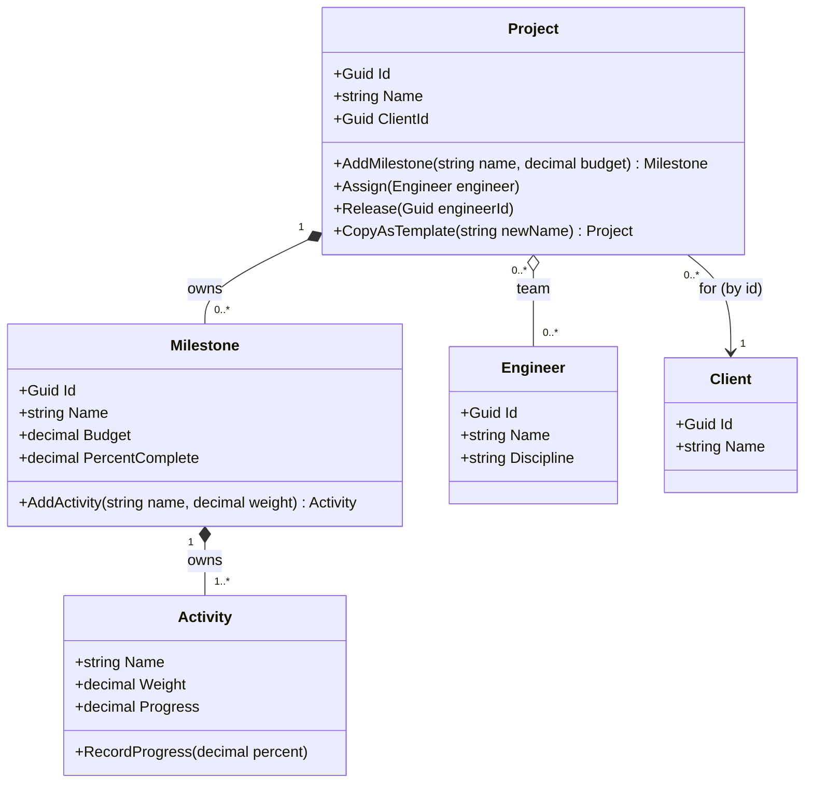
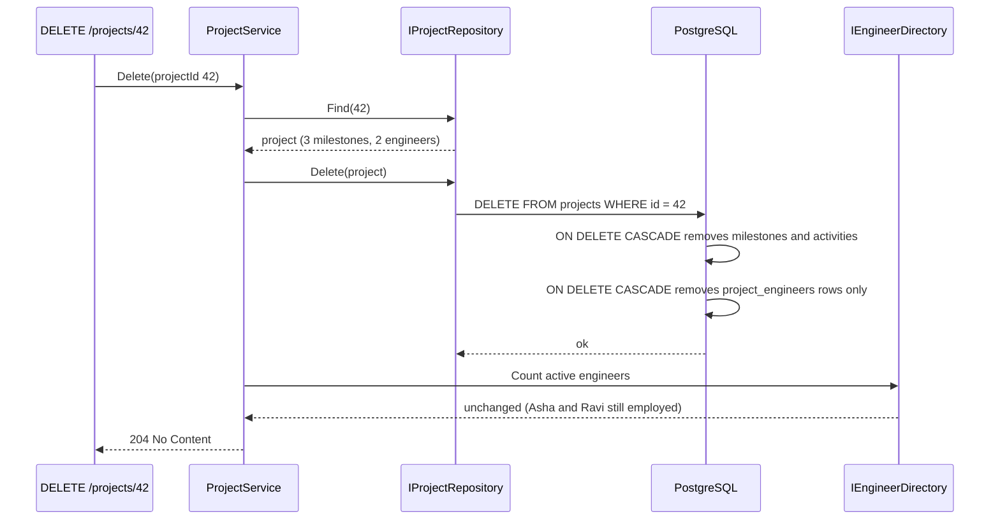

The [previous lesson](#/lesson/m07-relationships) covered direction and multiplicity. This one zooms in on a single question that causes a surprising number of production bugs: **when two objects are linked, who owns whom?** The answer decides who creates the part, what happens when the whole is deleted or copied, and who is allowed to call `Dispose`.

The running example is the project tracker of a small software agency that builds apps for clients (think of a Jira-style tool): projects, milestones, the activities (tasks) inside each milestone, and engineers.

## Learning objectives

By the end of this lesson you will be able to:

1. Explain association, aggregation and composition using lifetime and ownership, not just the diamond symbols.
2. Decide which one fits a real relationship by asking four questions: who creates it, can it be shared, does it outlive the whole, and who deletes it.
3. Implement composition in C# so parts cannot be created, shared or changed from outside the whole.
4. Implement aggregation so the whole holds parts without owning them, and apply the same idea to `IDisposable` ownership.
5. Copy and delete wholes correctly: deep-copy composed parts, never aggregated ones.
6. Map each relationship to PostgreSQL foreign keys and `ON DELETE` actions.

## Prerequisites

- [Modeling object relationships](#/lesson/m07-relationships): kinds, multiplicity and navigability.
- [Identifying entities, value objects and services](#/lesson/m07-entities-values-services): composed parts are often value objects or local entities.
- [Class diagrams](#/lesson/m05-class-diagrams): diamonds and arrows.

## Explain it like I'm a beginner

Think about three things in your life.

**Your doctor.** You know your doctor and your doctor knows you. Neither of you is "part of" the other. If you move to another city, you both carry on. That is an **association**: two independent things that know about each other.

**A cricket team.** A team *has* players. But the players existed before they joined, they can play for a club team and a state team at the same time, and if the team is disbanded, the players are still people who can join another team. That is **aggregation**: a whole made of parts that have their own lives.

**A house and its rooms.** The house *owns* its rooms. You cannot take the kitchen and put it in another house. A room does not exist on its own before the house is built. If the house is demolished, the rooms are gone too. That is **composition**: the parts live and die with the whole, and belong to only one whole.

A simple way to remember them:

| | Says | Example |
|---|---|---|
| Association | "knows about" | patient – doctor |
| Aggregation | "has, but does not own" | team – players |
| Composition | "owns, and the part dies with it" | house – rooms |

In code, the question "does the part die with the whole?" becomes very practical: when I delete a client's app project from the database, should its milestones be deleted too (yes, composition), and should the engineers who worked on it be deleted too (certainly not, aggregation)?

## First-principles explanation

### Four questions that decide the relationship

For a link from a *whole* W to a *part* P, ask:

1. **Creation.** Does W create P, or is P handed to W after being created elsewhere?
2. **Sharing.** Can P belong to more than one W at the same time?
3. **Lifetime.** Does P make sense after W is gone?
4. **Deletion.** When W is deleted, should P be deleted?

| Answers | Relationship |
|---|---|
| W creates P, P is never shared, P does not outlive W, deleting W deletes P | **Composition** |
| P is created elsewhere, may be shared, outlives W, deleting W leaves P alone | **Aggregation** |
| Neither is a "part" of the other; they just know each other | **Association** |

### Association

Two objects have a lasting link, but neither is part of the other. A `Project` is associated with its `Client`. Deleting a project does not delete the client, and deleting a client should probably be *blocked* while projects reference it. Associations are usually implemented with an id (see the previous lesson) and map to a foreign key with `ON DELETE RESTRICT` or `NO ACTION`.

### Aggregation

A whole–part relationship where the part has its own life. A `Project` aggregates `Engineer`s: engineers are hired by HR, exist before any project, can be on two projects at once, and stay employed when a project closes.

Code shape:

- The part is **passed in** (`project.Assign(engineer)`), not created by the whole.
- The whole holds a **reference or id**, and may hold many.
- Removing the part from the whole (`Release`) does not destroy the part.
- The whole **must not dispose, delete or mutate** the part's own state as a side effect of its own lifecycle.

An honest note: the UML specification defines aggregation ("shared aggregation") only loosely, and some authors, including Martin Fowler, advise against using the hollow diamond because readers interpret it differently. In practice, many teams draw plain associations and reserve the diamond for composition. What matters is that your team agrees on the *ownership* meaning. We use the hollow diamond in this course to mean "has, without owning".

### Composition

A whole–part relationship with exclusive ownership. A `Project` composes `Milestone`s ("Milestone 2: checkout and UPI payments"), and each milestone composes its `Activity` entries. A milestone has no meaning outside its project, cannot be moved to another project, and should be deleted when the project is.

Code shape:

- The **whole creates the part** (`project.AddMilestone(...)` returns the new milestone). The part's constructor is `internal` or `private`, so nothing else can create one.
- The part is **never shared**: no API accepts an existing part from outside.
- The whole **controls all changes** to the part, or the part exposes only operations that cannot break the whole's rules.
- **Copying** the whole copies the parts (a deep copy with new ids).
- **Deleting** the whole deletes the parts (cascade).
- If a part is `IDisposable`, the **whole disposes it**.

### "Lifetime" in a garbage-collected language

In C++, composition literally means the whole's destructor destroys the part's memory. In C#, the garbage collector frees memory, so "the part dies with the whole" is about **logical lifetime**:

- Is the part still reachable by the business after the whole is gone? (Can you look up a milestone of a deleted project? You should not be able to.)
- Is it deleted from the database with the whole?
- Who is responsible for releasing **unmanaged resources** (files, sockets, database connections) it holds?

That last point is where ownership becomes a correctness issue in .NET.

### Ownership and IDisposable

The rule in .NET is: **whoever creates a disposable object owns it and must dispose it; whoever receives one must not.**

- A class that does `new FileStream(...)` inside itself *composes* the stream. It should implement `IDisposable` and dispose the stream.
- A class that receives a `Stream` in its constructor *aggregates* it. It must not dispose it, unless the caller explicitly hands over ownership. The BCL expresses this with a `leaveOpen` flag: `new StreamWriter(stream, leaveOpen: true)` means "I am only borrowing this stream".
- The **DI container** owns everything it creates. Never call `Dispose` on an injected service; the container disposes scoped services at the end of the request and singletons at shutdown.

Getting this wrong produces two classic bugs: disposing something you borrowed (`ObjectDisposedException` later, in someone else's code), and never disposing something you own (file handles or connections leak until the process runs out).

### Copying wholes

Composition and aggregation behave differently when you copy:

- Copying a **composed** part: make a new part with a new identity. Two projects created from one template must not share a milestone object, or progress recorded on one appears on the other.
- Copying an **aggregated** part: copy the *reference* (both wholes now point to the same engineer) or do not copy at all. Never clone an engineer: you would create a second "Asha" in the HR system.

### Database mapping

| Relationship | PostgreSQL | EF Core |
|---|---|---|
| Composition | child table with `NOT NULL` FK to the whole, `ON DELETE CASCADE`; or columns on the owner's table for value parts | owned entity types (`OwnsMany`, `OwnsOne`) or complex types; or a required relationship with cascade delete |
| Aggregation | junction table (`project_engineers`) with `ON DELETE CASCADE` *on the junction rows only*; the part's own table is untouched | many-to-many with an explicit join entity |
| Association | FK column, often nullable, `ON DELETE RESTRICT` or `NO ACTION` | optional or required relationship, cascade delete off |

Notice the subtle aggregation case: deleting a project should delete the *membership rows* (Asha is no longer on that project), never the engineer row.

### When the distinction is not worth arguing about

Association versus aggregation rarely changes code; both are "a reference to something with its own life". Composition versus everything else almost always does, because it changes creation, copying, deletion and disposal. If your team spends ten minutes debating a hollow diamond, draw a plain line and move on. Spend the time on composition boundaries instead.

### Trade-offs

| Choice | You gain | You pay |
|---|---|---|
| Composition | Strong invariants: the whole controls every change to its parts; cascade delete is safe | The whole grows; every change to a part goes through it; large compositions are slow to load |
| Aggregation | Parts are reusable and independent | The whole cannot guarantee anything about the part's state; you must handle a part disappearing |
| Association by id | Loosest coupling | Lookups to get details; referential integrity across services is eventual |

## Visual explanation

### Class diagram



How to read it:

- **Filled diamonds** (`*--`) at `Project` and `Milestone`: composition. A milestone belongs to exactly one project and is created by it. An activity belongs to exactly one milestone.
- **Hollow diamond** (`o--`) at `Project` towards `Engineer`: aggregation. Note the multiplicity `0..*` on *both* ends: one engineer can be on many projects. Composition can never have `0..*` at the whole's end, because a part belongs to at most one whole.
- **Plain arrow** to `Client`: association, held by id.

A quick self-check when reading any diagram: if the multiplicity at the diamond end is more than 1, it cannot be composition.

### Sequence diagram: deleting a project



The deletion travels down the composition (milestones, then activities) and stops at the aggregation boundary. Only the *membership* rows in the junction table go; the engineers remain. The `Client` association is untouched, and if the operation had been "delete client" instead, the foreign key with `RESTRICT` would have refused while projects still reference it.

## Step-by-step example

### Step 1: list the links and ask the four questions

| Link | Creates? | Shared? | Outlives? | Delete with whole? | Result |
|---|---|---|---|---|---|
| Project → Milestone | Project creates | No | No | Yes | Composition |
| Milestone → Activity | Milestone creates | No | No | Yes | Composition |
| Project → Engineer | HR creates | Yes, many projects | Yes | No | Aggregation |
| Project → Client | Sales creates | Yes | Yes | No, block instead | Association |

### Step 2: hide the part constructors

`Milestone` and `Activity` get `internal` constructors. The only way to make one is through the owner's `Add...` method, which also enforces the owner's rules (unique names, budget limits).

### Step 3: decide what the whole exposes

The project exposes `IReadOnlyList<Milestone>`, so callers can read milestones and call safe operations on them, but cannot add, remove or replace them.

### Step 4: write copy and delete behaviour explicitly

`CopyAsTemplate` creates new milestones and activities with zero progress, keeps the client id, and starts with an empty team. Deletion is a single repository call; the database cascade handles composed rows.

### Step 5: check disposables

The progress-report writer opens a file in one constructor (owns it) and accepts a caller's stream in another (borrows it). Its `Dispose` honours that difference.

## Production-style C# implementation

```text
Projects.Api/
  Program.cs
  Projects/
    Engineer.cs
    Project.cs
    Milestone.cs
    ProjectStores.cs
    ProgressReportWriter.cs
    ProjectService.cs
```

```csharp file=Projects/Engineer.cs
namespace Projects;

/// <summary>Has its own life (hired by HR). Aggregated by projects, never owned by one.</summary>
public sealed class Engineer(Guid id, string name, string discipline)
{
    public Guid Id { get; } = id;
    public string Name { get; } = name;
    public string Discipline { get; } = discipline;
}
```

```csharp file=Projects/Milestone.cs
namespace Projects;

/// <summary>Composed by Milestone. Created only through Milestone.AddActivity.</summary>
public sealed class Activity
{
    internal Activity(string name, decimal weight) { Name = name; Weight = weight; }

    public string Name { get; }
    public decimal Weight { get; }            // share of the milestone, e.g. 0.25 = 25 %
    public decimal Progress { get; private set; }

    public void RecordProgress(decimal percent)
    {
        if (percent < Progress) throw new InvalidOperationException($"{Name}: progress cannot go back from {Progress} to {percent}.");
        if (percent > 100) throw new ArgumentOutOfRangeException(nameof(percent), "Progress cannot exceed 100 %.");
        Progress = percent;
    }

    internal Activity CopyFresh() => new(Name, Weight);
}

/// <summary>Composed by Project. Owns its activities. Created only through Project.AddMilestone.</summary>
public sealed class Milestone
{
    private readonly List<Activity> _activities = new();

    internal Milestone(string name, decimal budget)
    {
        Id = Guid.CreateVersion7();   // time-ordered: friendlier to a B-tree primary key index than random v4
        Name = name;
        Budget = budget;
    }

    public Guid Id { get; }
    public string Name { get; }
    public decimal Budget { get; }
    public IReadOnlyList<Activity> Activities => _activities;

    /// <summary>Weighted progress of the activities, 0 to 100.</summary>
    public decimal PercentComplete => Math.Round(_activities.Sum(a => a.Weight * a.Progress), 2);

    public Activity AddActivity(string name, decimal weight)
    {
        if (weight <= 0) throw new ArgumentOutOfRangeException(nameof(weight));
        if (_activities.Sum(a => a.Weight) + weight > 1m)
            throw new InvalidOperationException($"{Name}: activity weights cannot exceed 100 %.");
        if (_activities.Any(a => a.Name.Equals(name, StringComparison.OrdinalIgnoreCase)))
            throw new InvalidOperationException($"{Name} already has an activity called '{name}'.");
        var activity = new Activity(name, weight);
        _activities.Add(activity);
        return activity;
    }

    /// <summary>Deep copy for templates: new identity, same structure, zero progress.</summary>
    internal Milestone CopyFresh()
    {
        var copy = new Milestone(Name, Budget);
        foreach (var a in _activities) copy._activities.Add(a.CopyFresh());
        return copy;
    }
}
```

```csharp file=Projects/Project.cs
namespace Projects;

/// <summary>
/// Composition: milestones (created, owned, copied and deleted with the project).
/// Aggregation: engineers (passed in, shared with other projects, never copied or deleted).
/// Association: client (by id).
/// </summary>
public sealed class Project
{
    private readonly List<Milestone> _milestones = new();
    private readonly Dictionary<Guid, Engineer> _team = new();

    public Project(string name, Guid clientId, decimal budgetCap)
    {
        if (string.IsNullOrWhiteSpace(name)) throw new ArgumentException("Name is required.", nameof(name));
        Id = Guid.CreateVersion7();
        Name = name;
        ClientId = clientId;
        BudgetCap = budgetCap;
    }

    public Guid Id { get; }
    public string Name { get; }
    public Guid ClientId { get; }
    public decimal BudgetCap { get; }
    public IReadOnlyList<Milestone> Milestones => _milestones;
    public IReadOnlyCollection<Engineer> Team => _team.Values;
    public decimal AllocatedBudget => _milestones.Sum(p => p.Budget);

    // --- composition: the project creates its parts and enforces its rules while doing so
    public Milestone AddMilestone(string name, decimal budget)
    {
        if (budget <= 0) throw new ArgumentOutOfRangeException(nameof(budget));
        if (AllocatedBudget + budget > BudgetCap)
            throw new InvalidOperationException($"Budget cap {BudgetCap:N0} would be exceeded.");
        var milestone = new Milestone(name, budget);
        _milestones.Add(milestone);
        return milestone;
    }

    public void RemoveMilestone(Guid milestoneId)
    {
        var p = _milestones.SingleOrDefault(x => x.Id == milestoneId)
                ?? throw new InvalidOperationException($"Milestone {milestoneId} is not part of {Name}.");
        if (p.PercentComplete > 0) throw new InvalidOperationException($"Milestone '{p.Name}' has progress and cannot be removed.");
        _milestones.Remove(p);          // the part is gone for good; nothing else references it
    }

    // --- aggregation: engineers come from outside and leave unharmed
    public void Assign(Engineer engineer)
    {
        ArgumentNullException.ThrowIfNull(engineer);
        _team.TryAdd(engineer.Id, engineer);
    }

    public void Release(Guid engineerId) => _team.Remove(engineerId);

    /// <summary>New project with the same structure: composed parts are deep-copied, aggregated parts are not.</summary>
    public Project CopyAsTemplate(string newName)
    {
        var copy = new Project(newName, ClientId, BudgetCap);
        foreach (var p in _milestones) copy._milestones.Add(p.CopyFresh());
        return copy;
    }
}
```

```csharp file=Projects/ProjectStores.cs
using System.Collections.Concurrent;

namespace Projects;

public interface IProjectRepository
{
    Project? Find(Guid id);
    void Save(Project project);
    /// <summary>Deletes the project and everything it composes. Aggregated engineers are untouched.</summary>
    bool Delete(Guid id);
    IReadOnlyList<Project> WithEngineer(Guid engineerId);
}

public interface IEngineerDirectory
{
    Engineer? Find(Guid id);
    void Add(Engineer engineer);
    int Count { get; }
}

public sealed class InMemoryProjectRepository : IProjectRepository
{
    private readonly ConcurrentDictionary<Guid, Project> _projects = new();
    public Project? Find(Guid id) => _projects.GetValueOrDefault(id);
    public void Save(Project project) => _projects[project.Id] = project;
    public bool Delete(Guid id) => _projects.TryRemove(id, out _);   // milestones go with the project object
    public IReadOnlyList<Project> WithEngineer(Guid engineerId) =>
        _projects.Values.Where(p => p.Team.Any(e => e.Id == engineerId)).ToList();
}

public sealed class InMemoryEngineerDirectory : IEngineerDirectory
{
    private readonly ConcurrentDictionary<Guid, Engineer> _engineers = new();
    public Engineer? Find(Guid id) => _engineers.GetValueOrDefault(id);
    public void Add(Engineer engineer) => _engineers[engineer.Id] = engineer;
    public int Count => _engineers.Count;
}
```

```csharp file=Projects/ProgressReportWriter.cs
using System.Text;

namespace Projects;

/// <summary>
/// Shows IDisposable ownership. Opened with a path: the writer composes (owns) the stream and disposes it.
/// Given a stream: the writer aggregates (borrows) it and leaves it open unless told otherwise.
/// </summary>
public sealed class ProgressReportWriter : IDisposable
{
    private readonly StreamWriter _writer;

    public ProgressReportWriter(string path)
        : this(new FileStream(path, FileMode.Create, FileAccess.Write), leaveOpen: false) { }

    public ProgressReportWriter(Stream stream, bool leaveOpen = true) =>
        _writer = new StreamWriter(stream, new UTF8Encoding(encoderShouldEmitUTF8Identifier: false), bufferSize: 4096, leaveOpen: leaveOpen);

    public void Write(Project project)
    {
        _writer.WriteLine($"Project,{project.Name}");
        foreach (var p in project.Milestones)
            _writer.WriteLine($"{p.Name},{p.Budget},{p.PercentComplete}");
        _writer.Flush();
    }

    public void Dispose() => _writer.Dispose();   // disposes the stream only if we own it (leaveOpen: false)
}
```

```csharp file=Projects/ProjectService.cs
using Microsoft.Extensions.Logging;

namespace Projects;

public sealed class ProjectService(IProjectRepository projects, IEngineerDirectory engineers, ILogger<ProjectService> logger)
{
    public Project Create(string name, Guid clientId, decimal budgetCap)
    {
        var project = new Project(name, clientId, budgetCap);
        projects.Save(project);
        return project;
    }

    public void AssignEngineer(Guid projectId, Guid engineerId)
    {
        var project = projects.Find(projectId) ?? throw new KeyNotFoundException($"Project {projectId} not found.");
        var engineer = engineers.Find(engineerId) ?? throw new KeyNotFoundException($"Engineer {engineerId} not found.");
        project.Assign(engineer);
        projects.Save(project);
    }

    public void Delete(Guid projectId)
    {
        if (!projects.Delete(projectId)) throw new KeyNotFoundException($"Project {projectId} not found.");
        logger.LogInformation("Deleted project {ProjectId}; engineers on record: {Count}", projectId, engineers.Count);
    }
}
```

```csharp file=Program.cs
using Projects;

var builder = WebApplication.CreateBuilder(args);

builder.Services.AddSingleton<IProjectRepository, InMemoryProjectRepository>();
builder.Services.AddSingleton<IEngineerDirectory, InMemoryEngineerDirectory>();
builder.Services.AddScoped<ProjectService>();   // the container owns it and disposes it; we never do

var app = builder.Build();

var directory = app.Services.GetRequiredService<IEngineerDirectory>();
directory.Add(new Engineer(Guid.Parse("00000000-0000-0000-0000-0000000000a1"), "Asha", "Backend"));
directory.Add(new Engineer(Guid.Parse("00000000-0000-0000-0000-0000000000a2"), "Ravi", "Mobile"));

app.MapPost("/projects", (string name, Guid clientId, decimal budgetCap, ProjectService service) =>
{
    var p = service.Create(name, clientId, budgetCap);
    return Results.Created($"/projects/{p.Id}", new { p.Id, p.Name });
});

app.MapPost("/projects/{id:guid}/team/{engineerId:guid}", (Guid id, Guid engineerId, ProjectService service) =>
{
    try { service.AssignEngineer(id, engineerId); return Results.NoContent(); }
    catch (KeyNotFoundException ex) { return Results.Problem(ex.Message, statusCode: StatusCodes.Status404NotFound); }
});

app.MapDelete("/projects/{id:guid}", (Guid id, ProjectService service) =>
{
    try { service.Delete(id); return Results.NoContent(); }
    catch (KeyNotFoundException ex) { return Results.Problem(ex.Message, statusCode: StatusCodes.Status404NotFound); }
});

app.MapGet("/projects/{id:guid}/report.csv", (Guid id, IProjectRepository projects) =>
{
    var project = projects.Find(id);
    if (project is null) return Results.NotFound();
    var buffer = new MemoryStream();
    using (var writer = new ProgressReportWriter(buffer, leaveOpen: true)) writer.Write(project);
    buffer.Position = 0;
    return Results.File(buffer, "text/csv", $"{project.Name}.csv");   // the result now owns the stream
});

app.Run();
```

The matching PostgreSQL schema makes the same decisions in the database:

```sql
CREATE TABLE projects (
    id          uuid PRIMARY KEY,
    name        text NOT NULL,
    client_id   uuid NOT NULL REFERENCES clients (id) ON DELETE RESTRICT,   -- association
    budget_cap  numeric(14,2) NOT NULL
);

CREATE TABLE milestones (                                                -- composition
    id          uuid PRIMARY KEY,
    project_id  uuid NOT NULL REFERENCES projects (id) ON DELETE CASCADE,
    name        text NOT NULL,
    budget      numeric(14,2) NOT NULL,
    UNIQUE (project_id, name)
);

CREATE TABLE activities (                                                   -- composition, one level down
    milestone_id uuid NOT NULL REFERENCES milestones (id) ON DELETE CASCADE,
    name         text NOT NULL,
    weight       numeric(4,3) NOT NULL CHECK (weight > 0 AND weight <= 1),
    progress     numeric(5,2) NOT NULL DEFAULT 0 CHECK (progress BETWEEN 0 AND 100),
    PRIMARY KEY (milestone_id, name)
);

CREATE TABLE project_engineers (                                            -- aggregation (membership only)
    project_id  uuid NOT NULL REFERENCES projects (id) ON DELETE CASCADE,
    engineer_id uuid NOT NULL REFERENCES engineers (id) ON DELETE RESTRICT,
    PRIMARY KEY (project_id, engineer_id)
);
```

Design notes:

- **`internal` constructors** on `Milestone` and `Activity` make "only the owner creates parts" a compiler rule. Put the domain in its own project so `internal` means something.
- **`CopyAsTemplate` is written by hand.** A generic deep-clone (serialise and deserialise) would also copy the team and the progress, which is exactly wrong.
- **`ProgressReportWriter` has two constructors with different ownership.** This mirrors `StreamWriter`'s `leaveOpen` parameter. The endpoint borrows its own `MemoryStream`, then hands ownership to `Results.File`, which disposes it after sending.
- **The in-memory stores are for the demo only.** They hand the same mutable `Project` object to every request, and `Project` is not thread-safe. A real repository loads a fresh copy per request and saves it with optimistic concurrency (a version column checked in the `UPDATE`), so two people editing the same project cannot silently overwrite each other.


## Bad design vs good design

**Bad: composition in name only.**

```csharp
public class Project
{
    public List<Milestone> Milestones { get; set; } = new();
    public List<Engineer> Team { get; set; } = new();
}
public class Milestone { public Milestone() { } public string Name { get; set; } = ""; public decimal Budget { get; set; } }

// Somewhere else:
var shared = new Milestone { Name = "Checkout", Budget = 4_00_000m };
projectA.Milestones.Add(shared);
projectB.Milestones.Add(shared);          // one milestone in two projects: progress on A shows on B
projectA.Milestones.Add(new Milestone { Budget = 99_00_000m });   // budget cap bypassed
var clone = JsonSerializer.Deserialize<Project>(JsonSerializer.Serialize(projectA))!;  // clones the team too
```

The diagram says "composition", but the code allows sharing, outside creation, and rule-free mutation. The deep clone duplicates engineers, so HR reports now show two Ashas.

**Also bad: disposing a borrowed resource.**

```csharp
public sealed class ReportExporter(Stream output) : IDisposable
{
    public void Dispose() => output.Dispose();   // the caller's stream is now closed under their feet
}
```

**Good**: the implementation above. Parts are created by the owner, exposed read-only, copied deliberately, and deleted by cascade. Borrowed resources are left open.

**Is strict composition always worth it?** No. If a "part" is only ever displayed and never has rules (say, a list of tags on a project), a public `List<string>` is fine. Strictness pays off when the whole has invariants across its parts, such as "total milestone budgets ≤ project cap", which the bad version cannot protect.

:::callout type=mistake title="Cascade delete on an aggregation"
Configuring `ON DELETE CASCADE` from `projects` to `engineers` (instead of to the junction table) will delete employees when a project is closed. ORMs make this easy to do by accident when a many-to-many is mapped as a one-to-many. Always ask "what rows disappear?" before adding a cascade, and test deletion against a real database in CI.
:::

## Practical playground

Run it and watch how copying and deleting treat composed and aggregated parts differently. Then:

1. Make `CopyAsTemplate` copy the milestone list by reference (`copy._milestones.AddRange(_milestones)`). Record progress on the copy. What happens to the original?
2. Make the template copy the team too. Is that ever correct? (Think: "same team, new project" might be a separate, explicit operation.)

:::playground type=csharp title="Composition vs aggregation: copy and delete"
```csharp file=Program.cs
using System;
using System.Collections.Generic;
using System.Linq;

public sealed class Engineer(string name) { public string Name { get; } = name; }

public sealed class Milestone
{
    internal Milestone(string name) { Name = name; }
    public string Name { get; }
    public int Progress { get; private set; }
    public void Record(int percent) => Progress = percent;
    internal Milestone CopyFresh() => new(Name);
}

public sealed class Project(string name)
{
    private readonly List<Milestone> _milestones = new();
    private readonly List<Engineer> _team = new();
    public string Name { get; } = name;
    public IReadOnlyList<Milestone> Milestones => _milestones;
    public IReadOnlyList<Engineer> Team => _team;

    public Milestone AddMilestone(string name) { var p = new Milestone(name); _milestones.Add(p); return p; }
    public void Assign(Engineer e) { if (!_team.Contains(e)) _team.Add(e); }

    public Project CopyAsTemplate(string newName)
    {
        var copy = new Project(newName);
        foreach (var p in _milestones) copy._milestones.Add(p.CopyFresh());   // deep copy: composition
        return copy;                                                         // team not copied: aggregation
    }
}

public static class Program
{
    public static void Main()
    {
        var asha = new Engineer("Asha");
        var grocery = new Project("FreshCart grocery app");
        grocery.AddMilestone("Checkout flow").Record(40);
        grocery.AddMilestone("UPI payments");
        grocery.Assign(asha);

        var pharmacy = grocery.CopyAsTemplate("MediQuick pharmacy app");
        pharmacy.Assign(asha);                                  // same engineer, two projects
        pharmacy.Milestones[0].Record(5);

        Console.WriteLine($"{grocery.Name}: checkout {grocery.Milestones[0].Progress} %");    // still 40
        Console.WriteLine($"{pharmacy.Name}: checkout {pharmacy.Milestones[0].Progress} %");  // 5
        Console.WriteLine($"Asha on both: {grocery.Team.Contains(asha) && pharmacy.Team.Contains(asha)}");

        var projects = new List<Project> { grocery, pharmacy };
        projects.Remove(grocery);                                // "delete" FreshCart and everything it owns
        Console.WriteLine($"Milestones still reachable: {projects.Sum(p => p.Milestones.Count)}");   // only MediQuick's 2
        Console.WriteLine($"Asha still exists and works on: {string.Join(", ", projects.Where(p => p.Team.Contains(asha)).Select(p => p.Name))}");
    }
}
```
:::

## Exercises

:::exercise id=m07-association-aggregation-composition-ex1 difficulty=beginner kind=design title="Classify six relationships"
For each pair, decide association, aggregation or composition using the four questions (creates, shared, outlives, deleted with). Build the model with the right relationship kinds and multiplicities, and put your reasoning in each class's `responsibility`.

1. `Invoice` and `InvoiceLine`
2. `Playlist` and `Song` in a music app
3. `Doctor` and `Patient` in a clinic
4. `Car` and `Engine` in a car-rental fleet where engines are swapped between cars during repairs
5. `University` and `Department`; `Department` and `Professor`
6. `ParkingLot` and `Floor`
::acceptance
- Invoice–InvoiceLine and ParkingLot–Floor are compositions.
- Playlist–Song is aggregation with `0..*` at the playlist end (a song can be on many playlists).
- Doctor–Patient is a plain association (many-to-many).
- Car–Engine is aggregation in this fleet (engines are tracked and moved), with `0..1` at the car end.
- University–Department is composition; Department–Professor is aggregation (professors can hold joint appointments and outlive a department merger).
::hint
Work through the four questions for each pair and write the answers down before deciding.
::hint
The Car–Engine answer depends on the business. In a car *showroom* the engine is part of the car (composition). In a *fleet* where engines have serial numbers and move between cars, the engine has its own life.
::hint
Check multiplicities: if the whole's end could be more than 1 (a song on many playlists), it cannot be composition.
::hint
For professors, ask "if the Statistics department merges into a new School of Data Science, do the professors get deleted?" No, so it is not composition.
::starter
```json file=six-relationships.json
{
  "classes": [
    { "id": "Invoice", "name": "Invoice", "kind": "class", "fields": [], "methods": [] },
    { "id": "Line", "name": "InvoiceLine", "kind": "class", "fields": [], "methods": [] }
  ],
  "relations": []
}
```
::solution
```json file=six-relationships.json
{
  "classes": [
    { "id": "Invoice", "name": "Invoice", "kind": "class", "fields": ["-List~InvoiceLine~ _lines"], "methods": ["+InvoiceLine AddLine(string item, int qty, decimal rate)"],
      "responsibility": "Creates and owns its lines" },
    { "id": "Line", "name": "InvoiceLine", "kind": "class", "fields": ["+string Item", "+int Qty", "+decimal Rate"], "methods": [],
      "responsibility": "No meaning outside its invoice; deleted with it" },
    { "id": "Playlist", "name": "Playlist", "kind": "class", "fields": ["-List~Guid~ _songIds"], "methods": ["+void Add(Guid songId)"],
      "responsibility": "Has songs; deleting a playlist deletes no song" },
    { "id": "Song", "name": "Song", "kind": "class", "fields": ["+Guid Id", "+string Title"], "methods": [],
      "responsibility": "Exists in the catalogue independently" },
    { "id": "Doctor", "name": "Doctor", "kind": "class", "fields": ["+Guid Id"], "methods": [], "responsibility": "Independent; knows patients via appointments" },
    { "id": "Patient", "name": "Patient", "kind": "class", "fields": ["+Guid Id"], "methods": [], "responsibility": "Independent; can see many doctors" },
    { "id": "Car", "name": "Car", "kind": "class", "fields": ["+string Plate", "+Guid? EngineSerialId"], "methods": ["+void FitEngine(Engine e)", "+Engine? RemoveEngine()"],
      "responsibility": "Has an engine for now; does not own it" },
    { "id": "Engine", "name": "Engine", "kind": "class", "fields": ["+Guid SerialId", "+int Hours"], "methods": [],
      "responsibility": "Tracked asset; moves between cars, outlives any one car" },
    { "id": "Uni", "name": "University", "kind": "class", "fields": ["-List~Department~ _departments"], "methods": ["+Department OpenDepartment(string name)"],
      "responsibility": "Creates and closes departments" },
    { "id": "Dept", "name": "Department", "kind": "class", "fields": ["+string Name", "-HashSet~Guid~ _professorIds"], "methods": ["+void Appoint(Guid professorId)"],
      "responsibility": "Owned by the university; has professors without owning them" },
    { "id": "Prof", "name": "Professor", "kind": "class", "fields": ["+Guid Id", "+string Name"], "methods": [],
      "responsibility": "Employee of the university; may hold joint appointments" },
    { "id": "Lot", "name": "ParkingLot", "kind": "class", "fields": ["-List~Floor~ _floors"], "methods": [], "responsibility": "Owns its floors" },
    { "id": "Floor", "name": "Floor", "kind": "class", "fields": ["+int Number"], "methods": [], "responsibility": "Cannot be moved to another lot" }
  ],
  "relations": [
    { "from": "Invoice", "to": "Line", "kind": "composition", "multiplicity": "1..*" },
    { "from": "Playlist", "to": "Song", "kind": "aggregation", "multiplicity": "0..*", "label": "0..* playlists per song" },
    { "from": "Doctor", "to": "Patient", "kind": "association", "multiplicity": "0..*", "label": "treats (many-to-many)" },
    { "from": "Car", "to": "Engine", "kind": "aggregation", "multiplicity": "0..1" },
    { "from": "Uni", "to": "Dept", "kind": "composition", "multiplicity": "1..*" },
    { "from": "Dept", "to": "Prof", "kind": "aggregation", "multiplicity": "0..*" },
    { "from": "Lot", "to": "Floor", "kind": "composition", "multiplicity": "1..*" }
  ]
}
```

The Doctor–Patient link in a real clinic system becomes an association class (`Appointment`) as soon as dates and notes are recorded, which they always are. The Car–Engine answer is the important one: the same two nouns change relationship kind depending on whether the business tracks engines as assets.
::mistakes
- Choosing composition for Playlist–Song because "a playlist is made of songs". Deleting a playlist must not delete songs from the catalogue.
- Choosing composition for Department–Professor; a department restructure would then delete staff.
- Treating aggregation and association as very different. In code they look almost the same; composition is the one that changes behaviour.
:::

:::exercise id=m07-association-aggregation-composition-ex2 difficulty=beginner kind=code title="Make an invoice truly own its lines"
`Invoice` should compose its lines: only the invoice creates them, they cannot be shared or added from outside, and the invoice protects its totals. Implement it.
::requirements
- `AddLine(string item, int quantity, decimal rate, decimal gstPercent)` creates, stores and returns a new `InvoiceLine`.
- `InvoiceLine` has no public constructor.
- `Lines` is read-only. `RemoveLine(InvoiceLine line)` refuses a line that belongs to another invoice.
- `Taxable` is the sum of `quantity × rate`; `Gst` is the sum of each line's GST rounded to 2 decimals; `Total` = `Taxable + Gst`.
- After `Finalise()`, adding or removing lines throws `InvalidOperationException`.
::acceptance
- 10 × ₹372 at 5 % GST plus 2 × ₹1,250 at 18 % GST gives taxable ₹6,220, GST ₹636.00, total ₹6,856.00.
- Removing a line taken from another invoice throws `InvalidOperationException`.
- Adding a line after `Finalise()` throws `InvalidOperationException`.
- A non-positive quantity or negative rate throws `ArgumentOutOfRangeException`.
::hint
What stops another class calling `new InvoiceLine(...)`? A constructor that is not public.
::hint
`RemoveLine` gets a line object. How does the invoice know it is one of its own? `_lines.Contains(line)` compares references, which is exactly right for an owned part.
::hint
GST per line: `Math.Round(Quantity * Rate * GstPercent / 100m, 2)`. Sum the rounded values, which matches how most invoices print.
::hint
Keep a `bool _finalised` and a private `EnsureOpen()` that every mutating method calls first.
::starter
```csharp file=Invoice.cs
using System;
using System.Collections.Generic;
using System.Linq;

public sealed class InvoiceLine
{
    internal InvoiceLine(string item, int quantity, decimal rate, decimal gstPercent)
    {
        Item = item; Quantity = quantity; Rate = rate; GstPercent = gstPercent;
    }
    public string Item { get; }
    public int Quantity { get; }
    public decimal Rate { get; }
    public decimal GstPercent { get; }
    public decimal Taxable => Quantity * Rate;
    public decimal Gst => Math.Round(Taxable * GstPercent / 100m, 2);
}

public sealed class Invoice(string number)
{
    public string Number { get; } = number;
    public IReadOnlyList<InvoiceLine> Lines => throw new NotImplementedException();
    public decimal Taxable => throw new NotImplementedException();
    public decimal Gst => throw new NotImplementedException();
    public decimal Total => throw new NotImplementedException();

    public InvoiceLine AddLine(string item, int quantity, decimal rate, decimal gstPercent) => throw new NotImplementedException();
    public void RemoveLine(InvoiceLine line) => throw new NotImplementedException();
    public void Finalise() => throw new NotImplementedException();
}
```
::tests
```csharp file=InvoiceTests.cs
using System;
using Xunit;

public class InvoiceTests
{
    private static Invoice Sample()
    {
        var inv = new Invoice("INV-2026-0042");
        inv.AddLine("Basmati rice 1 kg", 10, 372m, 5m);
        inv.AddLine("Wireless mouse", 2, 1_250m, 18m);
        return inv;
    }

    [Fact]
    public void Totals_are_computed_from_owned_lines()
    {
        var inv = Sample();
        Assert.Equal(6_220m, inv.Taxable);
        Assert.Equal(636m, inv.Gst);
        Assert.Equal(6_856m, inv.Total);
    }

    [Fact]
    public void Cannot_remove_a_line_owned_by_another_invoice()
    {
        var a = Sample();
        var b = new Invoice("INV-2026-0043");
        var foreign = b.AddLine("USB cable", 1, 61m, 18m);
        Assert.Throws<InvalidOperationException>(() => a.RemoveLine(foreign));
    }

    [Fact]
    public void Can_remove_own_line()
    {
        var inv = Sample();
        inv.RemoveLine(inv.Lines[1]);
        Assert.Equal(3_720m, inv.Taxable);
    }

    [Fact]
    public void Finalised_invoice_is_closed()
    {
        var inv = Sample();
        inv.Finalise();
        Assert.Throws<InvalidOperationException>(() => inv.AddLine("Late item", 1, 10m, 18m));
        Assert.Throws<InvalidOperationException>(() => inv.RemoveLine(inv.Lines[0]));
    }

    [Fact]
    public void Bad_quantity_refused() =>
        Assert.Throws<ArgumentOutOfRangeException>(() => new Invoice("X").AddLine("A", 0, 10m, 18m));
}
```
::solution
```csharp file=Invoice.cs
using System;
using System.Collections.Generic;
using System.Linq;

public sealed class InvoiceLine
{
    internal InvoiceLine(string item, int quantity, decimal rate, decimal gstPercent)
    {
        Item = item; Quantity = quantity; Rate = rate; GstPercent = gstPercent;
    }
    public string Item { get; }
    public int Quantity { get; }
    public decimal Rate { get; }
    public decimal GstPercent { get; }
    public decimal Taxable => Quantity * Rate;
    public decimal Gst => Math.Round(Taxable * GstPercent / 100m, 2);
}

public sealed class Invoice(string number)
{
    private readonly List<InvoiceLine> _lines = new();
    private bool _finalised;

    public string Number { get; } = number;
    public IReadOnlyList<InvoiceLine> Lines => _lines;
    public decimal Taxable => _lines.Sum(l => l.Taxable);
    public decimal Gst => _lines.Sum(l => l.Gst);
    public decimal Total => Taxable + Gst;

    public InvoiceLine AddLine(string item, int quantity, decimal rate, decimal gstPercent)
    {
        EnsureOpen();
        if (quantity <= 0) throw new ArgumentOutOfRangeException(nameof(quantity));
        if (rate < 0) throw new ArgumentOutOfRangeException(nameof(rate));
        if (gstPercent is < 0 or > 40) throw new ArgumentOutOfRangeException(nameof(gstPercent));
        var line = new InvoiceLine(item, quantity, rate, gstPercent);
        _lines.Add(line);
        return line;
    }

    public void RemoveLine(InvoiceLine line)
    {
        EnsureOpen();
        if (!_lines.Remove(line)) throw new InvalidOperationException($"That line is not part of invoice {Number}.");
    }

    public void Finalise() => _finalised = true;

    private void EnsureOpen()
    {
        if (_finalised) throw new InvalidOperationException($"Invoice {Number} is finalised.");
    }
}
```

`_lines.Remove(line)` uses reference equality, which is correct for composed parts: the question is "is this *my* line object?", not "is there a line with the same text?". Taxable: 3,720 + 2,500 = 6,220. GST: 186 + 450 = 636. The guard allows 0 to 40 % because India's GST slabs since September 2025 are 5 %, 18 % and 40 %; in a real system the allowed rates would come from configuration, not a constant.
::mistakes
- Accepting an `InvoiceLine` parameter in `AddLine`. That lets callers create or share lines.
- Giving `InvoiceLine` value equality (a `record`) and then removing "a line equal to this one", which removes the wrong one when two lines are identical.
- Storing `Total` in a field updated by `AddLine` and forgetting to update it in `RemoveLine`.
:::

:::exercise id=m07-association-aggregation-composition-ex3 difficulty=intermediate kind=code title="Own or borrow: disposal rules"
Write a `CsvExporter` that writes rows to a stream. When it creates the stream itself, it owns and disposes it. When given a stream, it borrows it and must leave it open, unless the caller passes `ownsStream: true`.
::requirements
- `CsvExporter.ToStream(Stream s, bool ownsStream = false)` and `CsvExporter.ToFile(string path)` are the two ways
 to construct it (static factory methods).
- `WriteRow(params string[] cells)` writes cells separated by commas, quoting cells that contain a comma or quote (double the quotes inside).
- `Dispose()` flushes, then disposes the stream only if owned. A second `Dispose()` does nothing.
- `WriteRow` after `Dispose` throws `ObjectDisposedException`.
::acceptance
- A borrowed stream is still usable after the exporter is disposed, and contains the rows.
- A stream passed with `ownsStream: true` is disposed with the exporter.
- `ToFile` writes a file that can be read back, and the file is not locked after `Dispose`.
- `WriteRow("Pune", "Paneer pizza, large", "12\" base")` writes `Pune,"Paneer pizza, large","12"" base"`.
- Calling `Dispose` twice is safe.
::hint
The exporter needs to remember *whether it owns* the stream. One `bool` field is enough.
::hint
`StreamWriter` has a constructor with `leaveOpen`. Pass `leaveOpen: !ownsStream`, and disposing the writer then does the right thing.
::hint
Quoting rule: if a cell contains `,` or `"` or a newline, wrap it in quotes and replace `"` with `""`.
::hint
```csharp
private static string Escape(string c) =>
    c.IndexOfAny(new[] { ',', '"', '\n' }) >= 0 ? "\"" + c.Replace("\"", "\"\"") + "\"" : c;
```
::starter
```csharp file=CsvExporter.cs
using System;
using System.IO;
using System.Linq;
using System.Text;

public sealed class CsvExporter : IDisposable
{
    private CsvExporter(Stream stream, bool ownsStream) => throw new NotImplementedException();

    public static CsvExporter ToStream(Stream stream, bool ownsStream = false) => new(stream, ownsStream);
    public static CsvExporter ToFile(string path) => new(new FileStream(path, FileMode.Create, FileAccess.Write), ownsStream: true);

    public void WriteRow(params string[] cells) => throw new NotImplementedException();
    public void Dispose() => throw new NotImplementedException();
}
```
::tests
```csharp file=CsvExporterTests.cs
using System;
using System.IO;
using System.Text;
using Xunit;

public sealed class TrackingStream : MemoryStream
{
    public bool WasDisposed { get; private set; }
    protected override void Dispose(bool disposing) { WasDisposed = true; base.Dispose(disposing); }
}

public class CsvExporterTests
{
    [Fact]
    public void Borrowed_stream_stays_open_and_has_rows()
    {
        var s = new TrackingStream();
        using (var csv = CsvExporter.ToStream(s)) csv.WriteRow("City", "Orders");
        Assert.False(s.WasDisposed);
        s.Position = 0;
        Assert.Equal("City,Orders", new StreamReader(s).ReadToEnd().TrimEnd());
    }

    [Fact]
    public void Owned_stream_is_disposed()
    {
        var s = new TrackingStream();
        CsvExporter.ToStream(s, ownsStream: true).Dispose();
        Assert.True(s.WasDisposed);
    }

    [Fact]
    public void Quotes_cells_with_commas_and_quotes()
    {
        var s = new MemoryStream();
        using (var csv = CsvExporter.ToStream(s)) csv.WriteRow("Pune", "Paneer pizza, large", "12\" base");
        Assert.Equal("Pune,\"Paneer pizza, large\",\"12\"\" base\"", Encoding.UTF8.GetString(s.ToArray()).TrimEnd());
    }

    [Fact]
    public void File_is_written_and_released()
    {
        var path = Path.Combine(Path.GetTempPath(), $"csv-{Guid.NewGuid():N}.csv");
        using (var csv = CsvExporter.ToFile(path)) csv.WriteRow("a", "b");
        Assert.Equal("a,b", File.ReadAllText(path).TrimEnd());
        File.Delete(path);   // would throw if the file were still locked on Windows
    }

    [Fact]
    public void Double_dispose_is_safe_and_write_after_dispose_throws()
    {
        var csv = CsvExporter.ToStream(new MemoryStream());
        csv.Dispose();
        csv.Dispose();
        Assert.Throws<ObjectDisposedException>(() => csv.WriteRow("x"));
    }
}
```
::solution
```csharp file=CsvExporter.cs
using System;
using System.IO;
using System.Linq;
using System.Text;

public sealed class CsvExporter : IDisposable
{
    private readonly StreamWriter _writer;
    private bool _disposed;

    private CsvExporter(Stream stream, bool ownsStream)
    {
        ArgumentNullException.ThrowIfNull(stream);
        // leaveOpen: true means "borrowed": disposing the writer will not dispose the stream.
        _writer = new StreamWriter(stream, new UTF8Encoding(false), bufferSize: 4096, leaveOpen: !ownsStream);
    }

    public static CsvExporter ToStream(Stream stream, bool ownsStream = false) => new(stream, ownsStream);
    public static CsvExporter ToFile(string path) => new(new FileStream(path, FileMode.Create, FileAccess.Write), ownsStream: true);

    public void WriteRow(params string[] cells)
    {
        ObjectDisposedException.ThrowIf(_disposed, this);
        _writer.WriteLine(string.Join(",", cells.Select(Escape)));
    }

    public void Dispose()
    {
        if (_disposed) return;
        _disposed = true;
        _writer.Dispose();          // flushes; disposes the stream only when we own it
    }

    private static string Escape(string cell) =>
        cell.IndexOfAny(new[] { ',', '"', '\n', '\r' }) >= 0 ? "\"" + cell.Replace("\"", "\"\"") + "\"" : cell;
}
```

The ownership decision is made once, at construction, and every later method follows it. This is the same contract as `StreamWriter`, `GZipStream` and `HttpClient(handler, disposeHandler)` in the BCL, so other .NET developers will recognise it.
::mistakes
- Always disposing the stream "to be safe", which breaks callers who wanted to rewind and read it (as the ASP.NET Core endpoint in the lesson does).
- Never disposing, so `ToFile` leaves the file locked until the garbage collector finalises the stream.
- Not flushing before returning a borrowed stream, so the last rows are missing.
:::

:::exercise id=m07-association-aggregation-composition-ex4 difficulty=intermediate kind=code title="Copy a project as a template"
Implement `Project.CopyAsTemplate(newName)` so that composed parts are deep-copied with fresh state, aggregated parts are not copied, and associations are kept.
::requirements
- Milestones and their activities are copied with **new ids**, the same names, budgets and weights, and **zero progress**.
- The team (aggregated engineers) is **empty** in the copy.
- The client id (association) is the **same**.
- Changing the copy never affects the original, and vice versa.
::acceptance
- The copy has the same number of milestones and activities, all with different ids from the original.
- Recording progress on a copied activity leaves the original's progress unchanged.
- The original's team still has its engineers; the copy's team is empty.
- `ClientId` and `BudgetCap` are equal on both.
::hint
Which parts does the project *own*? Those are the ones to deep-copy.
::hint
Give each composed class an `internal CopyFresh()` method, so each class knows how to copy itself and the project just loops.
::hint
`Milestone.CopyFresh()` creates `new Milestone(Name, Budget)` and then adds `a.CopyFresh()` for each activity. Activities copy with `Progress = 0`.
::hint
Do not touch `_team` in `CopyAsTemplate` at all. The empty dictionary from the constructor is the right answer.
::starter
```csharp file=ProjectTemplate.cs
using System;
using System.Collections.Generic;
using System.Linq;

public sealed class Engineer(string name) { public Guid Id { get; } = Guid.NewGuid(); public string Name { get; } = name; }

public sealed class Activity
{
    internal Activity(string name, decimal weight) { Name = name; Weight = weight; }
    public Guid Id { get; } = Guid.NewGuid();
    public string Name { get; }
    public decimal Weight { get; }
    public decimal Progress { get; private set; }
    public void Record(decimal percent) => Progress = percent;
    internal Activity CopyFresh() => throw new NotImplementedException();
}

public sealed class Milestone
{
    private readonly List<Activity> _activities = new();
    internal Milestone(string name, decimal budget) { Name = name; Budget = budget; }
    public Guid Id { get; } = Guid.NewGuid();
    public string Name { get; }
    public decimal Budget { get; }
    public IReadOnlyList<Activity> Activities => _activities;
    public Activity AddActivity(string name, decimal weight) { var a = new Activity(name, weight); _activities.Add(a); return a; }
    internal Milestone CopyFresh() => throw new NotImplementedException();
}

public sealed class Project(string name, Guid clientId, decimal budgetCap)
{
    private readonly List<Milestone> _milestones = new();
    private readonly List<Engineer> _team = new();
    public string Name { get; } = name;
    public Guid ClientId { get; } = clientId;
    public decimal BudgetCap { get; } = budgetCap;
    public IReadOnlyList<Milestone> Milestones => _milestones;
    public IReadOnlyList<Engineer> Team => _team;

    public Milestone AddMilestone(string name, decimal budget) { var p = new Milestone(name, budget); _milestones.Add(p); return p; }
    public void Assign(Engineer e) { if (!_team.Contains(e)) _team.Add(e); }
    public Project CopyAsTemplate(string newName) => throw new NotImplementedException();
}
```
::tests
```csharp file=ProjectTemplateTests.cs
using System;
using System.Linq;
using Xunit;

public class ProjectTemplateTests
{
    private static Project Original()
    {
        var p = new Project("FreshCart grocery app", Guid.Parse("11111111-1111-1111-1111-111111111111"), 50_00_000m);
        var mvp = p.AddMilestone("MVP", 12_00_000m);
        mvp.AddActivity("Wireframes", 0.2m).Record(100m);
        mvp.AddActivity("Checkout screens", 0.8m).Record(30m);
        p.AddMilestone("Payments", 20_00_000m).AddActivity("UPI integration", 1m);
        p.Assign(new Engineer("Asha"));
        return p;
    }

    [Fact]
    public void Structure_copied_with_new_ids()
    {
        var o = Original();
        var c = o.CopyAsTemplate("MediQuick pharmacy app");
        Assert.Equal(2, c.Milestones.Count);
        Assert.Equal(new[] { "MVP", "Payments" }, c.Milestones.Select(w => w.Name).ToArray());
        Assert.Equal(3, c.Milestones.Sum(w => w.Activities.Count));
        Assert.Empty(c.Milestones.Select(w => w.Id).Intersect(o.Milestones.Select(w => w.Id)));
        Assert.Empty(c.Milestones.SelectMany(w => w.Activities).Select(a => a.Id)
                      .Intersect(o.Milestones.SelectMany(w => w.Activities).Select(a => a.Id)));
    }

    [Fact]
    public void Progress_reset_and_independent()
    {
        var o = Original();
        var c = o.CopyAsTemplate("MediQuick pharmacy app");
        Assert.All(c.Milestones.SelectMany(w => w.Activities), a => Assert.Equal(0m, a.Progress));
        c.Milestones[0].Activities[1].Record(10m);
        Assert.Equal(30m, o.Milestones[0].Activities[1].Progress);
        Assert.Equal(0.8m, c.Milestones[0].Activities[1].Weight);
    }

    [Fact]
    public void Team_not_copied_association_kept()
    {
        var o = Original();
        var c = o.CopyAsTemplate("MediQuick pharmacy app");
        Assert.Empty(c.Team);
        Assert.Single(o.Team);
        Assert.Equal(o.ClientId, c.ClientId);
        Assert.Equal(o.BudgetCap, c.BudgetCap);
        Assert.Equal(12_00_000m, c.Milestones[0].Budget);
    }
}
```
::solution
```csharp file=ProjectTemplate.cs
using System;
using System.Collections.Generic;
using System.Linq;

public sealed class Engineer(string name) { public Guid Id { get; } = Guid.NewGuid(); public string Name { get; } = name; }

public sealed class Activity
{
    internal Activity(string name, decimal weight) { Name = name; Weight = weight; }
    public Guid Id { get; } = Guid.NewGuid();
    public string Name { get; }
    public decimal Weight { get; }
    public decimal Progress { get; private set; }
    public void Record(decimal percent) => Progress = percent;
    internal Activity CopyFresh() => new(Name, Weight);            // new id, zero progress
}

public sealed class Milestone
{
    private readonly List<Activity> _activities = new();
    internal Milestone(string name, decimal budget) { Name = name; Budget = budget; }
    public Guid Id { get; } = Guid.NewGuid();
    public string Name { get; }
    public decimal Budget { get; }
    public IReadOnlyList<Activity> Activities => _activities;
    public Activity AddActivity(string name, decimal weight) { var a = new Activity(name, weight); _activities.Add(a); return a; }

    internal Milestone CopyFresh()
    {
        var copy = new Milestone(Name, Budget);
        foreach (var a in _activities) copy._activities.Add(a.CopyFresh());
        return copy;
    }
}

public sealed class Project(string name, Guid clientId, decimal budgetCap)
{
    private readonly List<Milestone> _milestones = new();
    private readonly List<Engineer> _team = new();
    public string Name { get; } = name;
    public Guid ClientId { get; } = clientId;
    public decimal BudgetCap { get; } = budgetCap;
    public IReadOnlyList<Milestone> Milestones => _milestones;
    public IReadOnlyList<Engineer> Team => _team;

    public Milestone AddMilestone(string name, decimal budget) { var p = new Milestone(name, budget); _milestones.Add(p); return p; }
    public void Assign(Engineer e) { if (!_team.Contains(e)) _team.Add(e); }

    public Project CopyAsTemplate(string newName)
    {
        var copy = new Project(newName, ClientId, BudgetCap);   // association kept
        foreach (var p in _milestones) copy._milestones.Add(p.CopyFresh());   // composition: deep copy
        return copy;                                             // aggregation: team left empty
    }
}
```

Each composed class copies itself, so adding a field to `Activity` later means changing one `CopyFresh` method. The relationship kind on the diagram translated directly into three different lines of code.
::mistakes
- `copy._milestones.AddRange(_milestones)`: a shallow copy that shares milestone objects between projects.
- Copying progress values, so the new client's app starts "30 % done" before anyone has written a line of code.
- Copying the team, which silently assigns engineers to a project they never agreed to join.
:::

:::exercise id=m07-association-aggregation-composition-ex5 difficulty=advanced kind=code title="Close a department without losing people"
A company composes its departments; each department composes its cost centres and aggregates employees (by id). Employees live in an `EmployeeDirectory` and belong to exactly one department at a time. Implement `Company.CloseDepartment(code, moveStaffTo)`.
::requirements
- `OpenDepartment(code, name)` creates a department (composition); codes are unique, case-insensitive.
- `Department.AddCostCentre(code, annualBudget)` creates a cost centre owned by the department.
- `Company.Hire(employeeId, departmentCode)` puts an employee in exactly one department; `Transfer(employeeId, toCode)` moves them.
- `CloseDepartment(code, moveStaffTo)` moves every employee to the target department, then removes the closed department and its cost centres. It refuses (`InvalidOperationException`) if the target is the same department or does not exist, and in that case changes nothing.
- `DepartmentOf(employeeId)` returns the employee's current department code.
::acceptance
- Closing "SUPPORT" into "CX" moves both support agents to CX; CX keeps its own staff too.
- After closing, `Departments` no longer contains SUPPORT and its cost centres are not reachable from the company.
- No employee is lost: total headcount is unchanged.
- Closing into a non-existent department throws and SUPPORT still exists with its staff.
- An employee cannot be hired into two departments.
::hint
Three relationships: Company `*--` Department (composition), Department `*--` CostCentre (composition), Department `o--` Employee (aggregation by id). What happens to each on close?
::hint
"Exactly one department at a time" sounds like composition, but employees outlive departments. It is an aggregation with multiplicity `1` at the department end. Enforce it with a single `Dictionary<Guid, string> _departmentOf` on the company, so there is one source of truth.
::hint
Validate everything first (source exists, target exists, target != source), then move staff, then remove the department. Validation before mutation gives "changes nothing on failure".
::hint
Moving staff: `foreach (var id in source.EmployeeIds.ToList()) Transfer(id, target.Code);` — note the `ToList()`, because `Transfer` changes the set you are iterating.
::starter
```csharp file=Company.cs
using System;
using System.Collections.Generic;
using System.Linq;

public sealed class CostCentre
{
    internal CostCentre(string code, decimal annualBudget) { Code = code; AnnualBudget = annualBudget; }
    public string Code { get; }
    public decimal AnnualBudget { get; }
}

public sealed class Department
{
    private readonly List<CostCentre> _costCentres = new();
    private readonly HashSet<Guid> _employeeIds = new();

    internal Department(string code, string name) { Code = code; Name = name; }
    public string Code { get; }
    public string Name { get; }
    public IReadOnlyList<CostCentre> CostCentres => _costCentres;
    public IReadOnlyCollection<Guid> EmployeeIds => _employeeIds;

    public CostCentre AddCostCentre(string code, decimal annualBudget) => throw new NotImplementedException();
    internal void AddEmployee(Guid id) => _employeeIds.Add(id);
    internal void RemoveEmployee(Guid id) => _employeeIds.Remove(id);
}

public sealed class Company
{
    public IReadOnlyCollection<Department> Departments => throw new NotImplementedException();
    public int Headcount => throw new NotImplementedException();

    public Department OpenDepartment(string code, string name) => throw new NotImplementedException();
    public void Hire(Guid employeeId, string departmentCode) => throw new NotImplementedException();
    public void Transfer(Guid employeeId, string toCode) => throw new NotImplementedException();
    public string DepartmentOf(Guid employeeId) => throw new NotImplementedException();
    public void CloseDepartment(string code, string moveStaffTo) => throw new NotImplementedException();
}
```
::tests
```csharp file=CompanyTests.cs
using System;
using System.Linq;
using Xunit;

public class CompanyTests
{
    private static readonly Guid Asha = Guid.NewGuid(), Ravi = Guid.NewGuid(), Meera = Guid.NewGuid();

    private static Company Setup()
    {
        var c = new Company();
        c.OpenDepartment("SUPPORT", "Customer Support").AddCostCentre("CC-101", 2_00_00_000m);
        c.OpenDepartment("CX", "Customer Experience");
        c.Hire(Asha, "SUPPORT");
        c.Hire(Ravi, "support");
        c.Hire(Meera, "CX");
        return c;
    }

    [Fact]
    public void Close_moves_staff_and_removes_department()
    {
        var c = Setup();
        c.CloseDepartment("SUPPORT", "CX");
        Assert.Equal("CX", c.DepartmentOf(Asha));
        Assert.Equal("CX", c.DepartmentOf(Ravi));
        Assert.Equal("CX", c.DepartmentOf(Meera));
        Assert.DoesNotContain(c.Departments, d => d.Code == "SUPPORT");
        Assert.Empty(c.Departments.SelectMany(d => d.CostCentres));
        Assert.Equal(3, c.Departments.Single().EmployeeIds.Count);
    }

    [Fact]
    public void Headcount_unchanged()
    {
        var c = Setup();
        c.CloseDepartment("SUPPORT", "CX");
        Assert.Equal(3, c.Headcount);
    }

    [Fact]
    public void Invalid_target_changes_nothing()
    {
        var c = Setup();
        Assert.Throws<InvalidOperationException>(() => c.CloseDepartment("SUPPORT", "LEGAL"));
        Assert.Throws<InvalidOperationException>(() => c.CloseDepartment("SUPPORT", "support"));
        Assert.Equal("SUPPORT", c.DepartmentOf(Asha));
        Assert.Equal(2, c.Departments.Count);
        Assert.Single(c.Departments.First(d => d.Code == "SUPPORT").CostCentres);
    }

    [Fact]
    public void Cannot_hire_twice()
    {
        var c = Setup();
        Assert.Throws<InvalidOperationException>(() => c.Hire(Asha, "CX"));
    }

    [Fact]
    public void Duplicate_department_code_refused()
    {
        var c = Setup();
        Assert.Throws<InvalidOperationException>(() => c.OpenDepartment("cx", "Again"));
    }

    [Fact]
    public void Transfer_updates_both_departments()
    {
        var c = Setup();
        c.Transfer(Asha, "CX");
        Assert.Equal("CX", c.DepartmentOf(Asha));
        Assert.Single(c.Departments.First(d => d.Code == "SUPPORT").EmployeeIds);
    }
}
```
::solution
```csharp file=Company.cs
using System;
using System.Collections.Generic;
using System.Linq;

public sealed class CostCentre
{
    internal CostCentre(string code, decimal annualBudget) { Code = code; AnnualBudget = annualBudget; }
    public string Code { get; }
    public decimal AnnualBudget { get; }
}

public sealed class Department
{
    private readonly List<CostCentre> _costCentres = new();
    private readonly HashSet<Guid> _employeeIds = new();

    internal Department(string code, string name) { Code = code; Name = name; }
    public string Code { get; }
    public string Name { get; }
    public IReadOnlyList<CostCentre> CostCentres => _costCentres;
    public IReadOnlyCollection<Guid> EmployeeIds => _employeeIds;

    public CostCentre AddCostCentre(string code, decimal annualBudget)
    {
        if (annualBudget < 0) throw new ArgumentOutOfRangeException(nameof(annualBudget));
        if (_costCentres.Any(c => c.Code.Equals(code, StringComparison.OrdinalIgnoreCase)))
            throw new InvalidOperationException($"{Code} already has cost centre {code}.");
        var cc = new CostCentre(code, annualBudget);
        _costCentres.Add(cc);
        return cc;
    }

    internal void AddEmployee(Guid id) => _employeeIds.Add(id);
    internal void RemoveEmployee(Guid id) => _employeeIds.Remove(id);
}

public sealed class Company
{
    private readonly Dictionary<string, Department> _departments = new(StringComparer.OrdinalIgnoreCase);
    private readonly Dictionary<Guid, string> _departmentOf = new();   // single source of truth for membership

    public IReadOnlyCollection<Department> Departments => _departments.Values;
    public int Headcount => _departmentOf.Count;

    public Department OpenDepartment(string code, string name)
    {
        if (_departments.ContainsKey(code)) throw new InvalidOperationException($"Department {code} already exists.");
        var d = new Department(code.ToUpperInvariant(), name);
        _departments.Add(d.Code, d);
        return d;
    }

    public void Hire(Guid employeeId, string departmentCode)
    {
        if (_departmentOf.ContainsKey(employeeId)) throw new InvalidOperationException($"{employeeId} already belongs to a department.");
        var d = Get(departmentCode);
        d.AddEmployee(employeeId);
        _departmentOf[employeeId] = d.Code;
    }

    public void Transfer(Guid employeeId, string toCode)
    {
        var from = Get(DepartmentOf(employeeId));
        var to = Get(toCode);
        if (ReferenceEquals(from, to)) return;
        from.RemoveEmployee(employeeId);
        to.AddEmployee(employeeId);
        _departmentOf[employeeId] = to.Code;
    }

    public string DepartmentOf(Guid employeeId) =>
        _departmentOf.TryGetValue(employeeId, out var code) ? code : throw new InvalidOperationException($"{employeeId} is not employed here.");

    public void CloseDepartment(string code, string moveStaffTo)
    {
        var source = Get(code);
        var target = Get(moveStaffTo);
        if (ReferenceEquals(source, target)) throw new InvalidOperationException("Cannot move staff into the department being closed.");

        foreach (var id in source.EmployeeIds.ToList()) Transfer(id, target.Code);   // aggregation: people move
        _departments.Remove(source.Code);                                               // composition: department and its cost centres go
    }

    private Department Get(string code) =>
        _departments.TryGetValue(code, out var d) ? d : throw new InvalidOperationException($"No department {code}.");
}
```

The three relationship kinds produce three different behaviours inside one method: cost centres disappear with their department (composition), employees are moved, never deleted (aggregation), and the company's membership dictionary keeps "exactly one department" true at every step.
::alternatives
In a database-backed system, closing a department is better modelled as *deactivating* it (`ClosedOn` date) than deleting it, because payroll history refers to old cost centres. Composition then means "closed with its department", not "deleted". Deleting is fine for things with no history, such as a draft department created by mistake.
::mistakes
- Iterating `source.EmployeeIds` directly while `Transfer` modifies it: `InvalidOperationException: Collection was modified`.
- Removing the department first and then trying to move its staff, losing the employee list on failure.
- Storing the department on the employee *and* the employee list on the department without a single owner, so they disagree after a transfer.
::extensions
Refuse to close a department whose cost centres still have budget unspent this year, unless the caller provides a cost centre in the target department to absorb it.
:::

## Automated testing

Ownership bugs show up in four operations, so test each one for every whole in your model.

**Create**: parts can only be created through the whole, and the whole's rules apply.

```csharp
public class ProjectCompositionTests
{
    [Fact]
    public void Budget_cap_applies_to_composed_milestones()
    {
        var p = new Project("FreshCart grocery app", Guid.NewGuid(), budgetCap: 10_00_000m);
        p.AddMilestone("MVP", 6_00_000m);
        Assert.Throws<InvalidOperationException>(() => p.AddMilestone("Payments", 5_00_000m));
    }

    [Fact]
    public void Removing_a_milestone_with_progress_is_refused()
    {
        var p = new Project("FreshCart grocery app", Guid.NewGuid(), 10_00_000m);
        var m = p.AddMilestone("MVP", 1_00_000m);
        m.AddActivity("Wireframes", 1m).RecordProgress(10m);
        Assert.Throws<InvalidOperationException>(() => p.RemoveMilestone(m.Id));
    }
}
```

**Copy**: deep copy for composition, no copy for aggregation (exercise 4's tests are a template).

**Delete**: after deleting a whole, composed parts are unreachable and aggregated parts still exist.

```csharp
[Fact]
public void Deleting_a_project_keeps_engineers()
{
    var projects = new InMemoryProjectRepository();
    var engineers = new InMemoryEngineerDirectory();
    var asha = new Engineer(Guid.NewGuid(), "Asha", "Backend");
    engineers.Add(asha);
    var svc = new ProjectService(projects, engineers, NullLogger<ProjectService>.Instance);
    var p = svc.Create("FreshCart grocery app", Guid.NewGuid(), 1_00_000m);
    svc.AssignEngineer(p.Id, asha.Id);

    svc.Delete(p.Id);

    Assert.Null(projects.Find(p.Id));
    Assert.NotNull(engineers.Find(asha.Id));
}
```

For a database-backed repository, run the same test against PostgreSQL (for example in a Testcontainers-based integration test suite) to prove the `ON DELETE` rules are what you think they are.

**Dispose**: a tracking stream (as in exercise 3) proves owned resources are disposed and borrowed ones are not.

## Real-world application

- **.NET BCL.** `StreamWriter(stream, leaveOpen)`, `GZipStream(stream, mode, leaveOpen)`, `HttpClient(handler, disposeHandler)` and `JsonDocument` all make ownership explicit. Following the same convention in your own types makes them predictable.
- **ASP.NET Core DI.** The container owns what it creates. Services that you register with an existing instance (`AddSingleton(myObject)`) are *not* disposed by the container, because it did not create them. That is aggregation versus composition at framework level.
- **EF Core.** Owned types (`OwnsMany`) express composition: they have no `DbSet`, cannot be queried alone, and are deleted with their owner. Many-to-many join entities express aggregation.
- **Document stores.** In a JSON document database, composition means "embed the parts in the parent document"; aggregation means "store ids and keep the parts in their own documents".
- **Food-delivery platforms.** An order composes its line items and its status history (placed, picked up, delivered); it refers to the customer, the restaurant and the delivery rider by id, and all three outlive the order. Archiving an order archives the first group and leaves the second untouched.

## Interview questions

:::interview
::q beginner
Explain the difference between aggregation and composition with an example.
::a
Both are whole–part relationships. In composition the whole owns the part: it creates it, the part belongs to only one whole, and the part is deleted with the whole, like a house and its rooms or an invoice and its lines. In aggregation the whole has the part without owning it: the part exists independently, can be shared, and survives the whole, like a cricket team and its players or a playlist and its songs.
::q beginner
How does composition show up in C# code?
::a
The whole creates its parts in its own methods (`invoice.AddLine(...)`), and the part's constructor is `internal` or `private`. The whole stores parts in a private collection and exposes them read-only. Copying the whole deep-copies the parts with new identities. Deleting the whole deletes the parts, and if the parts are disposable, the whole disposes them.
::q intermediate
A class receives a `Stream` in its constructor. Should it dispose it?
::a
Not by default. Receiving it means borrowing it (aggregation): the caller created it and will dispose it, possibly after reading it back. Disposing it would break the caller. If ownership is meant to transfer, make that explicit with a parameter like `leaveOpen: false` or `ownsStream: true`, as `StreamWriter` and `HttpClient(handler, disposeHandler)` do. If the class creates the stream itself, it owns it and must dispose it.
::q intermediate
How do you map composition and aggregation to PostgreSQL?
::a
Composition: a child table with a `NOT NULL` foreign key to the parent and `ON DELETE CASCADE`, or columns on the parent table for single value parts. Aggregation: a junction table with cascade delete on the membership rows only, and `RESTRICT` towards the part's own table so deleting a whole never deletes the part. Plain associations use a foreign key with `RESTRICT` or `NO ACTION` so the referenced row cannot be deleted while in use.
::q advanced
Composition gives strong invariants, so why not make everything part of one big composite?
::a
Because a composite is loaded, locked and saved as a unit. A `Project` that composes every task, comment, attachment and time-log entry for five years becomes slow to load, causes concurrency conflicts when two engineers edit different parts, and turns every save into a large write. Keep compositions as small as the invariants require: if a rule spans the whole and its parts (total budget ≤ cap), they belong together; if not (attachments), make them separate objects referencing the whole by id. This is the reasoning behind DDD aggregates.
::q advanced
When would you deliberately not cascade-delete a composed part?
::a
When the part has legal, financial or audit history. Invoice lines, payroll cost centres and bank-statement entries are composed conceptually, but you usually archive or soft-delete the whole instead of deleting rows, so reports and audits remain correct. Composition then means "shares the whole's lifecycle state" (closed with it, archived with it) rather than "physically deleted with it". Hard cascade delete remains right for drafts and data with no history.
:::

## Summary and revision

**Key takeaways**

- **Association**: knows about; independent lifetimes. **Aggregation**: has, does not own; parts can be shared and outlive the whole. **Composition**: owns; parts are created by, belong exclusively to, and die with the whole.
- Decide with four questions: who creates it, can it be shared, does it outlive the whole, is it deleted with the whole.
- If the multiplicity at the whole's end can exceed 1, it is not composition.
- In C#, "lifetime" means logical lifecycle, persistence and resource disposal, not memory.
- Create disposables → own and dispose them. Receive disposables → borrow, do not dispose (unless ownership is explicitly transferred).
- Copy: deep-copy composed parts with new ids; do not copy aggregated parts.
- Delete: cascade down compositions; stop at aggregations; restrict on associations.

**Terminology**: association, aggregation (shared aggregation), composition (composite aggregation), whole–part, ownership, logical lifetime, deep copy, shallow copy, cascade delete, `leaveOpen`, owned entity type.

:::flashcards
Q: Four questions that tell composition from aggregation?
A: Who creates the part? Can it be shared? Does it outlive the whole? Is it deleted with the whole?
Q: Can composition have multiplicity 0..* at the whole's end?
A: No. A composed part belongs to at most one whole at a time.
Q: A class receives a Stream in its constructor. Who disposes it?
A: The caller, unless ownership is explicitly transferred (leaveOpen: false / ownsStream: true).
Q: What should CopyAsTemplate do with composed parts and aggregated parts?
A: Deep-copy composed parts with new ids and fresh state; do not copy aggregated parts.
Q: PostgreSQL mapping for composition?
A: Child table with NOT NULL FK to the parent and ON DELETE CASCADE (or columns on the parent for value parts).
Q: PostgreSQL mapping for aggregation?
A: A junction table whose rows cascade with the whole, with RESTRICT towards the part's own table.
Q: Does the ASP.NET Core container dispose an instance you registered with AddSingleton(instance)?
A: No. It disposes only what it created; you created that instance, so you own it.
Q: Why do some authors avoid the hollow-diamond aggregation symbol?
A: UML defines it loosely and readers interpret it differently; teams often use plain associations and reserve the filled diamond for composition.
:::

## Knowledge check

:::quiz pass=70
::q single
A `Course` in an online learning platform has `Lesson`s. Lessons are written for one course, never reused, and are removed when the course is deleted. Which relationship is this?
- [ ] Association
- [ ] Aggregation
- [x] Composition
- [ ] Generalisation
> The course creates and exclusively owns its lessons, and they share its lifetime.
::q single
A `Project` holds a list of `Engineer`s. Deleting the project in the admin screen also deleted two engineers from HR. What was most likely configured wrongly?
- [ ] The engineers' ids were not unique.
- [x] An aggregation was mapped like a composition, with cascade delete reaching the engineers table instead of only the membership rows.
- [ ] The project should have composed the engineers.
- [ ] The engineers should have been value objects.
> Cascade delete is correct for composed parts and for junction rows, never for independently-living aggregated parts.
::q single
Your `PdfReport` class receives an `HttpResponse` body `Stream` from ASP.NET Core and writes to it. In `Dispose`, should it dispose the stream?
- [ ] Yes, always dispose streams.
- [x] No. It borrowed the stream; the framework owns it and will finish the response.
- [ ] Yes, but only if it is a FileStream.
- [ ] It does not matter in .NET because of the garbage collector.
> Disposing a borrowed stream breaks the owner. The garbage collector frees memory but does not decide ownership of resources.
::q multi
Which statements about composition in C# are true? (Select all that apply.)
- [x] The part's constructor is typically `internal` or `private`, so only the whole can create it.
- [x] Copying the whole should create new part instances with new identities.
- [ ] The part should be accepted as a parameter to `Add` so callers can reuse it.
- [x] The whole should expose parts through read-only collections.
> Accepting existing parts from outside allows sharing, which breaks exclusive ownership.
::q single
`CopyAsTemplate` uses `copy._milestones.AddRange(_milestones)`. What bug does this introduce?
- [ ] None; it is a fast deep copy.
- [x] Both projects share the same milestone objects, so progress on one appears on the other.
- [ ] The copy has no milestones.
- [ ] It copies the team.
> `AddRange` copies references (a shallow copy). Composed parts must be deep-copied.
::q single
Which is the best reason to soft-delete (archive) an invoice instead of cascade-deleting its lines?
- [ ] Cascade delete is slow in PostgreSQL.
- [x] Invoice lines are financial records that audits and reports must still see.
- [ ] Invoice lines are aggregated, not composed.
- [ ] EF Core does not support cascade delete.
> The relationship is still composition; the lifecycle change is "archived with the invoice" because of legal history, not physical deletion.
::q single
In a car-rental fleet, engines have serial numbers, are tracked as assets and are moved between cars during repairs. What is Car–Engine?
- [ ] Composition, because a car needs an engine.
- [x] Aggregation: the engine has its own life and outlives any one car.
- [ ] Generalisation.
- [ ] A dependency.
> The business tracks the engine independently. In a showroom system the same nouns could be composition.
:::

## Completion criteria

You have finished this lesson when you can:

- [ ] Score at least 70 % on the knowledge check.
- [ ] Complete exercises 2, 3 and 4 with all tests passing.
- [ ] Complete exercise 1 and justify the Car–Engine and Department–Professor answers aloud.
- [ ] Find one class in your own code that receives an `IDisposable` and check whether it disposes it, and whether it should.
