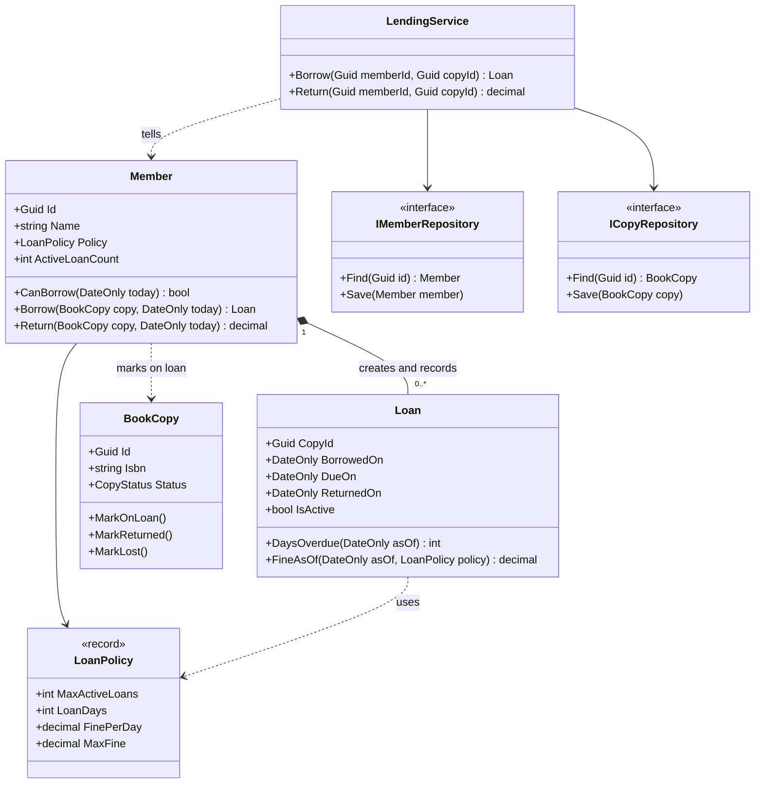
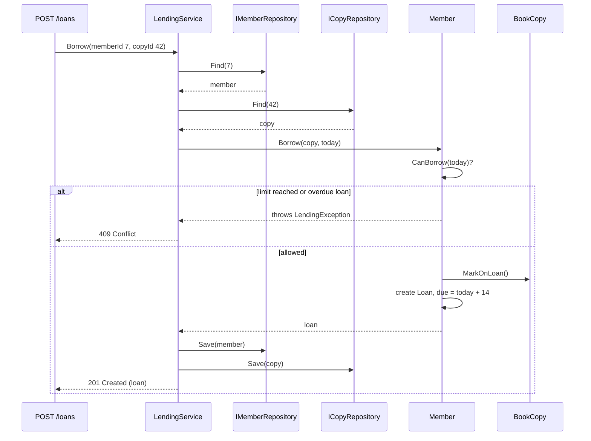

Every low-level design starts with the same two questions: *which classes should exist?* and *which class should do which job?* Get these right and the rest of the design (patterns, interfaces, tests) falls into place. Get them wrong and you end up with one 3,000-line `LibraryManager` that nobody wants to touch.

This lesson gives you a repeatable method for both questions. We use a library lending system as the running example, with side trips to a parking lot and an employee leave system.

## Learning objectives

By the end of this lesson you will be able to:

1. Pull candidate classes and operations out of a requirement using noun and verb analysis, and throw away the candidates that do not deserve to be classes.
2. Write CRC cards (Class, Responsibilities, Collaborators) and use them to test a design before writing code.
3. Explain responsibility-driven design: a class is defined by what it *knows* and what it *does*, not by the data it stores.
4. Apply five GRASP principles (Information Expert, Creator, Controller, Low Coupling, High Cohesion) to decide where a method belongs.
5. Implement a small lending domain in C# where behaviour lives next to the data it uses, with a thin use-case class on top.
6. Recognise the two classic failure modes: the god class and the anaemic model made of "data bags plus managers".

## Prerequisites

- [Classes, objects, fields, properties and methods](#/lesson/m01-classes-objects): you should be able to write a class with private fields and public methods.
- [Single Responsibility Principle](#/lesson/m04-srp): GRASP's High Cohesion is a close cousin of SRP.
- [Class diagrams](#/lesson/m05-class-diagrams): we draw our results as UML class diagrams.

## Explain it like I'm a beginner

Imagine you are opening a small neighbourhood library in Pune with three volunteers. Before the first day you must decide who does what.

- Priya sits at the front desk. Members talk to her. She does not personally know every rule. She *passes the work on* to the right person.
- Rahul keeps the membership register. If someone asks "can Anil borrow another book?", Rahul answers, because only he knows how many books Anil already has.
- Meena looks after the shelves. She knows whether copy number 3 of *Wings of Fire* is on the shelf, out on loan, or lost.

Nobody planned this using theory. You simply gave each job to **the person who already has the information needed to do it**. And you made sure each person has **one clear area**, so if the borrowing rules change, only Rahul's job changes.

That is exactly how we design classes:

- Each person is a **class**.
- Each job is a **responsibility** (something the class knows or does).
- "Ask the person who has the information" is a principle called **Information Expert**.
- "Priya takes requests and passes them on" is the **Controller** principle.
- "Each person has one clear area" is **High Cohesion**.
- "Priya does not need to know how Meena arranges the shelves" is **Low Coupling**.

A useful way to say it: **objects are not boxes of data; they are workers with jobs.** When you design, you are writing job descriptions.

## First-principles explanation

### What a "responsibility" is

A responsibility is a promise a class makes to the rest of the system. Craig Larman, who named the GRASP principles (General Responsibility Assignment Software Patterns), splits them into two kinds:

- **Knowing responsibilities**: facts the object is in charge of. A `Loan` knows its due date. A `Member` knows how many active loans it has.
- **Doing responsibilities**: actions the object performs or coordinates. A `Loan` calculates its own late fine. A `LendingService` coordinates a borrow request.

A class is "well designed" when its knowing and doing responsibilities fit together: the methods use the fields, and the fields exist because the methods need them.

### Step 1: find candidates with noun and verb analysis

Take the written requirement and underline nouns and verbs. Here is ours:

> A **member** can **borrow** up to 3 **books** at a time (premium members: 6). Each **loan** lasts 14 **days**. A member with an overdue loan cannot borrow. When a **copy** is **returned** late, the member is **charged** ₹5 per day, capped at ₹200. The **library** has several copies of the same **title**. **Librarians** can **mark** a copy as lost.

Nouns become candidate classes or attributes: member, book, loan, day, copy, library, title, librarian, fine.
Verbs become candidate methods: borrow, return, charge, mark as lost.

Now filter. Not every noun deserves a class:

| Candidate | Keep? | Why |
|---|---|---|
| Member | Class | Has identity, state (loans) and rules (limits). |
| Book vs Title vs Copy | Split into two | "Book" is ambiguous. A **title** (ISBN, author) is the catalogue entry. A **copy** is a physical item with its own status. One title has many copies. |
| Loan | Class | Has a lifecycle (active, returned) and rules (due date, fine). Beginners often miss this one because it is an *event* noun, not a *thing* noun. |
| Day | Attribute | It is a unit, not an object. Use `DateOnly` and `int` days. |
| Fine | Value or method | Could be a value object (`Money`) or just a calculated `decimal`. Not an entity with a lifecycle in this scope. |
| Library | Probably not | "The system itself" is a trap. A `Library` class tends to become a god class holding everything. |
| Librarian | Actor, not class | It is a *user role* outside the system. Model it as a permission, not a class with behaviour. |

Noun analysis is a starting point, not an algorithm. English is ambiguous, synonyms hide duplicates ("book" and "copy"), and the most important classes are sometimes never named directly (here, the rule set "3 books, 14 days, ₹5 per day" becomes a `LoanPolicy`).

### Step 2: write CRC cards

A CRC card is an index card (or sticky note) with three parts: **Class** name at the top, **Responsibilities** on the left, **Collaborators** (other classes it needs) on the right. Kent Beck and Ward Cunningham introduced them in 1989 for teaching object thinking, and they are still the cheapest design tool there is: a pack of cards costs less than ₹100 and a wrong card costs nothing to tear up.

| Class | Responsibilities | Collaborators |
|---|---|---|
| **Member** | Knows its active loans. Knows its loan policy. Decides whether it may borrow. Records a new loan. | Loan, LoanPolicy, BookCopy |
| **BookCopy** | Knows its ISBN and status. Moves between Available, OnLoan and Lost, refusing illegal moves. | — |
| **Loan** | Knows copy, member, borrowed and due dates. Knows whether it is active. Calculates days overdue and the fine. | LoanPolicy |
| **LoanPolicy** | Knows the limits: max loans, loan days, fine per day, fine cap. | — |
| **LendingService** | Handles the "borrow" and "return" use cases: loads objects, asks them to act, saves them. | Member, BookCopy, repositories, clock |

Then you **role-play a scenario**. Hold up the `LendingService` card and say "Anil wants to borrow copy 42". Who does what next? If you find yourself saying "the service checks the member's loans, counts them, compares with the limit…", the service is doing the member's job. Move that responsibility to `Member`. This walk-through finds misplaced responsibilities in minutes, long before code review.

A rule of thumb: if a card's responsibilities do not fit on a 4×6 inch card, the class is doing too much.

### Step 3: assign responsibilities with GRASP

GRASP is a set of nine principles. Five of them answer 90 % of everyday "where does this method go?" questions.

**1. Information Expert.** Give a responsibility to the class that has the information to fulfil it.
*Who calculates a late fine?* The fine depends on the due date, the return date and the fine rate. `Loan` has the dates and can be handed the policy, so `Loan` calculates the fine. Putting it in `LendingService` would force the service to pull three values out of the loan and compute on them. That is a code smell called **feature envy** (a method more interested in another class's data than its own).

**2. Creator.** Class B should create instances of A when B *contains* or *records* A, *closely uses* A, or *has the data needed to initialise* A.
*Who creates a `Loan`?* `Member` records its loans and has the policy that sets the due date. So `member.Borrow(copy, today)` creates the loan. This keeps the "a new loan must respect the limit" rule in one place: there is no other way to make a loan.

**3. Controller.** The first object behind the user interface that receives a system operation should be a non-UI class that represents the use case (a *use-case controller*) or the whole system (a *facade controller*).
*Who receives "borrow copy 42 for member 7"?* Not the ASP.NET Core endpoint, and not `Member` directly. A `LendingService` (some teams call it a use-case handler or application service) receives it. It loads the objects, calls `member.Borrow(...)`, and saves. It contains **coordination, not business rules**. Note the name clash: a GRASP "controller" is *not* an MVC controller. The MVC controller is UI-layer; it should call the GRASP controller.

**4. Low Coupling.** Assign responsibilities so that classes depend on as few other classes as possible, and on stable ones.
Every dependency is a reason to change and a thing to fake in tests. `Loan` does not need to know about repositories or HTTP, so it should not. `LendingService` depends on *interfaces* for storage (`IMemberRepository`) so it can be tested with in-memory fakes.

**5. High Cohesion.** Keep each class focused, so its responsibilities are strongly related.
A `Member` class that also sends reminder emails, formats PDF receipts and exports to Excel has low cohesion. Each of those is a separate reason to change. Cohesion and coupling pull in opposite directions: splitting everything into tiny classes raises coupling between them. The goal is balance, not maximum splitting.

The other four GRASP principles (Polymorphism, Pure Fabrication, Indirection, Protected Variations) appear in later lessons. You have already met one of them: `LendingService` and the repositories are **Pure Fabrications**, classes that do not represent any real-world thing but exist to keep the domain classes cohesive.

### Responsibility-driven design versus data-driven design

There are two ways to start a design.

- **Data-driven**: start from the database tables, create one class per table with public getters and setters, then write "manager" or "service" classes that hold all the logic.
- **Responsibility-driven** (Rebecca Wirfs-Brock's term): start from the behaviour the system needs, assign each behaviour to a role, and let the data follow.

Data-driven design feels natural to people coming from SQL, and for simple CRUD screens it is fine. Its failure mode is the **anaemic domain model** (Martin Fowler's name): classes that look like objects but are only data bags, with every rule scattered across services. The same rule ("max 3 loans") gets written in the borrow endpoint, the renewal endpoint and the bulk-import job, and one day they disagree.

Responsibility-driven design pairs well with **"Tell, Don't Ask"**: instead of asking an object for its data and deciding for it (`if (member.Loans.Count(l => l.ReturnedOn == null) < 3) ...`), tell the object what you want (`member.Borrow(copy, today)`) and let it decide.

### When to use this full method, and when not

- **Use it** when the domain has real rules (limits, lifecycles, money, permissions), when several use cases touch the same concepts, or when several developers will work on the code.
- **Skip most of it** for a CRUD admin screen with no rules ("edit a list of book categories"). One record type and a repository are enough. Applying CRC cards and GRASP to a lookup table is over-engineering.

### Trade-offs

| You gain | You pay |
|---|---|
| Rules live in one place, next to the data | You must think before you code; the first draft takes longer |
| Domain classes are easy to unit-test without mocks | Developers used to "entities + services" need to adjust |
| Small, cohesive classes are easier to change | More classes to navigate; too much splitting raises coupling |
| CRC role-play catches mistakes before code exists | Cards are informal and drift from the code if you keep them around |

## Visual explanation

### Class diagram



How to read it: `LendingService` is the GRASP Controller. It depends on two repository interfaces (Low Coupling) and *tells* `Member` what to do. `Member` owns its loans (the filled diamond means composition: a loan does not exist without its member) and is the only creator of `Loan` (Creator). `Loan` calculates its own fine using the policy (Information Expert). `BookCopy` guards its own status. Notice what is missing: no arrows from the domain classes to repositories, HTTP or logging. The domain does not know how it is stored.

### Sequence diagram: borrowing a copy



The service does three kinds of work only: *load*, *tell*, *save*. Every decision ("is the limit reached?", "is the copy available?", "when is it due?") is made inside a domain object. If you read a service method and see an `if` about a business rule, ask whether that `if` belongs on a domain class instead.

## Step-by-step example

We grow the lending feature in four steps, the way it usually happens on a real team.

### Step 1: the first version everyone writes

```csharp
public class LibraryManager
{
    public string Borrow(int memberId, int copyId)
    {
        var member = _db.Members.Find(memberId);
        var copy = _db.Copies.Find(copyId);
        var active = _db.Loans.Count(l => l.MemberId == memberId && l.ReturnedOn == null);
        var limit = member.IsPremium ? 6 : 3;
        if (active >= limit) return "Limit reached";
        if (_db.Loans.Any(l => l.MemberId == memberId && l.ReturnedOn == null && l.DueOn < DateTime.Today))
            return "Overdue loan";
        if (copy.Status != "Available") return "Not available";
        copy.Status = "OnLoan";
        _db.Loans.Add(new Loan { MemberId = memberId, CopyId = copyId, DueOn = DateTime.Today.AddDays(member.IsPremium ? 21 : 14) });
        _db.SaveChanges();
        return "OK";
    }
    // ... Return, Renew, MarkLost, SendReminders, ExportReport, ... 40 more methods
}
```

This works on day one. By month six, `LibraryManager` has 40 methods. The "premium = 6, standard = 3" rule appears in Borrow, Renew and the nightly import, and the copy status is a free-text string that someone once set to `"onloan"` in lowercase.

### Step 2: run the CRC role-play

Read the method aloud and ask, for each line, "who has this information?"

- Counting active loans and comparing with a limit → the member's loans and policy → `Member`.
- "Is the copy available?" and changing status → `BookCopy`.
- Due-date calculation → needs the policy and today's date → `Member` while creating the loan (Creator).
- Loading and saving → not a domain concern → stays in the service, behind repository interfaces.

### Step 3: move behaviour to the experts

`Member` gets `CanBorrow` and `Borrow`. `BookCopy` gets `MarkOnLoan` and refuses the move if the copy is not available. `Loan` gets `DaysOverdue` and `FineAsOf`. The magic numbers 3/6, 14/21, ₹5, ₹200 become a `LoanPolicy` record with two named instances, `Standard` and `Premium`.

### Step 4: thin the service

`LendingService.Borrow` shrinks to about eight lines: load, tell, save, log. The full code follows.

## Production-style C# implementation

Project structure:

```text
Library.Api/
  Program.cs
  Lending/
    LoanPolicy.cs
    BookCopy.cs
    Loan.cs
    Member.cs
    LendingException.cs
    Repositories.cs
    LendingService.cs
```

```csharp file=Lending/LoanPolicy.cs
namespace Library.Lending;

/// <summary>Knows the lending limits for one membership tier. Pure data with named presets.</summary>
public sealed record LoanPolicy(int MaxActiveLoans, int LoanDays, decimal FinePerDay, decimal MaxFine)
{
    public static LoanPolicy Standard { get; } = new(MaxActiveLoans: 3, LoanDays: 14, FinePerDay: 5m, MaxFine: 200m);
    public static LoanPolicy Premium { get; } = new(MaxActiveLoans: 6, LoanDays: 21, FinePerDay: 2m, MaxFine: 100m);
}
```

```csharp file=Lending/LendingException.cs
namespace Library.Lending;

/// <summary>A business rule refused the request. The API maps this to 409 Conflict.</summary>
public sealed class LendingException(string message) : Exception(message);
```

```csharp file=Lending/BookCopy.cs
namespace Library.Lending;

public enum CopyStatus { Available, OnLoan, Lost }

/// <summary>Information Expert for "can this physical copy go out?". Guards its own status.</summary>
public sealed class BookCopy
{
    public BookCopy(Guid id, string isbn)
    {
        if (string.IsNullOrWhiteSpace(isbn)) throw new ArgumentException("ISBN is required.", nameof(isbn));
        Id = id;
        Isbn = isbn;
    }

    public Guid Id { get; }
    public string Isbn { get; }
    public CopyStatus Status { get; private set; } = CopyStatus.Available;
    public bool IsAvailable => Status == CopyStatus.Available;

    public void MarkOnLoan()
    {
        if (!IsAvailable) throw new LendingException($"Copy {Id} is {Status} and cannot be lent.");
        Status = CopyStatus.OnLoan;
    }

    public void MarkReturned()
    {
        if (Status != CopyStatus.OnLoan) throw new LendingException($"Copy {Id} is {Status}, not on loan.");
        Status = CopyStatus.Available;
    }

    public void MarkLost() => Status = CopyStatus.Lost;
}
```

```csharp file=Lending/Loan.cs
namespace Library.Lending;

/// <summary>Information Expert for due dates and fines. Created only by Member (Creator).</summary>
public sealed class Loan
{
    internal Loan(Guid copyId, Guid memberId, DateOnly borrowedOn, DateOnly dueOn)
    {
        Id = Guid.NewGuid();
        CopyId = copyId;
        MemberId = memberId;
        BorrowedOn = borrowedOn;
        DueOn = dueOn;
    }

    public Guid Id { get; }
    public Guid CopyId { get; }
    public Guid MemberId { get; }
    public DateOnly BorrowedOn { get; }
    public DateOnly DueOn { get; }
    public DateOnly? ReturnedOn { get; private set; }
    public bool IsActive => ReturnedOn is null;

    /// <summary>Days late, measured to the return date if returned, otherwise to <paramref name="asOf"/>.</summary>
    public int DaysOverdue(DateOnly asOf)
    {
        var end = ReturnedOn ?? asOf;
        return Math.Max(0, end.DayNumber - DueOn.DayNumber);
    }

    public decimal FineAsOf(DateOnly asOf, LoanPolicy policy) =>
        Math.Min(DaysOverdue(asOf) * policy.FinePerDay, policy.MaxFine);

    internal void Close(DateOnly returnedOn)
    {
        if (!IsActive) throw new LendingException($"Loan {Id} is already closed.");
        if (returnedOn < BorrowedOn) throw new ArgumentOutOfRangeException(nameof(returnedOn), "Return date is before the borrow date.");
        ReturnedOn = returnedOn;
    }
}
```

```csharp file=Lending/Member.cs
namespace Library.Lending;

/// <summary>Records its own loans (Creator) and decides whether it may borrow (Information Expert).</summary>
public sealed class Member
{
    private readonly List<Loan> _loans = new();

    public Member(Guid id, string name, LoanPolicy policy)
    {
        if (string.IsNullOrWhiteSpace(name)) throw new ArgumentException("Name is required.", nameof(name));
        Id = id;
        Name = name;
        Policy = policy ?? throw new ArgumentNullException(nameof(policy));
    }

    public Guid Id { get; }
    public string Name { get; }
    public LoanPolicy Policy { get; private set; }
    public IReadOnlyList<Loan> Loans => _loans;
    public int ActiveLoanCount => _loans.Count(l => l.IsActive);

    public bool HasOverdueLoans(DateOnly today) => _loans.Any(l => l.IsActive && l.DaysOverdue(today) > 0);

    public bool CanBorrow(DateOnly today) => ActiveLoanCount < Policy.MaxActiveLoans && !HasOverdueLoans(today);

    public Loan Borrow(BookCopy copy, DateOnly today)
    {
        ArgumentNullException.ThrowIfNull(copy);
        if (ActiveLoanCount >= Policy.MaxActiveLoans)
            throw new LendingException($"{Name} already has {ActiveLoanCount} of {Policy.MaxActiveLoans} loans.");
        if (HasOverdueLoans(today))
            throw new LendingException($"{Name} has an overdue loan and must return it first.");

        copy.MarkOnLoan();
        var loan = new Loan(copy.Id, Id, today, today.AddDays(Policy.LoanDays));
        _loans.Add(loan);
        return loan;
    }

    /// <summary>Closes the active loan for this copy and returns the fine owed (0 if on time).</summary>
    public decimal Return(BookCopy copy, DateOnly today)
    {
        ArgumentNullException.ThrowIfNull(copy);
        var loan = _loans.SingleOrDefault(l => l.IsActive && l.CopyId == copy.Id)
                   ?? throw new LendingException($"{Name} has no active loan for copy {copy.Id}.");
        loan.Close(today);
        copy.MarkReturned();
        return loan.FineAsOf(today, Policy);
    }

    public void ChangePolicy(LoanPolicy policy) => Policy = policy ?? throw new ArgumentNullException(nameof(policy));
}
```

```csharp file=Lending/Repositories.cs
using System.Collections.Concurrent;

namespace Library.Lending;

public interface IMemberRepository
{
    Member? Find(Guid id);
    void Save(Member member);
}

public interface ICopyRepository
{
    BookCopy? Find(Guid id);
    void Save(BookCopy copy);
}

/// <summary>In-memory stores for the demo and for tests. A real app would use EF Core behind the same interfaces.</summary>
public sealed class InMemoryMemberRepository : IMemberRepository
{
    private readonly ConcurrentDictionary<Guid, Member> _items = new();
    public Member? Find(Guid id) => _items.GetValueOrDefault(id);
    public void Save(Member member) => _items[member.Id] = member;
}

public sealed class InMemoryCopyRepository : ICopyRepository
{
    private readonly ConcurrentDictionary<Guid, BookCopy> _items = new();
    public BookCopy? Find(Guid id) => _items.GetValueOrDefault(id);
    public void Save(BookCopy copy) => _items[copy.Id] = copy;
}
```

```csharp file=Lending/LendingService.cs
using Microsoft.Extensions.Logging;

namespace Library.Lending;

/// <summary>GRASP Controller for the lending use cases. Loads, tells, saves. Holds no business rules.</summary>
public sealed class LendingService(
    IMemberRepository members,
    ICopyRepository copies,
    TimeProvider clock,
    ILogger<LendingService> logger)
{
    private DateOnly Today => DateOnly.FromDateTime(clock.GetLocalNow().DateTime);

    public Loan Borrow(Guid memberId, Guid copyId)
    {
        var member = members.Find(memberId) ?? throw new KeyNotFoundException($"Member {memberId} not found.");
        var copy = copies.Find(copyId) ?? throw new KeyNotFoundException($"Copy {copyId} not found.");

        var loan = member.Borrow(copy, Today);

        members.Save(member);
        copies.Save(copy);
        logger.LogInformation("Member {MemberId} borrowed copy {CopyId}, due {DueOn}", memberId, copyId, loan.DueOn);
        return loan;
    }

    public decimal Return(Guid memberId, Guid copyId)
    {
        var member = members.Find(memberId) ?? throw new KeyNotFoundException($"Member {memberId} not found.");
        var copy = copies.Find(copyId) ?? throw new KeyNotFoundException($"Copy {copyId} not found.");

        var fine = member.Return(copy, Today);

        members.Save(member);
        copies.Save(copy);
        logger.LogInformation("Member {MemberId} returned copy {CopyId}, fine {Fine}", memberId, copyId, fine);
        return fine;
    }
}
```

```csharp file=Program.cs
using Library.Lending;

var builder = WebApplication.CreateBuilder(args);

builder.Services.AddSingleton(TimeProvider.System);
builder.Services.AddSingleton<IMemberRepository, InMemoryMemberRepository>();
builder.Services.AddSingleton<ICopyRepository, InMemoryCopyRepository>();
builder.Services.AddScoped<LendingService>();

var app = builder.Build();

// Seed demo data so the endpoints can be tried immediately.
var memberRepo = app.Services.GetRequiredService<IMemberRepository>();
var copyRepo = app.Services.GetRequiredService<ICopyRepository>();
var demoMember = new Member(Guid.Parse("00000000-0000-0000-0000-000000000007"), "Anil", LoanPolicy.Standard);
var demoCopy = new BookCopy(Guid.Parse("00000000-0000-0000-0000-000000000042"), "978-8173711466");
memberRepo.Save(demoMember);
copyRepo.Save(demoCopy);

// The MVC/minimal-API endpoint is UI layer: it translates HTTP to a use-case call and back.
app.MapPost("/members/{memberId:guid}/loans/{copyId:guid}", (Guid memberId, Guid copyId, LendingService lending) =>
{
    try
    {
        var loan = lending.Borrow(memberId, copyId);
        return Results.Created($"/loans/{loan.Id}", new { loan.Id, loan.DueOn });
    }
    catch (KeyNotFoundException ex) { return Results.Problem(ex.Message, statusCode: StatusCodes.Status404NotFound); }
    catch (LendingException ex) { return Results.Problem(ex.Message, statusCode: StatusCodes.Status409Conflict); }
});

app.MapPost("/members/{memberId:guid}/returns/{copyId:guid}", (Guid memberId, Guid copyId, LendingService lending) =>
{
    try { return Results.Ok(new { fine = lending.Return(memberId, copyId) }); }
    catch (KeyNotFoundException ex) { return Results.Problem(ex.Message, statusCode: StatusCodes.Status404NotFound); }
    catch (LendingException ex) { return Results.Problem(ex.Message, statusCode: StatusCodes.Status409Conflict); }
});

app.Run();
```

Design notes:

- **`Loan`'s constructor is `internal`.** Outside the domain assembly, the only way to get a loan is `member.Borrow(...)`. That is the Creator principle enforced by the compiler, not by a code-review comment.
- **`TimeProvider` is injected** into the service, and the domain methods take `DateOnly today` as a parameter. The domain never reads the clock, so tests can pass any date.
- **The endpoint maps exceptions to status codes.** That is a UI concern. The domain throws a meaningful `LendingException`, and it does not know HTTP exists. A later lesson ([Error handling and domain exceptions](#/lesson/m07-domain-exceptions)) compares this with returning a `Result` type.
- **`LendingService` is scoped.** In a real app it would share a scoped `DbContext` with the repositories so `Save` calls commit in one transaction.

## Bad design vs good design

### Bad: the god class

The `LibraryManager` from Step 1 is a **god class** ([see the anti-patterns lesson](#/lesson/m06-anti-patterns)). Symptoms you can measure:

- It has more than 30 public methods and more than 10 injected dependencies.
- Unrelated changes (fine rules, email templates, report formats) all edit the same file.
- Every unit test needs a database or a pile of mocks, because business rules are tangled with data access.

### Also bad: the anaemic model

The "fix" many teams try is to create classes `Member`, `Loan` and `BookCopy` with public `get; set;` properties and then split `LibraryManager` into `MemberService`, `LoanService` and `CopyService`. The code is now in more files but nothing has improved. `LoanService` still reaches into `member.Loans`, counts them and compares with a limit. The rule still lives far from the data, and nothing stops a fourth service from setting `copy.Status = CopyStatus.OnLoan` directly.

```csharp
// Anaemic: the "rule" is outside, and anyone can bypass it.
if (member.Loans.Count(l => l.ReturnedOn == null) < 3)
{
    copy.Status = CopyStatus.OnLoan;               // no guard
    member.Loans.Add(new Loan { DueOn = today.AddDays(14) });  // magic numbers again
}
```

### Good

The implementation above. Rules live on the objects that own the data. The service coordinates. Magic numbers live in one named policy.

### Is the improvement always worth it?

No. If your "library" is an admin screen for 200 book categories with no rules, a record and a repository are the right design. The responsibility-driven approach pays off once rules appear, and it pays off more each time a second use case reuses the same rule. A useful signal: **the second time you copy a business `if` into another service, move it onto the domain class.**

:::callout type=mistake title="Information Expert does not mean 'put everything on the entity'"
`Member` knows its loans, so should `Member` also send the overdue-reminder email? No. Sending email needs an SMTP client, templates and retry logic, none of which `Member` has. Information Expert is about *information*, and High Cohesion still applies. Let `Member` answer "which loans are overdue?" and let a separate `ReminderService` send the email.
:::

## Practical playground

The playground below is a cut-down version of the domain. `Loan.FineAsOf` is already done. Run it, then try these changes and predict the output first:

1. Change the return day from day 20 to day 14. What fine do you expect?
2. Make Anil borrow a fourth copy. Which class refuses, and with what message?
3. Move the "max 3 loans" check into `Main` instead of `Member`. What can now go wrong?

:::playground type=csharp title="Library lending: responsibilities in action"
```csharp file=Program.cs
using System;
using System.Collections.Generic;
using System.Linq;

public sealed record LoanPolicy(int MaxActiveLoans, int LoanDays, decimal FinePerDay, decimal MaxFine);

public sealed class Loan
{
    public Loan(string copyId, DateOnly borrowedOn, DateOnly dueOn) { CopyId = copyId; BorrowedOn = borrowedOn; DueOn = dueOn; }
    public string CopyId { get; }
    public DateOnly BorrowedOn { get; }
    public DateOnly DueOn { get; }
    public DateOnly? ReturnedOn { get; private set; }
    public bool IsActive => ReturnedOn is null;
    public void Close(DateOnly on) => ReturnedOn = on;
    public decimal FineAsOf(DateOnly asOf, LoanPolicy p)
    {
        var days = Math.Max(0, (ReturnedOn ?? asOf).DayNumber - DueOn.DayNumber);
        return Math.Min(days * p.FinePerDay, p.MaxFine);
    }
}

public sealed class Member
{
    private readonly List<Loan> _loans = new();
    public Member(string name, LoanPolicy policy) { Name = name; Policy = policy; }
    public string Name { get; }
    public LoanPolicy Policy { get; }
    public int ActiveLoanCount => _loans.Count(l => l.IsActive);

    public Loan Borrow(string copyId, DateOnly today)
    {
        if (ActiveLoanCount >= Policy.MaxActiveLoans)
            throw new InvalidOperationException($"{Name} is at the limit of {Policy.MaxActiveLoans} loans.");
        var loan = new Loan(copyId, today, today.AddDays(Policy.LoanDays));
        _loans.Add(loan);
        return loan;
    }

    public decimal Return(string copyId, DateOnly today)
    {
        var loan = _loans.Single(l => l.IsActive && l.CopyId == copyId);
        loan.Close(today);
        return loan.FineAsOf(today, Policy);
    }
}

public static class Program
{
    public static void Main()
    {
        var standard = new LoanPolicy(MaxActiveLoans: 3, LoanDays: 14, FinePerDay: 5m, MaxFine: 200m);
        var anil = new Member("Anil", standard);
        var day0 = new DateOnly(2026, 6, 1);

        var loan = anil.Borrow("COPY-42", day0);
        Console.WriteLine($"Borrowed {loan.CopyId}, due {loan.DueOn:yyyy-MM-dd}");

        var fine = anil.Return("COPY-42", day0.AddDays(20));
        Console.WriteLine($"Returned on day 20, fine = Rs {fine}");   // 6 days late x Rs 5 = Rs 30

        anil.Borrow("COPY-1", day0); anil.Borrow("COPY-2", day0); anil.Borrow("COPY-3", day0);
        try { anil.Borrow("COPY-4", day0); }
        catch (InvalidOperationException ex) { Console.WriteLine($"Refused: {ex.Message}"); }
    }
}
```
:::

## Exercises

:::exercise id=m07-classes-responsibilities-ex1 difficulty=beginner kind=design title="Noun and verb analysis for a parking lot"
Read this requirement and produce a first class model:

> A multi-storey **parking lot** in Bengaluru has 3 **floors**. Each floor has **spots** of three **sizes**: bike, car and large (SUV/van). A **vehicle** entering gets a **ticket** with the entry time. On exit, the **driver** **pays** a **fee**: bikes ₹20/hour, cars ₹40/hour, large ₹60/hour, with any part of an hour charged as a full hour. The **display board** at the entrance shows free spots per size per floor.

Underline the nouns and verbs, decide which nouns become classes, which become attributes or enums, and which are actors outside the system. Then build the model in the LLD designer, starting from the JSON below.
::requirements
- Every class has a one-line `responsibility`.
- Mark at least one noun you rejected and say why (in the solution notes or as a class `responsibility` of "rejected: …" if you prefer).
::acceptance
- `SpotSize` is an enum, not three classes.
- `Ticket` exists and knows the entry time and the spot.
- Fee calculation is assigned to a class that has the hourly rates, not to `Vehicle`.
- `Driver` is treated as an actor, not as a class with behaviour.
- The display board reads free-spot counts from floors or the lot; it does not keep its own copy of the counts.
::hint
Start with the nouns that have **identity and state that changes over time**: the lot, a floor, a spot, a ticket. Those are your strongest candidates.
::hint
"Size" appears with three values. Values from a fixed short list are usually an `enum`, not a class hierarchy.
::hint
Who has the information to compute a fee? You need the entry time (on the ticket), the exit time (now) and the rate (by size). Consider a small `FeeSchedule` or `Tariff` class that holds the rates, and let the ticket supply the duration.
::hint
`DisplayBoard` should *ask* each `Floor` for `FreeSpots(size)`. If it stores its own counts, they will drift out of sync with reality the first time an update is missed.
::starter
```json file=parking-model.json
{
  "classes": [
    { "id": "Lot", "name": "ParkingLot", "kind": "class", "fields": ["-List~Floor~ _floors"], "methods": [], "responsibility": "TODO" },
    { "id": "Floor", "name": "Floor", "kind": "class", "fields": [], "methods": [], "responsibility": "TODO" }
  ],
  "relations": []
}
```
::solution
Kept as classes: `ParkingLot`, `Floor`, `ParkingSpot`, `Ticket`, `Tariff`, `DisplayBoard`. `SpotSize` and `VehicleType` are enums. `Vehicle` is reduced to a record (number plate + type) because it has no behaviour of its own in this scope. Rejected: `Driver` (an actor outside the system), `hour` and `entry time` (attributes), `fee` (a calculated `decimal`).

```json file=parking-model.json
{
  "classes": [
    { "id": "Lot", "name": "ParkingLot", "kind": "class",
      "fields": ["-List~Floor~ _floors", "-Tariff _tariff"],
      "methods": ["+Ticket Enter(Vehicle v, DateTimeOffset at)", "+decimal Exit(Ticket t, DateTimeOffset at)"],
      "responsibility": "Use-case entry point: finds a spot, issues tickets, closes them" },
    { "id": "Floor", "name": "Floor", "kind": "class",
      "fields": ["+int Number", "-List~ParkingSpot~ _spots"],
      "methods": ["+ParkingSpot? FindFree(SpotSize size)", "+int FreeSpots(SpotSize size)"],
      "responsibility": "Knows its spots and which are free" },
    { "id": "Spot", "name": "ParkingSpot", "kind": "class",
      "fields": ["+string Code", "+SpotSize Size", "+bool IsFree"],
      "methods": ["+void Occupy()", "+void Release()"],
      "responsibility": "Guards its own occupied/free state" },
    { "id": "Ticket", "name": "Ticket", "kind": "class",
      "fields": ["+Guid Id", "+string Plate", "+SpotSize Size", "+DateTimeOffset EnteredAt", "+DateTimeOffset? ExitedAt"],
      "methods": ["+int BillableHours(DateTimeOffset exit)"],
      "responsibility": "Knows entry time and spot; computes billable hours (rounded up)" },
    { "id": "Tariff", "name": "Tariff", "kind": "class",
      "fields": ["-Dictionary~SpotSize,decimal~ _hourly"],
      "methods": ["+decimal FeeFor(Ticket t, DateTimeOffset exit)"],
      "responsibility": "Knows hourly rates per size; calculates the fee" },
    { "id": "Board", "name": "DisplayBoard", "kind": "class",
      "fields": [], "methods": ["+string Render(IEnumerable~Floor~ floors)"],
      "responsibility": "Formats free-spot counts; asks floors, stores nothing" },
    { "id": "Vehicle", "name": "Vehicle", "kind": "record", "fields": ["+string Plate", "+VehicleType Type"], "methods": [],
      "responsibility": "Identifies the vehicle and its type" },
    { "id": "SpotSize", "name": "SpotSize", "kind": "enum", "fields": ["Bike", "Car", "Large"], "methods": [] },
    { "id": "VehicleType", "name": "VehicleType", "kind": "enum", "fields": ["Bike", "Car", "Suv", "Van"], "methods": [] }
  ],
  "relations": [
    { "from": "Lot", "to": "Floor", "kind": "composition", "multiplicity": "1..*" },
    { "from": "Floor", "to": "Spot", "kind": "composition", "multiplicity": "1..*" },
    { "from": "Lot", "to": "Tariff", "kind": "association" },
    { "from": "Lot", "to": "Ticket", "kind": "dependency", "label": "creates" },
    { "from": "Tariff", "to": "Ticket", "kind": "dependency", "label": "reads duration" },
    { "from": "Board", "to": "Floor", "kind": "dependency", "label": "asks FreeSpots" },
    { "from": "Spot", "to": "SpotSize", "kind": "association" },
    { "from": "Vehicle", "to": "VehicleType", "kind": "association" }
  ]
}
```

`Ticket.BillableHours` uses `Math.Ceiling(minutes / 60.0)`, so 61 minutes bills as 2 hours. `Tariff` is the Information Expert for money, `Ticket` for time. Neither needs to know about floors.
::alternatives
If the lot will later support monthly passes and weekend rates, make `Tariff` an interface (`ITariff`) with several implementations (a Strategy). For one fixed rate card, a class with a dictionary is simpler.
::mistakes
- Creating `BikeSpot`, `CarSpot` and `LargeSpot` subclasses that differ only by a label. Use an enum until the sizes behave differently.
- Putting `CalculateFee()` on `Vehicle`. The vehicle does not know the rates or how long it stayed.
- Making `DisplayBoard` hold its own counters that `Enter` and `Exit` must remember to update.
:::

:::exercise id=m07-classes-responsibilities-ex2 difficulty=beginner kind=code title="Move the fine calculation to its Information Expert"
A `FineReportService` currently pulls dates out of every loan and calculates fines itself (feature envy). Move the calculation onto `Loan`, then make the service a one-liner that asks each loan.
::requirements
- Implement `Loan.DaysOverdue(DateOnly asOf)` and `Loan.FineAsOf(DateOnly asOf, decimal finePerDay, decimal maxFine)`.
- A returned loan measures lateness up to its return date, not up to `asOf`.
- Implement `FineReportService.TotalFines` by summing each loan's own fine.
::acceptance
- Due 10 June, not returned, as of 15 June, ₹5/day: fine is ₹25.
- Due 10 June, returned 12 June, asked on 30 June: fine is ₹10 (2 days), not ₹100.
- A loan returned on or before the due date has a fine of ₹0.
- The fine never exceeds `maxFine`.
- `FineReportService` contains no date arithmetic.
::hint
Which object holds the due date and the return date? That object should do the arithmetic.
::hint
`DateOnly.DayNumber` gives you an integer day count, so the difference of two `DayNumber`s is a number of days.
::hint
Measure to `ReturnedOn ?? asOf`, clamp below at zero with `Math.Max(0, ...)`, and clamp the money above with `Math.Min(..., maxFine)`.
::hint
```csharp
public int DaysOverdue(DateOnly asOf) => Math.Max(0, (ReturnedOn ?? asOf).DayNumber - DueOn.DayNumber);
```
::starter
```csharp file=Loan.cs
using System;
using System.Collections.Generic;
using System.Linq;

public sealed class Loan
{
    public Loan(DateOnly dueOn, DateOnly? returnedOn = null) { DueOn = dueOn; ReturnedOn = returnedOn; }
    public DateOnly DueOn { get; }
    public DateOnly? ReturnedOn { get; }

    public int DaysOverdue(DateOnly asOf) => throw new NotImplementedException();
    public decimal FineAsOf(DateOnly asOf, decimal finePerDay, decimal maxFine) => throw new NotImplementedException();
}

public sealed class FineReportService
{
    public decimal TotalFines(IEnumerable<Loan> loans, DateOnly asOf, decimal finePerDay, decimal maxFine) =>
        throw new NotImplementedException();
}
```
::tests
```csharp file=LoanFineTests.cs
using System;
using Xunit;

public class LoanFineTests
{
    private static readonly DateOnly Due = new(2026, 6, 10);

    [Fact] public void Active_loan_five_days_late() =>
        Assert.Equal(25m, new Loan(Due).FineAsOf(new DateOnly(2026, 6, 15), 5m, 200m));

    [Fact] public void Returned_loan_measures_to_return_date() =>
        Assert.Equal(10m, new Loan(Due, new DateOnly(2026, 6, 12)).FineAsOf(new DateOnly(2026, 6, 30), 5m, 200m));

    [Fact] public void On_time_return_is_free() =>
        Assert.Equal(0m, new Loan(Due, new DateOnly(2026, 6, 9)).FineAsOf(new DateOnly(2026, 6, 30), 5m, 200m));

    [Fact] public void Fine_is_capped() =>
        Assert.Equal(200m, new Loan(Due).FineAsOf(new DateOnly(2026, 9, 1), 5m, 200m));

    [Fact] public void Days_overdue_never_negative() =>
        Assert.Equal(0, new Loan(Due).DaysOverdue(new DateOnly(2026, 6, 1)));

    [Fact] public void Report_sums_each_loans_fine()
    {
        var loans = new[] { new Loan(Due), new Loan(Due, new DateOnly(2026, 6, 12)), new Loan(new DateOnly(2026, 7, 1)) };
        Assert.Equal(35m, new FineReportService().TotalFines(loans, new DateOnly(2026, 6, 15), 5m, 200m));
    }
}
```
::solution
The loan owns both dates, so it owns the arithmetic. The report now just asks.

```csharp file=Loan.cs
using System;
using System.Collections.Generic;
using System.Linq;

public sealed class Loan
{
    public Loan(DateOnly dueOn, DateOnly? returnedOn = null) { DueOn = dueOn; ReturnedOn = returnedOn; }
    public DateOnly DueOn { get; }
    public DateOnly? ReturnedOn { get; }

    public int DaysOverdue(DateOnly asOf) => Math.Max(0, (ReturnedOn ?? asOf).DayNumber - DueOn.DayNumber);

    public decimal FineAsOf(DateOnly asOf, decimal finePerDay, decimal maxFine) =>
        Math.Min(DaysOverdue(asOf) * finePerDay, maxFine);
}

public sealed class FineReportService
{
    public decimal TotalFines(IEnumerable<Loan> loans, DateOnly asOf, decimal finePerDay, decimal maxFine) =>
        loans.Sum(l => l.FineAsOf(asOf, finePerDay, maxFine));
}
```

Next time the library adds "no fines on public holidays", you change one method on `Loan` and every report, receipt and API that shows a fine picks it up.
::mistakes
- Using `(asOf - DueOn)` with `DateTime` and `.Days`, which breaks around daylight-saving changes in some time zones. `DateOnly.DayNumber` avoids time-of-day entirely.
- Forgetting that a returned loan stops accruing a fine.
- Leaving a copy of the calculation in the service "just in case". Two copies will drift.
::extensions
Replace the three loose parameters (`finePerDay`, `maxFine`, and later a grace period) with a `LoanPolicy` record. Notice how the method signature stops growing.
:::

:::exercise id=m07-classes-responsibilities-ex3 difficulty=intermediate kind=code title="Creator: only a member can create a loan"
Today any code can write `new Loan(...)`, and the bulk-import job does so without checking limits. Make `Member` the only creator of loans (GRASP Creator) and enforce the rules there.
::requirements
- `Member.Borrow(BookCopy copy, DateOnly today)` returns a new `Loan` due `today + policy.LoanDays`.
- Refuse (throw `LendingException`) if the member is at `MaxActiveLoans`, has any overdue active loan, or the copy is not available.
- A successful borrow sets the copy's status to `OnLoan`.
- `Member.Return(BookCopy copy, DateOnly today)` closes the matching active loan, marks the copy available and returns the fine.
::acceptance
- A standard member (3 loans) can borrow 3 copies and is refused on the 4th.
- A member with a loan 1 day overdue is refused even with only 1 active loan.
- Borrowing a copy that is already on loan is refused and the member's loan count does not change.
- Returning frees a slot so the member can borrow again.
- Return 3 days late with ₹5/day gives a fine of ₹15.
::hint
Which class *records* loans and has the data (the policy) to set the due date? That is the Creator.
::hint
Check all rules *before* changing any state. If you add the loan and then discover the copy is unavailable, you have to undo.
::hint
Order: check limit → check overdue → `copy.MarkOnLoan()` (which throws if unavailable) → create and add loan. The copy throws before the loan is added, so nothing needs undoing.
::hint
For `Return`: `_loans.SingleOrDefault(l => l.IsActive && l.CopyId == copy.Id)`; throw if null; set `ReturnedOn`; `copy.MarkReturned()`; compute the fine from the policy.
::starter
```csharp file=Lending.cs
using System;
using System.Collections.Generic;
using System.Linq;

public sealed class LendingException(string message) : Exception(message);

public sealed record LoanPolicy(int MaxActiveLoans, int LoanDays, decimal FinePerDay, decimal MaxFine);

public enum CopyStatus { Available, OnLoan, Lost }

public sealed class BookCopy(string id)
{
    public string Id { get; } = id;
    public CopyStatus Status { get; private set; } = CopyStatus.Available;
    public void MarkOnLoan()
    {
        if (Status != CopyStatus.Available) throw new LendingException($"Copy {Id} is {Status}.");
        Status = CopyStatus.OnLoan;
    }
    public void MarkReturned() => Status = CopyStatus.Available;
}

public sealed class Loan
{
    internal Loan(string copyId, DateOnly borrowedOn, DateOnly dueOn) { CopyId = copyId; BorrowedOn = borrowedOn; DueOn = dueOn; }
    public string CopyId { get; }
    public DateOnly BorrowedOn { get; }
    public DateOnly DueOn { get; }
    public DateOnly? ReturnedOn { get; internal set; }
    public bool IsActive => ReturnedOn is null;
}

public sealed class Member(string name, LoanPolicy policy)
{
    private readonly List<Loan> _loans = new();
    public string Name { get; } = name;
    public LoanPolicy Policy { get; } = policy;
    public IReadOnlyList<Loan> Loans => _loans;
    public int ActiveLoanCount => _loans.Count(l => l.IsActive);

    public Loan Borrow(BookCopy copy, DateOnly today) => throw new NotImplementedException();
    public decimal Return(BookCopy copy, DateOnly today) => throw new NotImplementedException();
}
```
::tests
```csharp file=MemberTests.cs
using System;
using Xunit;

public class MemberTests
{
    private static readonly LoanPolicy Standard = new(3, 14, 5m, 200m);
    private static readonly DateOnly Day0 = new(2026, 6, 1);

    [Fact]
    public void Borrow_sets_due_date_and_marks_copy()
    {
        var m = new Member("Anil", Standard);
        var c = new BookCopy("C1");
        var loan = m.Borrow(c, Day0);
        Assert.Equal(new DateOnly(2026, 6, 15), loan.DueOn);
        Assert.Equal(CopyStatus.OnLoan, c.Status);
        Assert.Equal(1, m.ActiveLoanCount);
    }

    [Fact]
    public void Fourth_loan_is_refused()
    {
        var m = new Member("Anil", Standard);
        m.Borrow(new BookCopy("C1"), Day0); m.Borrow(new BookCopy("C2"), Day0); m.Borrow(new BookCopy("C3"), Day0);
        Assert.Throws<LendingException>(() => m.Borrow(new BookCopy("C4"), Day0));
    }

    [Fact]
    public void Overdue_loan_blocks_borrowing()
    {
        var m = new Member("Anil", Standard);
        m.Borrow(new BookCopy("C1"), Day0);
        Assert.Throws<LendingException>(() => m.Borrow(new BookCopy("C2"), Day0.AddDays(15)));
    }

    [Fact]
    public void Unavailable_copy_does_not_create_loan()
    {
        var m = new Member("Anil", Standard);
        var other = new Member("Sara", Standard);
        var c = new BookCopy("C1");
        other.Borrow(c, Day0);
        Assert.Throws<LendingException>(() => m.Borrow(c, Day0));
        Assert.Equal(0, m.ActiveLoanCount);
    }

    [Fact]
    public void Return_frees_a_slot_and_charges_fine()
    {
        var m = new Member("Anil", Standard);
        var c1 = new BookCopy("C1");
        m.Borrow(c1, Day0); m.Borrow(new BookCopy("C2"), Day0); m.Borrow(new BookCopy("C3"), Day0);
        var fine = m.Return(c1, Day0.AddDays(17));
        Assert.Equal(15m, fine);
        Assert.Equal(CopyStatus.Available, c1.Status);
        Assert.Equal(2, m.ActiveLoanCount);
    }

    [Fact]
    public void Returning_a_copy_not_borrowed_is_refused() =>
        Assert.Throws<LendingException>(() => new Member("Anil", Standard).Return(new BookCopy("X"), Day0));
}
```
::solution
`Member` records loans and holds the policy, so it creates them. Rules are checked before any state changes.

```csharp file=Lending.cs
using System;
using System.Collections.Generic;
using System.Linq;

public sealed class LendingException(string message) : Exception(message);

public sealed record LoanPolicy(int MaxActiveLoans, int LoanDays, decimal FinePerDay, decimal MaxFine);

public enum CopyStatus { Available, OnLoan, Lost }

public sealed class BookCopy(string id)
{
    public string Id { get; } = id;
    public CopyStatus Status { get; private set; } = CopyStatus.Available;
    public void MarkOnLoan()
    {
        if (Status != CopyStatus.Available) throw new LendingException($"Copy {Id} is {Status}.");
        Status = CopyStatus.OnLoan;
    }
    public void MarkReturned() => Status = CopyStatus.Available;
}

public sealed class Loan
{
    internal Loan(string copyId, DateOnly borrowedOn, DateOnly dueOn) { CopyId = copyId; BorrowedOn = borrowedOn; DueOn = dueOn; }
    public string CopyId { get; }
    public DateOnly BorrowedOn { get; }
    public DateOnly DueOn { get; }
    public DateOnly? ReturnedOn { get; internal set; }
    public bool IsActive => ReturnedOn is null;
}

public sealed class Member(string name, LoanPolicy policy)
{
    private readonly List<Loan> _loans = new();
    public string Name { get; } = name;
    public LoanPolicy Policy { get; } = policy;
    public IReadOnlyList<Loan> Loans => _loans;
    public int ActiveLoanCount => _loans.Count(l => l.IsActive);

    private bool HasOverdue(DateOnly today) => _loans.Any(l => l.IsActive && l.DueOn < today);

    public Loan Borrow(BookCopy copy, DateOnly today)
    {
        ArgumentNullException.ThrowIfNull(copy);
        if (ActiveLoanCount >= Policy.MaxActiveLoans)
            throw new LendingException($"{Name} is at the limit of {Policy.MaxActiveLoans} loans.");
        if (HasOverdue(today))
            throw new LendingException($"{Name} has an overdue loan.");

        copy.MarkOnLoan();                                    // throws if unavailable, before we add anything
        var loan = new Loan(copy.Id, today, today.AddDays(Policy.LoanDays));
        _loans.Add(loan);
        return loan;
    }

    public decimal Return(BookCopy copy, DateOnly today)
    {
        ArgumentNullException.ThrowIfNull(copy);
        var loan = _loans.SingleOrDefault(l => l.IsActive && l.CopyId == copy.Id)
                   ?? throw new LendingException($"{Name} has no active loan for {copy.Id}.");
        loan.ReturnedOn = today;
        copy.MarkReturned();
        var daysLate = Math.Max(0, today.DayNumber - loan.DueOn.DayNumber);
        return Math.Min(daysLate * Policy.FinePerDay, Policy.MaxFine);
    }
}
```

With `Loan`'s constructor `internal`, the import job in another assembly cannot skip the rules. In a single-project app, `internal` does not protect you, so add an architecture test or keep the domain in its own project.
::alternatives
A separate `LoanFactory` is reasonable when creating a loan needs services the member should not hold (for example, checking a reservation queue in another aggregate). For this rule set, the member has everything it needs, so a factory adds indirection without benefit.
::mistakes
- Adding the loan first, then calling `copy.MarkOnLoan()`. When the copy throws, the member now has a phantom loan.
- Checking `l.DueOn <= today` for overdue. A book due today is not overdue until tomorrow.
- Letting `Borrow` take a `copyId` string and trusting the caller that the copy exists and is available.
::extensions
Add `Renew(BookCopy copy, DateOnly today)`: extends the due date by `LoanDays` once per loan, refused if overdue. Decide which class owns "renewed at most once".
:::

:::exercise id=m07-classes-responsibilities-ex4 difficulty=intermediate kind=design title="CRC cards for employee leave management"
Requirement:

> An **employee** at a construction consultancy in Gurgaon applies for **leave** (casual, sick or earned) for a date range. Casual leave allows 12 days a year, sick 10, earned 18. The employee's **reporting manager** approves or rejects. Approved leave reduces the **balance**. Weekends and **public holidays** in the employee's office **location** do not count as leave days. HR can see a **calendar** of who is on leave.

Write CRC cards for the main classes, role-play "Neha applies for 3 days of casual leave from Thursday to Monday", and turn the cards into a class model.
::acceptance
- A class (not a service) computes the number of chargeable leave days for a date range, using a holiday calendar.
- A `LeaveRequest` has an explicit status and only allows Pending → Approved or Pending → Rejected.
- Balance checking happens in one class, which has the balances.
- The manager is modelled as a reference to another employee, not as a separate class hierarchy.
- There is a use-case controller for "apply" and "decide" that holds no rules.
::hint
List the nouns: employee, leave, type, date range, manager, balance, holiday, location, calendar, HR. Which have a lifecycle? Which are just values?
::hint
"Thursday to Monday" is 5 calendar days but only 3 working days. Who knows which days are holidays? That information lives with a `HolidayCalendar` per location.
::hint
Who knows how much leave Neha has left? Consider a `LeaveBalance` owned by the employee (or a per-employee, per-year ledger). It answers `CanDeduct(type, days)` and performs `Deduct`.
::hint
Role-play: `LeaveApplicationService.Apply` → loads employee and calendar → `calendar.WorkingDaysBetween(from, to)` → `employee.Balance.CanDeduct(Casual, 3)` → `LeaveRequest.Create(...)` (Pending) → save. On approval: `request.Approve(manager)` → `balance.Deduct(...)`.
::starter
```json file=leave-model.json
{
  "classes": [
    { "id": "Emp", "name": "Employee", "kind": "class", "fields": ["+Guid Id", "+string Name"], "methods": [], "responsibility": "TODO" },
    { "id": "Req", "name": "LeaveRequest", "kind": "class", "fields": [], "methods": [], "responsibility": "TODO" }
  ],
  "relations": []
}
```
::solution
CRC cards (summary):

| Class | Responsibilities | Collaborators |
|---|---|---|
| Employee | Knows manager id, location, balances | LeaveBalance |
| LeaveBalance | Knows remaining days per type for a year; checks and deducts | LeaveType |
| LeaveRequest | Knows employee, type, range, chargeable days, status; approves/rejects with guard | Employee (manager id) |
| HolidayCalendar | Knows holidays for a location and year; counts working days in a range | DateRange |
| LeaveApplicationService | Apply and Decide use cases: load, tell, save | all of the above, repositories |

```json file=leave-model.json
{
  "classes": [
    { "id": "Emp", "name": "Employee", "kind": "class",
      "fields": ["+Guid Id", "+string Name", "+Guid? ManagerId", "+string LocationCode", "+LeaveBalance Balance"],
      "methods": ["+bool IsManagedBy(Guid managerId)"],
      "responsibility": "Knows who manages them, where they work, and their balance" },
    { "id": "Bal", "name": "LeaveBalance", "kind": "class",
      "fields": ["+int Year", "-Dictionary~LeaveType,int~ _remaining"],
      "methods": ["+bool CanDeduct(LeaveType type, int days)", "+void Deduct(LeaveType type, int days)", "+int Remaining(LeaveType type)"],
      "responsibility": "Information Expert for remaining leave" },
    { "id": "Req", "name": "LeaveRequest", "kind": "class",
      "fields": ["+Guid Id", "+Guid EmployeeId", "+LeaveType Type", "+DateRange Range", "+int ChargeableDays", "+LeaveStatus Status"],
      "methods": ["+static LeaveRequest Create(Employee e, LeaveType t, DateRange r, int days)", "+void Approve(Guid managerId)", "+void Reject(Guid managerId, string reason)"],
      "responsibility": "Owns its own status transitions" },
    { "id": "Cal", "name": "HolidayCalendar", "kind": "class",
      "fields": ["+string LocationCode", "-HashSet~DateOnly~ _holidays"],
      "methods": ["+int WorkingDaysBetween(DateRange range)"],
      "responsibility": "Counts working days, skipping weekends and local holidays" },
    { "id": "Range", "name": "DateRange", "kind": "record", "fields": ["+DateOnly From", "+DateOnly To"], "methods": ["+IEnumerable~DateOnly~ Days()"],
      "responsibility": "A validated inclusive date range" },
    { "id": "Svc", "name": "LeaveApplicationService", "kind": "class", "fields": [],
      "methods": ["+LeaveRequest Apply(Guid employeeId, LeaveType type, DateRange range)", "+void Decide(Guid requestId, Guid managerId, bool approve)"],
      "responsibility": "Use-case controller: load, tell, save" },
    { "id": "Type", "name": "LeaveType", "kind": "enum", "fields": ["Casual", "Sick", "Earned"], "methods": [] },
    { "id": "Status", "name": "LeaveStatus", "kind": "enum", "fields": ["Pending", "Approved", "Rejected"], "methods": [] }
  ],
  "relations": [
    { "from": "Emp", "to": "Bal", "kind": "composition" },
    { "from": "Emp", "to": "Emp", "kind": "association", "label": "reports to", "multiplicity": "0..1" },
    { "from": "Req", "to": "Emp", "kind": "association", "label": "for" },
    { "from": "Req", "to": "Range", "kind": "composition" },
    { "from": "Cal", "to": "Range", "kind": "dependency" },
    { "from": "Svc", "to": "Cal", "kind": "dependency" },
    { "from": "Svc", "to": "Emp", "kind": "dependency" },
    { "from": "Svc", "to": "Req", "kind": "dependency" }
  ]
}
```

In the role-play, Thursday 1 Oct to Monday 5 Oct 2026 is 5 calendar days. Saturday and Sunday drop out, leaving 3, and because Friday 2 October (Gandhi Jayanti) is in the Gurgaon calendar, Neha is charged only 2 days. That logic sits in `HolidayCalendar`, so the mobile app, the web form and the payroll export all agree.
::alternatives
Some HR systems model the balance as a **ledger** of entries (+12 accrued, −2 taken, +1 carried forward) rather than a single number. A ledger is better for audits and year-end carry-forward. A simple balance is fine for a first version.
::mistakes
- Creating `Manager` as a subclass of `Employee`. A manager is an employee in a role; people change roles, objects should not change class.
- Deducting the balance when the request is *created* instead of when it is *approved*. (Some companies do reserve on apply; if so, model the reservation explicitly.)
- Counting days with `(to - from).Days + 1` in the service, ignoring holidays.
:::

:::exercise id=m07-classes-responsibilities-ex5 difficulty=advanced kind=code title="Add reservations without bloating the controller"
Members can now **reserve** a title (ISBN) when all copies are out. When a copy of that title is returned, it goes on hold for the first member in the queue for 3 days instead of going back on the shelf. Assign the new responsibilities so that `LendingService` stays a thin controller.
::requirements
- `ReservationQueue` (one per ISBN) records reservations in first-come order and refuses duplicates from the same member.
- `BookCopy` gains an `OnHold` status with the member id it is held for and an expiry date; only that member may borrow it while the hold is valid.
- `LendingService.Return` closes the loan and, if the queue for that ISBN has a reservation, puts the copy on hold for the next member for 3 days.
- `LendingService` contains no business `if` other than "is there someone in the queue?" (delegated to the queue).
::acceptance
- With an empty queue, a returned copy becomes `Available`.
- With Sara in the queue, the returned copy becomes `OnHold` for Sara until return date + 3, and Sara leaves the queue.
- Anil cannot borrow a copy on hold for Sara; Sara can.
- After the hold expires, anyone can borrow the copy.
- A member cannot reserve the same ISBN twice.
::hint
Three new questions: who knows the *order* of reservations? who knows *whom a copy is held for*? who *coordinates* the two on return? Answer each with a GRASP principle.
::hint
Queue order → `ReservationQueue` (Information Expert). Hold state → `BookCopy` (it already guards its status). Coordination → `LendingService` (Controller).
::hint
`BookCopy.CanBeBorrowedBy(memberId, today)` returns true if Available, or OnHold for that member and `today <= HoldUntil`, or OnHold but expired. `MarkOnLoan(memberId, today)` checks it.
::hint
In `Return`: `var fine = member.Return(copy, today); var next = queue.Dequeue(); if (next is Guid id) copy.PlaceOnHold(id, today.AddDays(3)); else copy.MarkReturned();` (Note `member.Return` should not itself make the copy available; let the service decide between "available" and "on hold" via the copy.)
::starter
```csharp file=Reservations.cs
using System;
using System.Collections.Generic;
using System.Linq;

public sealed class LendingException(string message) : Exception(message);

public enum CopyStatus { Available, OnLoan, OnHold }

public sealed class BookCopy(string id, string isbn)
{
    public string Id { get; } = id;
    public string Isbn { get; } = isbn;
    public CopyStatus Status { get; private set; } = CopyStatus.Available;
    public Guid? HeldFor { get; private set; }
    public DateOnly? HoldUntil { get; private set; }

    public bool CanBeBorrowedBy(Guid memberId, DateOnly today) => throw new NotImplementedException();
    public void MarkOnLoan(Guid memberId, DateOnly today) => throw new NotImplementedException();
    public void PlaceOnHold(Guid memberId, DateOnly until) => throw new NotImplementedException();
    public void MarkReturned() => throw new NotImplementedException();
}

public sealed class ReservationQueue(string isbn)
{
    public string Isbn { get; } = isbn;
    public int Count => throw new NotImplementedException();
    public void Reserve(Guid memberId) => throw new NotImplementedException();
    public Guid? Dequeue() => throw new NotImplementedException();
}

public interface IReservationQueues { ReservationQueue For(string isbn); }

public sealed class InMemoryReservationQueues : IReservationQueues
{
    private readonly Dictionary<string, ReservationQueue> _queues = new();
    public ReservationQueue For(string isbn) =>
        _queues.TryGetValue(isbn, out var q) ? q : _queues[isbn] = new ReservationQueue(isbn);
}

/// <summary>Minimal loan tracking so the exercise focuses on reservations.</summary>
public sealed class Member(Guid id)
{
    private readonly HashSet<string> _onLoan = new();
    public Guid Id { get; } = id;
    public void Borrow(BookCopy copy, DateOnly today) { copy.MarkOnLoan(Id, today); _onLoan.Add(copy.Id); }
    public void Return(BookCopy copy)
    {
        if (!_onLoan.Remove(copy.Id)) throw new LendingException($"Member {Id} does not have {copy.Id}.");
    }
}

public sealed class LendingService(IReservationQueues queues)
{
    public const int HoldDays = 3;
    public void Borrow(Member member, BookCopy copy, DateOnly today) => member.Borrow(copy, today);
    public void Return(Member member, BookCopy copy, DateOnly today) => throw new NotImplementedException();
    public void Reserve(Member member, string isbn) => queues.For(isbn).Reserve(member.Id);
}
```
::tests
```csharp file=ReservationTests.cs
using System;
using Xunit;

public class ReservationTests
{
    private static readonly DateOnly Day0 = new(2026, 6, 1);
    private static readonly Guid AnilId = Guid.NewGuid();
    private static readonly Guid SaraId = Guid.NewGuid();

    private static (LendingService svc, InMemoryReservationQueues q, Member anil, Member sara, BookCopy copy) Setup()
    {
        var q = new InMemoryReservationQueues();
        return (new LendingService(q), q, new Member(AnilId), new Member(SaraId), new BookCopy("C1", "ISBN-1"));
    }

    [Fact]
    public void Return_with_empty_queue_makes_copy_available()
    {
        var (svc, _, anil, _, copy) = Setup();
        svc.Borrow(anil, copy, Day0);
        svc.Return(anil, copy, Day0.AddDays(5));
        Assert.Equal(CopyStatus.Available, copy.Status);
    }

    [Fact]
    public void Return_with_reservation_places_hold_for_next_member()
    {
        var (svc, q, anil, sara, copy) = Setup();
        svc.Borrow(anil, copy, Day0);
        svc.Reserve(sara, "ISBN-1");
        svc.Return(anil, copy, Day0.AddDays(5));
        Assert.Equal(CopyStatus.OnHold, copy.Status);
        Assert.Equal(SaraId, copy.HeldFor);
        Assert.Equal(Day0.AddDays(8), copy.HoldUntil);
        Assert.Equal(0, q.For("ISBN-1").Count);
    }

    [Fact]
    public void Only_holder_can_borrow_during_hold()
    {
        var (svc, _, anil, sara, copy) = Setup();
        svc.Borrow(anil, copy, Day0);
        svc.Reserve(sara, "ISBN-1");
        svc.Return(anil, copy, Day0.AddDays(5));
        Assert.Throws<LendingException>(() => svc.Borrow(anil, copy, Day0.AddDays(6)));
        svc.Borrow(sara, copy, Day0.AddDays(6));
        Assert.Equal(CopyStatus.OnLoan, copy.Status);
        Assert.Null(copy.HeldFor);
    }

    [Fact]
    public void Expired_hold_lets_anyone_borrow()
    {
        var (svc, _, anil, sara, copy) = Setup();
        svc.Borrow(anil, copy, Day0);
        svc.Reserve(sara, "ISBN-1");
        svc.Return(anil, copy, Day0.AddDays(5));
        svc.Borrow(anil, copy, Day0.AddDays(9));
        Assert.Equal(CopyStatus.OnLoan, copy.Status);
    }

    [Fact]
    public void Duplicate_reservation_is_refused()
    {
        var (svc, _, _, sara, _) = Setup();
        svc.Reserve(sara, "ISBN-1");
        Assert.Throws<LendingException>(() => svc.Reserve(sara, "ISBN-1"));
    }

    [Fact]
    public void Queue_is_first_come_first_served()
    {
        var q = new ReservationQueue("ISBN-1");
        q.Reserve(SaraId); q.Reserve(AnilId);
        Assert.Equal(SaraId, q.Dequeue());
        Assert.Equal(AnilId, q.Dequeue());
        Assert.Null(q.Dequeue());
    }
}
```
::solution
Each new piece of knowledge gets one owner: the queue owns order, the copy owns its hold, the service only connects them.

```csharp file=Reservations.cs
using System;
using System.Collections.Generic;
using System.Linq;

public sealed class LendingException(string message) : Exception(message);

public enum CopyStatus { Available, OnLoan, OnHold }

public sealed class BookCopy(string id, string isbn)
{
    public string Id { get; } = id;
    public string Isbn { get; } = isbn;
    public CopyStatus Status { get; private set; } = CopyStatus.Available;
    public Guid? HeldFor { get; private set; }
    public DateOnly? HoldUntil { get; private set; }

    public bool CanBeBorrowedBy(Guid memberId, DateOnly today) => Status switch
    {
        CopyStatus.Available => true,
        CopyStatus.OnHold => HeldFor == memberId || today > HoldUntil,
        _ => false,
    };

    public void MarkOnLoan(Guid memberId, DateOnly today)
    {
        if (!CanBeBorrowedBy(memberId, today))
            throw new LendingException($"Copy {Id} is {Status}{(HeldFor is null ? "" : $" for another member until {HoldUntil}")}.");
        Status = CopyStatus.OnLoan;
        HeldFor = null;
        HoldUntil = null;
    }

    public void PlaceOnHold(Guid memberId, DateOnly until)
    {
        if (Status != CopyStatus.OnLoan) throw new LendingException($"Copy {Id} must be returned before it can be held.");
        Status = CopyStatus.OnHold;
        HeldFor = memberId;
        HoldUntil = until;
    }

    public void MarkReturned()
    {
        if (Status != CopyStatus.OnLoan) throw new LendingException($"Copy {Id} is not on loan.");
        Status = CopyStatus.Available;
    }
}

public sealed class ReservationQueue(string isbn)
{
    private readonly LinkedList<Guid> _waiting = new();
    public string Isbn { get; } = isbn;
    public int Count => _waiting.Count;

    public void Reserve(Guid memberId)
    {
        if (_waiting.Contains(memberId)) throw new LendingException($"Member {memberId} already reserved {Isbn}.");
        _waiting.AddLast(memberId);
    }

    public Guid? Dequeue()
    {
        if (_waiting.First is null) return null;
        var next = _waiting.First.Value;
        _waiting.RemoveFirst();
        return next;
    }
}

public interface IReservationQueues { ReservationQueue For(string isbn); }

public sealed class InMemoryReservationQueues : IReservationQueues
{
    private readonly Dictionary<string, ReservationQueue> _queues = new();
    public ReservationQueue For(string isbn) =>
        _queues.TryGetValue(isbn, out var q) ? q : _queues[isbn] = new ReservationQueue(isbn);
}

public sealed class Member(Guid id)
{
    private readonly HashSet<string> _onLoan = new();
    public Guid Id { get; } = id;
    public void Borrow(BookCopy copy, DateOnly today) { copy.MarkOnLoan(Id, today); _onLoan.Add(copy.Id); }
    public void Return(BookCopy copy)
    {
        if (!_onLoan.Remove(copy.Id)) throw new LendingException($"Member {Id} does not have {copy.Id}.");
    }
}

public sealed class LendingService(IReservationQueues queues)
{
    public const int HoldDays = 3;

    public void Borrow(Member member, BookCopy copy, DateOnly today) => member.Borrow(copy, today);

    public void Return(Member member, BookCopy copy, DateOnly today)
    {
        member.Return(copy);
        var next = queues.For(copy.Isbn).Dequeue();
        if (next is Guid memberId) copy.PlaceOnHold(memberId, today.AddDays(HoldDays));
        else copy.MarkReturned();
    }

    public void Reserve(Member member, string isbn) => queues.For(isbn).Reserve(member.Id);
}
```

Notice what did *not* change: `Member` gained nothing, and `LendingService.Return` grew by two lines. A `LinkedList` keeps first-come order; at library scale (tens of reservations per title) its O(n) `Contains` is irrelevant.
::alternatives
If a member who never collects a hold should be skipped automatically, add a nightly job that finds expired holds and calls `PlaceOnHold` for the next in queue. That job is another thin controller calling the same domain methods. In a larger system the "copy returned" moment becomes a domain event ([Domain events](#/lesson/m08-domain-events)) that a reservation handler reacts to, which removes the service's knowledge of reservations entirely.
::mistakes
- Putting the queue inside `LendingService` as a `Dictionary<string, Queue<Guid>>`. It works, but the service now owns data and rules, and the next feature (priority for premium members) bloats it further.
- Using `Queue<Guid>` and allowing duplicates, so one eager member takes every returned copy.
- Forgetting to clear `HeldFor` when the holder borrows, which later blocks a return-and-hold cycle.
:::

## Automated testing

Responsibility-driven design makes testing cheap because the rules sit in plain objects with no dependencies.

**Level 1: domain objects, no fakes at all.** These run in microseconds and cover the business rules.

```csharp
public class MemberBorrowingTests
{
    private static readonly DateOnly Today = new(2026, 6, 1);

    [Theory]
    [InlineData(2, true)]
    [InlineData(3, false)]
    public void Standard_member_limit_is_three(int existingLoans, bool expected)
    {
        var member = new Member(Guid.NewGuid(), "Anil", LoanPolicy.Standard);
        for (var i = 0; i < existingLoans; i++) member.Borrow(new BookCopy(Guid.NewGuid(), $"ISBN-{i}"), Today);
        Assert.Equal(expected, member.CanBorrow(Today));
    }

    [Fact]
    public void Fine_is_capped_at_policy_maximum()
    {
        var member = new Member(Guid.NewGuid(), "Anil", LoanPolicy.Standard);
        var copy = new BookCopy(Guid.NewGuid(), "978-0");
        member.Borrow(copy, Today);
        Assert.Equal(200m, member.Return(copy, Today.AddDays(100)));
    }
}
```

**Level 2: the controller with in-memory repositories and a fixed clock.** This checks orchestration: loads, saves, and the "not found" path. It does not re-test the rules.

```csharp
public sealed class FixedClock(DateTimeOffset now) : TimeProvider
{
    public override DateTimeOffset GetUtcNow() => now;
    public override TimeZoneInfo LocalTimeZone => TimeZoneInfo.Utc;
}

public class LendingServiceTests
{
    [Fact]
    public void Borrow_saves_member_and_copy()
    {
        var members = new InMemoryMemberRepository();
        var copies = new InMemoryCopyRepository();
        var m = new Member(Guid.NewGuid(), "Anil", LoanPolicy.Standard);
        var c = new BookCopy(Guid.NewGuid(), "978-0");
        members.Save(m); copies.Save(c);
        var svc = new LendingService(members, copies, new FixedClock(new(2026, 6, 1, 10, 0, 0, TimeSpan.Zero)),
                                     NullLogger<LendingService>.Instance);

        var loan = svc.Borrow(m.Id, c.Id);

        Assert.Equal(new DateOnly(2026, 6, 15), loan.DueOn);
        Assert.Equal(CopyStatus.OnLoan, copies.Find(c.Id)!.Status);
    }

    [Fact]
    public void Unknown_member_is_not_found() =>
        Assert.Throws<KeyNotFoundException>(() =>
            new LendingService(new InMemoryMemberRepository(), new InMemoryCopyRepository(), TimeProvider.System,
                               NullLogger<LendingService>.Instance).Borrow(Guid.NewGuid(), Guid.NewGuid()));
}
```

**A design smell detector.** If a test for a *business rule* needs a fake repository, the rule is probably in the wrong class. Rules belong to Level 1 tests.

Edge cases worth covering: borrowing on the exact due date of another loan (not overdue), returning on the due date (no fine), the fine cap, a policy change from Standard to Premium while loans are active (does the old due date stay? it should), and returning a copy the member never borrowed.

## Real-world application

- **ASP.NET Core** itself follows the Controller principle at the framework level: an MVC controller or minimal-API handler receives the HTTP request and should delegate to an application-layer class. Microsoft's eShop reference architecture describes exactly this split between a thin API layer, an application layer and a domain model layer.
- **Banking systems** keep "can this account be debited?" on an `Account` object that knows its balance, overdraft limit and freeze status, rather than in each payment channel (UPI, NEFT, card). One rule, many callers.
- **Infrastructure project platforms** that track contracts and measurement books benefit from the same idea: a `MeasurementEntry` knows how to compute its own amount from quantity and rate, so the monthly progress report, the bill and the dashboard all agree.
- **Interviews.** LLD interviews (parking lot, library, elevator, splitwise) are mostly a test of this lesson. Interviewers listen for: did you find the right nouns, did you reject the wrong ones, and can you justify where each method lives.

## Interview questions

:::interview
::q beginner
How do you go from a requirement paragraph to a first set of classes?
::a
Underline nouns and verbs. Nouns are candidate classes or attributes; verbs are candidate methods. Then filter: keep nouns with identity and changing state (Member, Loan, BookCopy), turn fixed lists into enums (SpotSize), turn units into attributes (days, hours), and treat people who use the system as actors rather than classes (Librarian). Look for hidden concepts the text never names, such as a policy or a schedule. Finally, walk through one scenario with CRC cards to check every responsibility has an owner.
::q beginner
What is the Information Expert principle? Give an example.
::a
Assign a responsibility to the class that already has the information needed to carry it out. Example: a library fine depends on the due date, the return date and the fine rate. `Loan` holds the dates and can be given the policy, so `Loan.FineAsOf(...)` calculates it. Putting it in a service causes feature envy: the service pulls data out of the loan to compute something the loan could compute itself.
::q intermediate
What is the difference between a GRASP Controller and an MVC controller?
::a
An MVC (or minimal-API) controller is a UI-layer class: it translates HTTP into method calls and results into status codes. A GRASP Controller is the first non-UI object that receives a system operation, such as "borrow copy 42 for member 7". It coordinates domain objects and has no business rules. In ASP.NET Core, the MVC controller should call the GRASP controller (often called an application service or command handler). Mixing them puts business logic in a class that is hard to test without HTTP.
::q intermediate
Your `OrderService` has 2,000 lines and 15 dependencies. How do you decide what to move out, and where?
::a
List its methods and group them by the data they touch and the reason they change. For each business rule, ask who holds that data: rules that only need order data move onto `Order` (Information Expert). Clusters of methods that share dependencies but not data (emailing, PDF generation, reporting) become their own classes (High Cohesion). What remains in `OrderService` should be use-case coordination: load, tell, save. Do it in small steps with characterization tests first, because a 2,000-line class almost certainly has undocumented behaviour.
::q advanced
Information Expert says put behaviour with data. But that can make an entity depend on infrastructure, like a `Customer` that needs a tax-rate service. How do you resolve the tension?
::a
Information Expert competes with Low Coupling and High Cohesion; when the "expert" lacks some information that lives in infrastructure, pick one of three moves. (1) Pass the needed value in as a parameter (`order.CalculateTax(rate)`), so the entity stays pure. (2) Pass a narrow domain interface as a method parameter (`order.CalculateTax(ITaxRates rates)`), keeping the entity free of injected dependencies. (3) Create a Pure Fabrication, a domain service such as `TaxCalculator`, when the logic spans several entities or needs data no single entity owns. The goal is the domain staying free of HTTP, databases and clocks; that matters more than the rule that "everything goes on the entity".
::q advanced
When is an anaemic domain model actually the right choice?
::a
When there are few or no business rules: CRUD-heavy admin screens, reporting read models, integration DTOs, or a thin layer over an external system that owns the rules. Adding behaviour-rich entities there gives you ceremony without benefit. It is also reasonable in a transaction-script style for small apps with a short life. It becomes the wrong choice once the same rule is needed by two or more use cases, because then the rule is duplicated across services and drifts. Many systems mix both: rich models in the core domain, simple records at the edges.
:::

## Summary and revision

**Key takeaways**

- A class is defined by its responsibilities: what it knows and what it does.
- Noun and verb analysis finds candidates; your judgement filters them. Split ambiguous nouns (title vs copy), reject actors and units, and look for unnamed concepts such as policies.
- CRC cards plus a spoken walk-through find misplaced responsibilities before code exists.
- Information Expert: behaviour goes where the data is. Creator: the class that records or initialises an object creates it. Controller: a non-UI use-case class receives system operations and coordinates. Low Coupling and High Cohesion balance each other.
- A thin use-case controller does three things: load, tell, save.
- Avoid both extremes: the god class that does everything and the anaemic model where objects are only data.

**Terminology**: responsibility, knowing vs doing, CRC card, collaborator, responsibility-driven design, GRASP, Information Expert, Creator, Controller, Low Coupling, High Cohesion, Pure Fabrication, feature envy, Tell Don't Ask, god class, anaemic domain model.

:::flashcards
Q: What are the two kinds of responsibility in GRASP?
A: Knowing responsibilities (facts the object is in charge of) and doing responsibilities (actions it performs or coordinates).
Q: What goes on a CRC card?
A: The Class name, its Responsibilities (left), and its Collaborators, the other classes it needs (right).
Q: State the Information Expert principle.
A: Give a responsibility to the class that has the information needed to fulfil it.
Q: When should class B create instances of class A (Creator)?
A: When B contains or records A, closely uses A, or has the data needed to initialise A.
Q: What does a GRASP Controller do, and what must it not do?
A: It receives a system operation and coordinates domain objects (load, tell, save). It must not hold business rules.
Q: Why is "Librarian" usually not a class in a library system?
A: It is an actor (a user role) outside the system. Model it as a permission or role, not as an object with behaviour.
Q: What is feature envy?
A: A method that uses another class's data more than its own; a sign the method belongs on that other class.
Q: Low Coupling vs High Cohesion: how do they interact?
A: Splitting classes raises cohesion but adds dependencies between them. Aim for focused classes with few, stable dependencies, not maximum splitting.
Q: What is a Pure Fabrication?
A: A class with no real-world counterpart (a service, repository) invented to keep domain classes cohesive and loosely coupled.
:::

## Knowledge check

:::quiz pass=70
::q single
In a library system, a late fine depends on the due date, the return date and the fine rate. Which class should calculate it?
- [ ] `LendingService`, because it handles the return use case.
- [x] `Loan`, because it holds the dates and can be given the rate.
- [ ] `Member`, because the member pays the fine.
- [ ] A static `FineHelper` class, so everyone can call it.
> Information Expert: the loan owns the dates. A service calculating it would have to pull data out of the loan (feature envy), and a static helper scatters the rule away from its data.
::q single
Your requirement says "A librarian can mark a copy as lost." What is the best modelling decision for "librarian"?
- [ ] A `Librarian` class with a `MarkLost(BookCopy)` method.
- [ ] A `Librarian` subclass of `Member`.
- [x] An actor: a role that is allowed to call the "mark lost" use case, with `BookCopy.MarkLost()` doing the work.
- [ ] Ignore it; it is not relevant.
> People who use the system are actors. Their identity matters for permissions, but the behaviour belongs to the domain object being changed.
::q single
A `ParkingLotService.Exit` method computes `hours = ceil((exit - ticket.EnteredAt).TotalMinutes / 60)` and `fee = rates[ticket.Size] * hours`. What is the main design problem?
- [ ] It uses `Math.Ceiling`.
- [x] Fee and duration rules live in the service instead of with the data (ticket and tariff), so every other caller must repeat them.
- [ ] Services should never call other classes.
- [ ] The fee should be calculated by `Vehicle`.
> The ticket knows the entry time and the tariff knows the rates. Putting the calculation in the service makes the receipt printer, the mobile app and the monthly report duplicate it.
::q multi
Which of these belong in a thin use-case controller such as `LendingService.Borrow`? (Select all that apply.)
- [x] Loading the member and the copy from repositories.
- [x] Calling `member.Borrow(copy, today)`.
- [ ] Checking whether the member has fewer than 3 active loans.
- [x] Saving the changed objects and logging the outcome.
- [ ] Mapping a `LendingException` to HTTP 409.
> The controller loads, tells and saves. The loan-limit check is a business rule (belongs on `Member`). HTTP mapping is UI-layer work (belongs in the endpoint).
::q single
Who should create a `Loan` object according to GRASP Creator?
- [ ] Any class that needs one.
- [ ] The repository, because it stores loans.
- [x] `Member`, because it records its loans and has the policy that sets the due date.
- [ ] `BookCopy`, because a loan is for a copy.
> Creator favours the class that records or aggregates the created object and has its initialising data. Making `Member` the only creator also guarantees the limit rule is always applied.
::q single
A team splits `LibraryManager` into `MemberService`, `LoanService` and `CopyService`, while `Member`, `Loan` and `BookCopy` stay as classes with public setters only. What have they most likely produced?
- [ ] A rich domain model.
- [x] An anaemic domain model: the same scattered rules, now across more files.
- [ ] A correct application of High Cohesion.
- [ ] The Repository pattern.
> Splitting a god class by noun does not move rules next to data. Nothing stops any service from setting `copy.Status` directly.
::q single
You are designing a CRUD admin page to maintain a list of 40 book genres (name and display order). No business rules exist. What is the most sensible design?
- [ ] Full CRC session, a rich `Genre` entity and a use-case controller per operation.
- [x] A simple record and a repository (or even direct data access); add behaviour if rules appear.
- [ ] A `GenreManager` god class.
- [ ] An abstract `CatalogueItem` base class for future reuse.
> Responsibility-driven design pays off when rules exist. For rule-free CRUD it is ceremony; YAGNI applies.
:::

## Completion criteria

You have finished this lesson when you can:

- [ ] Score at least 70 % on the knowledge check.
- [ ] Complete exercises 2 and 3 with all tests passing.
- [ ] Complete one design exercise (1 or 4) and compare it with the solution, noting at least one difference and whether yours is better or worse.
- [ ] Explain Information Expert, Creator and Controller using your own example in under two minutes.
- [ ] Look at a service class in your current project and name one rule that should move onto a domain object.
