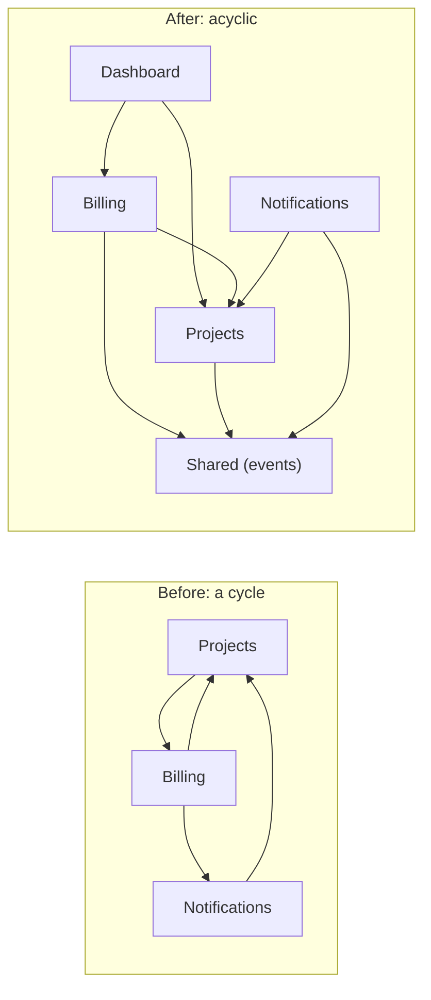
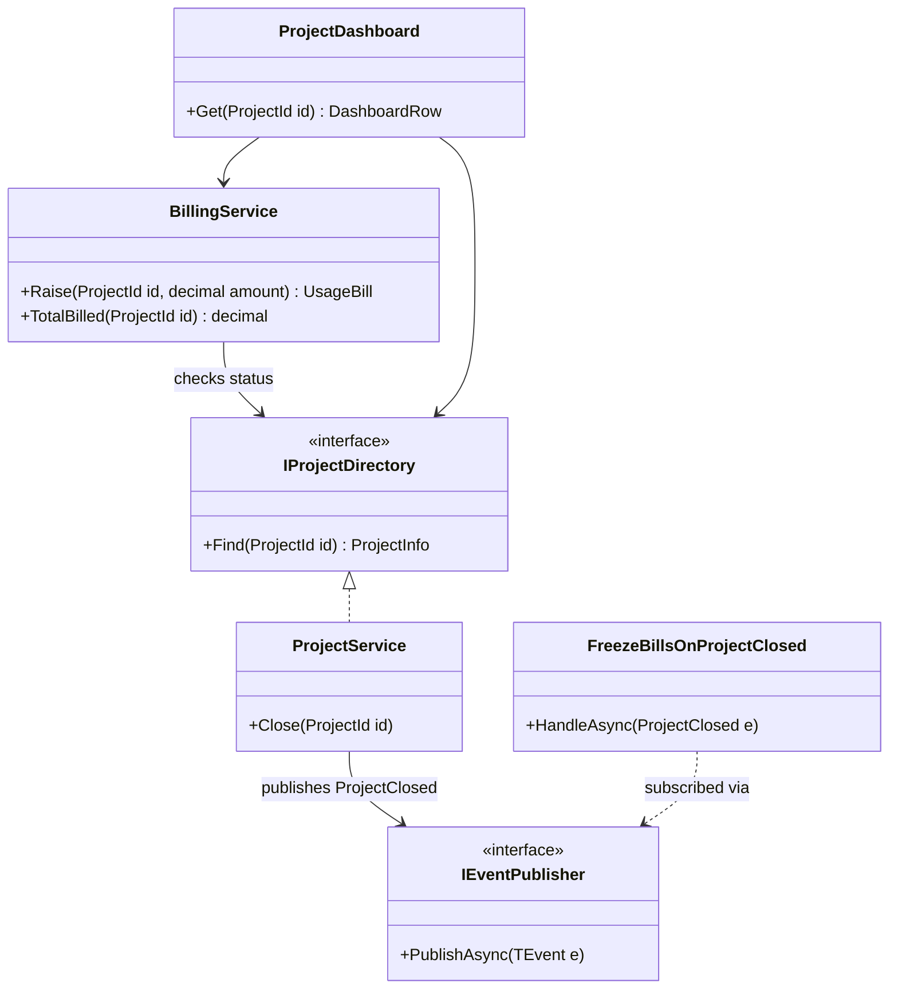
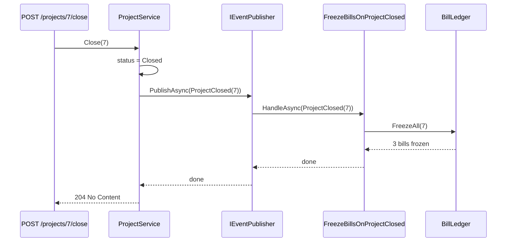

Every time one piece of code uses another, an arrow appears: `BillingService → ProjectService`. Draw all the arrows in a system and you get a **dependency graph**. Most of the time you never look at it. You only notice it when it has a loop in it: two modules that can't be built, tested, deployed or understood without each other. This lesson teaches you to see the graph, measure it, and keep loops out of it.

The running example is **CloudDock**, a small cloud-hosting platform (think of the services where you deploy a website or API and get a monthly bill). Customers create **projects** (a deployed shop front, a booking API), the **Billing** module raises a monthly usage bill against each project, and a **Dashboard** shows a project's status next to what it has been billed so far.

## Learning objectives

By the end of this lesson you will be able to:

1. Model classes, namespaces, modules and services as a directed graph, and explain what an edge means at each level.
2. Explain why cycles hurt: change ripple, test isolation, build and deploy order, initialisation order, and distributed failure.
3. Recognise how .NET reacts to cycles: the DI container's "circular dependency" error, MSBuild's refusal of circular project references, and the cycles C# silently allows inside one project.
4. Break a cycle five ways (invert, extract, lift, publish an event, merge) and pick the right one for the situation.
5. Measure stability (instability metric `I = Ce / (Ca + Ce)`) and apply the Acyclic and Stable Dependencies principles.
6. Write code that detects cycles and computes a safe start-up order (topological sort), and use it in architecture tests.

## Prerequisites

- [Coupling and cohesion](#/lesson/m02-coupling-cohesion): what a dependency costs.
- [Dependency Inversion Principle](#/lesson/m04-dip): the main tool for reversing an arrow.
- [Dependency injection](#/lesson/m03-dependency-injection): how .NET builds object graphs from constructors.

## Explain it like I'm a beginner

Think of a government office where you need two certificates.

The **Revenue office** says: "We'll give you a land certificate once you show us your **No Objection Certificate** from the Municipal office."

The **Municipal office** says: "We'll give you a No Objection Certificate once you show us your **land certificate** from Revenue."

You're stuck. Neither office can act first. That is a **circular dependency**.

Software has the same problem. If class A needs class B to be created, and B needs A, then neither can be created first. If module Projects can't compile without Billing and Billing can't compile without Projects, you can't build, test or release either one alone. Change one, and you must retest both. Over time, more modules get pulled into the loop, and the whole system becomes one big knot (often called a "big ball of mud").

How do offices fix it? A few ways, and they map neatly to software:

1. **One office stops asking for the other's paper and accepts a self-declaration form** with a standard format that both agree on. (Depend on an *interface* instead of the concrete thing: dependency inversion.)
2. **Move the shared check to a third office** both can ask. (Extract a lower-level module.)
3. **A single-window desk** collects both certificates for you, in the right order. (A higher-level coordinator depends on both; neither depends on the other.)
4. **Revenue sends a notification when a certificate is issued**, and Municipal reacts to it. Revenue never asks Municipal for anything. (Publish an event.)
5. **Merge the two counters**, if they were really doing one job. (Merge the modules.)

The rule of thumb that follows: **arrows should flow in one direction**, like water flowing downhill, never in a circle.

## First-principles explanation

### What an edge means

A dependency graph has **nodes** (things) and **directed edges** (A → B means "A uses B", so a change in B may force a change in A). The same idea works at every zoom level:

| Level | Node | A → B when… | Who enforces "no cycles"? |
|---|---|---|---|
| Method | method | A calls B | Nobody (recursion is fine here) |
| Class | type | A's constructor, field, parameter or base type mentions B | DI container, at runtime, for constructor cycles only |
| Namespace / module | folder or namespace | any type in A uses a type in B | Nobody, unless you write architecture tests |
| Project / assembly | `.csproj` | A has a `ProjectReference` to B | MSBuild: circular project references fail the build |
| Service | deployable | A calls B's API synchronously | Nobody, until production |

The interesting cycles are in the middle rows, where nothing stops you by default.

### Why cycles hurt

Every node in a cycle depends, directly or indirectly, on every other node in it. So the cycle behaves like one big component:

1. **Change ripple.** Changing any node may force changes in all the others. A cycle of 6 modules means a change anywhere can touch any of them.
2. **No isolated testing.** To test Billing you need Projects, which needs Billing. Test doubles help at class level, but module-level tests have to load everything.
3. **Build and release order.** You can't build or version the modules separately. Splitting a cycle across assemblies is impossible without breaking it first.
4. **Initialisation order.** Which one starts first? Static initialisers, DI constructors and start-up tasks in a cycle either fail or depend on accidental ordering.
5. **Understanding.** You can't read one without the other, so the cognitive cost is the whole cycle, not one module.
6. **Distributed cycles.** If service A calls B synchronously and B calls A, one slow request can tie up threads in both. Under load, they can exhaust each other's connection pools. Cycles between services are the most expensive kind.

### How .NET reacts

- **DI container.** If `BillingService(ProjectService p)` and `ProjectService(BillingService b)` are both registered, resolving either throws `InvalidOperationException` with a message beginning "A circular dependency was detected for the service of type…". This happens at the first resolve, or at start-up if you enable `ValidateOnBuild`. You'll see it in the playground.
- **MSBuild.** A `ProjectReference` loop between two `.csproj` files is rejected. That's one reason teams split modules into projects: the build enforces direction.
- **Inside one project, nothing.** Two namespaces in one project can reference each other freely. Most real-world cycles live here.

### Principles

**Acyclic Dependencies Principle (ADP)**, from Robert C. Martin: the dependency graph of packages (modules) must have no cycles. If it has one, break it.

**Stable Dependencies Principle (SDP)**: depend in the direction of stability. A module that many others depend on is hard to change ("stable"). It shouldn't depend on a module that changes often.

Stability can be measured. For a module:

- **Ca** (afferent coupling) = number of modules that depend *on* it (incoming arrows).
- **Ce** (efferent coupling) = number of modules it depends *on* (outgoing arrows).
- **Instability I = Ce / (Ca + Ce)**, from 0 (maximally stable: everyone uses it, it uses nothing) to 1 (maximally unstable: it uses others, nobody uses it).

Example: `Shared` is used by 4 modules and uses none: I = 0 / (4 + 0) = 0. `Dashboard` uses 3 modules and nobody uses it: I = 3 / (0 + 3) = 1. SDP says arrows should point from higher I to lower I. An arrow from `Shared` (I = 0) to `Dashboard` (I = 1) is a warning sign: the most-used module now depends on the most volatile one.

**Stable Abstractions Principle (SAP)**: stable modules should be abstract (mostly interfaces and contracts), so they can be extended without being changed. This is why "contracts" projects work well at the bottom of the graph.

### Five ways to break a cycle

Say `Billing → Projects` (billing checks the project is active before charging for it) and `Projects → Billing` (when a customer shuts a project down, its unpaid bills must be frozen so no more reminders or late fees go out).

1. **Invert one arrow (DIP).** Billing defines or uses an interface `IProjectDirectory` that lives with Projects' public contract, and Projects stops calling Billing. Use when one side only needs a narrow capability of the other.
2. **Extract the shared part.** If both depend on the same concept (say, a `ProjectId` and a status enum), move it into a lower module both can use. Use when the cycle exists because of shared data types.
3. **Lift to a higher-level coordinator.** A `ProjectClosureWorkflow` depends on both and calls them in order; neither knows the other. Use when the coupling is a *process* that spans both.
4. **Publish an event.** Projects publishes `ProjectClosed`; Billing subscribes and freezes bills. At code level, Projects depends only on an event-publishing abstraction. Use when the other side's reaction is a consequence, not a precondition, and can happen after the first side commits.
5. **Merge.** If two modules always change together and share most of their data, they are one module drawn as two. Merging removes the cycle honestly.

### Fake fixes

These make the error message go away without removing the cycle:

- **`Lazy<T>` or `Func<T>` injection.** The DI container stops complaining because nothing is resolved at construction. The cycle is still there; it just fails later, or works by luck.
- **Injecting `IServiceProvider`** and resolving the other service inside a method. Same cycle, now invisible to tools and readers (the Service Locator anti-pattern, see [DI vs service locator](#/lesson/m04-di-vs-service-locator)).
- **Property injection or a setter called after construction.** The object is half-built for a moment, and the cycle is hidden from the constructor signature.

There are rare valid uses of `Lazy<T>` (an expensive dependency that's seldom needed), but "to break a cycle" isn't one of them.

### When it doesn't matter

- **Recursion and mutual recursion between methods of one class** are normal algorithms, not design problems.
- **Two tiny classes in one feature folder** that reference each other (a `Order` and its `OrderLine` navigation back to the order) are one unit. A cycle inside a cohesive unit costs little. Worry about cycles *between* units you want to change, test or own separately.
- **Bidirectional object navigation** in a persistence model is a data-shape decision; it is usually better avoided, but it isn't the same as a module cycle.

### Trade-offs of the fixes

| Fix | You gain | You pay |
|---|---|---|
| Invert (interface) | Clear direction; easy to fake in tests | One more abstraction; must decide which side owns it |
| Extract shared module | Removes the root cause for shared types | A new module to name and maintain; can turn into a dumping ground ("Common") |
| Lift to coordinator | Process visible in one place | Coordinator can grow large; may hide domain rules in orchestration |
| Events | Loosest coupling; easy to add more subscribers | Harder to follow the flow; ordering, failure and retry questions; eventual consistency if async |
| Merge | Honest and simple | Larger module; may need splitting differently later |

## Visual explanation

### Module graph: before and after



On the left, Projects, Billing and Notifications form one loop of three, so all three behave like one component. On the right, every arrow flows towards `Shared`, which depends on nothing. `Dashboard` is a new top-level module that reads from both Projects and Billing, which used to be the reason Projects called Billing. Projects no longer knows Billing exists: it publishes `ProjectClosed` through `Shared`, and Billing and Notifications react. You could draw the right-hand graph in layers, with no arrow going upwards.

### Class diagram of the fixed design



Every arrow from Billing points at something Projects or Shared *offers* (`IProjectDirectory`, the event contract). No arrow points from Projects to Billing. The dashboard is the only class that knows about both, and nothing depends on it, so it's at the top of the graph where volatility belongs.

### Sequence: closing a project



At **runtime**, control still flows from Projects to Billing: closing a project ends up freezing bills. At **compile time**, though, the arrow is reversed: Billing's handler depends on the `ProjectClosed` event type that Projects owns. That's the trick behind every event-based fix: the runtime call direction and the source-code dependency direction no longer match. This in-process publisher runs handlers synchronously in the same request. If you later move to a message broker, the handler runs after the request commits, and you must design for retries and eventual consistency.

## Step-by-step example

### Step 1 — the cycle appears

```csharp
public sealed class ProjectService(BillingService billing)
{
    public void Close(int projectId) { /* ... */ billing.FreezeBills(projectId); }
    public decimal BilledSoFar(int projectId) => billing.Total(projectId);  // for the dashboard
}

public sealed class BillingService(ProjectService projects)
{
    public void Raise(int projectId, decimal amount) { /* is the project active? */ }
}
```

Both are registered as scoped services. The first request that needs either one fails with "A circular dependency was detected".

### Step 2 — find out why each arrow exists

Write each edge with its reason:

- `Projects → Billing` because (a) closing must freeze bills, and (b) the dashboard needs totals.
- `Billing → Projects` because raising a bill needs the project status.

Different reasons need different fixes. Don't fix the whole cycle in one move.

### Step 3 — fix each reason

- (b) "dashboard needs totals" is a read model that combines two modules. **Lift** it into a `ProjectDashboard` above both.
- (a) "closing must freeze bills" is a reaction to something that happened. **Publish** `ProjectClosed` and let Billing subscribe.
- `Billing → Projects` is a narrow precondition. Keep it, but **invert** it onto `IProjectDirectory` so Billing depends on a small, stable contract, not on all of `ProjectService`.

### Step 4 — lock it in with a test

Add an architecture test that builds the namespace graph from the compiled assembly and fails if any cycle exists or if Projects references Billing. Without the test, the cycle will come back within months: someone just needs one "quick" call.

## Production-style C# implementation

```text
CloudDock.Api/
  Program.cs
  Shared/Events.cs                 event contracts + in-process publisher
  Projects/Projects.cs             ProjectId, IProjectDirectory, ProjectService, ProjectClosed
  Billing/Billing.cs               BillLedger, BillingService, FreezeBillsOnProjectClosed
  Dashboard/ProjectDashboard.cs    read model above Projects and Billing
  Architecture/DependencyGraph.cs  graph, cycle detection, topological order, namespace scanner
```

```csharp file=Shared/Events.cs
using Microsoft.Extensions.DependencyInjection;

namespace CloudDock.Shared;

public interface IDomainEvent { }

public interface IEventHandler<in TEvent> where TEvent : IDomainEvent
{
    Task HandleAsync(TEvent e, CancellationToken ct);
}

public interface IEventPublisher
{
    Task PublishAsync<TEvent>(TEvent e, CancellationToken ct) where TEvent : IDomainEvent;
}

/// <summary>Runs handlers synchronously, in-process, in registration order. Handlers are resolved at
/// publish time, so publishers never take a constructor dependency on subscribers.</summary>
public sealed class InProcessEventPublisher(IServiceProvider services) : IEventPublisher
{
    public async Task PublishAsync<TEvent>(TEvent e, CancellationToken ct) where TEvent : IDomainEvent
    {
        foreach (var handler in services.GetServices<IEventHandler<TEvent>>())
            await handler.HandleAsync(e, ct);
    }
}
```

This publisher does resolve from `IServiceProvider`, which the previous section called a fake fix. The difference: it is a piece of *infrastructure* whose whole job is dispatch, and the dependency it hides is "handlers of this event type", not a specific domain service. Domain code never touches the provider. That is the same trade-off MediatR-style libraries make.

```csharp file=Projects/Projects.cs
using System.Collections.Concurrent;
using CloudDock.Shared;

namespace CloudDock.Projects;

public readonly record struct ProjectId(int Value);
public enum ProjectStatus { Active, Closed }
public sealed record ProjectInfo(ProjectId Id, string Name, ProjectStatus Status);

/// <summary>Published contract. Other modules may depend on this event type.</summary>
public sealed record ProjectClosed(ProjectId ProjectId, DateTimeOffset ClosedAt) : IDomainEvent;

/// <summary>The narrow capability other modules need: look up a project.</summary>
public interface IProjectDirectory
{
    ProjectInfo? Find(ProjectId id);
}

public sealed class ProjectRepository
{
    private readonly ConcurrentDictionary<ProjectId, ProjectInfo> _items = new(new Dictionary<ProjectId, ProjectInfo>
    {
        [new ProjectId(7)] = new(new ProjectId(7), "FreshCart storefront (Mumbai region)", ProjectStatus.Active),
        [new ProjectId(9)] = new(new ProjectId(9), "Clinic booking API", ProjectStatus.Active),
    });

    public ProjectInfo? Get(ProjectId id) => _items.TryGetValue(id, out var p) ? p : null;
    public void Save(ProjectInfo p) => _items[p.Id] = p;
}

public sealed class ProjectService(ProjectRepository repo, IEventPublisher events, TimeProvider clock) : IProjectDirectory
{
    public ProjectInfo? Find(ProjectId id) => repo.Get(id);

    public async Task CloseAsync(ProjectId id, CancellationToken ct)
    {
        var p = repo.Get(id) ?? throw new KeyNotFoundException($"Project {id.Value} not found.");
        if (p.Status == ProjectStatus.Closed) return;                 // idempotent
        repo.Save(p with { Status = ProjectStatus.Closed });
        await events.PublishAsync(new ProjectClosed(id, clock.GetUtcNow()), ct);
    }
}
```

```csharp file=Billing/Billing.cs
using Microsoft.Extensions.Logging;
using CloudDock.Projects;
using CloudDock.Shared;

namespace CloudDock.Billing;

/// <summary>A monthly usage bill (compute, bandwidth, storage) raised against a hosted project.</summary>
public sealed record UsageBill(int Number, ProjectId Project, decimal Amount, bool Frozen);

public interface IBillingTotals
{
    decimal TotalBilled(ProjectId id);
}

public sealed class BillLedger
{
    private readonly object _gate = new();
    private readonly List<UsageBill> _bills = [];

    public UsageBill Add(ProjectId project, decimal amount)
    {
        lock (_gate)
        {
            var bill = new UsageBill(_bills.Count + 1, project, amount, Frozen: false);
            _bills.Add(bill);
            return bill;
        }
    }

    public IReadOnlyList<UsageBill> For(ProjectId project) { lock (_gate) return _bills.Where(b => b.Project == project).ToList(); }

    public int FreezeAll(ProjectId project)
    {
        lock (_gate)
        {
            var count = 0;
            for (var i = 0; i < _bills.Count; i++)
                if (_bills[i].Project == project && !_bills[i].Frozen) { _bills[i] = _bills[i] with { Frozen = true }; count++; }
            return count;
        }
    }
}

/// <summary>Billing depends on Projects' small contract, never on ProjectService itself.</summary>
public sealed class BillingService(IProjectDirectory projects, BillLedger ledger) : IBillingTotals
{
    public UsageBill Raise(ProjectId id, decimal amount)
    {
        if (amount <= 0) throw new ArgumentOutOfRangeException(nameof(amount));
        var project = projects.Find(id) ?? throw new KeyNotFoundException($"Project {id.Value} not found.");
        if (project.Status != ProjectStatus.Active)
            throw new InvalidOperationException($"Project {id.Value} is closed; no new bills.");
        return ledger.Add(id, amount);
    }

    public decimal TotalBilled(ProjectId id) => ledger.For(id).Sum(b => b.Amount);
}

/// <summary>Billing reacts to Projects' event. Projects doesn't know this class exists.</summary>
public sealed class FreezeBillsOnProjectClosed(BillLedger ledger, ILogger<FreezeBillsOnProjectClosed> logger)
    : IEventHandler<ProjectClosed>
{
    public Task HandleAsync(ProjectClosed e, CancellationToken ct)
    {
        var n = ledger.FreezeAll(e.ProjectId);
        logger.LogInformation("Froze {Count} bills for closed project {ProjectId}", n, e.ProjectId.Value);
        return Task.CompletedTask;
    }
}
```

```csharp file=Dashboard/ProjectDashboard.cs
using CloudDock.Billing;
using CloudDock.Projects;

namespace CloudDock.Dashboard;

public sealed record DashboardRow(int ProjectId, string Name, string Status, decimal TotalBilled);

/// <summary>Top of the graph: depends on two modules, nothing depends on it.</summary>
public sealed class ProjectDashboard(IProjectDirectory projects, IBillingTotals billing)
{
    public DashboardRow? Get(ProjectId id) =>
        projects.Find(id) is { } p ? new DashboardRow(id.Value, p.Name, p.Status.ToString(), billing.TotalBilled(id)) : null;
}
```

```csharp file=Architecture/DependencyGraph.cs
using System.Reflection;

namespace CloudDock.Architecture;

/// <summary>A small directed graph with deterministic cycle detection and topological ordering.</summary>
public sealed class DependencyGraph<T> where T : notnull
{
    private readonly Dictionary<T, SortedSet<T>> _edges;
    private readonly IComparer<T> _order;

    public DependencyGraph(IComparer<T>? order = null)
    {
        _order = order ?? Comparer<T>.Default;
        _edges = new Dictionary<T, SortedSet<T>>();
    }

    public IEnumerable<T> Nodes => _edges.Keys.OrderBy(n => n, _order);
    public IReadOnlyCollection<T> DependenciesOf(T node) => _edges.TryGetValue(node, out var s) ? s : Array.Empty<T>();

    public void AddNode(T node)
    {
        if (!_edges.ContainsKey(node)) _edges[node] = new SortedSet<T>(_order);
    }

    public void AddEdge(T from, T to)
    {
        AddNode(from);
        AddNode(to);
        _edges[from].Add(to);
    }

    /// <summary>Returns one cycle as a path that starts and ends at the same node, or null.</summary>
    public IReadOnlyList<T>? FindCycle()
    {
        var state = new Dictionary<T, int>();          // 0 = unvisited, 1 = on stack, 2 = done
        var stack = new List<T>();

        IReadOnlyList<T>? Visit(T n)
        {
            state[n] = 1;
            stack.Add(n);
            foreach (var m in _edges[n])
            {
                var s = state.GetValueOrDefault(m);
                if (s == 1) return [.. stack.Skip(stack.IndexOf(m)), m];
                if (s == 0 && Visit(m) is { } found) return found;
            }
            stack.RemoveAt(stack.Count - 1);
            state[n] = 2;
            return null;
        }

        foreach (var n in Nodes)
            if (state.GetValueOrDefault(n) == 0 && Visit(n) is { } cycle) return cycle;
        return null;
    }

    /// <summary>Dependencies first (Kahn's algorithm). Throws if the graph has a cycle.</summary>
    public IReadOnlyList<T> DependenciesFirstOrder()
    {
        var remaining = _edges.ToDictionary(kv => kv.Key, kv => kv.Value.Count);
        var dependents = _edges.Keys.ToDictionary(k => k, _ => new List<T>());
        foreach (var (from, tos) in _edges) foreach (var to in tos) dependents[to].Add(from);

        var ready = new SortedSet<T>(remaining.Where(kv => kv.Value == 0).Select(kv => kv.Key), _order);
        var result = new List<T>();
        while (ready.Count > 0)
        {
            var n = ready.Min!;
            ready.Remove(n);
            result.Add(n);
            foreach (var d in dependents[n])
                if (--remaining[d] == 0) ready.Add(d);
        }
        if (result.Count != _edges.Count)
            throw new InvalidOperationException("Dependency cycle: " + string.Join(" -> ", FindCycle() ?? Array.Empty<T>()));
        return result;
    }

    /// <summary>Builds a module graph from constructor parameters: module = first namespace segment under root.</summary>
    public static DependencyGraph<string> FromConstructors(Assembly assembly, string rootNamespace)
    {
        string? ModuleOf(Type t) =>
            t.Namespace is { } ns && ns.StartsWith(rootNamespace + ".", StringComparison.Ordinal)
                ? ns[(rootNamespace.Length + 1)..].Split('.')[0]
                : null;

        var g = new DependencyGraph<string>(StringComparer.Ordinal);
        foreach (var type in assembly.GetTypes())
        {
            if (ModuleOf(type) is not { } from) continue;
            g.AddNode(from);
            foreach (var ctor in type.GetConstructors())
                foreach (var p in ctor.GetParameters())
                    if (ModuleOf(p.ParameterType) is { } to && to != from) g.AddEdge(from, to);
        }
        return g;
    }
}
```

The scanner only follows constructor parameters, which catches the dependencies DI wires up. A complete tool would also follow base types, fields, method signatures and method bodies; libraries such as NetArchTest or ArchUnitNET do this by reading IL. For many teams, constructor-level checks catch most accidental module cycles at a fraction of the effort.

```csharp file=Program.cs
using CloudDock.Architecture;
using CloudDock.Billing;
using CloudDock.Dashboard;
using CloudDock.Projects;
using CloudDock.Shared;

var builder = WebApplication.CreateBuilder(args);

// Fail at start-up, not on the first request, if the graph has a cycle or a captive dependency.
builder.Host.UseDefaultServiceProvider(o => { o.ValidateOnBuild = true; o.ValidateScopes = true; });

builder.Services.AddSingleton(TimeProvider.System);
builder.Services.AddScoped<IEventPublisher, InProcessEventPublisher>();

// Projects module
builder.Services.AddSingleton<ProjectRepository>();
builder.Services.AddScoped<ProjectService>();
builder.Services.AddScoped<IProjectDirectory>(sp => sp.GetRequiredService<ProjectService>());

// Billing module
builder.Services.AddSingleton<BillLedger>();
builder.Services.AddScoped<BillingService>();
builder.Services.AddScoped<IBillingTotals>(sp => sp.GetRequiredService<BillingService>());
builder.Services.AddScoped<IEventHandler<ProjectClosed>, FreezeBillsOnProjectClosed>();

// Dashboard module
builder.Services.AddScoped<ProjectDashboard>();

var app = builder.Build();

app.MapPost("/projects/{id:int}/bills", (int id, decimal amount, BillingService billing) =>
    Results.Ok(billing.Raise(new ProjectId(id), amount)));

app.MapPost("/projects/{id:int}/close", async (int id, ProjectService projects, CancellationToken ct) =>
{
    await projects.CloseAsync(new ProjectId(id), ct);
    return Results.NoContent();
});

app.MapGet("/projects/{id:int}/dashboard", (int id, ProjectDashboard dashboard) =>
    dashboard.Get(new ProjectId(id)) is { } row ? Results.Ok(row) : Results.NotFound());

app.MapGet("/architecture/modules", () =>
{
    var g = DependencyGraph<string>.FromConstructors(typeof(ProjectService).Assembly, "CloudDock");
    return Results.Ok(new
    {
        modules = g.Nodes.ToDictionary(n => n, n => g.DependenciesOf(n)),
        cycle = g.FindCycle(),
    });
});

app.Run();
```

## Bad design vs good design

**Bad**: the Step 1 cycle "fixed" with `Lazy<T>`:

```csharp
public sealed class ProjectService(Lazy<BillingService> billing) { /* billing.Value.FreezeBills(...) */ }
public sealed class BillingService(ProjectService projects) { /* ... */ }
// builder.Services.AddScoped(sp => new Lazy<BillingService>(() => sp.GetRequiredService<BillingService>()));
```

The container is happy. The design isn't:

- Projects still knows about Billing's concrete class, so every Billing change can break Projects.
- Neither module can be tested, moved to its own project or owned by a different team without the other.
- The next person adds `NotificationService(BillingService)` and `BillingService(NotificationService)`, and the knot grows. Each new `Lazy` makes the real graph harder to see.

**Good**: the implementation above. Arrows point one way: `Dashboard → Billing → Projects → Shared`. Each arrow exists for a written reason. An architecture test fails if anyone adds an arrow from Projects to Billing.

**Is it worth it?** For two classes inside one small feature, a cycle you can see in one screen is a mild smell, not an emergency. Breaking it is worth it when the two sides are separate modules, separate teams, or headed for separate deployables, or when the cycle is already pulling in a third module.

:::callout type=tradeoff title="Events are not free"
Replacing a direct call with an event removes a compile-time dependency, but it makes the flow harder to follow ("who reacts to `ProjectClosed`?") and raises new questions: what if a handler fails? Are handlers run in order? Inside one process with synchronous handlers, failures still propagate to the caller. Once events cross a message broker, you need retries, idempotent handlers and an outbox. Use events when the reaction is genuinely a consequence. Use an interface when one side needs an answer *now*.
:::

## Practical playground

This program builds a real `ServiceProvider` with a cycle, shows the exception .NET throws, then builds the fixed version. Try replacing the fix with a `Lazy<T>` and notice that the error disappears while the cycle stays.

:::playground type=csharp title="Watch the DI container catch a cycle"
```csharp file=Program.cs
using System;
using Microsoft.Extensions.DependencyInjection;

namespace Cyclic
{
    public sealed class ProjectService(BillingService billing) { public string Name => "Projects"; }
    public sealed class BillingService(ProjectService projects) { public string Name => "Billing"; }
}

namespace Acyclic
{
    public interface IProjectDirectory { bool IsActive(int id); }
    public sealed class ProjectService : IProjectDirectory { public bool IsActive(int id) => id != 13; }
    public sealed class BillingService(IProjectDirectory projects)
    {
        public string Raise(int projectId, decimal amount) =>
            projects.IsActive(projectId) ? $"Usage bill raised: project {projectId}, ₹{amount:N0}" : $"Project {projectId} is closed";
    }
}

public static class Program
{
    public static void Main()
    {
        var bad = new ServiceCollection();
        bad.AddScoped<Cyclic.ProjectService>();
        bad.AddScoped<Cyclic.BillingService>();
        try
        {
            using var sp = bad.BuildServiceProvider(new ServiceProviderOptions { ValidateOnBuild = true });
            Console.WriteLine("Built?! (should not happen)");
        }
        catch (Exception ex)
        {
            var inner = ex is AggregateException ae ? ae.InnerExceptions[0] : ex;
            Console.WriteLine($"Cyclic graph rejected:\n  {inner.Message}\n");
        }

        var good = new ServiceCollection();
        good.AddScoped<Acyclic.ProjectService>();
        good.AddScoped<Acyclic.IProjectDirectory>(sp => sp.GetRequiredService<Acyclic.ProjectService>());
        good.AddScoped<Acyclic.BillingService>();
        using var provider = good.BuildServiceProvider(new ServiceProviderOptions { ValidateOnBuild = true });
        using var scope = provider.CreateScope();
        var billing = scope.ServiceProvider.GetRequiredService<Acyclic.BillingService>();
        Console.WriteLine(billing.Raise(7, 18_500m));
        Console.WriteLine(billing.Raise(13, 2_400m));
    }
}
```
:::

## Exercises

:::exercise id=m07-dependency-graphs-ex1 difficulty=beginner kind=code title="Find a cycle in a module graph"
Implement `CycleFinder.Find`, which takes a module graph (module → modules it depends on) and returns one cycle as a path that starts and ends with the same module, or `null` if the graph is acyclic.
::requirements
- Visit modules in alphabetical order, and their dependencies in alphabetical order, so the result is deterministic.
- A module that depends on itself is a cycle of length 1: `["A", "A"]`.
- Dependencies that aren't keys in the dictionary are leaf modules (no outgoing edges).
::acceptance
- `Billing → Projects → Billing` returns `["Billing", "Projects", "Billing"]`.
- An acyclic graph returns `null`.
- A three-module loop `A → B → C → A` returns `["A", "B", "C", "A"]`.
- A diamond (`A → B`, `A → C`, `B → D`, `C → D`) is **not** a cycle.
::hint
Plain "visited" tracking isn't enough: in a diamond, D is reached twice without any cycle. What extra state do you need?
::hint
Use three states: unvisited, *in progress* (on the current DFS path), and done. Reaching an in-progress node means you've found a cycle.
::hint
Keep the current path in a list. When you reach an in-progress node `m`, the cycle is the path from `m`'s position to the end, plus `m` again.
::hint
```text
visit(n):
  state[n] = InProgress; path.push(n)
  for m in sorted(deps[n]):
     if state[m] == InProgress: return path[indexOf(m)..] + [m]
     if state[m] == Unvisited and visit(m) found: return it
  path.pop(); state[n] = Done
```
::starter
```csharp file=CycleFinder.cs
using System;
using System.Collections.Generic;
using System.Linq;

public static class CycleFinder
{
    public static IReadOnlyList<string>? Find(IReadOnlyDictionary<string, string[]> graph) =>
        throw new NotImplementedException();
}
```
::tests
```csharp file=CycleFinderTests.cs
using System.Collections.Generic;
using Xunit;

public class CycleFinderTests
{
    [Fact]
    public void Two_module_cycle()
    {
        var g = new Dictionary<string, string[]> { ["Projects"] = new[] { "Billing" }, ["Billing"] = new[] { "Projects" } };
        Assert.Equal(new[] { "Billing", "Projects", "Billing" }, CycleFinder.Find(g));
    }

    [Fact]
    public void Acyclic_returns_null()
    {
        var g = new Dictionary<string, string[]> { ["Dashboard"] = new[] { "Billing", "Projects" }, ["Billing"] = new[] { "Projects", "Shared" }, ["Projects"] = new[] { "Shared" } };
        Assert.Null(CycleFinder.Find(g));
    }

    [Fact]
    public void Three_module_cycle()
    {
        var g = new Dictionary<string, string[]> { ["A"] = new[] { "B" }, ["B"] = new[] { "C" }, ["C"] = new[] { "A" } };
        Assert.Equal(new[] { "A", "B", "C", "A" }, CycleFinder.Find(g));
    }

    [Fact]
    public void Diamond_is_not_a_cycle()
    {
        var g = new Dictionary<string, string[]> { ["A"] = new[] { "C", "B" }, ["B"] = new[] { "D" }, ["C"] = new[] { "D" } };
        Assert.Null(CycleFinder.Find(g));
    }

    [Fact]
    public void Self_loop()
    {
        var g = new Dictionary<string, string[]> { ["A"] = new[] { "A" } };
        Assert.Equal(new[] { "A", "A" }, CycleFinder.Find(g));
    }

    [Fact]
    public void Cycle_not_reachable_from_first_node()
    {
        var g = new Dictionary<string, string[]> { ["A"] = new[] { "Z" }, ["M"] = new[] { "N" }, ["N"] = new[] { "M" } };
        Assert.Equal(new[] { "M", "N", "M" }, CycleFinder.Find(g));
    }
}
```
::solution
```csharp file=CycleFinder.cs
using System;
using System.Collections.Generic;
using System.Linq;

public static class CycleFinder
{
    private enum State { Unvisited, InProgress, Done }

    public static IReadOnlyList<string>? Find(IReadOnlyDictionary<string, string[]> graph)
    {
        var state = new Dictionary<string, State>(StringComparer.Ordinal);
        var path = new List<string>();

        IEnumerable<string> Deps(string n) =>
            graph.TryGetValue(n, out var d) ? d.OrderBy(x => x, StringComparer.Ordinal) : Enumerable.Empty<string>();

        List<string>? Visit(string n)
        {
            state[n] = State.InProgress;
            path.Add(n);
            foreach (var m in Deps(n))
            {
                var s = state.GetValueOrDefault(m);
                if (s == State.InProgress) return [.. path.Skip(path.IndexOf(m)), m];
                if (s == State.Unvisited && Visit(m) is { } found) return found;
            }
            path.RemoveAt(path.Count - 1);
            state[n] = State.Done;
            return null;
        }

        foreach (var n in graph.Keys.OrderBy(x => x, StringComparer.Ordinal))
            if (state.GetValueOrDefault(n) == State.Unvisited && Visit(n) is { } cycle) return cycle;
        return null;
    }
}
```

The "in progress" state is what separates a cycle from a diamond. In a diamond, D is already *done* when it's reached the second time, so it's skipped. The run time is O(V + E): each module and each edge is processed once.
::mistakes
- Using a single `visited` set, which reports diamonds as cycles.
- Starting only from the first key, which misses cycles in disconnected parts of the graph.
- Iterating a `Dictionary` without sorting, so the reported cycle changes between runs.
::extensions
Return *all* elementary cycles, or better, the strongly connected components (Tarjan's algorithm). Each component with more than one module is a knot you need to untie.
:::

:::exercise id=m07-dependency-graphs-ex2 difficulty=beginner kind=code title="Compute instability and flag SDP violations"
Implement `Stability.Instability`, returning `I = Ce / (Ca + Ce)` for every module, and `Stability.Violations`, returning each edge that points from a more stable module to a less stable one (`I(from) < I(to)`), which breaks the Stable Dependencies Principle.
::requirements
- Every module that appears as a key or as a dependency is included.
- A module with no edges at all has I = 0.
- Return violations as `"From->To"` strings, sorted ordinally.
- Use `double` for I (it's a ratio, not money), rounded to 2 decimals.
::acceptance
- In `Dashboard → {Billing, Projects}`, `Billing → {Projects, Shared}`, `Projects → {Shared}`: I(Shared) = 0, I(Projects) = 0.33, I(Billing) = 0.67, I(Dashboard) = 1.
- That graph has no violations.
- Adding `Shared → Dashboard` makes `Shared->Dashboard` a violation.
::hint
Count outgoing edges (Ce) from the dictionary values, and incoming edges (Ca) by walking all edges and counting the targets.
::hint
Collect every module name first: keys plus all dependency names. Initialise both counters to 0 for each.
::hint
`I = Ca + Ce == 0 ? 0 : (double)Ce / (Ca + Ce)`, then `Math.Round(I, 2)`.
::hint
For violations, loop over every edge `(from, to)` and keep it when `I[from] < I[to]`.
::starter
```csharp file=Stability.cs
using System;
using System.Collections.Generic;
using System.Linq;

public static class Stability
{
    public static IReadOnlyDictionary<string, double> Instability(IReadOnlyDictionary<string, string[]> graph) =>
        throw new NotImplementedException();

    public static IReadOnlyList<string> Violations(IReadOnlyDictionary<string, string[]> graph) =>
        throw new NotImplementedException();
}
```
::tests
```csharp file=StabilityTests.cs
using System.Collections.Generic;
using Xunit;

public class StabilityTests
{
    private static Dictionary<string, string[]> Layered() => new()
    {
        ["Dashboard"] = new[] { "Billing", "Projects" },
        ["Billing"] = new[] { "Projects", "Shared" },
        ["Projects"] = new[] { "Shared" },
    };

    [Fact]
    public void Instability_values()
    {
        var i = Stability.Instability(Layered());
        Assert.Equal(0.0, i["Shared"]);
        Assert.Equal(0.33, i["Projects"]);
        Assert.Equal(0.67, i["Billing"]);
        Assert.Equal(1.0, i["Dashboard"]);
    }

    [Fact] public void Layered_graph_has_no_violations() => Assert.Empty(Stability.Violations(Layered()));

    [Fact]
    public void Shared_depending_on_dashboard_is_a_violation()
    {
        var g = Layered();
        g["Shared"] = new[] { "Dashboard" };
        Assert.Contains("Shared->Dashboard", Stability.Violations(g));
    }

    [Fact]
    public void Isolated_module_is_zero()
    {
        var g = new Dictionary<string, string[]> { ["Lonely"] = new string[0] };
        Assert.Equal(0.0, Stability.Instability(g)["Lonely"]);
    }
}
```
::solution
```csharp file=Stability.cs
using System;
using System.Collections.Generic;
using System.Linq;

public static class Stability
{
    private static IEnumerable<(string From, string To)> Edges(IReadOnlyDictionary<string, string[]> g) =>
        g.SelectMany(kv => kv.Value.Distinct().Select(to => (kv.Key, to)));

    public static IReadOnlyDictionary<string, double> Instability(IReadOnlyDictionary<string, string[]> graph)
    {
        var modules = graph.Keys.Concat(graph.Values.SelectMany(v => v)).Distinct(StringComparer.Ordinal);
        var ca = modules.ToDictionary(m => m, _ => 0, StringComparer.Ordinal);
        var ce = ca.ToDictionary(kv => kv.Key, _ => 0, StringComparer.Ordinal);
        foreach (var (from, to) in Edges(graph)) { ce[from]++; ca[to]++; }
        return ca.Keys.ToDictionary(
            m => m,
            m => ca[m] + ce[m] == 0 ? 0.0 : Math.Round((double)ce[m] / (ca[m] + ce[m]), 2),
            StringComparer.Ordinal);
    }

    public static IReadOnlyList<string> Violations(IReadOnlyDictionary<string, string[]> graph)
    {
        var i = Instability(graph);
        return Edges(graph).Where(e => i[e.From] < i[e.To])
                           .Select(e => $"{e.From}->{e.To}")
                           .OrderBy(s => s, StringComparer.Ordinal)
                           .ToList();
    }
}
```

Note what the metric doesn't tell you: whether a module is *supposed* to be stable. A `Shared` module with I = 0 and lots of concrete code is a problem waiting to happen (hard to change *and* not abstract). Pair instability with "abstractness" (share of interfaces and abstract types) to find modules in Martin's "zone of pain".
::mistakes
- Counting duplicate edges twice (`Billing → Projects` listed two times).
- Forgetting modules that only appear as dependencies, which then throws `KeyNotFoundException`.
- Integer division: `ce / (ca + ce)` with `int`s gives 0 for everything but fully unstable modules.
:::

:::exercise id=m07-dependency-graphs-ex3 difficulty=intermediate kind=code title="Start-up order for modules"
A modular monolith runs each module's database migrations and seeders at start-up. A module must start only after the modules it depends on. Implement `StartupPlanner.Order` with Kahn's algorithm: return modules dependencies-first, breaking ties alphabetically, and throw `CircularDependencyException` (with the modules left unscheduled) if there's a cycle.
::acceptance
- `Dashboard → Billing, Projects`; `Billing → Projects`; `Projects → Shared` gives `Shared, Projects, Billing, Dashboard`.
- Independent modules are ordered alphabetically: `{Audit, Shared}` with no edges gives `Audit, Shared`.
- `A → B → A` with `C` independent throws, and the exception's `Remaining` contains exactly `A` and `B`.
- Unknown dependency names (not keys) are treated as modules with no dependencies.
::hint
Kahn's algorithm: repeatedly pick a node with no *unscheduled* dependencies.
::hint
For each module keep a count of unscheduled dependencies. Also build the reverse map: for each module, who depends on it.
::hint
Keep the "ready" modules in a `SortedSet<string>` so you always take the alphabetically smallest one.
::hint
When the ready set is empty but some modules are unscheduled, those leftovers are in or behind a cycle. Put them in the exception.
::starter
```csharp file=StartupPlanner.cs
using System;
using System.Collections.Generic;
using System.Linq;

public sealed class CircularDependencyException(IReadOnlyList<string> remaining)
    : Exception("Circular dependency among: " + string.Join(", ", remaining))
{
    public IReadOnlyList<string> Remaining { get; } = remaining;
}

public static class StartupPlanner
{
    public static IReadOnlyList<string> Order(IReadOnlyDictionary<string, string[]> dependsOn) =>
        throw new NotImplementedException();
}
```
::tests
```csharp file=StartupPlannerTests.cs
using System.Collections.Generic;
using Xunit;

public class StartupPlannerTests
{
    [Fact]
    public void Dependencies_first()
    {
        var g = new Dictionary<string, string[]>
        {
            ["Dashboard"] = new[] { "Billing", "Projects" },
            ["Billing"] = new[] { "Projects" },
            ["Projects"] = new[] { "Shared" },
        };
        Assert.Equal(new[] { "Shared", "Projects", "Billing", "Dashboard" }, StartupPlanner.Order(g));
    }

    [Fact]
    public void Ties_alphabetical()
    {
        var g = new Dictionary<string, string[]> { ["Shared"] = new string[0], ["Audit"] = new string[0] };
        Assert.Equal(new[] { "Audit", "Shared" }, StartupPlanner.Order(g));
    }

    [Fact]
    public void Cycle_throws_with_remaining()
    {
        var g = new Dictionary<string, string[]> { ["A"] = new[] { "B" }, ["B"] = new[] { "A" }, ["C"] = new string[0] };
        var ex = Assert.Throws<CircularDependencyException>(() => StartupPlanner.Order(g));
        Assert.Equal(new[] { "A", "B" }, ex.Remaining);
    }

    [Fact]
    public void Unknown_dependency_is_a_leaf()
    {
        var g = new Dictionary<string, string[]> { ["Billing"] = new[] { "Identity" } };
        Assert.Equal(new[] { "Identity", "Billing" }, StartupPlanner.Order(g));
    }
}
```
::solution
```csharp file=StartupPlanner.cs
using System;
using System.Collections.Generic;
using System.Linq;

public sealed class CircularDependencyException(IReadOnlyList<string> remaining)
    : Exception("Circular dependency among: " + string.Join(", ", remaining))
{
    public IReadOnlyList<string> Remaining { get; } = remaining;
}

public static class StartupPlanner
{
    public static IReadOnlyList<string> Order(IReadOnlyDictionary<string, string[]> dependsOn)
    {
        var modules = dependsOn.Keys.Concat(dependsOn.Values.SelectMany(v => v)).Distinct(StringComparer.Ordinal).ToList();
        var pending = modules.ToDictionary(m => m,
            m => dependsOn.TryGetValue(m, out var d) ? d.Distinct(StringComparer.Ordinal).Count() : 0, StringComparer.Ordinal);
        var dependents = modules.ToDictionary(m => m, _ => new List<string>(), StringComparer.Ordinal);
        foreach (var (m, deps) in dependsOn)
            foreach (var d in deps.Distinct(StringComparer.Ordinal)) dependents[d].Add(m);

        var ready = new SortedSet<string>(pending.Where(kv => kv.Value == 0).Select(kv => kv.Key), StringComparer.Ordinal);
        var order = new List<string>(modules.Count);
        while (ready.Count > 0)
        {
            var next = ready.Min!;
            ready.Remove(next);
            order.Add(next);
            foreach (var dep in dependents[next])
                if (--pending[dep] == 0) ready.Add(dep);
        }

        if (order.Count < modules.Count)
            throw new CircularDependencyException(modules.Except(order).OrderBy(m => m, StringComparer.Ordinal).ToList());
        return order;
    }
}
```

`Remaining` can include modules that aren't *in* the cycle but depend on it. If `D → A` and `A ↔ B`, D is also left over. Combine this with a cycle finder to tell the user exactly which arrows form the loop.
::mistakes
- Reversing the edge direction, which returns `Dashboard` first.
- Using a `Queue` without sorting, so start-up order depends on dictionary iteration order and changes between machines.
- Running a full DFS cycle check on every iteration, making the algorithm O(V × (V + E)).
:::

:::exercise id=m07-dependency-graphs-ex4 difficulty=intermediate kind=design title="Untie a seller-payout-notification knot"
In an online marketplace where independent sellers list products and receive payouts for their sales, three services call each other:

- `SellerService` calls `PayoutService.HasPendingPayouts(sellerId)` before it allows a seller to be suspended.
- `PayoutService` calls `SellerService.GetBankAccount(sellerId)` when releasing a payout, and `NotificationService.Send(...)` after a payout.
- `NotificationService` calls `SellerService.GetContact(sellerId)` to find the phone number.

Redesign the classes in the LLD designer so the class graph is acyclic. For each arrow you remove or reverse, note which technique you used and why.
::acceptance
- No cycle among the classes in your diagram.
- Each original need is still met (suspension check, bank account for payouts, contact for notifications, a notification after a payout).
- At least two different cycle-breaking techniques are used, each justified.
- No `Lazy<T>`, `IServiceProvider` or property injection used to break a cycle.
::hint
Draw the current graph first: you'll find two loops, Seller ↔ Payouts and Payouts → Notification → Seller → Payouts.
::hint
Which arrows need an *answer right now* (preconditions) and which are *reactions* (things that happen after)? The notification after a payout is a reaction.
::hint
Bank account and contact details are both "seller profile" data. A narrow read contract (`ISellerDirectory`) can serve both Payouts and Notifications.
::hint
"Can this seller be suspended?" needs facts from two modules. That's a policy above both, or Payouts can expose a narrow query that Sellers depends on—but then Payouts can't depend on Sellers. Pick one direction and put the other need behind the extracted directory.
::starter
```json file=design.json
{
  "classes": [
    { "id": "Con", "name": "SellerService", "kind": "class", "fields": [], "methods": ["+void Suspend(int id)", "+BankAccount GetBankAccount(int id)", "+Contact GetContact(int id)"] },
    { "id": "Pay", "name": "PayoutService", "kind": "class", "fields": [], "methods": ["+bool HasPendingPayouts(int id)", "+void ReleasePayout(int payoutId)"] },
    { "id": "Notif", "name": "NotificationService", "kind": "class", "fields": [], "methods": ["+void Send(int sellerId, string text)"] }
  ],
  "relations": [
    { "from": "Con", "to": "Pay", "kind": "dependency", "label": "HasPendingPayouts" },
    { "from": "Pay", "to": "Con", "kind": "dependency", "label": "GetBankAccount" },
    { "from": "Pay", "to": "Notif", "kind": "dependency", "label": "Send" },
    { "from": "Notif", "to": "Con", "kind": "dependency", "label": "GetContact" }
  ]
}
```
::solution
```json file=design.json
{
  "classes": [
    { "id": "Dir", "name": "ISellerDirectory", "kind": "interface", "fields": [], "methods": ["+BankAccount GetBankAccount(int id)", "+Contact GetContact(int id)"], "responsibility": "Extracted read contract for seller profile data" },
    { "id": "Prof", "name": "SellerProfileStore", "kind": "class", "fields": [], "methods": [], "responsibility": "Owns seller master data; implements the directory" },
    { "id": "Con", "name": "SellerService", "kind": "class", "fields": [], "methods": ["+void Suspend(int id)"], "responsibility": "Seller lifecycle; asks a policy before suspending" },
    { "id": "Pol", "name": "ISuspensionPolicy", "kind": "interface", "fields": [], "methods": ["+bool CanSuspend(int id)"], "responsibility": "Owned by Sellers: what Sellers needs to know" },
    { "id": "OutPol", "name": "NoPendingPayoutsPolicy", "kind": "class", "fields": [], "methods": ["+bool CanSuspend(int id)"], "responsibility": "Payouts-side adapter implementing the Sellers-owned port" },
    { "id": "Pay", "name": "PayoutService", "kind": "class", "fields": [], "methods": ["+void ReleasePayout(int payoutId)", "+bool HasPendingPayouts(int id)"], "responsibility": "Payouts to sellers" },
    { "id": "Pub", "name": "IEventPublisher", "kind": "interface", "fields": [], "methods": ["+Task PublishAsync(TEvent e)"] },
    { "id": "Evt", "name": "PayoutReleased", "kind": "record", "fields": ["+int SellerId", "+decimal Amount", "+DateTimeOffset At"], "methods": [], "responsibility": "Event published by Payouts" },
    { "id": "Notif", "name": "PayoutNotificationHandler", "kind": "class", "fields": [], "methods": ["+Task HandleAsync(PayoutReleased e)"], "responsibility": "Notifications reacts to Payouts's event" },
    { "id": "Sms", "name": "ISmsSender", "kind": "interface", "fields": [], "methods": ["+Task SendAsync(string phone, string text)"] }
  ],
  "relations": [
    { "from": "Prof", "to": "Dir", "kind": "implements" },
    { "from": "Con", "to": "Prof", "kind": "dependency", "label": "owns profile" },
    { "from": "Con", "to": "Pol", "kind": "dependency" },
    { "from": "OutPol", "to": "Pol", "kind": "implements" },
    { "from": "OutPol", "to": "Pay", "kind": "dependency" },
    { "from": "Pay", "to": "Dir", "kind": "dependency", "label": "bank account" },
    { "from": "Pay", "to": "Pub", "kind": "dependency" },
    { "from": "Pay", "to": "Evt", "kind": "dependency", "label": "publishes" },
    { "from": "Notif", "to": "Evt", "kind": "dependency", "label": "handles" },
    { "from": "Notif", "to": "Dir", "kind": "dependency", "label": "contact" },
    { "from": "Notif", "to": "Sms", "kind": "dependency" }
  ]
}
```

Techniques used:

1. **Extract** (`ISellerDirectory` + `SellerProfileStore`): bank account and contact are profile data that Payouts and Notifications both read. Pulling them into a low-level read contract removes `Payouts → SellerService` and `Notification → SellerService`.
2. **Invert** (`ISuspensionPolicy`): Sellers owns the question it needs answered and depends only on its own interface. Payouts provides `NoPendingPayoutsPolicy`, the implementation. The arrow that used to be `Seller → Payouts` is now `Payouts adapter → Sellers port`.
3. **Event** (`PayoutReleased`): notifying after a payout is a reaction, so Payouts publishes and Notifications subscribes. Payouts no longer knows notifications exist.

Check the result: Payouts → Directory, Payouts → Publisher; Notifications → Event, Directory; Sellers → Policy (its own), ProfileStore; the policy adapter → Payouts. No path leads back to where it started.
::alternatives
A `SuspendSellerWorkflow` above both modules (lift) is equally valid for the suspension check, especially if more checks are coming (open customer complaints, counterfeit-product reports). Choose the policy port if Sellers should own the rule; choose the workflow if the rule is cross-cutting and owned by a process team.
::mistakes
- Moving everything into one `SellerPayoutService`. That removes the cycle by creating a god class.
- Making Notifications depend on Payouts to look up the seller. That adds a new edge instead of extracting the shared data.
- Using an event for the suspension check. The caller needs an answer *before* it acts, so a query is required.
:::

:::exercise id=m07-dependency-graphs-ex5 difficulty=advanced kind=code title="Detect DI cycles hidden behind Lazy and Func"
The DI container catches direct constructor cycles, but not those hidden behind `Lazy<T>`, `Func<T>` or `IEnumerable<T>`. Write `DiGraphScanner.FindCycle`, which takes service registrations (service type → implementation type), builds a graph from each implementation's constructor, *unwraps* those wrapper types, and returns one cycle of service types, or `null`.
::requirements
- For each implementation, use the public constructor with the most parameters.
- A parameter of type `Lazy<T>`, `Func<T>` or `IEnumerable<T>` is a dependency on `T`.
- Only follow parameter types that are registered services; ignore others (e.g. `string`, `ILogger<T>` if unregistered).
- Return the cycle as a list of service types that starts and ends with the same type. Visit services in order of `Type.FullName`.
::acceptance
- `A(B)`, `B(A)` → cycle `[A, B, A]`.
- `A(Lazy<B>)`, `B(A)` → still a cycle.
- `A(Func<B>)`, `B(IEnumerable<C>)`, `C(A)` → cycle of three.
- An acyclic registration set returns `null`.
- Unregistered parameter types (like `string`) are ignored.
::hint
Start by writing `Unwrap(Type t)`: if `t` is generic and its definition is `Lazy<>`, `Func<>` or `IEnumerable<>`, return the generic argument; otherwise return `t`.
::hint
Build `Dictionary<Type, List<Type>>`: for each `(service, impl)`, take `impl.GetConstructors()`, choose the one with the most parameters, unwrap each parameter type, keep those that are keys in the registrations.
::hint
Then reuse the three-state DFS from exercise 1, with `Type` instead of `string`. Sort by `FullName` for determinism.
::hint
`t.IsGenericType && t.GetGenericTypeDefinition() == typeof(Lazy<>)` is the check. `typeof(Func<>)` is the one-argument `Func<TResult>`.
::starter
```csharp file=DiGraphScanner.cs
using System;
using System.Collections.Generic;
using System.Linq;

public static class DiGraphScanner
{
    public static Type Unwrap(Type t) => throw new NotImplementedException();

    public static IReadOnlyList<Type>? FindCycle(IReadOnlyDictionary<Type, Type> registrations) =>
        throw new NotImplementedException();
}
```
::tests
```csharp file=DiGraphScannerTests.cs
using System;
using System.Collections.Generic;
using Xunit;

namespace Direct { public sealed class A(B b) { } public sealed class B(A a) { } }
namespace Lazy1 { public sealed class A(Lazy<B> b) { } public sealed class B(A a) { } }
namespace Three { public sealed class A(Func<B> b) { } public sealed class B(IEnumerable<C> cs) { } public sealed class C(A a) { } }
namespace Fine
{
    public interface IRepo { }
    public sealed class Repo(string connectionString) : IRepo { }
    public sealed class Service(IRepo repo, Lazy<IRepo> lazy) { }
    public sealed class Api(Service s) { }
}

public class DiGraphScannerTests
{
    private static Dictionary<Type, Type> Self(params Type[] types)
    {
        var d = new Dictionary<Type, Type>();
        foreach (var t in types) d[t] = t;
        return d;
    }

    [Fact]
    public void Direct_cycle() =>
        Assert.Equal(new[] { typeof(Direct.A), typeof(Direct.B), typeof(Direct.A) }, DiGraphScanner.FindCycle(Self(typeof(Direct.A), typeof(Direct.B))));

    [Fact]
    public void Lazy_does_not_hide_the_cycle() =>
        Assert.NotNull(DiGraphScanner.FindCycle(Self(typeof(Lazy1.A), typeof(Lazy1.B))));

    [Fact]
    public void Three_way_through_func_and_enumerable()
    {
        var cycle = DiGraphScanner.FindCycle(Self(typeof(Three.A), typeof(Three.B), typeof(Three.C)));
        Assert.Equal(new[] { typeof(Three.A), typeof(Three.B), typeof(Three.C), typeof(Three.A) }, cycle);
    }

    [Fact]
    public void Acyclic_with_interfaces_returns_null()
    {
        var regs = new Dictionary<Type, Type>
        {
            [typeof(Fine.IRepo)] = typeof(Fine.Repo),
            [typeof(Fine.Service)] = typeof(Fine.Service),
            [typeof(Fine.Api)] = typeof(Fine.Api),
        };
        Assert.Null(DiGraphScanner.FindCycle(regs));
    }

    [Fact]
    public void Unwrap_handles_wrappers()
    {
        Assert.Equal(typeof(string), DiGraphScanner.Unwrap(typeof(Lazy<string>)));
        Assert.Equal(typeof(string), DiGraphScanner.Unwrap(typeof(Func<string>)));
        Assert.Equal(typeof(string), DiGraphScanner.Unwrap(typeof(IEnumerable<string>)));
        Assert.Equal(typeof(List<string>), DiGraphScanner.Unwrap(typeof(List<string>)));
    }
}
```
::solution
```csharp file=DiGraphScanner.cs
using System;
using System.Collections.Generic;
using System.Linq;

public static class DiGraphScanner
{
    private static readonly Type[] Wrappers = { typeof(Lazy<>), typeof(Func<>), typeof(IEnumerable<>) };

    public static Type Unwrap(Type t) =>
        t.IsGenericType && Wrappers.Contains(t.GetGenericTypeDefinition()) ? t.GetGenericArguments()[0] : t;

    public static IReadOnlyList<Type>? FindCycle(IReadOnlyDictionary<Type, Type> registrations)
    {
        var byName = Comparer<Type>.Create((x, y) => string.CompareOrdinal(x.FullName, y.FullName));
        var edges = new Dictionary<Type, List<Type>>();
        foreach (var (service, impl) in registrations)
        {
            var ctor = impl.GetConstructors().OrderByDescending(c => c.GetParameters().Length).FirstOrDefault();
            edges[service] = ctor is null
                ? new List<Type>()
                : ctor.GetParameters().Select(p => Unwrap(p.ParameterType))
                      .Where(registrations.ContainsKey).Distinct().OrderBy(t => t, byName).ToList();
        }

        var state = new Dictionary<Type, int>();   // 0 unvisited, 1 in progress, 2 done
        var path = new List<Type>();

        List<Type>? Visit(Type n)
        {
            state[n] = 1;
            path.Add(n);
            foreach (var m in edges[n])
            {
                var s = state.GetValueOrDefault(m);
                if (s == 1) return [.. path.Skip(path.IndexOf(m)), m];
                if (s == 0 && Visit(m) is { } found) return found;
            }
            path.RemoveAt(path.Count - 1);
            state[n] = 2;
            return null;
        }

        foreach (var n in edges.Keys.OrderBy(t => t, byName))
            if (state.GetValueOrDefault(n) == 0 && Visit(n) is { } cycle) return cycle;
        return null;
    }
}
```

In a real project, feed this from your `IServiceCollection`: each `ServiceDescriptor` with an `ImplementationType` gives one `(ServiceType, ImplementationType)` pair. Run it in a test and fail the build on any cycle, including the ones `Lazy<T>` was hiding.
::alternatives
Factory registrations (`ImplementationFactory`) can't be scanned this way because their dependencies are inside a lambda. Either avoid factories for domain services or describe their dependencies explicitly. IL-based tools (NetArchTest, ArchUnitNET) can scan method bodies too, at the cost of a package dependency.
::mistakes
- Treating `Lazy<B>` as a dependency on `Lazy<B>` (an unregistered type), so the cycle disappears.
- Picking `GetConstructors()[0]`; reflection doesn't guarantee constructor order.
- Following unregistered types like `string`, which explodes the graph with BCL types.
::extensions
Detect *captive dependencies* too: a singleton whose graph reaches a scoped service. Add lifetimes to the input and report the path from the singleton to the scoped service.
:::

## Automated testing

Unit tests protect behaviour. **Architecture tests** protect the shape of the graph. They're ordinary xUnit tests that inspect the compiled assembly:

```csharp
public class ArchitectureTests
{
    private static readonly DependencyGraph<string> Modules =
        DependencyGraph<string>.FromConstructors(typeof(ProjectService).Assembly, "CloudDock");

    [Fact]
    public void Module_graph_is_acyclic() => Assert.Null(Modules.FindCycle());

    [Theory]
    [InlineData("Projects", "Billing")]
    [InlineData("Projects", "Dashboard")]
    [InlineData("Billing", "Dashboard")]
    [InlineData("Shared", "Projects")]
    public void Forbidden_dependency(string from, string to) =>
        Assert.DoesNotContain(to, Modules.DependenciesOf(from));

    [Fact]
    public void Start_up_order_is_defined() =>
        Assert.Equal(new[] { "Architecture", "Shared", "Projects", "Billing", "Dashboard" }, Modules.DependenciesFirstOrder());

    [Fact]
    public void Container_has_no_cycles_or_captive_dependencies()
    {
        var builder = WebApplication.CreateBuilder();
        // ... same registrations as Program.cs (extract them to an AddCloudDock() extension method)
        using var sp = builder.Services.BuildServiceProvider(new ServiceProviderOptions { ValidateOnBuild = true, ValidateScopes = true });
    }
}
```

Practical tips:

- Move registrations into one extension method per module (`AddBilling()`, `AddProjects()`), so tests and `Program.cs` build the same graph.
- Write forbidden edges as data (`[InlineData]`), so the allowed architecture is readable in one place.
- Keep architecture tests fast (milliseconds); run them in every CI build.
- When a test fails, the message should name the cycle (`Projects -> Billing -> Projects`), not just say "false".
- Unit-test the graph algorithms themselves (exercises 1, 3 and 5), including diamonds, self-loops and disconnected parts.

## Real-world application

- **Modular monoliths** in .NET often put each module in its own project, with a `Contracts` project per module for its public interfaces and events. MSBuild then enforces direction for free, because circular project references don't build.
- **Clean / onion architecture** is an explicit dependency rule: Web → Application → Domain, Infrastructure → Application. Repositories are interfaces in the inner layer, implemented in the outer layer, which is DIP used to keep the graph pointing inwards. See [Clean and onion architecture](#/lesson/m02-clean-onion).
- **Package managers** (NuGet, npm) and build systems (MSBuild, Bazel) all run topological sorts to decide build and restore order, and refuse or warn on cycles.
- **Database migrations and seed data**: tables with foreign keys must be created and seeded in dependency order. Mutually referencing tables are a cycle that needs a nullable column or a deferred constraint, the database version of breaking a cycle.
- **Microservices**: synchronous call cycles between services (A → B → A) amplify latency and failures. Teams break them with events, by moving data ownership, or by merging services that were split too finely.
- **Task trackers and CI pipelines** model work the same way: Jira-style "blocked by" links, GitHub Actions `needs:` between jobs and Azure Pipelines stage dependencies must form an acyclic graph, and the tools reject or flag loops before scheduling anything.


## Interview questions

:::interview
::q beginner
What is a circular dependency, and why is it a problem?
::a
It's a loop in the "uses" graph: A depends on B and B depends (directly or indirectly) on A. Everything in the loop behaves like one component: you can't build, test, deploy or understand one part alone, and changes ripple around the loop. In .NET, a constructor cycle makes the DI container throw "A circular dependency was detected"; a project-reference cycle fails the build; namespace cycles inside one project compile silently and grow over time.
::q beginner
Name three ways to break a cycle between two classes.
::a
(1) Dependency inversion: one side depends on an interface that describes only what it needs, and the other side implements it, removing the concrete back-reference. (2) Extract the shared part into a third, lower-level class or module both use. (3) Replace a "tell the other side" call with an event the other side subscribes to. Also: lift the cross-cutting process into a coordinator above both, or merge the two if they're really one concept.
::q intermediate
Why is injecting `Lazy<T>` to resolve a circular dependency considered a bad fix?
::a
It satisfies the container by deferring resolution, but the dependency is still there: both classes still know each other's concrete types, they still can't be tested or deployed separately, and the cycle is now hidden from the constructor signature and from tools. It can also fail later at runtime, or create subtle ordering bugs. Injecting `IServiceProvider` or using property injection has the same problem. Fix the design instead: invert, extract, publish an event, lift or merge.
::q intermediate
Explain the instability metric and the Stable Dependencies Principle.
::a
For a module, Ca is the number of incoming dependencies and Ce the number of outgoing. Instability I = Ce / (Ca + Ce): 0 means everyone depends on it and it depends on nothing (stable, hard to change), 1 means it depends on others and nobody depends on it (unstable, easy to change). SDP says depend in the direction of stability: arrows should go from higher I to lower I. A stable shared module depending on a volatile feature module is a red flag, because every change in the feature module now threatens everything built on the shared one.
::q advanced
How would you introduce rules to stop new cycles in a large existing codebase that already has many?
::a
Measure first: build the module graph (from project references, namespaces or IL) and list the strongly connected components. Freeze the current state with an architecture test that fails on *new* cycles or new forbidden edges, using an allow-list of existing violations. Then break the worst knots one reason at a time: write down why each edge exists, and pick invert, extract, lift, event or merge per reason. Move modules into separate projects as their cycles disappear, so MSBuild enforces direction. Shrink the allow-list over time, and treat any addition to it as a design review.
::q advanced
Two microservices call each other synchronously: Orders calls Inventory to reserve stock, and Inventory calls Orders to check if an order is still valid before releasing reservations. What are the risks, and how would you redesign?
::a
Risks: latency adds up across the loop; under load, threads or connections in both services wait on each other and can exhaust pools; a failure in one cascades to both; neither can be deployed or scaled independently; contract changes need coordinated releases. Redesign: make one direction asynchronous. Orders publishes `OrderCancelled` / `OrderExpired` events and Inventory releases reservations when it receives them, instead of asking Orders. Reservations get a TTL as a safety net. Keep the synchronous call only where an immediate answer is needed (Orders → Inventory to reserve). Use an outbox in Orders for reliable publishing and make Inventory's handler idempotent.
:::

## Summary and revision

**Key takeaways**

- A dependency graph is "who uses whom". Look at it at class, module, project and service level.
- Cycles turn several parts into one: change, test, build and deploy them together. Distributed cycles are the costliest.
- .NET catches constructor cycles (DI) and project-reference cycles (MSBuild), but not namespace or `Lazy<T>`-hidden cycles.
- Break cycles by reason: invert (interface), extract (shared lower module), lift (coordinator above), event (reaction), or merge.
- Depend towards stability: `I = Ce / (Ca + Ce)`, arrows from higher I to lower I. Stable modules should be abstract.
- Lock the graph in with architecture tests and topological ordering, and enable `ValidateOnBuild`.

**Terminology**: dependency graph, directed edge, cycle, strongly connected component, Acyclic Dependencies Principle, Stable Dependencies Principle, afferent/efferent coupling, instability, topological sort, Kahn's algorithm, architecture test, domain event, composition root.

:::flashcards
Q: What does an edge A → B mean in a dependency graph?
A: A uses B, so a change in B may force a change in A.
Q: What does .NET's DI container do with a constructor cycle?
A: Throws InvalidOperationException ("A circular dependency was detected…") on resolve, or at build time with ValidateOnBuild.
Q: Formula for instability?
A: I = Ce / (Ca + Ce), where Ce = outgoing dependencies and Ca = incoming dependencies.
Q: State the Stable Dependencies Principle.
A: Depend in the direction of stability — arrows go from less stable (higher I) to more stable (lower I) modules.
Q: Five ways to break a cycle?
A: Invert with an interface, extract a shared lower module, lift into a coordinator, publish an event, or merge.
Q: Why is Lazy<T> a fake fix for a cycle?
A: It defers resolution but leaves both classes coupled; the cycle is hidden, not removed.
Q: What algorithm gives a dependencies-first order?
A: A topological sort, e.g. Kahn's algorithm; it fails if the graph has a cycle.
Q: Cycle vs diamond in DFS?
A: A cycle reaches a node still on the current path ("in progress"); a diamond reaches a node already finished.
:::

## Knowledge check

:::quiz pass=70
::q single
`ProjectService` calls `BillingService` to freeze bills when a project closes, and `BillingService` calls `ProjectService` to check status before raising a bill. Which fix removes the cycle while keeping both behaviours?
- [ ] Inject `Lazy<BillingService>` into `ProjectService`.
- [x] Projects publishes `ProjectClosed` and Billing handles it; Billing depends on a narrow `IProjectDirectory` contract.
- [ ] Make both services singletons.
- [ ] Use property injection in `BillingService`.
> The event reverses the compile-time arrow for the reaction, and the narrow interface keeps the precondition check in one direction. The other options hide the cycle.
::q single
Which kind of cycle does the C# toolchain NOT catch by default?
- [ ] Two `.csproj` files referencing each other.
- [ ] Two DI-registered classes whose constructors require each other.
- [x] Two namespaces in the same project that use each other's types.
- [ ] None; all are caught.
> MSBuild rejects project-reference cycles and the DI container rejects constructor cycles. Namespace cycles inside one assembly compile fine; you need architecture tests.
::q single
Module `Shared` has Ca = 6 and Ce = 0. Module `Reports` has Ca = 0 and Ce = 4. A developer adds `Shared → Reports`. What does SDP say?
- [ ] It's fine; Shared is stable.
- [x] It's a violation: a maximally stable module (I = 0) now depends on a maximally unstable one (I = 1).
- [ ] It's fine as long as there's no cycle.
- [ ] SDP only applies to microservices.
> Every change to Reports can now ripple into Shared and through it to six modules.
::q multi
Which are legitimate ways to break a dependency cycle? (Select all that apply.)
- [x] Extract the shared types into a lower-level module.
- [x] Introduce a coordinator that depends on both sides.
- [ ] Resolve the other service from `IServiceProvider` inside a method.
- [x] Merge two modules that always change together.
> Resolving from the service provider is the Service Locator anti-pattern and leaves the cycle in place.
::q single
A DFS over a module graph marks nodes "visited" with a single boolean, and reports a cycle when it meets a visited node. What bug will it have?
- [ ] It will miss self-loops.
- [x] It will report diamonds (A→B→D, A→C→D) as cycles.
- [ ] It will run forever.
- [ ] It will miss cycles of length 3.
> A node reached again after it finished is not a cycle. You need an "in progress" state to tell the difference.
::q single
Your start-up code runs each module's migrations. Which ordering is correct?
- [ ] Alphabetical by module name.
- [ ] Reverse registration order.
- [x] A topological order with dependencies first.
- [ ] Random, as long as all run.
> A module's tables may reference tables of modules it depends on, so those must exist first.
::q single
When is a small cycle between two classes acceptable?
- [ ] Never.
- [x] When both are part of one small cohesive unit that is always changed and tested together.
- [ ] When one of them is `sealed`.
- [ ] When the DI container doesn't complain.
> The cost of a cycle comes from coupling things you want to change, test or own separately. Inside one cohesive unit, it costs little.
:::

## Completion criteria

You have finished this lesson when you can:

- [ ] Score at least 70 % on the knowledge check.
- [ ] Complete exercises 1 and 2. Your downloaded project's `dotnet test` should pass.
- [ ] Complete at least one of exercises 3–5 and compare your answer with the solution.
- [ ] Draw the module graph of a project you work on, mark any cycles, and say which of the five techniques you would use for each.
