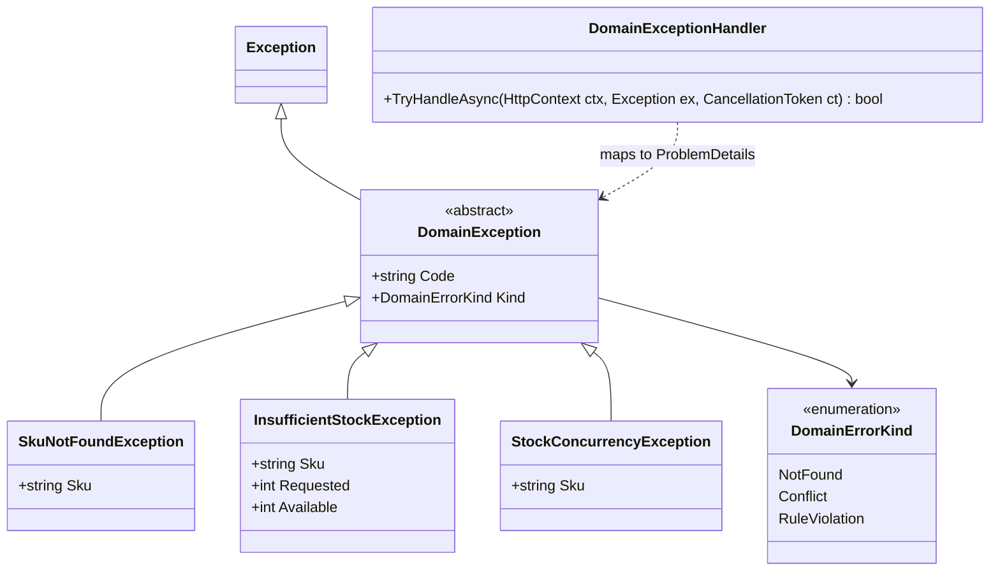
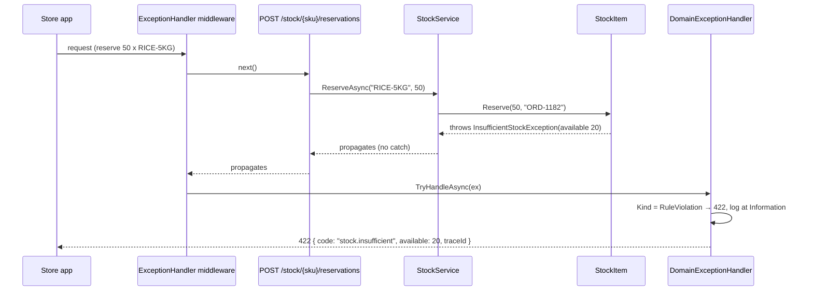
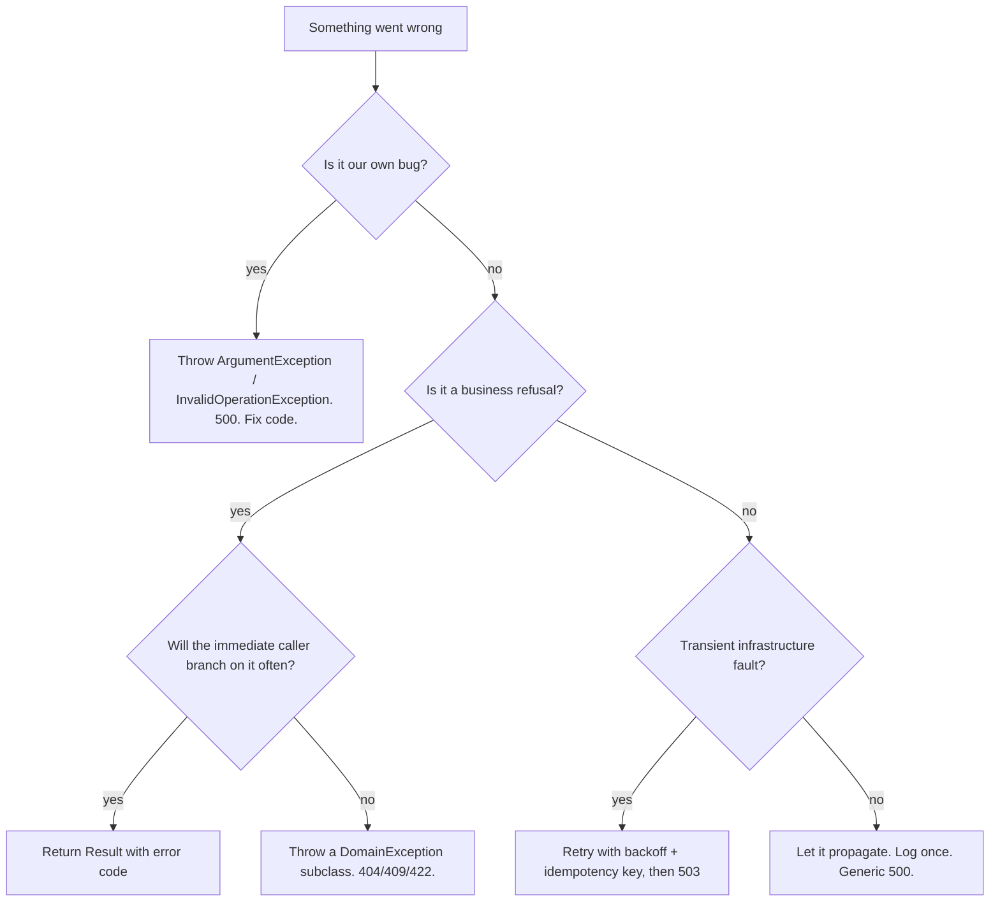

Every system fails. What separates a robust system from a fragile one is whether its failures are *expected, named and handled in the right place*. This lesson gives you a vocabulary for failures, shows how to model business failures as domain exceptions or results, and how to turn all of them into clean API responses.

## Learning objectives

By the end of this lesson you will be able to:

1. Classify a failure as a **bug**, a **business refusal** or an **infrastructure fault**, and know who should handle each.
2. Design a small domain exception hierarchy with stable error codes and useful data.
3. Choose between throwing an exception and returning a `Result` for a given operation.
4. Map exceptions to RFC 9457 Problem Details centrally with `IExceptionHandler`, without leaking stack traces or internal messages.
5. Write correct `catch` code: `throw;` not `throw ex;`, exception filters with `when`, wrapping with an inner exception, and never swallowing.
6. Retry only transient faults, safely, with idempotency and cancellation.

## Prerequisites

- [Validation and business rules](#/lesson/m07-validation-rules): where rules live and how they are reported.
- [Domain modeling](#/lesson/m07-domain-modeling): aggregates that protect their invariants.

## Explain it like I'm a beginner

Think of a kirana store owner in Lucknow taking orders over the phone. Three very different things can go wrong:

1. **The owner makes a mistake.** He writes "-5 kg rice" on the order slip. That is nobody's fault but his own, and the fix is to be more careful. In software, this is a **bug** (programmer error).
2. **The customer asks for something the shop can't do.** "Send 50 kg of basmati" — but only 20 kg is in stock. Nothing is broken. The shop politely refuses and says why: *"Only 20 kg available."* This is a **business refusal** (a domain error).
3. **Something outside fails.** The delivery boy's scooter breaks down, or the phone line drops. The order itself is fine; the world got in the way. Maybe trying again in ten minutes works. This is an **infrastructure fault**, often **transient** (temporary).

Each needs a different response:

- Bugs: fix the code. Shouting at the customer won't help.
- Business refusals: tell the customer exactly what happened, in their terms, so they can choose something else.
- Infrastructure faults: try again a bit later; if it keeps failing, apologise without blaming the customer.

In .NET, all three are often thrown as exceptions, and a common mistake is to handle them the same way — for example by catching *everything* and returning "Something went wrong", or by retrying a refusal that will never succeed.

## First-principles explanation

### What an exception is

An exception is a way for a method to say "I could not do what you asked, and I'm not going to return normally." The runtime unwinds the call stack, running `finally` blocks and `Dispose` calls, until some `catch` block that matches the exception type handles it. If nothing catches it, the request (or the process) fails.

Exceptions have real strengths:

- They **can't be ignored** by accident. An error code in a return value can.
- They carry **context**: type, message, stack trace, inner exception, custom properties.
- They separate the **happy path** from error handling, so a method that calls five others doesn't need five `if (error) return error;` lines.

And real costs:

- Throwing and catching is far slower than a normal return — roughly microseconds rather than nanoseconds, as a rough order of magnitude. Irrelevant for a 400 response once in a while; significant if you throw thousands per second as normal control flow.
- They are **invisible in signatures**. Nothing in `Reserve(string sku, int qty)` tells you it may throw `InsufficientStockException`.

### Three kinds of failure

| | Bug (programmer error) | Business refusal (domain error) | Infrastructure fault |
|---|---|---|---|
| **Example** | Null argument, negative quantity passed by our own code, impossible state | Not enough stock, refund window closed, booking expired | Database timeout, payment gateway 503, network reset |
| **Who caused it** | Our code | The request, given the current state | The environment |
| **Expected?** | No | Yes — part of normal business | Yes, occasionally |
| **Typical .NET type** | `ArgumentException`, `ArgumentNullException`, `InvalidOperationException` | Your own `DomainException` subclasses, or a `Result` | `TimeoutException`, `HttpRequestException`, `DbException`, your `TransientGatewayException` |
| **Handle by** | Fix the code; log as error; 500 | Tell the caller precisely; 404/409/422; log as info/warning | Retry if transient and safe; else 503; log as warning/error |
| **Retry?** | Never helps | Never helps | Sometimes helps |

This table is the core of the lesson. Most error-handling bugs are a failure of one kind treated as another.

### Domain exceptions

A **domain exception** names a business refusal in the language of the domain: `InsufficientStockException`, not `InvalidOperationException("not enough")`. A good one:

- **Derives from a common base** (`DomainException`) so the API layer can recognise "this is a business refusal, safe to show the user" in one `catch`.
- **Has a stable `Code`** (`stock.insufficient`) for clients to branch on. Messages are for humans and may change.
- **Carries data** (`Sku`, `Requested`, `Available`) so the API can show "Only 20 available" and logs can be searched.
- **States its kind** — not found, conflict, rule violation — so mapping to HTTP status is mechanical.
- Is **specific but not too specific**. One class per *distinct reaction* the caller might need. If callers would handle `ShelfLifeExceededException` and `BatchRecalledException` identically, one `StockUnavailableException` with a reason code may be better.

Keep the hierarchy shallow — one base and a flat list of concrete types is usually enough.

### Exceptions or results?

The [Result pattern](#/lesson/m06-options-result) returns success or failure as a value: `Result<Reservation>`. The caller must look at it.

| Prefer exceptions when | Prefer `Result` when |
|---|---|
| Failure is rare relative to success | Failure is a common, expected outcome (a search with no match, a coupon that doesn't apply) |
| The caller usually can't do anything locally and the error should travel up to the API | The immediate caller will branch on the outcome |
| You want the happy path to read cleanly through several layers | You want the possibility of failure visible in the signature |
| Bugs and infrastructure faults (always exceptions) | Performance-sensitive loops where failures are frequent |

Many codebases use **both**: domain methods throw domain exceptions for refusals that end the request, and offer `Try...` variants that return a result where a caller wants to branch — just as .NET offers `int.Parse` and `int.TryParse`. What you should avoid is *mixing styles randomly* for the same kind of failure.

### Handling exceptions correctly

**Catch only what you can handle.** A `catch` block must do something meaningful: retry, use a fallback, add context and rethrow, or translate to a response. Catching to log and rethrow at every layer produces the same error logged five times.

**Rethrow with `throw;`**, never `throw ex;`. `throw ex;` resets the stack trace to the current line, destroying the most useful information about where the error happened.

**Wrap with context, keeping the cause.** When translating an infrastructure exception into something meaningful, pass the original as the inner exception: `throw new PaymentGatewayUnavailableException("Gateway X timed out after 3 attempts", ex);`.

**Use exception filters** (`catch (X ex) when (condition)`) to catch only the cases you want. The filter runs *before* the stack unwinds, so unmatched exceptions keep their full context, and you avoid catch-and-rethrow.

**Never swallow.** An empty `catch { }` turns a visible failure into silent data corruption.

**Let cancellation through.** `OperationCanceledException` means the caller gave up (the user closed the tab, the app is shutting down). It is not an error to log loudly or retry. Filter it out: `catch (Exception ex) when (ex is not OperationCanceledException)`.

**Clean up with `using`/`finally`**, not with `catch`. Cleanup must run on success too.

### Translating to HTTP in one place

The domain should know nothing about HTTP status codes. A single **exception handler** at the edge maps kinds to statuses:

| Exception | Status | Body |
|---|---|---|
| `DomainException` with kind NotFound | 404 | Problem Details with `code` |
| `DomainException` with kind Conflict | 409 | Problem Details with `code` |
| `DomainException` with kind RuleViolation | 422 | Problem Details with `code` and data |
| `OperationCanceledException` | 499 (client closed) or no response | — |
| Anything else | 500 | Generic title, a trace id, **no** internal message or stack trace |

ASP.NET Core 8 and later provide `IExceptionHandler` for exactly this. You register handlers with `AddExceptionHandler<T>()`, add `AddProblemDetails()`, and call `UseExceptionHandler()`. Each handler returns `true` if it handled the exception; otherwise the next one (or the default 500) runs.

The rule for 500s: **never leak internals**. An exception message such as `"Npgsql: password authentication failed for user stock_rw"` tells an attacker your database, user name and that authentication is the weak point. Log it with a trace id; return the trace id to the client.

### Retrying transient faults

A transient fault (timeout, 503, connection reset) may succeed on a second attempt. Safe retries need:

1. **Only transient errors.** Never retry a `PaymentDeclinedException` — the bank said no.
2. **Idempotency.** If the first attempt actually succeeded but the response was lost, the retry must not charge twice. Send the same idempotency key on every attempt.
3. **Backoff with jitter.** Wait 200 ms, 400 ms, 800 ms (plus a little randomness) so a thousand clients don't retry in lockstep.
4. **A limit**, then a clear failure (`PaymentGatewayUnavailableException` → 503).
5. **Respect cancellation** between attempts.

In production you would typically use `Microsoft.Extensions.Http.Resilience` (built on Polly) for HTTP calls. Exercise 5 builds a small retry decorator by hand so you see the mechanics.

### When this is overkill

A small internal tool can throw `InvalidOperationException` with a clear message and let the default handler return 500 — if the only user is the developer, a domain hierarchy adds little. Introduce domain exceptions when external clients need to react differently to different refusals.

## Visual explanation

### The exception hierarchy



One abstract base, a flat set of concrete exceptions, and a kind enum. `DomainExceptionHandler` depends only on the base and the kind, so a new domain exception needs no change to the HTTP mapping. Each concrete class carries the data a client needs to explain the refusal, such as `Available` for insufficient stock.

### From a thrown exception to a response



Notice who does **not** catch: the service and the endpoint let the exception pass, because they can't do anything useful with it. Only the edge translates it. Had this been a database timeout, `DomainExceptionHandler` would return `false`, and the default handler would produce a generic 500 with a trace id, while the full exception is logged as an error.

### Throw or return?



Walk down the questions in order. The answer tells you both the mechanism (throw or return) and the response (status and logging level).

## Step-by-step example

### Step 1 — the generic version

```csharp
public void Reserve(string sku, int qty)
{
    var item = _db.Find(sku) ?? throw new Exception("not found");
    if (item.OnHand - item.Reserved < qty) throw new Exception("Not enough stock");
    item.Reserved += qty;
}

// in the controller
try { _stock.Reserve(sku, qty); return Ok(); }
catch (Exception ex) { _log.LogError(ex, "error"); return StatusCode(500, ex.Message); }
```

Everything is `Exception`. The client gets 500 for "out of stock", which tells it to retry — it never will succeed. The message for a real database failure ("connection refused to 10.0.3.14") goes straight to the client. Every refusal is logged as an error, so the on-call engineer's dashboard is full of noise.

### Step 2 — name the failures

Write the list: SKU not found (404), not enough stock (422), concurrent update conflict (409), database down (503/500), bad arguments from our own code (500, bug).

### Step 3 — a base class and specific exceptions

`DomainException` with `Code` and `Kind`; `SkuNotFoundException`, `InsufficientStockException(sku, requested, available)`, `StockConcurrencyException`.

### Step 4 — stop catching in the middle

Delete the `try/catch` in the endpoint. Let exceptions travel to the edge.

### Step 5 — one handler at the edge

`DomainExceptionHandler : IExceptionHandler` maps kinds to statuses and writes Problem Details with `code` and the exception's data. Everything else falls through to a generic 500.

### Step 6 — a `Try` variant where callers branch

The "suggest alternatives" screen asks "can I reserve 50?" for many SKUs. Throwing for each "no" would be noisy and slow, so `StockItem.TryReserve` returns a `Result`.

## Production-style C# implementation

```text
Inventory.Api/
  Program.cs
  Domain/DomainException.cs
  Domain/Result.cs
  Domain/StockItem.cs
  Application/StockService.cs
  Web/DomainExceptionHandler.cs
```

```csharp file=Domain/DomainException.cs
namespace Inventory.Domain;

public enum DomainErrorKind { NotFound, Conflict, RuleViolation }

/// <summary>Base for business refusals. Safe to show to clients: message and data contain no internals.</summary>
public abstract class DomainException : Exception
{
    protected DomainException(string code, string message, Exception? inner = null) : base(message, inner)
    {
        Code = code;
    }

    /// <summary>Stable, documented, never reused for a different meaning.</summary>
    public string Code { get; }
    public abstract DomainErrorKind Kind { get; }

    /// <summary>Extra fields for the Problem Details body. Must not contain secrets or internal ids.</summary>
    public virtual IReadOnlyDictionary<string, object?> Details => new Dictionary<string, object?>();
}

public sealed class SkuNotFoundException(string sku)
    : DomainException("stock.sku_not_found", $"SKU {sku} does not exist.")
{
    public string Sku { get; } = sku;
    public override DomainErrorKind Kind => DomainErrorKind.NotFound;
    public override IReadOnlyDictionary<string, object?> Details => new Dictionary<string, object?> { ["sku"] = Sku };
}

public sealed class InsufficientStockException(string sku, int requested, int available)
    : DomainException("stock.insufficient", $"Only {available} of {sku} available; {requested} requested.")
{
    public string Sku { get; } = sku;
    public int Requested { get; } = requested;
    public int Available { get; } = available;
    public override DomainErrorKind Kind => DomainErrorKind.RuleViolation;
    public override IReadOnlyDictionary<string, object?> Details =>
        new Dictionary<string, object?> { ["sku"] = Sku, ["requested"] = Requested, ["available"] = Available };
}

public sealed class StockConcurrencyException(string sku)
    : DomainException("stock.concurrent_update", $"Stock for {sku} was changed by another request. Please retry.")
{
    public string Sku { get; } = sku;
    public override DomainErrorKind Kind => DomainErrorKind.Conflict;
}
```

```csharp file=Domain/Result.cs
namespace Inventory.Domain;

public sealed record DomainError(string Code, string Message);

/// <summary>Success with a value, or failure with a DomainError. Never both.</summary>
public readonly struct Result<T>
{
    private readonly T? _value;

    private Result(T? value, DomainError? error)
    {
        _value = value;
        Error = error;
    }

    public DomainError? Error { get; }
    public bool IsSuccess => Error is null;

    public T Value => IsSuccess
        ? _value!
        : throw new InvalidOperationException($"Cannot read Value of a failed result ({Error!.Code}).");

    public static Result<T> Ok(T value) => new(value, null);
    public static Result<T> Fail(string code, string message) => new(default, new DomainError(code, message));

    public Result<TOut> Map<TOut>(Func<T, TOut> map) =>
        IsSuccess ? Result<TOut>.Ok(map(_value!)) : Result<TOut>.Fail(Error!.Code, Error.Message);
}
```

```csharp file=Domain/StockItem.cs
namespace Inventory.Domain;

public sealed record Reservation(Guid Id, string Sku, int Quantity, string OrderRef);

public sealed class StockItem
{
    private readonly List<Reservation> _reservations = [];

    public StockItem(string sku, int onHand)
    {
        ArgumentException.ThrowIfNullOrWhiteSpace(sku);
        ArgumentOutOfRangeException.ThrowIfNegative(onHand);
        Sku = sku;
        OnHand = onHand;
    }

    public string Sku { get; }
    public int OnHand { get; private set; }
    public int Reserved => _reservations.Sum(r => r.Quantity);
    public int Available => OnHand - Reserved;
    public int Version { get; private set; }

    /// <summary>Throws for refusals: used by checkout, where a refusal ends the request.</summary>
    public Reservation Reserve(int quantity, string orderRef)
    {
        // Bug guards: our own callers should never pass these.
        ArgumentOutOfRangeException.ThrowIfNegativeOrZero(quantity);
        ArgumentException.ThrowIfNullOrWhiteSpace(orderRef);

        if (quantity > Available) throw new InsufficientStockException(Sku, quantity, Available);
        return AddReservation(quantity, orderRef);
    }

    /// <summary>Returns a result: used where callers branch on "no" often (alternatives screen, bulk planning).</summary>
    public Result<Reservation> TryReserve(int quantity, string orderRef)
    {
        ArgumentOutOfRangeException.ThrowIfNegativeOrZero(quantity);
        return quantity > Available
            ? Result<Reservation>.Fail("stock.insufficient", $"Only {Available} of {Sku} available.")
            : Result<Reservation>.Ok(AddReservation(quantity, orderRef));
    }

    public void Release(Guid reservationId)
    {
        if (_reservations.RemoveAll(r => r.Id == reservationId) > 0) Version++;
    }

    private Reservation AddReservation(int quantity, string orderRef)
    {
        var r = new Reservation(Guid.NewGuid(), Sku, quantity, orderRef);
        _reservations.Add(r);
        Version++;
        return r;
    }
}
```

`Reserve` throws `ArgumentOutOfRangeException` for a zero quantity — that's a *bug* in our caller, since the input validator should already have rejected it — and `InsufficientStockException` for a refusal. Two different kinds, two different types.

```csharp file=Application/StockService.cs
using System.Collections.Concurrent;
using Inventory.Domain;
using Microsoft.Extensions.Logging;

namespace Inventory.Application;

public interface IStockRepository
{
    Task<StockItem?> FindAsync(string sku, CancellationToken ct);
    /// <summary>Throws StockConcurrencyException if the stored version differs from expectedVersion.</summary>
    Task SaveAsync(StockItem item, int expectedVersion, CancellationToken ct);
}

public sealed class InMemoryStockRepository : IStockRepository
{
    private readonly ConcurrentDictionary<string, (StockItem Item, int Version)> _rows = new(StringComparer.OrdinalIgnoreCase);

    public void Seed(StockItem item) => _rows[item.Sku] = (item, item.Version);

    public Task<StockItem?> FindAsync(string sku, CancellationToken ct) =>
        Task.FromResult(_rows.TryGetValue(sku, out var row) ? row.Item : null);

    public Task SaveAsync(StockItem item, int expectedVersion, CancellationToken ct)
    {
        var current = _rows[item.Sku];
        if (current.Version != expectedVersion || !_rows.TryUpdate(item.Sku, (item, item.Version), current))
            throw new StockConcurrencyException(item.Sku);
        return Task.CompletedTask;
    }
}

public sealed class StockService(IStockRepository repository, ILogger<StockService> logger)
{
    private const int MaxConflictRetries = 3;

    public async Task<Reservation> ReserveAsync(string sku, int quantity, string orderRef, CancellationToken ct)
    {
        for (var attempt = 1; ; attempt++)
        {
            var item = await repository.FindAsync(sku, ct) ?? throw new SkuNotFoundException(sku);
            var expected = item.Version;
            var reservation = item.Reserve(quantity, orderRef);   // may throw InsufficientStockException: let it go
            try
            {
                await repository.SaveAsync(item, expected, ct);
                return reservation;
            }
            // Filter: only conflicts, only while attempts remain. Anything else propagates untouched.
            catch (StockConcurrencyException) when (attempt < MaxConflictRetries)
            {
                logger.LogDebug("Concurrent update on {Sku}, attempt {Attempt}; reloading", sku, attempt);
            }
        }
    }

    /// <summary>Planning screen: many "no" answers are normal, so answer with values, never exceptions.</summary>
    public async Task<IReadOnlyList<StockCheck>> CheckAsync(IEnumerable<(string Sku, int Quantity)> lines, CancellationToken ct)
    {
        var answers = new List<StockCheck>();
        foreach (var (sku, qty) in lines)
        {
            var item = await repository.FindAsync(sku, ct);
            if (item is null) { answers.Add(new StockCheck(sku, false, "stock.sku_not_found")); continue; }
            var ok = qty <= item.Available;
            answers.Add(new StockCheck(sku, ok, ok ? null : "stock.insufficient"));
        }
        return answers;
    }
}

public sealed record StockCheck(string Sku, bool CanReserve, string? Reason);
```

The `catch ... when (attempt < MaxConflictRetries)` filter is the key line. On the third conflict the filter is false, the exception is *not* caught, and it reaches the edge as a 409 with its original stack trace intact. No `catch`/`throw;` dance is needed.

One caveat about the demo repository: it hands the *same* `StockItem` object to every caller, so it only illustrates the version check. A real repository (EF Core with a concurrency token, for example PostgreSQL's `xmin` system column) loads a fresh copy per request, so a reservation added before a failed save is simply thrown away with that copy, and the retry starts clean.


```csharp file=Web/DomainExceptionHandler.cs
using Inventory.Domain;
using Microsoft.AspNetCore.Diagnostics;
using Microsoft.AspNetCore.Mvc;
using Microsoft.Extensions.Logging;

namespace Inventory.Web;

/// <summary>The single place that turns domain refusals into HTTP. Returns false for everything else,
/// so the default handler produces a generic 500 without internal details.</summary>
public sealed class DomainExceptionHandler(IProblemDetailsService problemDetails, ILogger<DomainExceptionHandler> logger)
    : IExceptionHandler
{
    public async ValueTask<bool> TryHandleAsync(HttpContext httpContext, Exception exception, CancellationToken cancellationToken)
    {
        if (exception is not DomainException domain) return false;

        var status = domain.Kind switch
        {
            DomainErrorKind.NotFound => StatusCodes.Status404NotFound,
            DomainErrorKind.Conflict => StatusCodes.Status409Conflict,
            _ => StatusCodes.Status422UnprocessableEntity,
        };

        // Refusals are normal business: log at Information, not Error, to keep alerts meaningful.
        logger.LogInformation("Domain refusal {Code} on {Path}: {Message}", domain.Code, httpContext.Request.Path, domain.Message);

        var problem = new ProblemDetails
        {
            Status = status,
            Title = domain.Kind switch
            {
                DomainErrorKind.NotFound => "Not found",
                DomainErrorKind.Conflict => "Conflict",
                _ => "Request refused by business rules",
            },
            Detail = domain.Message,
            Type = $"https://errors.example.com/{domain.Code}",
        };
        problem.Extensions["code"] = domain.Code;
        foreach (var (key, value) in domain.Details) problem.Extensions[key] = value;

        httpContext.Response.StatusCode = status;
        return await problemDetails.TryWriteAsync(new ProblemDetailsContext
        {
            HttpContext = httpContext,
            ProblemDetails = problem,
            Exception = exception,
        });
    }
}
```

```csharp file=Program.cs
using Inventory.Application;
using Inventory.Domain;
using Inventory.Web;

var builder = WebApplication.CreateBuilder(args);

// AddProblemDetails adds traceId to every problem response and formats the default 500.
builder.Services.AddProblemDetails();
builder.Services.AddExceptionHandler<DomainExceptionHandler>();

var repository = new InMemoryStockRepository();
repository.Seed(new StockItem("RICE-5KG", onHand: 20));
repository.Seed(new StockItem("ATTA-10KG", onHand: 120));
builder.Services.AddSingleton<IStockRepository>(repository);
builder.Services.AddScoped<StockService>();

var app = builder.Build();

app.UseExceptionHandler();   // uses the registered IExceptionHandler(s), then the default ProblemDetails 500
app.UseStatusCodePages();    // empty 4xx/5xx responses also get a ProblemDetails body

app.MapPost("/stock/{sku}/reservations", async (string sku, int quantity, string orderRef, StockService svc, CancellationToken ct) =>
{
    var reservation = await svc.ReserveAsync(sku, quantity, orderRef, ct);
    return Results.Created($"/stock/{sku}/reservations/{reservation.Id}", reservation);
});

app.MapPost("/stock/check", (List<StockLine> lines, StockService svc, CancellationToken ct) =>
    svc.CheckAsync(lines.Select(l => (l.Sku, l.Quantity)), ct));

app.Run();

public sealed record StockLine(string Sku, int Quantity);
```

A request to reserve 50 × `RICE-5KG` returns:

```json
{
  "type": "https://errors.example.com/stock.insufficient",
  "title": "Request refused by business rules",
  "status": 422,
  "detail": "Only 20 of RICE-5KG available; 50 requested.",
  "code": "stock.insufficient",
  "sku": "RICE-5KG",
  "requested": 50,
  "available": 20,
  "traceId": "00-4bf9...-01"
}
```

:::callout type=warning title="Exception details belong in logs, not responses"
`UseDeveloperExceptionPage` (on by default in Development) shows stack traces. Make sure production uses `UseExceptionHandler`, and never put `ex.ToString()` or `ex.Message` of an unknown exception into a response body.
:::

## Bad design vs good design

**Bad**:

```csharp
try
{
    await _payments.ChargeAsync(order);
}
catch (Exception ex)
{
    _logger.LogError(ex.Message);   // stack trace lost
    throw ex;                       // stack trace reset
}
```

Plus `catch (Exception) { return false; }` in the repository, `catch { }` around the email sender, and "Something went wrong" returned for every failure. Consequences: the real cause of a production incident is invisible; "out of stock" looks like an outage to monitoring; the email failure that left 3,000 customers without invoices was never noticed.

**Good**: specific exceptions for refusals, no catching in the middle unless you can act, `throw;` or filters where you do, one edge handler that maps kinds to status codes, transient faults retried with idempotency, and every unknown failure logged once with a trace id.

**When is a hierarchy too much?** If a codebase has 40 domain exception classes and the edge handler maps 38 of them to 422, you've over-split. Merge into fewer types with `Code` values; add a class only when someone needs to `catch` it specifically or it carries different data.

:::callout type=tradeoff title="Exceptions across service boundaries"
Exceptions don't cross the network. When service A calls service B over HTTP, B's `InsufficientStockException` becomes a 422 Problem Details; A must read the `code` and decide whether to rethrow its own domain exception. Don't share exception classes between services as a library — share the documented *codes* instead.
:::

## Practical playground

Run the program. Three failures go through `ToStatus`. Fill in the missing case so that `ConflictException` maps to 409, and notice how `throw;` keeps the original line number in the stack trace while `throw ex;` would not.

:::playground type=csharp title="Map failures to status codes"
```csharp file=Program.cs
using System;

public abstract class DomainException(string code, string message) : Exception(message) { public string Code { get; } = code; }
public sealed class NotFoundException(string what) : DomainException("not_found", $"{what} not found");
public sealed class ConflictException(string what) : DomainException("conflict", $"{what} was changed by someone else");
public sealed class RuleException(string code, string message) : DomainException(code, message);

public static class Program
{
    public static int ToStatus(Exception ex) => ex switch
    {
        NotFoundException => 404,
        RuleException => 422,
        // TODO: ConflictException => 409
        OperationCanceledException => 499,
        _ => 500,
    };

    private static void Reserve() => throw new RuleException("stock.insufficient", "Only 20 available");

    public static void Main()
    {
        Exception[] samples =
        {
            new NotFoundException("SKU RICE-5KG"),
            new ConflictException("Stock row"),
            new TimeoutException("db timeout"),
        };
        foreach (var ex in samples) Console.WriteLine($"{ex.GetType().Name,-20} -> {ToStatus(ex)}");

        try
        {
            try { Reserve(); }
            catch (RuleException) { throw; }   // try changing to: catch (RuleException e) { throw e; }
        }
        catch (Exception ex)
        {
            Console.WriteLine($"{ToStatus(ex)} {ex.Message}");
            Console.WriteLine(ex.StackTrace?.Contains("Reserve") == true ? "Stack trace still points at Reserve()" : "Stack trace lost");
        }
    }
}
```
:::

## Exercises

:::exercise id=m07-domain-exceptions-ex1 difficulty=beginner kind=code title="A domain exception with useful data"
In an inventory service, replace `throw new Exception("not enough")` with a proper domain exception.
::requirements
- `InsufficientStockException` derives from `DomainException` (given) and exposes `Sku`, `Requested`, `Available`.
- Its `Code` is `stock.insufficient`; its message names the SKU and both numbers.
- `Bin.Pick(qty)` throws it when `qty > OnHand`, and leaves `OnHand` unchanged.
- `Bin.Pick` throws `ArgumentOutOfRangeException` for `qty <= 0` (that is a bug in the caller, not a refusal).
::acceptance
- Picking 7 from a bin with 5 throws `InsufficientStockException` with `Requested = 7`, `Available = 5`.
- The exception can be caught as `DomainException`.
- After the failed pick, `OnHand` is still 5.
- `Pick(0)` throws `ArgumentOutOfRangeException`.
::hint
The base class constructor takes a code and a message. How do you pass them from a derived class?
::hint
A primary constructor can call the base: `public sealed class InsufficientStockException(string sku, int requested, int available) : DomainException("stock.insufficient", $"...")`.
::hint
In `Pick`, check the argument first, then the rule, and only then change `OnHand`.
::starter
```csharp file=Bin.cs
using System;

public abstract class DomainException : Exception
{
    protected DomainException(string code, string message) : base(message) { Code = code; }
    public string Code { get; }
}

public sealed class InsufficientStockException : DomainException
{
    public InsufficientStockException(string sku, int requested, int available) : base("", "")
    {
        throw new NotImplementedException();
    }
    public string Sku { get; } = "";
    public int Requested { get; }
    public int Available { get; }
}

public sealed class Bin(string sku, int onHand)
{
    public string Sku { get; } = sku;
    public int OnHand { get; private set; } = onHand;

    public void Pick(int quantity) => throw new NotImplementedException();
}
```
::tests
```csharp file=BinTests.cs
using System;
using Xunit;

public class BinTests
{
    [Fact]
    public void Insufficient_stock_carries_data()
    {
        var bin = new Bin("TEA-ASSAM-1KG", 5);
        var ex = Assert.Throws<InsufficientStockException>(() => bin.Pick(7));
        Assert.Equal("TEA-ASSAM-1KG", ex.Sku);
        Assert.Equal(7, ex.Requested);
        Assert.Equal(5, ex.Available);
        Assert.Equal("stock.insufficient", ex.Code);
        Assert.Contains("TEA-ASSAM-1KG", ex.Message);
        Assert.Contains("5", ex.Message);
    }

    [Fact]
    public void Catchable_as_domain_exception_and_state_unchanged()
    {
        var bin = new Bin("OIL-SUNFLOWER-1L", 5);
        DomainException? caught = null;
        try { bin.Pick(6); } catch (DomainException e) { caught = e; }
        Assert.NotNull(caught);
        Assert.Equal(5, bin.OnHand);
    }

    [Fact]
    public void Successful_pick_reduces_stock()
    {
        var bin = new Bin("OIL-SUNFLOWER-1L", 5);
        bin.Pick(5);
        Assert.Equal(0, bin.OnHand);
    }

    [Fact] public void Zero_is_a_bug_not_a_refusal() =>
        Assert.Throws<ArgumentOutOfRangeException>(() => new Bin("X", 5).Pick(0));
}
```
::solution
```csharp file=Bin.cs
using System;

public abstract class DomainException : Exception
{
    protected DomainException(string code, string message) : base(message) { Code = code; }
    public string Code { get; }
}

public sealed class InsufficientStockException : DomainException
{
    public InsufficientStockException(string sku, int requested, int available)
        : base("stock.insufficient", $"Only {available} of {sku} available; {requested} requested.")
    {
        Sku = sku;
        Requested = requested;
        Available = available;
    }
    public string Sku { get; }
    public int Requested { get; }
    public int Available { get; }
}

public sealed class Bin(string sku, int onHand)
{
    public string Sku { get; } = sku;
    public int OnHand { get; private set; } = onHand;

    public void Pick(int quantity)
    {
        ArgumentOutOfRangeException.ThrowIfNegativeOrZero(quantity);
        if (quantity > OnHand) throw new InsufficientStockException(Sku, quantity, OnHand);
        OnHand -= quantity;
    }
}
```
The data properties let the API say "Only 5 available" without parsing the message, and let logs be filtered by SKU.
::mistakes
- Putting the numbers only in the message. Clients then parse English to find "5".
- Throwing `InsufficientStockException` for `qty <= 0`. That hides a programming bug behind a business message.
- Reducing `OnHand` before the check, then throwing — the bin is left wrong.
:::

:::exercise id=m07-domain-exceptions-ex2 difficulty=beginner kind=code title="A small Result type for expected failures"
A delivery-slot planner asks "can this order be delivered in slot X?" hundreds of times per screen. Most answers are "no". Implement `Result<T>` and use it in `SlotPlanner.TryBook`.
::requirements
- `Result<T>.Ok(value)` and `Result<T>.Fail(code, message)`.
- `IsSuccess`, `Error` (null on success), `Value` (throws `InvalidOperationException` on failure).
- `Map(func)` transforms a success and passes a failure through unchanged.
- `SlotPlanner.TryBook(slot, weightKg)` fails with `slot.full` if the slot's remaining capacity is less than the weight, else books and returns the remaining capacity.
::acceptance
- A slot with 100 kg capacity accepts 60 kg (remaining 40), then fails 50 kg with code `slot.full`.
- Reading `Value` of a failure throws `InvalidOperationException`.
- `Ok(40).Map(x => x * 2).Value` is 80; `Fail(...).Map(...)` keeps the same code.
- No exception is thrown for a full slot.
::hint
The result holds either a value or an error. Two private fields and a private constructor are enough.
::hint
`IsSuccess => Error is null`.
::hint
`Map` creates a new `Result<TOut>`: `IsSuccess ? Result<TOut>.Ok(map(_value)) : Result<TOut>.Fail(Error.Code, Error.Message)`.
::starter
```csharp file=Result.cs
using System;
using System.Collections.Generic;

public sealed record Error(string Code, string Message);

public sealed class Result<T>
{
    private Result() { }
    public bool IsSuccess => throw new NotImplementedException();
    public Error? Error => throw new NotImplementedException();
    public T Value => throw new NotImplementedException();

    public static Result<T> Ok(T value) => throw new NotImplementedException();
    public static Result<T> Fail(string code, string message) => throw new NotImplementedException();
    public Result<TOut> Map<TOut>(Func<T, TOut> map) => throw new NotImplementedException();
}

public sealed class SlotPlanner
{
    private readonly Dictionary<string, decimal> _remaining = new();
    public void AddSlot(string slot, decimal capacityKg) => _remaining[slot] = capacityKg;
    public Result<decimal> TryBook(string slot, decimal weightKg) => throw new NotImplementedException();
}
```
::tests
```csharp file=ResultTests.cs
using System;
using Xunit;

public class ResultTests
{
    [Fact]
    public void Planner_books_until_full()
    {
        var p = new SlotPlanner();
        p.AddSlot("SAT-10-12", 100m);
        var first = p.TryBook("SAT-10-12", 60m);
        Assert.True(first.IsSuccess);
        Assert.Equal(40m, first.Value);
        var second = p.TryBook("SAT-10-12", 50m);
        Assert.False(second.IsSuccess);
        Assert.Equal("slot.full", second.Error!.Code);
    }

    [Fact] public void Value_of_failure_throws() =>
        Assert.Throws<InvalidOperationException>(() => Result<int>.Fail("x", "y").Value);

    [Fact]
    public void Map_success_and_failure()
    {
        Assert.Equal(80, Result<int>.Ok(40).Map(x => x * 2).Value);
        var failed = Result<int>.Fail("slot.full", "Full").Map(x => x.ToString());
        Assert.Equal("slot.full", failed.Error!.Code);
    }

    [Fact] public void Success_has_no_error() => Assert.Null(Result<string>.Ok("ok").Error);
}
```
::solution
```csharp file=Result.cs
using System;
using System.Collections.Generic;

public sealed record Error(string Code, string Message);

public sealed class Result<T>
{
    private readonly T? _value;
    private readonly Error? _error;

    private Result(T? value, Error? error) { _value = value; _error = error; }

    public bool IsSuccess => _error is null;
    public Error? Error => _error;
    public T Value => IsSuccess ? _value! : throw new InvalidOperationException($"Result failed with {_error!.Code}.");

    public static Result<T> Ok(T value) => new(value, null);
    public static Result<T> Fail(string code, string message) => new(default, new Error(code, message));

    public Result<TOut> Map<TOut>(Func<T, TOut> map) =>
        IsSuccess ? Result<TOut>.Ok(map(_value!)) : Result<TOut>.Fail(_error!.Code, _error.Message);
}

public sealed class SlotPlanner
{
    private readonly Dictionary<string, decimal> _remaining = new();
    public void AddSlot(string slot, decimal capacityKg) => _remaining[slot] = capacityKg;

    public Result<decimal> TryBook(string slot, decimal weightKg)
    {
        if (!_remaining.TryGetValue(slot, out var left))
            return Result<decimal>.Fail("slot.unknown", $"Slot {slot} does not exist.");
        if (weightKg > left)
            return Result<decimal>.Fail("slot.full", $"Slot {slot} has {left} kg left; {weightKg} kg needed.");
        _remaining[slot] = left - weightKg;
        return Result<decimal>.Ok(left - weightKg);
    }
}
```
"Slot full" is an everyday answer, so it's a value, not an exception. Note that the starter's private parameterless constructor was replaced by one taking value and error — the public API is unchanged.
::alternatives
C# has no built-in discriminated unions yet, so many teams use a library or a hand-written type like this. A `bool TryBook(string slot, decimal kg, out decimal remaining, out string? errorCode)` method, in the style of `int.TryParse`, is a lighter option for one-off cases.
::mistakes
- Making `Value` return `default` on failure. Callers then silently use 0 kg.
- Using `Result` for bugs (a null slot name). Bugs should still throw.
:::

:::exercise id=m07-domain-exceptions-ex3 difficulty=intermediate kind=code title="Map any exception to a safe problem response"
Write the pure mapping logic behind an exception handler, so it can be unit tested without HTTP.
::requirements
- `ErrorMapper.Map(Exception ex, string traceId)` returns a `ProblemShape(int Status, string Title, string Detail, string? Code, string TraceId)`.
- `AppException` subclasses (given) map by `Kind`: NotFound → 404, Conflict → 409, Rule → 422; detail is the exception message; code is the exception code.
- `OperationCanceledException` (and `TaskCanceledException`) → 499, title `Client closed request`.
- `TimeoutException` and `HttpRequestException` → 503, title `Service temporarily unavailable`, **generic** detail.
- Anything else → 500, title `Unexpected error`, detail `An unexpected error occurred. Quote the trace id when contacting support.` — never the exception's message.
- An `AggregateException` with exactly one inner exception is mapped as that inner exception.
::acceptance
- An `AppException` with kind Rule and code `stock.insufficient` gives 422 with that code.
- An `InvalidOperationException("password for db user stock_rw rejected")` gives 500 and the detail does **not** contain "stock_rw".
- `new AggregateException(new TimeoutException())` gives 503.
- `TaskCanceledException` gives 499.
- Every result carries the trace id.
::hint
A `switch` expression over the exception type, with the most specific cases first.
::hint
`TaskCanceledException` derives from `OperationCanceledException`, so one case covers both.
::hint
Unwrap first: `if (ex is AggregateException { InnerExceptions.Count: 1 } agg) ex = agg.InnerExceptions[0];`.
::hint
```csharp
return ex switch
{
    AppException app => new(StatusFor(app.Kind), TitleFor(app.Kind), app.Message, app.Code, traceId),
    OperationCanceledException => new(499, "Client closed request", "The request was cancelled.", null, traceId),
    ...
};
```
::starter
```csharp file=ErrorMapper.cs
using System;
using System.Net.Http;

public enum AppErrorKind { NotFound, Conflict, Rule }

public class AppException(AppErrorKind kind, string code, string message) : Exception(message)
{
    public AppErrorKind Kind { get; } = kind;
    public string Code { get; } = code;
}

public sealed record ProblemShape(int Status, string Title, string Detail, string? Code, string TraceId);

public static class ErrorMapper
{
    public const string GenericDetail = "An unexpected error occurred. Quote the trace id when contacting support.";
    public static ProblemShape Map(Exception ex, string traceId) => throw new NotImplementedException();
}
```
::tests
```csharp file=ErrorMapperTests.cs
using System;
using System.Net.Http;
using System.Threading.Tasks;
using Xunit;

public class ErrorMapperTests
{
    [Fact]
    public void Domain_rule_is_422_with_code()
    {
        var p = ErrorMapper.Map(new AppException(AppErrorKind.Rule, "stock.insufficient", "Only 20 left"), "t1");
        Assert.Equal(422, p.Status);
        Assert.Equal("stock.insufficient", p.Code);
        Assert.Equal("Only 20 left", p.Detail);
        Assert.Equal("t1", p.TraceId);
    }

    [Theory]
    [InlineData(AppErrorKind.NotFound, 404)]
    [InlineData(AppErrorKind.Conflict, 409)]
    public void Kinds_map_to_status(AppErrorKind kind, int status) =>
        Assert.Equal(status, ErrorMapper.Map(new AppException(kind, "c", "m"), "t").Status);

    [Fact]
    public void Unknown_errors_do_not_leak()
    {
        var p = ErrorMapper.Map(new InvalidOperationException("password for db user stock_rw rejected"), "t2");
        Assert.Equal(500, p.Status);
        Assert.DoesNotContain("stock_rw", p.Detail);
        Assert.Equal(ErrorMapper.GenericDetail, p.Detail);
        Assert.Null(p.Code);
    }

    [Fact]
    public void Transient_faults_are_503()
    {
        Assert.Equal(503, ErrorMapper.Map(new TimeoutException("db"), "t").Status);
        Assert.Equal(503, ErrorMapper.Map(new HttpRequestException("gateway"), "t").Status);
        Assert.DoesNotContain("gateway", ErrorMapper.Map(new HttpRequestException("gateway"), "t").Detail);
    }

    [Fact] public void Single_aggregate_is_unwrapped() =>
        Assert.Equal(503, ErrorMapper.Map(new AggregateException(new TimeoutException()), "t").Status);

    [Fact] public void Cancellation_is_499() =>
        Assert.Equal(499, ErrorMapper.Map(new TaskCanceledException(), "t").Status);
}
```
::solution
```csharp file=ErrorMapper.cs
using System;
using System.Net.Http;

public enum AppErrorKind { NotFound, Conflict, Rule }

public class AppException(AppErrorKind kind, string code, string message) : Exception(message)
{
    public AppErrorKind Kind { get; } = kind;
    public string Code { get; } = code;
}

public sealed record ProblemShape(int Status, string Title, string Detail, string? Code, string TraceId);

public static class ErrorMapper
{
    public const string GenericDetail = "An unexpected error occurred. Quote the trace id when contacting support.";

    public static ProblemShape Map(Exception ex, string traceId)
    {
        ArgumentNullException.ThrowIfNull(ex);
        if (ex is AggregateException { InnerExceptions.Count: 1 } aggregate) ex = aggregate.InnerExceptions[0];

        return ex switch
        {
            AppException app => new ProblemShape(StatusFor(app.Kind), TitleFor(app.Kind), app.Message, app.Code, traceId),
            OperationCanceledException => new ProblemShape(499, "Client closed request", "The request was cancelled.", null, traceId),
            TimeoutException or HttpRequestException =>
                new ProblemShape(503, "Service temporarily unavailable", "Please try again in a few seconds.", null, traceId),
            _ => new ProblemShape(500, "Unexpected error", GenericDetail, null, traceId),
        };
    }

    private static int StatusFor(AppErrorKind kind) => kind switch
    {
        AppErrorKind.NotFound => 404,
        AppErrorKind.Conflict => 409,
        _ => 422,
    };

    private static string TitleFor(AppErrorKind kind) => kind switch
    {
        AppErrorKind.NotFound => "Not found",
        AppErrorKind.Conflict => "Conflict",
        _ => "Request refused by business rules",
    };
}
```
In ASP.NET Core, an `IExceptionHandler` calls this mapper, sets the status code and writes the shape as Problem Details. Logging stays in the handler: Information for domain refusals, Warning for 503, Error for 500.
::mistakes
- Using the exception's message for 500/503 detail "to help debugging". Debugging is what logs and the trace id are for.
- Ordering `Exception` before more specific types in the `switch` — the compiler catches some of these, but not all (e.g. a base class listed first).
- Treating client cancellation as a 500, which pages the on-call engineer every time a user closes a tab.
:::

:::exercise id=m07-domain-exceptions-ex4 difficulty=intermediate kind=design title="An error taxonomy for payment processing"
Your team integrates two payment gateways for card and UPI payments. Observed failures include: card declined by issuer, insufficient funds, expired card, suspected fraud block, UPI collect request expired, invalid VPA, gateway timeout, gateway 503, gateway returned malformed JSON, duplicate idempotency key with a different amount, merchant account suspended, our own bug (null order id).

Design the exception (and/or result) model in the LLD designer. For each failure decide: its type, its kind (bug, refusal, transient, permanent infrastructure), whether it is retried, which HTTP status the merchant API returns, and what the customer sees.
::acceptance
- A small base hierarchy (no more than about 6 concrete types) that separates refusals from infrastructure faults.
- Declines are grouped with a reason code rather than one class per bank reason.
- Transient faults are distinguishable by type so a retry decorator can target them.
- "Gateway timeout" is treated as *unknown outcome*, not as failure — the design says how the payment's real status is resolved.
- Customer-facing messages never reveal fraud rules.
::hint
Group by the *reaction* the caller needs, not by the gateway's error list.
::hint
Declines: one `PaymentDeclinedException` with `DeclineReason` (InsufficientFunds, ExpiredCard, DoNotHonour, SuspectedFraud…). The customer message for SuspectedFraud should be as generic as DoNotHonour.
::hint
A timeout after sending the charge request means "we don't know if money moved". The fix is not "retry blindly" but "retry with the same idempotency key" or "query the gateway's status endpoint", and meanwhile mark the payment `Pending`.
::hint
Malformed JSON from the gateway is neither the customer's fault nor transient by nature — treat it as a permanent infrastructure fault: alert, 502/503, and do not retry endlessly.
::starter
```json file=payment-errors.json
{
  "classes": [
    { "id": "Base", "name": "PaymentException", "kind": "abstract", "fields": ["+string Code"], "methods": [] },
    { "id": "Declined", "name": "PaymentDeclinedException", "kind": "class", "fields": [], "methods": [] }
  ],
  "relations": [ { "from": "Declined", "to": "Base", "kind": "inherits" } ]
}
```
::solution
```json file=payment-errors.json
{
  "classes": [
    { "id": "Base", "name": "PaymentException", "kind": "abstract", "fields": ["+string Code", "+string? GatewayReference"], "methods": [],
      "responsibility": "Base for all payment failures that callers may handle" },
    { "id": "Refusal", "name": "PaymentRefusedException", "kind": "abstract", "fields": [], "methods": [],
      "responsibility": "Business refusals: never retried; 422 to merchant API" },
    { "id": "Declined", "name": "PaymentDeclinedException", "kind": "class", "fields": ["+DeclineReason Reason", "+bool CustomerMayRetryWithOtherMethod"], "methods": [],
      "responsibility": "Issuer/bank said no; one class, reason as data" },
    { "id": "Reason", "name": "DeclineReason", "kind": "enum", "fields": ["InsufficientFunds", "ExpiredCard", "DoNotHonour", "SuspectedFraud", "InvalidVpa", "CollectRequestExpired"], "methods": [] },
    { "id": "Idem", "name": "IdempotencyConflictException", "kind": "class", "fields": ["+string IdempotencyKey"], "methods": [],
      "responsibility": "Same key, different request body: 409" },
    { "id": "Merchant", "name": "MerchantNotAllowedException", "kind": "class", "fields": ["+string MerchantId"], "methods": [],
      "responsibility": "Account suspended / not enabled for method: 403 to merchant, alert account manager" },
    { "id": "Infra", "name": "PaymentGatewayException", "kind": "abstract", "fields": ["+string Gateway"], "methods": [],
      "responsibility": "Infrastructure faults; customer sees 'try again shortly'" },
    { "id": "Transient", "name": "TransientGatewayException", "kind": "class", "fields": ["+int? HttpStatus"], "methods": [],
      "responsibility": "503, connection reset, 429: retried with same idempotency key and backoff" },
    { "id": "Unknown", "name": "PaymentOutcomeUnknownException", "kind": "class", "fields": ["+string IdempotencyKey"], "methods": [],
      "responsibility": "Timeout after request was sent: payment marked Pending; reconciler queries status" },
    { "id": "Protocol", "name": "GatewayProtocolException", "kind": "class", "fields": ["+string RawSnippetHash"], "methods": [],
      "responsibility": "Malformed response: not retried in a loop; alert; 502" },
    { "id": "Retry", "name": "RetryingGatewayDecorator", "kind": "class", "fields": ["-IPaymentGateway _inner", "-int _maxAttempts"], "methods": ["+Task~ChargeResult~ ChargeAsync(ChargeRequest r, CancellationToken ct)"],
      "responsibility": "Retries only TransientGatewayException" },
    { "id": "Recon", "name": "PendingPaymentReconciler", "kind": "class", "fields": [], "methods": ["+Task RunAsync(CancellationToken ct)"],
      "responsibility": "Resolves Pending payments by querying gateway status" }
  ],
  "relations": [
    { "from": "Refusal", "to": "Base", "kind": "inherits" },
    { "from": "Infra", "to": "Base", "kind": "inherits" },
    { "from": "Declined", "to": "Refusal", "kind": "inherits" },
    { "from": "Idem", "to": "Refusal", "kind": "inherits" },
    { "from": "Merchant", "to": "Refusal", "kind": "inherits" },
    { "from": "Transient", "to": "Infra", "kind": "inherits" },
    { "from": "Unknown", "to": "Infra", "kind": "inherits" },
    { "from": "Protocol", "to": "Infra", "kind": "inherits" },
    { "from": "Declined", "to": "Reason", "kind": "association" },
    { "from": "Retry", "to": "Transient", "kind": "dependency", "label": "catches" },
    { "from": "Recon", "to": "Unknown", "kind": "dependency", "label": "resolves" }
  ]
}
```
| Failure | Type | Retry? | Merchant API | Customer sees |
|---|---|---|---|---|
| Insufficient funds, expired card, do-not-honour, fraud block | `PaymentDeclinedException` + reason | No | 422 `payment.declined` + reason (fraud shown as `do_not_honour`) | "Your bank declined the payment. Try another method." |
| UPI collect expired, invalid VPA | `PaymentDeclinedException` + reason | No | 422 | "Request expired" / "Check your UPI ID" |
| Duplicate key, different amount | `IdempotencyConflictException` | No | 409 | — (merchant bug) |
| Merchant suspended | `MerchantNotAllowedException` | No | 403 | "Payments unavailable for this store" |
| Gateway 503, connection reset | `TransientGatewayException` | Yes, 3×, same key | 503 if exhausted | "Please try again shortly" |
| Gateway timeout after sending | `PaymentOutcomeUnknownException` | Not blindly; reconcile | 202 Pending | "We're confirming your payment" |
| Malformed JSON | `GatewayProtocolException` | No | 502 | "Please try again shortly" |
| Null order id | `ArgumentNullException` (bug) | No | 500 | Generic message |

The most important design decision is **unknown outcome**. Treating a timeout as "failed" and letting the customer pay again is how double charges happen.
::mistakes
- One exception class per gateway error code (dozens of classes, all handled identically).
- Returning "Suspected fraud" to the customer, which teaches fraudsters what triggered the block.
- Retrying declines "in case the bank changes its mind", which can trigger more fraud flags.
:::

:::exercise id=m07-domain-exceptions-ex5 difficulty=advanced kind=code title="Retry only transient gateway faults"
Write `RetryingPaymentGateway`, a decorator around `IPaymentGateway` that retries transient faults safely.
::requirements
- Retries only `TransientGatewayException`, up to `maxAttempts` total attempts (default 3).
- Every attempt sends the **same** `ChargeRequest` (same idempotency key).
- Waits between attempts with exponential backoff: 200 ms, 400 ms, 800 ms… using an injected `Func<TimeSpan, CancellationToken, Task> delay` so tests run instantly.
- `PaymentDeclinedException` and any other exception propagate immediately, unchanged (same object).
- When attempts are exhausted, throws `PaymentGatewayUnavailableException` whose `InnerException` is the last transient exception, and whose `Attempts` equals the number of attempts made.
- If the token is cancelled, stop and let `OperationCanceledException` propagate; never retry it.
::acceptance
- Two transient failures then success → returns the result after 3 calls, with delays 200 ms and 400 ms.
- A decline on the first call → 1 call, the same exception instance propagates.
- Always transient with `maxAttempts = 3` → `PaymentGatewayUnavailableException`, `Attempts = 3`, inner exception is the third failure.
- Cancelled token before a retry → `OperationCanceledException`, no further calls.
- The idempotency key is identical on every call.
::hint
A loop with `attempt` from 1 to `maxAttempts`, and a `try/catch` with a filter for the transient case.
::hint
`catch (TransientGatewayException ex) when (attempt < _maxAttempts)` retries; when the filter is false on the last attempt, catch it separately to wrap it.
::hint
Delay for attempt *n* (after the n-th failure) is `200 ms × 2^(n−1)`. Pass the cancellation token to the delay so cancellation interrupts the wait.
::hint
Call `ct.ThrowIfCancellationRequested()` at the top of each attempt, so a cancelled token stops before calling the gateway again.
::hint
```csharp
for (var attempt = 1; ; attempt++)
{
    ct.ThrowIfCancellationRequested();
    try { return await _inner.ChargeAsync(request, ct); }
    catch (TransientGatewayException ex) when (attempt < _maxAttempts) { await _delay(Backoff(attempt), ct); }
    catch (TransientGatewayException ex) { throw new PaymentGatewayUnavailableException(attempt, ex); }
}
```
::starter
```csharp file=RetryingPaymentGateway.cs
using System;
using System.Threading;
using System.Threading.Tasks;

public sealed record ChargeRequest(string OrderId, decimal Amount, string IdempotencyKey);
public sealed record ChargeResult(string GatewayReference);

public interface IPaymentGateway
{
    Task<ChargeResult> ChargeAsync(ChargeRequest request, CancellationToken ct);
}

public sealed class TransientGatewayException(string message) : Exception(message);
public sealed class PaymentDeclinedException(string reason) : Exception($"Declined: {reason}") { public string Reason { get; } = reason; }

public sealed class PaymentGatewayUnavailableException(int attempts, Exception inner)
    : Exception($"Payment gateway unavailable after {attempts} attempts.", inner)
{
    public int Attempts { get; } = attempts;
}

public sealed class RetryingPaymentGateway : IPaymentGateway
{
    public RetryingPaymentGateway(IPaymentGateway inner, Func<TimeSpan, CancellationToken, Task> delay, int maxAttempts = 3)
    {
        throw new NotImplementedException();
    }

    public Task<ChargeResult> ChargeAsync(ChargeRequest request, CancellationToken ct) => throw new NotImplementedException();
}
```
::tests
```csharp file=RetryingPaymentGatewayTests.cs
using System;
using System.Collections.Generic;
using System.Linq;
using System.Threading;
using System.Threading.Tasks;
using Xunit;

public class RetryingPaymentGatewayTests
{
    private sealed class ScriptedGateway(params Func<ChargeRequest, ChargeResult>[] script) : IPaymentGateway
    {
        public List<ChargeRequest> Calls { get; } = new();
        public Task<ChargeResult> ChargeAsync(ChargeRequest request, CancellationToken ct)
        {
            Calls.Add(request);
            var step = script[Math.Min(Calls.Count - 1, script.Length - 1)];
            return Task.FromResult(step(request));
        }
    }

    private static readonly ChargeRequest Req = new("ORD-1182", 560m, "idem-8f2c1a");
    private static Func<ChargeRequest, ChargeResult> Transient(int n) => _ => throw new TransientGatewayException($"503 #{n}");
    private static ChargeResult Ok(ChargeRequest _) => new("pay_9xYz");

    private readonly List<TimeSpan> _delays = new();
    private Task RecordDelay(TimeSpan d, CancellationToken ct) { _delays.Add(d); return Task.CompletedTask; }

    [Fact]
    public async Task Retries_then_succeeds_with_backoff()
    {
        var inner = new ScriptedGateway(Transient(1), Transient(2), Ok);
        var result = await new RetryingPaymentGateway(inner, RecordDelay).ChargeAsync(Req, CancellationToken.None);
        Assert.Equal("pay_9xYz", result.GatewayReference);
        Assert.Equal(3, inner.Calls.Count);
        Assert.Equal(new[] { TimeSpan.FromMilliseconds(200), TimeSpan.FromMilliseconds(400) }, _delays.ToArray());
        Assert.True(inner.Calls.All(c => c.IdempotencyKey == "idem-8f2c1a"));
    }

    [Fact]
    public async Task Declines_are_not_retried_and_propagate_unchanged()
    {
        var decline = new PaymentDeclinedException("insufficient_funds");
        var inner = new ScriptedGateway(_ => throw decline);
        var thrown = await Assert.ThrowsAsync<PaymentDeclinedException>(() =>
            new RetryingPaymentGateway(inner, RecordDelay).ChargeAsync(Req, CancellationToken.None));
        Assert.Same(decline, thrown);
        Assert.Single(inner.Calls);
    }

    [Fact]
    public async Task Exhausted_attempts_are_wrapped_with_inner()
    {
        var inner = new ScriptedGateway(Transient(1), Transient(2), Transient(3));
        var ex = await Assert.ThrowsAsync<PaymentGatewayUnavailableException>(() =>
            new RetryingPaymentGateway(inner, RecordDelay, maxAttempts: 3).ChargeAsync(Req, CancellationToken.None));
        Assert.Equal(3, ex.Attempts);
        Assert.Equal("503 #3", ex.InnerException!.Message);
        Assert.Equal(3, inner.Calls.Count);
    }

    [Fact]
    public async Task Cancellation_stops_retries()
    {
        using var cts = new CancellationTokenSource();
        var inner = new ScriptedGateway(Transient(1), Ok);
        Task CancelDuringDelay(TimeSpan d, CancellationToken ct) { cts.Cancel(); return Task.CompletedTask; }
        await Assert.ThrowsAsync<OperationCanceledException>(() =>
            new RetryingPaymentGateway(inner, CancelDuringDelay).ChargeAsync(Req, cts.Token));
        Assert.Single(inner.Calls);
    }

    [Fact]
    public void Max_attempts_must_be_positive() =>
        Assert.Throws<ArgumentOutOfRangeException>(() => new RetryingPaymentGateway(new ScriptedGateway(Ok), RecordDelay, 0));
}
```
::solution
```csharp file=RetryingPaymentGateway.cs
using System;
using System.Threading;
using System.Threading.Tasks;

public sealed record ChargeRequest(string OrderId, decimal Amount, string IdempotencyKey);
public sealed record ChargeResult(string GatewayReference);

public interface IPaymentGateway
{
    Task<ChargeResult> ChargeAsync(ChargeRequest request, CancellationToken ct);
}

public sealed class TransientGatewayException(string message) : Exception(message);
public sealed class PaymentDeclinedException(string reason) : Exception($"Declined: {reason}") { public string Reason { get; } = reason; }

public sealed class PaymentGatewayUnavailableException(int attempts, Exception inner)
    : Exception($"Payment gateway unavailable after {attempts} attempts.", inner)
{
    public int Attempts { get; } = attempts;
}

public sealed class RetryingPaymentGateway : IPaymentGateway
{
    private static readonly TimeSpan BaseDelay = TimeSpan.FromMilliseconds(200);
    private readonly IPaymentGateway _inner;
    private readonly Func<TimeSpan, CancellationToken, Task> _delay;
    private readonly int _maxAttempts;

    public RetryingPaymentGateway(IPaymentGateway inner, Func<TimeSpan, CancellationToken, Task> delay, int maxAttempts = 3)
    {
        ArgumentNullException.ThrowIfNull(inner);
        ArgumentNullException.ThrowIfNull(delay);
        ArgumentOutOfRangeException.ThrowIfNegativeOrZero(maxAttempts);
        _inner = inner;
        _delay = delay;
        _maxAttempts = maxAttempts;
    }

    public async Task<ChargeResult> ChargeAsync(ChargeRequest request, CancellationToken ct)
    {
        for (var attempt = 1; ; attempt++)
        {
            ct.ThrowIfCancellationRequested();
            try
            {
                // Same request object, same idempotency key, on every attempt.
                return await _inner.ChargeAsync(request, ct);
            }
            catch (TransientGatewayException) when (attempt < _maxAttempts)
            {
                await _delay(BaseDelay * Math.Pow(2, attempt - 1), ct);
            }
            catch (TransientGatewayException ex)
            {
                throw new PaymentGatewayUnavailableException(attempt, ex);
            }
        }
    }
}
```
Declines and unknown exceptions don't match either `catch`, so they leave the method untouched — same instance, same stack trace. In production, wire the real delay as `(d, ct) => Task.Delay(d, timeProvider, ct)` and add a little random jitter to each delay so many clients don't retry in lockstep.
::alternatives
For HTTP-based gateways, `Microsoft.Extensions.Http.Resilience` (`AddStandardResilienceHandler`) gives retries with jitter, timeouts and a circuit breaker out of the box. Hand-roll only when the retry decision depends on domain types, as here, or to learn the mechanics.
::mistakes
- Catching `Exception` and retrying everything, including declines and bugs.
- Generating a new idempotency key per attempt, which turns a lost response into a double charge.
- `throw ex;` inside the catch, which resets the stack trace of the original failure.
- Swallowing `OperationCanceledException` and continuing to retry after the user has left.
::extensions
Add a circuit breaker: after 5 consecutive exhausted calls, fail fast for 30 seconds without calling the gateway (see the circuit breaker simulator later in the course).
:::

## Automated testing

**1. Domain exceptions are part of the contract — test them.** Assert the type, the `Code` and the data, and that state is unchanged after a refusal:

```csharp
[Fact]
public void Reserve_more_than_available_is_refused_without_side_effects()
{
    var item = new StockItem("RICE-5KG", onHand: 20);
    var ex = Assert.Throws<InsufficientStockException>(() => item.Reserve(50, "ORD-1182"));
    Assert.Equal("stock.insufficient", ex.Code);
    Assert.Equal(20, ex.Available);
    Assert.Equal(0, item.Reserved);
    Assert.Equal(0, item.Version);
}
```

**2. Test the mapping without HTTP.** Keep the exception → status/body logic in a pure function (exercise 3) and test every branch, especially "unknown exceptions don't leak".

**3. One integration test per status code** with `WebApplicationFactory<Program>`: 404, 409, 422 and a forced 500 (register a test endpoint that throws `InvalidOperationException("secret")` and assert the body doesn't contain "secret" but does contain `traceId`).

**4. Retry logic with scripted fakes.** A fake gateway that fails *n* times then succeeds, and a recorded delay function, cover every path in milliseconds (exercise 5). Never test retries with real `Task.Delay`.

**5. Log-level tests (optional but valuable).** With a capturing `ILogger`, assert that domain refusals are logged at Information and unknown errors at Error. Misleveled logs are how alert fatigue starts.

## Real-world application

- **ASP.NET Core** ships `IExceptionHandler`, `AddProblemDetails` and `UseStatusCodePages` precisely so applications can centralise this mapping.
- **Payment gateways** generally separate declines (with reason codes) from API errors and recommend idempotency keys so merchants can retry network failures safely. The "timeout means unknown, not failed" rule is fundamental to avoiding double charges.
- **Inventory and order systems** expose "insufficient stock" as a specific, data-carrying error so storefronts can offer "only 3 left — add 3 instead?".
- **Government portals and enterprise integrations** often sit behind gateways that time out under load; the same principles apply — retry idempotent reads, treat timed-out writes as unknown and reconcile, and show users a reference number they can quote.
- **.NET guidance** itself recommends using predefined exception types for programming errors (`ArgumentException`, `InvalidOperationException`) and custom exceptions only when callers need to handle them differently.

## Interview questions

:::interview
::q beginner
What is the difference between `throw;` and `throw ex;` in C#?
::a
`throw;` rethrows the current exception and preserves its original stack trace. `throw ex;` throws the same object but resets the stack trace to the current line, losing where the error actually occurred. Use `throw;` (or better, an exception filter so you don't catch at all), and when you need to add context, throw a new exception with the original as `InnerException`.
::q beginner
When should you create a custom exception class?
::a
When callers need to handle that failure differently from others, or when it must carry specific data. Business refusals such as `InsufficientStockException(sku, requested, available)` are good candidates. For programming errors, use the built-in types (`ArgumentNullException`, `ArgumentOutOfRangeException`, `InvalidOperationException`). Derive custom domain exceptions from one common base with a stable error code.
::q intermediate
Exceptions or the Result pattern — how do you choose?
::a
Exceptions suit failures that are rare and should travel up to the edge (most business refusals that end a request, all bugs and infrastructure faults); they keep the happy path clean and can't be ignored. Results suit failures that are common and handled by the immediate caller (availability checks, searches, eligibility questions), and make failure visible in the signature. Many codebases offer both, like `Parse`/`TryParse`. Be consistent per kind of failure, and never use exceptions as ordinary loop control.
::q intermediate
How do you return errors from an ASP.NET Core API without leaking internals?
::a
Centralise mapping in an `IExceptionHandler` registered with `AddExceptionHandler`, plus `AddProblemDetails` and `UseExceptionHandler`. Map domain exceptions by kind to 404/409/422 with their safe message and code. Let everything else become a generic 500 with a trace id; log the full exception server-side once. Never return `ex.Message` or stack traces for unknown exceptions, and make sure the developer exception page is off in production.
::q advanced
A payment call times out. What do you do?
::a
Treat it as an unknown outcome, not a failure: the gateway may have charged the card. Mark the payment Pending, then either retry the same request with the same idempotency key (the gateway returns the original result if it already processed it) or query the gateway's status endpoint. A background reconciler resolves any payments still pending after a few minutes. Tell the customer "we're confirming your payment" rather than "failed, try again", which invites a double charge. Retries use backoff with jitter and a limit, and never apply to declines.
::q advanced
Your logs show 50,000 errors a day, and on-call engineers ignore them. How do you fix error handling?
::a
Classify. Most are probably business refusals (out of stock, validation, declines) logged at Error from catch-log-rethrow at several layers. Move to: log once, at the edge; Information or Warning for refusals, Error only for bugs and unexpected infrastructure faults; specific exception types or codes so dashboards can group by cause; cancellation filtered out. Then alert on rates of 5xx and specific infrastructure codes, not on raw error-log counts. Track the remaining errors as bugs. The goal is that an Error log line means "a human should look at this".
:::

## Summary and revision

**Key takeaways**

- Classify every failure: bug, business refusal, or infrastructure fault (transient or not). Each has a different owner and response.
- Model refusals as specific domain exceptions from one base, with a stable code, a kind and data — or as a `Result` where callers branch often.
- Catch only where you can act. Use filters (`when`), `throw;`, and inner exceptions; never swallow; let cancellation through.
- Map exceptions to HTTP in one `IExceptionHandler`; return Problem Details; never leak internals in 500s.
- Retry only transient faults, with the same idempotency key, backoff and a limit. A timeout on a write is an unknown outcome.

**Terminology**: programmer error, business refusal, domain exception, transient fault, error code, Result pattern, exception filter, inner exception, `IExceptionHandler`, Problem Details, idempotency key, unknown outcome.

:::flashcards
Q: Three kinds of failure and who handles each?
A: Bugs (fix the code, 500), business refusals (tell the caller precisely, 404/409/422), infrastructure faults (retry if transient and safe, else 503/500).
Q: `throw;` vs `throw ex;`?
A: `throw;` keeps the original stack trace; `throw ex;` resets it to the current line.
Q: What should a domain exception carry?
A: A stable code, a kind (NotFound/Conflict/Rule), a human message and the relevant data (e.g. Available).
Q: When is Result better than an exception?
A: When failure is a common outcome the immediate caller branches on, e.g. availability checks.
Q: What does an exception filter (`catch ... when`) give you?
A: Catches only matching cases, evaluated before unwinding, so unmatched exceptions keep full context without catch-and-rethrow.
Q: Which ASP.NET Core pieces centralise error responses?
A: AddProblemDetails, AddExceptionHandler<T> (IExceptionHandler) and UseExceptionHandler.
Q: Why must every retry of a charge use the same idempotency key?
A: If the first attempt succeeded but the response was lost, the gateway returns the original result instead of charging again.
Q: How should OperationCanceledException be treated?
A: As the caller giving up — don't retry, don't log as an error.
:::

## Knowledge check

:::quiz pass=70
::q single
A customer asks to reserve 50 bags when 20 are available. The API returns 500 and the error is logged at Error level. What is wrong?
- [ ] Nothing; any exception should return 500.
- [x] A business refusal is being treated like a bug; it should be a domain exception mapped to 422 and logged at a lower level.
- [ ] The API should retry the reservation.
- [ ] The stock count should be cached.
> Running out of stock is normal business. A 500 suggests an outage, triggers alerts and invites pointless retries.
::q single
Which `catch` is correct when you want to retry only database deadlocks, at most 3 times?
- [ ] `catch (Exception ex) { if (IsDeadlock(ex)) retry(); else throw ex; }`
- [x] `catch (DbException ex) when (IsDeadlock(ex) && attempt < 3) { /* retry */ }`
- [ ] `catch { retry(); }`
- [ ] `catch (DbException) { throw new Exception("db"); }`
> The filter catches only what you will handle, and everything else propagates with its stack trace intact.
::q single
A payment gateway call times out after the request was sent. What is the safest next step?
- [ ] Mark the payment failed and let the customer pay again.
- [ ] Retry with a new idempotency key.
- [x] Mark it pending and retry with the same idempotency key or query the gateway's status.
- [ ] Return 500 to the customer.
> The money may already have moved. Same-key retries and status queries resolve the unknown outcome without double charging.
::q multi
Which belong in a 500 response body for an unexpected exception? (Select all that apply.)
- [x] A generic title.
- [x] A trace id the customer can quote.
- [ ] The exception message.
- [ ] The stack trace.
> Internal details belong in logs, correlated by the trace id.
::q single
A "suggest alternatives" screen checks availability of 300 SKUs per page load; most are unavailable. Which design fits?
- [ ] Call `Reserve` for each SKU and catch `InsufficientStockException`.
- [x] Use a `TryReserve`/check method that returns a result for each SKU.
- [ ] Return 422 for the whole page if any SKU is unavailable.
- [ ] Catch `Exception` around the loop.
> Frequent expected "no" answers are values, not exceptions — clearer and cheaper.
::q single
Your codebase has 45 domain exception classes, and the edge handler maps 43 of them to 422 identically. What is the best improvement?
- [ ] Add more classes for finer detail.
- [x] Merge them into fewer types with distinct error codes, keeping separate classes only where callers handle them differently.
- [ ] Replace them all with `Exception`.
- [ ] Map each to a different status code.
> Create a class when it changes how someone reacts or what data it carries. Otherwise a code on a shared type is enough.
::q single
Where should exceptions from the domain be translated into HTTP status codes?
- [ ] In each domain method.
- [ ] In every endpoint with try/catch.
- [x] In one exception handler at the edge of the application.
- [ ] In the repository.
> The domain knows nothing about HTTP. One handler keeps the mapping consistent and testable.
:::

## Completion criteria

You have finished this lesson when you can:

- [ ] Score at least 70 % on the knowledge check.
- [ ] Complete exercises 1 and 2 with all tests passing.
- [ ] Complete exercise 3 or 5, and the design exercise 4.
- [ ] Take one `catch (Exception)` block from your own code and decide what it should become.
- [ ] Explain, in under two minutes, why a timeout on a payment is "unknown", not "failed".
