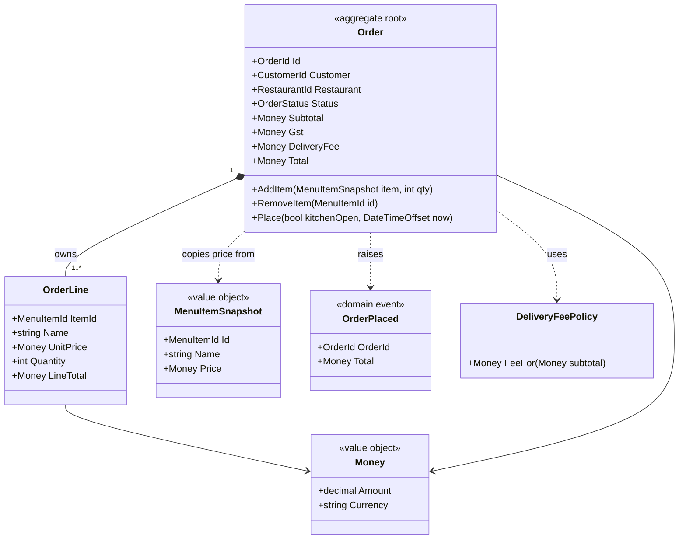
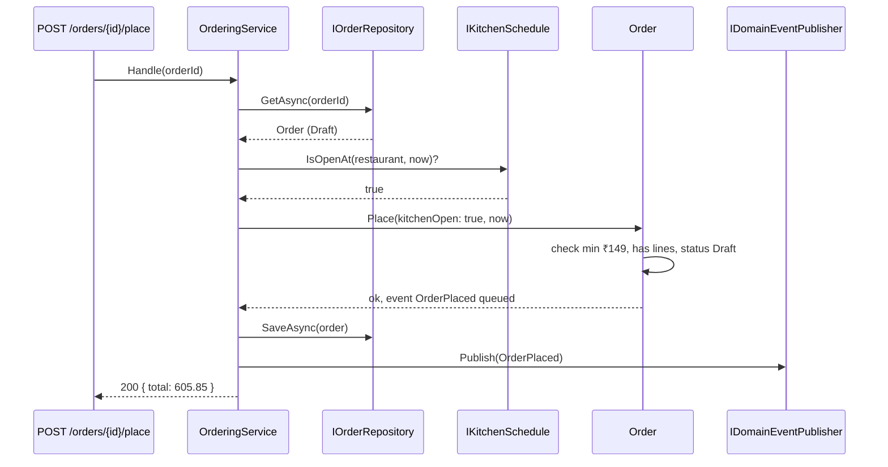
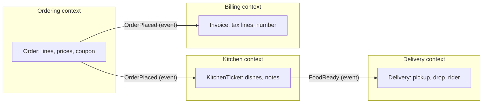

A domain model is the part of your code that *is* the business: orders, menus, coupons, deliveries, and the rules that tie them together. Get it right and a new requirement lands in one obvious class. Get it wrong and every change means hunting through controllers, stored procedures and helper classes.

## Learning objectives

By the end of this lesson you will be able to:

1. Explain what a domain model is and how it differs from a database schema or a set of DTOs.
2. Build a shared vocabulary (ubiquitous language) with domain experts and use it in code.
3. Choose between entities, value objects, aggregates and domain services for a given concept.
4. Put business rules inside the model instead of in services that push data around (avoid the anemic model).
5. Draw boundaries (bounded contexts) where the same word means different things.
6. Judge when a rich domain model is worth it and when simple CRUD is the better choice.

## Prerequisites

- [Identifying classes and responsibilities](#/lesson/m07-classes-responsibilities): nouns, verbs and CRC cards.
- [Entities, value objects and services](#/lesson/m07-entities-values-services): identity versus equality.
- [Encapsulation and invariant protection](#/lesson/m07-encapsulation-invariants): guard clauses and private setters.

## Explain it like I'm a beginner

Imagine you are building an app for a cloud kitchen in Hyderabad. You sit with the operations manager, Priya, and ask her how ordering works. She says:

> "A customer builds a **cart** from the **menu**. They can't order more than 20 of any one dish. When they **place** it, it becomes an **order** — but only if the food total is at least ₹149 and the kitchen is **open**. We add 5 % **GST** and a ₹39 **delivery fee**, which is free above ₹499. Once the kitchen **accepts** the order, the customer can't change it."

Every bold word is a concept. Every sentence with "can't", "only if" or "once" is a rule.

A **domain model** is code that uses Priya's exact words and enforces Priya's exact rules. There is an `Order` class with a `Place()` method. That method refuses to place an order under ₹149. Nobody can add a 21st biryani, because `AddItem` won't let them.

Think of it like a well-trained restaurant cashier. You don't hand the cashier a calculator and a rule book and check their work every time. The cashier *knows* the rules and won't ring up an order that breaks them. The bad alternative is a cashier who types whatever you say, and a supervisor in the back who checks every receipt afterwards. That supervisor is the "service class full of rules" you'll see in many codebases.

## First-principles explanation

### What a domain model is

The **domain** is the area of business your software serves: food ordering, inventory, payments. A **domain model** is a set of classes that represent the important concepts of that domain *together with their behaviour and rules*. Martin Fowler's definition: "an object model of the domain that incorporates both behavior and data".

It is not:

- **The database schema.** Tables are about storage and queries. A model is about rules. They often look similar, but they change for different reasons.
- **DTOs (data transfer objects).** A DTO is a bag of fields for sending data over the wire. It should have no rules.
- **The UI.** A screen might show "order summary" data from three different concepts.

### Step zero: a shared language

The biggest source of modelling bugs is *translation*. Priya says "place an order". The developer writes `SubmitCart()`. The tester writes "checkout". The database calls it `txn_status = 2`. Every translation loses meaning.

The fix is a **ubiquitous language** (one shared vocabulary used by business people, code, tests and documents). If Priya says "place", the method is `Place()`. If she says a customer can't "modify" an order after "acceptance", there is a rule in `Order` whose error message says exactly that. Keep a short glossary in the repository; review it when terms change.

### The building blocks

| Block | What it is | Food-ordering example | Equality |
|---|---|---|---|
| **Entity** | Something with an identity that lasts while its data changes | `Order` (id `ORD-8812`), `Customer` | By id |
| **Value object** | A descriptive value with no identity; usually immutable | `Money(₹249)`, `DeliveryAddress`, `Quantity` | By all values |
| **Aggregate** | A cluster of entities and values changed together as one unit, with one *root* entity as the only entry point | `Order` (root) + its `OrderLine`s | — |
| **Domain service** | A rule or operation that doesn't belong to one object | "Is the kitchen open at this time?" | — |
| **Domain event** | A record that something meaningful happened | `OrderPlaced` | By values |

**Aggregates deserve a closer look.** An `OrderLine` (2 × Chicken Biryani @ ₹249) never makes sense on its own. Nobody fetches "order line 77" without its order, and the rule "max 20 per dish" involves *all* lines. So the order and its lines form an aggregate, and outside code may only change lines by calling methods on `Order`. That gives one place to check the rules, and one unit to save in a transaction.

Rules of thumb for aggregates:

1. **Protect invariants inside one aggregate.** "An order's total never goes below zero" is checked by `Order` alone.
2. **Keep them small.** Don't put `Customer`, `Restaurant` and `Order` in one aggregate just because they are related. Big aggregates mean big locks and slow loads.
3. **Refer to other aggregates by id.** `Order` holds `RestaurantId`, not a `Restaurant` object.
4. **One aggregate per transaction** is the default. If placing an order must also update loyalty points, publish an event and let another handler do it.

### Rich model vs anemic model

An **anemic domain model** has classes with only getters and setters, and "services" that contain all the logic:

```csharp
public class Order { public List<OrderLine> Lines { get; set; } = new(); public string Status { get; set; } = ""; }

public class OrderService
{
    public void AddItem(Order o, MenuItem m, int qty)
    {
        if (o.Status != "Draft") throw new Exception("locked");
        o.Lines.Add(new OrderLine { ItemId = m.Id, Qty = qty, Price = m.Price });
    }
}
```

The rules exist, but nothing stops another developer writing `order.Lines.Add(...)` directly from a controller. Fowler calls this an anti-pattern because you pay the cost of objects (mapping, classes) without the benefit (objects that protect themselves). See [Anti-patterns](#/lesson/m06-anti-patterns).

A **rich model** moves the rule into `Order.AddItem`, makes `Lines` read-only from outside, and makes `Status` private-set. Now the rule cannot be bypassed.

### Where does a rule go?

Ask these questions in order:

1. Does the rule involve only **one value** (₹ amount can't be negative)? → the **value object**.
2. Does it involve the **state of one aggregate** (max 20 per dish, can't edit after acceptance)? → the **aggregate root**.
3. Does it need **information from outside** the aggregate (is the kitchen open now; does the coupon still have uses left)? → a **domain service** or an **application service** that fetches the information and passes it in.
4. Is it about **request shape** (field required, max length)? → input validation at the edge. See [Validation and business rules](#/lesson/m07-validation-rules).

### Bounded contexts: one word, several meanings

In a food-delivery business, "order" means different things to different teams:

- **Ordering** — what the customer chose, prices, coupons.
- **Kitchen** — dishes to cook, preparation notes, a ticket number. Prices are irrelevant.
- **Delivery** — a pickup address, a drop address, a rider, an ETA. Dishes are irrelevant except for "needs a large bag".
- **Billing** — tax lines, invoice number, payment reference.

Forcing all of this into one `Order` class creates a 60-field monster that every team edits. A **bounded context** is a boundary inside which one model and one meaning of each word applies. Each context has its own `Order` (or `KitchenTicket`, `Delivery`), and they talk through ids and events such as `OrderPlaced`.

Bounded contexts are not the same as microservices. A single ASP.NET Core application can contain several contexts as separate folders or projects. Splitting them into separate deployables is a later, separate decision.

### When a rich domain model is worth it

- Many rules that interact (pricing, limits, lifecycles), and they change often.
- Several entry points (API, admin panel, batch import, message consumers) that must all obey the same rules.
- Mistakes are costly: money, stock, legal compliance.

### When it is not

- **Simple CRUD.** A "manage restaurant cuisines" screen with a name and an icon has no rules. Map a record to a table and move on.
- **Reporting.** Read models for dashboards should be flat queries, not aggregates.
- **Prototypes.** If you are testing whether anyone wants the feature, model later.

### Trade-offs

| You gain | You pay |
|---|---|
| Rules in one obvious place, impossible to bypass | More classes; mapping between model, DTOs and tables |
| Code reads like the business, easier conversations | Time spent with domain experts to agree on language |
| Unit tests without databases or HTTP | ORMs need configuration for private setters and value objects |
| Changes land where the business changed | Wrong aggregate boundaries are expensive to fix later |

## Visual explanation

### The Ordering model



How to read it: `Order` is the aggregate root. The filled diamond means it **owns** its lines (composition): lines are created, changed and deleted only through `Order`. `Money` is a value object used everywhere an amount appears, so currency and rounding rules live in one place. The order *copies* the price from a `MenuItemSnapshot` when an item is added — if the menu price changes tomorrow, yesterday's order keeps yesterday's price. `DeliveryFeePolicy` is a small domain policy the order consults. `OrderPlaced` is raised when placement succeeds.

### Placing an order across layers



The application service (`OrderingService`) is thin: it **fetches** what the model needs (the order, whether the kitchen is open), **calls** one domain method, **saves**, and **publishes** the events. Every business decision happens inside `Order.Place`. The order doesn't call the schedule itself, so it stays free of I/O and trivially testable. Events are published *after* saving, so other contexts never hear about an order that wasn't stored. (For a guarantee that survives crashes between save and publish, use the outbox pattern covered later in the course.)

### Bounded contexts



Each box has its own model of "the order". They share only ids and events. The kitchen team can add "spice level" to `KitchenTicket` without touching Ordering. Billing can change invoice numbering without a meeting with the delivery team.

## Step-by-step example

### Step 1 — listen and write the glossary

From Priya's description we get: *Menu item, Cart/Order, Line, Quantity, Place, Accept, Minimum order value (₹149), GST (5 %), Delivery fee (₹39, free above ₹499), Kitchen open.* We decide that "cart" is just an order in `Draft` status — Priya confirms that's how she thinks of it too.

### Step 2 — classify each concept

- Order → entity and aggregate root (it has an id that lasts).
- Line → entity *inside* the aggregate (it is identified by menu item within its order).
- Money, MenuItemSnapshot → value objects.
- "Kitchen open" → needs outside data → domain service interface `IKitchenSchedule`.
- Delivery fee → a policy (a rule that may change on its own schedule).

### Step 3 — write the rules as methods

Each rule sentence becomes a guard inside a method: `AddItem` checks the 20-per-dish cap and the status; `Place` checks the minimum value and the kitchen flag.

### Step 4 — make it impossible to bypass

Lines are a private `List` exposed as `IReadOnlyList`. Status has a private setter. The constructor is private; `Order.Start(...)` is the factory.

### Step 5 — add the application service and the plumbing

Repository interface, in-memory implementation, handler, endpoints. These are deliberately boring.

## Production-style C# implementation

```text
FoodOrdering.Api/
  Program.cs
  Ordering/Domain/Money.cs
  Ordering/Domain/Ids.cs
  Ordering/Domain/Order.cs
  Ordering/Domain/DomainEvents.cs
  Ordering/Domain/OrderingRuleException.cs
  Ordering/Domain/DeliveryFeePolicy.cs
  Ordering/Application/OrderingService.cs
  Ordering/Infrastructure/InMemoryAdapters.cs
```

```csharp file=Ordering/Domain/Money.cs
namespace FoodOrdering.Ordering.Domain;

/// <summary>Value object: an amount in one currency, never negative, always 2 decimal places.</summary>
public readonly record struct Money
{
    public Money(decimal amount, string currency)
    {
        ArgumentOutOfRangeException.ThrowIfNegative(amount);
        ArgumentException.ThrowIfNullOrWhiteSpace(currency);
        Amount = Math.Round(amount, 2, MidpointRounding.AwayFromZero);
        Currency = currency.ToUpperInvariant();
    }

    public decimal Amount { get; }
    public string Currency { get; }

    public static Money Inr(decimal amount) => new(amount, "INR");
    public static Money Zero(string currency) => new(0m, currency);

    public static Money operator +(Money a, Money b)
    {
        EnsureSameCurrency(a, b);
        return new Money(a.Amount + b.Amount, a.Currency);
    }

    public Money Times(int quantity)
    {
        ArgumentOutOfRangeException.ThrowIfNegative(quantity);
        return new Money(Amount * quantity, Currency);
    }

    public Money PercentOf(decimal percent) => new(Amount * percent / 100m, Currency);

    public bool IsAtLeast(Money other)
    {
        EnsureSameCurrency(this, other);
        return Amount >= other.Amount;
    }

    private static void EnsureSameCurrency(Money a, Money b)
    {
        if (a.Currency != b.Currency)
            throw new InvalidOperationException($"Cannot combine {a.Currency} and {b.Currency}.");
    }

    public override string ToString() => $"{Currency} {Amount:0.00}";
}
```

```csharp file=Ordering/Domain/Ids.cs
namespace FoodOrdering.Ordering.Domain;

// Strongly typed ids: passing a CustomerId where an OrderId is expected is a compile error.
public readonly record struct OrderId(Guid Value) { public static OrderId New() => new(Guid.NewGuid()); }
public readonly record struct CustomerId(Guid Value);
public readonly record struct RestaurantId(Guid Value);
public readonly record struct MenuItemId(string Value);

/// <summary>The menu item as it was when the customer added it. Copying the price
/// protects the order from later menu changes.</summary>
public sealed record MenuItemSnapshot(MenuItemId Id, RestaurantId Restaurant, string Name, Money Price);
```

```csharp file=Ordering/Domain/DomainEvents.cs
namespace FoodOrdering.Ordering.Domain;

public interface IDomainEvent { DateTimeOffset OccurredAt { get; } }

public sealed record OrderPlaced(OrderId OrderId, CustomerId Customer, RestaurantId Restaurant,
                                 Money Total, DateTimeOffset OccurredAt) : IDomainEvent;
```

```csharp file=Ordering/Domain/OrderingRuleException.cs
namespace FoodOrdering.Ordering.Domain;

/// <summary>A business rule of the Ordering context was broken. Code is stable for clients; message is for people.</summary>
public sealed class OrderingRuleException(string code, string message) : Exception(message)
{
    public string Code { get; } = code;
}
```

```csharp file=Ordering/Domain/DeliveryFeePolicy.cs
namespace FoodOrdering.Ordering.Domain;

/// <summary>Domain policy: ₹39 delivery, free when the food subtotal is ₹499 or more.
/// A separate class because marketing changes it on its own schedule.</summary>
public sealed class DeliveryFeePolicy(decimal flatFee = 39m, decimal freeAbove = 499m)
{
    public Money FeeFor(Money subtotal) =>
        subtotal.Amount >= freeAbove ? Money.Zero(subtotal.Currency) : new Money(flatFee, subtotal.Currency);
}
```

```csharp file=Ordering/Domain/Order.cs
namespace FoodOrdering.Ordering.Domain;

public enum OrderStatus { Draft, Placed, Accepted, Cancelled }

/// <summary>Entity inside the Order aggregate. Only Order may create or change it.</summary>
public sealed class OrderLine
{
    internal OrderLine(MenuItemSnapshot item, int quantity)
    {
        ItemId = item.Id;
        Name = item.Name;
        UnitPrice = item.Price;
        Quantity = quantity;
    }

    public MenuItemId ItemId { get; }
    public string Name { get; }
    public Money UnitPrice { get; }
    public int Quantity { get; private set; }
    public Money LineTotal => UnitPrice.Times(Quantity);

    internal void Add(int quantity) => Quantity += quantity;
}

/// <summary>Aggregate root for the Ordering context.</summary>
public sealed class Order
{
    public const int MaxQuantityPerItem = 20;
    public const decimal GstPercent = 5m;
    public static readonly Money MinimumOrderValue = Money.Inr(149m);

    private readonly List<OrderLine> _lines = [];
    private readonly List<IDomainEvent> _events = [];
    private readonly DeliveryFeePolicy _deliveryFees;

    private Order(OrderId id, CustomerId customer, RestaurantId restaurant, DeliveryFeePolicy deliveryFees)
    {
        Id = id;
        Customer = customer;
        Restaurant = restaurant;
        _deliveryFees = deliveryFees;
    }

    public OrderId Id { get; }
    public CustomerId Customer { get; }
    public RestaurantId Restaurant { get; }
    public OrderStatus Status { get; private set; } = OrderStatus.Draft;
    public DateTimeOffset? PlacedAt { get; private set; }
    public IReadOnlyList<OrderLine> Lines => _lines;
    public IReadOnlyList<IDomainEvent> PendingEvents => _events;

    public Money Subtotal => _lines.Aggregate(Money.Inr(0m), (sum, l) => sum + l.LineTotal);
    public Money Gst => Subtotal.PercentOf(GstPercent);
    public Money DeliveryFee => _lines.Count == 0 ? Money.Inr(0m) : _deliveryFees.FeeFor(Subtotal);
    public Money Total => Subtotal + Gst + DeliveryFee;

    public static Order Start(CustomerId customer, RestaurantId restaurant, DeliveryFeePolicy? deliveryFees = null) =>
        new(OrderId.New(), customer, restaurant, deliveryFees ?? new DeliveryFeePolicy());

    public void AddItem(MenuItemSnapshot item, int quantity)
    {
        ArgumentNullException.ThrowIfNull(item);
        ArgumentOutOfRangeException.ThrowIfNegativeOrZero(quantity);
        EnsureDraft("add items");
        if (item.Restaurant != Restaurant)
            throw new OrderingRuleException("order.other_restaurant", $"{item.Name} is from a different restaurant.");

        var existing = _lines.FirstOrDefault(l => l.ItemId == item.Id);
        var newQuantity = (existing?.Quantity ?? 0) + quantity;
        if (newQuantity > MaxQuantityPerItem)
            throw new OrderingRuleException("order.too_many", $"At most {MaxQuantityPerItem} of {item.Name} per order.");

        if (existing is null) _lines.Add(new OrderLine(item, quantity));
        else existing.Add(quantity);
    }

    public void RemoveItem(MenuItemId itemId)
    {
        EnsureDraft("remove items");
        _lines.RemoveAll(l => l.ItemId == itemId);
    }

    /// <param name="kitchenOpen">Supplied by the caller, who asked the kitchen schedule. Keeps the model free of I/O.</param>
    public void Place(bool kitchenOpen, DateTimeOffset now)
    {
        EnsureDraft("place the order");
        if (_lines.Count == 0)
            throw new OrderingRuleException("order.empty", "Add at least one item.");
        if (!Subtotal.IsAtLeast(MinimumOrderValue))
            throw new OrderingRuleException("order.below_minimum", $"Minimum order is {MinimumOrderValue}; food total is {Subtotal}.");
        if (!kitchenOpen)
            throw new OrderingRuleException("order.kitchen_closed", "The kitchen is closed right now.");

        Status = OrderStatus.Placed;
        PlacedAt = now;
        _events.Add(new OrderPlaced(Id, Customer, Restaurant, Total, now));
    }

    public IReadOnlyList<IDomainEvent> DequeueEvents()
    {
        var copy = _events.ToArray();
        _events.Clear();
        return copy;
    }

    private void EnsureDraft(string action)
    {
        if (Status != OrderStatus.Draft)
            throw new OrderingRuleException("order.locked", $"Cannot {action}: the order is already {Status}.");
    }
}
```

Read `Order` from top to bottom and you can recite Priya's rules: 20 per dish, same restaurant, ₹149 minimum, 5 % GST, kitchen must be open, no edits after placing. Nothing outside this file can break them, because `Lines` is read-only, `Status` has a private setter and `OrderLine`'s constructor is `internal`.

```csharp file=Ordering/Application/OrderingService.cs
using FoodOrdering.Ordering.Domain;
using Microsoft.Extensions.Logging;

namespace FoodOrdering.Ordering.Application;

public interface IOrderRepository
{
    Task<Order?> GetAsync(OrderId id, CancellationToken ct);
    Task SaveAsync(Order order, CancellationToken ct);
}

public interface IMenuCatalog
{
    Task<MenuItemSnapshot?> FindAsync(MenuItemId id, CancellationToken ct);
}

/// <summary>Domain service interface: knowledge that lives outside the Order aggregate.</summary>
public interface IKitchenSchedule
{
    Task<bool> IsOpenAtAsync(RestaurantId restaurant, DateTimeOffset at, CancellationToken ct);
}

public interface IDomainEventPublisher
{
    Task PublishAsync(IReadOnlyList<IDomainEvent> events, CancellationToken ct);
}

public sealed record OrderSummary(Guid OrderId, string Status, decimal Subtotal, decimal Gst, decimal DeliveryFee, decimal Total);

/// <summary>Application service: fetch, call the model, save, publish. No business rules here.</summary>
public sealed class OrderingService(IOrderRepository orders, IMenuCatalog menu, IKitchenSchedule kitchen,
                                    IDomainEventPublisher publisher, TimeProvider clock, ILogger<OrderingService> logger)
{
    public async Task<OrderSummary> StartAsync(CustomerId customer, RestaurantId restaurant, CancellationToken ct)
    {
        var order = Order.Start(customer, restaurant);
        await orders.SaveAsync(order, ct);
        return Summarise(order);
    }

    public async Task<OrderSummary> AddItemAsync(OrderId id, MenuItemId itemId, int quantity, CancellationToken ct)
    {
        var order = await Load(id, ct);
        var item = await menu.FindAsync(itemId, ct)
                   ?? throw new OrderingRuleException("menu.unknown_item", $"Menu item {itemId.Value} does not exist.");
        order.AddItem(item, quantity);
        await orders.SaveAsync(order, ct);
        return Summarise(order);
    }

    public async Task<OrderSummary> PlaceAsync(OrderId id, CancellationToken ct)
    {
        var order = await Load(id, ct);
        var now = clock.GetUtcNow();
        var open = await kitchen.IsOpenAtAsync(order.Restaurant, now, ct);
        order.Place(open, now);
        await orders.SaveAsync(order, ct);
        await publisher.PublishAsync(order.DequeueEvents(), ct);
        logger.LogInformation("Order {OrderId} placed, total {Total}", order.Id.Value, order.Total);
        return Summarise(order);
    }

    private async Task<Order> Load(OrderId id, CancellationToken ct) =>
        await orders.GetAsync(id, ct) ?? throw new KeyNotFoundException($"Order {id.Value} not found.");

    private static OrderSummary Summarise(Order o) =>
        new(o.Id.Value, o.Status.ToString(), o.Subtotal.Amount, o.Gst.Amount, o.DeliveryFee.Amount, o.Total.Amount);
}
```

```csharp file=Ordering/Infrastructure/InMemoryAdapters.cs
using System.Collections.Concurrent;
using FoodOrdering.Ordering.Application;
using FoodOrdering.Ordering.Domain;
using Microsoft.Extensions.Logging;

namespace FoodOrdering.Ordering.Infrastructure;

public sealed class InMemoryOrderRepository : IOrderRepository
{
    private readonly ConcurrentDictionary<OrderId, Order> _store = new();
    public Task<Order?> GetAsync(OrderId id, CancellationToken ct) => Task.FromResult(_store.GetValueOrDefault(id));
    public Task SaveAsync(Order order, CancellationToken ct) { _store[order.Id] = order; return Task.CompletedTask; }
}

public sealed class InMemoryMenuCatalog : IMenuCatalog
{
    public static readonly RestaurantId DemoKitchen = new(Guid.Parse("8f6d3c3e-0000-4000-8000-000000000001"));
    private readonly Dictionary<string, MenuItemSnapshot> _items = new()
    {
        ["biryani"] = new(new MenuItemId("biryani"), DemoKitchen, "Chicken Biryani", Money.Inr(249m)),
        ["paneer"] = new(new MenuItemId("paneer"), DemoKitchen, "Paneer Tikka", Money.Inr(219m)),
        ["lassi"] = new(new MenuItemId("lassi"), DemoKitchen, "Sweet Lassi", Money.Inr(79m)),
    };
    public Task<MenuItemSnapshot?> FindAsync(MenuItemId id, CancellationToken ct) => Task.FromResult(_items.GetValueOrDefault(id.Value));
}

/// <summary>Open 11:00–23:00 India time.</summary>
public sealed class FixedHoursKitchenSchedule : IKitchenSchedule
{
    private static readonly TimeSpan Ist = TimeSpan.FromHours(5.5);
    public Task<bool> IsOpenAtAsync(RestaurantId restaurant, DateTimeOffset at, CancellationToken ct)
    {
        var local = at.ToOffset(Ist).TimeOfDay;
        return Task.FromResult(local >= TimeSpan.FromHours(11) && local < TimeSpan.FromHours(23));
    }
}

public sealed class LoggingEventPublisher(ILogger<LoggingEventPublisher> logger) : IDomainEventPublisher
{
    public Task PublishAsync(IReadOnlyList<IDomainEvent> events, CancellationToken ct)
    {
        foreach (var e in events) logger.LogInformation("Domain event {EventType}: {@Event}", e.GetType().Name, e);
        return Task.CompletedTask;
    }
}
```

```csharp file=Program.cs
using FoodOrdering.Ordering.Application;
using FoodOrdering.Ordering.Domain;
using FoodOrdering.Ordering.Infrastructure;

var builder = WebApplication.CreateBuilder(args);

builder.Services.AddSingleton(TimeProvider.System);
builder.Services.AddSingleton<IOrderRepository, InMemoryOrderRepository>();
builder.Services.AddSingleton<IMenuCatalog, InMemoryMenuCatalog>();
builder.Services.AddSingleton<IKitchenSchedule, FixedHoursKitchenSchedule>();
builder.Services.AddSingleton<IDomainEventPublisher, LoggingEventPublisher>();
builder.Services.AddScoped<OrderingService>();

var app = builder.Build();

// Translate rule violations into 422 once, for every endpoint.
app.Use(async (ctx, next) =>
{
    try { await next(ctx); }
    catch (OrderingRuleException ex)
    {
        await Results.Problem(ex.Message, statusCode: StatusCodes.Status422UnprocessableEntity,
            extensions: new Dictionary<string, object?> { ["code"] = ex.Code }).ExecuteAsync(ctx);
    }
});

app.MapPost("/orders", (Guid customerId, OrderingService svc, CancellationToken ct) =>
    svc.StartAsync(new CustomerId(customerId), InMemoryMenuCatalog.DemoKitchen, ct));

app.MapPost("/orders/{id:guid}/items", (Guid id, string itemId, int quantity, OrderingService svc, CancellationToken ct) =>
    svc.AddItemAsync(new OrderId(id), new MenuItemId(itemId), quantity, ct));

app.MapPost("/orders/{id:guid}/place", (Guid id, OrderingService svc, CancellationToken ct) =>
    svc.PlaceAsync(new OrderId(id), ct));

app.Run();
```

A worked total: 2 × Chicken Biryani (₹249) + 1 × Sweet Lassi (₹79) = ₹577 subtotal. GST 5 % = ₹28.85. Delivery is free because ₹577 ≥ ₹499. Total ₹605.85.

:::callout type=note title="Persisting a rich model"
EF Core can map private setters, backing fields (`_lines`), owned types (`Money`) and strongly typed ids with value converters, so a rich model does not force public setters. When the mapping gets painful, it is a sign the aggregate is too big or that a separate read model would serve queries better. We cover EF Core mapping in the persistence module.
:::

## Bad design vs good design

**Bad**: an anemic `Order` with public `List<OrderLine> Lines` and `string Status`, an `OrderService` with the rules, a `CheckoutController` that also checks "max 20" because someone didn't know the service did, and a SQL view that computes GST with `ROUND(subtotal * 0.05)`, which uses different rounding than the C# code.

Problems:

- Three copies of the 20-item rule, already slightly different: the controller checks per line, the service checks per item.
- An admin bulk-import tool writes lines directly and skips every rule.
- GST on the invoice and GST in the app differ by ₹0.01 on some orders. Finance raises a ticket every month.
- Tests need the controller, the service and a database to check one rule.

**Good**: the model above. One place per rule, value objects for money, an aggregate that can't be bypassed, and a thin application service.

**Is the rich model worth it here?** Yes: money, many rules and several entry points. But the *restaurant cuisine list* next door should stay a simple record and a table. Mixing styles in one application is normal and healthy. Use the rich model where the rules are.

:::callout type=mistake title="Modelling the database instead of the domain"
Starting from tables (`orders`, `order_items`, `order_status_history`) and generating classes from them produces an anemic model by default. Start from the language and the rules, then decide how to store them.
:::

## Practical playground

Run the program. It places a ₹577 order. Then implement `RemoveItem` so the second scenario prints a rule violation instead of crashing.

:::playground type=csharp title="Ordering aggregate"
```csharp file=Program.cs
using System;
using System.Collections.Generic;
using System.Linq;

public sealed record Item(string Id, string Name, decimal Price);

public sealed class Line
{
    public Line(Item item, int qty) { Item = item; Quantity = qty; }
    public Item Item { get; }
    public int Quantity { get; internal set; }
    public decimal Total => Item.Price * Quantity;
}

public sealed class Order
{
    private readonly List<Line> _lines = new();
    public IReadOnlyList<Line> Lines => _lines;
    public bool IsPlaced { get; private set; }
    public decimal Subtotal => _lines.Sum(l => l.Total);

    public void AddItem(Item item, int qty)
    {
        if (IsPlaced) throw new InvalidOperationException("Order is already placed.");
        var line = _lines.FirstOrDefault(l => l.Item.Id == item.Id);
        var newQty = (line?.Quantity ?? 0) + qty;
        if (newQty > 20) throw new InvalidOperationException($"At most 20 of {item.Name}.");
        if (line is null) _lines.Add(new Line(item, qty)); else line.Quantity = newQty;
    }

    // TODO: refuse when placed; otherwise remove the line for this item id.
    public void RemoveItem(string itemId) => throw new NotImplementedException();

    public void Place()
    {
        if (Subtotal < 149m) throw new InvalidOperationException($"Minimum order is 149; you have {Subtotal}.");
        IsPlaced = true;
    }
}

public static class Program
{
    public static void Main()
    {
        var biryani = new Item("biryani", "Chicken Biryani", 249m);
        var lassi = new Item("lassi", "Sweet Lassi", 79m);

        var o = new Order();
        o.AddItem(biryani, 2);
        o.AddItem(lassi, 1);
        o.Place();
        Console.WriteLine($"Placed. Subtotal {o.Subtotal}, GST {Math.Round(o.Subtotal * 0.05m, 2)}");

        try { o.RemoveItem("lassi"); }
        catch (Exception ex) { Console.WriteLine($"{ex.GetType().Name}: {ex.Message}"); }
    }
}
```
:::

## Exercises

:::exercise id=m07-domain-modeling-ex1 difficulty=beginner kind=code title="A Money value object"
Payment and ordering code keeps mixing up rupees and dollars and rounding differently. Implement `Money` as a value object.
::requirements
- `new Money(amount, currency)`: amount must not be negative (`ArgumentOutOfRangeException`); currency is stored upper-case; amount is rounded to 2 decimals, half away from zero.
- `Add(Money other)` throws `InvalidOperationException` for different currencies.
- `Multiply(int quantity)` and `Percent(decimal percent)` return new `Money` values.
- Two `Money` values with the same amount and currency are equal.
::acceptance
- `new Money(10.005m, "inr")` has amount 10.01 and currency `INR`.
- ₹249 × 2 + ₹79 = ₹577.
- 5 % of ₹577 = ₹28.85.
- Adding INR to USD throws.
- `new Money(5, "INR") == new Money(5.00m, "INR")` is true.
::hint
A value object has no id. What C# type gives value equality for free?
::hint
`readonly record struct` (or `sealed record`) gives you `Equals`, `GetHashCode` and `==` based on all fields.
::hint
Do the validation and rounding in an explicit constructor, and keep properties get-only so nobody can change a value after creation.
::hint
```csharp
public Money(decimal amount, string currency)
{
    ArgumentOutOfRangeException.ThrowIfNegative(amount);
    Amount = Math.Round(amount, 2, MidpointRounding.AwayFromZero);
    Currency = currency.ToUpperInvariant();
}
```
::starter
```csharp file=Money.cs
using System;

public readonly record struct Money
{
    public Money(decimal amount, string currency)
    {
        throw new NotImplementedException();
    }

    public decimal Amount { get; }
    public string Currency { get; }

    public Money Add(Money other) => throw new NotImplementedException();
    public Money Multiply(int quantity) => throw new NotImplementedException();
    public Money Percent(decimal percent) => throw new NotImplementedException();
}
```
::tests
```csharp file=MoneyTests.cs
using System;
using Xunit;

public class MoneyTests
{
    [Fact]
    public void Rounds_and_normalises_currency()
    {
        var m = new Money(10.005m, "inr");
        Assert.Equal(10.01m, m.Amount);
        Assert.Equal("INR", m.Currency);
    }

    [Fact]
    public void Arithmetic_matches_menu_example()
    {
        var subtotal = new Money(249m, "INR").Multiply(2).Add(new Money(79m, "INR"));
        Assert.Equal(new Money(577m, "INR"), subtotal);
        Assert.Equal(28.85m, subtotal.Percent(5m).Amount);
    }

    [Fact] public void Different_currencies_cannot_be_added() =>
        Assert.Throws<InvalidOperationException>(() => new Money(1m, "INR").Add(new Money(1m, "USD")));

    [Fact] public void Negative_amount_rejected() =>
        Assert.Throws<ArgumentOutOfRangeException>(() => new Money(-1m, "INR"));

    [Fact] public void Equal_by_value() =>
        Assert.True(new Money(5m, "INR") == new Money(5.00m, "inr"));
}
```
::solution
```csharp file=Money.cs
using System;

public readonly record struct Money
{
    public Money(decimal amount, string currency)
    {
        ArgumentOutOfRangeException.ThrowIfNegative(amount);
        ArgumentException.ThrowIfNullOrWhiteSpace(currency);
        Amount = Math.Round(amount, 2, MidpointRounding.AwayFromZero);
        Currency = currency.ToUpperInvariant();
    }

    public decimal Amount { get; }
    public string Currency { get; }

    public Money Add(Money other)
    {
        if (other.Currency != Currency)
            throw new InvalidOperationException($"Cannot add {other.Currency} to {Currency}.");
        return new Money(Amount + other.Amount, Currency);
    }

    public Money Multiply(int quantity)
    {
        ArgumentOutOfRangeException.ThrowIfNegative(quantity);
        return new Money(Amount * quantity, Currency);
    }

    public Money Percent(decimal percent) => new(Amount * percent / 100m, Currency);
}
```
`decimal` 5.00 and 5 compare equal, so record equality works after normalising the currency. A plain `struct` default (`default(Money)`) still has a `null` currency — a known limit of struct value objects. If that matters, use a `sealed record` class instead.
::mistakes
- Using `double` for money: 0.1 + 0.2 is not exactly 0.3 in binary floating point.
- Rounding with the default `MidpointRounding.ToEven` when the business (and the GST invoice) expects half-up rounding. Agree on the rule with finance and write a test for it.
- Exposing setters "for the serializer". `System.Text.Json` can use the constructor.
:::

:::exercise id=m07-domain-modeling-ex2 difficulty=beginner kind=design title="Model a small warehouse"
A building-materials distributor in Gurgaon asks for stock tracking. In their words: *"Every product has a SKU, like CEM-OPC53-50KG. Stock sits in bins inside a warehouse — bin A-03-2 is aisle A, rack 3, level 2. We receive stock against a purchase order, pick it for sales orders, and sometimes adjust it after a physical count. We must always know why stock changed. Stock in a bin can never go negative."*

Write the glossary (5–8 terms) in the description field of your model, then build the class model in the LLD designer: entities, value objects, the aggregate root, and where the "never negative" rule lives.
::acceptance
- At least one value object (e.g. `Sku`, `BinLocation`, `Quantity`) with its rule.
- One aggregate root that owns stock levels and enforces "never negative".
- Every stock change is recorded as a movement with a reason (receipt, pick, adjustment).
- Other aggregates (Product, PurchaseOrder) are referenced by id, not by object.
::hint
Underline the nouns: product, SKU, stock, bin, warehouse, purchase order, sales order, adjustment, count. Which have identity?
::hint
"A-03-2" is not a thing with identity — it is a structured value. `BinLocation(Aisle, Rack, Level)` with parsing and validation.
::hint
Which object must look at the quantity *before* allowing a pick? That object is your aggregate root. A `StockItem` per (warehouse, SKU, bin), or one `BinStock` per bin, are both defensible — argue your choice.
::hint
"We must always know why stock changed" means quantities are never set directly. Every change is a `StockMovement` record with a type and a reference document id.
::starter
```json file=warehouse-model.json
{
  "classes": [
    { "id": "Sku", "name": "Sku", "kind": "record", "fields": ["+string Value"], "methods": [], "responsibility": "Product code" },
    { "id": "Stock", "name": "StockItem", "kind": "class", "fields": ["-int Quantity"], "methods": [] }
  ],
  "relations": [ { "from": "Stock", "to": "Sku", "kind": "association" } ]
}
```
::solution
Glossary: **SKU** (product code), **Bin location** (aisle-rack-level address), **Stock item** (quantity of one SKU in one bin), **Receipt** (stock in, against a purchase order), **Pick** (stock out, for a sales order), **Adjustment** (correction after a physical count), **Movement** (a recorded change with a reason).

```json file=warehouse-model.json
{
  "classes": [
    { "id": "Sku", "name": "Sku", "kind": "record", "fields": ["+string Value"], "methods": ["+static Sku Parse(string s)"],
      "responsibility": "Value object; upper-case, pattern like CEM-OPC53-50KG" },
    { "id": "Bin", "name": "BinLocation", "kind": "record", "fields": ["+char Aisle", "+int Rack", "+int Level"],
      "methods": ["+static BinLocation Parse(string code)", "+string ToString()"],
      "responsibility": "Value object; parses and formats A-03-2" },
    { "id": "Qty", "name": "Quantity", "kind": "record", "fields": ["+int Value", "+string Unit"], "methods": [],
      "responsibility": "Value object; non-negative, unit like BAG or KG" },
    { "id": "Stock", "name": "StockItem", "kind": "class",
      "fields": ["-Guid Id", "-Guid WarehouseId", "-Sku Sku", "-BinLocation Bin", "-int OnHand", "-List~StockMovement~ Movements", "-int Version"],
      "methods": ["+void Receive(int qty, string purchaseOrderNo)", "+void Pick(int qty, string salesOrderNo)", "+void Adjust(int countedQty, string countSheetNo, string reason)"],
      "responsibility": "Aggregate root; on-hand never negative; every change recorded" },
    { "id": "Move", "name": "StockMovement", "kind": "record",
      "fields": ["+MovementType Type", "+int Delta", "+string ReferenceNo", "+DateTimeOffset At", "+string? Reason"], "methods": [],
      "responsibility": "Immutable audit entry" },
    { "id": "Type", "name": "MovementType", "kind": "enum", "fields": ["Receipt", "Pick", "Adjustment"], "methods": [] },
    { "id": "Product", "name": "Product", "kind": "class", "fields": ["-Sku Sku", "-string Name", "-string BaseUnit"], "methods": [],
      "responsibility": "Separate aggregate (catalogue); referenced by Sku" }
  ],
  "relations": [
    { "from": "Stock", "to": "Sku", "kind": "association" },
    { "from": "Stock", "to": "Bin", "kind": "association" },
    { "from": "Stock", "to": "Move", "kind": "composition", "multiplicity": "0..*" },
    { "from": "Move", "to": "Type", "kind": "association" },
    { "from": "Stock", "to": "Product", "kind": "dependency", "label": "by Sku only" }
  ]
}
```
`StockItem.Pick` checks `OnHand >= qty` before recording a negative movement, so the rule cannot be bypassed. `Adjust` records the *difference* between counted and on-hand quantity with the count sheet number. `Product` is a separate aggregate because its name or unit can change without touching stock.
::alternatives
For high-volume warehouses, some teams store only movements (an append-only ledger) and compute on-hand as a running sum, with a snapshot every N movements. That makes audit trivial but requires care to enforce "never negative" under concurrency (a lock per SKU-bin or a database constraint on the snapshot).
::mistakes
- Putting `Product` inside the `StockItem` aggregate, so renaming a product locks every stock row.
- A public `Quantity` setter "for adjustments", which loses the reason.
- Treating "A-03-2" as a plain string; then "a-3-2" and "A-03-2" become different bins.
:::

:::exercise id=m07-domain-modeling-ex3 difficulty=intermediate kind=code title="Move rules out of the anemic service"
You are given an anemic food order: rules live in a service, and anyone can edit the list. Rebuild `FoodBasket` as a rich aggregate.
::requirements
- `AddItem(itemId, name, unitPrice, qty)`: quantity 1–20 per item *in total* (adding 15 then 6 of the same item fails). Same item twice merges into one line.
- `ChangeQuantity(itemId, qty)`: sets the quantity (1–20); unknown item throws `KeyNotFoundException`.
- `Checkout()`: needs at least one line and a subtotal ≥ ₹149; afterwards the basket is locked.
- Any change after checkout throws `InvalidOperationException`. Rule breaks throw `InvalidOperationException` too; bad arguments (`qty <= 0`) throw `ArgumentOutOfRangeException`.
- `Lines` must not be modifiable from outside.
::acceptance
- 2 × ₹249 + 1 × ₹79 gives subtotal ₹577 and two lines.
- Adding 15 then 6 of the same item throws and leaves quantity at 15.
- Checkout with ₹120 subtotal throws; with ₹577 succeeds; then `AddItem` throws.
- `Lines` is exposed as `IReadOnlyList<BasketLine>` and cannot be cast back and modified through the public API.
::hint
Which object knows *all* lines? Only that object can check "20 in total for this item".
::hint
Keep `private readonly List<BasketLine> _lines` and expose `IReadOnlyList<BasketLine> Lines => _lines.AsReadOnly();`.
::hint
Write a private `EnsureOpen()` and call it first in every mutating method.
::hint
For merging, find the existing line by `ItemId`, compute `existing + qty`, check the cap, *then* change — so a failed add leaves the line untouched.
::starter
```csharp file=FoodBasket.cs
using System;
using System.Collections.Generic;
using System.Linq;

public sealed class BasketLine
{
    internal BasketLine(string itemId, string name, decimal unitPrice, int quantity)
    {
        ItemId = itemId; Name = name; UnitPrice = unitPrice; Quantity = quantity;
    }
    public string ItemId { get; }
    public string Name { get; }
    public decimal UnitPrice { get; }
    public int Quantity { get; internal set; }
    public decimal LineTotal => UnitPrice * Quantity;
}

public sealed class FoodBasket
{
    public const int MaxPerItem = 20;
    public const decimal MinimumSubtotal = 149m;

    public IReadOnlyList<BasketLine> Lines => throw new NotImplementedException();
    public bool IsCheckedOut { get; private set; }
    public decimal Subtotal => throw new NotImplementedException();

    public void AddItem(string itemId, string name, decimal unitPrice, int quantity) => throw new NotImplementedException();
    public void ChangeQuantity(string itemId, int quantity) => throw new NotImplementedException();
    public void Checkout() => throw new NotImplementedException();
}
```
::tests
```csharp file=FoodBasketTests.cs
using System;
using System.Collections.Generic;
using Xunit;

public class FoodBasketTests
{
    private static FoodBasket Sample()
    {
        var b = new FoodBasket();
        b.AddItem("biryani", "Chicken Biryani", 249m, 2);
        b.AddItem("lassi", "Sweet Lassi", 79m, 1);
        return b;
    }

    [Fact]
    public void Subtotal_and_lines()
    {
        var b = Sample();
        Assert.Equal(577m, b.Subtotal);
        Assert.Equal(2, b.Lines.Count);
    }

    [Fact]
    public void Same_item_merges()
    {
        var b = Sample();
        b.AddItem("lassi", "Sweet Lassi", 79m, 2);
        Assert.Equal(2, b.Lines.Count);
        Assert.Equal(3, b.Lines[1].Quantity);
    }

    [Fact]
    public void Cap_is_per_item_total_and_failed_add_changes_nothing()
    {
        var b = new FoodBasket();
        b.AddItem("roti", "Butter Roti", 30m, 15);
        Assert.Throws<InvalidOperationException>(() => b.AddItem("roti", "Butter Roti", 30m, 6));
        Assert.Equal(15, b.Lines[0].Quantity);
    }

    [Fact]
    public void Change_quantity_validates()
    {
        var b = Sample();
        b.ChangeQuantity("biryani", 4);
        Assert.Equal(1075m, b.Subtotal);
        Assert.Throws<InvalidOperationException>(() => b.ChangeQuantity("biryani", 21));
        Assert.Throws<KeyNotFoundException>(() => b.ChangeQuantity("dosa", 1));
        Assert.Throws<ArgumentOutOfRangeException>(() => b.ChangeQuantity("biryani", 0));
    }

    [Fact]
    public void Checkout_requires_minimum()
    {
        var small = new FoodBasket();
        small.AddItem("chai", "Masala Chai", 40m, 3);
        Assert.Throws<InvalidOperationException>(() => small.Checkout());
        Assert.Throws<InvalidOperationException>(() => new FoodBasket().Checkout());
    }

    [Fact]
    public void Locked_after_checkout()
    {
        var b = Sample();
        b.Checkout();
        Assert.True(b.IsCheckedOut);
        Assert.Throws<InvalidOperationException>(() => b.AddItem("chai", "Masala Chai", 40m, 1));
        Assert.Throws<InvalidOperationException>(() => b.ChangeQuantity("lassi", 2));
    }

    [Fact]
    public void Lines_cannot_be_modified_through_cast()
    {
        var b = Sample();
        Assert.False(b.Lines is List<BasketLine>);
    }
}
```
::solution
```csharp file=FoodBasket.cs
using System;
using System.Collections.Generic;
using System.Linq;

public sealed class BasketLine
{
    internal BasketLine(string itemId, string name, decimal unitPrice, int quantity)
    {
        ItemId = itemId; Name = name; UnitPrice = unitPrice; Quantity = quantity;
    }
    public string ItemId { get; }
    public string Name { get; }
    public decimal UnitPrice { get; }
    public int Quantity { get; internal set; }
    public decimal LineTotal => UnitPrice * Quantity;
}

public sealed class FoodBasket
{
    public const int MaxPerItem = 20;
    public const decimal MinimumSubtotal = 149m;

    private readonly List<BasketLine> _lines = new();

    public IReadOnlyList<BasketLine> Lines => _lines.AsReadOnly();
    public bool IsCheckedOut { get; private set; }
    public decimal Subtotal => _lines.Sum(l => l.LineTotal);

    public void AddItem(string itemId, string name, decimal unitPrice, int quantity)
    {
        EnsureOpen();
        ArgumentException.ThrowIfNullOrWhiteSpace(itemId);
        ArgumentOutOfRangeException.ThrowIfNegative(unitPrice);
        ArgumentOutOfRangeException.ThrowIfNegativeOrZero(quantity);

        var existing = _lines.FirstOrDefault(l => l.ItemId == itemId);
        var total = (existing?.Quantity ?? 0) + quantity;
        EnsureWithinCap(total, name);

        if (existing is null) _lines.Add(new BasketLine(itemId, name, unitPrice, quantity));
        else existing.Quantity = total;
    }

    public void ChangeQuantity(string itemId, int quantity)
    {
        EnsureOpen();
        ArgumentOutOfRangeException.ThrowIfNegativeOrZero(quantity);
        var line = _lines.FirstOrDefault(l => l.ItemId == itemId)
                   ?? throw new KeyNotFoundException($"Item {itemId} is not in the basket.");
        EnsureWithinCap(quantity, line.Name);
        line.Quantity = quantity;
    }

    public void Checkout()
    {
        EnsureOpen();
        if (_lines.Count == 0) throw new InvalidOperationException("The basket is empty.");
        if (Subtotal < MinimumSubtotal)
            throw new InvalidOperationException($"Minimum order is ₹{MinimumSubtotal}; basket is ₹{Subtotal}.");
        IsCheckedOut = true;
    }

    private void EnsureOpen()
    {
        if (IsCheckedOut) throw new InvalidOperationException("The basket is checked out and can no longer change.");
    }

    private static void EnsureWithinCap(int quantity, string name)
    {
        if (quantity > MaxPerItem) throw new InvalidOperationException($"At most {MaxPerItem} × {name} per order.");
    }
}
```
`AsReadOnly()` returns a `ReadOnlyCollection<T>` wrapper, so `(List<BasketLine>)basket.Lines` fails. Returning `_lines` typed as `IReadOnlyList` would let a caller cast it back and call `Add`.
::alternatives
Instead of throwing on rule breaks, methods can return a `Result` (see [Options and Result](#/lesson/m06-options-result)). That suits rules users break often, like the minimum order value. The trade-offs are covered in [Error handling and domain exceptions](#/lesson/m07-domain-exceptions).
::mistakes
- Checking the cap against the *added* quantity only (6 ≤ 20) rather than the new total (21).
- Leaving `BasketLine`'s constructor or `Quantity` setter public, so callers can bypass the basket.
- Calling `EnsureOpen()` after the change instead of before.
:::

:::exercise id=m07-domain-modeling-ex4 difficulty=intermediate kind=written title="Draw the bounded contexts for food delivery"
Your company's single `Order` table has 64 columns, including `spice_level`, `rider_phone`, `invoice_no`, `coupon_code` and `kitchen_station`. Four teams edit the `Order` class every sprint and merge conflicts are constant.

Write a short proposal (300–500 words) that:

1. Names the bounded contexts you see and what "order" means in each.
2. Lists 3–5 fields that each context's model needs, and which fields move out of `Order`.
3. Describes how the contexts communicate (which events, which ids).
4. States one risk of the split and how you would reduce it.
::acceptance
- At least three contexts with distinct meanings of "order".
- No field appears in two models unless it is an id or a copy taken from an event.
- Communication is through ids and events, not shared tables.
- One concrete risk (e.g. data now duplicated, eventual consistency in the UI) with a mitigation.
::hint
Ask each team: "What do you need to know about an order to do your job?" The answers differ.
::hint
Group the 64 columns by which team reads and writes them. Clusters are candidate contexts.
::hint
An event such as `OrderPlaced` can carry the data the kitchen needs (dishes, notes), so the kitchen never queries the ordering tables.
::hint
Remember a bounded context is a *model* boundary, not necessarily a separate service or database on day one. Separate schemas or modules inside one application are a valid first step.
::solution
A strong answer looks like this.

**Contexts.** *Ordering* (customer's choice and price: lines, unit prices, coupon, totals, status Draft/Placed). *Kitchen* (`KitchenTicket`: dishes, quantities, spice level, notes, station, prep status). *Delivery* (`Delivery`: pickup and drop addresses, rider id and phone, ETA, proof of delivery). *Billing* (`Invoice`: invoice number, GSTIN, tax lines, payment reference).

**Field moves.** `spice_level`, `kitchen_station` → Kitchen. `rider_phone`, `eta` → Delivery. `invoice_no`, `tax_breakup` → Billing. `coupon_code`, `subtotal` stay in Ordering.

**Communication.** Ordering publishes `OrderPlaced { orderId, restaurantId, lines[name, qty, notes], dropAddress, totals }`. Kitchen creates a ticket from it and later publishes `FoodReady { orderId }`. Delivery listens to `OrderPlaced` (for the address) and `FoodReady` (to dispatch). Billing listens to `OrderPlaced` and `PaymentCaptured`. Every context keys its data by `orderId`.

**Risk.** The customer's "track order" screen now needs data from three contexts and may show a stale status for a second or two. Mitigation: build a small read model (a projection) that listens to all events and serves the tracking screen; show "updating…" during the gap. Start with all four contexts as modules in the same deployable, with separate schemas, and split into services only if teams or scaling demand it.
::mistakes
- Splitting by *technical layer* (API, database, UI) instead of by meaning.
- Keeping one shared table and calling the folders "contexts". If two contexts write the same column, the boundary isn't real.
- Jumping straight to four microservices with four databases before the model boundaries are proven.
:::

:::exercise id=m07-domain-modeling-ex5 difficulty=advanced kind=code title="Coupons and domain events in the aggregate"
Extend an ordering aggregate with coupons. Marketing's rules: *"A coupon gives a percentage off the food subtotal, up to a maximum discount. It has a minimum subtotal and an expiry time. One coupon per order; applying a new one replaces the old. Coupons can only change before the order is placed. If the subtotal drops below the coupon's minimum, the coupon is removed automatically."*
::requirements
- `Coupon` is a value object: `Code`, `Percent` (1–100), `MaxDiscount`, `MinSubtotal`, `ExpiresAt`.
- `CouponOrder.ApplyCoupon(coupon, now)` fails with `InvalidOperationException` if expired, below minimum or the order is placed.
- `Discount` = min(subtotal × percent / 100, MaxDiscount), rounded to 2 decimals; 0 without a coupon.
- `RemoveItem` drops the coupon (and raises `CouponRemoved`) when the subtotal falls below its minimum.
- `Place(now)` raises `OrderPlaced(total)`; events are returned and cleared by `DequeueEvents()`.
::acceptance
- ₹600 subtotal with `FEAST20` (20 %, max ₹100, min ₹300) gives discount ₹100 and total ₹500.
- ₹400 subtotal with the same coupon gives discount ₹80.
- Applying an expired coupon throws; applying a second coupon replaces the first.
- Removing items so the subtotal is ₹250 removes the coupon and queues `CouponRemoved("FEAST20")`.
- `DequeueEvents()` returns the events once; a second call returns none.
::hint
Which rules belong to the coupon itself (percent range) and which need the order (minimum subtotal, placed status)?
::hint
Validate `Percent`, `MaxDiscount` in the `Coupon` record's constructor. Keep `IsExpired(now)` on the coupon.
::hint
After every change to the lines, call one private `RecheckCoupon()` that removes an ineligible coupon and records the event.
::hint
Events: `private readonly List<object> _events`, add records like `new CouponRemoved(code)`, and `DequeueEvents()` copies then clears.
::hint
```csharp
public decimal Discount => _coupon is null ? 0m
    : Math.Min(Math.Round(Subtotal * _coupon.Percent / 100m, 2, MidpointRounding.AwayFromZero), _coupon.MaxDiscount);
```
::starter
```csharp file=CouponOrder.cs
using System;
using System.Collections.Generic;
using System.Linq;

public sealed record Coupon
{
    public Coupon(string code, decimal percent, decimal maxDiscount, decimal minSubtotal, DateTimeOffset expiresAt)
    {
        throw new NotImplementedException();
    }
    public string Code { get; } = "";
    public decimal Percent { get; }
    public decimal MaxDiscount { get; }
    public decimal MinSubtotal { get; }
    public DateTimeOffset ExpiresAt { get; }
    public bool IsExpired(DateTimeOffset now) => throw new NotImplementedException();
}

public sealed record CouponApplied(string Code);
public sealed record CouponRemoved(string Code);
public sealed record OrderPlaced(decimal Total);

public sealed class CouponOrder
{
    private readonly Dictionary<string, (decimal Price, int Qty)> _lines = new();

    public bool IsPlaced { get; private set; }
    public string? CouponCode => throw new NotImplementedException();
    public decimal Subtotal => _lines.Values.Sum(l => l.Price * l.Qty);
    public decimal Discount => throw new NotImplementedException();
    public decimal Total => Subtotal - Discount;

    public void AddItem(string itemId, decimal price, int qty)
    {
        if (IsPlaced) throw new InvalidOperationException("Order is placed.");
        var current = _lines.GetValueOrDefault(itemId);
        _lines[itemId] = (price, current.Qty + qty);
    }

    public void RemoveItem(string itemId) => throw new NotImplementedException();
    public void ApplyCoupon(Coupon coupon, DateTimeOffset now) => throw new NotImplementedException();
    public void Place(DateTimeOffset now) => throw new NotImplementedException();
    public IReadOnlyList<object> DequeueEvents() => throw new NotImplementedException();
}
```
::tests
```csharp file=CouponOrderTests.cs
using System;
using System.Linq;
using Xunit;

public class CouponOrderTests
{
    private static readonly DateTimeOffset Now = new(2026, 11, 1, 12, 0, 0, TimeSpan.Zero);
    private static Coupon Feast20() => new("FEAST20", 20m, 100m, 300m, Now.AddDays(7));

    private static CouponOrder With(params (string id, decimal price, int qty)[] items)
    {
        var o = new CouponOrder();
        foreach (var i in items) o.AddItem(i.id, i.price, i.qty);
        return o;
    }

    [Fact]
    public void Discount_is_capped()
    {
        var o = With(("thali", 300m, 2));
        o.ApplyCoupon(Feast20(), Now);
        Assert.Equal(100m, o.Discount);
        Assert.Equal(500m, o.Total);
    }

    [Fact]
    public void Discount_below_cap()
    {
        var o = With(("thali", 200m, 2));
        o.ApplyCoupon(Feast20(), Now);
        Assert.Equal(80m, o.Discount);
    }

    [Fact]
    public void Expired_or_below_minimum_rejected()
    {
        var o = With(("thali", 200m, 2));
        Assert.Throws<InvalidOperationException>(() => o.ApplyCoupon(Feast20(), Now.AddDays(8)));
        var small = With(("chai", 40m, 2));
        Assert.Throws<InvalidOperationException>(() => small.ApplyCoupon(Feast20(), Now));
    }

    [Fact]
    public void New_coupon_replaces_old()
    {
        var o = With(("thali", 300m, 2));
        o.ApplyCoupon(Feast20(), Now);
        o.ApplyCoupon(new Coupon("FLAT10", 10m, 500m, 0m, Now.AddDays(1)), Now);
        Assert.Equal("FLAT10", o.CouponCode);
        Assert.Equal(60m, o.Discount);
    }

    [Fact]
    public void Coupon_dropped_when_subtotal_falls_below_minimum()
    {
        var o = With(("thali", 250m, 1), ("lassi", 80m, 1));
        o.ApplyCoupon(Feast20(), Now);
        o.DequeueEvents();
        o.RemoveItem("lassi");
        Assert.Null(o.CouponCode);
        Assert.Equal(0m, o.Discount);
        Assert.Equal(new CouponRemoved("FEAST20"), o.DequeueEvents().Single());
    }

    [Fact]
    public void Place_raises_event_once_and_locks()
    {
        var o = With(("thali", 300m, 2));
        o.ApplyCoupon(Feast20(), Now);
        o.Place(Now);
        var events = o.DequeueEvents();
        Assert.Equal(new object[] { new CouponApplied("FEAST20"), new OrderPlaced(500m) }, events.ToArray());
        Assert.Empty(o.DequeueEvents());
        Assert.Throws<InvalidOperationException>(() => o.ApplyCoupon(Feast20(), Now));
    }

    [Fact] public void Coupon_percent_validated() =>
        Assert.Throws<ArgumentOutOfRangeException>(() => new Coupon("BAD", 0m, 10m, 0m, Now));
}
```
::solution
```csharp file=CouponOrder.cs
using System;
using System.Collections.Generic;
using System.Linq;

public sealed record Coupon
{
    public Coupon(string code, decimal percent, decimal maxDiscount, decimal minSubtotal, DateTimeOffset expiresAt)
    {
        ArgumentException.ThrowIfNullOrWhiteSpace(code);
        if (percent is <= 0m or > 100m) throw new ArgumentOutOfRangeException(nameof(percent), "Percent must be 1–100.");
        ArgumentOutOfRangeException.ThrowIfNegativeOrZero(maxDiscount);
        ArgumentOutOfRangeException.ThrowIfNegative(minSubtotal);
        Code = code.ToUpperInvariant();
        Percent = percent;
        MaxDiscount = maxDiscount;
        MinSubtotal = minSubtotal;
        ExpiresAt = expiresAt;
    }
    public string Code { get; }
    public decimal Percent { get; }
    public decimal MaxDiscount { get; }
    public decimal MinSubtotal { get; }
    public DateTimeOffset ExpiresAt { get; }
    public bool IsExpired(DateTimeOffset now) => now >= ExpiresAt;
}

public sealed record CouponApplied(string Code);
public sealed record CouponRemoved(string Code);
public sealed record OrderPlaced(decimal Total);

public sealed class CouponOrder
{
    private readonly Dictionary<string, (decimal Price, int Qty)> _lines = new();
    private readonly List<object> _events = new();
    private Coupon? _coupon;

    public bool IsPlaced { get; private set; }
    public string? CouponCode => _coupon?.Code;
    public decimal Subtotal => _lines.Values.Sum(l => l.Price * l.Qty);
    public decimal Discount => _coupon is null ? 0m
        : Math.Min(Math.Round(Subtotal * _coupon.Percent / 100m, 2, MidpointRounding.AwayFromZero), _coupon.MaxDiscount);
    public decimal Total => Subtotal - Discount;

    public void AddItem(string itemId, decimal price, int qty)
    {
        EnsureOpen();
        var current = _lines.GetValueOrDefault(itemId);
        _lines[itemId] = (price, current.Qty + qty);
    }

    public void RemoveItem(string itemId)
    {
        EnsureOpen();
        _lines.Remove(itemId);
        RecheckCoupon();
    }

    public void ApplyCoupon(Coupon coupon, DateTimeOffset now)
    {
        ArgumentNullException.ThrowIfNull(coupon);
        EnsureOpen();
        if (coupon.IsExpired(now)) throw new InvalidOperationException($"Coupon {coupon.Code} has expired.");
        if (Subtotal < coupon.MinSubtotal)
            throw new InvalidOperationException($"Coupon {coupon.Code} needs a subtotal of at least ₹{coupon.MinSubtotal}.");
        _coupon = coupon;
        _events.Add(new CouponApplied(coupon.Code));
    }

    public void Place(DateTimeOffset now)
    {
        EnsureOpen();
        if (_lines.Count == 0) throw new InvalidOperationException("Order is empty.");
        if (_coupon is not null && _coupon.IsExpired(now))
            throw new InvalidOperationException($"Coupon {_coupon.Code} expired before placing; remove it or apply another.");
        IsPlaced = true;
        _events.Add(new OrderPlaced(Total));
    }

    public IReadOnlyList<object> DequeueEvents()
    {
        var copy = _events.ToArray();
        _events.Clear();
        return copy;
    }

    private void RecheckCoupon()
    {
        if (_coupon is not null && Subtotal < _coupon.MinSubtotal)
        {
            _events.Add(new CouponRemoved(_coupon.Code));
            _coupon = null;
        }
    }

    private void EnsureOpen()
    {
        if (IsPlaced) throw new InvalidOperationException("Order is placed and can no longer change.");
    }
}
```
The coupon checks its own data (percent range, expiry). The order checks rules that need the order (minimum subtotal, placed status) and keeps the coupon consistent after every change. The events tell other contexts what happened — for example, analytics can count `CouponRemoved` to find coupons with confusing minimums.
::alternatives
"Coupon has uses left" (e.g. first 1,000 customers) needs data outside this aggregate. Keep it out of `CouponOrder`: an application service reserves a use from a `CouponCampaign` aggregate first, then applies the coupon. If placing fails, it releases the use.
::mistakes
- Storing the discount amount when the coupon is applied. If items change afterwards, the stored discount is wrong. Compute it from the current subtotal.
- Throwing when a coupon becomes ineligible after a removal. The customer didn't do anything wrong; removing the coupon and telling them is kinder and is what the rule says.
- Publishing events directly from inside the aggregate (calling a message bus). The aggregate records events; the application service publishes them after saving.
:::

## Automated testing

A rich model is the easiest code in the system to test: no database, no HTTP, no mocks.

**1. Rule tests on the aggregate.** One test per rule sentence, named in the domain language:

```csharp
public class OrderRuleTests
{
    private static readonly RestaurantId Kitchen = new(Guid.NewGuid());
    private static MenuItemSnapshot Biryani => new(new MenuItemId("biryani"), Kitchen, "Chicken Biryani", Money.Inr(249m));

    [Fact]
    public void Cannot_place_an_order_below_the_minimum_value()
    {
        var order = Order.Start(new CustomerId(Guid.NewGuid()), Kitchen);
        order.AddItem(new MenuItemSnapshot(new MenuItemId("chai"), Kitchen, "Chai", Money.Inr(40m)), 3);
        var ex = Assert.Throws<OrderingRuleException>(() => order.Place(kitchenOpen: true, DateTimeOffset.UtcNow));
        Assert.Equal("order.below_minimum", ex.Code);
    }

    [Fact]
    public void Delivery_is_free_from_499()
    {
        var order = Order.Start(new CustomerId(Guid.NewGuid()), Kitchen);
        order.AddItem(Biryani, 2);   // 498
        Assert.Equal(39m, order.DeliveryFee.Amount);
        order.AddItem(new MenuItemSnapshot(new MenuItemId("roti"), Kitchen, "Roti", Money.Inr(1m)), 1);   // 499
        Assert.Equal(0m, order.DeliveryFee.Amount);
    }
}
```

Read the test names aloud to the domain expert. If Priya says "yes, that's the rule", the test is right. This is the ubiquitous language paying off.

**2. Value object tests.** Equality, rounding and invalid input for `Money`, strongly typed ids and snapshots.

**3. Application service tests with fakes.** Use in-memory repositories and a fake `IKitchenSchedule` that returns a fixed answer, then assert that `PlaceAsync` saves the order *and* publishes exactly one `OrderPlaced`. These tests check orchestration, not rules.

**4. A few end-to-end tests** with `WebApplicationFactory` for the HTTP mapping (422 with `code` for rule breaks). Keep these few; the rules are already covered below.

Boundary cases to cover: exactly ₹149 and ₹148.99; exactly 20 and 21 of an item; ₹499 and ₹498 for delivery; adding an item from another restaurant; placing twice.

## Real-world application

- **Food delivery and e-commerce** platforms separate cart/ordering, fulfilment, delivery and billing because those areas change for different reasons and are owned by different teams.
- **Payments**: a payment aggregate protects "captured amount ≤ authorised amount" and "refunds ≤ captured", while risk scoring is a separate context with its own model of the same transaction.
- **Infrastructure project management**: in a system that tracks highway works, a *bill of quantities item*, a *measurement* and a *running-account bill* are distinct concepts with rules such as "measured quantity can't exceed BOQ quantity plus the approved variation". Modelling them with engineers' exact terms avoids costly misunderstandings between site staff and developers.
- **.NET reference application**: Microsoft's eShop sample uses an `Order` aggregate with private collections, value objects for addresses and domain events, in an ASP.NET Core service — a useful public example to read.

## Interview questions

:::interview
::q beginner
What is a domain model, and how is it different from a database schema?
::a
A domain model is a set of classes that represent business concepts together with their behaviour and rules — for example an `Order` that refuses to be placed below the minimum value. A schema describes how data is stored and queried. They often overlap, but the model is shaped by rules and language, and the schema by storage, indexing and query needs. Generating the model from the schema usually produces an anemic model.
::q beginner
What is the difference between an entity and a value object? Give an example of each.
::a
An entity has an identity that stays the same while its data changes, and two entities are equal only if they have the same id — an `Order` with id ORD-8812. A value object has no identity and is equal to another with the same values; it is usually immutable — `Money(249, INR)` or a `DeliveryAddress`. Replace a value object rather than modifying it.
::q intermediate
What is an aggregate, and how do you decide its boundary?
::a
An aggregate is a cluster of objects that are changed together as one unit, with a single root entity as the only entry point; invariants inside it are always enforced by the root. Pick the boundary around the data that a rule needs *at the same moment* — "max 20 per dish" needs all lines, so lines belong to the order. Keep aggregates small, reference other aggregates by id, and default to one aggregate per transaction, using events for side effects in other aggregates.
::q intermediate
What is an anemic domain model and why is it considered an anti-pattern?
::a
Classes with only getters and setters, and services that hold all the logic. The rules exist but can be bypassed by anyone who sets properties directly, rules get duplicated across services, and you still pay for object mapping without getting objects that protect themselves. It is not always wrong — simple CRUD areas are fine as data records — but it is a problem where rules matter.
::q advanced
"Order" means different things to the ordering, kitchen, delivery and billing teams. How do you model this?
::a
Use bounded contexts: each team's area has its own model with its own meaning of the term — `Order` in Ordering, `KitchenTicket` in Kitchen, `Delivery`, `Invoice`. They share only identifiers and communicate through events such as `OrderPlaced` and `FoodReady`, each carrying what consumers need. This lets teams change independently. Contexts can start as modules within one deployable with separate schemas; splitting into services is a later decision driven by team size, scaling or release cadence. The cost is eventual consistency between contexts and some duplicated data, which you handle with read models and idempotent consumers.
::q advanced
A rule needs data from outside the aggregate, e.g. "a customer can have at most 3 active orders". Where does it go, and what about concurrency?
::a
The `Order` aggregate can't see other orders, so the rule belongs to an application or domain service that queries the count before creating the order — or to a separate aggregate that owns the count (e.g. `CustomerOrderQuota`). A check-then-insert has a race: two requests can both see 2 active orders. Options: a database constraint or a counter row updated with optimistic concurrency; a per-customer lock; or accepting the rare violation and correcting it afterwards, if the business agrees. Choose based on the cost of a violation.
:::

## Summary and revision

**Key takeaways**

- A domain model is code that uses the business's words and enforces the business's rules.
- Build a ubiquitous language first; translation between business and code is where meaning gets lost.
- Entities have identity, value objects have value equality, aggregates are consistency boundaries with one root, domain services hold rules that need outside information.
- Put each rule in the smallest object that has all the data it needs; make bypassing it impossible.
- Bounded contexts let the same word mean different things in different parts of the business.
- Rich models pay off where rules are many and costly; simple CRUD is fine elsewhere.

**Terminology**: domain, domain model, ubiquitous language, entity, value object, aggregate, aggregate root, domain service, domain event, bounded context, anemic domain model, application service.

:::flashcards
Q: What is a ubiquitous language?
A: One shared vocabulary used by domain experts, code, tests and documents, so no translation is needed.
Q: Entity vs value object?
A: Entity: identity that persists while data changes; equal by id. Value object: no identity, immutable, equal by values.
Q: What is an aggregate root?
A: The single entity through which all changes to an aggregate pass, so it can enforce the aggregate's invariants.
Q: Three rules of thumb for aggregates?
A: Keep them small, reference other aggregates by id, change one aggregate per transaction (use events for the rest).
Q: What is an anemic domain model?
A: Data-only classes with the logic in services, so rules can be bypassed and get duplicated.
Q: Where should "is the kitchen open now?" be checked?
A: Outside the aggregate (domain or application service), and the result passed into Order.Place.
Q: What is a bounded context?
A: A boundary within which one model and one meaning of each term applies; contexts integrate through ids and events.
Q: Why copy the menu price into the order line?
A: So later menu price changes don't alter orders that were already created.
:::

## Knowledge check

:::quiz pass=70
::q single
A developer adds `order.Lines.Add(line)` in an admin controller and an order ends up with 25 biryanis, despite the 20-per-dish rule in `OrderService`. What is the best fix?
- [ ] Add the same check to the admin controller.
- [x] Make lines private to the `Order` aggregate and enforce the rule in `Order.AddItem`.
- [ ] Add a database trigger.
- [ ] Write a nightly job that fixes bad orders.
> The rule belongs to the aggregate that owns the lines. Then no caller can bypass it, and there is one copy of the rule.
::q single
Which concept is best modelled as a value object?
- [ ] A customer account.
- [ ] A food order.
- [x] A delivery address (flat, street, city, pincode).
- [ ] A rider.
> Two identical addresses are interchangeable and the address has no lifecycle of its own. The others need identity.
::q single
Placing an order requires "the kitchen is open now", which comes from the restaurant's schedule. Where should that check happen?
- [ ] Inside `Order.Place`, which calls the schedule database.
- [x] An application or domain service asks the schedule and passes the answer into `Order.Place`.
- [ ] In the UI only.
- [ ] Nowhere — let the kitchen reject it later.
> The aggregate stays free of I/O and remains easy to test, while the rule is still enforced inside the domain method.
::q multi
Which are good reasons to split one `Order` class into several bounded contexts? (Select all that apply.)
- [x] Different teams use "order" to mean different things.
- [x] The class has fields only some teams use, and constant merge conflicts.
- [ ] You want to use microservices because they're popular.
- [x] Kitchen, delivery and billing change their rules on different schedules.
> Contexts follow meaning and ownership. Deployment style is a separate decision.
::q single
Your admin screen manages a list of cuisines (name and icon) with no rules. What is the right design?
- [ ] A full aggregate with value objects and domain events.
- [x] A simple record mapped to a table (CRUD).
- [ ] A bounded context of its own with a message bus.
- [ ] A domain service.
> Rich models pay off where rules are. Simple data deserves simple code.
::q single
Placing an order must also award loyalty points to the customer, which live in a different aggregate. What is the default approach?
- [ ] Load both aggregates and change them in one transaction inside `Order.Place`.
- [x] `Order.Place` raises `OrderPlaced`; a handler updates the loyalty aggregate separately.
- [ ] Put loyalty points inside the `Order` aggregate.
- [ ] Have the UI call two endpoints.
> One aggregate per transaction keeps aggregates small and decoupled. The event makes the side effect explicit and retryable.
::q single
Why does `OrderLine` copy the price from `MenuItemSnapshot` instead of referencing the live menu item?
- [ ] To save memory.
- [x] So menu price changes after the order was made do not change the order.
- [ ] Because EF Core requires it.
- [ ] To avoid null references.
> The order records what the customer agreed to pay at that time. That's a business fact, not a technical shortcut.
:::

## Completion criteria

You have finished this lesson when you can:

- [ ] Score at least 70 % on the knowledge check.
- [ ] Complete exercises 1 and 3 with all tests passing.
- [ ] Complete the design exercise 2 and the written exercise 4, and compare with the model answers.
- [ ] Attempt exercise 5 and explain which rules live in `Coupon` and which in the order.
- [ ] Write a ten-term glossary for a domain you work in, and identify one aggregate and its invariants.
