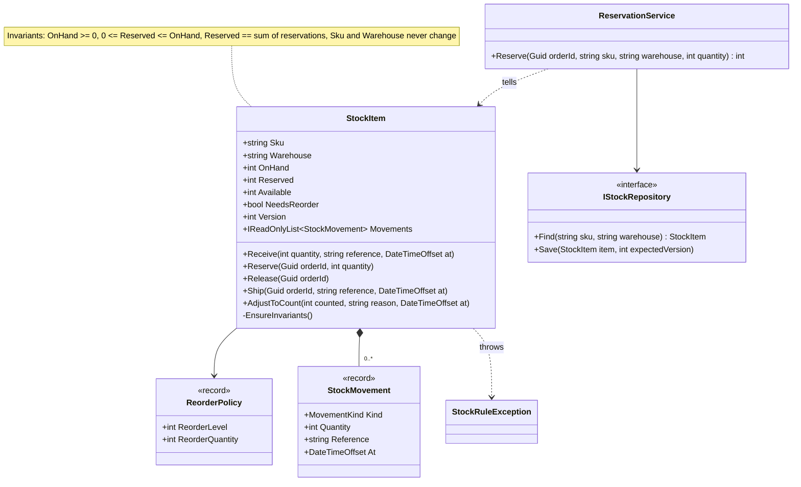
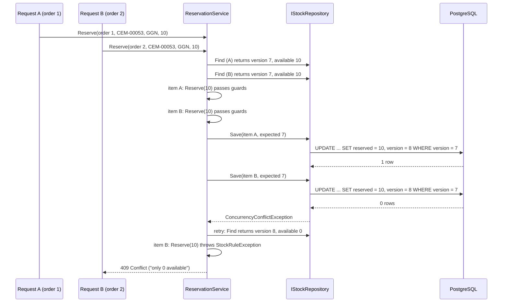

You have found your classes, given them responsibilities and connected them. Now the hardest part: making sure they can never be put into a state that makes no sense. A stock item with −40 units reserved. A leave balance of 52 days when the policy allows 30. A percentage of 150. These bugs rarely come from one obviously wrong line. They come from many small paths around the rules: a public setter, a leaked list, a `with` expression, two requests at the same time.

This lesson shows you how to close those paths. The running example is warehouse inventory (stock on hand, reservations and shipments), with leave balances, library loans, prices and bank accounts in the exercises.

## Learning objectives

By the end of this lesson you will be able to:

1. Define an invariant and list the invariants of a real class, separating them from input validation.
2. Write constructors and factory methods that only ever create valid objects.
3. Use guard clauses and the .NET throw helpers to state preconditions clearly.
4. Close the common back doors: public setters, leaked collections, `with` expressions on records, property initialisers that skip validation, and `default` structs.
5. Make multi-step operations all-or-nothing, so a failure halfway does not leave the object broken.
6. Explain how concurrency, ORMs and serialisers can break invariants, and what to do about each.

## Prerequisites

- [Identifying entities, value objects and services](#/lesson/m07-entities-values-services): entities change through methods; value objects validate on creation.
- [Identifying classes and responsibilities](#/lesson/m07-classes-responsibilities): Information Expert and "Tell, Don't Ask".
- [Encapsulation, abstraction, inheritance and polymorphism](#/lesson/m01-oop-pillars) and [Exceptions](#/lesson/m01-exceptions).

## Explain it like I'm a beginner

Think about an ATM. Inside it are stacks of ₹500 and ₹100 notes. The bank has rules: the ATM never gives out more money than it holds, and the cash count on the screen always matches what is physically inside.

How does the bank make sure those rules hold? Not by putting up a sign saying "please do not take more than your balance". It **locks the cash inside a box** and gives you a **small set of buttons**: check balance, withdraw, deposit. Every button checks the rules before it moves any money. You cannot reach in and grab notes, and you cannot type "my balance is now ₹10 lakh".

Classes work the same way:

- The notes are the object's **data** (fields).
- The locked box is **encapsulation**: the data is private.
- The buttons are the object's **public methods**.
- The rules that must always be true ("cash count never negative", "shown count equals real count") are **invariants**.
- The checks each button does before acting are **guard clauses** (preconditions).

If the box has a gap, even a small one (a public setter, a list you hand out), the rules are only as strong as the most careless caller. Encapsulation means there is no gap.

## First-principles explanation

### What an invariant is

An **invariant** is a condition that must be true for an object whenever no method is in the middle of running. In other words, it is true after the constructor finishes, and true again after every public method returns.

For a warehouse stock item:

1. `OnHand >= 0`
2. `0 <= Reserved <= OnHand` (you cannot promise more stock than you have)
3. `Reserved` equals the sum of all individual reservations
4. `Sku` and `Warehouse` never change and are never empty

For a leave balance: `0 <= Days <= 30`. For a bank account with an overdraft: `Balance >= -OverdraftLimit`. For a parking spot: "occupied" if and only if it has an active ticket id.

Three related ideas, often confused:

| Term | Question it answers | Example |
|---|---|---|
| **Invariant** | What is always true of this object? | `Reserved <= OnHand` |
| **Precondition** | What must be true before this method may run? | `Reserve(qty)` needs `qty > 0` and `qty <= Available` |
| **Postcondition** | What does this method promise afterwards? | After `Reserve`, `Available` decreased by `qty` |

Bertrand Meyer's **Design by Contract** formalises these three. In C# we express them with constructors, guard clauses and tests.

### Invariants versus input validation

They are different jobs, done in different places:

- **Input validation** checks what a *user* typed: "the quantity field is required", "must be a number", "max 6 digits". It lives at the edge (API model validation, FluentValidation), produces friendly messages, and may collect several errors at once.
- **Invariants** are rules of the *model*: "reserved can never exceed on hand". They live inside the domain object, are checked on every path (API, background job, import, test), and fail fast with an exception.

The edge can check the same rule early for a nicer message, but the domain object must never rely on that. A nightly import job does not go through your API's validators. [Validation and business rules](#/lesson/m07-validation-rules) covers the split in depth.

### Technique 1: constructors that only make valid objects

If an object can exist in an invalid state, every method has to wonder "am I valid yet?". The alternative is the **always-valid object**: the constructor establishes every invariant, or throws.

```csharp
public StockItem(string sku, string warehouse, ReorderPolicy policy)
{
    ArgumentException.ThrowIfNullOrWhiteSpace(sku);
    ArgumentException.ThrowIfNullOrWhiteSpace(warehouse);
    ArgumentNullException.ThrowIfNull(policy);
    Sku = sku; Warehouse = warehouse; Policy = policy;
}
```

Avoid the pattern "create with `new`, then set properties, then call `Validate()`". Between `new` and `Validate()` the object is invalid, and someone will forget to call `Validate()`.

When creation can fail for ordinary reasons (parsing user input), offer a `TryCreate` or `Parse` factory that returns a result instead of throwing, and keep the constructor strict.

### Technique 2: guard clauses with throw helpers

A **guard clause** checks a precondition at the top of a method and exits immediately if it fails. It keeps the happy path unindented and the rules visible.

.NET 8 and later have throw helpers that make guards one line each and give consistent messages that include the parameter name:

```csharp
ArgumentNullException.ThrowIfNull(policy);
ArgumentException.ThrowIfNullOrWhiteSpace(reference);
ArgumentOutOfRangeException.ThrowIfNegativeOrZero(quantity);
ArgumentOutOfRangeException.ThrowIfGreaterThan(quantity, 10_000);
```

Use `Argument*Exception` for **caller bugs** (a negative quantity is never valid). Use a domain exception for **business rule refusals** that depend on state ("only 12 units available"), so the API can map them to a 409 or 422 and the message can be shown to a user. [Error handling and domain exceptions](#/lesson/m07-domain-exceptions) compares exceptions with `Result` types.

### Technique 3: no public setters on state with rules

`public int Reserved { get; set; }` is an invitation. Every class in the solution can now write `item.Reserved = -40`. Instead:

- `{ get; private set; }` for state that changes through methods.
- `{ get; }` (get-only) for state set once in the constructor.
- `{ get; init; }` only when you have validation in the `init` accessor (see Technique 5), or for plain data types with no rules.

Then expose **intention-revealing methods**: `Reserve(orderId, qty)`, `Ship(orderId)`, `AdjustToCount(counted, reason)`. This is "Tell, Don't Ask": callers say what they want, and the object decides whether it is allowed.

### Technique 4: do not leak mutable internals

A private field is not private if you hand out a reference to it.

```csharp
private readonly List<StockMovement> _movements = new();
public IReadOnlyList<StockMovement> Movements => _movements;   // looks read-only...
((List<StockMovement>)item.Movements).Clear();                 // ...but the history is gone
```

`IReadOnlyList<T>` is an interface, and the object behind it is still a `List<T>`. Options, from cheapest to safest:

- **`_movements.AsReadOnly()`** returns a `ReadOnlyCollection<T>` wrapper. Callers cannot cast it back to a list. It is a live view: later changes show through. Cost: one small allocation per call (you can cache the wrapper in a field).
- **A copy** (`_movements.ToArray()`): a snapshot that cannot change. Cost: copies every element on each call.
- **An immutable collection** (`ImmutableList<T>`) as the field type, if the data rarely changes.

The same applies to arrays (always mutable), dictionaries (use `AsReadOnly()` from .NET 7+ or `ReadOnlyDictionary`), and **mutable objects inside your object**: returning a mutable `Address` class lets callers change the address without going through your rules. Prefer immutable value objects for parts.

### Technique 5: records, `with` and the `field` keyword

Records are excellent for value objects, but they open two back doors.

**Back door 1: `with` expressions skip the constructor.** `with` clones the object and then runs `init` accessors for the properties you set. If validation lives only in the constructor, this compiles and succeeds:

```csharp
public sealed record Percentage
{
    public Percentage(decimal value)
    {
        if (value is < 0 or > 100) throw new ArgumentOutOfRangeException(nameof(value));   // validation here only
        Value = value;
    }
    public decimal Value { get; init; }
}
var gst = new Percentage(18m);
var broken = gst with { Value = 150m };   // constructor never runs
```

**Back door 2: object initialisers set `init` properties after construction.** `new Percentage(18m) { Value = 150m }` also bypasses constructor checks.

The fix is to validate **in the `init` accessor itself**. C# 14's `field` keyword makes this concise, because you no longer need to declare a backing field by hand:

```csharp
public sealed record Percentage
{
    public Percentage(decimal value) => Value = value;   // goes through the init accessor
    public decimal Value
    {
        get;
        init => field = value is >= 0 and <= 100 ? value : throw new ArgumentOutOfRangeException(nameof(Value));
    }
}
```

One more trap, which surprises experienced developers: **a property initialiser (`public decimal Value { get; init => ... } = value;`) writes the backing field directly and skips the `init` accessor.** Assign through the property in a constructor body, as above, so every path runs the check.

For invariants that involve **two properties** (`Min <= Max`), per-property `init` checks are not enough, because properties are set one at a time. Make those properties get-only (so `with` cannot set them), and offer methods such as `WithMax(decimal max)` that call the constructor. Exercise 3 practises both.

**Structs** have a third back door: `default(T)` and `new T[10]` create instances without running any constructor. Prefer `sealed record` (a class) for value objects with invariants, as the [entities and value objects lesson](#/lesson/m07-entities-values-services) recommended.

### Technique 6: all-or-nothing operations

An invariant may be temporarily false *inside* a method, but must be true again before the method returns, **including when it throws**. The simplest way to achieve that: **check everything first, then change state.**

```csharp
public void Ship(Guid orderId, string reference, DateTimeOffset at)
{
    // 1. All checks (no state touched yet)
    ArgumentException.ThrowIfNullOrWhiteSpace(reference);
    if (!_reservations.TryGetValue(orderId, out var qty)) throw new StockRuleException(...);
    // 2. All mutations (nothing below can fail for a business reason)
    _reservations.Remove(orderId);
    Reserved -= qty;
    OnHand -= qty;
    _movements.Add(new StockMovement(MovementKind.Shipment, -qty, reference, at));
}
```

If you must call something that can fail in the middle (another object, I/O), either do it before any mutation, or compute the new state into local variables and assign them at the end. For operations across *several* objects, such as reserving stock for five order lines, validate all lines first and then apply all of them (exercise 5).

### Technique 7: a self-check

For objects with several related numbers, a private `EnsureInvariants()` called at the end of each mutating method catches bugs in *your own* methods early, close to the cause:

```csharp
private void EnsureInvariants()
{
    if (OnHand < 0 || Reserved < 0 || Reserved > OnHand || _reservations.Values.Sum() != Reserved)
        throw new InvalidOperationException($"Invariant violated for {Sku}: on hand {OnHand}, reserved {Reserved}.");
}
```

This is cheap for small objects. For large collections, use `Debug.Assert` or run the check only in tests.

### What can still break invariants

Encapsulation protects against *other code*. Four things can still get around it:

1. **Concurrency.** Two requests reserve the last 10 units at the same moment. Each checks `qty <= Available` (true for both), then both reserve: 20 reserved, 10 on hand. Inside one process, a `lock` makes check-and-change atomic. Across processes and servers, the database must decide: an optimistic concurrency token (a `version` column, or PostgreSQL's `xmin` system column via EF Core) makes the second save fail so it can retry with fresh data. See [Deadlocks, optimistic and pessimistic locking](#/lesson/m09-locking).
2. **ORMs and serialisers.** EF Core and `System.Text.Json` can set private setters and backing fields. That is how they load objects, and it is fine as long as the database or JSON is trusted. Add database constraints (`CHECK (reserved >= 0 AND reserved <= on_hand)`) as a second line of defence for data written by other systems.
3. **Reflection** and `UnsafeAccessor` can reach anything. Encapsulation guards against mistakes, not malice.
4. **Invariants spanning several objects** ("total reserved across all warehouses never exceeds the order quantity") cannot be protected by one object alone. Put the objects that share an invariant under one owner (an aggregate root) that all changes go through. That is the subject of [Aggregates and aggregate roots](#/lesson/m08-aggregates).

### When this is too much

- **DTOs and API models** carry data across a boundary and have no behaviour. Public `get; set;` (or simple records) is correct for them.
- **Private helper methods** do not need to re-validate what the public method already guarded. Guard at the public boundary of the class.
- **Read models** for reports are built from trusted data and never changed by users. Plain records are enough.

Over-guarding has a cost too: duplicated checks that drift apart and noisy code where the real rules are hard to find.

### Trade-offs

| You gain | You pay |
|---|---|
| Bugs fail loudly at the point of cause, not three screens later | More code than public setters |
| Every path (API, job, import, test) gets the same rules | ORMs and serialisers need configuration (private setters, constructors) |
| Objects are easy to reason about: if you have one, it is valid | Some operations need explicit methods instead of "just set it" |
| Database constraints become a backstop rather than the only defence | Rules may appear in two places (domain and DB) and must be kept in step |

## Visual explanation

### Class diagram



How to read it: every property of `StockItem` is read-only from outside (no setters appear in the public list); the only way in is through the five verbs. The note lists the invariants that each verb must preserve. `ReorderPolicy` is a validated record. `ReservationService` never touches quantities itself; it *tells* the item to reserve, then saves with the version it loaded, which is how the invariant survives two servers acting at once.

### Sequence diagram: two reservations race for the last units



Each object protects its invariant *within one process*, but two copies of the same stock item exist in memory at once. The `WHERE version = 7` clause makes the database the final judge: only one save wins. The loser reloads and re-runs the same domain guard, which now refuses. The invariant held, and no `lock` across servers was needed.

## Step-by-step example

### Step 1: the leaky version

```csharp
public class StockItem
{
    public string Sku { get; set; } = "";
    public int OnHand { get; set; }
    public int Reserved { get; set; }
    public List<StockMovement> Movements { get; set; } = new();
}

// In OrderService:
if (item.OnHand - item.Reserved >= qty) item.Reserved += qty;
// In ShippingService:
item.OnHand -= qty; item.Reserved -= qty;          // forgot the movement record
// In StockCountJob:
item.OnHand = counted;                              // can drop below Reserved
```

Three services, three copies of half-rules, and one of them can make `Reserved > OnHand`.

### Step 2: write the invariants down

Before any code, list them in plain English (the note in the class diagram). Then list every way the state changes today: receive, reserve, release, ship, count adjustment. Each becomes one method.

### Step 3: close the setters, add the verbs

Make every setter private. Move each service's logic into the matching method on `StockItem`, with guard clauses for preconditions. Delete the copies in the services.

### Step 4: protect the collections and the policy

`Movements` becomes `AsReadOnly()`. Reservations move into a private dictionary keyed by order id. `ReorderPolicy` becomes a record that validates in its `init` accessors, so `policy with { ReorderLevel = -5 }` fails.

### Step 5: add the self-check and the concurrency token

`EnsureInvariants()` runs after every mutation. `Version` increments on every change, and the repository saves with `WHERE version = expected`.

## Production-style C# implementation

```text
Inventory.Api/
  Program.cs
  Stock/
    ReorderPolicy.cs
    StockItem.cs
    StockRepository.cs
    ReservationService.cs
```

```csharp file=Stock/ReorderPolicy.cs
namespace Inventory.Stock;

/// <summary>Value object. Validation lives in the init accessors, so constructors, object
/// initialisers and with-expressions all run it. (C# 14 'field' keyword.)</summary>
public sealed record ReorderPolicy
{
    public ReorderPolicy(int reorderLevel, int reorderQuantity)
    {
        ReorderLevel = reorderLevel;       // assigned through the property, not a property initialiser
        ReorderQuantity = reorderQuantity;
    }

    public int ReorderLevel
    {
        get;
        init => field = value >= 0 ? value : throw new ArgumentOutOfRangeException(nameof(ReorderLevel), value, "Cannot be negative.");
    }

    public int ReorderQuantity
    {
        get;
        init => field = value > 0 ? value : throw new ArgumentOutOfRangeException(nameof(ReorderQuantity), value, "Must be positive.");
    }
}
```

```csharp file=Stock/StockItem.cs
namespace Inventory.Stock;

/// <summary>A business rule refused the operation. The API maps this to 409 Conflict.</summary>
public sealed class StockRuleException(string message) : Exception(message);

public enum MovementKind { Receipt, Shipment, Adjustment }

public sealed record StockMovement(MovementKind Kind, int Quantity, string Reference, DateTimeOffset At);

/// <summary>
/// Invariants (true after the constructor and after every public method, including when one throws):
///   OnHand >= 0;  0 <= Reserved <= OnHand;  Reserved == sum of reservations;  Sku and Warehouse fixed and non-empty.
/// </summary>
public sealed class StockItem
{
    private readonly Dictionary<Guid, int> _reservations = new();
    private readonly List<StockMovement> _movements = new();

    public StockItem(string sku, string warehouse, ReorderPolicy policy)
    {
        ArgumentException.ThrowIfNullOrWhiteSpace(sku);
        ArgumentException.ThrowIfNullOrWhiteSpace(warehouse);
        ArgumentNullException.ThrowIfNull(policy);
        Sku = sku.ToUpperInvariant();
        Warehouse = warehouse.ToUpperInvariant();
        Policy = policy;
    }

    public string Sku { get; }
    public string Warehouse { get; }
    public ReorderPolicy Policy { get; private set; }
    public int OnHand { get; private set; }
    public int Reserved { get; private set; }
    public int Available => OnHand - Reserved;
    public bool NeedsReorder => Available <= Policy.ReorderLevel;

    /// <summary>Optimistic concurrency token: incremented on every change.</summary>
    public int Version { get; private set; }

    public IReadOnlyList<StockMovement> Movements => _movements.AsReadOnly();
    public IReadOnlyDictionary<Guid, int> Reservations => _reservations.AsReadOnly();

    public void Receive(int quantity, string reference, DateTimeOffset at)
    {
        ArgumentOutOfRangeException.ThrowIfNegativeOrZero(quantity);
        ArgumentException.ThrowIfNullOrWhiteSpace(reference);

        OnHand += quantity;
        _movements.Add(new StockMovement(MovementKind.Receipt, quantity, reference, at));
        Changed();
    }

    public void Reserve(Guid orderId, int quantity)
    {
        ArgumentOutOfRangeException.ThrowIfNegativeOrZero(quantity);
        if (_reservations.ContainsKey(orderId))
            throw new StockRuleException($"Order {orderId} already holds a reservation for {Sku}.");
        if (quantity > Available)
            throw new StockRuleException($"Cannot reserve {quantity} of {Sku} at {Warehouse}: only {Available} available.");

        _reservations.Add(orderId, quantity);
        Reserved += quantity;
        Changed();
    }

    public void Release(Guid orderId)
    {
        if (!_reservations.Remove(orderId, out var quantity))
            throw new StockRuleException($"Order {orderId} has no reservation for {Sku}.");
        Reserved -= quantity;
        Changed();
    }

    public void Ship(Guid orderId, string reference, DateTimeOffset at)
    {
        ArgumentException.ThrowIfNullOrWhiteSpace(reference);
        if (!_reservations.TryGetValue(orderId, out var quantity))
            throw new StockRuleException($"Order {orderId} has no reservation for {Sku}; reserve before shipping.");

        // All checks done; from here on nothing can fail for a business reason.
        _reservations.Remove(orderId);
        Reserved -= quantity;
        OnHand -= quantity;
        _movements.Add(new StockMovement(MovementKind.Shipment, -quantity, reference, at));
        Changed();
    }

    /// <summary>Applies a physical stock count. Refuses counts below what is already promised.</summary>
    public void AdjustToCount(int counted, string reason, DateTimeOffset at)
    {
        ArgumentOutOfRangeException.ThrowIfNegative(counted);
        ArgumentException.ThrowIfNullOrWhiteSpace(reason);
        if (counted < Reserved)
            throw new StockRuleException($"Count {counted} is below reserved {Reserved} for {Sku}. Release or reallocate reservations first.");

        var delta = counted - OnHand;
        if (delta == 0) return;
        OnHand = counted;
        _movements.Add(new StockMovement(MovementKind.Adjustment, delta, reason, at));
        Changed();
    }

    public void ChangePolicy(ReorderPolicy policy)
    {
        Policy = policy ?? throw new ArgumentNullException(nameof(policy));
        Changed();
    }

    private void Changed()
    {
        EnsureInvariants();
        Version++;
    }

    private void EnsureInvariants()
    {
        if (OnHand < 0 || Reserved < 0 || Reserved > OnHand || _reservations.Values.Sum() != Reserved)
            throw new InvalidOperationException(
                $"Invariant violated for {Sku}@{Warehouse}: on hand {OnHand}, reserved {Reserved}, reservations {_reservations.Values.Sum()}.");
    }
}
```

```csharp file=Stock/StockRepository.cs
using System.Collections.Concurrent;

namespace Inventory.Stock;

/// <summary>Another writer saved this item first. Reload and retry.</summary>
public sealed class ConcurrencyConflictException(string message) : Exception(message);

public interface IStockRepository
{
    StockItem? Find(string sku, string warehouse);
    /// <summary>Saves only if the stored version still equals <paramref name="expectedVersion"/>.</summary>
    void Save(StockItem item, int expectedVersion);
}

/// <summary>
/// Demo store that mimics "UPDATE ... WHERE version = @expected". It keeps the version it last saved per key,
/// so two in-memory copies of the same item cannot both win.
/// </summary>
public sealed class InMemoryStockRepository : IStockRepository
{
    private readonly ConcurrentDictionary<(string, string), (StockItem Item, int Version)> _rows = new();
    private readonly object _gate = new();

    public void Seed(StockItem item) => _rows[(item.Sku, item.Warehouse)] = (item, item.Version);

    public StockItem? Find(string sku, string warehouse) =>
        _rows.TryGetValue((sku.ToUpperInvariant(), warehouse.ToUpperInvariant()), out var row) ? row.Item : null;

    public void Save(StockItem item, int expectedVersion)
    {
        lock (_gate)
        {
            var key = (item.Sku, item.Warehouse);
            if (_rows.TryGetValue(key, out var row) && row.Version != expectedVersion)
                throw new ConcurrencyConflictException($"{item.Sku}@{item.Warehouse} changed (stored v{row.Version}, expected v{expectedVersion}).");
            _rows[key] = (item, item.Version);
        }
    }
}
```

```csharp file=Stock/ReservationService.cs
using Microsoft.Extensions.Logging;

namespace Inventory.Stock;

/// <summary>Application service: load, tell, save; retries on concurrency conflicts. Holds no stock rules.</summary>
public sealed class ReservationService(IStockRepository stock, ILogger<ReservationService> logger)
{
    private const int MaxAttempts = 3;

    public int Reserve(Guid orderId, string sku, string warehouse, int quantity)
    {
        for (var attempt = 1; ; attempt++)
        {
            var item = stock.Find(sku, warehouse) ?? throw new KeyNotFoundException($"No stock record for {sku} at {warehouse}.");
            var loadedVersion = item.Version;

            item.Reserve(orderId, quantity);          // invariants enforced here

            try
            {
                stock.Save(item, loadedVersion);
                logger.LogInformation("Reserved {Quantity} x {Sku}@{Warehouse} for {OrderId}; {Available} left",
                    quantity, item.Sku, item.Warehouse, orderId, item.Available);
                return item.Available;
            }
            catch (ConcurrencyConflictException) when (attempt < MaxAttempts)
            {
                logger.LogWarning("Concurrency conflict reserving {Sku} for {OrderId}, attempt {Attempt}", sku, orderId, attempt);
            }
        }
    }
}
```

```csharp file=Program.cs
using Inventory.Stock;

var builder = WebApplication.CreateBuilder(args);

var repository = new InMemoryStockRepository();
var cement = new StockItem("CEM-00053", "GGN", new ReorderPolicy(reorderLevel: 100, reorderQuantity: 500));
cement.Receive(400, "GRN-2026-0815", DateTimeOffset.UtcNow);
repository.Seed(cement);

builder.Services.AddSingleton<IStockRepository>(repository);
builder.Services.AddScoped<ReservationService>();

var app = builder.Build();

app.MapPost("/stock/{warehouse}/{sku}/reservations", (string warehouse, string sku, Guid orderId, int quantity, ReservationService service) =>
{
    try { return Results.Ok(new { available = service.Reserve(orderId, sku, warehouse, quantity) }); }
    catch (ArgumentException ex) { return Results.Problem(ex.Message, statusCode: StatusCodes.Status400BadRequest); }
    catch (KeyNotFoundException ex) { return Results.Problem(ex.Message, statusCode: StatusCodes.Status404NotFound); }
    catch (StockRuleException ex) { return Results.Problem(ex.Message, statusCode: StatusCodes.Status409Conflict); }
    catch (ConcurrencyConflictException) { return Results.Problem("Stock is busy, please retry.", statusCode: StatusCodes.Status409Conflict); }
});

app.MapGet("/stock/{warehouse}/{sku}", (string warehouse, string sku, IStockRepository stock) =>
    stock.Find(sku, warehouse) is { } item
        ? Results.Ok(new { item.Sku, item.Warehouse, item.OnHand, item.Reserved, item.Available, item.NeedsReorder })
        : Results.NotFound());

app.Run();
```

The same invariants, as a database backstop in PostgreSQL:

```sql
CREATE TABLE stock_items (
    sku         text    NOT NULL,
    warehouse   text    NOT NULL,
    on_hand     integer NOT NULL CHECK (on_hand >= 0),
    reserved    integer NOT NULL CHECK (reserved >= 0),
    version     integer NOT NULL DEFAULT 0,
    PRIMARY KEY (sku, warehouse),
    CONSTRAINT reserved_within_on_hand CHECK (reserved <= on_hand)
);

-- The optimistic-concurrency save the repository would issue:
UPDATE stock_items SET on_hand = $3, reserved = $4, version = version + 1
WHERE sku = $1 AND warehouse = $2 AND version = $5;   -- 0 rows updated = conflict
```

Design notes:

- **`Changed()` checks invariants before bumping the version**, so a bug in one of the methods throws before anything is saved.
- **The two `AsReadOnly()` properties** return wrappers that cannot be cast back to the mutable collections. For hot paths, cache the wrapper in a field.
- **The service retries a bounded number of times** (3), then lets the conflict surface as a 409. Unbounded retries under contention can spin.
- **The SQL `CHECK` constraints** do not replace the domain rules (they give unfriendly errors and cannot express "sum of reservations"), but they stop a buggy import script from writing impossible rows.

## Bad design vs good design

**Bad**: Step 1's public setters, plus this "validation" that runs only in the API:

```csharp
public sealed class ReserveRequestValidator : AbstractValidator<ReserveRequest>
{
    public ReserveRequestValidator() => RuleFor(r => r.Quantity).GreaterThan(0);
}
// The bulk-import job and the admin console call item.Reserved += qty directly. No validator runs.
```

Rules that live only at the edge protect only one entrance. The stock count job, the import, a test helper, and next year's mobile app all have their own entrances.

**Also bad: the "validated" record with a back door.**

```csharp
public sealed record ReorderPolicy
{
    public ReorderPolicy(int level, int quantity)
    {
        if (level < 0 || quantity <= 0) throw new ArgumentOutOfRangeException();   // only the constructor checks
        ReorderLevel = level; ReorderQuantity = quantity;
    }
    public int ReorderLevel { get; init; }
    public int ReorderQuantity { get; init; }
}
var p = policy with { ReorderLevel = -5 };   // no validation runs
```

**Good**: the implementation above. Private state, verbs with guards, read-only views, validation in `init` accessors, all-or-nothing methods, a self-check, an optimistic concurrency token, and database constraints as a backstop.

**Is it always worth it?** For a `ProductCategory` with a name and a display order and no rules, no. Public properties on a simple record are fine. The more numbers that must agree with each other, and the more entry points the system has, the more this pays off. Inventory, money, leave balances and anything legally audited are clear cases.

:::callout type=mistake title="Validation in the getter"
Some code "protects" an invariant by clamping in the getter: `public int Reserved => Math.Min(_reserved, OnHand);`. The stored value is still wrong, every other calculation that uses `_reserved` is still wrong, and the bug is now hidden. Refuse invalid changes; never quietly correct them on read.
:::

## Practical playground

The playground shows three back doors and their fixes. Run it, then:

1. Remove `.AsReadOnly()` from `Sealed.Lines`. Does the cast succeed now?
2. Move the validation in `SafePercent` from the `init` accessor to the constructor only. Which line now prints a broken value?
3. Change `SafePercent`'s constructor to a property initialiser (`{ get; init => ... } = value;` in a positional record). Predict, then check, whether the constructor path is still validated.

:::playground type=csharp title="Closing the back doors"
```csharp file=Program.cs
using System;
using System.Collections.Generic;

public sealed record LoosePercent(decimal Value)
{
    // Validation only in a helper that the constructor path calls; with-expressions skip it.
    public static LoosePercent Create(decimal v) => v is >= 0 and <= 100 ? new LoosePercent(v) : throw new ArgumentOutOfRangeException(nameof(v));
}

public sealed record SafePercent
{
    public SafePercent(decimal value) => Value = value;
    public decimal Value
    {
        get;
        init => field = value is >= 0 and <= 100 ? value : throw new ArgumentOutOfRangeException(nameof(Value));
    }
}

public sealed class Leaky
{
    private readonly List<string> _lines = new() { "CEM-00053 x 10" };
    public IReadOnlyList<string> Lines => _lines;                 // castable back to List<string>
}

public sealed class Sealed
{
    private readonly List<string> _lines = new() { "CEM-00053 x 10" };
    public IReadOnlyList<string> Lines => _lines.AsReadOnly();    // ReadOnlyCollection wrapper
}

public static class Program
{
    public static void Main()
    {
        var gst = LoosePercent.Create(18m);
        var broken = gst with { Value = 150m };
        Console.WriteLine($"Loose percent after with: {broken.Value}");          // 150: invariant broken

        try { var bad = new SafePercent(18m) with { Value = 150m }; Console.WriteLine(bad.Value); }
        catch (ArgumentOutOfRangeException) { Console.WriteLine("Safe percent refused 150 in with-expression"); }

        var leaky = new Leaky();
        if (leaky.Lines is List<string> list) { list.Clear(); Console.WriteLine($"Leaky lines after cast+clear: {leaky.Lines.Count}"); }

        var sealedOne = new Sealed();
        Console.WriteLine($"Sealed lines castable to List? {sealedOne.Lines is List<string>}");
    }
}
```
:::

## Exercises

:::exercise id=m07-encapsulation-invariants-ex1 difficulty=beginner kind=code title="Guard a leave balance"
An HR system keeps each employee's earned-leave balance. Policy: the balance is between 0 and 30 days (the maximum carry-forward). Make it impossible to break.
::requirements
- Constructor: employee code must not be null or whitespace; opening balance must be 0 to 30.
- `Credit(days)` adds days; `days` must be positive; refuse if the result would exceed 30.
- `Deduct(days)` removes days; `days` must be positive; refuse if more than the current balance.
- `Days` has no public setter.
- Use `ArgumentException`/`ArgumentOutOfRangeException` for caller bugs and `InvalidOperationException` for business refusals. Refusals leave the balance unchanged.
::acceptance
- `new LeaveBalance("  ", 5)` throws `ArgumentException`; `new LeaveBalance("E1042", 31)` throws `ArgumentOutOfRangeException`.
- Opening 10, credit 15 gives 25; then credit 6 throws `InvalidOperationException` and the balance stays 25.
- Deducting 0 or a negative number throws `ArgumentOutOfRangeException`.
- Deducting 26 from 25 throws `InvalidOperationException` and the balance stays 25.
::hint
Which checks depend only on the argument (always wrong), and which depend on the current balance (wrong right now)? They get different exception types.
::hint
.NET has one-line throw helpers: `ArgumentException.ThrowIfNullOrWhiteSpace`, `ArgumentOutOfRangeException.ThrowIfNegativeOrZero`, `ThrowIfGreaterThan`, `ThrowIfNegative`.
::hint
Check first, then change: compute `Days + days`, refuse if it exceeds 30, and only then assign.
::hint
```csharp
ArgumentOutOfRangeException.ThrowIfNegativeOrZero(days);
if (Days + days > MaxCarryForward) throw new InvalidOperationException(...);
Days += days;
```
::starter
```csharp file=LeaveBalance.cs
using System;

public sealed class LeaveBalance
{
    public const int MaxCarryForward = 30;

    public LeaveBalance(string employeeCode, int openingDays) => throw new NotImplementedException();

    public string EmployeeCode { get; } = "";
    public int Days { get; private set; }

    public void Credit(int days) => throw new NotImplementedException();
    public void Deduct(int days) => throw new NotImplementedException();
}
```
::tests
```csharp file=LeaveBalanceTests.cs
using System;
using Xunit;

public class LeaveBalanceTests
{
    [Fact] public void Whitespace_code_rejected() => Assert.Throws<ArgumentException>(() => new LeaveBalance("  ", 5));
    [Fact] public void Opening_over_max_rejected() => Assert.Throws<ArgumentOutOfRangeException>(() => new LeaveBalance("E1042", 31));
    [Fact] public void Negative_opening_rejected() => Assert.Throws<ArgumentOutOfRangeException>(() => new LeaveBalance("E1042", -1));

    [Fact]
    public void Credit_up_to_max_then_refuse()
    {
        var b = new LeaveBalance("E1042", 10);
        b.Credit(15);
        Assert.Equal(25, b.Days);
        Assert.Throws<InvalidOperationException>(() => b.Credit(6));
        Assert.Equal(25, b.Days);
    }

    [Theory]
    [InlineData(0)]
    [InlineData(-3)]
    public void Non_positive_deduct_rejected(int days) =>
        Assert.Throws<ArgumentOutOfRangeException>(() => new LeaveBalance("E1042", 10).Deduct(days));

    [Fact]
    public void Over_deduct_refused_and_unchanged()
    {
        var b = new LeaveBalance("E1042", 25);
        Assert.Throws<InvalidOperationException>(() => b.Deduct(26));
        Assert.Equal(25, b.Days);
        b.Deduct(25);
        Assert.Equal(0, b.Days);
    }
}
```
::solution
```csharp file=LeaveBalance.cs
using System;

public sealed class LeaveBalance
{
    public const int MaxCarryForward = 30;

    public LeaveBalance(string employeeCode, int openingDays)
    {
        ArgumentException.ThrowIfNullOrWhiteSpace(employeeCode);
        ArgumentOutOfRangeException.ThrowIfNegative(openingDays);
        ArgumentOutOfRangeException.ThrowIfGreaterThan(openingDays, MaxCarryForward);
        EmployeeCode = employeeCode;
        Days = openingDays;
    }

    public string EmployeeCode { get; } = "";
    public int Days { get; private set; }

    public void Credit(int days)
    {
        ArgumentOutOfRangeException.ThrowIfNegativeOrZero(days);
        if (Days + days > MaxCarryForward)
            throw new InvalidOperationException($"{EmployeeCode}: crediting {days} would exceed the {MaxCarryForward}-day limit (current {Days}).");
        Days += days;
    }

    public void Deduct(int days)
    {
        ArgumentOutOfRangeException.ThrowIfNegativeOrZero(days);
        if (days > Days)
            throw new InvalidOperationException($"{EmployeeCode}: cannot deduct {days} days, only {Days} available.");
        Days -= days;
    }
}
```

`ArgumentException.ThrowIfNullOrWhiteSpace` throws `ArgumentNullException` for `null` (a subclass of `ArgumentException`) and `ArgumentException` for whitespace, so callers catching `ArgumentException` handle both.
::mistakes
- Clamping instead of refusing: `Days = Math.Min(Days + days, 30)` silently loses leave the employee earned.
- Using `ArgumentException` for "not enough balance". The argument is fine; the current state is what refuses it.
- Adding a public `SetDays(int)` "for the admin screen". Give the admin screen its own verb (`CorrectBalance(days, reason)`) with the same guards and an audit reason.
:::

:::exercise id=m07-encapsulation-invariants-ex2 difficulty=beginner kind=code title="Stop a library member's loans from leaking"
A `Member` exposes its loans as `IReadOnlyList<Loan>`, but a reporting script cast it back to `List<Loan>` and cleared it. Fix the leak and implement the borrowing rules.
::requirements
- `Loans` cannot be cast back to a mutable list, and its `ICollection<T>.IsReadOnly` is `true`.
- `Borrow(copyId, dueOn)` refuses when the member already has `maxLoans` loans, or already has that copy (`InvalidOperationException`).
- `Return(copyId)` removes the loan, or throws `InvalidOperationException` if there is none.
- `CopyIdsDueBefore(date)` returns a **snapshot**: later borrows and returns do not change a list already returned.
::acceptance
- `member.Loans as List<Loan>` is `null`.
- A fourth borrow with `maxLoans = 3` throws, and the count stays 3.
- Borrowing the same copy twice throws.
- A list from `CopyIdsDueBefore` keeps its contents after the member returns those copies.
::hint
`IReadOnlyList<T>` is just an interface. What object is actually behind it right now?
::hint
`List<T>.AsReadOnly()` returns a `ReadOnlyCollection<T>`, which is not a `List<T>` and reports `IsReadOnly = true`.
::hint
For the snapshot, return a new array or list built with `.ToArray()` or `.ToList()`; never return a view of the internal list.
::starter
```csharp file=Member.cs
using System;
using System.Collections.Generic;
using System.Linq;

public sealed record Loan(string CopyId, DateOnly DueOn);

public sealed class Member(string name, int maxLoans)
{
    private readonly List<Loan> _loans = new();
    public string Name { get; } = name;
    public int MaxLoans { get; } = maxLoans;

    public IReadOnlyList<Loan> Loans => _loans;   // leaks: castable back to List<Loan>

    public void Borrow(string copyId, DateOnly dueOn) => throw new NotImplementedException();
    public void Return(string copyId) => throw new NotImplementedException();
    public IReadOnlyList<string> CopyIdsDueBefore(DateOnly date) => throw new NotImplementedException();
}
```
::tests
```csharp file=MemberTests.cs
using System;
using System.Collections.Generic;
using Xunit;

public class MemberTests
{
    private static readonly DateOnly Due = new(2026, 11, 1);

    [Fact]
    public void Loans_cannot_be_cast_back()
    {
        var m = new Member("Kavya", 3);
        m.Borrow("C1", Due);
        Assert.Null(m.Loans as List<Loan>);
        Assert.True(((ICollection<Loan>)m.Loans).IsReadOnly);
    }

    [Fact]
    public void Limit_enforced()
    {
        var m = new Member("Kavya", 3);
        m.Borrow("C1", Due); m.Borrow("C2", Due); m.Borrow("C3", Due);
        Assert.Throws<InvalidOperationException>(() => m.Borrow("C4", Due));
        Assert.Equal(3, m.Loans.Count);
    }

    [Fact]
    public void Same_copy_twice_refused()
    {
        var m = new Member("Kavya", 3);
        m.Borrow("C1", Due);
        Assert.Throws<InvalidOperationException>(() => m.Borrow("C1", Due));
    }

    [Fact]
    public void Return_unknown_refused() =>
        Assert.Throws<InvalidOperationException>(() => new Member("Kavya", 3).Return("C9"));

    [Fact]
    public void Due_list_is_a_snapshot()
    {
        var m = new Member("Kavya", 3);
        m.Borrow("C1", new DateOnly(2026, 10, 10));
        m.Borrow("C2", new DateOnly(2026, 10, 20));
        var due = m.CopyIdsDueBefore(new DateOnly(2026, 10, 31));
        m.Return("C1");
        m.Return("C2");
        Assert.Equal(new[] { "C1", "C2" }, due);
        Assert.Empty(m.Loans);
    }
}
```
::solution
```csharp file=Member.cs
using System;
using System.Collections.Generic;
using System.Linq;

public sealed record Loan(string CopyId, DateOnly DueOn);

public sealed class Member(string name, int maxLoans)
{
    private readonly List<Loan> _loans = new();
    public string Name { get; } = name;
    public int MaxLoans { get; } = maxLoans;

    public IReadOnlyList<Loan> Loans => _loans.AsReadOnly();

    public void Borrow(string copyId, DateOnly dueOn)
    {
        ArgumentException.ThrowIfNullOrWhiteSpace(copyId);
        if (_loans.Count >= MaxLoans) throw new InvalidOperationException($"{Name} already has {MaxLoans} loans.");
        if (_loans.Any(l => l.CopyId == copyId)) throw new InvalidOperationException($"{Name} already has copy {copyId}.");
        _loans.Add(new Loan(copyId, dueOn));
    }

    public void Return(string copyId)
    {
        var index = _loans.FindIndex(l => l.CopyId == copyId);
        if (index < 0) throw new InvalidOperationException($"{Name} has no loan for {copyId}.");
        _loans.RemoveAt(index);
    }

    public IReadOnlyList<string> CopyIdsDueBefore(DateOnly date) =>
        _loans.Where(l => l.DueOn < date).Select(l => l.CopyId).ToArray();
}
```

Two different tools for two different promises: `AsReadOnly()` is a live, read-only *view* (cheap, reflects changes); `ToArray()` is a *snapshot* (a copy, never changes). Choose by what the caller needs.
::mistakes
- Returning `_loans.ToList()` from `Loans`: safe, but a new copy on every access, which hurts in loops.
- Returning the `IEnumerable` from a LINQ query (`_loans.Where(...)`) as the "snapshot". It is lazy, so it re-runs against the live list each time it is enumerated.
- Making `Loan` a mutable class, so callers can change `DueOn` through the read-only list.
:::

:::exercise id=m07-encapsulation-invariants-ex3 difficulty=intermediate kind=code title="Close the record back doors"
Two value objects in a pricing module have invariants that `with` expressions currently bypass. Fix both.
::requirements
- `Percentage` (0 to 100): validation must run for the constructor, object initialisers and `with` expressions. Add `Of(amount)` that returns the percentage of an amount rounded to 2 decimals.
- `PriceBand(min, max)`: `min >= 0` and `min <= max`. Because this invariant involves two properties, make them get-only and offer `WithMin` and `WithMax`, which return new validated instances.
- `PriceBand.Contains(price)` is inclusive at both ends.
::acceptance
- `new Percentage(18m) with { Value = 150m }` throws `ArgumentOutOfRangeException`.
- `new Percentage(-1m)` throws `ArgumentOutOfRangeException`.
- 18 % of ₹1,234.56 is ₹222.22.
- `new PriceBand(500m, 100m)` throws `ArgumentException`; `new PriceBand(-1m, 100m)` throws `ArgumentOutOfRangeException`.
- `band.WithMax(50m)` on a 100–500 band throws `ArgumentException`, and the original band is unchanged.
- Two bands with the same min and max are equal.
::hint
`with` runs `init` accessors, not constructors. Where must `Percentage`'s check live?
::hint
C# 14's `field` keyword lets you write `init => field = Check(value);` without declaring a backing field. Assign `Value = value;` in a constructor body, not in a property initialiser, which would skip the accessor.
::hint
For `PriceBand`, a per-property check cannot see the other property's new value reliably. Get-only properties make `with { Max = ... }` a compile error, so the only way to change a band is through methods you control.
::hint
```csharp
public PriceBand WithMax(decimal max) => new(Min, max);   // the constructor validates
```
::starter
```csharp file=Pricing.cs
using System;

public sealed record Percentage
{
    public Percentage(decimal value) => throw new NotImplementedException();
    public decimal Value { get; init; }
    public decimal Of(decimal amount) => throw new NotImplementedException();
}

public sealed record PriceBand
{
    public PriceBand(decimal min, decimal max) => throw new NotImplementedException();
    public decimal Min { get; }
    public decimal Max { get; }
    public PriceBand WithMin(decimal min) => throw new NotImplementedException();
    public PriceBand WithMax(decimal max) => throw new NotImplementedException();
    public bool Contains(decimal price) => throw new NotImplementedException();
}
```
::tests
```csharp file=PricingTests.cs
using System;
using Xunit;

public class PricingTests
{
    [Fact] public void With_expression_is_validated() =>
        Assert.Throws<ArgumentOutOfRangeException>(() => new Percentage(18m) with { Value = 150m });

    [Fact] public void Constructor_is_validated() =>
        Assert.Throws<ArgumentOutOfRangeException>(() => new Percentage(-1m));

    [Fact] public void Valid_with_works() => Assert.Equal(28m, (new Percentage(18m) with { Value = 28m }).Value);

    [Fact] public void Of_rounds_to_paise() => Assert.Equal(222.22m, new Percentage(18m).Of(1_234.56m));

    [Fact] public void Band_min_above_max_rejected() => Assert.Throws<ArgumentException>(() => new PriceBand(500m, 100m));
    [Fact] public void Band_negative_min_rejected() => Assert.Throws<ArgumentOutOfRangeException>(() => new PriceBand(-1m, 100m));

    [Fact]
    public void WithMax_validates_and_keeps_original()
    {
        var band = new PriceBand(100m, 500m);
        Assert.Throws<ArgumentException>(() => band.WithMax(50m));
        Assert.Equal(500m, band.Max);
        var wider = band.WithMax(800m);
        Assert.Equal(800m, wider.Max);
        Assert.Equal(100m, wider.Min);
    }

    [Fact]
    public void Contains_is_inclusive()
    {
        var band = new PriceBand(100m, 500m);
        Assert.True(band.Contains(100m));
        Assert.True(band.Contains(500m));
        Assert.False(band.Contains(500.01m));
    }

    [Fact] public void Bands_compare_by_value() => Assert.Equal(new PriceBand(1m, 2m), new PriceBand(1m, 2m));
}
```
::solution
```csharp file=Pricing.cs
using System;

public sealed record Percentage
{
    public Percentage(decimal value) => Value = value;   // runs the init accessor

    public decimal Value
    {
        get;
        init => field = value is >= 0m and <= 100m
            ? value
            : throw new ArgumentOutOfRangeException(nameof(Value), value, "Percentage must be between 0 and 100.");
    }

    public decimal Of(decimal amount) => Math.Round(amount * Value / 100m, 2, MidpointRounding.AwayFromZero);
}

public sealed record PriceBand
{
    public PriceBand(decimal min, decimal max)
    {
        ArgumentOutOfRangeException.ThrowIfNegative(min);
        if (min > max) throw new ArgumentException($"Band minimum {min} is above maximum {max}.", nameof(min));
        Min = min;
        Max = max;
    }

    public decimal Min { get; }   // get-only: 'with { Min = ... }' does not compile
    public decimal Max { get; }

    public PriceBand WithMin(decimal min) => new(min, Max);
    public PriceBand WithMax(decimal max) => new(Min, max);
    public bool Contains(decimal price) => price >= Min && price <= Max;
}
```

`Percentage` uses init-accessor validation because its invariant involves one property. `PriceBand` uses get-only properties plus `With...` methods because its invariant involves two. Records still give both value equality. 1,234.56 × 18 / 100 = 222.2208, which rounds to 222.22.
::alternatives
For `PriceBand` you could keep `init` setters and validate the pair in a private method called from both accessors, but the construction order makes that fragile (`Min` is checked against a `Max` that has not been set yet). Get-only properties are simpler and safer.
::mistakes
- Validating only in the constructor of a positional record (`record Percentage(decimal Value)`), which `with` skips.
- Using a property initialiser with the `field` keyword (`{ get; init => ...; } = value;`). The initialiser writes the backing field directly and the check never runs.
- Using `double` for prices and percentages.
:::

:::exercise id=m07-encapsulation-invariants-ex4 difficulty=intermediate kind=design title="Find and place the invariants of a joint bank account"
Requirement:

> A **savings account** at a cooperative bank in Nagpur can have one to three **holders**; exactly one is the **primary** holder. Balance may go negative only up to an approved **overdraft limit** (₹0 by default; up to ₹50,000 with approval). Each **transaction** is recorded with a unique reference; posting the same reference twice must not double-post. An account can be **frozen** by compliance; a frozen account accepts credits but no debits. Closing requires a zero balance.

List every invariant, mark it as a class invariant or a precondition, and decide which class owns it. Build the model with each class's invariants in its `responsibility`.
::acceptance
- "Balance ≥ −overdraft limit" is owned by the account and checked in every debit path.
- "One to three holders, exactly one primary" is owned by the account (holder changes go through it), not by `Holder`.
- Overdraft limit is a validated value (0 to ₹50,000) and changing it is a separate, explicit operation.
- Duplicate transaction references are refused by the account, using a set of posted references.
- "Frozen: no debits" and "close only at zero" are preconditions of specific methods.
::hint
Write each rule as "must always be true" or "must be true before X". The first kind are class invariants; the second are preconditions.
::hint
Who could break "exactly one primary holder"? Anyone who can add, remove or change holders. So all of those operations must live on one class.
::hint
Idempotent posting needs memory of what was posted. Which object should remember? The one whose balance the posting changes.
::hint
Consider `OverdraftLimit` as a value object (validated 0..50,000) and `Holder` as a small value or entity with a `IsPrimary` flag that only `SavingsAccount` can set.
::starter
```json file=account-invariants.json
{
  "classes": [
    { "id": "Acc", "name": "SavingsAccount", "kind": "class", "fields": [], "methods": [], "responsibility": "Invariants: TODO" },
    { "id": "Holder", "name": "Holder", "kind": "record", "fields": [], "methods": [] }
  ],
  "relations": []
}
```
::solution
| Rule | Kind | Owner |
|---|---|---|
| Balance ≥ −OverdraftLimit | class invariant | SavingsAccount |
| 1 ≤ holders ≤ 3, exactly one primary | class invariant | SavingsAccount |
| 0 ≤ OverdraftLimit ≤ ₹50,000 | class invariant | OverdraftLimit value object |
| Each transaction reference posted at most once | class invariant | SavingsAccount (set of references) |
| Debit requires not frozen | precondition of `Debit` | SavingsAccount |
| Close requires balance = 0 | precondition of `Close` | SavingsAccount |
| Any operation requires status ≠ Closed | precondition of all mutators | SavingsAccount |

```json file=account-invariants.json
{
  "classes": [
    { "id": "Acc", "name": "SavingsAccount", "kind": "class",
      "fields": ["+string Number", "+Money Balance", "+OverdraftLimit Limit", "+AccountStatus Status", "-List~Holder~ _holders", "-HashSet~string~ _postedRefs"],
      "methods": ["+void Credit(Money amount, string reference)", "+void Debit(Money amount, string reference)", "+void AddHolder(Holder h)",
                  "+void RemoveHolder(string customerId)", "+void MakePrimary(string customerId)", "+void ChangeOverdraft(OverdraftLimit limit, string approvalRef)",
                  "+void Freeze(string reason)", "+void Close()"],
      "responsibility": "Invariants: Balance >= -Limit; 1..3 holders with exactly one primary; each reference posted once. Preconditions: Debit needs Active (not Frozen); Close needs Balance == 0; nothing allowed when Closed" },
    { "id": "Holder", "name": "Holder", "kind": "record", "fields": ["+string CustomerId", "+string Name", "+bool IsPrimary"], "methods": [],
      "responsibility": "Value; IsPrimary is only set by SavingsAccount" },
    { "id": "Limit", "name": "OverdraftLimit", "kind": "record", "fields": ["+decimal Amount"], "methods": [],
      "responsibility": "Invariant: 0 <= Amount <= 50,000 (validated in init)" },
    { "id": "Money", "name": "Money", "kind": "record", "fields": ["+decimal Amount", "+string Currency"], "methods": ["+Money Add(Money m)", "+Money Subtract(Money m)"],
      "responsibility": "Invariant: 2 decimal places; single currency per operation" },
    { "id": "Status", "name": "AccountStatus", "kind": "enum", "fields": ["Active", "Frozen", "Closed"], "methods": [] },
    { "id": "Tx", "name": "Transaction", "kind": "record", "fields": ["+string Reference", "+Money Amount", "+DateTimeOffset At"], "methods": [],
      "responsibility": "Immutable ledger line" }
  ],
  "relations": [
    { "from": "Acc", "to": "Holder", "kind": "composition", "multiplicity": "1..3" },
    { "from": "Acc", "to": "Limit", "kind": "composition" },
    { "from": "Acc", "to": "Money", "kind": "composition" },
    { "from": "Acc", "to": "Tx", "kind": "composition", "multiplicity": "0..*" },
    { "from": "Acc", "to": "Status", "kind": "association" }
  ]
}
```

`RemoveHolder` must refuse removing the last holder and must refuse removing the primary unless another holder is made primary first; `MakePrimary` sets the new primary and clears the old one in one method, so "exactly one" is never false between calls. `ChangeOverdraft` takes an approval reference so the change is auditable and cannot happen as a side effect.
::alternatives
If transaction volume is high, the set of posted references grows without bound. Production systems keep an idempotency table in the database with a unique index on the reference (and expire old entries by policy), letting the database enforce "posted once" across servers.
::mistakes
- Putting `IsPrimary` as a public settable property on `Holder`, so two holders can be primary.
- Checking the overdraft only in the "withdraw at branch" use case and forgetting standing instructions, charges and cheque clearing.
- Treating "frozen" as a class invariant ("balance never changes"). Credits are still allowed; it is a precondition of debits only.
:::

:::exercise id=m07-encapsulation-invariants-ex5 difficulty=advanced kind=code title="All-or-nothing, thread-safe multi-line reservations"
An order reserves several SKUs at once. Either every line is reserved or none is, and 200 checkout requests hitting the same warehouse concurrently must never over-reserve. Implement `ReservationBook`.
::requirements
- `Reserve(orderId, lines)`: refuse an empty list (`ArgumentException`), a non-positive quantity (`ArgumentOutOfRangeException`) and an order id that already has reservations (`InvalidOperationException`).
- Lines for the same SKU are summed before checking.
- If any SKU (including an unknown one, which has 0 available) lacks stock, throw `InsufficientStockException` naming that SKU, requested and available, and reserve **nothing**.
- `Release(orderId)` returns all of that order's quantities.
- `Available(sku)` and `ReservedFor(orderId, sku)` report state. All public methods are thread-safe.
::acceptance
- Reserving `CEM × 10, STL × 500` when steel has 200 throws for `STL-00012` and leaves cement availability unchanged.
- Two lines `CEM × 30` and `CEM × 30` with 50 available throw (60 > 50).
- After `Release`, availability is restored exactly.
- 200 parallel orders each reserving 1 unit of a SKU with 50 available: exactly 50 succeed and availability ends at 0.
- An unknown SKU throws `InsufficientStockException` with `Available = 0`.
::hint
Two separate problems: atomicity (all lines or none) and isolation (other threads must not see or interleave with half-done work).
::hint
Atomicity: aggregate lines by SKU, check every SKU, and only then mutate. Nothing that can fail should run after the first mutation.
::hint
Isolation: one `lock` around the whole check-then-act sequence. Checking inside the lock and acting outside it reintroduces the race.
::hint
```csharp
lock (_gate)
{
    var wanted = lines.GroupBy(l => l.Sku).ToDictionary(g => g.Key, g => g.Sum(l => l.Quantity));
    foreach (var (sku, qty) in wanted) if (qty > AvailableUnsafe(sku)) throw new InsufficientStockException(sku, qty, AvailableUnsafe(sku));
    foreach (var (sku, qty) in wanted) _reserved[sku] = _reserved.GetValueOrDefault(sku) + qty;
    _byOrder[orderId] = wanted;
}
```
::starter
```csharp file=ReservationBook.cs
using System;
using System.Collections.Generic;
using System.Linq;

public sealed record ReservationLine(string Sku, int Quantity);

public sealed class InsufficientStockException(string sku, int requested, int available)
    : Exception($"Insufficient stock for {sku}: requested {requested}, available {available}.")
{
    public string Sku { get; } = sku;
    public int Requested { get; } = requested;
    public int Available { get; } = available;
}

public sealed class ReservationBook(IReadOnlyDictionary<string, int> onHand)
{
    public int Available(string sku) => throw new NotImplementedException();
    public int ReservedFor(Guid orderId, string sku) => throw new NotImplementedException();
    public void Reserve(Guid orderId, IReadOnlyList<ReservationLine> lines) => throw new NotImplementedException();
    public void Release(Guid orderId) => throw new NotImplementedException();
}
```
::tests
```csharp file=ReservationBookTests.cs
using System;
using System.Collections.Generic;
using System.Linq;
using System.Threading;
using System.Threading.Tasks;
using Xunit;

public class ReservationBookTests
{
    private static ReservationBook Book() => new(new Dictionary<string, int> { ["CEM-00053"] = 50, ["STL-00012"] = 200 });

    [Fact]
    public void Failing_line_reserves_nothing()
    {
        var b = Book();
        var ex = Assert.Throws<InsufficientStockException>(() => b.Reserve(Guid.NewGuid(), new[]
        {
            new ReservationLine("CEM-00053", 10), new ReservationLine("STL-00012", 500),
        }));
        Assert.Equal("STL-00012", ex.Sku);
        Assert.Equal(200, ex.Available);
        Assert.Equal(50, b.Available("CEM-00053"));
    }

    [Fact]
    public void Same_sku_lines_are_summed()
    {
        var b = Book();
        Assert.Throws<InsufficientStockException>(() => b.Reserve(Guid.NewGuid(), new[]
        {
            new ReservationLine("CEM-00053", 30), new ReservationLine("CEM-00053", 30),
        }));
        Assert.Equal(50, b.Available("CEM-00053"));
    }

    [Fact]
    public void Release_restores_exactly()
    {
        var b = Book();
        var order = Guid.NewGuid();
        b.Reserve(order, new[] { new ReservationLine("CEM-00053", 20), new ReservationLine("STL-00012", 75) });
        Assert.Equal(30, b.Available("CEM-00053"));
        Assert.Equal(75, b.ReservedFor(order, "STL-00012"));
        b.Release(order);
        Assert.Equal(50, b.Available("CEM-00053"));
        Assert.Equal(200, b.Available("STL-00012"));
        Assert.Equal(0, b.ReservedFor(order, "STL-00012"));
    }

    [Fact]
    public void Duplicate_order_and_bad_input_refused()
    {
        var b = Book();
        var order = Guid.NewGuid();
        b.Reserve(order, new[] { new ReservationLine("CEM-00053", 1) });
        Assert.Throws<InvalidOperationException>(() => b.Reserve(order, new[] { new ReservationLine("CEM-00053", 1) }));
        Assert.Throws<ArgumentException>(() => b.Reserve(Guid.NewGuid(), Array.Empty<ReservationLine>()));
        Assert.Throws<ArgumentOutOfRangeException>(() => b.Reserve(Guid.NewGuid(), new[] { new ReservationLine("CEM-00053", 0) }));
    }

    [Fact]
    public void Unknown_sku_has_zero_available()
    {
        var ex = Assert.Throws<InsufficientStockException>(() => Book().Reserve(Guid.NewGuid(), new[] { new ReservationLine("PIP-00110", 1) }));
        Assert.Equal(0, ex.Available);
    }

    [Fact]
    public void Concurrent_orders_never_over_reserve()
    {
        var b = Book();
        var successes = 0;
        Parallel.For(0, 200, new ParallelOptions { MaxDegreeOfParallelism = 16 }, _ =>
        {
            try { b.Reserve(Guid.NewGuid(), new[] { new ReservationLine("CEM-00053", 1) }); Interlocked.Increment(ref successes); }
            catch (InsufficientStockException) { }
        });
        Assert.Equal(50, successes);
        Assert.Equal(0, b.Available("CEM-00053"));
    }
}
```
::solution
```csharp file=ReservationBook.cs
using System;
using System.Collections.Generic;
using System.Linq;

public sealed record ReservationLine(string Sku, int Quantity);

public sealed class InsufficientStockException(string sku, int requested, int available)
    : Exception($"Insufficient stock for {sku}: requested {requested}, available {available}.")
{
    public string Sku { get; } = sku;
    public int Requested { get; } = requested;
    public int Available { get; } = available;
}

public sealed class ReservationBook(IReadOnlyDictionary<string, int> onHand)
{
    private readonly Dictionary<string, int> _onHand = new(onHand);
    private readonly Dictionary<string, int> _reserved = new();
    private readonly Dictionary<Guid, Dictionary<string, int>> _byOrder = new();
    private readonly object _gate = new();

    public int Available(string sku)
    {
        lock (_gate) return AvailableUnsafe(sku);
    }

    public int ReservedFor(Guid orderId, string sku)
    {
        lock (_gate) return _byOrder.TryGetValue(orderId, out var lines) ? lines.GetValueOrDefault(sku) : 0;
    }

    public void Reserve(Guid orderId, IReadOnlyList<ReservationLine> lines)
    {
        ArgumentNullException.ThrowIfNull(lines);
        if (lines.Count == 0) throw new ArgumentException("An order needs at least one line.", nameof(lines));
        foreach (var l in lines) ArgumentOutOfRangeException.ThrowIfNegativeOrZero(l.Quantity);

        var wanted = lines.GroupBy(l => l.Sku).ToDictionary(g => g.Key, g => g.Sum(l => l.Quantity));

        lock (_gate)
        {
            if (_byOrder.ContainsKey(orderId)) throw new InvalidOperationException($"Order {orderId} already has reservations.");

            // Phase 1: check everything. No state is touched.
            foreach (var (sku, qty) in wanted)
            {
                var available = AvailableUnsafe(sku);
                if (qty > available) throw new InsufficientStockException(sku, qty, available);
            }

            // Phase 2: apply everything. Nothing here can fail for a business reason.
            foreach (var (sku, qty) in wanted) _reserved[sku] = _reserved.GetValueOrDefault(sku) + qty;
            _byOrder[orderId] = wanted;
        }
    }

    public void Release(Guid orderId)
    {
        lock (_gate)
        {
            if (!_byOrder.Remove(orderId, out var lines)) throw new InvalidOperationException($"Order {orderId} has no reservations.");
            foreach (var (sku, qty) in lines) _reserved[sku] -= qty;
        }
    }

    private int AvailableUnsafe(string sku) => _onHand.GetValueOrDefault(sku) - _reserved.GetValueOrDefault(sku);
}
```

The two phases give atomicity; the single lock around both phases gives isolation. Argument checks run outside the lock because they do not read shared state, which keeps the critical section short. The constructor copies the incoming dictionary, so a caller who later changes their dictionary cannot change the book's stock.
::alternatives
Across several servers a process-local `lock` is not enough. Use the database: one transaction that runs `UPDATE stock SET reserved = reserved + $qty WHERE sku = $sku AND on_hand - reserved >= $qty` for each line and rolls back if any update affects 0 rows. The `CHECK (reserved <= on_hand)` constraint is a backstop. See [Transactions and ACID](#/lesson/m09-transactions-acid).
::mistakes
- Checking availability for each line and reserving it immediately in the same loop, which leaves earlier lines reserved when a later one fails.
- Locking per SKU without a consistent order, which can deadlock two orders that want the same two SKUs in opposite order.
- Using `ConcurrentDictionary` and assuming that makes the whole check-then-act sequence atomic. Each call is atomic; the sequence is not.
::extensions
Add `Ship(orderId)` that reduces on-hand and reserved together, and a `Snapshot()` that returns an immutable copy of all quantities for reporting without holding the lock while the report renders.
:::

## Automated testing

Invariant tests have a simple shape: **try to break the rule through every public path, and assert both the refusal and that nothing changed.**

```csharp
public class StockItemInvariantTests
{
    private static StockItem WithStock(int onHand)
    {
        var item = new StockItem("CEM-00053", "GGN", new ReorderPolicy(100, 500));
        item.Receive(onHand, "GRN-1", DateTimeOffset.UnixEpoch);
        return item;
    }

    [Fact]
    public void Cannot_reserve_more_than_available_and_state_is_unchanged()
    {
        var item = WithStock(40);
        var version = item.Version;
        Assert.Throws<StockRuleException>(() => item.Reserve(Guid.NewGuid(), 41));
        Assert.Equal(0, item.Reserved);
        Assert.Equal(version, item.Version);
    }

    [Fact]
    public void Stock_count_below_reserved_is_refused()
    {
        var item = WithStock(40);
        item.Reserve(Guid.NewGuid(), 30);
        Assert.Throws<StockRuleException>(() => item.AdjustToCount(25, "cycle count", DateTimeOffset.UnixEpoch));
        Assert.Equal(40, item.OnHand);
    }

    [Fact]
    public void Movement_history_cannot_be_modified_through_the_property() =>
        Assert.Null(WithStock(10).Movements as List<StockMovement>);

    [Fact]
    public void With_expression_cannot_create_invalid_policy() =>
        Assert.Throws<ArgumentOutOfRangeException>(() => new ReorderPolicy(10, 50) with { ReorderLevel = -1 });
}
```

Beyond example tests:

- **Property-based tests** (with a library such as FsCheck or CsCheck) generate random sequences of operations, apply them, and assert the invariants after each step. They find the odd sequence (receive, reserve, count, release, ship) that breaks a rule you did not think of.
- **Concurrency tests** like exercise 5's `Parallel.For` catch missing locks. They are probabilistic: a pass does not prove correctness, but a failure is always real. Run them with a high iteration count in CI.
- **Database constraint tests** in an integration suite insert impossible rows directly and assert PostgreSQL rejects them, proving the backstop exists.

## Real-world application

- **.NET BCL types** are encapsulated this way: `DateOnly` cannot hold 30 February, `TimeSpan` arithmetic checks overflow, and `List<T>.AsReadOnly()` exists precisely to share internal lists safely.
- **E-commerce and quick-commerce inventory**: "never sell what you do not have" is an invariant on stock with reservations, protected by in-process guards and database-level conditional updates, because flash sales produce exactly the race in the sequence diagram.
- **Banking and UPI**: balance and overdraft invariants, idempotent posting by transaction reference, and freezing are textbook preconditions and invariants. Regulators expect the system, not the UI, to enforce them.
- **HR and leave systems**: balances, carry-forward caps and "no overlapping leave" are invariants that must hold whether leave is applied from the web, the mobile app or a bulk HR import.
- **Infrastructure project billing**: a running-account bill must not claim more quantity than the measurement book records, and cumulative payments must not exceed the contract value. These are cross-object invariants that belong to an aggregate root, see [Aggregates](#/lesson/m08-aggregates).

## Interview questions

:::interview
::q beginner
What is an invariant? Give two examples.
::a
A condition that is always true for an object when no method is running: after the constructor, and after every public method returns, including when it throws. Examples: for stock, `0 <= Reserved <= OnHand`; for a leave balance, `0 <= Days <= 30`. Invariants differ from preconditions, which must be true before one specific method runs (`Reserve` needs a positive quantity).
::q beginner
Why are public setters a problem for domain objects?
::a
They let any code put the object into any state, bypassing the rules. With `public int Reserved { get; set; }`, a background job can set `Reserved = -40` and nothing stops it; rules then depend on every caller remembering them. Private setters plus intention-revealing methods (`Reserve`, `Release`) put the rules in one place and apply them on every path.
::q intermediate
How can a C# record with constructor validation still end up invalid?
::a
A `with` expression clones the record and runs `init` accessors, not the constructor, so `gst with { Value = 150 }` skips constructor checks. Object initialisers also set `init` properties after construction. Fix single-property rules by validating in the `init` accessor (the C# 14 `field` keyword makes this concise), assigned from a constructor body rather than a property initialiser, which would write the backing field directly. For rules spanning several properties, make the properties get-only and provide `With...` methods that call the constructor. For structs, `default(T)` also bypasses constructors.
::q intermediate
Where should input validation live, and where should invariants live?
::a
Input validation lives at the system edge (API models, validators). It checks format and presence, gives user-friendly messages and may report several errors at once. Invariants live inside the domain objects and are enforced on every path (API, jobs, imports, tests) by throwing. The edge may duplicate a rule for a better message, but the domain must never rely on the edge having run. A database `CHECK` constraint can be a third, last line of defence for data written outside the application.
::q advanced
Two servers reserve the last 10 units of a SKU at the same time. Each object's guard passes. How do you keep the invariant?
::a
In-process locks do not help across servers, so the database must decide. Option one: optimistic concurrency. Load the item with a version, apply the domain method, save with `UPDATE ... WHERE version = @loaded`, and on 0 rows reload and retry, which re-runs the guard against fresh data. Option two: a conditional atomic update, `UPDATE stock SET reserved = reserved + 10 WHERE sku = @s AND on_hand - reserved >= 10`, treating 0 rows as "insufficient stock". Pessimistic `SELECT ... FOR UPDATE` also works but holds row locks longer. Add a `CHECK (reserved <= on_hand)` constraint as a backstop.
::q advanced
How do you keep a multi-step operation from leaving an object half-changed when it fails?
::a
Structure the method in two phases: first check every precondition and compute every new value without mutating anything, then apply all mutations with code that cannot fail for business reasons. If a dependency that can fail must be called, call it before the first mutation, or build the new state in locals and assign at the end. For operations across several objects, validate all of them first, then apply; across several aggregates or services, use a database transaction or, if that is impossible, a saga with compensating actions. Test it by forcing a failure on the last step and asserting nothing changed.
:::

## Summary and revision

**Key takeaways**

- An invariant is always true between public method calls. A precondition must be true before one method. Keep them separate from user input validation.
- Constructors must produce only valid objects. Avoid "new, set, then Validate()".
- Guard clauses with the .NET throw helpers state preconditions in one line each. `Argument*Exception` for caller bugs, domain exceptions for state-based refusals.
- No public setters on state with rules; expose verbs instead ("Tell, Don't Ask").
- Do not leak internals: `AsReadOnly()` for live views, copies for snapshots, immutable value objects for parts.
- Records: `with` and object initialisers skip constructors. Validate in `init` accessors (C# 14 `field`), assign from the constructor body, and use get-only properties plus `With...` methods for multi-property rules.
- Check everything, then change everything. Add a self-check for objects with related numbers.
- Concurrency, ORMs and other writers can still break rules: use optimistic concurrency or atomic conditional updates, and database constraints as a backstop.

**Terminology**: encapsulation, invariant, precondition, postcondition, Design by Contract, always-valid object, guard clause, throw helper, Tell Don't Ask, read-only view, snapshot, nondestructive mutation (`with`), `field` keyword, optimistic concurrency, backstop constraint.

:::flashcards
Q: Invariant vs precondition?
A: An invariant is always true between public method calls; a precondition must hold before one particular method runs.
Q: Why avoid "new, set properties, call Validate()"?
A: The object is invalid between creation and Validate(), and someone will forget to call Validate().
Q: Which exception for "quantity is negative" vs "only 12 units available"?
A: ArgumentOutOfRangeException for the caller bug; a domain exception (e.g. StockRuleException) for the state-based refusal.
Q: Why is returning `_list` as IReadOnlyList<T> not enough?
A: Callers can cast it back to List<T> and modify it; return _list.AsReadOnly() or a copy.
Q: What does a `with` expression skip?
A: The record's constructor; it clones and runs init accessors only.
Q: Why must you not use a property initialiser with a validating `field` init accessor?
A: The initialiser writes the backing field directly and skips the accessor's validation.
Q: How do you protect a two-property invariant like Min <= Max on a record?
A: Make both properties get-only and provide With... methods that go through the validating constructor.
Q: What is the two-phase rule for all-or-nothing methods?
A: Check every precondition first without mutating; then apply all mutations with code that cannot fail.
Q: How do you keep a stock invariant across two servers?
A: Optimistic concurrency (UPDATE ... WHERE version = loaded, retry on 0 rows) or an atomic conditional UPDATE, plus a CHECK constraint.
:::

## Knowledge check

:::quiz pass=70
::q single
A stock count job sets `item.OnHand = counted` directly. Sometimes `counted` is lower than the reserved quantity. What is the best fix?
- [ ] Clamp `Reserved` in its getter to never exceed `OnHand`.
- [x] Remove the public setter and add `AdjustToCount(counted, reason)` that refuses counts below `Reserved`.
- [ ] Add a comment telling job authors to check first.
- [ ] Validate in the API controller.
> The rule must hold on every path, including the job. A verb with a guard enforces it; clamping hides the bug.
::q single
`public sealed record Percentage(decimal Value)` validates in its constructor. Which line can still create a `Percentage` of 150?
- [ ] `new Percentage(150m)`
- [x] `new Percentage(18m) with { Value = 150m }`
- [ ] `Percentage.Parse("150")` if Parse calls the constructor
- [ ] None; records are always valid.
> `with` runs `init` accessors, not the constructor. Validate in the accessor.
::q single
`Reserve(orderId, lines)` reserves each line inside a loop and throws when a later line has no stock. What is wrong?
- [ ] Nothing; exceptions roll back automatically.
- [x] Earlier lines stay reserved, so the object is left in a partial state; check all lines first, then apply.
- [ ] It should return `false` instead of throwing.
- [ ] Loops are not allowed in domain methods.
> C# has no automatic rollback of in-memory state. Use the check-then-act two-phase structure.
::q multi
Which of these can put a well-encapsulated object into an invalid state? (Select all that apply.)
- [x] Two servers saving the same row concurrently without a concurrency token.
- [x] An import script writing directly to the database without constraints.
- [ ] Calling the object's public `Reserve` method with a quantity that is too large.
- [x] Returning an internal `List<T>` typed as `IReadOnlyList<T>` that a caller casts back.
> Public methods with guards refuse invalid requests. The others go around the guards.
::q single
Which statement about input validation and invariants is correct?
- [ ] If the API validates input, domain objects do not need guards.
- [ ] Invariants should only be enforced by database constraints.
- [x] The edge validates for user-friendly messages; the domain enforces invariants on every path; the database can add a backstop.
- [ ] Input validation and invariants are the same thing.
> Each layer has a different job. Only the domain sees every path.
::q single
A `PriceBand` record has `init` properties `Min` and `Max` and must keep `Min <= Max`. What is the most robust design?
- [ ] Validate `Min <= Max` inside each `init` accessor.
- [x] Make `Min` and `Max` get-only and expose `WithMin`/`WithMax` methods that call the validating constructor.
- [ ] Validate in `ToString()`.
- [ ] Use a struct.
> Per-property `init` checks depend on assignment order. Get-only properties remove the `with` back door entirely.
::q single
In `ReservationBook`, the developer checks availability inside a `lock`, releases the lock, then updates the counts in a second `lock`. What happens under load?
- [ ] It is safe because both parts are locked.
- [x] Another thread can reserve between the two locks, so both pass the check and the book over-reserves.
- [ ] It deadlocks.
- [ ] It is slower but correct.
> Check-then-act must be one critical section. Two separately locked steps are still a race.
:::

## Completion criteria

You have finished this lesson when you can:

- [ ] Score at least 70 % on the knowledge check.
- [ ] Complete exercises 1, 2 and 3 with all tests passing.
- [ ] Complete exercise 5, including the concurrency test, or explain precisely why your design is race-free.
- [ ] Complete exercise 4 and compare your invariant list with the solution.
- [ ] Pick one entity in your own code, write its invariants in one sentence each, and find every path (setter, collection, `with`, job, import) that could break them.
