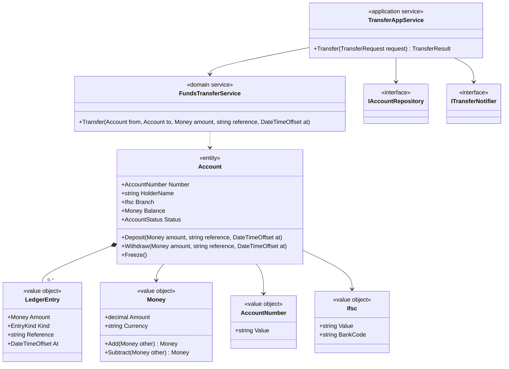
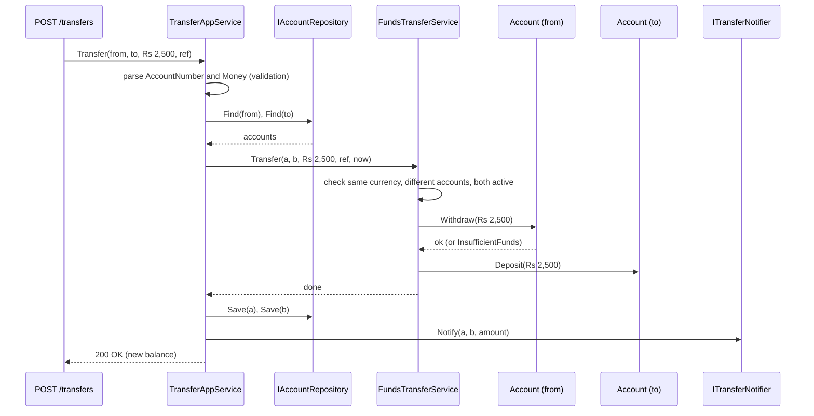

In the [previous lesson](#/lesson/m07-classes-responsibilities) you found candidate classes and gave them jobs. This lesson adds a second question you ask about every candidate: *what kind of thing is it?* There are three answers, and each one changes how you write the class.

We use a bank account system as the main example, with an inventory model and a leave calendar in the exercises.

## Learning objectives

By the end of this lesson you will be able to:

1. Tell an entity (identified by an id that stays the same while its data changes) from a value object (identified only by its content).
2. Recognise when an operation belongs in a service because it does not naturally belong to any one object.
3. Distinguish domain services, application services and infrastructure services.
4. Implement value objects in C# with records: immutable, self-validating, compared by value.
5. Implement entities with identity-based equality and controlled state changes.
6. Spot and fix "primitive obsession": using `string` and `decimal` where a value object should be.

## Prerequisites

- [Identifying classes and responsibilities](#/lesson/m07-classes-responsibilities): noun analysis and GRASP.
- [Value types, reference types and memory basics](#/lesson/m01-value-reference-memory): the difference between `struct` and `class`.
- [Constructors and object initialization](#/lesson/m01-constructors): records and `required` members.

## Explain it like I'm a beginner

Think about two ₹500 notes in your wallet. If a friend swaps one of yours for one of theirs, you do not care. A ₹500 note is a ₹500 note. What matters is **what it is worth**, not *which* note it is. That is a **value**.

Now think about your bank account. Your balance changes every day: salary in, rent out, a UPI payment for chai. Yet it is still *your* account, because it has the same account number. If two different people both have ₹12,000 in their accounts, those accounts are not "equal". They are different accounts that happen to have the same balance. That is an **entity**: something with an identity that lasts while its data changes.

Finally, think about *sending* money from your account to your friend's. Is "transfer" something your account does? Something your friend's account does? It touches both equally, and it belongs to neither. In real life a bank clerk or the UPI system does it. In code, that is a **service**: an operation that coordinates several objects and holds no state of its own.

So for every noun in your design, ask:

- **Does it have a life story?** Is it created, changed, and maybe closed, while staying "the same one"? → **Entity** (Account, Customer, Loan).
- **Is it only a description?** Is it fully defined by its values, so two with the same values are interchangeable? → **Value object** (Money, IFSC code, Address, DateRange).
- **Is it an action that does not belong to any one thing?** → **Service** (FundsTransfer, InterestCalculation).

## First-principles explanation

### Entities: identity over time

An entity is an object whose identity matters more than its attributes. Two `Account` objects with the same account number are the same account, even if one was loaded before a deposit and one after.

What makes something an entity:

- It has a **lifecycle**: opened, active, frozen, closed.
- It is **tracked**: other parts of the system refer to it by id ("send the statement for account 50100234567890").
- Its **attributes change** but it stays the same thing.

How to implement one:

- Give it an **explicit, stable identity**: a `Guid`, a database key, or a natural key such as an account number. The id never changes after creation.
- **Equality is by id**, not by field values.
- **State changes happen through methods** that enforce rules (`Withdraw`, `Freeze`), not through public setters.

### Value objects: defined by their content

A value object is an object with no identity of its own. It describes something. Examples: an amount of money (₹1,250.50), an IFSC code (`HDFC0001234`), an address, a date range (1–5 October), a GPS coordinate, a percentage.

What makes something a value object:

- **Two with the same content are equal and interchangeable.** ₹100 is ₹100.
- **It is immutable.** You do not "change" ₹100 into ₹150. You compute a new value, ₹150, and replace the old one. This matches how the number 5 never becomes 6.
- **It validates itself on creation.** An IFSC code with 10 characters cannot exist. If you hold an `Ifsc` object, it is valid, and no other code needs to check again.
- **It carries behaviour** related to the value: `Money.Add`, `DateRange.Overlaps`, `Percentage.Of(amount)`.

The last two points are why value objects are so useful. They move validation and small calculations out of services and entities, into tiny classes that are trivially testable.

### Primitive obsession

The opposite of using value objects is **primitive obsession**: representing domain concepts as raw `string`, `int` and `decimal`.

```csharp
// Which string is the IFSC and which is the account number? The compiler cannot help you.
public void Transfer(string fromAccount, string toAccount, string ifsc, decimal amount, string currency) { ... }
```

Problems this causes:

1. **Arguments get swapped.** `Transfer(toAccount, fromAccount, ...)` compiles.
2. **Validation is repeated** everywhere, or forgotten somewhere.
3. **Mixed units slip through.** Adding ₹100 to $100 gives "200" of nothing.
4. **Rounding rules scatter.** One place rounds to 2 decimals, another does not, and the ledger is off by a paisa.

With value objects, the signature becomes `Transfer(AccountNumber from, AccountNumber to, Money amount)`, and most of those bugs become compile errors or are caught once at the boundary.

### Services: operations without a natural home

Sometimes a responsibility does not fit any entity or value object. Forcing it onto one makes that class awkward. For example, `account.TransferTo(otherAccount, amount)` gives one account power over another, and the rule "both accounts must be active and in the same currency" is equally about both.

When that happens, create a **service**: a stateless object named after an activity (a verb), whose methods take domain objects as parameters. There are three kinds, and mixing them up is a common source of confusion:

| Kind | What it does | Example | Depends on |
|---|---|---|---|
| **Domain service** | Business logic that spans several domain objects | `FundsTransferService.Transfer(from, to, amount)` | Only domain types |
| **Application service** | Coordinates a use case: load, call domain, save, notify | `TransferAppService.TransferAsync(request)` | Repositories, domain services, clock, notifier interfaces |
| **Infrastructure service** | Talks to the outside world | `SmsTransferNotifier`, `SmtpEmailSender` | SDKs, HTTP clients, databases |

A domain service is part of the business model: a bank teller would understand what it does. An application service is plumbing for one use case. An infrastructure service is a technical adapter.

### The service trap

Services are easy to write, so teams overuse them. If *every* rule lives in a service and the entities are bags of getters and setters, you have the **anaemic domain model** again. Use this test before creating a domain service:

> Could this logic live on one of the objects involved, using only that object's data? If yes, put it there. Create a service only when the logic genuinely needs several objects equally, or needs something none of them should hold.

`Account.Withdraw(amount)` belongs on the account: it only needs the account's balance and status. `FundsTransferService.Transfer(a, b, amount)` belongs in a service: it needs both accounts equally.

### Classifying is context-dependent

The same real-world concept can be different kinds in different systems:

- **Address**: a value object in an e-commerce order ("ship to this address"). An entity in a postal service system, where each delivery point has an id and a history.
- **Money**: a value object almost everywhere. A physical banknote is an entity at the central bank, which tracks serial numbers.
- **Seat**: a value object ("row F, seat 12") in a cinema ticket. An entity in the cinema's own seat-maintenance system.

The question is always "does *this system* care about tracking this particular one over time?"

### Trade-offs

| Choice | Benefit | Cost |
|---|---|---|
| Value objects instead of primitives | Validation once, no swapped arguments, behaviour in one place | More small types; ORM and JSON mapping needs configuration |
| Entities with methods instead of setters | Rules cannot be bypassed | Serialisers and some ORMs need extra setup (private setters, backing fields) |
| Domain services for cross-object logic | Neither entity is overloaded | Overuse leads back to an anaemic model |

## Visual explanation

### Class diagram



How to read it: the stereotypes in angle brackets label each class's kind. `Account` is the only entity here; everything it holds (`Money`, `AccountNumber`, `Ifsc`, `LedgerEntry`) is a value object. `FundsTransferService` depends only on domain types. `TransferAppService` is the only class that talks to interfaces for storage and notification. If you see a domain service depending on a repository or an SMS client, it has become an application service in disguise.

### Sequence diagram: a transfer



Read it top to bottom. Raw input becomes value objects at the boundary, so bad input fails before any account is touched. The domain service checks cross-account rules, then *tells* each account to change itself; each account enforces its own rules (sufficient balance, not frozen). Only the application service saves and notifies. In a real system both `Save` calls happen in one database transaction.

## Step-by-step example

### Step 1: the primitive version

```csharp
public class Account
{
    public string AccountNo { get; set; } = "";
    public string Ifsc { get; set; } = "";
    public decimal Balance { get; set; }
    public string Currency { get; set; } = "INR";
}

public class BankService
{
    public void Transfer(Account from, Account to, decimal amount)
    {
        if (amount <= 0) throw new ArgumentException("amount");
        if (from.Balance < amount) throw new InvalidOperationException("Insufficient funds");
        from.Balance -= amount;
        to.Balance += amount;   // currency? frozen accounts? rounding? audit trail?
    }
}
```

### Step 2: classify

Nouns: account, account number, IFSC, balance, currency, amount, transfer, ledger entry.

- Account: has a lifecycle and an id → **entity**.
- Account number, IFSC: formatted identifiers with validation rules → **value objects**.
- Balance + currency, amount: always appear together → one value object, **Money**.
- Ledger entry: a fact about the past that never changes → **value object** (owned by the account).
- Transfer: involves two accounts equally → **domain service**.

### Step 3: build the value objects first

They have no dependencies, so start there. `Money` refuses to add different currencies and rounds to 2 decimals. `Ifsc` checks the 11-character format. Once they exist, every signature that used `decimal` and `string` gets more precise.

### Step 4: make the entity guard its state

`Balance` gets a private setter. The only ways to change it are `Deposit` and `Withdraw`, which check status and funds and append a ledger entry. You can no longer forget the audit trail, because there is no other path.

### Step 5: extract the domain service, then the application service

The cross-account rules go into `FundsTransferService`. Loading, saving, the clock and the SMS go into `TransferAppService`.

## Production-style C# implementation

```text
Banking.Api/
  Program.cs
  Accounts/
    Money.cs
    Identifiers.cs
    Account.cs
    FundsTransferService.cs
    TransferAppService.cs
    Infrastructure.cs
```

```csharp file=Accounts/Money.cs
namespace Banking.Accounts;

/// <summary>Value object: an amount in a currency. Immutable, validated, compared by value.</summary>
public sealed record Money
{
    public decimal Amount { get; }
    public string Currency { get; }

    public Money(decimal amount, string currency)
    {
        if (string.IsNullOrWhiteSpace(currency) || currency.Length != 3)
            throw new ArgumentException("Currency must be a 3-letter ISO code.", nameof(currency));
        if (decimal.Round(amount, 2) != amount)
            throw new ArgumentException($"Amount {amount} has more than 2 decimal places.", nameof(amount));
        Amount = amount;
        Currency = currency.ToUpperInvariant();
    }

    public static Money Inr(decimal amount) => new(amount, "INR");
    public static Money Zero(string currency) => new(0m, currency);

    public bool IsPositive => Amount > 0;

    public Money Add(Money other) { EnsureSameCurrency(other); return new(Amount + other.Amount, Currency); }
    public Money Subtract(Money other) { EnsureSameCurrency(other); return new(Amount - other.Amount, Currency); }
    public bool IsLessThan(Money other) { EnsureSameCurrency(other); return Amount < other.Amount; }

    private void EnsureSameCurrency(Money other)
    {
        ArgumentNullException.ThrowIfNull(other);
        if (other.Currency != Currency)
            throw new InvalidOperationException($"Cannot combine {Currency} with {other.Currency}.");
    }

    public override string ToString() => $"{Currency} {Amount:N2}";
}
```

```csharp file=Accounts/Identifiers.cs
using System.Text.RegularExpressions;

namespace Banking.Accounts;

/// <summary>Value object: an Indian bank account number (9 to 18 digits).</summary>
public sealed partial record AccountNumber
{
    public string Value { get; }
    public AccountNumber(string value)
    {
        var v = (value ?? "").Replace(" ", "");
        if (!Digits().IsMatch(v)) throw new ArgumentException("Account number must be 9 to 18 digits.", nameof(value));
        Value = v;
    }
    public override string ToString() => $"XXXX{Value[^4..]}";   // masked by default; never log full numbers

    [GeneratedRegex("^[0-9]{9,18}$")] private static partial Regex Digits();
}

/// <summary>Value object: an IFSC code — 4 letters (bank), a zero, then 6 letters or digits (branch).</summary>
public sealed partial record Ifsc
{
    public string Value { get; }
    public Ifsc(string value)
    {
        var v = (value ?? "").Trim().ToUpperInvariant();
        if (!Format().IsMatch(v)) throw new ArgumentException($"'{value}' is not a valid IFSC code.", nameof(value));
        Value = v;
    }
    public string BankCode => Value[..4];
    public override string ToString() => Value;

    [GeneratedRegex("^[A-Z]{4}0[A-Z0-9]{6}$")] private static partial Regex Format();
}
```

```csharp file=Accounts/Account.cs
namespace Banking.Accounts;

public enum AccountStatus { Active, Frozen, Closed }
public enum EntryKind { Credit, Debit }

/// <summary>Value object: one immutable line in an account's ledger.</summary>
public sealed record LedgerEntry(Money Amount, EntryKind Kind, string Reference, DateTimeOffset At);

public sealed class AccountRuleException(string message) : Exception(message);

/// <summary>Entity: identified by its account number. State changes only through methods.</summary>
public sealed class Account : IEquatable<Account>
{
    private readonly List<LedgerEntry> _ledger = new();

    public Account(AccountNumber number, string holderName, Ifsc branch, string currency)
    {
        Number = number ?? throw new ArgumentNullException(nameof(number));
        Branch = branch ?? throw new ArgumentNullException(nameof(branch));
        if (string.IsNullOrWhiteSpace(holderName)) throw new ArgumentException("Holder name is required.", nameof(holderName));
        HolderName = holderName;
        Balance = Money.Zero(currency);
    }

    public AccountNumber Number { get; }
    public string HolderName { get; private set; }
    public Ifsc Branch { get; }
    public Money Balance { get; private set; }
    public AccountStatus Status { get; private set; } = AccountStatus.Active;
    public IReadOnlyList<LedgerEntry> Ledger => _ledger;

    public void Deposit(Money amount, string reference, DateTimeOffset at)
    {
        EnsureActive();
        EnsurePositive(amount);
        Balance = Balance.Add(amount);
        _ledger.Add(new LedgerEntry(amount, EntryKind.Credit, reference, at));
    }

    public void Withdraw(Money amount, string reference, DateTimeOffset at)
    {
        EnsureActive();
        EnsurePositive(amount);
        if (Balance.IsLessThan(amount))
            throw new AccountRuleException($"Insufficient funds in {Number}: balance {Balance}, requested {amount}.");
        Balance = Balance.Subtract(amount);
        _ledger.Add(new LedgerEntry(amount, EntryKind.Debit, reference, at));
    }

    public void Freeze() => Status = AccountStatus.Frozen;

    private void EnsureActive()
    {
        if (Status != AccountStatus.Active) throw new AccountRuleException($"Account {Number} is {Status}.");
    }

    private static void EnsurePositive(Money amount)
    {
        ArgumentNullException.ThrowIfNull(amount);
        if (!amount.IsPositive) throw new AccountRuleException("Amount must be positive.");
    }

    // Identity-based equality: same number means same account, whatever the balance.
    public bool Equals(Account? other) => other is not null && Number == other.Number;
    public override bool Equals(object? obj) => obj is Account a && Equals(a);
    public override int GetHashCode() => Number.GetHashCode();
}
```

```csharp file=Accounts/FundsTransferService.cs
namespace Banking.Accounts;

/// <summary>Domain service: a rule that involves two accounts equally. Stateless; depends only on domain types.</summary>
public sealed class FundsTransferService
{
    public void Transfer(Account from, Account to, Money amount, string reference, DateTimeOffset at)
    {
        ArgumentNullException.ThrowIfNull(from);
        ArgumentNullException.ThrowIfNull(to);
        if (from.Equals(to)) throw new AccountRuleException("Cannot transfer to the same account.");
        if (from.Balance.Currency != amount.Currency || to.Balance.Currency != amount.Currency)
            throw new AccountRuleException("Both accounts must hold the transfer currency.");
        if (to.Status != AccountStatus.Active)
            throw new AccountRuleException($"Destination account {to.Number} is {to.Status}.");

        // Withdraw first: if it fails (funds, frozen), nothing has changed yet.
        from.Withdraw(amount, reference, at);
        to.Deposit(amount, reference, at);
    }
}
```

```csharp file=Accounts/TransferAppService.cs
using Microsoft.Extensions.Logging;

namespace Banking.Accounts;

public sealed record TransferRequest(string FromAccount, string ToAccount, decimal Amount, string Currency, string Reference);
public sealed record TransferResult(string Reference, Money NewSourceBalance);

public interface IAccountRepository
{
    Account? Find(AccountNumber number);
    void Save(Account account);
}

public interface ITransferNotifier
{
    void Notify(Account from, Account to, Money amount, string reference);
}

/// <summary>Application service: one use case. Parses input into value objects, loads, delegates, saves, notifies.</summary>
public sealed class TransferAppService(
    IAccountRepository accounts,
    FundsTransferService transfers,
    ITransferNotifier notifier,
    TimeProvider clock,
    ILogger<TransferAppService> logger)
{
    public TransferResult Transfer(TransferRequest request)
    {
        var fromNo = new AccountNumber(request.FromAccount);
        var toNo = new AccountNumber(request.ToAccount);
        var amount = new Money(request.Amount, request.Currency);

        var from = accounts.Find(fromNo) ?? throw new KeyNotFoundException($"Account {fromNo} not found.");
        var to = accounts.Find(toNo) ?? throw new KeyNotFoundException($"Account {toNo} not found.");

        transfers.Transfer(from, to, amount, request.Reference, clock.GetUtcNow());

        // In production these two saves run inside one database transaction.
        accounts.Save(from);
        accounts.Save(to);
        notifier.Notify(from, to, amount, request.Reference);
        logger.LogInformation("Transfer {Reference}: {Amount} from {From} to {To}", request.Reference, amount, fromNo, toNo);
        return new TransferResult(request.Reference, from.Balance);
    }
}
```

```csharp file=Accounts/Infrastructure.cs
using System.Collections.Concurrent;
using Microsoft.Extensions.Logging;

namespace Banking.Accounts;

public sealed class InMemoryAccountRepository : IAccountRepository
{
    private readonly ConcurrentDictionary<AccountNumber, Account> _items = new();
    public Account? Find(AccountNumber number) => _items.GetValueOrDefault(number);
    public void Save(Account account) => _items[account.Number] = account;
}

/// <summary>Infrastructure service. A real one would call an SMS gateway; this one only logs.</summary>
public sealed class LoggingTransferNotifier(ILogger<LoggingTransferNotifier> logger) : ITransferNotifier
{
    public void Notify(Account from, Account to, Money amount, string reference) =>
        logger.LogInformation("SMS to {Holder}: {Amount} debited, ref {Reference}", from.HolderName, amount, reference);
}
```

```csharp file=Program.cs
using Banking.Accounts;

var builder = WebApplication.CreateBuilder(args);

builder.Services.AddSingleton(TimeProvider.System);
builder.Services.AddSingleton<FundsTransferService>();          // stateless domain service
builder.Services.AddSingleton<IAccountRepository, InMemoryAccountRepository>();
builder.Services.AddSingleton<ITransferNotifier, LoggingTransferNotifier>();
builder.Services.AddScoped<TransferAppService>();

var app = builder.Build();

var repo = app.Services.GetRequiredService<IAccountRepository>();
var asha = new Account(new AccountNumber("501002345678"), "Asha", new Ifsc("HDFC0001234"), "INR");
asha.Deposit(Money.Inr(10_000m), "opening", DateTimeOffset.UtcNow);
repo.Save(asha);
repo.Save(new Account(new AccountNumber("601009876543"), "Ravi", new Ifsc("SBIN0005678"), "INR"));

app.MapPost("/transfers", (TransferRequest request, TransferAppService service) =>
{
    try { return Results.Ok(service.Transfer(request)); }
    catch (ArgumentException ex) { return Results.Problem(ex.Message, statusCode: StatusCodes.Status400BadRequest); }
    catch (KeyNotFoundException ex) { return Results.Problem(ex.Message, statusCode: StatusCodes.Status404NotFound); }
    catch (AccountRuleException ex) { return Results.Problem(ex.Message, statusCode: StatusCodes.Status422UnprocessableEntity); }
});

app.Run();
```

Design notes:

- **Records give value objects their equality for free.** Two `Money` instances with the same amount and currency are `==`. We use `sealed record` (a class) rather than `record struct`, because `default(Money)` for a struct would have a `null` currency and skip the constructor's validation.
- **`AccountNumber.ToString()` masks the number.** Value objects are a natural place for "how this value is shown" rules, including privacy rules.
- **Value objects as dictionary keys.** `InMemoryAccountRepository` keys by `AccountNumber`. That works only because records implement `GetHashCode` from their content.
- **Persistence.** EF Core maps value objects with owned types or complex types, and single-value wrappers with value converters. The domain code does not change; only the mapping configuration does.
- **What this demo leaves out: idempotency and concurrency.** A mobile app that times out will retry `POST /transfers`. In production, store each transfer's `Reference` under a unique constraint in the same transaction as the two balance updates, and return the original result when the same reference arrives again; otherwise one retry moves the money twice. Lock or version both account rows (for example `SELECT ... FOR UPDATE` in a fixed order, lowest account number first) so two concurrent transfers cannot overdraw an account.


## Bad design vs good design

**Bad**: the Step 1 code. `Balance` has a public setter, so any class can set it to anything. Currency is a loose string next to the amount. The transfer has no ledger, no frozen-account check, and nothing stops `Transfer(a, a, 100)`.

**Also bad, in the other direction**: making *everything* a value object or a service.

```csharp
public sealed record HolderName(string Value);   // adds nothing if there are no rules about names
public sealed class AccountDepositService { public void Deposit(Account a, Money m) { ... } }   // belongs on Account
```

Wrapping a string in a type that has no rules, no behaviour and no risk of mix-ups is ceremony. And a service for something that only touches one entity strips that entity of its behaviour.

**Good**: the implementation above. Value objects where there are rules or mix-up risks (money, identifiers). Behaviour on the entity when only that entity is involved (`Withdraw`). A domain service where two entities are involved equally (`Transfer`). An application service for the plumbing.

:::callout type=tip title="A quick decision checklist"
1. Would two of these with identical data be interchangeable? → value object.
2. Do we need to find *this particular one* later, or track how it changes? → entity.
3. Is it an action that needs several objects equally, with no state of its own? → domain service.
4. Does it talk to databases, queues, HTTP or the clock? → application or infrastructure service, never the domain.
:::

## Practical playground

Run the program, then try these:

1. Add `Console.WriteLine(Money.Inr(100m) == Money.Inr(100.00m));`. Why is it `True` even though the literals differ?
2. Try `Money.Inr(100m).Add(new Money(5m, "USD"))`. Where does it fail, and is that the right place?
3. Make `Account` a `record` instead of a class. What happens to `a1 == a2` after a deposit? Why is that wrong for an entity?

:::playground type=csharp title="Entity vs value object equality"
```csharp file=Program.cs
using System;
using System.Collections.Generic;

public sealed record Money(decimal Amount, string Currency)
{
    public static Money Inr(decimal amount) => new(amount, "INR");
    public Money Add(Money other)
    {
        if (other.Currency != Currency) throw new InvalidOperationException($"Cannot add {other.Currency} to {Currency}");
        return this with { Amount = Amount + other.Amount };
    }
}

public sealed class Account(string number)
{
    public string Number { get; } = number;
    public Money Balance { get; private set; } = Money.Inr(0m);
    public void Deposit(Money m) => Balance = Balance.Add(m);

    public override bool Equals(object? obj) => obj is Account a && a.Number == Number;
    public override int GetHashCode() => Number.GetHashCode();
}

public static class Program
{
    public static void Main()
    {
        var a = Money.Inr(500m);
        var b = Money.Inr(500m);
        Console.WriteLine($"Two Rs 500 values equal? {a == b}");                 // True: value object

        var acc1 = new Account("501002345678");
        var acc2 = new Account("501002345678");                                  // same account, loaded twice
        acc1.Deposit(Money.Inr(2_000m));
        Console.WriteLine($"Same account after deposit? {acc1.Equals(acc2)}");   // True: identity
        Console.WriteLine($"Balances: {acc1.Balance.Amount} vs {acc2.Balance.Amount}");

        var other = new Account("601009876543");
        other.Deposit(Money.Inr(2_000m));
        Console.WriteLine($"Different accounts, same balance, equal? {acc1.Equals(other)}");   // False

        var set = new HashSet<Money> { Money.Inr(10m), Money.Inr(10m), Money.Inr(20m) };
        Console.WriteLine($"Distinct money values: {set.Count}");                // 2
    }
}
```
:::

## Exercises

:::exercise id=m07-entities-values-services-ex1 difficulty=beginner kind=code title="Build a Money value object"
Implement `Money` so it validates itself, compares by value, and refuses to mix currencies.
::requirements
- Constructor rejects a currency that is not exactly 3 letters, and amounts with more than 2 decimal places.
- Currency is normalised to upper case (`"inr"` becomes `"INR"`).
- `Add` and `Subtract` return new instances and throw `InvalidOperationException` for different currencies.
- `Allocate(int parts)` splits an amount into `parts` shares that add up exactly to the original, giving leftover paise to the first shares.
::acceptance
- `new Money(100m, "inr") == new Money(100.00m, "INR")` is true.
- ₹100 + ₹50.25 = ₹150.25, and the original ₹100 is unchanged.
- ₹100 + $1 throws `InvalidOperationException`.
- `new Money(1.005m, "INR")` throws `ArgumentException`.
- ₹100 allocated into 3 parts gives ₹33.34, ₹33.33, ₹33.33.
::hint
A `sealed record` gives you value equality. You only need to write the constructor and the methods.
::hint
Check decimal places with `decimal.Round(amount, 2) != amount`.
::hint
For `Allocate`, work in paise (integer): `var total = (long)(Amount * 100); var share = total / parts; var remainder = total % parts;`. The first `remainder` shares get one extra paisa.
::hint
```csharp
return Enumerable.Range(0, parts).Select(i => new Money((share + (i < remainder ? 1 : 0)) / 100m, Currency)).ToList();
```
::starter
```csharp file=Money.cs
using System;
using System.Collections.Generic;
using System.Linq;

public sealed record Money
{
    public decimal Amount { get; }
    public string Currency { get; }

    public Money(decimal amount, string currency) => throw new NotImplementedException();

    public Money Add(Money other) => throw new NotImplementedException();
    public Money Subtract(Money other) => throw new NotImplementedException();
    public IReadOnlyList<Money> Allocate(int parts) => throw new NotImplementedException();
}
```
::tests
```csharp file=MoneyTests.cs
using System;
using System.Linq;
using Xunit;

public class MoneyTests
{
    [Fact] public void Equal_by_value_and_normalises_currency() =>
        Assert.True(new Money(100m, "inr") == new Money(100.00m, "INR"));

    [Fact]
    public void Add_returns_new_instance()
    {
        var a = new Money(100m, "INR");
        var sum = a.Add(new Money(50.25m, "INR"));
        Assert.Equal(150.25m, sum.Amount);
        Assert.Equal(100m, a.Amount);
    }

    [Fact] public void Subtract_works() => Assert.Equal(new Money(40m, "INR"), new Money(100m, "INR").Subtract(new Money(60m, "INR")));

    [Fact] public void Mixed_currency_throws() =>
        Assert.Throws<InvalidOperationException>(() => new Money(100m, "INR").Add(new Money(1m, "USD")));

    [Fact] public void Too_many_decimals_throws() => Assert.Throws<ArgumentException>(() => new Money(1.005m, "INR"));

    [Fact] public void Bad_currency_throws() => Assert.Throws<ArgumentException>(() => new Money(1m, "RUPEE"));

    [Fact]
    public void Allocate_keeps_every_paisa()
    {
        var parts = new Money(100m, "INR").Allocate(3);
        Assert.Equal(new[] { 33.34m, 33.33m, 33.33m }, parts.Select(p => p.Amount).ToArray());
        Assert.Equal(100m, parts.Sum(p => p.Amount));
    }
}
```
::solution
```csharp file=Money.cs
using System;
using System.Collections.Generic;
using System.Linq;

public sealed record Money
{
    public decimal Amount { get; }
    public string Currency { get; }

    public Money(decimal amount, string currency)
    {
        if (string.IsNullOrWhiteSpace(currency) || currency.Length != 3 || !currency.All(char.IsLetter))
            throw new ArgumentException("Currency must be a 3-letter code.", nameof(currency));
        if (decimal.Round(amount, 2) != amount)
            throw new ArgumentException("At most 2 decimal places.", nameof(amount));
        Amount = amount;
        Currency = currency.ToUpperInvariant();
    }

    public Money Add(Money other) { Same(other); return new Money(Amount + other.Amount, Currency); }
    public Money Subtract(Money other) { Same(other); return new Money(Amount - other.Amount, Currency); }

    public IReadOnlyList<Money> Allocate(int parts)
    {
        if (parts <= 0) throw new ArgumentOutOfRangeException(nameof(parts));
        var totalPaise = (long)(Amount * 100);
        var share = totalPaise / parts;
        var remainder = totalPaise % parts;
        return Enumerable.Range(0, parts)
            .Select(i => new Money((share + (i < remainder ? 1 : 0)) / 100m, Currency))
            .ToList();
    }

    private void Same(Money other)
    {
        ArgumentNullException.ThrowIfNull(other);
        if (other.Currency != Currency) throw new InvalidOperationException($"Cannot combine {Currency} and {other.Currency}.");
    }
}
```

Records compare `decimal` with `decimal.Equals`, which treats `100m` and `100.00m` as equal even though they print differently. `Allocate` is the classic reason money needs its own type: splitting a ₹100 bill three ways with plain `decimal` division gives 33.33 × 3 = 99.99, and a paisa disappears from the ledger.
::mistakes
- Using `double` for money. Binary floating point cannot represent 0.10 exactly.
- Rounding in `Allocate` with `Math.Round(Amount / parts, 2)` for every share, which loses or invents paise.
- Making `Amount` settable "for the serialiser". That breaks immutability; configure the serialiser to use the constructor instead.
::extensions
Add `Multiply(decimal factor, MidpointRounding mode)` for interest calculations and decide which rounding mode your bank uses. Banker's rounding (`ToEven`) and `AwayFromZero` give different results for ₹0.125.
:::

:::exercise id=m07-entities-values-services-ex2 difficulty=beginner kind=design title="Classify the inventory model"
A warehouse inventory system for a hardware distributor in Chennai has these concepts:

> **Product** (SKU, name, unit of measure), **Warehouse** (code, address), **stock level** of a product in a warehouse, **quantity** with a unit (e.g. 40 boxes, 12.5 kg), **address**, **SKU** code (format `ABC-12345`), **stock movement** (receipt, issue, transfer, with date and quantity), **reorder point**, and **moving stock between two warehouses**.

Classify each concept as entity, value object, or service. Build the class model and mark each class's kind with `kind: "record"` (value object), `"class"` (entity or service), or `"enum"`, and say which in `responsibility`.
::acceptance
- `Sku`, `Quantity` and `Address` are value objects.
- `Product` and `Warehouse` are entities with explicit identity.
- A stock movement is an immutable record of something that happened.
- "Moving stock between two warehouses" is a domain service, not a method on either warehouse.
- `Quantity` refuses to add different units.
::hint
For each concept ask: "if two of these had identical data, would I care which one I had?"
::hint
`StockLevel` is interesting. It is "how much of product P is in warehouse W". Is it tracked over time with its own id, or is it a value that the warehouse holds per product?
::hint
A reasonable choice: `Warehouse` (entity) holds a dictionary of `Sku → Quantity` (values). Each change appends a `StockMovement` record. The transfer service calls `source.Issue(...)` and `target.Receive(...)`.
::hint
`ReorderPoint` is just a `Quantity` with a meaning. It can be a property of type `Quantity` on the product or on a per-warehouse setting; it does not need its own class.
::starter
```json file=inventory-model.json
{
  "classes": [
    { "id": "Product", "name": "Product", "kind": "class", "fields": [], "methods": [], "responsibility": "TODO: entity or value?" },
    { "id": "Sku", "name": "Sku", "kind": "class", "fields": [], "methods": [], "responsibility": "TODO" }
  ],
  "relations": []
}
```
::solution
```json file=inventory-model.json
{
  "classes": [
    { "id": "Product", "name": "Product", "kind": "class",
      "fields": ["+Sku Sku", "+string Name", "+UnitOfMeasure Unit", "+Quantity ReorderPoint"],
      "methods": ["+void Rename(string name)"],
      "responsibility": "Entity, identified by SKU; name can change" },
    { "id": "Warehouse", "name": "Warehouse", "kind": "class",
      "fields": ["+string Code", "+Address Address", "-Dictionary~Sku,Quantity~ _stock", "-List~StockMovement~ _movements"],
      "methods": ["+void Receive(Sku sku, Quantity qty, DateOnly on)", "+void Issue(Sku sku, Quantity qty, DateOnly on)", "+Quantity OnHand(Sku sku)"],
      "responsibility": "Entity; guards its own stock (no negative stock) and records movements" },
    { "id": "Sku", "name": "Sku", "kind": "record", "fields": ["+string Value"], "methods": [],
      "responsibility": "Value object; validates format ABC-12345" },
    { "id": "Qty", "name": "Quantity", "kind": "record", "fields": ["+decimal Value", "+UnitOfMeasure Unit"],
      "methods": ["+Quantity Add(Quantity other)", "+Quantity Subtract(Quantity other)"],
      "responsibility": "Value object; refuses to mix units, never negative" },
    { "id": "Address", "name": "Address", "kind": "record", "fields": ["+string Line1", "+string City", "+string Pincode"], "methods": [],
      "responsibility": "Value object; validates 6-digit pincode" },
    { "id": "Move", "name": "StockMovement", "kind": "record",
      "fields": ["+Sku Sku", "+Quantity Qty", "+MovementKind Kind", "+DateOnly On", "+string? Reference"], "methods": [],
      "responsibility": "Value object; an immutable fact about the past" },
    { "id": "Transfer", "name": "StockTransferService", "kind": "class", "fields": [],
      "methods": ["+void Transfer(Warehouse from, Warehouse to, Sku sku, Quantity qty, DateOnly on)"],
      "responsibility": "Domain service; involves two warehouses equally" },
    { "id": "Unit", "name": "UnitOfMeasure", "kind": "enum", "fields": ["Piece", "Box", "Kg", "Metre"], "methods": [] },
    { "id": "Kind", "name": "MovementKind", "kind": "enum", "fields": ["Receipt", "Issue", "TransferIn", "TransferOut"], "methods": [] }
  ],
  "relations": [
    { "from": "Product", "to": "Sku", "kind": "composition" },
    { "from": "Warehouse", "to": "Address", "kind": "composition" },
    { "from": "Warehouse", "to": "Qty", "kind": "composition", "label": "stock per SKU" },
    { "from": "Warehouse", "to": "Move", "kind": "composition", "multiplicity": "0..*" },
    { "from": "Transfer", "to": "Warehouse", "kind": "dependency" },
    { "from": "Qty", "to": "Unit", "kind": "association" }
  ]
}
```

`StockLevel` disappeared as a class: it is the `Quantity` the warehouse holds for a SKU. If the business later needs per-bin locations, batch numbers or reservations against stock, `StockLevel` may grow into an entity of its own. Start simple.
::alternatives
In a high-volume system, warehouses may not hold all movements in memory. A `StockLedger` entity per SKU per warehouse, with movements stored separately, scales better. The classification (value vs entity) stays the same; only the boundaries move.
::mistakes
- Treating `Sku` as a plain `string` and validating the format in three controllers.
- Giving `Warehouse` a `TransferTo(Warehouse other, ...)` method, which lets one warehouse change another's stock.
- Making `StockMovement` mutable so someone can "fix" a wrong receipt. Corrections should be new movements, so the history stays honest.
:::

:::exercise id=m07-entities-values-services-ex3 difficulty=intermediate kind=code title="Identity-based equality for an entity"
A `Vehicle` in a fleet system is identified by its chassis number (VIN). Its registration plate and odometer can change. Implement equality so two objects with the same VIN are equal, regardless of other data, and the entity works correctly in a `HashSet` and as a `Dictionary` key.
::requirements
- `Vehicle` equality and hash code use only `Vin`.
- `Vin` is a value object: 17 characters, letters and digits, excluding I, O and Q, stored upper case.
- `ChangePlate` and `RecordOdometer` change state; the odometer can never go down.
- Implement `==` and `!=` operators consistent with `Equals`.
::acceptance
- Two `Vehicle` objects with the same VIN but different plates are equal.
- A `HashSet<Vehicle>` with both contains 1 item.
- Changing the plate does not change the hash code.
- A VIN containing `O` or with 16 characters throws `ArgumentException`.
- Recording a lower odometer reading throws `InvalidOperationException`.
::hint
Hash codes must not change while an object is in a hash set. Which field never changes?
::hint
Make `Vin` a `sealed record` with a validating constructor; then `Vehicle.Equals` compares `Vin` values with `==`.
::hint
Pattern: `public bool Equals(Vehicle? other) => other is not null && Vin == other.Vin;` plus `override Equals(object?)`, `GetHashCode() => Vin.GetHashCode()`, and the two operators that handle nulls via `Equals(left, right)`.
::hint
For the VIN check: `value.Length == 17 && value.All(c => char.IsAsciiLetterOrDigit(c) && c is not ('I' or 'O' or 'Q'))` after `ToUpperInvariant()`.
::starter
```csharp file=Vehicle.cs
using System;
using System.Linq;

public sealed record Vin
{
    public string Value { get; }
    public Vin(string value) => throw new NotImplementedException();
}

public sealed class Vehicle : IEquatable<Vehicle>
{
    public Vehicle(Vin vin, string plate) { Vin = vin; Plate = plate; }
    public Vin Vin { get; }
    public string Plate { get; private set; }
    public int OdometerKm { get; private set; }

    public void ChangePlate(string plate) => throw new NotImplementedException();
    public void RecordOdometer(int km) => throw new NotImplementedException();

    public bool Equals(Vehicle? other) => throw new NotImplementedException();
    public override bool Equals(object? obj) => throw new NotImplementedException();
    public override int GetHashCode() => throw new NotImplementedException();
    public static bool operator ==(Vehicle? left, Vehicle? right) => throw new NotImplementedException();
    public static bool operator !=(Vehicle? left, Vehicle? right) => throw new NotImplementedException();
}
```
::tests
```csharp file=VehicleTests.cs
using System;
using System.Collections.Generic;
using Xunit;

public class VehicleTests
{
    private const string V = "MA1TA2BC3D4E56789";

    [Fact] public void Same_vin_is_equal() =>
        Assert.True(new Vehicle(new Vin(V), "HR26AB1234") == new Vehicle(new Vin(V.ToLowerInvariant()), "DL3CXY9999"));

    [Fact] public void Different_vin_not_equal() =>
        Assert.True(new Vehicle(new Vin(V), "X") != new Vehicle(new Vin("MA1TA2BC3D4E56788"), "X"));

    [Fact]
    public void HashSet_dedupes_by_identity()
    {
        var set = new HashSet<Vehicle> { new(new Vin(V), "A"), new(new Vin(V), "B") };
        Assert.Single(set);
    }

    [Fact]
    public void Hash_stable_when_state_changes()
    {
        var v = new Vehicle(new Vin(V), "HR26AB1234");
        var before = v.GetHashCode();
        v.ChangePlate("HR26ZZ0001");
        v.RecordOdometer(1500);
        Assert.Equal(before, v.GetHashCode());
        Assert.Equal("HR26ZZ0001", v.Plate);
    }

    [Fact] public void Vin_rejects_letter_O() => Assert.Throws<ArgumentException>(() => new Vin("MA1TA2BC3D4E5678O"));
    [Fact] public void Vin_rejects_wrong_length() => Assert.Throws<ArgumentException>(() => new Vin("MA1TA2BC3D4E5678"));

    [Fact]
    public void Odometer_never_goes_down()
    {
        var v = new Vehicle(new Vin(V), "X");
        v.RecordOdometer(1000);
        Assert.Throws<InvalidOperationException>(() => v.RecordOdometer(999));
    }

    [Fact] public void Null_comparisons_work()
    {
        Vehicle? none = null;
        Assert.True(none == null);
        Assert.False(new Vehicle(new Vin(V), "X") == none);
    }
}
```
::solution
```csharp file=Vehicle.cs
using System;
using System.Linq;

public sealed record Vin
{
    public string Value { get; }
    public Vin(string value)
    {
        var v = (value ?? "").Trim().ToUpperInvariant();
        if (v.Length != 17 || !v.All(c => char.IsAsciiLetterOrDigit(c) && c is not ('I' or 'O' or 'Q')))
            throw new ArgumentException($"'{value}' is not a valid 17-character VIN.", nameof(value));
        Value = v;
    }
}

public sealed class Vehicle : IEquatable<Vehicle>
{
    public Vehicle(Vin vin, string plate) { Vin = vin ?? throw new ArgumentNullException(nameof(vin)); Plate = plate; }
    public Vin Vin { get; }
    public string Plate { get; private set; }
    public int OdometerKm { get; private set; }

    public void ChangePlate(string plate)
    {
        if (string.IsNullOrWhiteSpace(plate)) throw new ArgumentException("Plate is required.", nameof(plate));
        Plate = plate;
    }

    public void RecordOdometer(int km)
    {
        if (km < OdometerKm) throw new InvalidOperationException($"Odometer cannot go from {OdometerKm} to {km}.");
        OdometerKm = km;
    }

    public bool Equals(Vehicle? other) => other is not null && Vin == other.Vin;
    public override bool Equals(object? obj) => obj is Vehicle v && Equals(v);
    public override int GetHashCode() => Vin.GetHashCode();
    public static bool operator ==(Vehicle? left, Vehicle? right) => Equals(left, right);
    public static bool operator !=(Vehicle? left, Vehicle? right) => !Equals(left, right);
}
```

`Equals(left, right)` here is the static `object.Equals`, which handles the null cases and then calls our override. If you used a `record` for `Vehicle`, equality would include `Plate` and `OdometerKm`, so the same vehicle would stop being "equal to itself" after a service visit.
::mistakes
- Using a mutable field (plate) in `GetHashCode`. The object becomes unfindable in a `HashSet` after the plate changes.
- Implementing `==` as `left.Equals(right)`, which throws when `left` is null.
- Generating a new `Guid` in the constructor *and* treating VIN as identity. Pick one identity and stick to it.
::extensions
Extract an `Entity<TId>` base class that implements equality once. Then discuss: what should `Equals` return for two *new* entities whose database id has not been assigned yet (both 0)?
:::

:::exercise id=m07-entities-values-services-ex4 difficulty=intermediate kind=code title="A domain service for transfers"
Implement `FundsTransferService.Transfer` for the bank model. The service must enforce rules that involve both accounts, and rely on each account to enforce its own rules.
::requirements
- Refuse a transfer to the same account, and a transfer when either account's currency differs from the amount's.
- Refuse a transfer to a frozen destination **before** debiting the source.
- If the source cannot be debited (insufficient funds or frozen), nothing changes on either side.
- Both accounts get a ledger entry with the same reference.
::acceptance
- ₹2,500 from Asha (₹10,000) to Ravi (₹0) leaves ₹7,500 and ₹2,500.
- Transferring ₹20,000 from Asha throws `AccountRuleException`, and Ravi's balance and ledger are unchanged.
- Transfer to a frozen account throws, and Asha's balance is unchanged.
- A USD amount between two INR accounts throws `AccountRuleException`.
- Transfer to self throws `AccountRuleException`.
::hint
Which rules belong to one account (funds, frozen source) and which involve both (same account, currency, frozen destination)?
::hint
Order matters. Check everything that involves the destination before you change the source.
::hint
`from.Withdraw(...)` throws if funds are short, before changing state, so calling it before `to.Deposit(...)` keeps "nothing changes" true.
::hint
```csharp
if (from.Number == to.Number) throw ...;
if (from.Currency != amount.Currency || to.Currency != amount.Currency) throw ...;
if (to.IsFrozen) throw ...;
from.Withdraw(amount, reference); to.Deposit(amount, reference);
```
::starter
```csharp file=Transfers.cs
using System;
using System.Collections.Generic;

public sealed class AccountRuleException(string message) : Exception(message);

public sealed record Money(decimal Amount, string Currency)
{
    public static Money Inr(decimal a) => new(a, "INR");
}

public sealed record LedgerEntry(decimal Amount, string Reference);

public sealed class Account(string number, string currency)
{
    private readonly List<LedgerEntry> _ledger = new();
    public string Number { get; } = number;
    public string Currency { get; } = currency;
    public decimal Balance { get; private set; }
    public bool IsFrozen { get; private set; }
    public IReadOnlyList<LedgerEntry> Ledger => _ledger;

    public void Freeze() => IsFrozen = true;

    public void Deposit(Money amount, string reference)
    {
        if (IsFrozen) throw new AccountRuleException($"{Number} is frozen.");
        if (amount.Currency != Currency || amount.Amount <= 0) throw new AccountRuleException("Bad amount.");
        Balance += amount.Amount;
        _ledger.Add(new LedgerEntry(amount.Amount, reference));
    }

    public void Withdraw(Money amount, string reference)
    {
        if (IsFrozen) throw new AccountRuleException($"{Number} is frozen.");
        if (amount.Currency != Currency || amount.Amount <= 0) throw new AccountRuleException("Bad amount.");
        if (Balance < amount.Amount) throw new AccountRuleException($"Insufficient funds in {Number}.");
        Balance -= amount.Amount;
        _ledger.Add(new LedgerEntry(-amount.Amount, reference));
    }
}

public sealed class FundsTransferService
{
    public void Transfer(Account from, Account to, Money amount, string reference) => throw new NotImplementedException();
}
```
::tests
```csharp file=TransferTests.cs
using System;
using Xunit;

public class TransferTests
{
    private static (Account asha, Account ravi) Accounts()
    {
        var asha = new Account("501002345678", "INR");
        asha.Deposit(Money.Inr(10_000m), "opening");
        return (asha, new Account("601009876543", "INR"));
    }

    [Fact]
    public void Moves_money_and_writes_both_ledgers()
    {
        var (asha, ravi) = Accounts();
        new FundsTransferService().Transfer(asha, ravi, Money.Inr(2_500m), "UPI-001");
        Assert.Equal(7_500m, asha.Balance);
        Assert.Equal(2_500m, ravi.Balance);
        Assert.Equal("UPI-001", ravi.Ledger[0].Reference);
        Assert.Equal("UPI-001", asha.Ledger[1].Reference);
    }

    [Fact]
    public void Insufficient_funds_changes_nothing()
    {
        var (asha, ravi) = Accounts();
        Assert.Throws<AccountRuleException>(() => new FundsTransferService().Transfer(asha, ravi, Money.Inr(20_000m), "X"));
        Assert.Equal(10_000m, asha.Balance);
        Assert.Equal(0m, ravi.Balance);
        Assert.Empty(ravi.Ledger);
    }

    [Fact]
    public void Frozen_destination_checked_before_debit()
    {
        var (asha, ravi) = Accounts();
        ravi.Freeze();
        Assert.Throws<AccountRuleException>(() => new FundsTransferService().Transfer(asha, ravi, Money.Inr(100m), "X"));
        Assert.Equal(10_000m, asha.Balance);
        Assert.Single(asha.Ledger);
    }

    [Fact]
    public void Currency_mismatch_refused()
    {
        var (asha, ravi) = Accounts();
        Assert.Throws<AccountRuleException>(() => new FundsTransferService().Transfer(asha, ravi, new Money(10m, "USD"), "X"));
    }

    [Fact]
    public void Self_transfer_refused()
    {
        var (asha, _) = Accounts();
        var sameAccountLoadedTwice = new Account("501002345678", "INR");
        Assert.Throws<AccountRuleException>(() => new FundsTransferService().Transfer(asha, sameAccountLoadedTwice, Money.Inr(1m), "X"));
    }
}
```
::solution
```csharp file=Transfers.cs
using System;
using System.Collections.Generic;

public sealed class AccountRuleException(string message) : Exception(message);

public sealed record Money(decimal Amount, string Currency)
{
    public static Money Inr(decimal a) => new(a, "INR");
}

public sealed record LedgerEntry(decimal Amount, string Reference);

public sealed class Account(string number, string currency)
{
    private readonly List<LedgerEntry> _ledger = new();
    public string Number { get; } = number;
    public string Currency { get; } = currency;
    public decimal Balance { get; private set; }
    public bool IsFrozen { get; private set; }
    public IReadOnlyList<LedgerEntry> Ledger => _ledger;

    public void Freeze() => IsFrozen = true;

    public void Deposit(Money amount, string reference)
    {
        if (IsFrozen) throw new AccountRuleException($"{Number} is frozen.");
        if (amount.Currency != Currency || amount.Amount <= 0) throw new AccountRuleException("Bad amount.");
        Balance += amount.Amount;
        _ledger.Add(new LedgerEntry(amount.Amount, reference));
    }

    public void Withdraw(Money amount, string reference)
    {
        if (IsFrozen) throw new AccountRuleException($"{Number} is frozen.");
        if (amount.Currency != Currency || amount.Amount <= 0) throw new AccountRuleException("Bad amount.");
        if (Balance < amount.Amount) throw new AccountRuleException($"Insufficient funds in {Number}.");
        Balance -= amount.Amount;
        _ledger.Add(new LedgerEntry(-amount.Amount, reference));
    }
}

public sealed class FundsTransferService
{
    public void Transfer(Account from, Account to, Money amount, string reference)
    {
        ArgumentNullException.ThrowIfNull(from);
        ArgumentNullException.ThrowIfNull(to);
        ArgumentNullException.ThrowIfNull(amount);

        // Rules that involve both accounts: the service's job.
        if (from.Number == to.Number) throw new AccountRuleException("Cannot transfer to the same account.");
        if (from.Currency != amount.Currency || to.Currency != amount.Currency)
            throw new AccountRuleException($"Transfer currency {amount.Currency} does not match both accounts.");
        if (to.IsFrozen) throw new AccountRuleException($"Destination {to.Number} is frozen.");

        // Rules that belong to one account are enforced by that account.
        from.Withdraw(amount, reference);
        to.Deposit(amount, reference);
    }
}
```

The self-transfer test loads "the same account twice" as two objects. Comparing references (`ReferenceEquals(from, to)`) would miss it; comparing identity (`Number`) catches it.
::mistakes
- Depositing first, then withdrawing. When the withdrawal fails, Ravi has been credited money that never left Asha.
- Re-checking `from.Balance < amount` in the service. The account already enforces it; two copies of a rule drift.
- Assuming in-memory ordering gives database atomicity. In production, the application service must save both accounts in one transaction.
:::

:::exercise id=m07-entities-values-services-ex5 difficulty=advanced kind=code title="A DateRange value object for leave management"
In an employee leave system, dates are passed around as pairs of `DateOnly`, and three different services check "do these two leaves overlap?" in three slightly different ways. Create a `DateRange` value object that owns these rules, and an `EmployeeLeaveCalendar` entity that uses it to refuse overlapping leave.
::requirements
- `DateRange(From, To)` is inclusive on both ends and rejects `To < From`.
- `Days` returns the number of calendar days (1 October to 1 October is 1 day).
- `Contains(DateOnly)`, `Overlaps(DateRange)` and `Intersect(DateRange)` (returns `DateRange?`).
- `WorkingDays(ISet<DateOnly> holidays)` excludes Saturdays, Sundays and holidays.
- `EmployeeLeaveCalendar` (entity, identified by employee id) has `Book(DateRange range, string type)` that throws `InvalidOperationException` if the range overlaps an existing booking, and `Cancel(DateRange range)`.
::acceptance
- 1–5 Oct overlaps 5–9 Oct (shared day); 1–5 Oct does not overlap 6–9 Oct.
- Intersect of 1–5 Oct and 3–9 Oct is 3–5 Oct; of non-overlapping ranges is `null`.
- Thursday 1 Oct 2026 to Monday 5 Oct 2026 with 2 Oct as a holiday has 2 working days.
- Two `DateRange` objects with the same dates are equal and work as dictionary keys.
- Booking 1–5 Oct then 4–6 Oct throws; after cancelling 1–5 Oct, 4–6 Oct succeeds.
::hint
Two inclusive ranges overlap when each starts on or before the other ends.
::hint
`Intersect`: the later of the two starts and the earlier of the two ends. If that is a valid range, return it.
::hint
For `WorkingDays`, iterate `From.AddDays(i)` for `i` in `0..Days-1` and count days whose `DayOfWeek` is not Saturday or Sunday and that are not in the holiday set.
::hint
The calendar stores `List<(DateRange Range, string Type)>`. `Book` checks `_bookings.Any(b => b.Range.Overlaps(range))` before adding. `Cancel` removes by `Range` equality, which records give you.
::hint
```csharp
public bool Overlaps(DateRange other) => From <= other.To && other.From <= To;
```
::starter
```csharp file=DateRange.cs
using System;
using System.Collections.Generic;
using System.Linq;

public sealed record DateRange
{
    public DateOnly From { get; }
    public DateOnly To { get; }

    public DateRange(DateOnly from, DateOnly to) => throw new NotImplementedException();

    public int Days => throw new NotImplementedException();
    public bool Contains(DateOnly day) => throw new NotImplementedException();
    public bool Overlaps(DateRange other) => throw new NotImplementedException();
    public DateRange? Intersect(DateRange other) => throw new NotImplementedException();
    public int WorkingDays(ISet<DateOnly> holidays) => throw new NotImplementedException();
}

public sealed class EmployeeLeaveCalendar(Guid employeeId)
{
    public Guid EmployeeId { get; } = employeeId;
    public IReadOnlyList<(DateRange Range, string Type)> Bookings => throw new NotImplementedException();
    public void Book(DateRange range, string type) => throw new NotImplementedException();
    public void Cancel(DateRange range) => throw new NotImplementedException();
}
```
::tests
```csharp file=DateRangeTests.cs
using System;
using System.Collections.Generic;
using Xunit;

public class DateRangeTests
{
    private static DateRange R(int from, int to) => new(new DateOnly(2026, 10, from), new DateOnly(2026, 10, to));

    [Fact] public void Rejects_backwards_range() => Assert.Throws<ArgumentException>(() => R(5, 1));
    [Fact] public void Single_day_is_one_day() => Assert.Equal(1, R(1, 1).Days);
    [Fact] public void Shared_day_overlaps() => Assert.True(R(1, 5).Overlaps(R(5, 9)));
    [Fact] public void Adjacent_does_not_overlap() => Assert.False(R(1, 5).Overlaps(R(6, 9)));
    [Fact] public void Contains_ends() => Assert.True(R(1, 5).Contains(new DateOnly(2026, 10, 5)));
    [Fact] public void Intersect_returns_shared_part() => Assert.Equal(R(3, 5), R(1, 5).Intersect(R(3, 9)));
    [Fact] public void Intersect_none_is_null() => Assert.Null(R(1, 5).Intersect(R(6, 9)));

    [Fact]
    public void Working_days_skip_weekend_and_holiday()
    {
        var holidays = new HashSet<DateOnly> { new(2026, 10, 2) };
        Assert.Equal(2, R(1, 5).WorkingDays(holidays));
    }

    [Fact]
    public void Value_equality_as_dictionary_key()
    {
        var d = new Dictionary<DateRange, string> { [R(1, 5)] = "casual" };
        Assert.Equal("casual", d[R(1, 5)]);
    }

    [Fact]
    public void Calendar_refuses_overlap_until_cancelled()
    {
        var cal = new EmployeeLeaveCalendar(Guid.NewGuid());
        cal.Book(R(1, 5), "casual");
        Assert.Throws<InvalidOperationException>(() => cal.Book(R(4, 6), "sick"));
        cal.Cancel(R(1, 5));
        cal.Book(R(4, 6), "sick");
        Assert.Single(cal.Bookings);
    }
}
```
::solution
```csharp file=DateRange.cs
using System;
using System.Collections.Generic;
using System.Linq;

public sealed record DateRange
{
    public DateOnly From { get; }
    public DateOnly To { get; }

    public DateRange(DateOnly from, DateOnly to)
    {
        if (to < from) throw new ArgumentException($"Range end {to} is before start {from}.", nameof(to));
        From = from;
        To = to;
    }

    public int Days => To.DayNumber - From.DayNumber + 1;
    public bool Contains(DateOnly day) => day >= From && day <= To;
    public bool Overlaps(DateRange other) => From <= other.To && other.From <= To;

    public DateRange? Intersect(DateRange other)
    {
        var start = From > other.From ? From : other.From;
        var end = To < other.To ? To : other.To;
        return start <= end ? new DateRange(start, end) : null;
    }

    public int WorkingDays(ISet<DateOnly> holidays) =>
        Enumerable.Range(0, Days)
            .Select(From.AddDays)
            .Count(d => d.DayOfWeek is not (DayOfWeek.Saturday or DayOfWeek.Sunday) && !holidays.Contains(d));
}

public sealed class EmployeeLeaveCalendar(Guid employeeId)
{
    private readonly List<(DateRange Range, string Type)> _bookings = new();
    public Guid EmployeeId { get; } = employeeId;
    public IReadOnlyList<(DateRange Range, string Type)> Bookings => _bookings;

    public void Book(DateRange range, string type)
    {
        ArgumentNullException.ThrowIfNull(range);
        var clash = _bookings.FirstOrDefault(b => b.Range.Overlaps(range));
        if (clash.Range is not null)
            throw new InvalidOperationException($"{range.From}..{range.To} overlaps existing {clash.Type} leave {clash.Range.From}..{clash.Range.To}.");
        _bookings.Add((range, type));
    }

    public void Cancel(DateRange range)
    {
        var index = _bookings.FindIndex(b => b.Range == range);
        if (index < 0) throw new InvalidOperationException("No booking for that range.");
        _bookings.RemoveAt(index);
    }
}
```

Every service that used to compare raw dates now calls `range.Overlaps(other)`. The off-by-one bug (is a range ending on the 5th "overlapping" one starting on the 5th?) is decided once, in a class with ten tests.
::alternatives
Some teams model half-open ranges `[From, To)`, where adjacent ranges share a boundary without overlapping. Half-open is cleaner for times (`09:00–10:00` and `10:00–11:00`). Inclusive is more natural for whole days, which is how people describe leave. Pick one per type and document it in the type name or XML comment.
::mistakes
- Using `<` instead of `<=` in `Overlaps`, which lets someone book 5 October twice.
- Holding the holiday set inside `DateRange`. The range is a pure value; holidays depend on location and year, so they come in as a parameter.
- Exposing `Bookings` as the mutable `List`, so a caller can `Add` an overlapping booking directly.
::extensions
Allow half-day leave by introducing a `LeaveSlot` value object (date + `Morning`/`Afternoon`/`FullDay`) and decide how `Overlaps` works when two half-days share a date.
:::

## Automated testing

Each kind of class has its own testing style.

**Value objects**: pure, table-driven tests. Test construction (valid and invalid), equality, and each operation.

```csharp
public class IfscTests
{
    [Theory]
    [InlineData("HDFC0001234", true)]
    [InlineData("hdfc0001234", true)]     // normalised
    [InlineData("HDFC1001234", false)]    // 5th character must be 0
    [InlineData("HDF0001234", false)]     // too short
    public void Validates_format(string input, bool valid)
    {
        var ok = true;
        try { _ = new Ifsc(input); } catch (ArgumentException) { ok = false; }
        Assert.Equal(valid, ok);
    }

    [Fact] public void Equal_by_value() => Assert.Equal(new Ifsc("SBIN0005678"), new Ifsc("sbin0005678"));
}
```

**Entities**: test state transitions and that rules cannot be bypassed. Also test identity: two instances with the same id are equal even after state changes.

```csharp
public class AccountTests
{
    private static Account New() => new(new AccountNumber("501002345678"), "Asha", new Ifsc("HDFC0001234"), "INR");

    [Fact]
    public void Withdraw_more_than_balance_is_refused_and_ledger_unchanged()
    {
        var a = New();
        a.Deposit(Money.Inr(1_000m), "cash", DateTimeOffset.UnixEpoch);
        Assert.Throws<AccountRuleException>(() => a.Withdraw(Money.Inr(1_000.01m), "atm", DateTimeOffset.UnixEpoch));
        Assert.Single(a.Ledger);
    }

    [Fact]
    public void Frozen_account_refuses_deposit()
    {
        var a = New();
        a.Freeze();
        Assert.Throws<AccountRuleException>(() => a.Deposit(Money.Inr(1m), "x", DateTimeOffset.UnixEpoch));
    }
}
```

**Domain services**: build real entities (no fakes needed) and assert both sides of the operation.

**Application services**: use in-memory repositories, a fake notifier that records calls, and a fixed `TimeProvider`. Assert the orchestration: both accounts saved, notifier called once, nothing saved when the domain throws.

## Real-world application

- **Payments.** A UPI transaction id, a VPA (`name@bank`), an IFSC and an amount are all value objects in a payments system. The payment itself is an entity with a status lifecycle (initiated, pending, success, failed, reversed).
- **.NET itself** has many value objects: `DateOnly`, `TimeSpan`, `Guid`, `Uri` and `IPAddress` are all compared by value and are immutable. `System.String` is the most-used value object in .NET.
- **E-commerce.** The shipping address on an order is a value object, copied onto the order at checkout, so later changes to the customer's address book do not rewrite history.
- **Ride-hailing.** A pickup point (latitude and longitude), a fare (`₹184.50`) and a vehicle number plate are values; a trip, a rider and a driver are entities with ids and histories. A trip keeps its id while it moves from requested to accepted, started and completed.

- **EF Core** supports this split directly: owned entity types and complex types for value objects, and entity types with keys for entities.

## Interview questions

:::interview
::q beginner
What is the difference between an entity and a value object?
::a
An entity has an identity that stays the same while its attributes change, so equality is by id: two `Account` objects with the same account number are the same account even with different balances. A value object has no identity; it is defined by its attributes, so two with the same values are equal and interchangeable, like ₹500 and ₹500. Value objects should be immutable and self-validating; entities change through methods that protect their rules.
::q beginner
Why should value objects be immutable?
::a
Because they are shared and compared by content. If `Money` were mutable, changing the amount on one reference could silently change a price on an order that shares the same instance, and an object used as a dictionary key could change its hash code and become unfindable. Immutability makes them safe to share, cache and use across threads, and "changing" a value means computing a new one, which matches how values behave in maths.
::q intermediate
How do you decide whether logic belongs on an entity or in a domain service?
::a
If the logic only needs the entity's own data and rules, it goes on the entity (`account.Withdraw`). If it involves several entities equally, or would give one entity power over another, it goes in a domain service (`FundsTransferService.Transfer(from, to, amount)`). A domain service is stateless, named after an activity, and depends only on domain types. Before creating one, check you are not just moving entity behaviour out and creating an anaemic model.
::q intermediate
What is primitive obsession and how do value objects fix it?
::a
Using raw types like `string`, `int` and `decimal` for domain concepts such as account numbers, currencies and email addresses. It causes swapped arguments that still compile, validation repeated or forgotten in many places, and mixed units. Value objects wrap the primitive with validation in the constructor and behaviour in methods, so an invalid value cannot exist, the compiler rejects swapped arguments, and rules like rounding live in one place.
::q advanced
How would you persist value objects with EF Core and PostgreSQL?
::a
Single-value wrappers (`AccountNumber`, `Ifsc`) map with a value converter to a single column. Multi-field values (`Money`, `Address`) map as owned types or complex types, giving columns like `balance_amount` and `balance_currency` on the owner's table; EF Core 8+ complex types fit immutable records well. Collections of values (ledger entries) can be an owned collection in a separate table, or a `jsonb` column when you rarely query inside them. The domain types stay free of persistence attributes; all mapping lives in `IEntityTypeConfiguration` classes.
::q advanced
Is `Address` an entity or a value object?
::a
It depends on the system. In an online shop, the shipping address on an order is a value: it is copied at checkout and never edited, and two orders to the same address do not share an identity. In a postal or utility system, a delivery point has its own id, is validated and geocoded once, has a history and is referenced by many customers, so it is an entity. The question is whether this system needs to track one particular address over time. Many systems have both: an `AddressBookEntry` entity the customer edits, and an `Address` value copied onto each order.
:::

## Summary and revision

**Key takeaways**

- **Entity**: identity that lasts while data changes. Equality by id. Changes through methods.
- **Value object**: defined by its content. Immutable, self-validating, compared by value. Use C# `record`s.
- **Domain service**: stateless business logic involving several domain objects equally. Depends only on domain types.
- **Application service**: coordinates one use case (load, call domain, save, notify). **Infrastructure service**: talks to the outside world.
- Replace primitives with value objects where there are rules, units or mix-up risks; do not wrap values that have none.
- Classification depends on the system: ask whether *this* system tracks one particular instance over time.

**Terminology**: entity, identity, value object, immutability, structural equality, primitive obsession, domain service, application service, infrastructure service, anaemic domain model, owned type.

:::flashcards
Q: One-line test for "entity or value object"?
A: If two with identical data are interchangeable, it is a value object; if you need to track this particular one over time, it is an entity.
Q: How should entity equality be implemented?
A: By identity only (id or natural key), never by mutable fields, and the hash code must use only the id.
Q: Three properties of a good value object?
A: Immutable, self-validating in the constructor, and compared by value.
Q: Why prefer `sealed record` over `record struct` for a validated value object?
A: `default(T)` of a struct bypasses the constructor and can hold invalid data (e.g. a null currency).
Q: What is primitive obsession?
A: Using raw string/int/decimal for domain concepts, which leads to swapped arguments, repeated validation and mixed units.
Q: Domain service vs application service?
A: A domain service holds business rules spanning several domain objects and depends only on domain types; an application service coordinates a use case with repositories, clocks and notifiers.
Q: When should you NOT create a domain service?
A: When the logic only needs one entity's own data; put it on that entity instead.
Q: How do you split ₹100 three ways without losing a paisa?
A: Work in paise: 10000 / 3 = 3333 remainder 1; give the extra paisa to the first share (33.34, 33.33, 33.33).
:::

## Knowledge check

:::quiz pass=70
::q single
In a hospital system, two patients have the same name, date of birth and city. What does this tell you about `Patient`?
- [ ] It should be a value object because the data is identical.
- [x] It is an entity: they are different people and need a stable identity (e.g. a patient id) independent of their attributes.
- [ ] It should be split into two value objects.
- [ ] Equality should compare name and date of birth.
> Identical attributes do not make two patients the same. Mixing up their records could be dangerous; identity must come from an id.
::q single
`Money` is implemented as a class with a public settable `Amount`. An order line and a discount both reference the same `Money` instance. What can go wrong?
- [ ] Nothing; classes are reference types.
- [x] Changing the amount through one reference silently changes the other, because the value is shared and mutable.
- [ ] The garbage collector will free it twice.
- [ ] It cannot be serialised.
> Value objects are safe to share only when immutable. "Changing" money should create a new instance.
::q single
Where should the rule "a frozen account cannot be debited" live?
- [x] On `Account.Withdraw`, because it only needs the account's own state.
- [ ] In `FundsTransferService`, because transfers debit accounts.
- [ ] In the controller, so it can return a 422.
- [ ] In the database as a trigger only.
> It is about one entity's state, so the entity enforces it. Then ATM withdrawals, transfers and standing instructions all get it automatically.
::q multi
Which are good candidates for value objects in a parking-lot system? (Select all that apply.)
- [x] A vehicle registration number such as `KA01AB1234`.
- [x] A time interval (entry time to exit time).
- [ ] A parking ticket that is issued, paid and closed.
- [x] An hourly rate in rupees.
> The ticket has a lifecycle and must be found again at exit, so it is an entity. The others are descriptions defined entirely by their values.
::q single
A `TransferAppService` method contains `if (from.Balance < amount) throw ...`. The `Account.Withdraw` method has the same check. What is the best fix?
- [ ] Keep both for safety.
- [x] Remove the check from the application service; the entity owns the rule.
- [ ] Remove the check from the entity; services own rules.
- [ ] Move it to a static helper used by both.
> Duplicated rules drift. The entity's check runs on every path; the service only coordinates.
::q single
You make `Vehicle` a C# `record` with properties `Vin`, `Plate` and `OdometerKm`. What problem appears?
- [ ] Records cannot have methods.
- [x] Equality includes all properties, so the same vehicle stops being equal to itself after its plate or odometer changes.
- [ ] Records are always structs.
- [ ] Records cannot be used in a `HashSet`.
> Records give structural equality, which is right for values and wrong for entities.
::q single
A domain service needs to send an SMS after a transfer. What should you do?
- [ ] Inject the SMS client into the domain service.
- [x] Keep the domain service pure; let the application service call an `ITransferNotifier` (an infrastructure service) after the domain operation.
- [ ] Put the SMS call inside `Account.Deposit`.
- [ ] Make the SMS client a static class.
> Domain services depend only on domain types. Side effects on the outside world belong to the application layer and infrastructure.
:::

## Completion criteria

You have finished this lesson when you can:

- [ ] Score at least 70 % on the knowledge check.
- [ ] Complete exercises 1, 3 and 4 with all tests passing.
- [ ] Complete the inventory classification (exercise 2) and justify any difference from the solution.
- [ ] Take one class from your own project that uses `string` or `decimal` for a domain concept and sketch the value object that should replace it.
