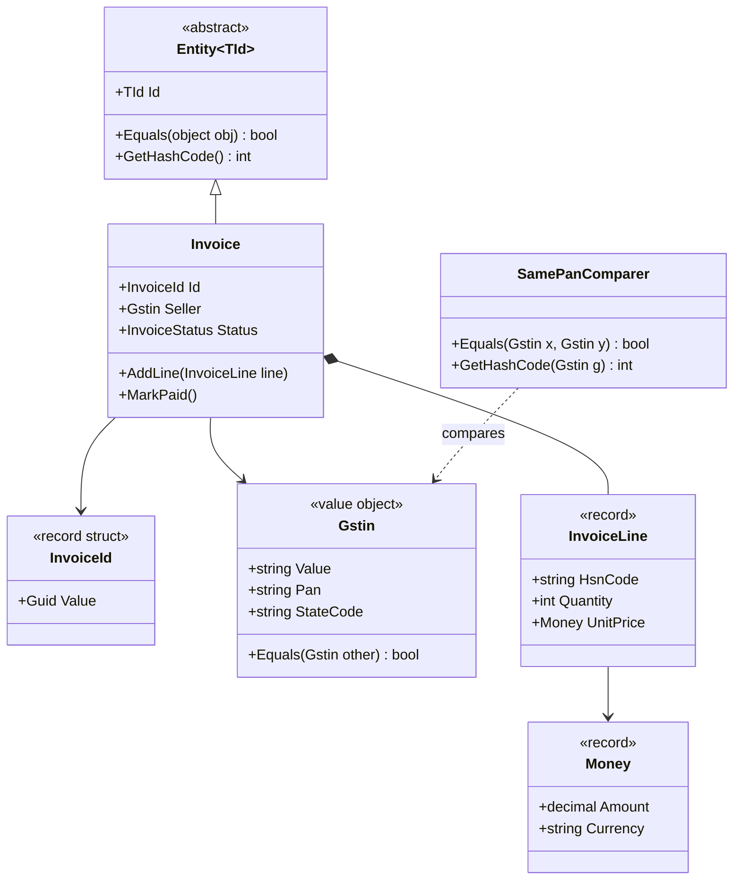
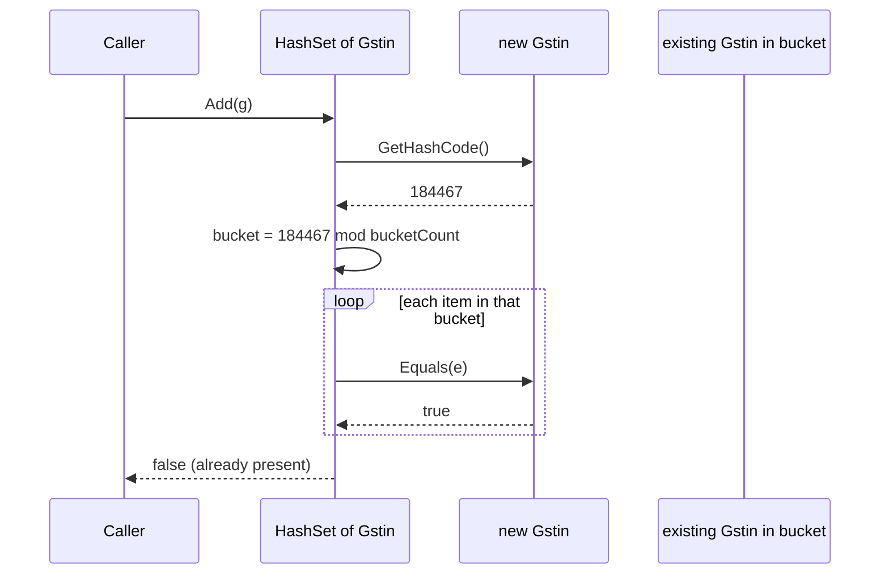

"Are these two the same?" sounds like a trivial question. It is behind a surprising number of production bugs: duplicate vendors in a master list, a cache that never hits, a `HashSet` that "loses" an item, an invoice that is paid twice because two objects for the same invoice were treated as different. This lesson teaches you to answer the question deliberately for every type you design.

## Learning objectives

By the end of this lesson you will be able to:

1. Explain the three meanings of "same": same object in memory (reference identity), same business identity (entity), and same value (value object).
2. Implement value equality correctly in C#: `Equals`, `GetHashCode`, `IEquatable<T>`, `==` and `!=`, and know which ones records generate for you.
3. State the equality contract (reflexive, symmetric, transitive, consistent, hash-compatible) and spot code that breaks it.
4. Design entity equality based on a stable identifier, including strongly typed IDs.
5. Use `IEqualityComparer<T>` when "same" depends on the context, such as deduplicating vendors by PAN rather than by GSTIN.
6. Avoid the classic traps: mutable hash keys, records holding lists, `double` comparisons, inheritance breaking symmetry.

## Prerequisites

- [Identifying entities, value objects and services](#/lesson/m07-entities-values-services): this lesson turns that modelling choice into code.
- [Immutable objects](#/lesson/m07-immutability): value equality is only safe on objects that don't change.
- [Value types, reference types and memory](#/lesson/m01-value-reference-memory): you need to know what a reference is.

## Explain it like I'm a beginner

Imagine three situations at a railway station.

**Situation 1: two ₹500 notes.** You give the ticket clerk one ₹500 note, and she gives you change. Do you care *which* ₹500 note she keeps? No. Any ₹500 note is as good as any other. Two notes are "the same" if their **value** is the same. That is a **value object**.

**Situation 2: two passengers named Priya Sharma.** Both are on the same train. They have the same name, the same age, maybe even the same city. They are still two different people, each with her own PNR and seat. Two passengers are "the same" only if they are **the same person**, which we track with an identifier (the PNR). That is an **entity**: something with an identity that persists while its details change. Priya can change her seat and she is still Priya.

**Situation 3: two printouts of your ticket.** You print your e-ticket twice. The two sheets of paper are different physical objects. But they describe the same booking. Whether they are "the same" depends on what you are asking: "same sheet of paper?" (no) or "same booking?" (yes).

Computers face exactly this question. By default, C# classes answer it in the most literal way: two variables are equal only if they point at **the same object in memory** (reference equality). That's the "same sheet of paper" answer. Often it is the wrong one for business code.

Your job as a designer is to decide, for each type, which answer is right, and then to make the code give that answer consistently everywhere: in `==`, in `Equals`, in dictionaries, in `HashSet`, in LINQ's `Distinct`, and in your tests.

## First-principles explanation

### Three kinds of sameness

| Kind | Question it answers | C# default for | Example |
|---|---|---|---|
| Reference identity | Is this the very same object in memory? | `class` | Two variables pointing at one `HttpClient` |
| Entity identity | Is this the same business thing, even if details changed? | (you must implement it) | Invoice `INV-2026-0042`, an employee, a road project |
| Value equality | Do these hold the same values? | `struct`, `record`, `string` | ₹500, a GSTIN, a date range, a GPS coordinate |

`string` is the most famous value type that is actually a reference type. Two different string objects containing `"Delhi"` are equal with `==`, because Microsoft overrode equality for `string`. You will do the same for your own value objects.

### What happens without a decision

Suppose `Vendor` is a plain class and you load the same vendor twice, once from the database and once from a CSV import:

```csharp
var a = new Vendor { Gstin = "29ABCDE1234F1Z5", Name = "Shree Cement Traders" };
var b = new Vendor { Gstin = "29ABCDE1234F1Z5", Name = "Shree Cement Traders" };
Console.WriteLine(a == b);                          // False
Console.WriteLine(new HashSet<Vendor> { a, b }.Count); // 2
```

Nothing crashes. You just get two rows in the vendor master, and three months later the finance team finds the same supplier paid under two codes. Equality bugs are quiet. That is why they are expensive.

### The equality contract

Whenever you override `Equals`, .NET collections assume these rules hold. Break one and dictionaries and sets start misbehaving in ways that are hard to debug.

1. **Reflexive**: `x.Equals(x)` is true.
2. **Symmetric**: if `x.Equals(y)` then `y.Equals(x)`.
3. **Transitive**: if `x` equals `y` and `y` equals `z`, then `x` equals `z`.
4. **Consistent**: the answer doesn't change unless the objects change.
5. **Null-safe**: `x.Equals(null)` is false and never throws.
6. **Hash-compatible**: if `x.Equals(y)`, then `x.GetHashCode() == y.GetHashCode()`. The reverse is *not* required: unequal objects may share a hash code (a collision).

### How a HashSet actually uses these methods

A `HashSet<T>` or `Dictionary<TKey, TValue>` is like a post office with numbered pigeonholes (buckets). To store an item it:

1. Calls `GetHashCode()` to get an `int`.
2. Uses that number to pick a bucket.
3. Inside the bucket, calls `Equals` on each item already there to see if it is a duplicate.

So `GetHashCode` decides *where to look*, and `Equals` decides *whether it's a match*. If two equal objects produce different hash codes, the set looks in the wrong pigeonhole and never even calls `Equals`. You get duplicates, or `Contains` returns false for an item you just added.

A good hash code spreads objects evenly over buckets. A terrible one (`return 1;`) is *correct* but turns every lookup into a linear scan: a set of 100,000 items would do up to 100,000 `Equals` calls per lookup instead of about one. Use `HashCode.Combine(a, b, c)`, which mixes fields well and is randomised per process.

:::callout type=warning title="Hash codes are not stable across runs"
`string.GetHashCode()` and `HashCode.Combine` are randomised per process in .NET Core and later. Never store a hash code in a database, a file or a cache key shared between servers. Use a real hash (SHA-256) or the value itself for that.
:::

### Records give you value equality for free (mostly)

A C# `record` (class or struct) generates:

- `Equals(object)`, `Equals(T)` (implementing `IEquatable<T>`), `GetHashCode()`, `==`, `!=`.
- An `EqualityContract` property that makes a base record and a derived record unequal, even with the same fields. This keeps symmetry intact under inheritance.

The generated `Equals` compares every field using `EqualityComparer<TField>.Default`. That's perfect for fields like `decimal`, `string`, `DateOnly`, `Guid` and other records. It is wrong for **collections**: `List<T>` and arrays use reference equality, so two records holding two lists with identical content are *not* equal. You will fix this in an exercise.

### Entities: identity, not content

An entity's fields change over its life: an invoice moves from Draft to Paid, its due date may be extended. If equality were based on fields, the same invoice would stop being equal to itself after an update, and it would fall out of any `HashSet` it was in. So entity equality uses **only the identifier**.

Two design decisions make entity equality safe:

1. **Assign the ID at construction**, for example with `Guid.CreateVersion7()` (.NET 9+), which gives time-ordered GUIDs that index well in PostgreSQL. If the database assigns the ID on insert, a new entity has ID `0` until it is saved. Two new unsaved invoices would then be "equal", which is nonsense.
2. **Use a strongly typed ID** such as `readonly record struct InvoiceId(Guid Value)`. Then the compiler stops you from comparing an `InvoiceId` with a `VendorId` by accident: two different `Guid`s are both just `Guid`, but two different ID types don't mix.

### Equality depends on context: comparers

Sometimes "same" changes with the question. A GSTIN (Goods and Services Tax Identification Number) has 15 characters: a 2-digit state code, the business's 10-character PAN, an entity number, a `Z` and a check character. So `29ABCDE1234F1Z5` (Karnataka) and `27ABCDE1234F1Z9` (Maharashtra) are two different *registrations* of the same *legal business*.

- For GST filing, they are different. The type's own `Equals` should say so.
- For "how much did we pay this company across India?", they are the same.

Don't change the type's `Equals` to suit one report. Write an `IEqualityComparer<Gstin>` for the second question and pass it to `Distinct`, `GroupBy`, `HashSet` or `Dictionary`. The type keeps one natural equality; comparers provide the others.

### When value equality is unnecessary

- **Services** (`InvoiceService`, `ILogger`) have no meaningful equality. Leave them with reference equality.
- **DTOs** that only carry data to JSON rarely need equality. Records are fine but don't add hand-written equality code.
- **Large mutable aggregates** compared field by field are slow and wrong. Compare them by ID.

### Trade-offs

| Choice | You gain | You pay |
|---|---|---|
| `record` | Correct equality, `ToString`, `with` in one line | Collection fields compare by reference; all fields take part, including ones you may not want |
| Hand-written `IEquatable<T>` | Full control: normalisation, which fields count | 30+ lines of boilerplate that must stay in sync with the fields |
| `record struct` | No heap allocation, value semantics | Copying cost for big structs; `default` instance always exists |
| Entity equality by ID | Stable across state changes | You must guarantee the ID exists before the object enters a set |
| External comparer | Many notions of "same" without polluting the type | Callers must remember to pass it |

## Visual explanation

### Class diagram



Read it like this. `Invoice` is an entity: it inherits identity-based equality from `Entity<TId>` and is identified by an `InvoiceId`, a strongly typed wrapper around a `Guid`. Everything it *holds* is a value: `Gstin`, `Money` and each `InvoiceLine` are compared by content. `SamePanComparer` sits outside the model. It is a second, context-specific definition of sameness for `Gstin` that doesn't replace the natural one. The filled diamond shows that lines are owned by (composed into) the invoice.

### Sequence diagram: what HashSet.Add does



The set never compares the new item against *every* item, only against the few that landed in the same bucket. This is why a wrong `GetHashCode` is worse than a slow one: if two equal GSTINs produce different hash codes, they land in different buckets, `Equals` is never called, and the duplicate gets in.

## Step-by-step example

We'll build the GSTIN value object in four steps.

### Step 1 — the naive version

```csharp
public class Gstin
{
    public string Value { get; set; } = "";
}
```

`new Gstin { Value = "29ABCDE1234F1Z5" } == new Gstin { Value = "29ABCDE1234F1Z5" }` is `false`. Also `Value` can be changed after the object is in a dictionary, and nothing stops `" 29abcde1234f1z5 "` from sneaking in with spaces and lowercase.

### Step 2 — make it immutable and normalised

Normalise once, in the constructor: trim, uppercase with the invariant culture, validate the format. After construction, the value never changes. Now "same value" has one canonical spelling, so equality can be a simple ordinal string comparison.

### Step 3 — implement equality

Implement `IEquatable<Gstin>` (a strongly typed `Equals` that avoids boxing and casting), override `Equals(object)` to call it, override `GetHashCode` with the *same* field, and add `==` / `!=` so the operators agree with `Equals`.

### Step 4 — add context comparers

Expose `Pan` and `StateCode` as derived properties, and write `SamePanComparer` for the "same legal business" question. The full code is below.

## Production-style C# implementation

```text
Billing.Api/
  Program.cs
  Equality/
    Gstin.cs              value object, hand-written equality
    Money.cs              value object as a record
    Entity.cs             base class: identity equality
    Invoice.cs            entity + strongly typed ID + line record
    SamePanComparer.cs    context-specific comparer
```

```csharp file=Equality/Gstin.cs
using System.Diagnostics.CodeAnalysis;
using System.Text.RegularExpressions;

namespace Billing.Equality;

/// <summary>A GST registration number. Immutable, normalised, compared by value.</summary>
public sealed partial class Gstin : IEquatable<Gstin>
{
    // 2-digit state, 10-char PAN (5 letters, 4 digits, 1 letter), entity number, 'Z', check character.
    [GeneratedRegex("^[0-9]{2}[A-Z]{5}[0-9]{4}[A-Z][1-9A-Z]Z[0-9A-Z]$")]
    private static partial Regex Format();

    public string Value { get; }
    public string StateCode => Value[..2];
    public string Pan => Value.Substring(2, 10);

    private Gstin(string normalised) => Value = normalised;

    public static Gstin Parse(string raw) =>
        TryParse(raw, out var g) ? g : throw new FormatException($"'{raw}' is not a valid GSTIN.");

    public static bool TryParse(string? raw, [NotNullWhen(true)] out Gstin? gstin)
    {
        gstin = null;
        if (string.IsNullOrWhiteSpace(raw)) return false;
        var n = raw.Trim().ToUpperInvariant();
        if (!Format().IsMatch(n)) return false;
        gstin = new Gstin(n);
        return true;
    }

    public bool Equals(Gstin? other) =>
        other is not null && string.Equals(Value, other.Value, StringComparison.Ordinal);

    public override bool Equals(object? obj) => obj is Gstin g && Equals(g);

    // Same field, same comparison as Equals, so equal objects always share a hash code.
    public override int GetHashCode() => StringComparer.Ordinal.GetHashCode(Value);

    public static bool operator ==(Gstin? left, Gstin? right) => left is null ? right is null : left.Equals(right);
    public static bool operator !=(Gstin? left, Gstin? right) => !(left == right);

    public override string ToString() => Value;
}
```

The class is `sealed`. If someone could derive `SpecialGstin : Gstin` and add a field, `gstin.Equals(special)` and `special.Equals(gstin)` could disagree, which breaks symmetry. Sealing a value object is the simplest way to rule that out.

```csharp file=Equality/Money.cs
namespace Billing.Equality;

/// <summary>A record gives value equality over Amount and Currency. The constructor normalises both,
/// so ₹10.0 and ₹10.00 in "inr" and "INR" are all equal.</summary>
public sealed record Money
{
    public decimal Amount { get; }
    public string Currency { get; }

    public Money(decimal amount, string currency)
    {
        if (string.IsNullOrWhiteSpace(currency) || currency.Trim().Length != 3)
            throw new ArgumentException("Currency must be a 3-letter ISO code.", nameof(currency));
        Amount = decimal.Round(amount, 2, MidpointRounding.ToEven);
        Currency = currency.Trim().ToUpperInvariant();
    }

    public static Money Inr(decimal amount) => new(amount, "INR");
    public static Money Zero(string currency) => new(0m, currency);

    public Money Add(Money other)
    {
        if (other.Currency != Currency)
            throw new InvalidOperationException($"Cannot add {other.Currency} to {Currency}.");
        return new Money(Amount + other.Amount, Currency);
    }

    public Money Times(int quantity) => new(Amount * quantity, Currency);

    public override string ToString() => $"{Currency} {Amount:0.00}";
}
```

`decimal` equality already treats `10.0m` and `10.00m` as equal (they differ only in scale), and their hash codes match too. `double` is a different story: `0.1 + 0.2 == 0.3` is `false`. Never use `double` for money or for anything you compare for equality.

```csharp file=Equality/Entity.cs
namespace Billing.Equality;

/// <summary>Base class for entities: two instances are equal when they are the same concrete type
/// with the same Id. The Id is required at construction, so there is no "transient" state.</summary>
public abstract class Entity<TId> : IEquatable<Entity<TId>> where TId : notnull, IEquatable<TId>
{
    public TId Id { get; }

    protected Entity(TId id)
    {
        if (EqualityComparer<TId>.Default.Equals(id, default!))
            throw new ArgumentException("An entity needs a non-default Id.", nameof(id));
        Id = id;
    }

    public bool Equals(Entity<TId>? other)
    {
        if (other is null) return false;
        if (ReferenceEquals(this, other)) return true;
        // An Invoice and a CreditNote that happen to share an Id are not the same thing.
        return GetType() == other.GetType() && Id.Equals(other.Id);
    }

    public override bool Equals(object? obj) => obj is Entity<TId> e && Equals(e);
    public override int GetHashCode() => HashCode.Combine(GetType(), Id);

    public static bool operator ==(Entity<TId>? a, Entity<TId>? b) => a is null ? b is null : a.Equals(b);
    public static bool operator !=(Entity<TId>? a, Entity<TId>? b) => !(a == b);
}
```

```csharp file=Equality/Invoice.cs
namespace Billing.Equality;

/// <summary>Strongly typed ID: an InvoiceId can't be passed where a VendorId is expected.</summary>
public readonly record struct InvoiceId(Guid Value)
{
    public static InvoiceId New() => new(Guid.CreateVersion7());
    public override string ToString() => Value.ToString();
}

public sealed record InvoiceLine(string HsnCode, int Quantity, Money UnitPrice)
{
    public Money Total => UnitPrice.Times(Quantity);
}

public enum InvoiceStatus { Draft, Issued, Paid }

public sealed class Invoice : Entity<InvoiceId>
{
    private readonly List<InvoiceLine> _lines = [];

    public Invoice(InvoiceId id, Gstin seller, string currency = "INR") : base(id)
    {
        Seller = seller;
        Currency = currency;
    }

    public Gstin Seller { get; }
    public string Currency { get; }
    public InvoiceStatus Status { get; private set; } = InvoiceStatus.Draft;
    public IReadOnlyList<InvoiceLine> Lines => _lines;

    public Money Total => _lines.Aggregate(Money.Zero(Currency), (sum, l) => sum.Add(l.Total));

    public void AddLine(InvoiceLine line)
    {
        if (Status != InvoiceStatus.Draft) throw new InvalidOperationException("Only draft invoices can change.");
        if (line.UnitPrice.Currency != Currency) throw new ArgumentException("Line currency must match the invoice.");
        _lines.Add(line);
    }

    public void Issue()
    {
        if (_lines.Count == 0) throw new InvalidOperationException("Cannot issue an empty invoice.");
        Status = InvoiceStatus.Issued;
    }

    public void MarkPaid()
    {
        if (Status != InvoiceStatus.Issued) throw new InvalidOperationException("Only issued invoices can be paid.");
        Status = InvoiceStatus.Paid;
    }
}
```

The invoice's status and lines change, but its equality (and hash code) depends only on `Id` and type, which never change. It is safe to keep invoices in a `HashSet<Invoice>` while they move from Draft to Paid.

```csharp file=Equality/SamePanComparer.cs
namespace Billing.Equality;

/// <summary>"Same legal business": two GSTINs from different states share a PAN.</summary>
public sealed class SamePanComparer : IEqualityComparer<Gstin>
{
    public static readonly SamePanComparer Instance = new();

    public bool Equals(Gstin? x, Gstin? y) =>
        ReferenceEquals(x, y) || (x is not null && y is not null && string.Equals(x.Pan, y.Pan, StringComparison.Ordinal));

    public int GetHashCode(Gstin obj) => StringComparer.Ordinal.GetHashCode(obj.Pan);
}
```

```csharp file=Program.cs
using Billing.Equality;

var builder = WebApplication.CreateBuilder(args);
var app = builder.Build();

// POST ["29ABCDE1234F1Z5", "29abcde1234f1z5 ", "27ABCDE1234F1Z9"]
// -> { registrations: 2, legalEntities: 1, invalid: [] }
app.MapPost("/vendors/dedupe", (string[] raw) =>
{
    var invalid = new List<string>();
    var parsed = new List<Gstin>();
    foreach (var r in raw)
    {
        if (Gstin.TryParse(r, out var g)) parsed.Add(g);
        else invalid.Add(r);
    }

    var registrations = parsed.Distinct().Count();                         // natural equality
    var legalEntities = parsed.Distinct(SamePanComparer.Instance).Count(); // context equality
    return Results.Ok(new { registrations, legalEntities, invalid });
});

app.Run();
```

## Bad design vs good design

**Bad**: a mutable `Vendor` class used as a dictionary key, with equality overridden on every field.

```csharp
public class Vendor
{
    public string Gstin { get; set; } = "";
    public string Name { get; set; } = "";
    public override bool Equals(object? o) => o is Vendor v && v.Gstin == Gstin && v.Name == Name;
    public override int GetHashCode() => HashCode.Combine(Gstin, Name);
}

var payments = new Dictionary<Vendor, decimal>();
var v = new Vendor { Gstin = "29ABCDE1234F1Z5", Name = "Shree Cement" };
payments[v] = 1_25_000m;
v.Name = "Shree Cement Traders Pvt Ltd";        // renamed after a KYC update
Console.WriteLine(payments.ContainsKey(v));     // False — the key is now in the wrong bucket
```

Three mistakes stack up here:

- `Vendor` is really an entity (it keeps its identity when renamed), but it is compared like a value.
- The fields used in `GetHashCode` are mutable, so changing one strands the object in the wrong bucket. The ₹1,25,000 is still in the dictionary, but you can't find it.
- GSTIN strings aren't normalised, so `"29abcde1234f1z5"` would be a different vendor.

**Good**: `Vendor` is an entity with a `VendorId`, compared by ID only. Its GSTIN is a `Gstin` value object, normalised at construction. Any "same business" grouping uses `SamePanComparer`. Dictionary keys are immutable values (`VendorId` or `Gstin`), never the mutable entity.

**Is the hand-written version worth it?** For most value objects, no. A `sealed record` with a validating constructor gives you correct equality in a few lines, as `Money` shows. Hand-write `IEquatable<T>` only when you need something a record can't do: comparing only *some* fields, comparing collections by content, or case-insensitive comparison without normalising the stored value.

:::callout type=mistake title="Comparing entities by all fields"
If an `Employee` with ID 1042 is equal to itself only until someone updates her phone number, every cache, set and change tracker that holds her will break. Entities compare by identity. Values compare by content. Mixing these up is the root of most equality bugs.
:::

## Practical playground

Run this program and predict each line before you read the output. Then try the suggested edits in the comments.

:::playground type=csharp title="Equality experiments"
```csharp file=Program.cs
using System;
using System.Collections.Generic;
using System.Linq;

public class PlainPoint { public int X { get; set; } public int Y { get; set; } }

public sealed record GeoPoint(double Lat, double Lng);

public sealed record Route(string Name, List<string> Stops);

public class MutableKey
{
    public string Code { get; set; } = "";
    public override bool Equals(object? obj) => obj is MutableKey k && k.Code == Code;
    public override int GetHashCode() => Code.GetHashCode();
}

public static class Program
{
    public static void Main()
    {
        // 1. Classes: reference equality by default.
        var p1 = new PlainPoint { X = 1, Y = 2 };
        var p2 = new PlainPoint { X = 1, Y = 2 };
        Console.WriteLine($"1. PlainPoint equal? {p1.Equals(p2)}");

        // 2. Records: value equality, generated for you.
        var delhi1 = new GeoPoint(28.6139, 77.2090);
        var delhi2 = new GeoPoint(28.6139, 77.2090);
        Console.WriteLine($"2. GeoPoint equal? {delhi1 == delhi2}, same object? {ReferenceEquals(delhi1, delhi2)}");

        // 3. Records holding a List compare the list by reference.
        var r1 = new Route("Metro Yellow", new List<string> { "Samaypur Badli", "Rajiv Chowk", "HUDA City Centre" });
        var r2 = new Route("Metro Yellow", new List<string> { "Samaypur Badli", "Rajiv Chowk", "HUDA City Centre" });
        Console.WriteLine($"3. Route equal? {r1 == r2}   (try: override Equals to use SequenceEqual)");

        // 4. A mutable key gets lost in a HashSet.
        var key = new MutableKey { Code = "NH-48" };
        var set = new HashSet<MutableKey> { key };
        key.Code = "NH-44";
        Console.WriteLine($"4. Contains after mutation? {set.Contains(key)}, count = {set.Count}");

        // 5. double vs decimal.
        Console.WriteLine($"5. 0.1+0.2==0.3 as double? {0.1 + 0.2 == 0.3}; as decimal? {0.1m + 0.2m == 0.3m}");

        // 6. Context comparer: case-insensitive city names.
        var cities = new[] { "Pune", "PUNE", "pune", "Patna" };
        Console.WriteLine($"6. Distinct default: {cities.Distinct().Count()}, ignore case: {cities.Distinct(StringComparer.OrdinalIgnoreCase).Count()}");
    }
}
```
:::

## Exercises

:::exercise id=m07-equality-identity-ex1 difficulty=beginner kind=code title="Make PinCode a proper value object"
Indian postal PIN codes are six digits, and the first digit is never 0. Users type them with spaces (`"122 001"`) or leading and trailing whitespace. Implement `PinCode` so that two PIN codes with the same digits are equal everywhere: `Equals`, `==`, `!=`, and in a `HashSet`.
::requirements
- `PinCode.Parse(string)` strips all spaces, validates, and throws `FormatException` for invalid input.
- Implement `IEquatable<PinCode>`, `Equals(object)`, `GetHashCode`, `==` and `!=`.
- `Value` returns the normalised six digits.
::acceptance
- `PinCode.Parse("122 001") == PinCode.Parse(" 122001")` is true.
- `PinCode.Parse("110001") != PinCode.Parse("122001")` is true.
- A `HashSet<PinCode>` with three spellings of the same PIN has one item.
- `"012345"`, `"12345"` and `"12A456"` all throw `FormatException`.
- `pin.Equals(null)` is false and `null == null` is true for `PinCode?`.
::hint
Normalise in one place, the factory method, so every instance stores the same canonical text.
::hint
Once the stored value is canonical, equality is just an ordinal string comparison of `Value`.
::hint
`GetHashCode` must use the same field as `Equals`. `Value.GetHashCode()` is fine because `Value` never changes.
::hint
For `==`, handle `null` on the left first: `left is null ? right is null : left.Equals(right)`.
::starter
```csharp file=PinCode.cs
using System;

public sealed class PinCode : IEquatable<PinCode>
{
    public string Value { get; }
    private PinCode(string value) => Value = value;

    public static PinCode Parse(string raw) => throw new NotImplementedException();

    public bool Equals(PinCode? other) => throw new NotImplementedException();
    public override bool Equals(object? obj) => throw new NotImplementedException();
    public override int GetHashCode() => throw new NotImplementedException();

    public static bool operator ==(PinCode? left, PinCode? right) => throw new NotImplementedException();
    public static bool operator !=(PinCode? left, PinCode? right) => throw new NotImplementedException();

    public override string ToString() => Value;
}
```
::tests
```csharp file=PinCodeTests.cs
using System;
using System.Collections.Generic;
using Xunit;

public class PinCodeTests
{
    [Fact] public void Spaces_are_ignored() => Assert.True(PinCode.Parse("122 001") == PinCode.Parse(" 122001"));
    [Fact] public void Different_pins_differ() => Assert.True(PinCode.Parse("110001") != PinCode.Parse("122001"));
    [Fact] public void Value_is_normalised() => Assert.Equal("560034", PinCode.Parse(" 560 034 ").Value);

    [Fact]
    public void HashSet_dedupes()
    {
        var set = new HashSet<PinCode> { PinCode.Parse("122001"), PinCode.Parse("122 001"), PinCode.Parse(" 122001 ") };
        Assert.Single(set);
    }

    [Theory]
    [InlineData("012345")]
    [InlineData("12345")]
    [InlineData("12A456")]
    [InlineData("")]
    public void Invalid_throws(string raw) => Assert.Throws<FormatException>(() => PinCode.Parse(raw));

    [Fact]
    public void Null_handling()
    {
        PinCode? none = null;
        PinCode? alsoNone = null;
        Assert.False(PinCode.Parse("400001").Equals(null));
        Assert.True(none == alsoNone);
        Assert.False(none == PinCode.Parse("400001"));
    }

    [Fact] public void Object_equals_agrees() => Assert.True(PinCode.Parse("700001").Equals((object)PinCode.Parse("700 001")));
}
```
::solution
Normalise in `Parse`, then compare the canonical string.

```csharp file=PinCode.cs
using System;
using System.Linq;

public sealed class PinCode : IEquatable<PinCode>
{
    public string Value { get; }
    private PinCode(string value) => Value = value;

    public static PinCode Parse(string raw)
    {
        var n = new string((raw ?? "").Where(c => c != ' ').ToArray());
        if (n.Length != 6 || !n.All(char.IsAsciiDigit) || n[0] == '0')
            throw new FormatException($"'{raw}' is not a valid PIN code.");
        return new PinCode(n);
    }

    public bool Equals(PinCode? other) => other is not null && string.Equals(Value, other.Value, StringComparison.Ordinal);
    public override bool Equals(object? obj) => obj is PinCode p && Equals(p);
    public override int GetHashCode() => StringComparer.Ordinal.GetHashCode(Value);

    public static bool operator ==(PinCode? left, PinCode? right) => left is null ? right is null : left.Equals(right);
    public static bool operator !=(PinCode? left, PinCode? right) => !(left == right);

    public override string ToString() => Value;
}
```

`char.IsAsciiDigit` (.NET 7+) is used instead of `char.IsDigit`, which also accepts digits from other scripts such as Devanagari `१`.
::alternatives
A `sealed record PinCode` with a private constructor and a `Parse` factory gives the same behaviour with less code, because the record's generated equality compares the already-normalised `Value`.
::mistakes
- Writing `left.Equals(right)` in `==` without a null check, which throws `NullReferenceException` for `null == x`.
- Overriding `Equals` but not `GetHashCode`. The `HashSet` test then fails.
- Using `char.IsDigit`, which accepts non-ASCII digits.
::extensions
Add `IComparable<PinCode>` so PIN codes can be sorted, and check that `CompareTo` returns 0 exactly when `Equals` is true.
:::

:::exercise id=m07-equality-identity-ex2 difficulty=beginner kind=code title="Fix a record that holds a list"
`SiteInspection` is a record with a list of observed defect codes. Two inspections with the same date, site and defects (in the same order) should be equal, but the generated equality compares the list by reference. Fix it without turning the record into a class.
::acceptance
- Two inspections with equal fields and equal defect lists (same order) are equal with `==` and `Equals`.
- Different defect lists make them unequal.
- Equal inspections have equal hash codes.
- `with` expressions still work.
::hint
Records let you write your own `Equals(SiteInspection? other)`. The compiler then uses yours instead of generating one.
::hint
If you write `Equals`, you must also write `GetHashCode`, or the compiler warns and hash-based collections break.
::hint
Use `SequenceEqual` for the list, and add each list item to a `HashCode` instance in a loop.
::hint
```csharp
public bool Equals(SiteInspection? other) =>
    other is not null && Date == other.Date && SiteCode == other.SiteCode && DefectCodes.SequenceEqual(other.DefectCodes);
```
::starter
```csharp file=SiteInspection.cs
using System;
using System.Collections.Generic;
using System.Linq;

public sealed record SiteInspection(DateOnly Date, string SiteCode, IReadOnlyList<string> DefectCodes)
{
    // TODO: make equality compare DefectCodes by content.
    public bool HasDefect(string code) => DefectCodes.Contains(code);
}
```
::tests
```csharp file=SiteInspectionTests.cs
using System;
using Xunit;

public class SiteInspectionTests
{
    private static SiteInspection Make(params string[] defects) =>
        new(new DateOnly(2026, 3, 14), "NH48-KM112", defects.ToList());

    [Fact] public void Same_content_is_equal() => Assert.True(Make("CRACK", "POTHOLE") == Make("CRACK", "POTHOLE"));
    [Fact] public void Different_content_is_not_equal() => Assert.False(Make("CRACK") == Make("POTHOLE"));
    [Fact] public void Order_matters() => Assert.False(Make("CRACK", "POTHOLE").Equals(Make("POTHOLE", "CRACK")));
    [Fact] public void Hash_codes_match() => Assert.Equal(Make("A", "B").GetHashCode(), Make("A", "B").GetHashCode());
    [Fact] public void With_still_works() => Assert.Equal("NH48-KM113", (Make("A") with { SiteCode = "NH48-KM113" }).SiteCode);
    [Fact] public void Date_matters() => Assert.False(Make("A") == (Make("A") with { Date = new DateOnly(2026, 3, 15) }));
}
```
::solution
Write `Equals(SiteInspection?)` and `GetHashCode()` in the record body. The compiler keeps generating `==`, `!=` and `Equals(object)`, which call yours.

```csharp file=SiteInspection.cs
using System;
using System.Collections.Generic;
using System.Linq;

public sealed record SiteInspection(DateOnly Date, string SiteCode, IReadOnlyList<string> DefectCodes)
{
    public bool HasDefect(string code) => DefectCodes.Contains(code);

    public bool Equals(SiteInspection? other) =>
        other is not null
        && Date == other.Date
        && string.Equals(SiteCode, other.SiteCode, StringComparison.Ordinal)
        && DefectCodes.SequenceEqual(other.DefectCodes);

    public override int GetHashCode()
    {
        var h = new HashCode();
        h.Add(Date);
        h.Add(SiteCode, StringComparer.Ordinal);
        foreach (var d in DefectCodes) h.Add(d, StringComparer.Ordinal);
        return h.ToHashCode();
    }
}
```

Because the record is `sealed`, you don't need to check `EqualityContract`. In an unsealed record you would add `EqualityContract == other.EqualityContract` to keep derived records unequal.
::alternatives
If order shouldn't matter, store the defects as an `ImmutableSortedSet<string>` or sort them in the constructor, so "same set" has one canonical order. Another option is a reusable `EquatableList<T>` wrapper type with content equality, used as the field type in many records.
::mistakes
- Overriding `Equals(object)` in a record. The compiler doesn't allow it; you override the typed `Equals(T?)`.
- Forgetting that the caller can still mutate a `List<string>` passed in. Copy it in the constructor (`defects.ToArray()`) if the record must be truly immutable.
- Hashing the list reference (`h.Add(DefectCodes)`), which gives different hashes for equal lists.
:::

:::exercise id=m07-equality-identity-ex3 difficulty=intermediate kind=code title="Entity equality for employees"
An HR system loads `Employee` objects from the database and from an HRMS sync. Implement an `Entity<TId>` base class and an `Employee` entity so that:
::requirements
- Equality uses only the concrete type and `Id`, never names, phone numbers or other mutable fields.
- An entity can't be created with a default ID (`Guid.Empty` inside `EmployeeId`).
- An `Employee` and a `Contractor` with the same raw `Guid` are **not** equal.
- An employee whose phone number changes stays in any `HashSet` she was in.
::acceptance
- Two `Employee` objects with the same `EmployeeId` and different names are equal.
- `new Employee(new EmployeeId(Guid.Empty), ...)` throws `ArgumentException`.
- `Employee` vs `Contractor` with the same Guid are unequal in both directions.
- After `ChangePhone`, `set.Contains(employee)` is still true.
::hint
What's the only thing about an employee that never changes?
::hint
Put the logic in an abstract `Entity<TId>` so every entity gets it consistently. Constrain `TId : notnull, IEquatable<TId>`.
::hint
Compare `GetType()` values to keep different entity types apart. Include the type in `GetHashCode` as well, or at least make sure it doesn't contradict `Equals`.
::hint
Check `EqualityComparer<TId>.Default.Equals(id, default!)` in the constructor. For `EmployeeId(Guid Value)`, a record struct, `default` is `EmployeeId(Guid.Empty)`.
::starter
```csharp file=Entities.cs
using System;
using System.Collections.Generic;

public readonly record struct EmployeeId(Guid Value);
public readonly record struct ContractorId(Guid Value);

public abstract class Entity<TId> : IEquatable<Entity<TId>> where TId : notnull, IEquatable<TId>
{
    public TId Id { get; }
    protected Entity(TId id) => throw new NotImplementedException();

    public bool Equals(Entity<TId>? other) => throw new NotImplementedException();
    public override bool Equals(object? obj) => throw new NotImplementedException();
    public override int GetHashCode() => throw new NotImplementedException();
}

public sealed class Employee : Entity<EmployeeId>
{
    public Employee(EmployeeId id, string name, string phone) : base(id) { Name = name; Phone = phone; }
    public string Name { get; private set; }
    public string Phone { get; private set; }
    public void ChangePhone(string phone) => Phone = phone;
}

/// <summary>Deliberately uses a Guid Id too, to show that the raw value isn't enough.</summary>
public sealed class Contractor : Entity<Guid>
{
    public Contractor(Guid id, string agency) : base(id) => Agency = agency;
    public string Agency { get; }
}
```
::tests
```csharp file=EntityTests.cs
using System;
using System.Collections.Generic;
using Xunit;

public class EntityTests
{
    private static readonly Guid G = Guid.Parse("0192f0a0-0000-7000-8000-000000001042");

    [Fact]
    public void Same_id_different_name_is_equal() =>
        Assert.True(new Employee(new EmployeeId(G), "Anita Rao", "98100").Equals(new Employee(new EmployeeId(G), "Anita R.", "98999")));

    [Fact]
    public void Different_id_is_not_equal() =>
        Assert.False(new Employee(new EmployeeId(G), "A", "1").Equals(new Employee(new EmployeeId(Guid.NewGuid()), "A", "1")));

    [Fact]
    public void Default_id_throws() => Assert.Throws<ArgumentException>(() => new Employee(new EmployeeId(Guid.Empty), "A", "1"));

    [Fact]
    public void Default_guid_throws_for_contractor() => Assert.Throws<ArgumentException>(() => new Contractor(Guid.Empty, "X"));

    [Fact]
    public void Different_entity_types_are_not_equal()
    {
        object e = new Employee(new EmployeeId(G), "A", "1");
        object c = new Contractor(G, "Agency");
        Assert.False(e.Equals(c));
        Assert.False(c.Equals(e));
    }

    [Fact]
    public void Survives_mutation_in_hashset()
    {
        var emp = new Employee(new EmployeeId(G), "Anita", "98100");
        var set = new HashSet<Employee> { emp };
        emp.ChangePhone("97000");
        Assert.True(set.Contains(emp));
        Assert.True(set.Contains(new Employee(new EmployeeId(G), "Anita", "x")));
    }

    [Fact]
    public void Equal_entities_have_equal_hashes() =>
        Assert.Equal(new Employee(new EmployeeId(G), "A", "1").GetHashCode(), new Employee(new EmployeeId(G), "B", "2").GetHashCode());
}
```
::solution
```csharp file=Entities.cs
using System;
using System.Collections.Generic;

public readonly record struct EmployeeId(Guid Value);
public readonly record struct ContractorId(Guid Value);

public abstract class Entity<TId> : IEquatable<Entity<TId>> where TId : notnull, IEquatable<TId>
{
    public TId Id { get; }

    protected Entity(TId id)
    {
        if (EqualityComparer<TId>.Default.Equals(id, default!))
            throw new ArgumentException("Entity Id must not be the default value.", nameof(id));
        Id = id;
    }

    public bool Equals(Entity<TId>? other) =>
        other is not null && (ReferenceEquals(this, other) || (GetType() == other.GetType() && Id.Equals(other.Id)));

    public override bool Equals(object? obj) => obj is Entity<TId> e && Equals(e);
    public override int GetHashCode() => HashCode.Combine(GetType(), Id);
}

public sealed class Employee : Entity<EmployeeId>
{
    public Employee(EmployeeId id, string name, string phone) : base(id) { Name = name; Phone = phone; }
    public string Name { get; private set; }
    public string Phone { get; private set; }
    public void ChangePhone(string phone) => Phone = phone;
}

public sealed class Contractor : Entity<Guid>
{
    public Contractor(Guid id, string agency) : base(id) => Agency = agency;
    public string Agency { get; }
}
```

`Employee` and `Contractor` derive from *different* closed generic types (`Entity<EmployeeId>` and `Entity<Guid>`), so `obj is Entity<TId>` already fails across them. The `GetType()` check still matters when two entity types share the same ID type, for example `Invoice` and `CreditNote` both using `Guid`.
::alternatives
Many teams skip the base class and give each entity its own `Equals` by ID. It's more code but avoids an inheritance hierarchy. With EF Core, beware that lazy-loading proxies are subclasses, so `GetType()` differs from the entity type. Compare the unproxied type in that case, or disable proxies.
::mistakes
- Including `Name` or `Phone` in equality, so the employee disappears from sets after an update.
- Letting the database assign the ID later. Two unsaved employees would then compare equal (both ID 0).
- Comparing only `Id`, so an `Invoice` and a `CreditNote` with the same Guid look equal.
:::

:::exercise id=m07-equality-identity-ex4 difficulty=intermediate kind=design title="Classify a material-delivery model by sameness"
A construction-site app records cement and steel deliveries. The current model treats everything as a mutable class with reference equality. Redesign it in the LLD designer: for each type, choose entity, value object or service, decide what equality it needs, and add any comparers.

Types today: `Delivery` (truck arrives with a challan), `ChallanNumber`, `Supplier`, `Quantity` (amount + unit, e.g. 40 tonnes), `VehicleNumber` (e.g. `HR 26 DQ 5521`), `DeliveryService`, and a weekly report that must count deliveries per *supplier group* (one company, several GSTINs).
::acceptance
- `Delivery` and `Supplier` are entities with strongly typed IDs and identity equality.
- `ChallanNumber`, `Quantity`, `VehicleNumber` are immutable value objects; `VehicleNumber` normalises spacing and case.
- `Quantity` equality accounts for units (decide whether 1 tonne equals 1,000 kg, and say why).
- `DeliveryService` has no custom equality.
- The supplier-group report uses a comparer, not a change to `Supplier.Equals`.
::hint
Ask "does it keep its identity when its details change?" for each type. A supplier changing its address is still the same supplier.
::hint
Vehicle numbers are typed as `HR26DQ5521`, `hr 26 dq 5521` and `HR-26-DQ-5521`. One canonical form fixes equality.
::hint
For `Quantity`, the safest rule is to normalise to a base unit (kg) in the constructor. Then 1 t and 1,000 kg are equal and hash the same. The alternative is to keep units distinct and make them unequal; either is defensible if documented.
::hint
The report needs "same group", which is a second definition of sameness: an `IEqualityComparer<Supplier>` keyed on a `GroupPan` or parent-company ID.
::starter
```json file=design.json
{
  "classes": [
    { "id": "Delivery", "name": "Delivery", "kind": "class", "fields": ["+string ChallanNo", "+string Supplier", "+decimal Qty", "+string Unit", "+string Vehicle"], "methods": [] },
    { "id": "Supplier", "name": "Supplier", "kind": "class", "fields": ["+string Name", "+string Gstin", "+string Address"], "methods": [] },
    { "id": "DeliveryService", "name": "DeliveryService", "kind": "class", "fields": [], "methods": ["+void Record(Delivery d)", "+int CountBySupplier(string supplier)"] }
  ],
  "relations": [
    { "from": "DeliveryService", "to": "Delivery", "kind": "dependency" }
  ]
}
```
::solution
```json file=design.json
{
  "classes": [
    { "id": "Entity", "name": "Entity~TId~", "kind": "abstract", "fields": ["+TId Id"], "methods": ["+bool Equals(object obj)", "+int GetHashCode()"], "responsibility": "Identity equality: same concrete type and same Id" },
    { "id": "DeliveryId", "name": "DeliveryId", "kind": "record", "fields": ["+Guid Value"], "methods": [], "responsibility": "Strongly typed delivery identifier" },
    { "id": "SupplierId", "name": "SupplierId", "kind": "record", "fields": ["+Guid Value"], "methods": [], "responsibility": "Strongly typed supplier identifier" },
    { "id": "Delivery", "name": "Delivery", "kind": "class", "fields": ["+DeliveryId Id", "+ChallanNumber Challan", "+SupplierId Supplier", "+Quantity Qty", "+VehicleNumber Vehicle", "+DateTimeOffset ArrivedAt"], "methods": ["+void Reject(string reason)"], "responsibility": "Entity: a delivery event; equal by Id" },
    { "id": "Supplier", "name": "Supplier", "kind": "class", "fields": ["+SupplierId Id", "+string Name", "+Gstin Gstin", "+string GroupPan"], "methods": ["+void ChangeAddress(string a)"], "responsibility": "Entity: keeps identity when name or address change" },
    { "id": "ChallanNumber", "name": "ChallanNumber", "kind": "record", "fields": ["+string Value"], "methods": ["+ChallanNumber Parse(string raw)"], "responsibility": "Value: trimmed, upper-case challan number" },
    { "id": "Quantity", "name": "Quantity", "kind": "record", "fields": ["+decimal Kilograms"], "methods": ["+Quantity Tonnes(decimal t)", "+Quantity Kg(decimal kg)"], "responsibility": "Value: normalised to kg so 1 t equals 1000 kg" },
    { "id": "VehicleNumber", "name": "VehicleNumber", "kind": "record", "fields": ["+string Value"], "methods": ["+VehicleNumber Parse(string raw)"], "responsibility": "Value: strips spaces and hyphens, upper-cases" },
    { "id": "SameGroupComparer", "name": "SameGroupComparer", "kind": "class", "fields": [], "methods": ["+bool Equals(Supplier x, Supplier y)", "+int GetHashCode(Supplier s)"], "responsibility": "Context equality for the weekly group report" },
    { "id": "DeliveryService", "name": "DeliveryService", "kind": "class", "fields": [], "methods": ["+void Record(Delivery d)", "+IReadOnlyDictionary~string,int~ CountByGroup(DateOnly weekStart)"], "responsibility": "Service: orchestrates; no equality" }
  ],
  "relations": [
    { "from": "Delivery", "to": "Entity", "kind": "inherits" },
    { "from": "Supplier", "to": "Entity", "kind": "inherits" },
    { "from": "Delivery", "to": "DeliveryId", "kind": "composition" },
    { "from": "Delivery", "to": "ChallanNumber", "kind": "composition" },
    { "from": "Delivery", "to": "Quantity", "kind": "composition" },
    { "from": "Delivery", "to": "VehicleNumber", "kind": "composition" },
    { "from": "Delivery", "to": "SupplierId", "kind": "association", "label": "refers to supplier by Id" },
    { "from": "Supplier", "to": "SupplierId", "kind": "composition" },
    { "from": "SameGroupComparer", "to": "Supplier", "kind": "dependency" },
    { "from": "DeliveryService", "to": "Delivery", "kind": "dependency" },
    { "from": "DeliveryService", "to": "SameGroupComparer", "kind": "dependency" }
  ]
}
```

Key decisions:

- **Delivery** holds a `SupplierId`, not a `Supplier` object. Holding the ID avoids comparing or loading the whole supplier, and it makes the reference across entities explicit.
- **Quantity** normalises to kilograms. A 40 t truck and a 40,000 kg entry are the same physical amount, so they should be equal and deduplicate. If your business genuinely treats "bags" and "kg" as incomparable, use a `Unit` field and make mixed units unequal, but then never add or compare them without converting.
- **SameGroupComparer** keeps `Supplier.Equals` meaning "same supplier record" while the report asks "same company group".
::mistakes
- Making `Supplier` a record. When its address changes, it would stop being equal to itself.
- Comparing `Quantity` with `decimal` and a free-text unit: `40 "T"` vs `40 "t"` vs `40000 "kg"` gives three different values.
- Changing `Supplier.Equals` to compare group PAN, which then silently merges suppliers everywhere else.
:::

:::exercise id=m07-equality-identity-ex5 difficulty=advanced kind=code title="Deduplicate vendor addresses with a comparer"
A vendor import from three regional offices contains near-duplicate addresses. Write `AddressComparer : IEqualityComparer<Address>` so that addresses which differ only in case, extra spaces, punctuation and common abbreviations count as the same. Then write `VendorImport.Deduplicate`, which keeps the **first** occurrence of each address and preserves input order.
::requirements
- Case-insensitive; collapse runs of whitespace; ignore `.`, `,` and `-`.
- Treat `Rd` as `Road`, `St` as `Street`, `Sec` as `Sector` (whole words only).
- PIN code must match exactly.
- `GetHashCode` must be consistent with `Equals` (hint: hash the normalised form).
- The `Address` record's own equality is unchanged (exact match).
::acceptance
- `"Plot 12, Sec-44 Rd"` and `"plot 12 sector 44 road"` with the same PIN are equal under the comparer.
- Same text but different PIN codes are not equal.
- `"Station Rd"` vs `"Station Road"` are equal; `"Rdx Lane"` is not rewritten to `"Roadx Lane"`.
- `Deduplicate` returns the first spelling and keeps order.
- `new Address(...) == new Address(...)` still compares exact text.
::hint
Don't compare two raw strings cleverly. Convert each address into one canonical string, then compare canonical strings.
::hint
Pipeline: lower-case invariant → replace `.`, `,`, `-` with spaces → split on whitespace → map abbreviations per token → join with single spaces.
::hint
Mapping per *token* gives you whole-word replacement for free, so `Rdx` stays `rdx`.
::hint
`GetHashCode(a) => HashCode.Combine(Normalise(a.Line), a.PinCode)`. Then equal addresses (by the comparer) always have equal hashes.
::hint
For dedup with order, `items.Distinct(comparer)` keeps the first occurrence and preserves order in LINQ to Objects. A `HashSet<Address>(comparer)` with a loop works too.
::starter
```csharp file=AddressComparer.cs
using System;
using System.Collections.Generic;
using System.Linq;

public sealed record Address(string Line, string PinCode);

public sealed class AddressComparer : IEqualityComparer<Address>
{
    public static readonly AddressComparer Instance = new();

    public static string Normalise(string line) => throw new NotImplementedException();

    public bool Equals(Address? x, Address? y) => throw new NotImplementedException();
    public int GetHashCode(Address obj) => throw new NotImplementedException();
}

public static class VendorImport
{
    public static IReadOnlyList<Address> Deduplicate(IEnumerable<Address> input) => throw new NotImplementedException();
}
```
::tests
```csharp file=AddressComparerTests.cs
using System.Linq;
using Xunit;

public class AddressComparerTests
{
    private static readonly AddressComparer C = AddressComparer.Instance;

    [Fact]
    public void Punctuation_case_and_abbreviations_ignored() =>
        Assert.True(C.Equals(new Address("Plot 12, Sec-44 Rd", "122003"), new Address("plot 12  sector 44 road", "122003")));

    [Fact]
    public void Pin_must_match() =>
        Assert.False(C.Equals(new Address("Station Road", "411001"), new Address("Station Road", "411002")));

    [Fact]
    public void Whole_word_only() => Assert.Equal("rdx lane", AddressComparer.Normalise("Rdx Lane"));

    [Fact]
    public void Station_rd() => Assert.Equal("station road", AddressComparer.Normalise("Station Rd."));

    [Fact]
    public void Hash_consistent_with_equals()
    {
        var a = new Address("12, M.G. Rd", "560001");
        var b = new Address("12 m g road", "560001");
        Assert.True(C.Equals(a, b));
        Assert.Equal(C.GetHashCode(a), C.GetHashCode(b));
    }

    [Fact]
    public void Deduplicate_keeps_first_and_order()
    {
        var input = new[]
        {
            new Address("Sec 18, Udyog Vihar", "122015"),
            new Address("Ring Rd, Lajpat Nagar", "110024"),
            new Address("sector 18 udyog vihar", "122015"),
            new Address("Ring Road Lajpat Nagar", "110024"),
            new Address("Civil Lines", "302006"),
        };
        var result = VendorImport.Deduplicate(input);
        Assert.Equal(3, result.Count);
        Assert.Equal("Sec 18, Udyog Vihar", result[0].Line);
        Assert.Equal("Ring Rd, Lajpat Nagar", result[1].Line);
        Assert.Equal("Civil Lines", result[2].Line);
    }

    [Fact]
    public void Record_equality_is_still_exact() =>
        Assert.False(new Address("Station Rd", "411001") == new Address("Station Road", "411001"));

    [Fact]
    public void Null_handling()
    {
        Assert.True(C.Equals(null, null));
        Assert.False(C.Equals(new Address("A", "1"), null));
    }
}
```
::solution
```csharp file=AddressComparer.cs
using System;
using System.Collections.Generic;
using System.Linq;

public sealed record Address(string Line, string PinCode);

public sealed class AddressComparer : IEqualityComparer<Address>
{
    public static readonly AddressComparer Instance = new();

    private static readonly Dictionary<string, string> Abbreviations = new(StringComparer.Ordinal)
    {
        ["rd"] = "road",
        ["st"] = "street",
        ["sec"] = "sector",
    };

    public static string Normalise(string line)
    {
        var cleaned = new string(line.ToLowerInvariant().Select(c => c is '.' or ',' or '-' ? ' ' : c).ToArray());
        var tokens = cleaned.Split((char[]?)null, StringSplitOptions.RemoveEmptyEntries)
                            .Select(t => Abbreviations.TryGetValue(t, out var full) ? full : t);
        return string.Join(' ', tokens);
    }

    public bool Equals(Address? x, Address? y)
    {
        if (ReferenceEquals(x, y)) return true;
        if (x is null || y is null) return false;
        return string.Equals(x.PinCode, y.PinCode, StringComparison.Ordinal)
            && string.Equals(Normalise(x.Line), Normalise(y.Line), StringComparison.Ordinal);
    }

    public int GetHashCode(Address obj) => HashCode.Combine(Normalise(obj.Line), obj.PinCode);
}

public static class VendorImport
{
    public static IReadOnlyList<Address> Deduplicate(IEnumerable<Address> input) =>
        input.Distinct(AddressComparer.Instance).ToList();
}
```

Note what `"M.G. Rd"` becomes: `"m g road"`. Both spellings in the hash test normalise to the same tokens, which is exactly what we want.

**Performance note (estimate):** `Normalise` allocates a few strings per call, and `Distinct` calls `GetHashCode` once per item plus `Equals` on collisions. For an import of 50,000 vendors that is well under a second on a typical server. If it ever matters, normalise once into a `(Address, string Key)` tuple and dedupe by key.
::alternatives
For fuzzy matching ("Udyog Vihar" vs "Udyog Vihaar"), equality is the wrong tool: it must be transitive, and similarity scores aren't. Use a matching step that produces *candidate duplicates* for a human to confirm, then store the confirmed link.
::mistakes
- Using `string.Replace("Rd", "Road")`, which turns `"Rdx"` into `"Roadx"` and `"Road"` into `"Roadoad"`.
- Hashing the raw `Line` while comparing the normalised one, so equal addresses land in different buckets.
- Changing `Address`'s own equality to the fuzzy rule, which affects every other use of the record.
::extensions
Add a Levenshtein-based `FindProbableDuplicates` that returns pairs with distance ≤ 2 after normalisation, and explain why it must not be an `IEqualityComparer`.
:::

## Automated testing

Equality code is small, but it deserves tests because it runs inside every dictionary, set and LINQ operator that touches the type. A useful pattern is a reusable **equality contract test**: one helper that checks all the rules for any pair of equal objects and one different object.

```csharp
public static class EqualityAssert
{
    public static void ObeysContract<T>(T a, T equalToA, T different) where T : IEquatable<T>
    {
        Assert.True(a.Equals(a));                           // reflexive
        Assert.True(a.Equals(equalToA));                    // equal pair
        Assert.True(equalToA.Equals(a));                    // symmetric
        Assert.Equal(a.GetHashCode(), equalToA.GetHashCode()); // hash-compatible
        Assert.False(a.Equals(different));
        Assert.False(different.Equals(a));
        Assert.False(a.Equals(default(T)));                 // null-safe for reference types
        Assert.True(a.Equals((object)equalToA));            // object overload agrees
    }
}

public class GstinEqualityTests
{
    [Fact]
    public void Gstin_obeys_contract() => EqualityAssert.ObeysContract(
        Gstin.Parse("29ABCDE1234F1Z5"), Gstin.Parse(" 29abcde1234f1z5 "), Gstin.Parse("27ABCDE1234F1Z9"));

    [Fact]
    public void Same_pan_comparer_groups_states() =>
        Assert.True(SamePanComparer.Instance.Equals(Gstin.Parse("29ABCDE1234F1Z5"), Gstin.Parse("27ABCDE1234F1Z9")));

    [Fact]
    public void Invoice_equality_survives_state_change()
    {
        var id = InvoiceId.New();
        var inv = new Invoice(id, Gstin.Parse("29ABCDE1234F1Z5"));
        inv.AddLine(new InvoiceLine("2523", 10, Money.Inr(380m)));
        var set = new HashSet<Invoice> { inv };
        inv.Issue();
        Assert.Contains(inv, set);
    }
}
```

What else to test:

- **Normalisation edge cases**: whitespace, lowercase, Unicode digits, empty strings.
- **Money**: `Money.Inr(10.0m) == Money.Inr(10.00m)`, and adding different currencies throws.
- **Collections in records**: a regression test that two records with equal list contents are equal, so nobody "simplifies" the custom `Equals` away.
- **Persistence round-trip**: load the same row twice and check the two objects are `Equals` (entity) but not `ReferenceEquals`. That proves your code doesn't rely on the ORM returning the same instance.

Property-based testing tools (such as FsCheck) are good at finding contract violations by generating thousands of random pairs. They're optional, but worth a look for core value objects.

## Real-world application

- **ORMs and identity maps.** An ORM such as EF Core keeps one tracked instance per primary key inside a `DbContext` (an identity map), so within one context the same row returns the same object. Across contexts, or with no-tracking queries, you get different objects for the same row, which is why entity equality must be ID-based rather than reference-based.
- **Caching.** `IMemoryCache` keys are compared with `Equals`/`GetHashCode`. A record such as `ReportKey(ProjectId, DateOnly Month)` makes a safe cache key. A mutable class key is a cache that silently misses.
- **Deduplication of master data.** Vendor, employee and asset masters in ERPs suffer from near-duplicates. Comparers with normalisation catch the easy cases; a review queue handles the fuzzy ones.
- **Event deduplication.** Message consumers keep a set of processed message IDs to handle a message delivered twice. The ID is a value object; the comparison must be exact and stable.
- **Government and infrastructure systems.** Land parcels (survey numbers), chainage markers on a highway (km 112+450) and asset tags are values that arrive in many spellings. Getting their canonical form and equality right is a large part of data quality.

## Interview questions

:::interview
::q beginner
What is the difference between `==` and `Equals` in C#?
::a
For classes, `==` defaults to reference equality unless the type overloads the operator. `Equals` is a virtual method that the type can override. `string`, records and many BCL types make both mean value equality. When you implement value equality yourself, override `Equals` and `GetHashCode`, implement `IEquatable<T>`, and overload `==` and `!=` so all four agree. Otherwise `a == b` and `a.Equals(b)` can give different answers.
::q beginner
Why must you override `GetHashCode` when you override `Equals`?
::a
Hash-based collections use `GetHashCode` to pick a bucket and only then call `Equals` within that bucket. If two equal objects return different hash codes, they go into different buckets and are never compared, so a `HashSet` accepts duplicates and `Dictionary` lookups fail. The rule is: equal objects must have equal hash codes. Unequal objects may collide.
::q intermediate
How should entities and value objects implement equality differently?
::a
Value objects compare all their meaningful fields and should be immutable, so their hash code never changes. A record is usually the easiest way. Entities compare by identity only: concrete type plus a stable ID. Their other fields change over time, so including them in equality would make the entity unequal to itself after an update and strand it in hash-based collections. Assign the ID at creation (for example `Guid.CreateVersion7()`) so there is never a moment when two different entities share a default ID.
::q intermediate
Two records hold `List<string>` properties with identical contents. Are they equal? How do you fix it?
::a
No. The generated equality uses `EqualityComparer<List<string>>.Default`, which is reference equality for lists. Fix it by writing your own `Equals(T? other)` using `SequenceEqual` plus a matching `GetHashCode` that adds each element. Alternatively, use a collection type with value equality (a custom `EquatableArray<T>` wrapper), or sort/normalise in the constructor if order shouldn't matter. Also copy the incoming list so callers can't mutate it.
::q advanced
How does inheritance threaten the equality contract, and how do C# records handle it?
::a
If `ColoredPoint : Point` adds a field and overrides `Equals`, then `point.Equals(coloredPoint)` might be true (the base only checks X, Y) while `coloredPoint.Equals(point)` is false. That breaks symmetry and transitivity. Records add a virtual `EqualityContract` property, returning the runtime type, and include it in `Equals`, so a base record never equals a derived one. For hand-written types, the simplest fixes are to seal value types or compare `GetType()`. If you need "a derived thing equal to its base", that is usually a sign you want composition or a comparer instead.
::q advanced
A team uses a mutable `Customer` class as a `Dictionary` key, and sometimes lookups fail after updates. Explain and propose a fix.
::a
The hash code is computed from fields that change. When a field changes after insertion, the object's new hash points to a different bucket than the one it is stored in, so lookups and removals miss it. Its old entry is unreachable but still holds memory. Fixes: key the dictionary by an immutable value (`CustomerId`), or make equality ID-based so the hash can't change. Never use a type with mutable equality-relevant state as a key, and add a test that mutates a stored object and checks it can still be found.
:::

## Summary and revision

**Key takeaways**

- "Same" has three meanings: same object (reference), same identity (entity), same value (value object). Decide which one each type needs.
- Value objects: immutable, normalised in the constructor, usually a `sealed record`. Hand-write `IEquatable<T>` only when you need control.
- Entities: compare by concrete type plus an ID assigned at creation. Strongly typed IDs prevent mixing up IDs.
- `Equals` and `GetHashCode` must agree, and hash-relevant state must never change while the object is in a hash-based collection.
- Records compare collections by reference. Fix with custom `Equals` + `GetHashCode` or a value-equal collection.
- When "same" depends on the question, write an `IEqualityComparer<T>` instead of changing the type.
- Use `decimal` (or integers) for money; `double` equality is unreliable.

**Terminology**: reference equality, value equality, identity, entity, value object, equality contract, hash code, bucket, `IEquatable<T>`, `IEqualityComparer<T>`, `EqualityContract`, strongly typed ID, normalisation, identity map.

:::flashcards
Q: What does `==` mean for a plain C# class by default?
A: Reference equality: both variables point at the same object in memory.
Q: What is the one rule linking Equals and GetHashCode?
A: If two objects are equal, they must return the same hash code. Unequal objects may collide.
Q: How should an entity implement equality?
A: By concrete type plus a stable identifier assigned at creation — never by its mutable fields.
Q: Why are two records with equal List properties not equal?
A: The generated Equals compares each field with EqualityComparer<T>.Default, which is reference equality for List<T>.
Q: When should you write an IEqualityComparer<T> instead of changing Equals?
A: When "same" depends on context (same PAN vs same GSTIN, case-insensitive matching) and the type already has a natural equality.
Q: Why seal value objects that override Equals?
A: A subclass adding fields can make a.Equals(b) and b.Equals(a) disagree, breaking symmetry.
Q: Why is a mutable object a dangerous dictionary key?
A: Changing a hash-relevant field moves it to a different bucket, so lookups can no longer find it.
Q: What does EqualityContract do in records?
A: It includes the runtime type in equality so a base record never equals a derived record with the same fields.
:::

## Knowledge check

:::quiz pass=70
::q single
A `HashSet<Vendor>` contains duplicates even though `Vendor` overrides `Equals` to compare GSTIN. What is the most likely cause?
- [ ] HashSet doesn't call Equals.
- [x] `GetHashCode` wasn't overridden (or uses different fields), so equal vendors land in different buckets.
- [ ] GSTINs are too long to hash.
- [ ] HashSet only works with structs.
> The set picks a bucket by hash code first. Without a matching `GetHashCode`, equal objects rarely meet in the same bucket, so `Equals` is never called on them.
::q single
An `Invoice` entity overrides equality to compare `Id`, `Status` and `Total`. What goes wrong?
- [ ] Nothing; more fields means more precise equality.
- [x] After `MarkPaid()`, the invoice is no longer equal to its earlier self and can't be found in sets or dictionaries.
- [ ] The compiler rejects it.
- [ ] It only fails for invoices over ₹1 lakh.
> Entity equality must ignore fields that change over the entity's lifetime. Use the identity only.
::q multi
Which are good candidates for value objects with value equality? (Select all that apply.)
- [x] A GSTIN
- [x] A date range (from, to)
- [ ] A customer account whose address and phone change over time
- [x] An amount of money with currency
- [ ] An `EmailSender` service
> GSTIN, date range and money are defined entirely by their values and can be immutable. The customer account is an entity. A service has no meaningful equality.
::q single
Finance needs a report of total payments per legal company, where one company has GSTINs in several states. Best design?
- [ ] Change `Gstin.Equals` to compare only the PAN part.
- [x] Keep `Gstin` equality exact and group with an `IEqualityComparer<Gstin>` based on PAN.
- [ ] Store the PAN as the GSTIN.
- [ ] Compare `ToString()` outputs in the report.
> The type keeps its natural meaning, which GST filing relies on. The comparer answers the report's different question.
::q single
Two `record Route(string Name, List<string> Stops)` instances have the same name and identical stop lists. What does `r1 == r2` return?
- [ ] true
- [x] false
- [ ] It throws.
- [ ] It depends on the list length.
> `List<string>` uses reference equality, so the generated record equality sees two different lists.
::q single
A team stores `HashCode.Combine(projectId, month)` in Redis as a cache key shared by 4 API servers. What is the problem?
- [ ] Hash codes are too long for Redis.
- [x] `HashCode.Combine` is randomised per process, so each server computes a different key for the same inputs.
- [ ] Redis doesn't allow integer keys.
- [ ] There is no problem.
> In-process hash codes are only for in-memory buckets. Use a deterministic key such as `$"report:{projectId}:{month:yyyy-MM}"`.
::q single
Which statement about `decimal` equality is correct?
- [ ] `10.0m == 10.00m` is false because the scale differs.
- [x] `10.0m == 10.00m` is true, and both have the same hash code.
- [ ] decimal compares by reference.
- [ ] decimal equality is unreliable like double.
> `decimal` compares numeric value, not scale. `ToString()` may still print them differently, which matters for display but not for equality.
:::

## Completion criteria

You have finished this lesson when you can:

- [ ] Score at least 70 % on the knowledge check.
- [ ] Complete exercises 1 and 2. Your downloaded project's `dotnet test` should pass.
- [ ] Complete at least one of exercises 3–5 and compare your answer with the solution.
- [ ] For any type in your current project, say in one sentence whether it is an entity, a value object or a service, and what its equality should be.
