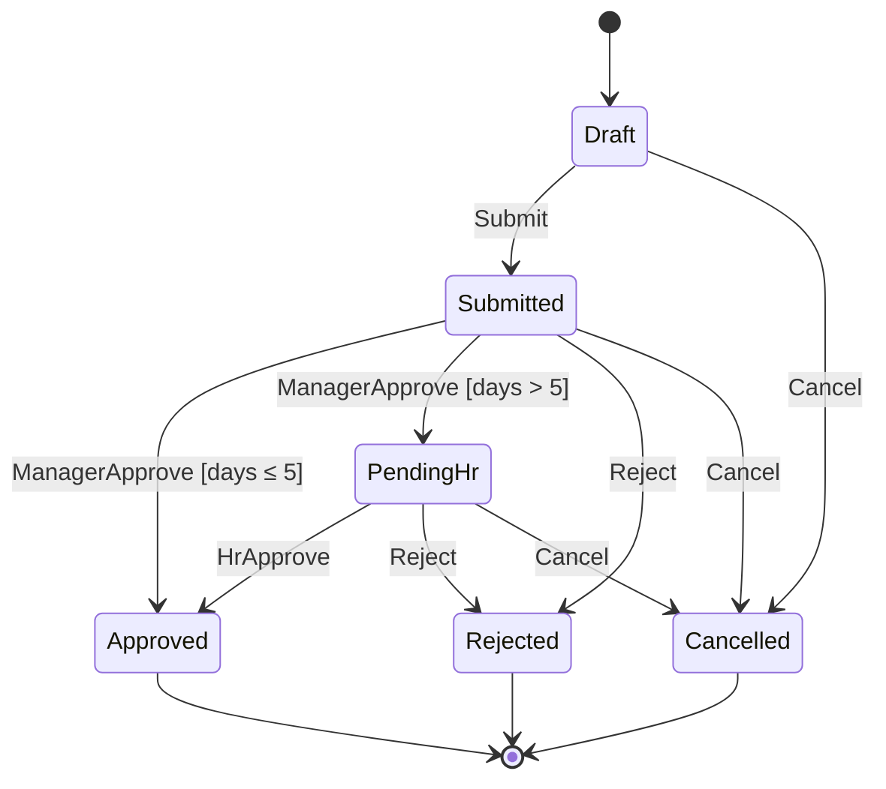
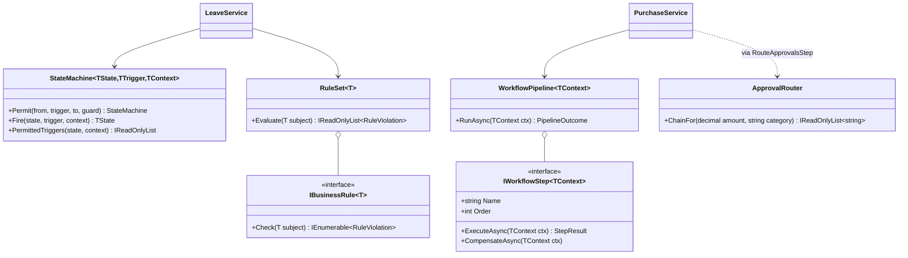
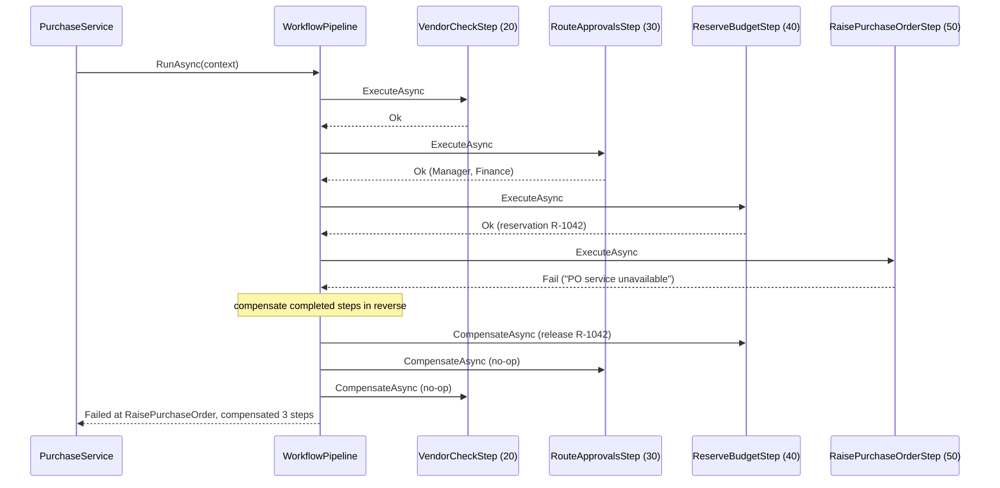

Every organisation runs on workflows: leave approvals, purchase requests, expense claims, refund requests, customer-complaint handling. They all start simple ("manager approves, done") and then the exceptions arrive. Sick leave over two days needs a certificate. Purchases above ₹5 lakh need Finance. IT purchases need the IT head. Requests stuck for 48 hours escalate. This lesson shows how to design workflows so each new rule is a small addition, not another branch in a 600-line method.

## Learning objectives

By the end of this lesson you will be able to:

1. Name the four things that vary in a business workflow (rules, routing, lifecycle, steps) and give each its own extension point.
2. Model a lifecycle as an explicit state machine with a transition table and guards, and reject invalid transitions with clear messages.
3. Express business rules as small rule objects that are evaluated together and report every violation.
4. Drive approval routing from data (an approval matrix) instead of code.
5. Build a pipeline of plug-in steps with ordering, short-circuiting and compensation (undo) when a later step fails.
6. Handle the production concerns: concurrency, audit trail, idempotency, versioning of in-flight requests.
7. Decide when a hand-built design is enough and when a workflow engine is worth its cost.

## Prerequisites

- [State](#/lesson/m06-state): lifecycles with states and transitions.
- [Chain of Responsibility](#/lesson/m06-chain-of-responsibility) and [Pipeline and middleware](#/lesson/m06-pipeline): steps that run in sequence.
- [Specification](#/lesson/m06-specification): business rules as objects.

## Explain it like I'm a beginner

Think about how a paper file moves through a government office.

An employee fills in a leave form and puts it in the file. The file goes to the section officer, then maybe to the under-secretary, then to establishment (HR). Each person writes a note and signs. At any desk, the file can be sent back or rejected. Everyone can see, from the notes, who did what and when.

Four different kinds of knowledge make this work:

1. **Rules**: "Sick leave of more than 2 days needs a medical certificate." "You can't take leave for a date that has passed." These are checks on the *content* of the form.
2. **Routing**: "Leave over 5 days also goes to HR." "Purchases over ₹5 lakh also go to the Finance officer." This decides *who* must sign.
3. **Lifecycle**: Draft → Submitted → Approved / Rejected / Cancelled. This decides *what can happen next*. You can't approve a file that's already rejected, or cancel one that was never submitted.
4. **Steps**: what actually happens when the file moves: check the budget, reserve the money, create the purchase order, send an SMS, write the audit note.

In a badly designed system, all four are mixed into one long piece of code. Then every new rule means editing the same method, and nobody can tell which line is a rule, which is routing and which is a step.

In a well-designed system, each kind of knowledge has its own place:

- Rules are **small checkers** in a list. Add a new rule by adding a checker.
- Routing is a **table** (an approval matrix) that admin staff can change.
- The lifecycle is a **map of allowed moves** (a state machine).
- Steps are **plug-ins** in an ordered pipeline. Add a step by adding a plug-in.

## First-principles explanation

### What varies, and how fast

| Part | Example | Who changes it | How often | Best home |
|---|---|---|---|---|
| **Rules** | Sick leave > 2 days needs a certificate | HR policy | Several times a year | One class per rule, run as a set |
| **Routing** | > ₹5 lakh needs Finance and Director | Finance, delegation-of-powers document | Yearly, or on reorganisation | Configuration data (approval matrix) |
| **Lifecycle** | Submitted → PendingHr → Approved | Process owners | Rarely | Explicit state machine (transition table) |
| **Steps** | Reserve budget, raise purchase order, notify | Engineering, integration teams | When systems change | Ordered plug-in pipeline |

The single most useful design move is to **keep these four apart**. They change at different speeds, for different people. That's the Single Responsibility Principle applied to a process.

### Lifecycles as explicit state machines

Without a state machine, status is usually a pile of booleans: `IsSubmitted`, `IsApproved`, `IsRejected`, `IsCancelled`. Four booleans give 16 combinations, and most of them (`IsApproved && IsRejected`) are nonsense that the code must keep guarding against.

A **state machine** says: there is exactly one current state, and only these moves are allowed:

| From | Trigger | Guard | To |
|---|---|---|---|
| Draft | Submit | — | Submitted |
| Submitted | ManagerApprove | days ≤ 5 | Approved |
| Submitted | ManagerApprove | days > 5 | PendingHr |
| PendingHr | HrApprove | — | Approved |
| Submitted, PendingHr | Reject | — | Rejected |
| Draft, Submitted, PendingHr | Cancel | — | Cancelled |

A **trigger** is something that happens (a button press, an event). A **guard** is a condition that must be true for the transition. The table is the whole lifecycle in one place: easy to review with HR, easy to test, and easy to draw.

Benefits: invalid moves are impossible by construction; "what can this user do now?" is a query (`PermittedTriggers(state)`), so the UI shows only valid buttons; and every transition is a natural place to record an audit entry and raise an event.

### Rules as a set of small objects

A rule takes the request and returns zero or more violations. A **rule set** runs every rule and collects all violations, so the employee sees "dates are in the past *and* the certificate is missing" in one go, instead of fixing one error at a time.

Rules don't change state and don't call external systems except to read facts (like leave balance). Because they're independent, adding a rule is: write a class, register it. Nothing else changes. This is the Specification pattern used for validation, and the Strategy pattern used as a collection.

Don't confuse rules with **input validation**. "The date field is a valid date" is input validation at the API edge. "You have enough earned leave" is a business rule. See [Validation and business rules](#/lesson/m07-validation-rules).

### Routing as data

Delegation of financial powers is usually written in a document, as a table: up to ₹50,000 the department manager; up to ₹5,00,000 the manager and the finance officer; above that, the director as well. That's data. Put it in configuration or a database table with an admin screen, and let code *interpret* it. Then a reorganisation is a config change with an audit trail, not a deployment.

Watch out for the opposite mistake: making *everything* configurable. When the configuration language grows conditions, loops and variables, you've built a programming language without a debugger, tests or code review. Fowler calls the general trap of building a full rules engine for this the "rules engine" problem; the broader anti-pattern is the **inner-platform effect**. Keep configuration to *parameters* (thresholds, roles, durations) and keep *logic* in code.

### Steps as a plug-in pipeline

When a purchase request is approved, several things happen in order: validate it, check the vendor isn't blacklisted, work out the approval chain, reserve budget, raise a purchase order, notify people. Each is a **step** with one job. A **pipeline** runs them in order and stops at the first failure.

Two design details make it extensible:

1. **Steps are discovered, not listed.** Each step is registered in DI as `IWorkflowStep<PurchaseContext>` with an `Order` number. Another team can add a "vendor KYC check" step at order 25 without touching the pipeline code.
2. **Steps can be undone.** If raising the purchase order fails after budget was reserved, the reservation must be released. Each step that changes something outside the process offers a `CompensateAsync`. The pipeline calls compensations of completed steps in **reverse order**. This is the **Saga** idea from Garcia-Molina and Salem (1987): a long transaction made of steps, each with a compensating action, instead of one database transaction spanning everything.

Compensation isn't a rollback. A released budget reservation might already have been seen in a report, and a sent SMS can't be unsent. Design compensations as business actions ("release reservation", "send cancellation notice"), and make them idempotent, because they may be retried.

### Production concerns

- **Concurrency.** Two managers click Approve at the same moment. Store a `Version` on the request and update with `WHERE id = @id AND version = @expected` (optimistic concurrency). The second click fails cleanly with "this request has changed".
- **Audit trail.** Store every transition: from, to, trigger, who, when, comment. In regulated environments (government, public-sector procurement) this history *is* the record. Never update it in place.
- **Idempotency.** A user double-clicks, or a message is redelivered. Firing `Approve` on an already-approved request should be rejected as an invalid transition, which the state machine gives you for free. Steps that call external systems need idempotency keys.
- **Side effects after commit.** Sending the "approved" SMS inside the database transaction means an SMS goes out even if the save then fails. Record an event in an outbox table in the same transaction and send it afterwards. See the transactional outbox pattern in later modules.
- **Timers and escalation.** "Escalate after 48 hours" is a scheduled job that looks for requests in a state older than a threshold and fires an `Escalate` trigger. Keep the decision ("is it overdue?") in pure code with an injected clock.
- **Versioning.** If the workflow changes on 1 April, what happens to the 300 requests already in flight? Store the definition version on each request and keep old definitions until their requests finish, or migrate them deliberately.

### When to use a workflow engine

Workflow engines and durable-execution platforms (for example Elsa Workflows for .NET, Temporal, Azure Durable Functions, Camunda for BPMN) give you persistence of long-running state, timers, retries, visual designers and monitoring. They're worth it when you have:

- many different workflows with long waits (days or weeks) and timers,
- business users who must change the flow itself, not only parameters,
- complex parallel branches, or steps across many services.

They cost: new infrastructure to run, a new mental model, harder local debugging, and lock-in to the engine's model. For one or two workflows with a handful of states, a state column, a transition table in code, a rule set and a pipeline (as in this lesson) is simpler and fully testable.

### Trade-offs

| Choice | You gain | You pay |
|---|---|---|
| Explicit state machine | Impossible states removed; lifecycle reviewable in one table | Up-front modelling; migrations when states change |
| Rule objects | Add rules without editing others; each tested alone | Rule ordering and interactions are less visible |
| Routing in config | Changes without deploys; admins own it | Needs validation, audit and an admin UI |
| Plug-in pipeline | Teams add steps independently | Flow spread over many classes; ordering by numbers can be fragile |
| Compensation | Partial failures cleaned up | Compensations are business logic too; must be designed and tested |
| Workflow engine | Timers, persistence, visual tools | Infrastructure, learning curve, lock-in |

## Visual explanation

### Leave request lifecycle



This diagram *is* the transition table from the previous section. Square brackets are guards: the same `ManagerApprove` trigger leads to different states depending on the number of days. Three states are terminal. Notice what's missing: there's no arrow out of Approved, so "approve again" or "reject after approval" is impossible. If HR later wants to allow cancelling approved leave before it starts, that's one new arrow with a guard, and one new row in the table.

### The workflow building blocks



Four reusable building blocks, each with one job: the state machine owns *what can happen next*, the rule set owns *is this request acceptable*, the router owns *who must approve*, and the pipeline owns *what happens, in order*. The two application services (`LeaveService`, `PurchaseService`) compose them. Rules and steps are aggregated from DI (hollow diamonds), so adding one is a registration, not an edit.

### Procurement pipeline with compensation



The purchase-order service failed after the budget was reserved. Without compensation, ₹3.2 lakh of the department's budget would stay locked against a purchase order that doesn't exist, and the next request would wrongly fail its budget check. The pipeline walks back through completed steps in reverse order. Steps with nothing to undo have an empty compensation. The outcome tells the caller exactly which step failed and what was undone, which goes into the audit log.

## Step-by-step example

### Step 1 — the version that grows by `if`

```csharp
public async Task<IActionResult> Approve(Guid id)
{
    var r = await _db.LeaveRequests.FindAsync(id);
    if (r.IsRejected || r.IsCancelled) return BadRequest("Closed");
    if (r.IsApproved) return BadRequest("Already approved");
    if (r.Type == "Sick" && r.Days > 2 && !r.HasCertificate) return BadRequest("Certificate needed");
    if (User.IsInRole("Manager") && r.Days > 5) { r.IsPendingHr = true; }
    else if (User.IsInRole("HR") && r.IsPendingHr) { r.IsApproved = true; r.IsPendingHr = false; }
    else if (User.IsInRole("Manager")) { r.IsApproved = true; }
    await _db.SaveChangesAsync();
    await _sms.SendAsync(r.Phone, "Your leave is approved");   // even when it went to HR!
    return Ok();
}
```

Rules, routing, lifecycle and side effects are interleaved. There's already a bug: the SMS says "approved" when the request only moved to HR. And this is one action out of five.

### Step 2 — pull out the lifecycle

Replace the booleans with a single `Status` enum and a transition table. Now "already approved" and "closed" checks disappear: the state machine rejects those triggers.

### Step 3 — pull out the rules

Move the certificate check into `SickLeaveNeedsCertificateRule`. Add `NotInPastRule`, `CasualLeaveMaxDaysRule` and `SufficientBalanceRule` the same way. Run them on Submit, all together.

### Step 4 — move side effects to transitions

Publish a `LeaveStatusChanged` event after each successful transition. The notification handler decides the message from the *new* status, which fixes the SMS bug.

### Step 5 — procurement: pipeline and matrix

For purchases, the lifecycle is similar, but the interesting part is what happens on approval. Each action becomes an `IWorkflowStep<PurchaseContext>`, and routing comes from an `ApprovalMatrix` in configuration.

## Production-style C# implementation

```text
Workflows.Api/
  Program.cs
  Engine/StateMachine.cs        generic state machine with guards
  Engine/Rules.cs               rule interface + rule set
  Engine/Pipeline.cs            plug-in steps with compensation
  Leave/Leave.cs                leave model, workflow definition, rules, service
  Procurement/Procurement.cs    approval matrix, steps, service
```

```csharp file=Engine/StateMachine.cs
namespace Workflows.Engine;

public sealed class InvalidTransitionException(string message) : InvalidOperationException(message);

/// <summary>A transition table with optional guards. Immutable after configuration; safe as a singleton.</summary>
public sealed class StateMachine<TState, TTrigger, TContext>
    where TState : struct, Enum
    where TTrigger : struct, Enum
{
    private sealed record Transition(TState From, TTrigger Trigger, TState To, Func<TContext, bool> Guard, string GuardName);
    private readonly List<Transition> _transitions = [];

    public StateMachine<TState, TTrigger, TContext> Permit(TState from, TTrigger trigger, TState to,
        Func<TContext, bool>? guard = null, string? guardName = null)
    {
        _transitions.Add(new Transition(from, trigger, to, guard ?? (_ => true), guardName ?? "always"));
        return this;
    }

    public IReadOnlyList<TTrigger> PermittedTriggers(TState state, TContext context) =>
        _transitions.Where(t => t.From.Equals(state) && t.Guard(context)).Select(t => t.Trigger).Distinct().ToList();

    public TState Fire(TState state, TTrigger trigger, TContext context)
    {
        var candidates = _transitions.Where(t => t.From.Equals(state) && t.Trigger.Equals(trigger)).ToList();
        if (candidates.Count == 0)
            throw new InvalidTransitionException($"'{trigger}' is not allowed when the request is '{state}'.");

        var matches = candidates.Where(t => t.Guard(context)).ToList();
        return matches.Count switch
        {
            1 => matches[0].To,
            0 => throw new InvalidTransitionException(
                $"'{trigger}' from '{state}' requires: {string.Join(" or ", candidates.Select(c => c.GuardName))}."),
            _ => throw new InvalidOperationException($"Workflow definition is ambiguous for '{state}' + '{trigger}'."),
        };
    }
}
```

The "ambiguous" case is a bug in the *definition*, not in the user's request, so it throws a different exception type. Exercise 5 catches such bugs before deployment by validating the definition itself.

```csharp file=Engine/Rules.cs
namespace Workflows.Engine;

public sealed record RuleViolation(string Code, string Message);

public interface IBusinessRule<in T>
{
    IEnumerable<RuleViolation> Check(T subject);
}

/// <summary>Runs every registered rule and collects all violations, so users see every problem at once.</summary>
public sealed class RuleSet<T>(IEnumerable<IBusinessRule<T>> rules)
{
    private readonly IReadOnlyList<IBusinessRule<T>> _rules = rules.ToList();
    public IReadOnlyList<RuleViolation> Evaluate(T subject) => _rules.SelectMany(r => r.Check(subject)).ToList();
}
```

```csharp file=Engine/Pipeline.cs
using Microsoft.Extensions.Logging;

namespace Workflows.Engine;

public sealed record StepResult(bool Succeeded, string? Error = null)
{
    public static readonly StepResult Ok = new(true);
    public static StepResult Fail(string error) => new(false, error);
}

public interface IWorkflowStep<in TContext>
{
    string Name { get; }
    int Order { get; }
    Task<StepResult> ExecuteAsync(TContext context, CancellationToken ct);
    /// <summary>Undo this step's external effects. Must be idempotent. Default: nothing to undo.</summary>
    Task CompensateAsync(TContext context, CancellationToken ct) => Task.CompletedTask;
}

public sealed record PipelineOutcome(bool Succeeded, string? FailedStep, string? Error,
                                     IReadOnlyList<string> Completed, IReadOnlyList<string> Compensated);

public sealed class WorkflowPipeline<TContext>(IEnumerable<IWorkflowStep<TContext>> steps, ILogger<WorkflowPipeline<TContext>> logger)
{
    private readonly IReadOnlyList<IWorkflowStep<TContext>> _steps =
        steps.OrderBy(s => s.Order).ThenBy(s => s.Name, StringComparer.Ordinal).ToList();

    public async Task<PipelineOutcome> RunAsync(TContext context, CancellationToken ct)
    {
        var completed = new List<IWorkflowStep<TContext>>();
        foreach (var step in _steps)
        {
            StepResult result;
            try { result = await step.ExecuteAsync(context, ct); }
            catch (Exception ex) when (ex is not OperationCanceledException) { result = StepResult.Fail(ex.Message); }

            if (result.Succeeded) { completed.Add(step); continue; }

            logger.LogWarning("Step {Step} failed: {Error}. Compensating {Count} step(s).", step.Name, result.Error, completed.Count);
            var compensated = await CompensateAsync(completed, context);
            return new PipelineOutcome(false, step.Name, result.Error, completed.Select(s => s.Name).ToList(), compensated);
        }
        return new PipelineOutcome(true, null, null, completed.Select(s => s.Name).ToList(), []);
    }

    private async Task<IReadOnlyList<string>> CompensateAsync(List<IWorkflowStep<TContext>> completed, TContext context)
    {
        var done = new List<string>();
        for (var i = completed.Count - 1; i >= 0; i--)
        {
            try
            {
                // Compensation must run even if the request was cancelled, so it doesn't take the caller's token.
                await completed[i].CompensateAsync(context, CancellationToken.None);
                done.Add(completed[i].Name);
            }
            catch (Exception ex)
            {
                // Keep going: one failed undo mustn't block the others. Alert a human for this one.
                logger.LogError(ex, "Compensation of {Step} failed; manual follow-up needed.", completed[i].Name);
            }
        }
        return done;
    }
}
```

```csharp file=Leave/Leave.cs
using Workflows.Engine;

namespace Workflows.Leave;

public enum LeaveType { Casual, Sick, Earned }
public enum LeaveStatus { Draft, Submitted, PendingHr, Approved, Rejected, Cancelled }
public enum LeaveTrigger { Submit, ManagerApprove, HrApprove, Reject, Cancel }

public sealed record LeaveTransition(LeaveStatus From, LeaveTrigger Trigger, LeaveStatus To, string Actor, DateTimeOffset At, string? Comment);

public sealed class LeaveRequest(Guid id, string employeeId, LeaveType type, DateOnly from, DateOnly to, bool hasMedicalCertificate = false)
{
    private readonly List<LeaveTransition> _history = [];

    public Guid Id { get; } = id;
    public string EmployeeId { get; } = employeeId;
    public LeaveType Type { get; } = type;
    public DateOnly From { get; } = from;
    public DateOnly To { get; } = to;
    public bool HasMedicalCertificate { get; } = hasMedicalCertificate;
    public int Days => To.DayNumber - From.DayNumber + 1;
    public LeaveStatus Status { get; private set; } = LeaveStatus.Draft;
    public int Version { get; private set; }
    public IReadOnlyList<LeaveTransition> History => _history;

    internal void Apply(LeaveTrigger trigger, LeaveStatus next, string actor, DateTimeOffset at, string? comment)
    {
        _history.Add(new LeaveTransition(Status, trigger, next, actor, at, comment));
        Status = next;
        Version++;
    }
}

public static class LeaveWorkflow
{
    public const int HrReviewAboveDays = 5;

    public static StateMachine<LeaveStatus, LeaveTrigger, LeaveRequest> Definition { get; } =
        new StateMachine<LeaveStatus, LeaveTrigger, LeaveRequest>()
            .Permit(LeaveStatus.Draft, LeaveTrigger.Submit, LeaveStatus.Submitted)
            .Permit(LeaveStatus.Submitted, LeaveTrigger.ManagerApprove, LeaveStatus.Approved, r => r.Days <= HrReviewAboveDays, "5 days or fewer")
            .Permit(LeaveStatus.Submitted, LeaveTrigger.ManagerApprove, LeaveStatus.PendingHr, r => r.Days > HrReviewAboveDays, "more than 5 days")
            .Permit(LeaveStatus.PendingHr, LeaveTrigger.HrApprove, LeaveStatus.Approved)
            .Permit(LeaveStatus.Submitted, LeaveTrigger.Reject, LeaveStatus.Rejected)
            .Permit(LeaveStatus.PendingHr, LeaveTrigger.Reject, LeaveStatus.Rejected)
            .Permit(LeaveStatus.Draft, LeaveTrigger.Cancel, LeaveStatus.Cancelled)
            .Permit(LeaveStatus.Submitted, LeaveTrigger.Cancel, LeaveStatus.Cancelled)
            .Permit(LeaveStatus.PendingHr, LeaveTrigger.Cancel, LeaveStatus.Cancelled);

    /// <summary>Who may fire which trigger. Kept beside the definition so the two are reviewed together.</summary>
    public static IReadOnlyDictionary<LeaveTrigger, string[]> AllowedRoles { get; } = new Dictionary<LeaveTrigger, string[]>
    {
        [LeaveTrigger.Submit] = ["Employee"],
        [LeaveTrigger.Cancel] = ["Employee"],
        [LeaveTrigger.ManagerApprove] = ["Manager"],
        [LeaveTrigger.Reject] = ["Manager", "HR"],         // HR must be able to reject a request waiting in PendingHr
        [LeaveTrigger.HrApprove] = ["HR"],
    };
}

// ----- Rules: one class each, registered in DI -----

public interface ILeaveBalanceProvider { decimal Available(string employeeId, LeaveType type); }

public sealed class NotInPastRule(TimeProvider clock) : IBusinessRule<LeaveRequest>
{
    public IEnumerable<RuleViolation> Check(LeaveRequest r)
    {
        var today = DateOnly.FromDateTime(clock.GetUtcNow().ToOffset(TimeSpan.FromHours(5.5)).DateTime);
        if (r.From < today && r.Type != LeaveType.Sick)
            yield return new("past-dates", "Only sick leave can be applied for past dates.");
        if (r.To < r.From)
            yield return new("bad-range", "The end date is before the start date.");
    }
}

public sealed class SickLeaveNeedsCertificateRule : IBusinessRule<LeaveRequest>
{
    public IEnumerable<RuleViolation> Check(LeaveRequest r)
    {
        if (r.Type == LeaveType.Sick && r.Days > 2 && !r.HasMedicalCertificate)
            yield return new("certificate-required", "Sick leave of more than 2 days needs a medical certificate.");
    }
}

public sealed class CasualLeaveMaxDaysRule : IBusinessRule<LeaveRequest>
{
    public IEnumerable<RuleViolation> Check(LeaveRequest r)
    {
        if (r.Type == LeaveType.Casual && r.Days > 3)
            yield return new("casual-too-long", "Casual leave can't exceed 3 consecutive days.");
    }
}

public sealed class SufficientBalanceRule(ILeaveBalanceProvider balances) : IBusinessRule<LeaveRequest>
{
    public IEnumerable<RuleViolation> Check(LeaveRequest r)
    {
        var available = balances.Available(r.EmployeeId, r.Type);
        if (r.Days > available)
            yield return new("insufficient-balance", $"Requested {r.Days} day(s) but only {available} available.");
    }
}

public sealed class FixedLeaveBalanceProvider : ILeaveBalanceProvider
{
    public decimal Available(string employeeId, LeaveType type) => type switch
    {
        LeaveType.Casual => 8, LeaveType.Sick => 12, LeaveType.Earned => 30, _ => 0,
    };
}

// ----- Application service: composes rules + state machine -----

public sealed record LeaveCommandResult(bool Ok, LeaveStatus Status, IReadOnlyList<RuleViolation> Violations);

public sealed class LeaveService(RuleSet<LeaveRequest> rules, TimeProvider clock)
{
    public LeaveCommandResult Fire(LeaveRequest request, LeaveTrigger trigger, string actor, string actorRole, string? comment = null)
    {
        if (LeaveWorkflow.AllowedRoles.TryGetValue(trigger, out var roles) && !roles.Contains(actorRole))
            return new(false, request.Status, [new("forbidden", $"Only {string.Join(" or ", roles)} can {trigger}.")]);

        if (trigger == LeaveTrigger.Submit && rules.Evaluate(request) is { Count: > 0 } violations)
            return new(false, request.Status, violations);

        try
        {
            var next = LeaveWorkflow.Definition.Fire(request.Status, trigger, request);
            request.Apply(trigger, next, actor, clock.GetUtcNow(), comment);
            return new(true, next, []);
        }
        catch (InvalidTransitionException ex)
        {
            return new(false, request.Status, [new("invalid-transition", ex.Message)]);
        }
    }
}
```

The service is short because it only *composes*: check the role, run the rules on submit, ask the state machine for the next state, record it. The role check is deliberately coarse; a real system also checks *which* manager (the employee's own, never the employee approving their own leave), usually with an ASP.NET Core resource-based authorization handler. Each of those has its own home and its own tests. A notification or outbox write would go right after `request.Apply`, keyed on the new status.

```csharp file=Procurement/Procurement.cs
using Microsoft.Extensions.Options;
using Workflows.Engine;

namespace Workflows.Procurement;

public sealed record PurchaseRequest(Guid Id, string Department, string Category, string VendorGstin, decimal Amount, string Justification);

public sealed class PurchaseContext(PurchaseRequest request)
{
    public PurchaseRequest Request { get; } = request;
    public IReadOnlyList<string> ApproverChain { get; set; } = [];
    public string? BudgetReservationId { get; set; }
    public string? PurchaseOrderNumber { get; set; }
}

// ----- Routing as data -----

public sealed class ApprovalTier
{
    public decimal? UpTo { get; set; }                  // null = no upper limit
    public List<string> Approvers { get; set; } = [];
}

public sealed class ApprovalMatrixOptions
{
    public List<ApprovalTier> Tiers { get; set; } = [];
    public Dictionary<string, List<string>> ExtraApproversByCategory { get; set; } = new(StringComparer.OrdinalIgnoreCase);
}

public sealed class ApprovalRouter(IOptions<ApprovalMatrixOptions> options)
{
    public IReadOnlyList<string> ChainFor(decimal amount, string category)
    {
        var o = options.Value;
        var tier = o.Tiers.OrderBy(t => t.UpTo ?? decimal.MaxValue).FirstOrDefault(t => amount <= (t.UpTo ?? decimal.MaxValue))
                   ?? throw new InvalidOperationException($"No approval tier covers ₹{amount:N2}.");
        var chain = new List<string>(tier.Approvers);
        if (o.ExtraApproversByCategory.TryGetValue(category, out var extra))
        {
            var insertAt = 1;                                   // right after the first approver, in configured order
            foreach (var e in extra)
                if (!chain.Contains(e)) chain.Insert(insertAt++, e);
        }
        return chain;
    }
}

// ----- Ports to other systems -----

public interface IVendorRegistry { bool IsBlacklisted(string gstin); }
public interface IBudgetService { string? TryReserve(string department, decimal amount); void Release(string reservationId); }
public interface IPurchaseOrderService { string Raise(PurchaseRequest request); void Cancel(string poNumber); }

// ----- Plug-in steps (each registered as IWorkflowStep<PurchaseContext>) -----

public sealed class ValidateRequestStep : IWorkflowStep<PurchaseContext>
{
    public string Name => "ValidateRequest";
    public int Order => 10;
    public Task<StepResult> ExecuteAsync(PurchaseContext c, CancellationToken ct) => Task.FromResult(
        c.Request.Amount <= 0 ? StepResult.Fail("Amount must be positive.")
        : string.IsNullOrWhiteSpace(c.Request.Justification) ? StepResult.Fail("Justification is required.")
        : StepResult.Ok);
}

public sealed class VendorCheckStep(IVendorRegistry vendors) : IWorkflowStep<PurchaseContext>
{
    public string Name => "VendorCheck";
    public int Order => 20;
    public Task<StepResult> ExecuteAsync(PurchaseContext c, CancellationToken ct) => Task.FromResult(
        vendors.IsBlacklisted(c.Request.VendorGstin) ? StepResult.Fail("Vendor is blacklisted.") : StepResult.Ok);
}

public sealed class RouteApprovalsStep(ApprovalRouter router) : IWorkflowStep<PurchaseContext>
{
    public string Name => "RouteApprovals";
    public int Order => 30;
    public Task<StepResult> ExecuteAsync(PurchaseContext c, CancellationToken ct)
    {
        c.ApproverChain = router.ChainFor(c.Request.Amount, c.Request.Category);
        return Task.FromResult(StepResult.Ok);
    }
}

public sealed class ReserveBudgetStep(IBudgetService budget) : IWorkflowStep<PurchaseContext>
{
    public string Name => "ReserveBudget";
    public int Order => 40;
    public Task<StepResult> ExecuteAsync(PurchaseContext c, CancellationToken ct)
    {
        c.BudgetReservationId = budget.TryReserve(c.Request.Department, c.Request.Amount);
        return Task.FromResult(c.BudgetReservationId is null ? StepResult.Fail("Insufficient budget.") : StepResult.Ok);
    }
    public Task CompensateAsync(PurchaseContext c, CancellationToken ct)
    {
        if (c.BudgetReservationId is { } id) { budget.Release(id); c.BudgetReservationId = null; }
        return Task.CompletedTask;
    }
}

public sealed class RaisePurchaseOrderStep(IPurchaseOrderService orders) : IWorkflowStep<PurchaseContext>
{
    public string Name => "RaisePurchaseOrder";
    public int Order => 50;
    public Task<StepResult> ExecuteAsync(PurchaseContext c, CancellationToken ct)
    {
        c.PurchaseOrderNumber = orders.Raise(c.Request);
        return Task.FromResult(StepResult.Ok);
    }
    public Task CompensateAsync(PurchaseContext c, CancellationToken ct)
    {
        if (c.PurchaseOrderNumber is { } po) { orders.Cancel(po); c.PurchaseOrderNumber = null; }
        return Task.CompletedTask;
    }
}

// ----- Simple in-memory adapters for the demo -----

public sealed class InMemoryVendorRegistry : IVendorRegistry
{
    private readonly HashSet<string> _blacklisted = new(StringComparer.OrdinalIgnoreCase) { "07AAACB1234C1Z1" };
    public bool IsBlacklisted(string gstin) => _blacklisted.Contains(gstin);
}

public sealed class InMemoryBudgetService : IBudgetService
{
    private readonly object _gate = new();
    private readonly Dictionary<string, decimal> _available = new(StringComparer.OrdinalIgnoreCase) { ["Operations"] = 25_00_000m, ["IT"] = 8_00_000m };
    private readonly Dictionary<string, (string Dept, decimal Amount)> _reservations = [];

    public string? TryReserve(string department, decimal amount)
    {
        lock (_gate)
        {
            if (_available.GetValueOrDefault(department) < amount) return null;
            _available[department] -= amount;
            var id = $"R-{_reservations.Count + 1001}";
            _reservations[id] = (department, amount);
            return id;
        }
    }

    public void Release(string reservationId)
    {
        lock (_gate)
            if (_reservations.Remove(reservationId, out var r)) _available[r.Dept] += r.Amount;   // idempotent: second call finds nothing
    }
}

public sealed class SequentialPurchaseOrderService : IPurchaseOrderService
{
    private int _next = 5000;
    public string Raise(PurchaseRequest request) => $"PO-{Interlocked.Increment(ref _next)}";
    public void Cancel(string poNumber) { }
}

public sealed class PurchaseService(WorkflowPipeline<PurchaseContext> pipeline)
{
    public Task<PipelineOutcome> SubmitAsync(PurchaseRequest request, CancellationToken ct) =>
        pipeline.RunAsync(new PurchaseContext(request), ct);
}
```

```csharp file=Program.cs
using Workflows.Engine;
using Workflows.Leave;
using Workflows.Procurement;

var builder = WebApplication.CreateBuilder(args);

builder.Services.AddSingleton(TimeProvider.System);

// Leave: rules are plug-ins. Add a rule = add a class + one line here.
builder.Services.AddSingleton<ILeaveBalanceProvider, FixedLeaveBalanceProvider>();
builder.Services.AddSingleton<IBusinessRule<LeaveRequest>, NotInPastRule>();
builder.Services.AddSingleton<IBusinessRule<LeaveRequest>, SickLeaveNeedsCertificateRule>();
builder.Services.AddSingleton<IBusinessRule<LeaveRequest>, CasualLeaveMaxDaysRule>();
builder.Services.AddSingleton<IBusinessRule<LeaveRequest>, SufficientBalanceRule>();
builder.Services.AddSingleton<RuleSet<LeaveRequest>>();
builder.Services.AddSingleton<LeaveService>();

// Procurement: routing from configuration, steps as plug-ins.
builder.Services.Configure<ApprovalMatrixOptions>(o =>
{
    o.Tiers =
    [
        new ApprovalTier { UpTo = 50_000m, Approvers = ["DepartmentManager"] },
        new ApprovalTier { UpTo = 5_00_000m, Approvers = ["DepartmentManager", "FinanceOfficer"] },
        new ApprovalTier { UpTo = null, Approvers = ["DepartmentManager", "FinanceOfficer", "Director"] },
    ];
    o.ExtraApproversByCategory["IT"] = ["ItHead"];
});
builder.Services.Configure<ApprovalMatrixOptions>(builder.Configuration.GetSection("ApprovalMatrix"));   // config can override
builder.Services.AddSingleton<ApprovalRouter>();
builder.Services.AddSingleton<IVendorRegistry, InMemoryVendorRegistry>();
builder.Services.AddSingleton<IBudgetService, InMemoryBudgetService>();
builder.Services.AddSingleton<IPurchaseOrderService, SequentialPurchaseOrderService>();
builder.Services.AddSingleton<IWorkflowStep<PurchaseContext>, ValidateRequestStep>();
builder.Services.AddSingleton<IWorkflowStep<PurchaseContext>, VendorCheckStep>();
builder.Services.AddSingleton<IWorkflowStep<PurchaseContext>, RouteApprovalsStep>();
builder.Services.AddSingleton<IWorkflowStep<PurchaseContext>, ReserveBudgetStep>();
builder.Services.AddSingleton<IWorkflowStep<PurchaseContext>, RaisePurchaseOrderStep>();
builder.Services.AddSingleton<WorkflowPipeline<PurchaseContext>>();
builder.Services.AddSingleton<PurchaseService>();

var app = builder.Build();

app.MapPost("/purchases", async (PurchaseRequest req, PurchaseService svc, CancellationToken ct) =>
{
    var outcome = await svc.SubmitAsync(req, ct);
    return outcome.Succeeded ? Results.Ok(outcome) : Results.UnprocessableEntity(outcome);
});

app.MapGet("/leave/workflow/{status}", (LeaveStatus status) =>
    Results.Ok(Enum.GetValues<LeaveTrigger>().Where(t =>
        LeaveWorkflow.Definition.PermittedTriggers(status, new LeaveRequest(Guid.Empty, "-", LeaveType.Earned,
            DateOnly.MinValue, DateOnly.MinValue.AddDays(9))).Contains(t))));

app.Run();
```

The last endpoint shows a benefit of an explicit state machine: the UI can ask "which buttons should I show for a request in `Submitted`?" and get the answer from the same definition that enforces the rules.

## Bad design vs good design

**Bad #1: the boolean soup and the giant controller action** from Step 1. Rules, routing, lifecycle and side effects are interleaved; the SMS bug is a direct result. Adding "IT purchases need the IT head" means finding every place that decides approvers.

**Bad #2: everything in configuration.** A JSON "workflow DSL" with `if`, `and`, `or`, nested `steps`, and string expressions evaluated at runtime:

```json
{ "when": "request.Amount > 500000 && (request.Category == 'IT' || user.Grade < 7)", "then": [ "route:Director", "step:ReserveBudget" ] }
```

Nobody can unit-test it, rename-refactoring doesn't reach it, a typo in a string expression fails only in production, and only one person understands it. This is the inner-platform effect.

**Good**: each kind of variation in its natural home. Lifecycle in a code-defined state machine (changes rarely, needs review). Rules as classes (need tests). Routing thresholds and roles as data (change often, simple shape). Steps as plug-ins (owned by teams). Data where the change is a *parameter*; code where the change is *logic*.

**Is it worth it?** For a process with three states and one approver that hasn't changed in years, a status enum and a `switch` are fine. The structure in this lesson pays off once you have several rules, a routing matrix that changes, more than one team adding steps, or audit requirements.

:::callout type=warning title="Don't put side effects inside guards or rules"
Guards and rules can be evaluated more than once: `PermittedTriggers` runs every guard to build the UI, and a rule set may be re-run on each edit. A guard that sends an email, or a rule that reserves budget, will do it repeatedly. Keep guards and rules as pure reads; put effects in steps or in handlers that run after a committed transition.
:::

## Practical playground

A minimal leave workflow: a transition table plus a rule list. Run it, then add a rule (for example "earned leave needs 7 days' notice") and a new transition ("Approved → Cancelled before the leave starts") and see how little else changes.

:::playground type=csharp title="Leave workflow in 60 lines"
```csharp file=Program.cs
using System;
using System.Collections.Generic;
using System.Linq;

public enum Status { Draft, Submitted, PendingHr, Approved, Rejected, Cancelled }
public enum Trigger { Submit, ManagerApprove, HrApprove, Reject, Cancel }
public sealed record Leave(string Type, int Days, bool HasCertificate);

public static class Program
{
    static readonly List<(Status From, Trigger T, Status To, Func<Leave, bool> Guard)> Table = new()
    {
        (Status.Draft, Trigger.Submit, Status.Submitted, _ => true),
        (Status.Submitted, Trigger.ManagerApprove, Status.Approved, l => l.Days <= 5),
        (Status.Submitted, Trigger.ManagerApprove, Status.PendingHr, l => l.Days > 5),
        (Status.PendingHr, Trigger.HrApprove, Status.Approved, _ => true),
        (Status.Submitted, Trigger.Reject, Status.Rejected, _ => true),
        (Status.PendingHr, Trigger.Reject, Status.Rejected, _ => true),
        (Status.Draft, Trigger.Cancel, Status.Cancelled, _ => true),
        (Status.Submitted, Trigger.Cancel, Status.Cancelled, _ => true),
    };

    static readonly List<Func<Leave, string?>> Rules = new()
    {
        l => l.Type == "Sick" && l.Days > 2 && !l.HasCertificate ? "Sick leave over 2 days needs a certificate." : null,
        l => l.Type == "Casual" && l.Days > 3 ? "Casual leave can't exceed 3 days." : null,
    };

    static Status Fire(Status s, Trigger t, Leave l)
    {
        var match = Table.Where(x => x.From == s && x.T == t && x.Guard(l)).ToList();
        if (match.Count != 1) throw new InvalidOperationException($"{t} not allowed from {s}");
        return match[0].To;
    }

    static void Run(string title, Leave leave, params Trigger[] triggers)
    {
        Console.WriteLine($"--- {title}");
        var problems = Rules.Select(r => r(leave)).Where(p => p is not null).ToList();
        if (problems.Count > 0) { problems.ForEach(p => Console.WriteLine($"  rule: {p}")); return; }
        var s = Status.Draft;
        foreach (var t in triggers)
        {
            try { var n = Fire(s, t, leave); Console.WriteLine($"  {s} --{t}--> {n}"); s = n; }
            catch (InvalidOperationException ex) { Console.WriteLine($"  rejected: {ex.Message}"); }
        }
        var allowed = Table.Where(x => x.From == s && x.Guard(leave)).Select(x => x.T).Distinct();
        Console.WriteLine($"  now {s}; allowed next: [{string.Join(", ", allowed)}]");
    }

    public static void Main()
    {
        Run("3 days earned leave", new Leave("Earned", 3, false), Trigger.Submit, Trigger.ManagerApprove);
        Run("8 days earned leave", new Leave("Earned", 8, false), Trigger.Submit, Trigger.ManagerApprove, Trigger.HrApprove);
        Run("Approve twice", new Leave("Earned", 2, false), Trigger.Submit, Trigger.ManagerApprove, Trigger.ManagerApprove);
        Run("4 days sick, no certificate", new Leave("Sick", 4, false), Trigger.Submit);
        Run("Reject then cancel", new Leave("Casual", 1, false), Trigger.Submit, Trigger.Reject, Trigger.Cancel);
    }
}
```
:::

## Exercises

:::exercise id=m07-extensible-workflows-ex1 difficulty=beginner kind=code title="Leave transitions as a table"
Implement `LeaveFlow.Next(status, trigger, days)` from the transition table in this lesson, and `LeaveFlow.Allowed(status, days)`, which lists the triggers that are valid now. Invalid moves throw `InvalidTransitionException` with a message naming the trigger and status.
::requirements
- Use a data structure (a list or dictionary of transitions), not a nested `switch`.
- `ManagerApprove` from `Submitted` goes to `Approved` if days ≤ 5, else to `PendingHr`.
- Terminal states (`Approved`, `Rejected`, `Cancelled`) allow nothing.
- `Allowed` returns triggers in enum order.
::acceptance
- Draft + Submit → Submitted.
- Submitted + ManagerApprove with 5 days → Approved; with 6 days → PendingHr.
- Approved + ManagerApprove throws, and the message contains "ManagerApprove" and "Approved".
- `Allowed(Submitted, 3)` = [ManagerApprove, Reject, Cancel].
- `Allowed(Rejected, 3)` is empty.
::hint
Write the table first, as rows of (from, trigger, guard, to). The code that reads it is tiny.
::hint
A guard can be a `Func<int, bool>` taking the number of days. Rows without a condition use `_ => true`.
::hint
`Next` filters rows by from + trigger + guard. Zero matches → throw. `Allowed` filters by from + guard and takes distinct triggers.
::hint
```csharp
private static readonly (LeaveStatus From, LeaveTrigger Trigger, Func<int, bool> Guard, LeaveStatus To)[] Table =
{
    (LeaveStatus.Draft, LeaveTrigger.Submit, _ => true, LeaveStatus.Submitted),
    // ...
};
```
::starter
```csharp file=LeaveFlow.cs
using System;
using System.Collections.Generic;
using System.Linq;

public enum LeaveStatus { Draft, Submitted, PendingHr, Approved, Rejected, Cancelled }
public enum LeaveTrigger { Submit, ManagerApprove, HrApprove, Reject, Cancel }

public sealed class InvalidTransitionException(string message) : InvalidOperationException(message);

public static class LeaveFlow
{
    public static LeaveStatus Next(LeaveStatus status, LeaveTrigger trigger, int days) => throw new NotImplementedException();
    public static IReadOnlyList<LeaveTrigger> Allowed(LeaveStatus status, int days) => throw new NotImplementedException();
}
```
::tests
```csharp file=LeaveFlowTests.cs
using System;
using Xunit;

public class LeaveFlowTests
{
    [Fact] public void Submit_from_draft() => Assert.Equal(LeaveStatus.Submitted, LeaveFlow.Next(LeaveStatus.Draft, LeaveTrigger.Submit, 2));
    [Fact] public void Short_leave_approved_by_manager() => Assert.Equal(LeaveStatus.Approved, LeaveFlow.Next(LeaveStatus.Submitted, LeaveTrigger.ManagerApprove, 5));
    [Fact] public void Long_leave_goes_to_hr() => Assert.Equal(LeaveStatus.PendingHr, LeaveFlow.Next(LeaveStatus.Submitted, LeaveTrigger.ManagerApprove, 6));
    [Fact] public void Hr_approves() => Assert.Equal(LeaveStatus.Approved, LeaveFlow.Next(LeaveStatus.PendingHr, LeaveTrigger.HrApprove, 6));
    [Fact] public void Cancel_pending_hr() => Assert.Equal(LeaveStatus.Cancelled, LeaveFlow.Next(LeaveStatus.PendingHr, LeaveTrigger.Cancel, 6));

    [Fact]
    public void Approve_twice_throws()
    {
        var ex = Assert.Throws<InvalidTransitionException>(() => LeaveFlow.Next(LeaveStatus.Approved, LeaveTrigger.ManagerApprove, 2));
        Assert.Contains("ManagerApprove", ex.Message);
        Assert.Contains("Approved", ex.Message);
    }

    [Fact] public void Hr_cannot_approve_submitted() => Assert.Throws<InvalidTransitionException>(() => LeaveFlow.Next(LeaveStatus.Submitted, LeaveTrigger.HrApprove, 8));

    [Fact]
    public void Allowed_from_submitted() =>
        Assert.Equal(new[] { LeaveTrigger.ManagerApprove, LeaveTrigger.Reject, LeaveTrigger.Cancel }, LeaveFlow.Allowed(LeaveStatus.Submitted, 3));

    [Fact] public void Terminal_allows_nothing() => Assert.Empty(LeaveFlow.Allowed(LeaveStatus.Rejected, 3));
}
```
::solution
```csharp file=LeaveFlow.cs
using System;
using System.Collections.Generic;
using System.Linq;

public enum LeaveStatus { Draft, Submitted, PendingHr, Approved, Rejected, Cancelled }
public enum LeaveTrigger { Submit, ManagerApprove, HrApprove, Reject, Cancel }

public sealed class InvalidTransitionException(string message) : InvalidOperationException(message);

public static class LeaveFlow
{
    private const int HrAboveDays = 5;

    private static readonly (LeaveStatus From, LeaveTrigger Trigger, Func<int, bool> Guard, LeaveStatus To)[] Table =
    {
        (LeaveStatus.Draft, LeaveTrigger.Submit, _ => true, LeaveStatus.Submitted),
        (LeaveStatus.Submitted, LeaveTrigger.ManagerApprove, d => d <= HrAboveDays, LeaveStatus.Approved),
        (LeaveStatus.Submitted, LeaveTrigger.ManagerApprove, d => d > HrAboveDays, LeaveStatus.PendingHr),
        (LeaveStatus.PendingHr, LeaveTrigger.HrApprove, _ => true, LeaveStatus.Approved),
        (LeaveStatus.Submitted, LeaveTrigger.Reject, _ => true, LeaveStatus.Rejected),
        (LeaveStatus.PendingHr, LeaveTrigger.Reject, _ => true, LeaveStatus.Rejected),
        (LeaveStatus.Draft, LeaveTrigger.Cancel, _ => true, LeaveStatus.Cancelled),
        (LeaveStatus.Submitted, LeaveTrigger.Cancel, _ => true, LeaveStatus.Cancelled),
        (LeaveStatus.PendingHr, LeaveTrigger.Cancel, _ => true, LeaveStatus.Cancelled),
    };

    public static LeaveStatus Next(LeaveStatus status, LeaveTrigger trigger, int days)
    {
        foreach (var row in Table)
            if (row.From == status && row.Trigger == trigger && row.Guard(days)) return row.To;
        throw new InvalidTransitionException($"'{trigger}' is not allowed when the leave request is '{status}'.");
    }

    public static IReadOnlyList<LeaveTrigger> Allowed(LeaveStatus status, int days) =>
        Table.Where(r => r.From == status && r.Guard(days)).Select(r => r.Trigger).Distinct().OrderBy(t => t).ToList();
}
```

The whole lifecycle is the nine-row table. A reviewer from HR can read it and confirm it matches the policy, which is much harder with nested `if`s.
::mistakes
- A nested `switch (status) { case ...: switch (trigger) ... }`, which spreads the table over 40 lines.
- Returning the current status for invalid moves instead of throwing, which hides bugs ("approve" silently does nothing).
- Putting the 5-day threshold in two places (`Next` and `Allowed`), so they drift.
:::

:::exercise id=m07-extensible-workflows-ex2 difficulty=beginner kind=code title="Add leave rules without touching the engine"
The `LeaveRuleEngine` runs every `ILeaveRule` and collects all violations. Add two rules as new classes, and don't modify the engine:
::requirements
- `SickLeaveCertificateRule`: sick leave of more than 2 days without a medical certificate → violation code `certificate-required`.
- `NoticePeriodRule(TimeProvider clock)`: earned leave must be applied at least 7 days before it starts → violation code `short-notice`. Today is the UTC date from the clock.
- Each rule returns no violations when it doesn't apply.
- `LeaveRuleEngine.Default(clock)` returns an engine with both rules.
::acceptance
- 3 days sick leave without a certificate → one `certificate-required` violation; with a certificate → none.
- Earned leave starting in 6 days → `short-notice`; in 7 days → none.
- Casual leave is never flagged by the notice rule.
- `LeaveRuleEngine` has zero changed lines.
::hint
Each rule implements `ILeaveRule` and returns `IEnumerable<string>` of codes. `yield return` makes the "no violation" case trivial.
::hint
The notice rule needs today's date, so it takes a `TimeProvider`. `DateOnly.FromDateTime(clock.GetUtcNow().UtcDateTime)`.
::hint
Notice is `request.From.DayNumber - today.DayNumber`. Short notice is `< 7`.
::hint
`Default(clock) => new(new ILeaveRule[] { new SickLeaveCertificateRule(), new NoticePeriodRule(clock) })`.
::starter
```csharp file=LeaveRules.cs
using System;
using System.Collections.Generic;
using System.Linq;

public enum LeaveType { Casual, Sick, Earned }
public sealed record LeaveApplication(LeaveType Type, DateOnly From, DateOnly To, bool HasCertificate)
{
    public int Days => To.DayNumber - From.DayNumber + 1;
}

public interface ILeaveRule { IEnumerable<string> Check(LeaveApplication application); }

/// <summary>Do not modify: rules plug in from outside.</summary>
public sealed class LeaveRuleEngine(IEnumerable<ILeaveRule> rules)
{
    private readonly List<ILeaveRule> _rules = rules.ToList();
    public IReadOnlyList<string> Evaluate(LeaveApplication a) => _rules.SelectMany(r => r.Check(a)).ToList();

    public static LeaveRuleEngine Default(TimeProvider clock) => throw new NotImplementedException();
}

public sealed class SickLeaveCertificateRule : ILeaveRule
{
    public IEnumerable<string> Check(LeaveApplication a) => throw new NotImplementedException();
}

public sealed class NoticePeriodRule(TimeProvider clock) : ILeaveRule
{
    public IEnumerable<string> Check(LeaveApplication a) => throw new NotImplementedException();
}
```
::tests
```csharp file=LeaveRulesTests.cs
using System;
using Xunit;

public class LeaveRulesTests
{
    private sealed class Clock(DateTimeOffset now) : TimeProvider { public override DateTimeOffset GetUtcNow() => now; }
    private static readonly Clock Today = new(new DateTimeOffset(2026, 6, 1, 9, 0, 0, TimeSpan.Zero));
    private static readonly DateOnly D = new(2026, 6, 1);

    [Fact]
    public void Sick_without_certificate() =>
        Assert.Equal(new[] { "certificate-required" }, LeaveRuleEngine.Default(Today).Evaluate(new LeaveApplication(LeaveType.Sick, D, D.AddDays(2), false)));

    [Fact]
    public void Sick_with_certificate() =>
        Assert.Empty(LeaveRuleEngine.Default(Today).Evaluate(new LeaveApplication(LeaveType.Sick, D, D.AddDays(2), true)));

    [Fact]
    public void Two_days_sick_needs_nothing() =>
        Assert.Empty(new SickLeaveCertificateRule().Check(new LeaveApplication(LeaveType.Sick, D, D.AddDays(1), false)));

    [Fact]
    public void Earned_short_notice() =>
        Assert.Equal(new[] { "short-notice" }, LeaveRuleEngine.Default(Today).Evaluate(new LeaveApplication(LeaveType.Earned, D.AddDays(6), D.AddDays(8), false)));

    [Fact]
    public void Earned_enough_notice() =>
        Assert.Empty(LeaveRuleEngine.Default(Today).Evaluate(new LeaveApplication(LeaveType.Earned, D.AddDays(7), D.AddDays(9), false)));

    [Fact]
    public void Casual_not_affected_by_notice() =>
        Assert.Empty(new NoticePeriodRule(Today).Check(new LeaveApplication(LeaveType.Casual, D.AddDays(1), D.AddDays(1), false)));
}
```
::solution
```csharp file=LeaveRules.cs
using System;
using System.Collections.Generic;
using System.Linq;

public enum LeaveType { Casual, Sick, Earned }
public sealed record LeaveApplication(LeaveType Type, DateOnly From, DateOnly To, bool HasCertificate)
{
    public int Days => To.DayNumber - From.DayNumber + 1;
}

public interface ILeaveRule { IEnumerable<string> Check(LeaveApplication application); }

public sealed class LeaveRuleEngine(IEnumerable<ILeaveRule> rules)
{
    private readonly List<ILeaveRule> _rules = rules.ToList();
    public IReadOnlyList<string> Evaluate(LeaveApplication a) => _rules.SelectMany(r => r.Check(a)).ToList();

    public static LeaveRuleEngine Default(TimeProvider clock) =>
        new(new ILeaveRule[] { new SickLeaveCertificateRule(), new NoticePeriodRule(clock) });
}

public sealed class SickLeaveCertificateRule : ILeaveRule
{
    public IEnumerable<string> Check(LeaveApplication a)
    {
        if (a.Type == LeaveType.Sick && a.Days > 2 && !a.HasCertificate) yield return "certificate-required";
    }
}

public sealed class NoticePeriodRule(TimeProvider clock) : ILeaveRule
{
    private const int MinimumNoticeDays = 7;

    public IEnumerable<string> Check(LeaveApplication a)
    {
        if (a.Type != LeaveType.Earned) yield break;
        var today = DateOnly.FromDateTime(clock.GetUtcNow().UtcDateTime);
        if (a.From.DayNumber - today.DayNumber < MinimumNoticeDays) yield return "short-notice";
    }
}
```

The `Default` factory is the only shared line that changed. In an ASP.NET Core app, even that disappears: each rule is registered as `IBusinessRule<LeaveRequest>`, and the engine receives them all from DI, as in the implementation section.
::mistakes
- Adding `if (a.Type == LeaveType.Sick ...)` inside `Evaluate`. That's exactly the edit the design is meant to avoid.
- Using `DateTime.Today`, which makes the notice rule depend on the machine's time zone and date.
- Throwing an exception for a violation, which stops the engine at the first problem.
:::

:::exercise id=m07-extensible-workflows-ex3 difficulty=intermediate kind=code title="Approval routing from a matrix"
Implement `ApprovalMatrix`, which turns configuration rows into an approver chain for a purchase. Validate the configuration when the matrix is constructed, so a bad delegation-of-powers setup fails at start-up, not at the first purchase.
::requirements
- Tiers: `(decimal? UpTo, string[] Approvers)`. A purchase uses the first tier (sorted by `UpTo`, with `null` meaning "no limit", sorted last) whose `UpTo` is ≥ the amount.
- Category extras: for a category such as `IT`, extra approvers are inserted right after the first approver of the tier, without duplicates.
- Construction throws `ArgumentException` if: there are no tiers; there is no unlimited (`null`) tier; two tiers have the same `UpTo`; any tier has no approvers.
- Amount must be positive (`ArgumentOutOfRangeException` otherwise).
::acceptance
- ₹45,000 → `[DepartmentManager]`; ₹50,000 → `[DepartmentManager]` (inclusive); ₹50,001 → `[DepartmentManager, FinanceOfficer]`.
- ₹12,00,000 → `[DepartmentManager, FinanceOfficer, Director]`.
- ₹3,00,000 for `IT` → `[DepartmentManager, ItHead, FinanceOfficer]`.
- Category lookup is case-insensitive (`it` works).
- Missing unlimited tier, duplicate limits or empty approver lists throw at construction.
::hint
Sort the tiers once, in the constructor, so `ChainFor` is a simple scan.
::hint
Sort by `UpTo ?? decimal.MaxValue`. Then the unlimited tier is last automatically.
::hint
For validation: `tiers.Count(t => t.UpTo is null) == 1`, `tiers.GroupBy(t => t.UpTo).Any(g => g.Count() > 1)`, `tiers.Any(t => t.Approvers.Length == 0)`.
::hint
For extras: copy the tier's approvers into a list, then insert each extra at index 1 + (number already inserted), skipping any already present.
::starter
```csharp file=ApprovalMatrix.cs
using System;
using System.Collections.Generic;
using System.Linq;

public sealed record ApprovalTier(decimal? UpTo, string[] Approvers);

public sealed class ApprovalMatrix
{
    public ApprovalMatrix(IEnumerable<ApprovalTier> tiers, IReadOnlyDictionary<string, string[]> extrasByCategory) =>
        throw new NotImplementedException();

    public IReadOnlyList<string> ChainFor(decimal amount, string category) => throw new NotImplementedException();
}
```
::tests
```csharp file=ApprovalMatrixTests.cs
using System;
using System.Collections.Generic;
using Xunit;

public class ApprovalMatrixTests
{
    private static readonly ApprovalTier[] Tiers =
    {
        new(null, new[] { "DepartmentManager", "FinanceOfficer", "Director" }),
        new(50_000m, new[] { "DepartmentManager" }),
        new(5_00_000m, new[] { "DepartmentManager", "FinanceOfficer" }),
    };
    private static readonly Dictionary<string, string[]> Extras = new() { ["IT"] = new[] { "ItHead" } };
    private static ApprovalMatrix M() => new(Tiers, Extras);

    [Theory]
    [InlineData(45000, "DepartmentManager")]
    [InlineData(50000, "DepartmentManager")]
    [InlineData(50001, "DepartmentManager,FinanceOfficer")]
    [InlineData(1200000, "DepartmentManager,FinanceOfficer,Director")]
    public void Routes_by_amount(decimal amount, string expected) =>
        Assert.Equal(expected, string.Join(",", M().ChainFor(amount, "Operations")));

    [Fact] public void It_head_inserted_after_first() =>
        Assert.Equal("DepartmentManager,ItHead,FinanceOfficer", string.Join(",", M().ChainFor(300000m, "IT")));

    [Fact] public void Category_case_insensitive() =>
        Assert.Equal("DepartmentManager,ItHead", string.Join(",", M().ChainFor(10000m, "it")));

    [Fact] public void No_duplicates()
    {
        var m = new ApprovalMatrix(Tiers, new Dictionary<string, string[]> { ["Finance"] = new[] { "FinanceOfficer" } });
        Assert.Equal("DepartmentManager,FinanceOfficer", string.Join(",", m.ChainFor(100000m, "Finance")));
    }

    [Fact] public void Missing_unlimited_tier_throws() =>
        Assert.Throws<ArgumentException>(() => new ApprovalMatrix(new[] { new ApprovalTier(50_000m, new[] { "M" }) }, Extras));

    [Fact] public void Duplicate_limit_throws() =>
        Assert.Throws<ArgumentException>(() => new ApprovalMatrix(new[] { new ApprovalTier(1m, new[] { "A" }), new ApprovalTier(1m, new[] { "B" }), new ApprovalTier(null, new[] { "C" }) }, Extras));

    [Fact] public void Empty_approvers_throws() =>
        Assert.Throws<ArgumentException>(() => new ApprovalMatrix(new[] { new ApprovalTier(null, new string[0]) }, Extras));

    [Fact] public void Non_positive_amount_throws() =>
        Assert.Throws<ArgumentOutOfRangeException>(() => M().ChainFor(0m, "Operations"));
}
```
::solution
```csharp file=ApprovalMatrix.cs
using System;
using System.Collections.Generic;
using System.Linq;

public sealed record ApprovalTier(decimal? UpTo, string[] Approvers);

public sealed class ApprovalMatrix
{
    private readonly IReadOnlyList<ApprovalTier> _tiers;
    private readonly Dictionary<string, string[]> _extras;

    public ApprovalMatrix(IEnumerable<ApprovalTier> tiers, IReadOnlyDictionary<string, string[]> extrasByCategory)
    {
        var list = tiers.ToList();
        if (list.Count == 0) throw new ArgumentException("At least one approval tier is required.", nameof(tiers));
        if (list.Count(t => t.UpTo is null) != 1) throw new ArgumentException("Exactly one tier must have no upper limit.", nameof(tiers));
        if (list.GroupBy(t => t.UpTo).Any(g => g.Count() > 1)) throw new ArgumentException("Two tiers have the same limit.", nameof(tiers));
        if (list.Any(t => t.Approvers.Length == 0)) throw new ArgumentException("Every tier needs at least one approver.", nameof(tiers));

        _tiers = list.OrderBy(t => t.UpTo ?? decimal.MaxValue).ToList();
        _extras = new Dictionary<string, string[]>(extrasByCategory, StringComparer.OrdinalIgnoreCase);
    }

    public IReadOnlyList<string> ChainFor(decimal amount, string category)
    {
        if (amount <= 0) throw new ArgumentOutOfRangeException(nameof(amount), "Amount must be positive.");
        var tier = _tiers.First(t => amount <= (t.UpTo ?? decimal.MaxValue));
        var chain = new List<string>(tier.Approvers);
        if (_extras.TryGetValue(category, out var extras))
        {
            var insertAt = 1;
            foreach (var e in extras)
                if (!chain.Contains(e, StringComparer.Ordinal)) chain.Insert(insertAt++, e);
        }
        return chain;
    }
}
```

Validating in the constructor turns a configuration mistake into a start-up failure with a clear message. In ASP.NET Core, register the matrix as a singleton built from `IOptions<T>` and call `ValidateOnStart()` on the options, so a bad deployment fails its health check instead of failing the first ₹10 lakh purchase.
::alternatives
Store tiers in a database table with an admin screen and an audit history, and rebuild the matrix on change (`IOptionsMonitor<T>` or a cache invalidated on update). Keep the validation in the same class either way.
::mistakes
- Using `<` instead of `<=`, so exactly ₹50,000 goes to the next tier. Delegation-of-powers documents usually say "up to and including".
- Sorting tiers on every call, or not at all and relying on config order.
- Appending category extras at the end, so the IT head reviews after the Director has already approved.
:::

:::exercise id=m07-extensible-workflows-ex4 difficulty=intermediate kind=design title="Design plug-in steps for an expense-claim workflow"
A company's expense-claim process is one 900-line `ExpenseClaimService.Submit` method. Several teams want to add checks: Finance wants a GST-invoice check for claims above ₹2,000, Travel wants a per-diem check against city tiers (Mumbai and Delhi tier 1, others tier 2), Compliance wants a duplicate-receipt check, and Payroll wants the approved amount pushed to the next salary run. Design the target structure in the LLD designer.
::acceptance
- Rules (checks that only read) and steps (actions with effects) are separate abstractions.
- Teams can add a rule or a step by adding a class and a registration, without editing shared code.
- The lifecycle (Draft → Submitted → Approved / Rejected → Paid) is an explicit state machine.
- Steps with external effects (payroll push) have compensation.
- Per-diem rates and city tiers are configuration, not code.
::hint
Sort the four requests into the four kinds of variation: which are rules, which are routing, which are lifecycle, which are steps?
::hint
GST-invoice, per-diem and duplicate-receipt checks only *read*. They're rules returning violations. The payroll push *changes* another system: it's a step, and it runs after approval, not on submit.
::hint
Duplicate-receipt detection needs a lookup of past receipts (by hash of vendor + date + amount). Give the rule a narrow read port, `IReceiptHistory`.
::hint
Per-diem: `PerDiemOptions { Dictionary<string, int> CityTier; Dictionary<int, decimal> DailyRateByTier }`.
::starter
```json file=design.json
{
  "classes": [
    { "id": "Svc", "name": "ExpenseClaimService", "kind": "class", "fields": ["-17 dependencies"], "methods": ["+Result Submit(ExpenseClaim c)", "+Result Approve(Guid id)"], "responsibility": "Everything" },
    { "id": "Claim", "name": "ExpenseClaim", "kind": "class", "fields": ["+bool IsSubmitted", "+bool IsApproved", "+bool IsPaid", "+List~ExpenseLine~ Lines"], "methods": [] }
  ],
  "relations": [ { "from": "Svc", "to": "Claim", "kind": "dependency" } ]
}
```
::solution
```json file=design.json
{
  "classes": [
    { "id": "Claim", "name": "ExpenseClaim", "kind": "class", "fields": ["+Guid Id", "+ClaimStatus Status", "+int Version", "+IReadOnlyList~ExpenseLine~ Lines", "+IReadOnlyList~ClaimTransition~ History"], "methods": ["~Apply(trigger, next, actor, at)"], "responsibility": "Entity: one status, full history" },
    { "id": "Status", "name": "ClaimStatus", "kind": "enum", "fields": ["Draft", "Submitted", "Approved", "Rejected", "Paid"], "methods": [] },
    { "id": "SM", "name": "StateMachine~ClaimStatus,ClaimTrigger,ExpenseClaim~", "kind": "class", "fields": [], "methods": ["+Fire(state, trigger, claim) ClaimStatus", "+PermittedTriggers(state, claim)"], "responsibility": "Lifecycle table" },
    { "id": "Rule", "name": "IBusinessRule~ExpenseClaim~", "kind": "interface", "fields": [], "methods": ["+IEnumerable~RuleViolation~ Check(ExpenseClaim c)"], "responsibility": "Read-only check" },
    { "id": "Gst", "name": "GstInvoiceRequiredRule", "kind": "class", "fields": [], "methods": [], "responsibility": "Finance: lines above 2000 need a GST invoice" },
    { "id": "PerDiem", "name": "PerDiemLimitRule", "kind": "class", "fields": ["-IOptions~PerDiemOptions~ options"], "methods": [], "responsibility": "Travel: daily limit by city tier" },
    { "id": "Dup", "name": "DuplicateReceiptRule", "kind": "class", "fields": ["-IReceiptHistory history"], "methods": [], "responsibility": "Compliance: same vendor, date, amount seen before" },
    { "id": "Hist", "name": "IReceiptHistory", "kind": "interface", "fields": [], "methods": ["+bool Seen(string receiptFingerprint)"] },
    { "id": "Opts", "name": "PerDiemOptions", "kind": "class", "fields": ["+Dictionary~string,int~ CityTier", "+Dictionary~int,decimal~ DailyRateByTier"], "methods": [] },
    { "id": "Rules", "name": "RuleSet~ExpenseClaim~", "kind": "class", "fields": [], "methods": ["+Evaluate(ExpenseClaim c) IReadOnlyList~RuleViolation~"] },
    { "id": "Step", "name": "IWorkflowStep~ApprovedClaimContext~", "kind": "interface", "fields": [], "methods": ["+string Name", "+int Order", "+Task~StepResult~ ExecuteAsync(ctx)", "+Task CompensateAsync(ctx)"], "responsibility": "Action with effects, run after approval" },
    { "id": "Payroll", "name": "PushToPayrollStep", "kind": "class", "fields": ["-IPayrollGateway payroll"], "methods": [], "responsibility": "Payroll: adds amount to next salary run; compensation removes it" },
    { "id": "Ledger", "name": "PostToLedgerStep", "kind": "class", "fields": [], "methods": [], "responsibility": "Finance: accounting entry; compensation reverses it" },
    { "id": "Pipe", "name": "WorkflowPipeline~ApprovedClaimContext~", "kind": "class", "fields": [], "methods": ["+RunAsync(ctx) PipelineOutcome"] },
    { "id": "App", "name": "ExpenseClaimService", "kind": "class", "fields": [], "methods": ["+Submit(Guid id, string actor)", "+Approve(Guid id, string actor)"], "responsibility": "Composes rules, state machine and pipeline" }
  ],
  "relations": [
    { "from": "Claim", "to": "Status", "kind": "association" },
    { "from": "Gst", "to": "Rule", "kind": "implements" },
    { "from": "PerDiem", "to": "Rule", "kind": "implements" },
    { "from": "Dup", "to": "Rule", "kind": "implements" },
    { "from": "Dup", "to": "Hist", "kind": "dependency" },
    { "from": "PerDiem", "to": "Opts", "kind": "dependency" },
    { "from": "Rules", "to": "Rule", "kind": "aggregation", "multiplicity": "0..*" },
    { "from": "Payroll", "to": "Step", "kind": "implements" },
    { "from": "Ledger", "to": "Step", "kind": "implements" },
    { "from": "Pipe", "to": "Step", "kind": "aggregation", "multiplicity": "0..*" },
    { "from": "App", "to": "Rules", "kind": "dependency", "label": "on Submit" },
    { "from": "App", "to": "SM", "kind": "dependency" },
    { "from": "App", "to": "Pipe", "kind": "dependency", "label": "on Approve" }
  ]
}
```

How each team's request lands:

- **Finance (GST invoice)**, **Travel (per-diem)**, **Compliance (duplicate receipt)**: three `IBusinessRule<ExpenseClaim>` classes, each owned by its team, registered in DI. The rule set runs them all on Submit and shows every violation together.
- **Travel's tiers and rates**: `PerDiemOptions` from configuration, so a rate revision is a config change.
- **Payroll push**: an `IWorkflowStep` that runs in the post-approval pipeline, with compensation that removes the entry if a later step (ledger posting) fails.
- **Lifecycle**: a state machine replaces `IsSubmitted/IsApproved/IsPaid`. `Paid` is reached by a `PaymentConfirmed` trigger fired when payroll confirms, not by the push itself.

Shared code (`RuleSet`, `WorkflowPipeline`, `StateMachine`) never changes when a team adds a rule or a step.
::mistakes
- Treating the payroll push as a "rule" that runs on submit, so salary entries are created for claims that are later rejected.
- Hard-coding city tiers in the per-diem rule.
- One `IExpenseCheck` interface for both checks and actions, which forces every check to implement compensation and lets actions run during validation.
:::

:::exercise id=m07-extensible-workflows-ex5 difficulty=advanced kind=code title="Validate a data-driven workflow definition"
Your platform lets administrators define simple workflows as data. Before a definition is saved, it must be checked. Implement `WorkflowValidator.Validate`, which returns a sorted list of problems.
::requirements
- `unknown-guard:<From>-<Trigger>:<Guard>` for a transition whose guard name isn't in the set of known guards.
- `unreachable:<State>` for any state (in transitions or terminals) not reachable from the initial state.
- `dead-end:<State>` for a non-terminal state with no outgoing transitions.
- `terminal-has-exit:<State>` for a terminal state with an outgoing transition.
- `ambiguous:<From>-<Trigger>` when two or more transitions share From + Trigger and at least one of them has no guard.
- State and trigger names are compared ordinally; the result is sorted ordinally and has no duplicates.
::acceptance
- The leave workflow from this lesson (with guards `days<=5` and `days>5` known) validates with no problems.
- A state `OnHold` that is only a target of nothing and has an exit → `unreachable:OnHold`.
- Removing the outgoing transitions from `PendingHr` → `dead-end:PendingHr`.
- Adding `Approved --Reopen--> Submitted` while `Approved` is terminal → `terminal-has-exit:Approved`.
- Two unguarded `Submitted --ManagerApprove-->` rows → `ambiguous:Submitted-ManagerApprove`.
- A guard named `dayz>5` → `unknown-guard:Submitted-ManagerApprove:dayz>5`.
::hint
Each problem type is an independent check. Write five small loops, add strings to a `SortedSet<string>` with an ordinal comparer, and return it as a list.
::hint
Reachability is a breadth-first search from `Initial` over `From → To` edges.
::hint
"All states" = initial + every From + every To + every terminal. Check reachability over that set.
::hint
Ambiguity: `GroupBy(t => (t.From, t.Trigger))`, keep groups with `Count() > 1 && Any(t => t.Guard is null)`.
::hint
Dead-end: a state that isn't terminal and doesn't appear as any `From`. The initial state counts too: a workflow whose initial state has no exit is broken.
::starter
```csharp file=WorkflowValidator.cs
using System;
using System.Collections.Generic;
using System.Linq;

public sealed record TransitionDef(string From, string Trigger, string To, string? Guard = null);

public sealed record WorkflowDefinition(string Initial, IReadOnlyList<string> Terminal, IReadOnlyList<TransitionDef> Transitions);

public static class WorkflowValidator
{
    public static IReadOnlyList<string> Validate(WorkflowDefinition definition, IReadOnlySet<string> knownGuards) =>
        throw new NotImplementedException();
}
```
::tests
```csharp file=WorkflowValidatorTests.cs
using System.Collections.Generic;
using System.Linq;
using Xunit;

public class WorkflowValidatorTests
{
    private static readonly HashSet<string> Guards = new() { "days<=5", "days>5" };

    private static List<TransitionDef> LeaveTransitions() => new()
    {
        new("Draft", "Submit", "Submitted"),
        new("Submitted", "ManagerApprove", "Approved", "days<=5"),
        new("Submitted", "ManagerApprove", "PendingHr", "days>5"),
        new("PendingHr", "HrApprove", "Approved"),
        new("Submitted", "Reject", "Rejected"),
        new("PendingHr", "Reject", "Rejected"),
        new("Draft", "Cancel", "Cancelled"),
        new("Submitted", "Cancel", "Cancelled"),
    };

    private static readonly string[] Terminals = { "Approved", "Rejected", "Cancelled" };

    private static IReadOnlyList<string> Check(List<TransitionDef> t, string[]? terminals = null) =>
        WorkflowValidator.Validate(new WorkflowDefinition("Draft", terminals ?? Terminals, t), Guards);

    [Fact] public void Valid_leave_workflow() => Assert.Empty(Check(LeaveTransitions()));

    [Fact]
    public void Unreachable_state()
    {
        var t = LeaveTransitions();
        t.Add(new("OnHold", "Resume", "Submitted"));
        Assert.Equal(new[] { "unreachable:OnHold" }, Check(t).ToArray());
    }

    [Fact]
    public void Dead_end()
    {
        var t = LeaveTransitions().Where(x => x.From != "PendingHr").ToList();
        Assert.Contains("dead-end:PendingHr", Check(t));
    }

    [Fact]
    public void Terminal_with_exit()
    {
        var t = LeaveTransitions();
        t.Add(new("Approved", "Reopen", "Submitted"));
        Assert.Equal(new[] { "terminal-has-exit:Approved" }, Check(t).ToArray());
    }

    [Fact]
    public void Ambiguous_unguarded()
    {
        var t = LeaveTransitions();
        t.Add(new("Submitted", "ManagerApprove", "Rejected"));
        Assert.Equal(new[] { "ambiguous:Submitted-ManagerApprove" }, Check(t).ToArray());
    }

    [Fact]
    public void Unknown_guard()
    {
        var t = LeaveTransitions();
        t[2] = t[2] with { Guard = "dayz>5" };
        Assert.Equal(new[] { "unknown-guard:Submitted-ManagerApprove:dayz>5" }, Check(t).ToArray());
    }

    [Fact]
    public void Results_sorted_and_distinct()
    {
        var t = new List<TransitionDef> { new("Draft", "Go", "Middle"), new("Lost", "X", "Middle"), new("Lost", "Y", "Middle") };
        var result = WorkflowValidator.Validate(new WorkflowDefinition("Draft", new[] { "End" }, t), Guards);
        Assert.Equal(new[] { "dead-end:Middle", "unreachable:End", "unreachable:Lost" }, result.ToArray());
    }
}
```
::solution
```csharp file=WorkflowValidator.cs
using System;
using System.Collections.Generic;
using System.Linq;

public sealed record TransitionDef(string From, string Trigger, string To, string? Guard = null);

public sealed record WorkflowDefinition(string Initial, IReadOnlyList<string> Terminal, IReadOnlyList<TransitionDef> Transitions);

public static class WorkflowValidator
{
    public static IReadOnlyList<string> Validate(WorkflowDefinition d, IReadOnlySet<string> knownGuards)
    {
        var problems = new SortedSet<string>(StringComparer.Ordinal);
        var terminals = new HashSet<string>(d.Terminal, StringComparer.Ordinal);
        var withExit = new HashSet<string>(d.Transitions.Select(t => t.From), StringComparer.Ordinal);
        var all = new HashSet<string>(StringComparer.Ordinal) { d.Initial };
        all.UnionWith(d.Transitions.Select(t => t.From));
        all.UnionWith(d.Transitions.Select(t => t.To));
        all.UnionWith(terminals);

        // 1. Unknown guards
        foreach (var t in d.Transitions)
            if (t.Guard is { } g && !knownGuards.Contains(g))
                problems.Add($"unknown-guard:{t.From}-{t.Trigger}:{g}");

        // 2. Reachability (BFS from the initial state)
        var reached = new HashSet<string>(StringComparer.Ordinal) { d.Initial };
        var queue = new Queue<string>([d.Initial]);
        while (queue.Count > 0)
        {
            var s = queue.Dequeue();
            foreach (var t in d.Transitions.Where(t => t.From == s))
                if (reached.Add(t.To)) queue.Enqueue(t.To);
        }
        foreach (var s in all.Where(s => !reached.Contains(s))) problems.Add($"unreachable:{s}");

        // 3. Dead ends and 4. terminals with exits
        foreach (var s in all)
        {
            if (!terminals.Contains(s) && !withExit.Contains(s)) problems.Add($"dead-end:{s}");
            if (terminals.Contains(s) && withExit.Contains(s)) problems.Add($"terminal-has-exit:{s}");
        }

        // 5. Ambiguity
        foreach (var g in d.Transitions.GroupBy(t => (t.From, t.Trigger)))
            if (g.Count() > 1 && g.Any(t => t.Guard is null))
                problems.Add($"ambiguous:{g.Key.From}-{g.Key.Trigger}");

        return problems.ToList();
    }
}
```

These checks catch the definition bugs that would otherwise surface as stuck requests in production: a state nobody can leave, a state nobody can reach, or two transitions fighting over one button. Run the validator in the admin screen before saving, and in a unit test for every code-defined workflow.

One limit: the validator can't prove that two guards on the same From + Trigger are *mutually exclusive* (`days<=5` and `days>5` are, `days<=5` and `days<=7` aren't). A practical approach is to test the guards against sample contexts and fail if more than one matches.
::mistakes
- Treating "no outgoing transitions" as fine for every state, so a forgotten `PendingHr` exit isn't noticed until requests pile up there.
- Only checking reachability for `To` states, which misses orphan `From` states like `Lost`.
- Using a `List<string>` and sorting at the end without removing duplicates (a state can be both unreachable from two paths).
::extensions
Add a check that every non-terminal state can *eventually* reach a terminal state (reverse BFS from terminals). A loop like `A → B → A` with no exit is reachable and has exits, but can never finish.
:::

:::exercise id=m07-extensible-workflows-ex6 difficulty=advanced kind=written title="Change a workflow while 300 requests are in flight"
From 1 April, procurement policy changes: purchases between ₹2 lakh and ₹5 lakh need a new "Technical committee" approval between the department manager and Finance, and a new state `PendingTechnical` is added. On 31 March, 300 purchase requests are somewhere in the old workflow. Write a short design (about 300–500 words) explaining how you would roll out the change.
::acceptance
- Explains what happens to requests already past the point where the new step would apply.
- Describes how the workflow version is stored and used.
- Covers deployment order (code, configuration, data) and how to roll back.
- Mentions audit: how an auditor can see which policy applied to each request.
- Names at least one risk and how to test for it before 1 April.
::hint
Is "which rules apply" decided when a request is *created*, or at each step? Both are defensible; choose one and justify it.
::hint
Store a `DefinitionVersion` on each request. The state machine and routing are looked up by version.
::hint
Old definitions must stay in the code (or database) until their last request finishes. How will you know when that is?
::hint
Think about a request in `PendingFinance` on 31 March for ₹3 lakh. Should it go back to `PendingTechnical`? What would the department and auditors expect?
::solution
A model answer covers these points:

**Policy choice.** Requests keep the version they started with (*version pinning*). A request created before 1 April finishes under the old rules; one created on or after 1 April uses the new rules. This is what most delegation-of-powers changes intend ("applies to proposals initiated after…"), and it's the easiest to audit. If the policy owner says the change applies retroactively to anything not yet approved by Finance, that's a *migration*, handled explicitly (below), not a side effect of deploying code.

**Mechanism.** Each request stores `WorkflowDefinitionVersion` (e.g. `procurement-v3`). The application holds a registry: version → (state machine, approval matrix, rule set). v3 adds `PendingTechnical` and the new tier; v2 stays unchanged. New requests get the current version from configuration (`CurrentVersion = v3`, with an effective date).

**Deployment order.** (1) Deploy code containing both v2 and v3, with current = v2. Nothing changes for users. (2) Add `PendingTechnical` to the database's allowed status values; it's unused yet. (3) On 1 April, flip configuration to current = v3. Rollback is flipping it back; any v3 requests created in between still finish under v3, because v3 code remains deployed.

**Optional migration.** If retroactive application is required, run a one-off, reviewed script: for v2 requests in `PendingFinance` between ₹2–5 lakh, fire a `RouteToTechnical` transition with actor "system: policy migration 2026-04-01" and a comment citing the circular. Run it in a transaction with optimistic concurrency, and record every change in history.

**Audit.** History rows record the version in force for each transition. A report "requests by policy version" lets auditors confirm that every approval matched the matrix of its version.

**Retiring v2.** A daily query counts open v2 requests. When it reaches zero (or remaining ones are closed by a decision), remove v2 in a later release.

**Risks and tests.** Risk: a v2 request hits v3-only code (e.g. the UI shows a "Technical approve" button). Test: run the full suite against both versions, and add a test that every non-terminal state in every *live* version has a path to a terminal state (exercise 5's validator). Risk: the effective date is evaluated in UTC, flipping at 05:30 IST. Test: unit-test the version selector with a fake clock at 31 March 23:59 IST and 1 April 00:00 IST.
::mistakes
- Deploying the new state machine in place, so in-flight requests in `PendingFinance` suddenly fail transitions or skip the committee inconsistently.
- Deleting the old definition immediately, which breaks requests still in flight.
- Migrating silently without history entries, leaving auditors unable to explain why a request changed state.
:::

## Automated testing

Each building block gets its own kind of test.

**State machine: table-driven.** One test per row, plus "everything not in the table is rejected":

```csharp
public class LeaveWorkflowTests
{
    private static LeaveRequest Req(int days) =>
        new(Guid.NewGuid(), "E1042", LeaveType.Earned, new DateOnly(2026, 7, 1), new DateOnly(2026, 7, 1).AddDays(days - 1));

    [Theory]
    [InlineData(LeaveStatus.Draft, LeaveTrigger.Submit, 3, LeaveStatus.Submitted)]
    [InlineData(LeaveStatus.Submitted, LeaveTrigger.ManagerApprove, 5, LeaveStatus.Approved)]
    [InlineData(LeaveStatus.Submitted, LeaveTrigger.ManagerApprove, 6, LeaveStatus.PendingHr)]
    [InlineData(LeaveStatus.PendingHr, LeaveTrigger.HrApprove, 6, LeaveStatus.Approved)]
    public void Allowed_transitions(LeaveStatus from, LeaveTrigger trigger, int days, LeaveStatus to) =>
        Assert.Equal(to, LeaveWorkflow.Definition.Fire(from, trigger, Req(days)));

    [Fact]
    public void Terminal_states_reject_every_trigger()
    {
        foreach (var s in new[] { LeaveStatus.Approved, LeaveStatus.Rejected, LeaveStatus.Cancelled })
            foreach (var t in Enum.GetValues<LeaveTrigger>())
                Assert.Throws<InvalidTransitionException>(() => LeaveWorkflow.Definition.Fire(s, t, Req(2)));
    }
}
```

**Rules: one class, a few cases each**, no doubles except a fake clock or a stub balance provider.

**Pipeline: fake steps that record calls.** Test the engine once, not per workflow:

```csharp
[Fact]
public async Task Failure_compensates_completed_steps_in_reverse()
{
    var log = new List<string>();
    var steps = new IWorkflowStep<object>[]
    {
        new RecordingStep("A", 10, log), new RecordingStep("B", 20, log), new RecordingStep("C", 30, log, fail: true),
    };
    var outcome = await new WorkflowPipeline<object>(steps, NullLogger<WorkflowPipeline<object>>.Instance).RunAsync(new object(), default);

    Assert.False(outcome.Succeeded);
    Assert.Equal("C", outcome.FailedStep);
    Assert.Equal(new[] { "do:A", "do:B", "do:C", "undo:B", "undo:A" }, log);
}
```

**Routing: a table of amounts and categories**, as in exercise 3, plus a start-up test that loads the real configuration and constructs the matrix (catches bad config in CI).

**Definition checks**: run the validator from exercise 5 on every workflow definition in a unit test.

**End-to-end**: a few integration tests with `WebApplicationFactory` that walk a leave request and a purchase through the HTTP API, including a concurrency test where two approvals race and exactly one succeeds.

## Real-world application

- **HR systems** (leave, attendance regularisation, transfers) are the classic home of approval state machines, with rules that change every policy cycle and routing based on grade and department.
- **Public procurement** in India follows delegation-of-financial-powers rules and general financial rules, with thresholds that decide who approves and which procurement method applies. Approval matrices as data, and a complete audit trail per transition, map directly onto those requirements.
- **Order processing** in e-commerce is a pipeline with compensation: reserve stock, charge payment, create shipment; if shipment creation fails, refund and release stock. Large systems implement it as a saga across services.
- **Insurance and loan processing** combine rule sets (eligibility, risk) with routing (amounts and risk grades decide underwriter levels) and long waits for documents, a typical case for a durable workflow engine.
- **Customer-support and SaaS tools** (Jira- or Zendesk-style ticketing) run configurable workflows: each ticket type has a lifecycle, routing rules (team, priority, customer tier) and SLA-based escalation when a ticket sits too long in one state.
- **ASP.NET Core's own middleware pipeline** is the same plug-in step idea applied to HTTP requests: ordered components, each deciding whether to continue.

## Interview questions

:::interview
::q beginner
Why model a workflow's status as a state machine instead of several booleans?
::a
Booleans allow impossible combinations (approved and rejected at once), and every action has to re-check them. A state machine has exactly one current state and an explicit table of allowed transitions, so invalid moves are rejected by construction, the lifecycle is reviewable in one place, the UI can ask which actions are allowed now, and each transition is a natural point for audit and events.
::q beginner
What's the difference between a business rule and a workflow step?
::a
A rule only reads: it checks the request and returns violations, with no side effects, so it can run many times safely. A step *does* something: reserves budget, raises a purchase order, sends a notification. Steps run in order, may fail, and may need compensation. Mixing them leads to bugs such as reserving budget during validation.
::q intermediate
How would you make it possible for other teams to add steps to a workflow without changing shared code?
::a
Define an `IWorkflowStep<TContext>` interface with `Name`, `Order`, `ExecuteAsync` and an optional `CompensateAsync`. Register implementations in DI; the pipeline receives `IEnumerable<IWorkflowStep<TContext>>`, sorts by order, runs them, stops on failure and compensates completed steps in reverse. A team adds a class and a registration. Document order ranges per team, add a test that lists the registered steps in order so changes are visible in code review, and keep the context type small and explicit.
::q intermediate
What belongs in configuration and what belongs in code in a workflow?
::a
Parameters that change often and have a simple shape belong in configuration: approval thresholds, approver roles, SLA durations, rates. Logic belongs in code: rules with conditions, new step types, the lifecycle structure. When configuration starts to need expressions, conditions and loops, you're building a programming language without tests or tooling (the inner-platform effect). Whatever is in configuration must be validated at load time and audited when changed.
::q advanced
A step after budget reservation fails. How do you design compensation, and what can go wrong?
::a
Each step that changes an external system provides a compensating business action (release reservation, cancel PO, send cancellation notice). On failure, the orchestrator runs compensations for completed steps in reverse order. Things that go wrong: compensation can itself fail (log, alert, retry later, keep going with other compensations); compensation can run twice (make it idempotent, e.g. release by reservation ID); effects may already be visible to others (reports, sent messages), so compensation is semantic, not a rollback; the process may crash mid-way (persist step progress so a recovery job can resume or compensate). Across services, use a saga with persisted state, an outbox for reliable messages, and timeouts.
::q advanced
When would you adopt a workflow engine (Temporal, Elsa, Durable Functions, Camunda) instead of the hand-built approach?
::a
When there are many workflows with long waits and timers (days or weeks), human tasks and escalations, parallel branches, steps spanning multiple services, a need for durable state and replay after crashes, or business users who must change the flow visually. The engine gives persistence, retries, timers and monitoring. The costs are new infrastructure, a new programming model with its own constraints (e.g. deterministic workflow code in replay-based engines), harder local debugging, and lock-in. For a few short workflows in one service, a status column, a transition table, a rule set and a pipeline are simpler and fully unit-testable; migrate when the hand-built version starts reimplementing timers and persistence.
:::

## Summary and revision

**Key takeaways**

- Four things vary in a workflow, at different speeds and for different people: rules, routing, lifecycle and steps. Give each its own home.
- Lifecycle: an explicit state machine with a transition table and guards. Invalid moves become impossible; the UI can ask what's allowed.
- Rules: small read-only objects evaluated together, reporting every violation.
- Routing: data (an approval matrix), validated at start-up.
- Steps: ordered plug-ins with compensation in reverse order on failure (a saga).
- Production: optimistic concurrency, full transition history, idempotency, side effects after commit, versioned definitions for in-flight requests.
- Configure parameters, code logic. Use a workflow engine when you need durable timers, long waits and many workflows, not by default.

**Terminology**: workflow, state machine, trigger, guard, terminal state, transition table, business rule, rule set, approval matrix, delegation of powers, pipeline, plug-in step, compensation, saga, outbox, optimistic concurrency, definition versioning, inner-platform effect.

:::flashcards
Q: What four things vary in a business workflow?
A: Rules (is the request acceptable), routing (who approves), lifecycle (which state transitions are allowed) and steps (what happens, in order).
Q: What is a guard in a state machine?
A: A condition that must be true for a transition to happen, e.g. days ≤ 5 for manager-only approval.
Q: Why must rules and guards have no side effects?
A: They may be evaluated many times (UI permitted-actions checks, re-validation), so effects would repeat.
Q: What is compensation in a pipeline?
A: A business action that undoes a completed step's external effect, run in reverse order when a later step fails.
Q: Where should approval thresholds live?
A: In validated, audited configuration or data (an approval matrix), interpreted by code.
Q: What is the inner-platform effect?
A: Making configuration so powerful it becomes a programming language without tests, tooling or review.
Q: How do you prevent two approvers approving at once?
A: Optimistic concurrency: a version number checked in the UPDATE; the second save fails.
Q: How do in-flight requests survive a workflow change?
A: Store the definition version on each request and keep old versions until their requests finish (or migrate explicitly with audit).
:::

## Knowledge check

:::quiz pass=70
::q single
A leave system stores `IsSubmitted`, `IsApproved`, `IsRejected` and `IsCancelled`. Bugs keep appearing where a request is both approved and cancelled. Best fix?
- [ ] Add a fifth boolean `IsClosed`.
- [x] Replace the booleans with one status and an explicit transition table.
- [ ] Add more `if` checks in each controller action.
- [ ] Use a database trigger to fix bad rows.
> One status with allowed transitions removes impossible combinations by construction.
::q single
Finance revises delegation of powers every year: new thresholds and approver roles. Where should these live?
- [ ] Hard-coded in the purchase controller.
- [x] In an approval matrix in validated configuration or a database table, interpreted by a router class.
- [ ] In a custom expression language stored as strings.
- [ ] In each approver's user profile.
> Thresholds and roles are parameters with a simple shape: data. The logic of interpreting them stays in tested code.
::q single
A new check "vendor must not be blacklisted" must be added to procurement. Which design needs the fewest edits to existing code?
- [ ] Add an `if` to `PurchaseService.Submit`.
- [x] Add a `VendorCheckStep` (or rule) class and register it; the pipeline picks it up.
- [ ] Add a column to the purchase table.
- [ ] Ask users to check manually.
> Plug-in steps and rules are discovered from DI, so adding one is a new class plus one registration.
::q single
In a pipeline, ReserveBudget (order 40) succeeded and RaisePurchaseOrder (order 50) failed. What should happen?
- [ ] Nothing; the budget stays reserved for a retry.
- [x] Run compensations of completed steps in reverse order, releasing the budget reservation.
- [ ] Re-run all steps from the beginning.
- [ ] Delete the purchase request.
> Without compensation, the reservation would lock money against a purchase order that doesn't exist.
::q multi
Which belong in rules or guards? (Select all that apply.)
- [x] "Sick leave over 2 days needs a certificate."
- [ ] "Send an SMS to the manager."
- [x] "Days > 5 requires HR approval."
- [ ] "Reserve ₹3 lakh in the department budget."
> Rules and guards only read and decide. Sending messages and reserving money are steps with side effects.
::q single
Two managers click Approve on the same request within 100 ms. How do you make sure only one approval is recorded?
- [ ] Add `Thread.Sleep` before saving.
- [x] Optimistic concurrency: save with `WHERE version = @expected`, and the second save fails.
- [ ] Use a static lock in the controller.
- [ ] Ignore it; duplicates are harmless.
> A static lock doesn't work across multiple servers. A version check in the database works everywhere.
::q single
You have two short workflows (leave and expense claims), each with 5 states, all in one service. Is a workflow engine the right first choice?
- [ ] Yes, always use an engine for workflows.
- [x] Probably not; a state machine, rule set and pipeline in code is simpler and fully testable.
- [ ] Yes, because engines are faster.
- [ ] No workflow structure is needed at all.
> Engines pay off with long-running, timer-heavy, multi-service or user-designed flows. For small in-service workflows they add infrastructure and complexity.
:::

## Completion criteria

You have finished this lesson when you can:

- [ ] Score at least 70 % on the knowledge check.
- [ ] Complete exercises 1 and 2. Your downloaded project's `dotnet test` should pass.
- [ ] Complete at least one of exercises 3–6 and compare your answer with the solution.
- [ ] Take a workflow from your own work, sort its changes into rules, routing, lifecycle and steps, and draw its state machine.
