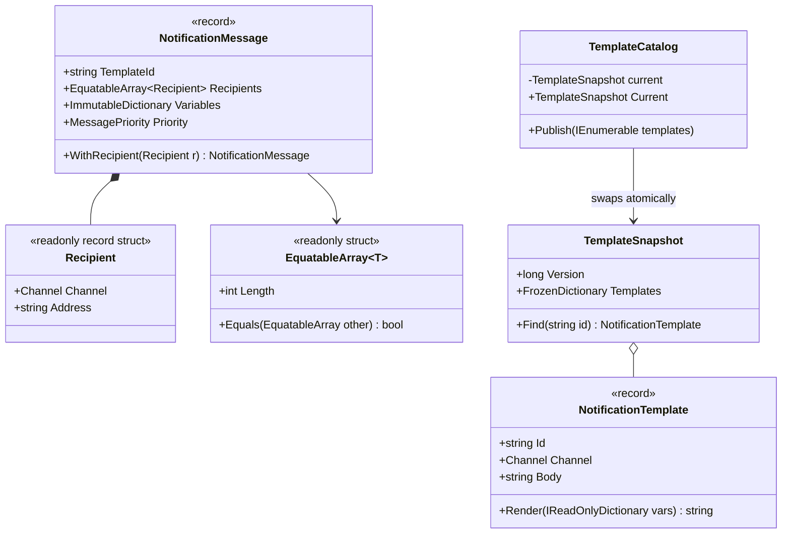
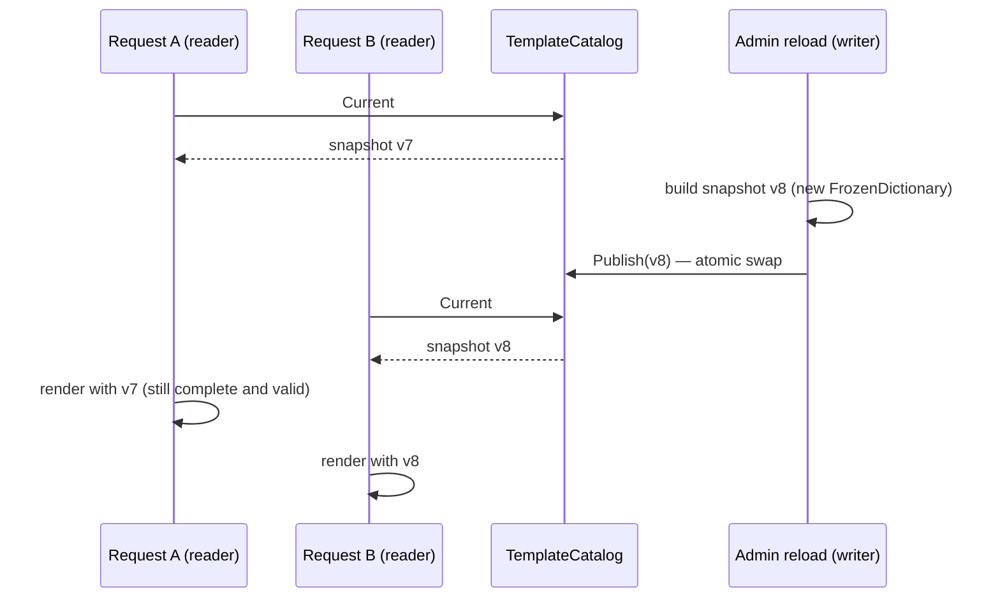

An immutable object is one whose state can't change after it is created. That single property removes whole families of bugs: values that change behind your back, race conditions between threads, cached objects that get "corrupted", and dictionary keys that stop matching. This lesson shows how to build immutable types in modern C#, where immutability pays off, and where it costs more than it gives.

## Learning objectives

By the end of this lesson you will be able to:

1. Explain what immutability is, and the difference between *shallow* and *deep* immutability.
2. Build immutable types with `readonly` fields, get-only and `init` properties, `required` members, records and `readonly struct`.
3. Use `with` expressions to make modified copies, and avoid the trap where `with` skips constructor validation (fix it with C# 14's `field` keyword).
4. Choose between `IReadOnlyList<T>`, `ImmutableArray<T>`, `ImmutableList<T>` and `FrozenDictionary<TKey, TValue>`.
5. Fix record equality when a record contains a collection.
6. Use immutable snapshots with an atomic swap for configuration and catalogues that are read by many threads and updated rarely.
7. Recognise when a mutable design is the better choice.

## Prerequisites

- [Entities, value objects and services](#/lesson/m07-entities-values-services): value objects are the most common immutable types.
- [Encapsulation and invariant protection](#/lesson/m07-encapsulation-invariants): immutability is the strongest form of encapsulation.

## Explain it like I'm a beginner

Think of a printed train ticket from Delhi to Jaipur: coach B2, seat 41, ₹755. Once it is printed, nobody can change it. If you want seat 42 instead, the clerk doesn't scratch out "41" — he prints a **new ticket** and cancels the old one.

Because a printed ticket never changes:

- You can photocopy it and hand copies to your family, and every copy says the same thing (**safe to share**).
- The ticket checker and you can look at it at the same time without either of you getting confused (**safe across threads**).
- If the railway keeps a list of issued tickets, an entry never quietly changes (**safe to cache or use as a key**).

Now think of a whiteboard on which someone wrote "B2-41". Anyone walking past can rub it out and write "B2-42". If you and your friend both read it at different moments, you may see different seats. That's a **mutable** object.

In code, "printing a new ticket" means creating a new object with the change, instead of editing the old one. C# makes this easy with **records** and the `with` keyword:

```csharp
var ticket = new TrainTicket("12015", "B2", 41, 755m);
var moved = ticket with { Seat = 42 };   // a new ticket; the original still says 41
```

## First-principles explanation

### What "immutable" means precisely

An object is **immutable** if, after its constructor finishes, no operation can change any state that is observable from outside. There are levels:

- **Shallow immutability**: the object's own fields can't be reassigned, but they may point to objects that *can* change. A record holding a `List<string>` is shallowly immutable: you can't replace the list, but anyone can `Add` to it.
- **Deep immutability**: everything reachable from the object is also immutable. This is what you usually want, and C# does not enforce it for you.

Immutability is also different from **read-only access**. `IReadOnlyList<T>` means "*you* can't change it through this reference". Someone else holding the underlying `List<T>` still can. It's a view, not a guarantee.

### Why immutability helps

1. **No surprises from aliasing.** If two parts of the program hold the same object, neither can change it under the other. Passing an immutable object to a method is as safe as passing a number.
2. **Thread safety for free.** Data races require at least one writer. An immutable object has none after construction, so any number of threads can read it without locks. (One caveat: the reference to the object must be *published* safely, for example through a `volatile` field or `Interlocked`. More on that below.)
3. **Validity forever.** Validate once in the constructor and the object stays valid. Nothing can later push it into an invalid state.
4. **Safe hash keys and caching.** A mutable object used as a `Dictionary` key can change its hash code after insertion and become unfindable. Immutable keys can't.
5. **Easy reasoning and testing.** Methods on immutable objects behave like functions: same inputs, same outputs.
6. **History and undo.** Each change produces a new version; keep the old ones and you have an audit trail or undo stack (compare Memento).

### The costs

- **Allocations.** Every "change" creates a new object. For a ticket or a money value that's negligible. For a 100,000-element list modified in a loop, copying on each change is very expensive — use a builder or a mutable local, then freeze.
- **Awkward for entities with lifecycles.** An `Order` that moves Draft → Placed → Delivered is naturally an entity with identity and controlled mutation (see [Object lifecycle](#/lesson/m07-lifecycle-state)). Making it immutable means replacing the whole aggregate on every change, which complicates persistence and identity tracking.
- **Deep immutability takes discipline.** One `List<T>` field breaks it.

**Rule of thumb:** make **value objects, messages, events, DTOs, configuration and snapshots** immutable. Keep **entities** mutable but encapsulated: private setters, intention-revealing methods, and immutable values inside them.

### The C# toolbox

| Tool | What it gives you | Note |
|---|---|---|
| `readonly` field | Field can only be assigned in a constructor or initializer | The object it points to may still be mutable |
| Get-only property `{ get; }` | Set only in the constructor | Classic immutable class |
| `init` accessor `{ get; init; }` | Set in an object initializer or `with`, then frozen | Enables `new X { A = 1 }` syntax |
| `required` member | Compiler forces callers to set it in the initializer | Pairs with `init` |
| `record` / `record class` | Value equality, `ToString`, `with` support, positional syntax | Positional properties are `init`-only |
| `record struct` | Same features as a value type | **Positional record structs are mutable** unless declared `readonly record struct` |
| `readonly struct` / `readonly record struct` | Compiler enforces that no member mutates the struct | Good for small values like ids and `Money` |
| `ImmutableArray<T>`, `ImmutableList<T>`, `ImmutableDictionary<K,V>` | Collections that never change; "modifying" returns a new collection | In `System.Collections.Immutable` |
| `FrozenDictionary<K,V>`, `FrozenSet<T>` (.NET 8+) | Built once, optimised for very fast reads | Slower to create; ideal for lookup tables |

### Records and `with`

A record declared as

```csharp
public sealed record TrainTicket(string TrainNo, string Coach, int Seat, decimal Fare);
```

gives you a constructor, `init`-only properties, value-based `Equals`/`GetHashCode`/`==`, a readable `ToString`, and support for `with`. A `with` expression **copies** the record (using a hidden copy constructor) and then runs the `init` accessors for the properties you name.

That last sentence hides the biggest trap in C# immutability: **`with` does not run your constructor.** If you validate in the constructor — "fare must not be negative" — `ticket with { Fare = -10 }` happily creates an invalid ticket.

The fix is to validate in the **`init` accessors**, because `with` *does* call those. In C# 14 the `field` keyword makes this short:

```csharp
public sealed record TrainTicket
{
    public required decimal Fare
    {
        get;
        init => field = value >= 0 ? value : throw new ArgumentOutOfRangeException(nameof(Fare));
    }
}
```

`field` refers to the compiler-generated backing field, so you don't need to declare `private decimal _fare;` yourself. Cross-property rules (e.g. "discounted fare ≤ fare") can't be checked reliably in a single `init` accessor, because the order in which a `with` expression sets properties is the order you wrote them. For those, expose methods (`ApplyDiscount`) that construct the new instance through a validating path, or keep the type a class with a validating constructor and no `with` support.

### Collections: read-only vs immutable vs frozen

- `IReadOnlyList<T>` — an interface. The object behind it might be a `List<T>` someone else is changing. Fine as a *parameter* type ("I won't modify your list"), weak as a *field* type in an immutable object.
- `ImmutableArray<T>` — a thin struct wrapper around an array that is never modified. Fast reads (like an array); every `Add` copies the whole array, so it suits small or rarely-changing collections. Note: `default(ImmutableArray<T>)` is "uninitialised" and throws on most operations — check `IsDefault`.
- `ImmutableList<T>` — a balanced tree. `Add`/`Remove` are O(log n) and share most of the structure with the previous version, so frequent small updates are cheaper than with `ImmutableArray`; reads are slower than an array.
- `FrozenDictionary<K,V>` / `FrozenSet<T>` — created once from existing data and optimised for lookups. Use for catalogues and configuration that are read millions of times and rebuilt occasionally.

To build a big immutable collection efficiently, use a **builder** (`ImmutableArray.CreateBuilder<T>()`) or a normal `List<T>` and call `ToImmutableArray()` once at the end.

### Equality traps

Records compare their properties with `EqualityComparer<T>.Default`. For a `List<T>` or an array, that means **reference** equality. For `ImmutableArray<T>`, it compares the underlying array reference too. So:

```csharp
public sealed record Template(string Id, ImmutableArray<string> Variables);
new Template("otp", ["code"]) == new Template("otp", ["code"]);   // false!
```

Two fixes: override `Equals(Template? other)` and `GetHashCode()` in the record to compare sequences, or use a small wrapper type such as `EquatableArray<T>` (shown in the implementation) whose equality is element-by-element.

### Publishing immutable snapshots safely

A common production pattern: a catalogue (notification templates, price lists, feature flags) is read on every request and updated a few times a day. Make the catalogue an **immutable snapshot**. Readers grab the current snapshot reference once and use it for the whole request. An updater builds a **new** snapshot and swaps the reference atomically. Readers never see a half-updated catalogue, and nobody needs a lock on the read path.

This is copy-on-write. The swap uses `Volatile.Write`/`Interlocked.Exchange` (or a `volatile` field) so that other threads see a fully constructed snapshot. When several writers may update concurrently, use a compare-and-swap loop (`Interlocked.CompareExchange`) or `ImmutableInterlocked.Update` so that no update is lost.

### When not to use immutability

- Entities with identity and a lifecycle — use encapsulated mutation.
- Hot loops building large collections — mutate locally, freeze at the end.
- Types bound to frameworks that need setters (some UI data-binding, older serializers). Isolate those types at the edge and map to immutable domain types.

## Visual explanation

### Immutable building blocks in a notification service



Everything here is immutable except `TemplateCatalog`, and even that holds only one mutable thing: a *reference* to the current snapshot. Messages and recipients are values — two messages with the same content are equal, thanks to `EquatableArray<T>`. Templates are immutable records. A `TemplateSnapshot` is a frozen dictionary plus a version number. To update templates, the catalogue builds a new snapshot and swaps the reference.

### Readers and a writer during a template reload



Request A started before the reload and keeps using version 7 until it finishes. Request B, which started after the swap, gets version 8. Neither sees a mix of old and new templates, and no reader ever waits for a lock. Version 7 is garbage-collected once the last request using it completes.

## Step-by-step example

### Step 1 — the mutable message

```csharp
public class NotificationMessage
{
    public string TemplateId { get; set; } = "";
    public List<string> Recipients { get; set; } = new();
    public Dictionary<string, string> Variables { get; set; } = new();
}
```

The send pipeline passes this through a rate limiter, a renderer, a channel router and a retry queue. A bug report says: "OTP SMS sometimes goes to the wrong user." The cause: the retry queue held a reference to a message object that the API controller reused and modified for the next request.

### Step 2 — make the shell immutable

Change the class to a `sealed record` with `init` properties and `required` members. Now nobody can reassign `TemplateId` after creation.

### Step 3 — make the contents immutable

`List<string>` → `ImmutableArray<Recipient>` (wrapped in `EquatableArray<T>` for value equality), `Dictionary` → `ImmutableDictionary`. A caller passing a `List` gets a copy, so later changes to their list don't leak in.

### Step 4 — validate in `init`, so `with` can't bypass it

Use the `field` keyword in `init` accessors for "template id required" and "at least one recipient".

### Step 5 — "change" by creating

`WithRecipient(r)` returns `this with { Recipients = Recipients.Add(r) }`. The original stays untouched, so the retry queue's copy is safe.

### Step 6 — immutable snapshots for shared data

Templates move into a `TemplateCatalog` that publishes immutable snapshots.

## Production-style C# implementation

```text
Notify.Api/
  Program.cs
  Messaging/EquatableArray.cs
  Messaging/NotificationMessage.cs
  Templates/NotificationTemplate.cs
  Templates/TemplateCatalog.cs
```

```csharp file=Messaging/EquatableArray.cs
using System.Collections;
using System.Collections.Immutable;

namespace Notify.Messaging;

/// <summary>An immutable array with element-by-element equality, so records containing it compare by value.</summary>
public readonly struct EquatableArray<T> : IEquatable<EquatableArray<T>>, IReadOnlyList<T>
{
    private readonly ImmutableArray<T> _items;

    public EquatableArray(ImmutableArray<T> items) => _items = items.IsDefault ? ImmutableArray<T>.Empty : items;

    public static EquatableArray<T> Empty => new(ImmutableArray<T>.Empty);

    private ImmutableArray<T> Items => _items.IsDefault ? ImmutableArray<T>.Empty : _items;
    public int Count => Items.Length;
    public T this[int index] => Items[index];

    public EquatableArray<T> Add(T item) => new(Items.Add(item));

    public bool Equals(EquatableArray<T> other) => Items.AsSpan().SequenceEqual(other.Items.AsSpan());
    public override bool Equals(object? obj) => obj is EquatableArray<T> other && Equals(other);

    public override int GetHashCode()
    {
        var hash = new HashCode();
        foreach (var item in Items) hash.Add(item);
        return hash.ToHashCode();
    }

    public static bool operator ==(EquatableArray<T> left, EquatableArray<T> right) => left.Equals(right);
    public static bool operator !=(EquatableArray<T> left, EquatableArray<T> right) => !left.Equals(right);

    public IEnumerator<T> GetEnumerator() => ((IEnumerable<T>)Items).GetEnumerator();
    IEnumerator IEnumerable.GetEnumerator() => GetEnumerator();

    public static implicit operator EquatableArray<T>(ImmutableArray<T> items) => new(items);
    public override string ToString() => $"[{string.Join(", ", Items)}]";
}
```

`SequenceEqual` on spans uses `EqualityComparer<T>.Default` for each element, which is what you want for strings, records and record structs. The `IsDefault` checks make `default(EquatableArray<T>)` behave like an empty array instead of throwing.

```csharp file=Messaging/NotificationMessage.cs
using System.Collections.Immutable;

namespace Notify.Messaging;

public enum Channel { Sms, Email, WhatsApp }
public enum MessagePriority { Transactional, Promotional }

/// <summary>A value: two recipients with the same channel and address are the same recipient.</summary>
public readonly record struct Recipient
{
    public Recipient(Channel channel, string address)
    {
        ArgumentException.ThrowIfNullOrWhiteSpace(address);
        Channel = channel;
        Address = channel == Channel.Email ? address.Trim().ToLowerInvariant() : address.Replace(" ", "");
    }

    public Channel Channel { get; }
    public string Address { get; }
}

/// <summary>Deeply immutable message. Validation lives in init accessors so `with` cannot bypass it.</summary>
public sealed record NotificationMessage
{
    public required string TemplateId
    {
        get;
        init => field = string.IsNullOrWhiteSpace(value)
            ? throw new ArgumentException("TemplateId is required.", nameof(TemplateId))
            : value;
    }

    public required EquatableArray<Recipient> Recipients
    {
        get;
        init => field = value.Count == 0
            ? throw new ArgumentException("At least one recipient is required.", nameof(Recipients))
            : value;
    }

    public ImmutableDictionary<string, string> Variables { get; init; } = ImmutableDictionary<string, string>.Empty;
    public MessagePriority Priority { get; init; } = MessagePriority.Transactional;

    public NotificationMessage WithRecipient(Recipient recipient) =>
        Recipients.Contains(recipient) ? this : this with { Recipients = Recipients.Add(recipient) };

    public NotificationMessage WithVariable(string name, string value) =>
        this with { Variables = Variables.SetItem(name, value) };

    // Records compare ImmutableDictionary by reference; compare contents instead.
    public bool Equals(NotificationMessage? other) =>
        other is not null
        && TemplateId == other.TemplateId
        && Recipients == other.Recipients
        && Priority == other.Priority
        && Variables.Count == other.Variables.Count
        && Variables.All(kv => other.Variables.TryGetValue(kv.Key, out var v) && v == kv.Value);

    public override int GetHashCode() => HashCode.Combine(TemplateId, Recipients, Priority, Variables.Count);
}
```

Note the custom `Equals`: once a record contains a dictionary, the generated equality is no longer "by value". Writing `Equals(NotificationMessage? other)` in a sealed record replaces the generated one, and `==` uses it automatically. `GetHashCode` must stay consistent with it — equal objects must have equal hash codes — which is why it only mixes in properties that `Equals` compares (using the variable *count* is coarse but correct).

```csharp file=Templates/NotificationTemplate.cs
using System.Collections.Immutable;
using System.Text.RegularExpressions;
using Notify.Messaging;

namespace Notify.Templates;

public sealed partial record NotificationTemplate
{
    [GeneratedRegex(@"\{(\w+)\}")]
    private static partial Regex Placeholder();

    public NotificationTemplate(string id, Channel channel, string body)
    {
        ArgumentException.ThrowIfNullOrWhiteSpace(id);
        ArgumentException.ThrowIfNullOrWhiteSpace(body);
        Id = id;
        Channel = channel;
        Body = body;
        VariableNames = Placeholder().Matches(body).Select(m => m.Groups[1].Value).Distinct()
                                     .ToImmutableArray();
    }

    public string Id { get; }
    public Channel Channel { get; }
    public string Body { get; }
    public EquatableArray<string> VariableNames { get; }

    /// <summary>Pure function: same template and variables always give the same text.</summary>
    public string Render(IReadOnlyDictionary<string, string> variables)
    {
        var missing = VariableNames.Where(n => !variables.ContainsKey(n)).ToArray();
        if (missing.Length > 0)
            throw new InvalidOperationException($"Template {Id} is missing variables: {string.Join(", ", missing)}.");
        return Placeholder().Replace(Body, m => variables[m.Groups[1].Value]);
    }
}
```

This record uses get-only properties and a validating constructor. None of its properties has an `init` accessor, so a `with` expression can't change anything and can't bypass the constructor's checks. That's deliberate: templates are replaced, never edited.

```csharp file=Templates/TemplateCatalog.cs
using System.Collections.Frozen;

namespace Notify.Templates;

/// <summary>Immutable, versioned view of all templates. Safe to use for a whole request.</summary>
public sealed class TemplateSnapshot
{
    public TemplateSnapshot(long version, IEnumerable<NotificationTemplate> templates)
    {
        Version = version;
        Templates = templates.ToFrozenDictionary(t => t.Id, StringComparer.OrdinalIgnoreCase);
    }

    public long Version { get; }
    public FrozenDictionary<string, NotificationTemplate> Templates { get; }

    public NotificationTemplate Find(string id) =>
        Templates.TryGetValue(id, out var t) ? t : throw new KeyNotFoundException($"Template {id} not found in v{Version}.");
}

/// <summary>Copy-on-write holder. Reads are lock-free; publishing swaps the whole snapshot atomically.</summary>
public sealed class TemplateCatalog
{
    private TemplateSnapshot _current;

    public TemplateCatalog(IEnumerable<NotificationTemplate> initial) => _current = new TemplateSnapshot(1, initial);

    /// <summary>Volatile read: always sees a fully constructed snapshot.</summary>
    public TemplateSnapshot Current => Volatile.Read(ref _current);

    /// <summary>Safe with concurrent publishers: version numbers never go backwards and no publish is lost.</summary>
    public TemplateSnapshot Publish(IEnumerable<NotificationTemplate> templates)
    {
        var list = templates.ToArray();   // materialise once; the input might be lazy or mutable
        while (true)
        {
            var observed = Current;
            var next = new TemplateSnapshot(observed.Version + 1, list);
            if (ReferenceEquals(Interlocked.CompareExchange(ref _current, next, observed), observed))
                return next;
            // Another publisher won the race; retry on top of their version.
        }
    }
}
```

```csharp file=Program.cs
using System.Collections.Immutable;
using Notify.Messaging;
using Notify.Templates;

var builder = WebApplication.CreateBuilder(args);

builder.Services.AddSingleton(new TemplateCatalog(
[
    new NotificationTemplate("otp", Channel.Sms, "Your OTP is {code}. Valid for {minutes} minutes."),
    new NotificationTemplate("ticket-confirmed", Channel.Email, "Booking {bookingId}: seats {seats} for {show}."),
]));

var app = builder.Build();

app.MapPost("/notifications/preview", (PreviewRequest req, TemplateCatalog catalog) =>
{
    var snapshot = catalog.Current;   // one snapshot for the whole request
    var message = new NotificationMessage
    {
        TemplateId = req.TemplateId,
        Recipients = req.Recipients.Select(r => new Recipient(r.Channel, r.Address)).ToImmutableArray(),
        Variables = req.Variables.ToImmutableDictionary(),
    };
    var template = snapshot.Find(message.TemplateId);
    return Results.Ok(new { templateVersion = snapshot.Version, text = template.Render(message.Variables) });
});

app.MapPost("/templates/publish", (List<TemplateDto> templates, TemplateCatalog catalog) =>
{
    var snapshot = catalog.Publish(templates.Select(t => new NotificationTemplate(t.Id, t.Channel, t.Body)));
    return Results.Ok(new { version = snapshot.Version, count = snapshot.Templates.Count });
});

app.Run();

public sealed record RecipientDto(Channel Channel, string Address);
public sealed record PreviewRequest(string TemplateId, List<RecipientDto> Recipients, Dictionary<string, string> Variables);
public sealed record TemplateDto(string Id, Channel Channel, string Body);
```

The DTOs at the bottom use `List` and `Dictionary` because that is what the JSON serializer produces. They are converted to immutable domain types at the first line of each endpoint. Mutable at the edge, immutable inside — a common and healthy split.

:::callout type=warning title="Positional record structs are mutable"
`public record struct Point(int X, int Y);` generates **settable** properties. Write `public readonly record struct Point(int X, int Y);` to get `init`-only properties and a compiler-enforced read-only struct.
:::

:::callout type=tip title="Immutability and EF Core"
EF Core can materialise entities through constructors and map get-only properties, and it handles value objects well as owned or complex types. Entities themselves usually stay mutable with private setters, because EF Core tracks changes on the instance. Use immutable records for value objects inside entities, and for read models returned by queries (`AsNoTracking()` projections).
:::

## Bad design vs good design

**Bad**: a `PriceList` singleton with a public `Dictionary<string, decimal> Prices` that an admin endpoint edits in place while checkout requests read it. Symptoms seen in practice:

- An `InvalidOperationException: Collection was modified` during enumeration, a few times a day.
- Occasional corrupted internal state of `Dictionary` under concurrent writes, which can surface as wrong lookups or exceptions.
- An order priced with half the old list and half the new one during an update, because the update loop changed prices one by one.

**Good**: an immutable `PriceSnapshot` (a `FrozenDictionary` plus a version), published by atomic swap. Each checkout request reads one snapshot and records `priceListVersion` on the order, which also helps when customers dispute a price.

**When is immutability the wrong call?** For the `Order` aggregate itself. Recreating the whole order for each line change breaks identity tracking in the ORM and adds allocations for no safety gain, since only one request modifies an order at a time (guarded by optimistic concurrency). Keep the aggregate mutable and encapsulated; make its `Money`, `OrderLine` snapshots and domain events immutable.

:::callout type=mistake title="IReadOnlyList is not immutable"
`public IReadOnlyList<string> Tags { get; } = tags;` stores the caller's list. If the caller later calls `tags.Add("x")`, your "immutable" object changes. Copy on the way in: `Tags = tags.ToImmutableArray();`.
:::

## Practical playground

Run the program. It shows that `with` copies a record and that the copy compares equal by value. Then try the experiment in the comment: give `Fare` a validating `init` accessor so that the last line throws instead of printing a negative fare.

:::playground type=csharp title="Records, with and validation"
```csharp file=Program.cs
using System;
using System.Collections.Generic;

public sealed record TrainTicket(string TrainNo, string Coach, int Seat, decimal Fare)
{
    // Experiment: add this explicit property, which replaces the generated one:
    // public decimal Fare { get; init => field = value >= 0 ? value : throw new ArgumentOutOfRangeException(nameof(Fare)); } = Fare;
    // Now `with { Fare = -10m }` throws. But the "= Fare" initializer writes the backing field directly,
    // so `new TrainTicket(..., -5m)` is still NOT validated. Exercise 3 shows the complete fix (required + init).
}

public static class Program
{
    public static void Main()
    {
        var ticket = new TrainTicket("12015", "B2", 41, 755m);
        var moved = ticket with { Seat = 42 };

        Console.WriteLine(ticket);
        Console.WriteLine(moved);
        Console.WriteLine($"Same object? {ReferenceEquals(ticket, moved)}");
        Console.WriteLine($"Equal to a fresh copy? {ticket == new TrainTicket("12015", "B2", 41, 755m)}");

        var seen = new HashSet<TrainTicket> { ticket };
        Console.WriteLine($"Found in set: {seen.Contains(new TrainTicket("12015", "B2", 41, 755m))}");

        try { Console.WriteLine(ticket with { Fare = -10m }); }
        catch (ArgumentOutOfRangeException ex) { Console.WriteLine($"Rejected: {ex.ParamName}"); }
    }
}
```
:::

## Exercises

:::exercise id=m07-immutability-ex1 difficulty=beginner kind=code title="An immutable movie ticket"
Make `MovieTicket` immutable. Every "change" returns a new ticket.
::requirements
- `MovieTicket(string ShowId, string Seat, decimal Price)` is a record.
- `ChangeSeat(string seat)` returns a new ticket with the new seat (upper-cased), leaving the original unchanged.
- `ApplyDiscount(decimal percent)` returns a new ticket with the price reduced and rounded to 2 decimals; percent must be between 0 and 50 (`ArgumentOutOfRangeException` otherwise).
- Two tickets with the same values are equal and have the same hash code.
::acceptance
- `t.ChangeSeat("e8")` has seat `E8`; `t.Seat` is still `E7`.
- `ApplyDiscount(10)` on ₹280 gives ₹252.
- `ApplyDiscount(60)` throws.
- `new MovieTicket("S1", "E7", 280m) == new MovieTicket("S1", "E7", 280m)`.
::hint
Which C# type gives you value equality and `with` for free?
::hint
Inside a record, `this with { Seat = ... }` creates a modified copy.
::hint
`Math.Round(Price * (100 - percent) / 100m, 2, MidpointRounding.AwayFromZero)`.
::starter
```csharp file=MovieTicket.cs
using System;

public sealed record MovieTicket(string ShowId, string Seat, decimal Price)
{
    public MovieTicket ChangeSeat(string seat) => throw new NotImplementedException();
    public MovieTicket ApplyDiscount(decimal percent) => throw new NotImplementedException();
}
```
::tests
```csharp file=MovieTicketTests.cs
using System;
using Xunit;

public class MovieTicketTests
{
    private static readonly MovieTicket T = new("SHOW-PVR-1930", "E7", 280m);

    [Fact]
    public void Change_seat_returns_new_ticket()
    {
        var moved = T.ChangeSeat("e8");
        Assert.Equal("E8", moved.Seat);
        Assert.Equal("E7", T.Seat);
        Assert.NotSame(T, moved);
    }

    [Fact] public void Discount_rounds() => Assert.Equal(252m, T.ApplyDiscount(10m).Price);

    [Fact] public void Discount_limit() => Assert.Throws<ArgumentOutOfRangeException>(() => T.ApplyDiscount(60m));

    [Fact]
    public void Value_equality()
    {
        var a = new MovieTicket("S1", "E7", 280m);
        var b = new MovieTicket("S1", "E7", 280m);
        Assert.True(a == b);
        Assert.Equal(a.GetHashCode(), b.GetHashCode());
    }

    [Fact] public void Original_price_unchanged_after_discount()
    {
        T.ApplyDiscount(20m);
        Assert.Equal(280m, T.Price);
    }
}
```
::solution
```csharp file=MovieTicket.cs
using System;

public sealed record MovieTicket(string ShowId, string Seat, decimal Price)
{
    public MovieTicket ChangeSeat(string seat)
    {
        ArgumentException.ThrowIfNullOrWhiteSpace(seat);
        return this with { Seat = seat.Trim().ToUpperInvariant() };
    }

    public MovieTicket ApplyDiscount(decimal percent)
    {
        if (percent is < 0m or > 50m) throw new ArgumentOutOfRangeException(nameof(percent), "Discount must be 0–50 %.");
        return this with { Price = Math.Round(Price * (100m - percent) / 100m, 2, MidpointRounding.AwayFromZero) };
    }
}
```
Methods named after the business action (`ChangeSeat`) are clearer than raw `with` expressions spread across the code base, and they are the right place for rules.
::mistakes
- Using a `class` with `{ get; set; }` and copying fields by hand — easy to forget a field.
- Returning `this` after "changing" it (impossible with records, but common with hand-written immutable classes that accidentally keep a setter).
:::

:::exercise id=m07-immutability-ex2 difficulty=beginner kind=code title="Fix shallow immutability with a defensive copy"
A food-ordering service stores a snapshot of the cart when an order is placed, for invoices and disputes. The snapshot type looks immutable but isn't. Fix it.
::requirements
- `CartSnapshot(string orderId, IEnumerable<CartItem> items)` copies the items on the way in.
- `Items` is exposed as `ImmutableArray<CartItem>`.
- Changing the source list after creating the snapshot must not affect the snapshot.
- `Total` is computed from the copied items.
- An empty item list throws `ArgumentException`.
::acceptance
- Create from a `List<CartItem>` with 2 items, then add a third to the list → snapshot still has 2 items and the same total.
- `Items` cannot be cast to `List<CartItem>`.
- `CartItem` is a record with value equality.
::hint
Storing the reference you were given is the bug. What do you store instead?
::hint
`items.ToImmutableArray()` makes a copy that nobody else can modify.
::hint
`ImmutableArray<T>` is a struct; `IsEmpty` tells you whether it has no elements.
::starter
```csharp file=CartSnapshot.cs
using System;
using System.Collections.Generic;
using System.Collections.Immutable;
using System.Linq;

public sealed record CartItem(string Sku, string Name, decimal UnitPrice, int Quantity)
{
    public decimal LineTotal => UnitPrice * Quantity;
}

public sealed class CartSnapshot
{
    public CartSnapshot(string orderId, IEnumerable<CartItem> items)
    {
        throw new NotImplementedException();
    }

    public string OrderId { get; } = "";
    public ImmutableArray<CartItem> Items { get; }
    public decimal Total => throw new NotImplementedException();
}
```
::tests
```csharp file=CartSnapshotTests.cs
using System;
using System.Collections.Generic;
using Xunit;

public class CartSnapshotTests
{
    [Fact]
    public void Source_list_changes_do_not_leak_in()
    {
        var items = new List<CartItem> { new("MASALA-DOSA", "Masala Dosa", 120m, 2), new("FILTER-COFFEE", "Filter Coffee", 40m, 2) };
        var snapshot = new CartSnapshot("ORD-501", items);
        items.Add(new CartItem("VADA", "Medu Vada", 60m, 1));
        items[0] = items[0] with { Quantity = 10 };
        Assert.Equal(2, snapshot.Items.Length);
        Assert.Equal(320m, snapshot.Total);
    }

    [Fact]
    public void Items_cannot_be_cast_back_to_list()
    {
        var snapshot = new CartSnapshot("ORD-502", new[] { new CartItem("IDLI", "Idli", 50m, 2) });
        object boxed = snapshot.Items;
        Assert.False(boxed is List<CartItem>);
    }

    [Fact] public void Empty_cart_rejected() =>
        Assert.Throws<ArgumentException>(() => new CartSnapshot("ORD-503", new List<CartItem>()));

    [Fact] public void Items_have_value_equality() =>
        Assert.Equal(new CartItem("IDLI", "Idli", 50m, 2), new CartItem("IDLI", "Idli", 50m, 2));
}
```
::solution
```csharp file=CartSnapshot.cs
using System;
using System.Collections.Generic;
using System.Collections.Immutable;
using System.Linq;

public sealed record CartItem(string Sku, string Name, decimal UnitPrice, int Quantity)
{
    public decimal LineTotal => UnitPrice * Quantity;
}

public sealed class CartSnapshot
{
    public CartSnapshot(string orderId, IEnumerable<CartItem> items)
    {
        ArgumentException.ThrowIfNullOrWhiteSpace(orderId);
        ArgumentNullException.ThrowIfNull(items);
        var copy = items.ToImmutableArray();   // defensive copy: we own this array now
        if (copy.IsEmpty) throw new ArgumentException("A snapshot needs at least one item.", nameof(items));
        OrderId = orderId;
        Items = copy;
        Total = copy.Sum(i => i.LineTotal);    // computed once; it can never change
    }

    public string OrderId { get; }
    public ImmutableArray<CartItem> Items { get; }
    public decimal Total { get; }
}
```
Because `CartItem` is itself an immutable record, copying the *list* is enough for deep immutability. If `CartItem` were a mutable class, you would have to copy each item too.
::mistakes
- `Items = items as IReadOnlyList<CartItem>` — no copy, so the caller can still change it.
- Copying into a new `List<CartItem>` but exposing it as `IReadOnlyList` — safer, but the class can still mutate it internally by accident; `ImmutableArray` makes intent explicit.
- Using `ImmutableArray<T>` without considering `default` — a `default(ImmutableArray<T>)` throws on `Length`.
:::

:::exercise id=m07-immutability-ex3 difficulty=intermediate kind=code title="Validation that survives with-expressions"
A payment service has a `ChargeAmount` record that validates in its constructor. A teammate wrote `amount with { Value = -500 }` and the invalid value reached the payment gateway. Rewrite the record so validation runs for both construction and `with`.
::requirements
- `ChargeAmount` has `Value` (decimal, > 0, at most 2 decimal places) and `Currency` (3 upper-case letters, normalised to upper case).
- Both `new ChargeAmount { Value = ..., Currency = ... }` and `with { ... }` validate.
- Invalid `Value` throws `ArgumentOutOfRangeException`; invalid `Currency` throws `ArgumentException`.
- Both properties are `required`.
- Value equality still works.
::acceptance
- `new ChargeAmount { Value = 499.50m, Currency = "inr" }` has currency `INR`.
- `x with { Value = -500m }` throws `ArgumentOutOfRangeException`.
- `x with { Value = 10.005m }` throws (3 decimal places).
- `x with { Currency = "RUPEE" }` throws `ArgumentException`.
- Two amounts with the same values are equal.
::hint
`with` calls the hidden copy constructor, then the `init` accessors of the properties you list. Which of those can you put code in?
::hint
Move validation into `init` accessors. In C# 14, `field` is the compiler-generated backing field: `init => field = Validate(value);`.
::hint
For the decimal-places rule: `decimal.Round(value, 2) == value`.
::hint
```csharp
public required decimal Value
{
    get;
    init => field = value > 0 && decimal.Round(value, 2) == value
        ? value
        : throw new ArgumentOutOfRangeException(nameof(Value), value, "Must be positive with at most 2 decimals.");
}
```
::starter
```csharp file=ChargeAmount.cs
using System;

public sealed record ChargeAmount
{
    public required decimal Value
    {
        get;
        init => throw new NotImplementedException();
    }

    public required string Currency
    {
        get;
        init => throw new NotImplementedException();
    }
}
```
::tests
```csharp file=ChargeAmountTests.cs
using System;
using Xunit;

public class ChargeAmountTests
{
    private static ChargeAmount Valid() => new() { Value = 499.50m, Currency = "inr" };

    [Fact]
    public void Normalises_currency()
    {
        Assert.Equal("INR", Valid().Currency);
        Assert.Equal(499.50m, Valid().Value);
    }

    [Fact] public void With_negative_value_throws() =>
        Assert.Throws<ArgumentOutOfRangeException>(() => Valid() with { Value = -500m });

    [Fact] public void With_three_decimals_throws() =>
        Assert.Throws<ArgumentOutOfRangeException>(() => Valid() with { Value = 10.005m });

    [Fact] public void With_bad_currency_throws() =>
        Assert.Throws<ArgumentException>(() => Valid() with { Currency = "RUPEE" });

    [Fact] public void Construction_validates_too() =>
        Assert.Throws<ArgumentOutOfRangeException>(() => new ChargeAmount { Value = 0m, Currency = "INR" });

    [Fact]
    public void Value_equality_and_valid_with()
    {
        var changed = Valid() with { Value = 100m };
        Assert.Equal(new ChargeAmount { Value = 100m, Currency = "INR" }, changed);
        Assert.Equal(499.50m, Valid().Value);
    }
}
```
::solution
```csharp file=ChargeAmount.cs
using System;

public sealed record ChargeAmount
{
    public required decimal Value
    {
        get;
        init => field = value > 0m && decimal.Round(value, 2) == value
            ? value
            : throw new ArgumentOutOfRangeException(nameof(Value), value, "Amount must be positive with at most 2 decimal places.");
    }

    public required string Currency
    {
        get;
        init => field = value is { Length: 3 } && value.All(char.IsAsciiLetter)
            ? value.ToUpperInvariant()
            : throw new ArgumentException("Currency must be a 3-letter ISO code such as INR.", nameof(Currency));
    }
}
```
`ArgumentOutOfRangeException` derives from `ArgumentException`, so the currency check deliberately throws the base type and the value check the more specific one. `value.All(...)` works on a string because `string` implements `IEnumerable<char>`; `System.Linq` comes in through implicit usings.
::alternatives
If you need a rule across properties (for example "USD amounts above 10,000 need approval"), `init` accessors can't see the final state reliably. Make the type a `sealed class` with a validating constructor and expose methods like `WithValue(decimal)` that call the constructor — no `with` support, but no bypass either.
::mistakes
- Keeping the validation in a constructor and assuming `with` calls it.
- Declaring a `private decimal _value;` *and* using `field` — they would be two different fields. Use one or the other.
- Forgetting `required`, so `new ChargeAmount()` creates an object whose `init` accessors never ran (and whose `Value` is 0).
:::

:::exercise id=m07-immutability-ex4 difficulty=intermediate kind=design title="An immutable audit trail for notification delivery"
Compliance asks the notification service to keep a tamper-evident history of every message: when it was requested, rendered, sent to each provider, delivered, failed or retried. Support staff must answer "what happened to the OTP sent to +91 98xxxx3210 at 10:42?" and the operations dashboard needs the *current* status of each message.

Design the model in the LLD designer using immutable types wherever reasonable. Show which types are immutable, which single place holds mutable state, and how the current status is derived.
::acceptance
- Each thing that happened is an immutable event record with a timestamp and a message id.
- History is append-only; nothing is updated in place.
- Current status is a function of the events (a fold/projection), not a separately edited field — or, if cached, it is rebuilt from events.
- Shared lookup data (provider configuration, templates) is an immutable snapshot with a version recorded on each event.
- The design mentions how tamper-evidence could work (e.g. a hash chain), and its cost.
::hint
Name the events in the past tense: `NotificationRequested`, `NotificationRendered`, `ProviderAccepted`, `DeliveryReported`, `DeliveryFailed`, `RetryScheduled`.
::hint
A common base: `abstract record NotificationEvent(Guid MessageId, DateTimeOffset At)` with derived records.
::hint
A pure function `DeliveryStatus Apply(DeliveryStatus current, NotificationEvent e)` folded over the event list gives the current status. Test it like any other pure function.
::hint
For tamper evidence, each event can carry `PreviousHash` and `Hash = SHA256(previousHash + serialised event)`. Changing any old event breaks every later hash.
::starter
```json file=notification-audit.json
{
  "classes": [
    { "id": "Evt", "name": "NotificationEvent", "kind": "abstract", "fields": ["+Guid MessageId", "+DateTimeOffset At"], "methods": [] },
    { "id": "Status", "name": "DeliveryStatus", "kind": "enum", "fields": ["Requested", "Delivered"], "methods": [] }
  ],
  "relations": []
}
```
::solution
```json file=notification-audit.json
{
  "classes": [
    { "id": "Evt", "name": "NotificationEvent", "kind": "abstract",
      "fields": ["+Guid MessageId", "+DateTimeOffset At", "+long TemplateVersion", "+string PreviousHash", "+string Hash"], "methods": [],
      "responsibility": "Immutable base record for everything that happened" },
    { "id": "Req", "name": "NotificationRequested", "kind": "record", "fields": ["+string TemplateId", "+Recipient Recipient", "+MessagePriority Priority"], "methods": [] },
    { "id": "Ren", "name": "NotificationRendered", "kind": "record", "fields": ["+string BodyHash", "+int Segments"], "methods": [],
      "responsibility": "Stores a hash, not the OTP itself" },
    { "id": "Acc", "name": "ProviderAccepted", "kind": "record", "fields": ["+string Provider", "+string ProviderMessageId"], "methods": [] },
    { "id": "Del", "name": "DeliveryReported", "kind": "record", "fields": ["+string Provider", "+DateTimeOffset DeliveredAt"], "methods": [] },
    { "id": "Fail", "name": "DeliveryFailed", "kind": "record", "fields": ["+string Provider", "+string ErrorCode", "+bool Permanent"], "methods": [] },
    { "id": "Retry", "name": "RetryScheduled", "kind": "record", "fields": ["+int Attempt", "+DateTimeOffset RetryAt", "+string NextProvider"], "methods": [] },
    { "id": "Status", "name": "DeliveryStatus", "kind": "enum", "fields": ["Requested", "Rendered", "Sent", "Delivered", "RetryPending", "Failed"], "methods": [] },
    { "id": "View", "name": "MessageView", "kind": "record",
      "fields": ["+Guid MessageId", "+DeliveryStatus Status", "+int Attempts", "+DateTimeOffset LastChangedAt", "+string? LastProvider"], "methods": [],
      "responsibility": "Immutable projection; recomputed, never edited" },
    { "id": "Proj", "name": "MessageProjector", "kind": "class", "fields": [],
      "methods": ["+static MessageView Apply(MessageView view, NotificationEvent e)", "+static MessageView Replay(IEnumerable~NotificationEvent~ events)"],
      "responsibility": "Pure fold from events to current view" },
    { "id": "Log", "name": "INotificationEventLog", "kind": "interface", "fields": [],
      "methods": ["Task AppendAsync(NotificationEvent e, CancellationToken ct)", "IAsyncEnumerable~NotificationEvent~ ReadAsync(Guid messageId, CancellationToken ct)"],
      "responsibility": "Append-only store (INSERT only; no UPDATE/DELETE grants)" },
    { "id": "Snap", "name": "ProviderConfigSnapshot", "kind": "class", "fields": ["+long Version", "+FrozenDictionary~string,ProviderConfig~ Providers"], "methods": [],
      "responsibility": "Immutable, swapped atomically; version stamped on events" }
  ],
  "relations": [
    { "from": "Req", "to": "Evt", "kind": "inherits" },
    { "from": "Ren", "to": "Evt", "kind": "inherits" },
    { "from": "Acc", "to": "Evt", "kind": "inherits" },
    { "from": "Del", "to": "Evt", "kind": "inherits" },
    { "from": "Fail", "to": "Evt", "kind": "inherits" },
    { "from": "Retry", "to": "Evt", "kind": "inherits" },
    { "from": "Proj", "to": "Evt", "kind": "dependency", "label": "folds" },
    { "from": "Proj", "to": "View", "kind": "dependency", "label": "produces" },
    { "from": "View", "to": "Status", "kind": "association" },
    { "from": "Log", "to": "Evt", "kind": "aggregation", "multiplicity": "0..*" }
  ]
}
```
**Only one mutable thing**: the event log grows. Everything in it is an immutable record. The dashboard's `MessageView` is a projection — either computed on demand with `Replay` or cached in a table that is rebuilt from events if in doubt.

**Answering support questions**: read all events for the message id in order; they tell the full story with provider ids and timestamps.

**Privacy**: the rendered OTP is never stored — only its hash and segment count. Immutable logs make deletion requests harder, so keep personal data out of events or store it separately with a reference that can be erased.

**Tamper evidence**: a hash chain per message (or per day) makes edits detectable. Cost: hashing on every append and a verification job; it detects tampering but doesn't prevent it. Database permissions (INSERT only) do the preventing.
::alternatives
If compliance only needs "last status and when", a mutable status row with an append-only history table is simpler. Full event sourcing is worth it when the history *is* the product (audit, disputes, analytics).
::mistakes
- A `Status` column updated in place with no history — the exact thing compliance asked to avoid.
- Storing the OTP text in the audit log.
- Making `MessageView` mutable and editing it from several handlers, so it drifts from the events.
:::

:::exercise id=m07-immutability-ex5 difficulty=advanced kind=code title="A copy-on-write rate card with lock-free reads"
An inventory and logistics service prices shipments from a rate card (zone → price per kg). The rate card is read on every quote (thousands per second) and updated by operations a few times a day. Implement `RateCardStore` with immutable snapshots.
::requirements
- `RateCard` is immutable: a `Version` and an `ImmutableDictionary<string, decimal>` of zone → ₹/kg. `Quote(zone, kg)` returns `Math.Ceiling(kg) × rate` and throws `KeyNotFoundException` for an unknown zone.
- `RateCardStore.Current` returns the current snapshot without locking.
- `RateCardStore.Update(Func<RateCard, RateCard> change)` applies a change atomically. Concurrent updates must never be lost: use a compare-and-swap loop. The new card's version is the old version + 1.
- `RateCard.WithRate(zone, rate)` returns a new card (same version; the store bumps the version). Rates must be positive.
- A snapshot obtained before an update is unchanged afterwards.
::acceptance
- Start with version 1 and `{ "NORTH": 40 }`. `Quote("NORTH", 2.3)` = 120.
- After `Update(c => c.WithRate("SOUTH", 55))`, `Current.Version` = 2 and both zones exist; a snapshot taken before still has only NORTH and version 1.
- 200 parallel updates, each adding a different zone → 201 zones and version 201.
- `WithRate("EAST", 0)` throws `ArgumentOutOfRangeException`.
::hint
Readers do `Volatile.Read(ref _current)`. That's the whole read path.
::hint
Writers: read the current card, compute the new one, and try to swap with `Interlocked.CompareExchange(ref _current, next, observed)`. If it returns something other than `observed`, someone else won — try again.
::hint
The change function may run more than once under contention, so it must be a pure function of its input (no side effects).
::hint
```csharp
while (true)
{
    var observed = Volatile.Read(ref _current);
    var next = change(observed).WithVersion(observed.Version + 1);
    if (ReferenceEquals(Interlocked.CompareExchange(ref _current, next, observed), observed)) return next;
}
```
::starter
```csharp file=RateCardStore.cs
using System;
using System.Collections.Generic;
using System.Collections.Immutable;
using System.Threading;

public sealed class RateCard
{
    public RateCard(long version, ImmutableDictionary<string, decimal> ratesPerKg)
    {
        throw new NotImplementedException();
    }

    public long Version { get; }
    public ImmutableDictionary<string, decimal> RatesPerKg { get; } = ImmutableDictionary<string, decimal>.Empty;

    public decimal Quote(string zone, decimal kg) => throw new NotImplementedException();
    public RateCard WithRate(string zone, decimal ratePerKg) => throw new NotImplementedException();
    public RateCard WithVersion(long version) => throw new NotImplementedException();
}

public sealed class RateCardStore
{
    public RateCardStore(RateCard initial) => throw new NotImplementedException();
    public RateCard Current => throw new NotImplementedException();
    public RateCard Update(Func<RateCard, RateCard> change) => throw new NotImplementedException();
}
```
::tests
```csharp file=RateCardStoreTests.cs
using System;
using System.Collections.Generic;
using System.Collections.Immutable;
using System.Threading.Tasks;
using Xunit;

public class RateCardStoreTests
{
    private static RateCardStore NewStore() =>
        new(new RateCard(1, ImmutableDictionary<string, decimal>.Empty.Add("NORTH", 40m)));

    [Fact] public void Quote_rounds_weight_up() => Assert.Equal(120m, NewStore().Current.Quote("NORTH", 2.3m));

    [Fact] public void Unknown_zone() =>
        Assert.Throws<KeyNotFoundException>(() => NewStore().Current.Quote("MARS", 1m));

    [Fact]
    public void Update_creates_new_version_and_old_snapshot_is_unchanged()
    {
        var store = NewStore();
        var before = store.Current;
        var after = store.Update(c => c.WithRate("SOUTH", 55m));
        Assert.Equal(2, after.Version);
        Assert.Same(after, store.Current);
        Assert.Equal(2, store.Current.RatesPerKg.Count);
        Assert.Equal(1, before.Version);
        Assert.Single(before.RatesPerKg);
    }

    [Fact]
    public void Parallel_updates_are_not_lost()
    {
        var store = NewStore();
        Parallel.For(0, 200, i => store.Update(c => c.WithRate($"ZONE-{i}", 10m + i)));
        Assert.Equal(201, store.Current.RatesPerKg.Count);
        Assert.Equal(201, store.Current.Version);
    }

    [Fact] public void Rates_must_be_positive() =>
        Assert.Throws<ArgumentOutOfRangeException>(() => NewStore().Current.WithRate("EAST", 0m));
}
```
::solution
```csharp file=RateCardStore.cs
using System;
using System.Collections.Generic;
using System.Collections.Immutable;
using System.Threading;

public sealed class RateCard
{
    public RateCard(long version, ImmutableDictionary<string, decimal> ratesPerKg)
    {
        ArgumentOutOfRangeException.ThrowIfNegativeOrZero(version);
        ArgumentNullException.ThrowIfNull(ratesPerKg);
        Version = version;
        RatesPerKg = ratesPerKg;
    }

    public long Version { get; }
    public ImmutableDictionary<string, decimal> RatesPerKg { get; }

    public decimal Quote(string zone, decimal kg)
    {
        ArgumentOutOfRangeException.ThrowIfNegativeOrZero(kg);
        if (!RatesPerKg.TryGetValue(zone, out var rate))
            throw new KeyNotFoundException($"No rate for zone {zone} in rate card v{Version}.");
        return Math.Ceiling(kg) * rate;
    }

    public RateCard WithRate(string zone, decimal ratePerKg)
    {
        ArgumentException.ThrowIfNullOrWhiteSpace(zone);
        ArgumentOutOfRangeException.ThrowIfNegativeOrZero(ratePerKg);
        return new RateCard(Version, RatesPerKg.SetItem(zone, ratePerKg));
    }

    public RateCard WithVersion(long version) => new(version, RatesPerKg);
}

public sealed class RateCardStore
{
    private RateCard _current;

    public RateCardStore(RateCard initial)
    {
        ArgumentNullException.ThrowIfNull(initial);
        _current = initial;
    }

    public RateCard Current => Volatile.Read(ref _current);

    public RateCard Update(Func<RateCard, RateCard> change)
    {
        ArgumentNullException.ThrowIfNull(change);
        while (true)
        {
            var observed = Volatile.Read(ref _current);
            var next = change(observed).WithVersion(observed.Version + 1);
            if (ReferenceEquals(Interlocked.CompareExchange(ref _current, next, observed), observed))
                return next;
        }
    }
}
```
Readers never block and never see a half-applied update. Under contention a writer may compute its change several times, which is why `change` must be pure. `ImmutableDictionary.SetItem` shares most of its internal tree with the previous version, so each update allocates a little, not a full copy.
::alternatives
`ImmutableInterlocked.Update(ref _current, transformer)` implements the same CAS loop for you. If updates are rare and come from a single admin process, a plain `lock` around the writer plus a `Volatile.Write` is simpler and just as correct — readers still never lock. For read-heavy lookups after building, convert to a `FrozenDictionary` inside the snapshot.
::mistakes
- Making `_current` a normal field read without `Volatile.Read` and assuming it "just works" — on most hardware it does, but the memory model doesn't promise it, and the code no longer documents its intent.
- Mutating the dictionary inside the current card ("it's only one entry"), which breaks every reader holding that snapshot.
- Bumping the version inside `change` instead of in the store, so two retried attempts produce inconsistent versions.
::extensions
Add `IObservable<RateCard>` or an event that fires after each successful swap, so caches elsewhere can refresh. Make sure handlers can't block the writer.
:::

## Automated testing

Immutable types are the easiest code to test: no setup of hidden state, no ordering issues.

**1. Non-mutation tests.** For every "modifying" method, assert the original is unchanged:

```csharp
[Fact]
public void WithRecipient_does_not_change_the_original()
{
    var original = new NotificationMessage
    {
        TemplateId = "otp",
        Recipients = ImmutableArray.Create(new Recipient(Channel.Sms, "+919876543210")),
    };
    var updated = original.WithRecipient(new Recipient(Channel.Email, "Asha@Example.com"));

    Assert.Equal(1, original.Recipients.Count);
    Assert.Equal(2, updated.Recipients.Count);
    Assert.Equal("asha@example.com", updated.Recipients[1].Address);
}
```

**2. Equality tests.** Two instances built from equal data must be equal and have equal hash codes — especially for records containing collections, where the generated equality silently falls back to reference comparison.

**3. `with` validation tests.** For each validated property, `valid with { Prop = invalid }` must throw. These tests catch the constructor-only validation trap.

**4. Defensive-copy tests.** Build from a `List<T>`, modify the list, assert the object didn't change.

**5. Concurrency tests for snapshot stores.** Run hundreds of parallel updates with `Parallel.For` and assert none was lost; take a snapshot before an update and assert it is unchanged. These tests can't prove absence of races, but they catch the common lost-update bug reliably.

## Real-world application

- **.NET itself**: `string`, `DateTime`, `DateTimeOffset`, `TimeSpan`, `Guid`, `Uri` and `decimal` are immutable. That's why you can pass them anywhere without worrying.
- **ASP.NET Core configuration**: `IOptionsMonitor<T>` hands out a new options instance when configuration reloads. Treat options as immutable snapshots: read `CurrentValue` once per operation.
- **Roslyn**, the C# compiler, is built on immutable syntax trees: every edit produces a new tree that shares unchanged nodes with the old one. That enables fast, concurrent analysis in IDEs.
- **Event-driven systems** (Kafka topics, audit logs, ledgers) store immutable facts; current state is derived. Banking ledgers and UPI transaction histories follow the same principle: you don't edit a past transaction, you post a reversal.
- **Pricing and tariff tables** in logistics, telecom and utilities are commonly published as versioned, immutable rate cards, with the version recorded on each bill for later disputes.

## Interview questions

:::interview
::q beginner
What is an immutable object, and why is it useful?
::a
An object whose observable state cannot change after construction. Benefits: it can be shared without defensive copies, read by many threads without locks, used safely as a dictionary key or cache entry, and it stays valid forever once its constructor validated it. Changes are made by creating a new object, e.g. with a `with` expression on a record.
::q beginner
Is a C# record automatically immutable?
::a
Positional `record class` properties are `init`-only, so the record is shallowly immutable — but any reference-type property (a `List<T>`, a mutable class) can still be changed. You can also declare `{ get; set; }` properties in a record. And a positional `record struct` has settable properties unless you write `readonly record struct`. Deep immutability requires immutable property types too.
::q intermediate
What does a `with` expression do, and what is the validation trap?
::a
It clones the record using a compiler-generated copy constructor and then runs the `init` accessors of the properties listed in the braces. It does not call your primary or explicit constructor, so validation written in a constructor is skipped — `price with { Amount = -5 }` succeeds. Put validation in `init` accessors (C# 14's `field` keyword makes this concise), or don't expose `init` and offer validating methods instead.
::q intermediate
`IReadOnlyList<T>`, `ImmutableArray<T>`, `ImmutableList<T>`, `FrozenDictionary<K,V>` — when would you use each?
::a
`IReadOnlyList<T>` is a read-only *view*: good as a parameter or return type, but the underlying list may change. `ImmutableArray<T>` is a truly immutable array with array-speed reads; updates copy everything, so use it for small or rarely changing data. `ImmutableList<T>` is a tree with O(log n) updates that share structure; use it when you make many small changes to large immutable lists. `FrozenDictionary`/`FrozenSet` (.NET 8+) are slow to build but very fast to read; use them for lookup tables built once and read constantly.
::q advanced
How do you let thousands of requests per second read a catalogue that admins update a few times a day, without locks on the read path and without readers seeing partial updates?
::a
Make the catalogue an immutable snapshot (e.g. a `FrozenDictionary` plus a version). Keep one field referencing the current snapshot. Readers do a volatile read of the reference once per request and use that snapshot throughout. Writers build a complete new snapshot and publish it with an atomic swap; with multiple writers, use a compare-and-swap loop (`Interlocked.CompareExchange` or `ImmutableInterlocked.Update`) so no update is lost, keeping the transformation pure because it may be retried. Record the snapshot version on outputs (orders, bills) for traceability. Old snapshots are garbage-collected when no request references them.
::q advanced
When is immutability the wrong choice?
::a
For entities with identity and lifecycles where an ORM tracks changes on instances — rebuilding an aggregate per change complicates persistence and identity. For hot loops building large collections, where copying per change is costly; use a mutable builder and freeze at the end. For framework-bound types that require setters. Even then, keep immutability for the values inside: money, addresses, events, snapshots. The goal is fewer places where state can change, not zero.
:::

## Summary and revision

**Key takeaways**

- Immutable objects can't change after construction: safe to share, cache, hash and read from many threads.
- Distinguish shallow from deep immutability; one mutable collection field breaks the guarantee.
- C# tools: `readonly`, get-only and `init` properties, `required`, records, `readonly record struct`, immutable and frozen collections.
- `with` copies and runs `init` accessors, not constructors — validate in `init` (with `field` in C# 14) or don't expose `init`.
- Records compare collections by reference; fix with a custom `Equals` or an equatable wrapper.
- Publish shared data as immutable snapshots with an atomic swap; use CAS loops for concurrent writers.
- Keep entities mutable but encapsulated; make values, events, messages, DTOs and snapshots immutable.

**Terminology**: immutable, shallow vs deep immutability, read-only view, defensive copy, record, `init` accessor, `required`, `with` expression, `field` keyword, immutable collection, frozen collection, copy-on-write, compare-and-swap, snapshot.

:::flashcards
Q: Shallow vs deep immutability?
A: Shallow: the object's fields can't be reassigned. Deep: nothing reachable from the object can change either.
Q: Does a with-expression call the record's constructor?
A: No. It uses the copy constructor and then the init accessors of the listed properties.
Q: How do you make validation survive `with` in C# 14?
A: Validate in init accessors, e.g. `init => field = value > 0 ? value : throw ...;`.
Q: Is `public record struct Point(int X, int Y)` immutable?
A: No — positional record structs have settable properties. Use `readonly record struct`.
Q: Why does a record with an ImmutableArray property often compare unequal?
A: Record equality uses each property's default equality, and ImmutableArray compares the underlying array reference.
Q: IReadOnlyList vs ImmutableArray?
A: IReadOnlyList is a read-only view of something that may change; ImmutableArray can never change.
Q: When should you use FrozenDictionary?
A: For lookup tables built once (or rarely) and read very often — slow to build, very fast to read.
Q: How do you publish a new snapshot safely when several writers may update?
A: Build a new immutable snapshot and swap the reference with an Interlocked.CompareExchange loop.
:::

## Knowledge check

:::quiz pass=70
::q single
A `NotificationMessage` record has `List<string> Recipients`. A queued retry sends an SMS to the wrong person after the controller reused the list. What is the root cause?
- [ ] Records are not thread-safe.
- [x] The record is only shallowly immutable; the list it points to was mutated.
- [ ] The retry queue should use a lock.
- [ ] `with` expressions are buggy.
> The record's property couldn't be reassigned, but the list object was shared and changed. Copy into an immutable collection on construction.
::q single
A `Price` record validates `Amount >= 0` in its constructor. What does `price with { Amount = -5 }` do?
- [ ] Throws, because the constructor runs.
- [x] Creates a `Price` with -5, because `with` doesn't call that constructor.
- [ ] Fails to compile.
- [ ] Returns the original `price`.
> `with` uses the copy constructor and `init` accessors. Validation must live in the `init` accessor to apply.
::q single
Which collection type best fits a list of 12 GST slab definitions loaded at startup and read on every invoice?
- [ ] `List<T>` exposed publicly.
- [x] An `ImmutableArray<T>` or a `FrozenDictionary` keyed by slab code.
- [ ] `ImmutableList<T>`, because it's a tree.
- [ ] `ConcurrentBag<T>`.
> Built once, read constantly: an immutable array or frozen dictionary gives fast reads and no accidental changes.
::q multi
Which statements are true? (Select all that apply.)
- [x] `IReadOnlyList<T>` does not guarantee the contents never change.
- [x] `public record struct Point(int X, int Y);` has settable properties.
- [ ] Records always compare collection properties element by element.
- [x] `string` and `DateTimeOffset` are immutable.
> Records use each property's default equality, which for most collections is reference equality.
::q single
Thousands of requests per second read a rate card; operations update it a few times a day. Which design avoids both locks on reads and partial updates?
- [ ] A `Dictionary` guarded by `lock` on every read and write.
- [ ] A `ConcurrentDictionary` updated entry by entry.
- [x] An immutable snapshot replaced by an atomic reference swap.
- [ ] Reloading from the database on every request.
> `ConcurrentDictionary` is thread-safe per operation, but a multi-entry update is still visible half-applied. A snapshot swap makes the whole update atomic.
::q single
Should the `Order` aggregate (Draft → Placed → Delivered, tracked by EF Core) be immutable?
- [ ] Yes, always make everything immutable.
- [x] Usually no: keep it an encapsulated mutable entity, and make its values (money, lines snapshots, events) immutable.
- [ ] Yes, and replace it in the database on every change.
- [ ] No, and make all its properties public.
> Entities with identity and lifecycles fit controlled mutation. Immutability pays off most for values, events and shared snapshots.
::q single
In a compare-and-swap update loop, why must the change function be pure?
- [ ] So it compiles.
- [x] It may run several times under contention; side effects would happen more than once.
- [ ] Because `Interlocked` requires static methods.
- [ ] To make it faster.
> Losing writers retry with the latest snapshot, re-running the function. Side effects such as sending emails would repeat.
:::

## Completion criteria

You have finished this lesson when you can:

- [ ] Score at least 70 % on the knowledge check.
- [ ] Complete exercises 1 and 2 with all tests passing.
- [ ] Complete exercise 3 and explain why validation must be in `init` accessors.
- [ ] Complete exercise 5 or the design exercise 4.
- [ ] Point to one shared, mutable object in your own codebase and describe how an immutable snapshot would replace it.
