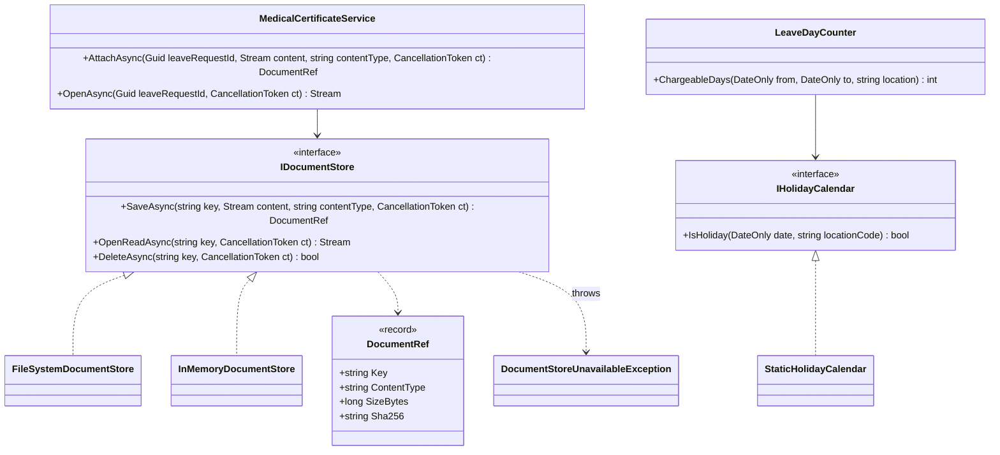
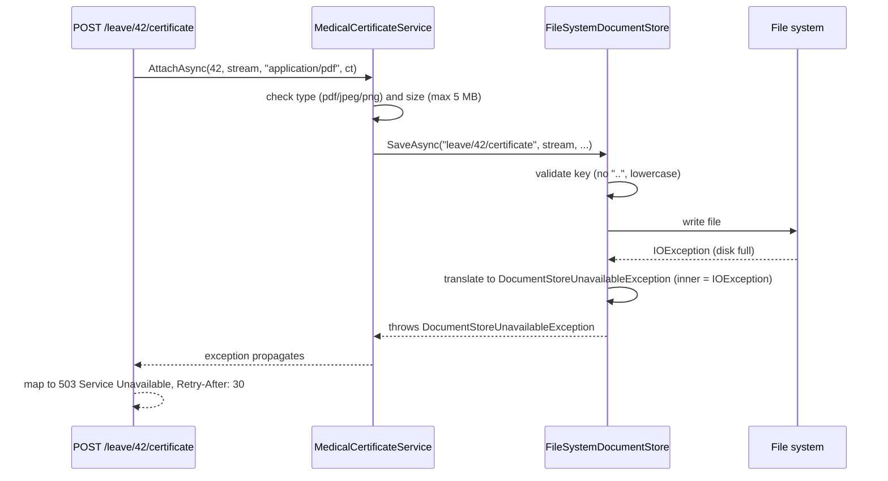

An interface is a promise: "give me something that can do *this*, and I will not care how". Good interfaces let you swap a local disk for cloud storage, test without a network, and let two teams work in parallel. Bad interfaces do the opposite. They leak details of one implementation into every caller, grow until nobody can implement them, or exist only because "we always add an interface".

This lesson is about designing the good kind. The running example is an employee leave management system where employees upload medical certificates for sick leave and the system counts working days against a holiday calendar.

## Learning objectives

By the end of this lesson you will be able to:

1. Explain what an abstraction hides and what it must *not* hide.
2. Design role interfaces from the caller's needs, named in the caller's language, and placed in the caller's layer.
3. Write an interface's contract: inputs, outputs, errors, nullability, async and cancellation, side effects and guarantees.
4. Recognise leaky abstractions (latency, failure modes, query languages, ordering, size limits) and design for them instead of hiding them.
5. Translate infrastructure exceptions at the boundary so callers never depend on a vendor SDK.
6. Evolve an interface without breaking implementers, and decide when an interface, an abstract class, a delegate or a plain concrete class is the right tool.

## Prerequisites

- [Interfaces and abstract classes](#/lesson/m01-interfaces-abstract): the C# syntax.
- [Interface Segregation Principle](#/lesson/m04-isp) and [Dependency Inversion Principle](#/lesson/m04-dip): the principles this lesson puts into practice.
- [Identifying classes and responsibilities](#/lesson/m07-classes-responsibilities): you know who needs what.

## Explain it like I'm a beginner

Think about the electrical socket in your wall. You plug in a phone charger, a kettle or a laptop, and you never think about the power station, the transformer on your street or the wiring inside the wall. The socket is an **abstraction**: a simple shape (two or three pins, 230 volts) that hides a huge amount of detail.

But the socket does not hide *everything*. If you plug in a 3,000-watt heater and a 2,000-watt geyser on the same circuit, the breaker trips. The limit of the wiring "leaks" through the simple socket shape. A good electrician tells you that limit up front (a 16-amp socket for the geyser), instead of pretending every socket can power anything.

Software interfaces are the same:

- An **interface** is the socket shape: a list of methods a caller can use.
- An **implementation** is what is behind the wall: a local folder, cloud storage, an SMS gateway.
- A good interface **hides the details that do not matter to the caller** (which cloud, which SDK, which file path).
- A good interface **does not hide the details that do matter** (this call goes over the network and can be slow or fail; files larger than 5 MB are refused).

When an interface pretends a slow, failure-prone, limited thing is fast, reliable and unlimited, callers get surprised in production. That is a **leaky abstraction**.

## First-principles explanation

### What an abstraction is for

An abstraction is a simplified model that lets a caller think about *what* happens without thinking about *how*. It earns its place when at least one of these is true:

1. **Several implementations exist or are realistically planned** (local disk in development, Azure Blob or S3 in production).
2. **The caller needs a test seam** for something slow, non-deterministic or external (network, clock, randomness).
3. **The dependency must point the other way** so the domain does not reference infrastructure (Dependency Inversion).
4. **Two teams need to work in parallel** against an agreed contract.

If none apply, a concrete class is simpler and better. An interface with one implementation, no test need and no layering reason is ceremony. `IEmployeeNameFormatter` with one `EmployeeNameFormatter` behind it adds a file, an indirection and a DI registration, and buys nothing.

### Design from the caller's side (role interfaces)

The most common mistake is to write a class first and then "extract an interface" containing every public method. Martin Fowler calls that a **header interface**: it mirrors one implementation and serves no particular caller.

A **role interface** is designed the other way round: start from what one caller needs.

The leave service needs to know whether a date is a working day in Gurgaon. It does not need to know that holidays come from a government API, a database table or a JSON file. So the role interface is:

```csharp
public interface IHolidayCalendar
{
    bool IsHoliday(DateOnly date, string locationCode);
}
```

Not `IHolidayService` with `GetAllHolidays()`, `ImportFromCsv()`, `SyncWithGovernmentPortal()` and `DeleteHoliday()`. Those are real operations, but they belong to *other* callers (an admin screen, a nightly job) and should be in *other* interfaces, or simply on the concrete class.

Rules of thumb for role interfaces:

- **Name it after the role, in the caller's language**: `IHolidayCalendar`, `IDocumentStore`, `INotificationChannel`. Avoid `IManager`, `IHelper`, `IService`.
- **Keep it small.** One to five members is typical. If a fake for tests needs 20 stubbed methods, the interface is serving too many callers.
- **One level of abstraction.** `SaveAsync(key, stream)` and `SetBlobTierToArchive(blobName)` do not belong together. The second is a storage-vendor concept.
- **Place it with the consumer.** The leave domain owns `IHolidayCalendar`; the infrastructure project implements it. This is what makes Dependency Inversion work: the arrow points from infrastructure to domain.

### Write the contract down

A method signature is only part of a contract. The rest is what callers can rely on. For every interface member, decide and document:

| Question | Example answer for `IDocumentStore.SaveAsync` |
|---|---|
| Valid inputs? | Key: lowercase letters, digits, `/`, `-`, `.`; max 200 characters; no `..`. |
| What does it return? | A `DocumentRef` with the stored size and SHA-256 hash. |
| Is it idempotent? | Saving the same key twice overwrites. |
| What can fail, and how? | `DocumentStoreUnavailableException` when storage is down (retry later). `ArgumentException` for invalid keys (do not retry). Never vendor exceptions. |
| Nullability? | `OpenReadAsync` returns `null` when the key does not exist; it does not throw. |
| Async and cancellation? | All members are async and honour the `CancellationToken`. |
| Thread safety? | Implementations must be safe to use as singletons. |
| Performance shape? | One network round trip per call; do not call in a loop over thousands of keys. |

Most of these cannot be expressed in C# types, so they go in XML doc comments and, more importantly, in **contract tests**: one test suite that every implementation must pass. If `InMemoryDocumentStore` and `FileSystemDocumentStore` both pass the same suite, swapping them is safe. This is the [Liskov Substitution Principle](#/lesson/m04-lsp) made executable.

### Leaky abstractions

Joel Spolsky's Law of Leaky Abstractions says: *all non-trivial abstractions, to some degree, are leaky.* The details you hide eventually show through. Common leaks in .NET systems:

1. **Latency.** A method that looks local (`bool Exists(string key)`) is a network call. Called inside a loop over 2,000 documents, it turns a 50 ms page into a 100-second page (2,000 × roughly 50 ms; an estimate, actual latency varies).
2. **Partial failure.** Local method calls do not time out. Network calls do. If the interface has no way to express "storage is temporarily down", callers will catch `Exception` and guess.
3. **Vendor exceptions.** If `SaveAsync` lets `Azure.RequestFailedException` or `Amazon.S3.AmazonS3Exception` escape, every caller now depends on that SDK, and switching vendors means changing every `catch`.
4. **Query languages.** A repository that returns `IQueryable<T>` leaks the ORM: callers write LINQ that works against EF Core's SQL translation but fails at runtime against an in-memory implementation, or vice versa.
5. **Semantics that differ by implementation.** Ordering of results, case sensitivity of keys, maximum sizes, eventual consistency (a just-written object not yet visible in a listing).
6. **Resource lifetime.** Returning a `Stream` means someone must dispose it, and a network stream may be single-use and not seekable.

You cannot remove leaks. You can **design for them**:

- **Make the real shape visible**: async methods with `CancellationToken` for anything remote; batch methods (`GetManyAsync(keys)`) where loops are likely; paged results instead of `GetAll()`.
- **Define your own error vocabulary**: a small set of exceptions (or a `Result` type) owned by the interface, and translate vendor errors into it inside the implementation. This is the **exception translation** pattern.
- **State limits in the contract and enforce them in one place**: maximum size, allowed content types, key format.
- **Normalise semantics**: if one store is case-sensitive and another is not, pick one rule (lowercase keys) and validate it before calling the implementation.
- **Do not abstract what you cannot honour.** If only one storage vendor supports "archive tier", do not put `ArchiveAsync` on the shared interface. Use a separate capability interface that only some implementations provide.

### Interface, abstract class, delegate or concrete class?

| Tool | Use when | Avoid when |
|---|---|---|
| **Interface** | Several unrelated implementations; test seams; dependency inversion; a type needs several roles | Only one implementation and no seam needed |
| **Abstract class** | Implementations share real code and state (a template method); you control all implementations | Implementations are unrelated, or need to inherit from something else |
| **Delegate** (`Func<...>`) | One operation, no state, no name needed (`Func<DateOnly, bool> isHoliday`) | The operation needs configuration, several methods, or a meaningful name in DI |
| **Concrete class** | One implementation, no external resource, no layering reason | It talks to the network, disk or clock and callers need to test without them |

The Microsoft Framework Design Guidelines lean towards classes for public library APIs, because adding a member to a class does not break subclasses, while adding a member to an interface breaks every implementer (unless you use a default implementation). For application code where you own every implementer, interfaces are usually fine.

### Evolving an interface

Once an interface has implementations you do not control (other teams, plugins, NuGet consumers), every change is a breaking change. Options, from safest to riskiest:

1. **Add a new interface** for the new capability (`IAttachmentChannel : INotificationChannel`) and check for it with `is`. Old implementations keep compiling and simply lack the capability.
2. **Add a default interface member** (C# 8+): `int MaxMessageLength => int.MaxValue;`. Old implementations compile and get the default. Use it for members with an obvious safe default, not for core behaviour.
3. **Add an extension method** for convenience operations built from existing members.
4. **Version the interface** (`IDocumentStoreV2`) when semantics change. Keep the old one until all callers migrate.
5. **Change the interface** only when you own every implementation and can update them in one commit.

### The wrong abstraction

Sandi Metz's warning applies directly: *duplication is far cheaper than the wrong abstraction.* If two pieces of code look similar today and you force them behind one interface with flags (`SendAsync(message, bool isSms, bool isUrgent, bool isWhatsApp)`), every new requirement adds another flag, and the abstraction becomes harder to change than the duplication ever was. Wait until you have seen the same shape **three times** and understand what varies before you abstract. If an abstraction has gone wrong, inline it back into the callers and re-extract the right one.

### Trade-offs

| You gain | You pay |
|---|---|
| Swap implementations (disk, cloud, fake) without changing callers | An extra type and an indirection to navigate |
| Fast, deterministic tests with fakes | Contract tests needed to keep implementations honest |
| Domain free of infrastructure references | Mapping and exception-translation code in adapters |
| Teams work in parallel against a contract | Changing the contract later is expensive |

## Visual explanation

### Class diagram



How to read it: the two consumers (`MedicalCertificateService`, `LeaveDayCounter`) depend only on small interfaces. Each interface has exactly the members its consumer needs. The interface also owns its **result type** (`DocumentRef`) and its **error type** (`DocumentStoreUnavailableException`), so the contract is complete without any implementation. The implementations depend on the interfaces (dotted lines with hollow triangles), never the other way round. In a multi-project solution, the interfaces and the two consumers live in the domain or application project, and `FileSystemDocumentStore` lives in infrastructure.

### Sequence diagram: an upload when storage fails



The failure leaks, as it must, but it leaks **in the interface's own vocabulary**. The API layer catches `DocumentStoreUnavailableException`, which belongs to the interface, and maps it to `503`. Swap the file system for cloud storage and only the translation inside the new implementation changes; the service and the API stay the same.

## Step-by-step example

### Step 1: the version with no abstraction

```csharp
public class LeaveController : ControllerBase
{
    [HttpPost("{id}/certificate")]
    public async Task<IActionResult> Upload(Guid id, IFormFile file)
    {
        var path = Path.Combine(@"D:\HRDocs", id.ToString(), file.FileName);   // path from user input
        Directory.CreateDirectory(Path.GetDirectoryName(path)!);
        using var fs = System.IO.File.Create(path);
        await file.CopyToAsync(fs);
        return Ok();
    }
}
```

It works on one server. It cannot be tested without a `D:` drive, cannot move to cloud storage, and trusts `file.FileName` (a path-traversal risk: `..\..\Windows\win.ini`).

### Step 2: the header-interface mistake

```csharp
public interface IFileHelper
{
    string CombinePath(params string[] parts);
    void CreateDirectory(string path);
    Stream CreateFile(string path);
    bool FileExists(string path);
    void SetReadOnly(string path);
}
```

This interface is *about the file system*. Every caller still thinks in paths and directories. A cloud implementation would have to fake `CreateDirectory`. The abstraction exists, but it abstracts nothing.

### Step 3: ask what the caller needs

The certificate feature needs to: store some bytes under a name, read them back, and delete them. That is all. Name the role (`IDocumentStore`), use the caller's words (key, content, content type), and make it async because storage may be remote.

### Step 4: write the contract and error vocabulary

Key format, overwrite semantics, `null` for "not found", one exception type for "unavailable, retry later", cancellation honoured. Then write a contract test suite and run it against every implementation.

### Step 5: implement and translate

`FileSystemDocumentStore` maps keys to paths safely and converts `IOException` and `UnauthorizedAccessException` into the interface's exception. `InMemoryDocumentStore` passes the same contract tests and is used in unit tests.

## Production-style C# implementation

```text
Leave.Api/
  Program.cs
  Leave/
    Documents/IDocumentStore.cs
    Documents/FileSystemDocumentStore.cs
    Documents/InMemoryDocumentStore.cs
    Documents/MedicalCertificateService.cs
    Calendar/IHolidayCalendar.cs
    Calendar/LeaveDayCounter.cs
```

```csharp file=Leave/Documents/IDocumentStore.cs
namespace Leave.Documents;

/// <summary>Metadata of a stored document.</summary>
public sealed record DocumentRef(string Key, string ContentType, long SizeBytes, string Sha256);

/// <summary>Storage is temporarily unavailable. Safe to retry later.</summary>
public sealed class DocumentStoreUnavailableException(string message, Exception? inner = null) : Exception(message, inner);

/// <summary>
/// Stores opaque documents by key.
/// Contract (every implementation must pass the same contract tests):
/// - Keys: 1–200 chars of [a-z0-9/-.], no "..", no leading "/". Invalid keys throw ArgumentException (do not retry).
/// - SaveAsync overwrites an existing key.
/// - OpenReadAsync returns null when the key does not exist. The caller owns and disposes the returned stream.
/// - Infrastructure failures surface only as DocumentStoreUnavailableException, never vendor exceptions.
/// - One round trip per call: do not call in loops over large key sets.
/// - Implementations are thread-safe and may be registered as singletons.
/// </summary>
public interface IDocumentStore
{
    Task<DocumentRef> SaveAsync(string key, Stream content, string contentType, CancellationToken ct);
    Task<Stream?> OpenReadAsync(string key, CancellationToken ct);
    Task<bool> DeleteAsync(string key, CancellationToken ct);
}

/// <summary>Shared key rules, so every implementation enforces the same contract.</summary>
public static class DocumentKey
{
    public static string Validate(string key)
    {
        if (string.IsNullOrEmpty(key) || key.Length > 200)
            throw new ArgumentException("Key must be 1 to 200 characters.", nameof(key));
        if (key.StartsWith('/') || key.Contains("..") || key.Any(c => !(char.IsAsciiLetterLower(c) || char.IsAsciiDigit(c) || c is '/' or '-' or '.')))
            throw new ArgumentException($"Key '{key}' contains characters outside [a-z0-9/-.] or a path traversal.", nameof(key));
        return key;
    }
}
```

```csharp file=Leave/Documents/FileSystemDocumentStore.cs
using System.Security.Cryptography;

namespace Leave.Documents;

/// <summary>Development and single-server implementation. Translates IO errors into the interface's vocabulary.</summary>
public sealed class FileSystemDocumentStore(string rootDirectory) : IDocumentStore
{
    private readonly string _root = Path.GetFullPath(rootDirectory);

    public async Task<DocumentRef> SaveAsync(string key, Stream content, string contentType, CancellationToken ct)
    {
        var path = PathFor(key);
        try
        {
            Directory.CreateDirectory(Path.GetDirectoryName(path)!);
            await using var file = new FileStream(path, FileMode.Create, FileAccess.Write, FileShare.None, 81920, useAsync: true);
            using var sha = IncrementalHash.CreateHash(HashAlgorithmName.SHA256);
            var buffer = new byte[81920];
            int read;
            long total = 0;
            while ((read = await content.ReadAsync(buffer, ct)) > 0)
            {
                sha.AppendData(buffer, 0, read);
                await file.WriteAsync(buffer.AsMemory(0, read), ct);
                total += read;
            }
            await File.WriteAllTextAsync(path + ".type", contentType, ct);
            return new DocumentRef(key, contentType, total, Convert.ToHexStringLower(sha.GetHashAndReset()));
        }
        catch (Exception ex) when (ex is IOException or UnauthorizedAccessException)
        {
            throw new DocumentStoreUnavailableException($"Could not save '{key}'.", ex);
        }
    }

    public Task<Stream?> OpenReadAsync(string key, CancellationToken ct)
    {
        var path = PathFor(key);
        try
        {
            if (!File.Exists(path)) return Task.FromResult<Stream?>(null);
            Stream s = new FileStream(path, FileMode.Open, FileAccess.Read, FileShare.Read, 81920, useAsync: true);
            return Task.FromResult<Stream?>(s);
        }
        catch (Exception ex) when (ex is IOException or UnauthorizedAccessException)
        {
            throw new DocumentStoreUnavailableException($"Could not read '{key}'.", ex);
        }
    }

    public Task<bool> DeleteAsync(string key, CancellationToken ct)
    {
        var path = PathFor(key);
        try
        {
            if (!File.Exists(path)) return Task.FromResult(false);
            File.Delete(path);
            File.Delete(path + ".type");
            return Task.FromResult(true);
        }
        catch (Exception ex) when (ex is IOException or UnauthorizedAccessException)
        {
            throw new DocumentStoreUnavailableException($"Could not delete '{key}'.", ex);
        }
    }

    private string PathFor(string key)
    {
        DocumentKey.Validate(key);
        var full = Path.GetFullPath(Path.Combine(_root, key.Replace('/', Path.DirectorySeparatorChar)));
        // Defence in depth: even a validated key must resolve inside the root.
        if (!full.StartsWith(_root + Path.DirectorySeparatorChar, StringComparison.Ordinal))
            throw new ArgumentException($"Key '{key}' resolves outside the store.", nameof(key));
        return full;
    }
}
```

```csharp file=Leave/Documents/InMemoryDocumentStore.cs
using System.Collections.Concurrent;
using System.Security.Cryptography;

namespace Leave.Documents;

/// <summary>Test and demo implementation. Passes the same contract tests as the file-system store.</summary>
public sealed class InMemoryDocumentStore : IDocumentStore
{
    private readonly ConcurrentDictionary<string, (byte[] Data, string Type)> _docs = new(StringComparer.Ordinal);

    public async Task<DocumentRef> SaveAsync(string key, Stream content, string contentType, CancellationToken ct)
    {
        DocumentKey.Validate(key);
        using var buffer = new MemoryStream();
        await content.CopyToAsync(buffer, ct);
        var data = buffer.ToArray();
        _docs[key] = (data, contentType);
        return new DocumentRef(key, contentType, data.LongLength, Convert.ToHexStringLower(SHA256.HashData(data)));
    }

    public Task<Stream?> OpenReadAsync(string key, CancellationToken ct)
    {
        DocumentKey.Validate(key);
        return Task.FromResult<Stream?>(_docs.TryGetValue(key, out var d) ? new MemoryStream(d.Data, writable: false) : null);
    }

    public Task<bool> DeleteAsync(string key, CancellationToken ct)
    {
        DocumentKey.Validate(key);
        return Task.FromResult(_docs.TryRemove(key, out _));
    }
}
```

```csharp file=Leave/Documents/MedicalCertificateService.cs
using Microsoft.Extensions.Logging;

namespace Leave.Documents;

public sealed class CertificateRejectedException(string message) : Exception(message);

/// <summary>Consumer of IDocumentStore. Owns the business rules: allowed types and the 5 MB limit.</summary>
public sealed class MedicalCertificateService(IDocumentStore store, ILogger<MedicalCertificateService> logger)
{
    public const long MaxBytes = 5 * 1024 * 1024;
    private static readonly HashSet<string> Allowed = new(StringComparer.OrdinalIgnoreCase)
        { "application/pdf", "image/jpeg", "image/png" };

    private static string KeyFor(Guid leaveRequestId) => $"leave/{leaveRequestId:N}/certificate";

    public async Task<DocumentRef> AttachAsync(Guid leaveRequestId, Stream content, string contentType, CancellationToken ct)
    {
        if (!Allowed.Contains(contentType))
            throw new CertificateRejectedException($"Content type '{contentType}' is not accepted. Use PDF, JPEG or PNG.");

        // Enforce the size limit while reading, so a 2 GB upload is rejected without buffering it.
        await using var limited = new MaxLengthStream(content, MaxBytes);
        var saved = await store.SaveAsync(KeyFor(leaveRequestId), limited, contentType, ct);
        logger.LogInformation("Stored certificate for leave {LeaveId}: {Bytes} bytes", leaveRequestId, saved.SizeBytes);
        return saved;
    }

    public Task<Stream?> OpenAsync(Guid leaveRequestId, CancellationToken ct) => store.OpenReadAsync(KeyFor(leaveRequestId), ct);
}

/// <summary>Read-only wrapper that throws once more than maxBytes have been read. Does not own the inner stream.</summary>
internal sealed class MaxLengthStream(Stream inner, long maxBytes) : Stream
{
    private long _read;
    public override bool CanRead => true;
    public override bool CanSeek => false;
    public override bool CanWrite => false;
    public override long Length => throw new NotSupportedException();
    public override long Position { get => _read; set => throw new NotSupportedException(); }
    public override void Flush() { }
    public override int Read(byte[] buffer, int offset, int count) => Count(inner.Read(buffer, offset, count));
    public override async ValueTask<int> ReadAsync(Memory<byte> buffer, CancellationToken ct = default) => Count(await inner.ReadAsync(buffer, ct));
    public override Task<int> ReadAsync(byte[] buffer, int offset, int count, CancellationToken ct) => ReadAsync(buffer.AsMemory(offset, count), ct).AsTask();
    public override long Seek(long offset, SeekOrigin origin) => throw new NotSupportedException();
    public override void SetLength(long value) => throw new NotSupportedException();
    public override void Write(byte[] buffer, int offset, int count) => throw new NotSupportedException();

    private int Count(int n)
    {
        _read += n;
        if (_read > maxBytes) throw new CertificateRejectedException($"Certificate is larger than {maxBytes / (1024 * 1024)} MB.");
        return n;
    }
}
```

```csharp file=Leave/Calendar/IHolidayCalendar.cs
namespace Leave.Calendar;

/// <summary>Role interface owned by the leave domain: exactly what LeaveDayCounter needs, nothing more.</summary>
public interface IHolidayCalendar
{
    bool IsHoliday(DateOnly date, string locationCode);
}

/// <summary>Simple implementation from configuration. A real one might load from a database and cache per year.</summary>
public sealed class StaticHolidayCalendar(IReadOnlyDictionary<string, HashSet<DateOnly>> holidaysByLocation) : IHolidayCalendar
{
    public bool IsHoliday(DateOnly date, string locationCode) =>
        holidaysByLocation.TryGetValue(locationCode, out var days) && days.Contains(date);
}
```

```csharp file=Leave/Calendar/LeaveDayCounter.cs
namespace Leave.Calendar;

public sealed class LeaveDayCounter(IHolidayCalendar calendar)
{
    /// <summary>Working days in the inclusive range, excluding weekends and local holidays.</summary>
    public int ChargeableDays(DateOnly from, DateOnly to, string locationCode)
    {
        if (to < from) throw new ArgumentException("End date is before start date.", nameof(to));
        var count = 0;
        for (var d = from; d <= to; d = d.AddDays(1))
            if (d.DayOfWeek is not (DayOfWeek.Saturday or DayOfWeek.Sunday) && !calendar.IsHoliday(d, locationCode))
                count++;
        return count;
    }
}
```

```csharp file=Program.cs
using Leave.Calendar;
using Leave.Documents;

var builder = WebApplication.CreateBuilder(args);

// Choose the implementation by environment; callers never know which one they got.
if (builder.Environment.IsDevelopment())
    builder.Services.AddSingleton<IDocumentStore, InMemoryDocumentStore>();
else
    builder.Services.AddSingleton<IDocumentStore>(_ =>
        new FileSystemDocumentStore(builder.Configuration["Documents:Root"] ?? Path.Combine(Path.GetTempPath(), "leave-docs")));

builder.Services.AddSingleton<IHolidayCalendar>(new StaticHolidayCalendar(new Dictionary<string, HashSet<DateOnly>>
{
    ["GGN"] = new() { new DateOnly(2026, 10, 2), new DateOnly(2026, 10, 20), new DateOnly(2026, 11, 8) },
    ["BLR"] = new() { new DateOnly(2026, 10, 2), new DateOnly(2026, 11, 1) },
}));
builder.Services.AddSingleton<LeaveDayCounter>();
builder.Services.AddScoped<MedicalCertificateService>();

var app = builder.Build();

app.MapPost("/leave/{id:guid}/certificate", async (Guid id, HttpRequest request, MedicalCertificateService certificates, CancellationToken ct) =>
{
    try
    {
        var saved = await certificates.AttachAsync(id, request.Body, request.ContentType ?? "", ct);
        return Results.Ok(saved);
    }
    catch (CertificateRejectedException ex) { return Results.Problem(ex.Message, statusCode: StatusCodes.Status400BadRequest); }
    catch (DocumentStoreUnavailableException)
    {
        // The leak is expected and named: map it to a retryable status.
        return Results.Problem("Document storage is temporarily unavailable. Please retry.", statusCode: StatusCodes.Status503ServiceUnavailable);
    }
});

app.MapGet("/leave/days", (DateOnly from, DateOnly to, string location, LeaveDayCounter counter) =>
    Results.Ok(new { days = counter.ChargeableDays(from, to, location) }));

app.Run();
```

Design notes:

- **The interface owns its error type.** `DocumentStoreUnavailableException` lives next to `IDocumentStore`, not in an infrastructure project. Callers can catch it without referencing any implementation.
- **Shared rules in one place.** `DocumentKey.Validate` is used by every implementation, so case and character rules cannot drift between the in-memory and file-system stores.
- **Business limits live in the consumer, storage limits in the store.** "Certificates are at most 5 MB and must be PDF or image" is a leave rule, enforced by `MedicalCertificateService`. "Keys must be safe paths" is a storage rule.
- **Streams and ownership.** `OpenReadAsync` returns a stream the caller owns. That is stated in the contract, as the [previous lesson](#/lesson/m07-association-aggregation-composition) recommends for disposables.
- **In production on cloud storage**, you would add a third implementation using the vendor SDK, translating its exceptions in the same way, and run the same contract tests against it in an integration test stage.

## Bad design vs good design

**Bad: a leaky, vendor-shaped interface.**

```csharp
public interface IBlobStorage
{
    Task UploadAsync(string containerName, string blobName, Stream data, AccessTier tier);  // vendor enum
    BlobClient GetClient(string containerName, string blobName);                          // vendor type escapes
    IQueryable<BlobItem> ListBlobs(string prefix);                                        // query language leak
    bool Exists(string blobName);                                                         // sync network call
}
```

Every caller now references the vendor SDK. A test fake must construct vendor types. `Exists` blocks a thread on a network call. `ListBlobs` invites callers to write LINQ that only one provider understands. Switching to another cloud means rewriting every caller.

**Also bad: an interface for everything.**

```csharp
public interface ILeaveDayCounter { int ChargeableDays(DateOnly from, DateOnly to, string location); }
public sealed class LeaveDayCounter : ILeaveDayCounter { /* the only implementation, ever */ }
```

`LeaveDayCounter` is pure logic over an injected `IHolidayCalendar`. Tests can use the real class with a fake calendar. The extra interface adds a file and a registration, and makes "Go to implementation" one click longer, for no benefit.

**Good**: the implementation above. Small, consumer-shaped interfaces with written contracts and their own error vocabulary; adapters translate vendor behaviour; pure logic stays concrete.

:::callout type=tradeoff title="Abstraction is a bet on future change"
Every interface is a bet that the thing behind it will vary (a second implementation, a fake in tests, a different vendor). When the bet is right, the interface pays for itself many times. When it is wrong, it is a small but permanent tax on every reader. Bet on the things that touch the outside world (network, disk, clock, third-party services); do not bet on pure logic.
:::

## Practical playground

The playground shows a classic leak: a "local-looking" interface that is really remote, called in a loop. It counts simulated round trips instead of sleeping, so it runs instantly. Run it, then:

1. Change the number of SKUs from 50 to 2,000. How many round trips does each approach make?
2. If one round trip takes about 40 ms (an assumption for illustration), how long would the page take with each approach?
3. Add a `CancellationToken` parameter to both methods. Why does that make the remote nature more visible to callers?

:::playground type=csharp title="A leaky abstraction: chatty vs batched"
```csharp file=Program.cs
using System;
using System.Collections.Generic;
using System.Linq;
using System.Threading.Tasks;

// Version 1 looks local and invites loops.
public interface IStockLookupChatty
{
    Task<int> GetOnHandAsync(string sku);
}

// Version 2 makes the remote shape explicit: batch in, batch out.
public interface IStockLookupBatched
{
    Task<IReadOnlyDictionary<string, int>> GetOnHandAsync(IReadOnlyCollection<string> skus);
}

public sealed class SimulatedRemoteStock : IStockLookupChatty, IStockLookupBatched
{
    public int RoundTrips { get; private set; }
    private static int Fake(string sku) => sku.Sum(c => c) % 500;

    Task<int> IStockLookupChatty.GetOnHandAsync(string sku)
    {
        RoundTrips++;
        return Task.FromResult(Fake(sku));
    }

    Task<IReadOnlyDictionary<string, int>> IStockLookupBatched.GetOnHandAsync(IReadOnlyCollection<string> skus)
    {
        RoundTrips += (skus.Count + 99) / 100;   // the remote API accepts up to 100 SKUs per call
        IReadOnlyDictionary<string, int> result = skus.ToDictionary(s => s, Fake);
        return Task.FromResult(result);
    }
}

public static class Program
{
    public static async Task Main()
    {
        var skus = Enumerable.Range(1, 50).Select(i => $"CEM-{i:00000}").ToList();

        var chattyStore = new SimulatedRemoteStock();
        IStockLookupChatty chatty = chattyStore;
        var total1 = 0;
        foreach (var sku in skus) total1 += await chatty.GetOnHandAsync(sku);
        Console.WriteLine($"Chatty:  total {total1}, round trips {chattyStore.RoundTrips}");

        var batchedStore = new SimulatedRemoteStock();
        IStockLookupBatched batched = batchedStore;
        var map = await batched.GetOnHandAsync(skus);
        Console.WriteLine($"Batched: total {map.Values.Sum()}, round trips {batchedStore.RoundTrips}");
    }
}
```
:::

## Exercises

:::exercise id=m07-interfaces-abstractions-ex1 difficulty=beginner kind=code title="Program against a role interface"
`LeaveDayCounter` used to call a static `GovernmentHolidayApi.Fetch(year, state)` over the network on every request. The team has defined a role interface, `IHolidayCalendar`. Implement the counter against it, and implement `CachedHolidayCalendar`, which loads a year's holidays for a location once and answers from memory afterwards.
::requirements
- `LeaveDayCounter.ChargeableDays(from, to, location)` counts inclusive days that are not Saturday, Sunday or a holiday.
- `CachedHolidayCalendar` takes a loader `Func<int, string, IReadOnlySet<DateOnly>>` (year, location → holidays) and calls it at most once per (year, location).
- `to < from` throws `ArgumentException`.
::acceptance
- Thursday 1 Oct to Monday 5 Oct 2026 in GGN with 2 Oct as a holiday is 2 days.
- A range spanning 30 Dec 2026 to 2 Jan 2027 loads both years, once each.
- Asking 100 times about dates in the same year and location calls the loader once.
- `LeaveDayCounter` has no reference to the loader or any static API.
::hint
The counter only needs one question answered per day: "is this a holiday here?" That is all `IHolidayCalendar` offers, which is the point.
::hint
Cache key: the pair `(date.Year, location)`. A `Dictionary<(int, string), IReadOnlySet<DateOnly>>` is enough for this exercise.
::hint
`CachedHolidayCalendar.IsHoliday`: look up the key; if missing, call the loader and store the result; then `set.Contains(date)`.
::hint
```csharp
if (!_cache.TryGetValue((date.Year, location), out var set))
    _cache[(date.Year, location)] = set = _loader(date.Year, location);
return set.Contains(date);
```
::starter
```csharp file=LeaveDays.cs
using System;
using System.Collections.Generic;

public interface IHolidayCalendar
{
    bool IsHoliday(DateOnly date, string locationCode);
}

public sealed class CachedHolidayCalendar(Func<int, string, IReadOnlySet<DateOnly>> loader) : IHolidayCalendar
{
    public bool IsHoliday(DateOnly date, string locationCode) => throw new NotImplementedException();
}

public sealed class LeaveDayCounter(IHolidayCalendar calendar)
{
    public int ChargeableDays(DateOnly from, DateOnly to, string locationCode) => throw new NotImplementedException();
}
```
::tests
```csharp file=LeaveDaysTests.cs
using System;
using System.Collections.Generic;
using Xunit;

public class LeaveDaysTests
{
    private sealed class FakeCalendar(params DateOnly[] holidays) : IHolidayCalendar
    {
        private readonly HashSet<DateOnly> _h = new(holidays);
        public bool IsHoliday(DateOnly date, string locationCode) => _h.Contains(date);
    }

    [Fact]
    public void Skips_weekend_and_holiday() =>
        Assert.Equal(2, new LeaveDayCounter(new FakeCalendar(new DateOnly(2026, 10, 2)))
            .ChargeableDays(new DateOnly(2026, 10, 1), new DateOnly(2026, 10, 5), "GGN"));

    [Fact]
    public void Backwards_range_throws() =>
        Assert.Throws<ArgumentException>(() => new LeaveDayCounter(new FakeCalendar())
            .ChargeableDays(new DateOnly(2026, 10, 5), new DateOnly(2026, 10, 1), "GGN"));

    [Fact]
    public void Cache_loads_once_per_year_and_location()
    {
        var calls = new List<(int, string)>();
        var cal = new CachedHolidayCalendar((y, l) => { calls.Add((y, l)); return new HashSet<DateOnly> { new(y, 1, 26) }; });
        for (var i = 0; i < 100; i++) cal.IsHoliday(new DateOnly(2026, 3, 1).AddDays(i), "GGN");
        Assert.Single(calls);
        Assert.True(cal.IsHoliday(new DateOnly(2026, 1, 26), "GGN"));
        Assert.Single(calls);
    }

    [Fact]
    public void Range_across_years_loads_each_year_once()
    {
        var calls = new List<(int, string)>();
        var cal = new CachedHolidayCalendar((y, l) => { calls.Add((y, l)); return new HashSet<DateOnly>(); });
        var days = new LeaveDayCounter(cal).ChargeableDays(new DateOnly(2026, 12, 30), new DateOnly(2027, 1, 2), "BLR");
        Assert.Equal(3, days);   // Wed 30, Thu 31, Fri 1; Sat 2 skipped
        Assert.Equal(new List<(int, string)> { (2026, "BLR"), (2027, "BLR") }, calls);
    }

    [Fact]
    public void Locations_cached_separately()
    {
        var calls = 0;
        var cal = new CachedHolidayCalendar((y, l) => { calls++; return new HashSet<DateOnly>(); });
        cal.IsHoliday(new DateOnly(2026, 5, 1), "GGN");
        cal.IsHoliday(new DateOnly(2026, 5, 1), "BLR");
        Assert.Equal(2, calls);
    }
}
```
::solution
```csharp file=LeaveDays.cs
using System;
using System.Collections.Generic;

public interface IHolidayCalendar
{
    bool IsHoliday(DateOnly date, string locationCode);
}

public sealed class CachedHolidayCalendar(Func<int, string, IReadOnlySet<DateOnly>> loader) : IHolidayCalendar
{
    private readonly Dictionary<(int Year, string Location), IReadOnlySet<DateOnly>> _cache = new();
    private readonly object _gate = new();

    public bool IsHoliday(DateOnly date, string locationCode)
    {
        var key = (date.Year, locationCode);
        IReadOnlySet<DateOnly>? set;
        lock (_gate)
        {
            if (!_cache.TryGetValue(key, out set))
                _cache[key] = set = loader(date.Year, locationCode);
        }
        return set.Contains(date);
    }
}

public sealed class LeaveDayCounter(IHolidayCalendar calendar)
{
    public int ChargeableDays(DateOnly from, DateOnly to, string locationCode)
    {
        if (to < from) throw new ArgumentException("End date is before start date.", nameof(to));
        var count = 0;
        for (var d = from; d <= to; d = d.AddDays(1))
            if (d.DayOfWeek is not (DayOfWeek.Saturday or DayOfWeek.Sunday) && !calendar.IsHoliday(d, locationCode))
                count++;
        return count;
    }
}
```

The counter never learns that holidays are cached or where they come from. Caching became a property of one implementation, added without touching the consumer, which is exactly what the interface is for. The lock makes the cache safe as a singleton; in ASP.NET Core you could use `IMemoryCache` instead.
::mistakes
- Making the counter take `Func<int, string, IReadOnlySet<DateOnly>>` directly. It works, but it leaks "holidays are loaded per year" into the consumer.
- Caching by date instead of by (year, location), so every new date triggers a load.
- Forgetting that `DateOnly` ranges can cross a year boundary.
:::

:::exercise id=m07-interfaces-abstractions-ex2 difficulty=beginner kind=design title="Split a fat parking-lot interface"
A parking-lot system has one interface used by every client:

```csharp
public interface IParkingLotSystem
{
    Ticket IssueTicket(string plate, VehicleType type);
    decimal CalculateFee(Guid ticketId, DateTimeOffset exitAt);
    void RecordPayment(Guid ticketId, decimal amount, string method);
    void OpenBarrier(int gateNo);
    IReadOnlyDictionary<SpotSize, int> FreeSpotsByFloor(int floor);
    void AddFloor(int number, int bikeSpots, int carSpots, int largeSpots);
    void SetHourlyRate(SpotSize size, decimal rate);
    IReadOnlyList<Ticket> TicketsBetween(DateOnly from, DateOnly to);
    decimal RevenueFor(DateOnly day);
    void BlockSpot(string spotCode, string reason);
}
```

The clients are: the **entry kiosk**, the **exit kiosk**, the **display board**, the **admin portal** and the **finance report job**. Redesign it as role interfaces, one per client need, and show which implementation classes provide which interfaces.
::acceptance
- Each client depends on an interface containing only what it calls.
- The display board's interface has a single read-only member.
- Admin configuration and finance reporting are separate interfaces.
- One class may implement several interfaces; no interface is a superset copy of the old one.
- `OpenBarrier` is in an interface owned by the kiosks (a hardware port), not mixed with business queries.
::hint
List what each client calls. Entry: issue ticket, open barrier. Exit: calculate fee, record payment, open barrier. Board: free spots. Admin: add floor, set rate, block spot. Finance: tickets between, revenue for.
::hint
`OpenBarrier` is hardware. Who implements it? Probably a gate-controller adapter, not the parking domain. Give it its own interface, used by both kiosks.
::hint
Interface names in the client's language: `ITicketIssuer`, `IExitCheckout`, `IOccupancyReader`, `ILotConfiguration`, `IParkingRevenueReport`, `IBarrierController`.
::hint
Implementations: `ParkingLotService` implements `ITicketIssuer`, `IExitCheckout`, `IOccupancyReader` and `ILotConfiguration`; `RevenueReportQuery` implements the report; `GateControllerAdapter` implements `IBarrierController`.
::starter
```json file=parking-interfaces.json
{
  "classes": [
    { "id": "Fat", "name": "IParkingLotSystem", "kind": "interface", "fields": [],
      "methods": ["Ticket IssueTicket(string plate, VehicleType type)", "decimal CalculateFee(Guid ticketId, DateTimeOffset exitAt)", "void OpenBarrier(int gateNo)", "..."] }
  ],
  "relations": []
}
```
::solution
```json file=parking-interfaces.json
{
  "classes": [
    { "id": "Issuer", "name": "ITicketIssuer", "kind": "interface", "fields": [], "methods": ["Ticket IssueTicket(string plate, VehicleType type)"],
      "responsibility": "Used by the entry kiosk" },
    { "id": "Checkout", "name": "IExitCheckout", "kind": "interface", "fields": [],
      "methods": ["decimal CalculateFee(Guid ticketId, DateTimeOffset exitAt)", "void RecordPayment(Guid ticketId, decimal amount, string method)"],
      "responsibility": "Used by the exit kiosk" },
    { "id": "Occ", "name": "IOccupancyReader", "kind": "interface", "fields": [], "methods": ["IReadOnlyDictionary~SpotSize,int~ FreeSpotsByFloor(int floor)"],
      "responsibility": "Used by the display board; read-only" },
    { "id": "Config", "name": "ILotConfiguration", "kind": "interface", "fields": [],
      "methods": ["void AddFloor(int number, int bikeSpots, int carSpots, int largeSpots)", "void SetHourlyRate(SpotSize size, decimal rate)", "void BlockSpot(string spotCode, string reason)"],
      "responsibility": "Used by the admin portal" },
    { "id": "Report", "name": "IParkingRevenueReport", "kind": "interface", "fields": [],
      "methods": ["IReadOnlyList~Ticket~ TicketsBetween(DateOnly from, DateOnly to)", "decimal RevenueFor(DateOnly day)"],
      "responsibility": "Used by the finance job; read side" },
    { "id": "Barrier", "name": "IBarrierController", "kind": "interface", "fields": [], "methods": ["Task OpenAsync(int gateNo, CancellationToken ct)"],
      "responsibility": "Hardware port used by both kiosks; async because it talks to a device" },
    { "id": "Svc", "name": "ParkingLotService", "kind": "class", "fields": [], "methods": [],
      "responsibility": "Domain implementation of the operational roles" },
    { "id": "RevQ", "name": "RevenueReportQuery", "kind": "class", "fields": [], "methods": [],
      "responsibility": "Read-model query, can run against a replica" },
    { "id": "Gate", "name": "GateControllerAdapter", "kind": "class", "fields": [], "methods": [],
      "responsibility": "Adapter over the barrier vendor's serial protocol" },
    { "id": "Entry", "name": "EntryKiosk", "kind": "class", "fields": [], "methods": [], "responsibility": "Client" },
    { "id": "Exit", "name": "ExitKiosk", "kind": "class", "fields": [], "methods": [], "responsibility": "Client" },
    { "id": "Board", "name": "DisplayBoard", "kind": "class", "fields": [], "methods": [], "responsibility": "Client" }
  ],
  "relations": [
    { "from": "Svc", "to": "Issuer", "kind": "implements" },
    { "from": "Svc", "to": "Checkout", "kind": "implements" },
    { "from": "Svc", "to": "Occ", "kind": "implements" },
    { "from": "Svc", "to": "Config", "kind": "implements" },
    { "from": "RevQ", "to": "Report", "kind": "implements" },
    { "from": "Gate", "to": "Barrier", "kind": "implements" },
    { "from": "Entry", "to": "Issuer", "kind": "dependency" },
    { "from": "Entry", "to": "Barrier", "kind": "dependency" },
    { "from": "Exit", "to": "Checkout", "kind": "dependency" },
    { "from": "Exit", "to": "Barrier", "kind": "dependency" },
    { "from": "Board", "to": "Occ", "kind": "dependency" }
  ]
}
```

Benefits you can now name: the display board's test fake has one method; the finance job can run against a read replica because its interface is read-only; replacing the barrier vendor touches one adapter; and an admin-only change cannot accidentally break the kiosks' contract. `OpenBarrier` also became async, because the new interface admits it talks to a device.
::alternatives
If the system is small and one team owns every client, two or three interfaces (operations, configuration, reporting) may be enough. Split further when a client is deployed separately, owned by another team, or needs a different security boundary.
::mistakes
- Making `IParkingLotSystem` inherit all the new interfaces "for backward compatibility" and keeping clients on it, which keeps the coupling.
- Splitting by implementation class ("everything `ParkingLotService` does") instead of by client need.
:::

:::exercise id=m07-interfaces-abstractions-ex3 difficulty=intermediate kind=code title="Stop vendor exceptions leaking"
A vendor blob SDK throws `BlobSdkException` with an HTTP-like `Status`. Implement `BlobDocumentStore : IDocumentStore` so callers only ever see the interface's own vocabulary.
::requirements
- Validate keys before calling the SDK: 1–200 characters of `[a-z0-9/-.]`, no `..`. Invalid → `ArgumentException`, and the SDK is not called.
- `ReadAsync`: status 404 → return `null`.
- Status 401 or 403 → `DocumentAccessDeniedException`.
- Status 408, 429, 500, 502, 503, 504 → `DocumentStoreUnavailableException`.
- Any other `BlobSdkException` → `DocumentStoreUnavailableException`.
- Translated exceptions keep the original as `InnerException`.
- `OperationCanceledException` is **not** translated.
::acceptance
- A 503 on save surfaces as `DocumentStoreUnavailableException` with the `BlobSdkException` as inner exception.
- A 404 on read returns `null`; a 404 on save is translated to `DocumentStoreUnavailableException`.
- A 403 surfaces as `DocumentAccessDeniedException`.
- The key `leave/../payroll.xlsx` throws `ArgumentException` and the fake SDK records zero calls.
- A cancelled token surfaces as `OperationCanceledException`.
::hint
Where do the translations live? In one private helper used by every method, so the mapping is defined once.
::hint
Use exception filters: `catch (BlobSdkException ex) when (ex.Status == 404)`. Filters keep the mapping readable and do not catch what they do not match.
::hint
Do not write `catch (Exception)`. That would also catch `OperationCanceledException` and turn a user's cancel into "storage unavailable".
::hint
```csharp
private static Exception Translate(BlobSdkException ex, string key) => ex.Status switch
{
    401 or 403 => new DocumentAccessDeniedException($"Access denied for '{key}'.", ex),
    _ => new DocumentStoreUnavailableException($"Storage failed for '{key}' (status {ex.Status}).", ex),
};
```
::starter
```csharp file=BlobDocumentStore.cs
using System;
using System.Linq;
using System.Threading;
using System.Threading.Tasks;

// ---- Vendor SDK (you cannot change this) ----
public sealed class BlobSdkException(int status, string message) : Exception(message)
{
    public int Status { get; } = status;
}

public interface IBlobClient
{
    Task UploadAsync(string container, string name, byte[] data, CancellationToken ct);
    Task<byte[]> DownloadAsync(string container, string name, CancellationToken ct);
}

// ---- Your interface and its vocabulary ----
public sealed class DocumentStoreUnavailableException(string message, Exception? inner = null) : Exception(message, inner);
public sealed class DocumentAccessDeniedException(string message, Exception? inner = null) : Exception(message, inner);

public interface IDocumentStore
{
    Task SaveAsync(string key, byte[] content, CancellationToken ct);
    Task<byte[]?> ReadAsync(string key, CancellationToken ct);
}

public sealed class BlobDocumentStore(IBlobClient client, string container) : IDocumentStore
{
    public Task SaveAsync(string key, byte[] content, CancellationToken ct) => throw new NotImplementedException();
    public Task<byte[]?> ReadAsync(string key, CancellationToken ct) => throw new NotImplementedException();
}
```
::tests
```csharp file=BlobDocumentStoreTests.cs
using System;
using System.Collections.Generic;
using System.Threading;
using System.Threading.Tasks;
using Xunit;

public class BlobDocumentStoreTests
{
    private sealed class FakeBlobClient : IBlobClient
    {
        public int? FailWith { get; set; }
        public int Calls { get; private set; }
        public Dictionary<string, byte[]> Data { get; } = new();

        public Task UploadAsync(string container, string name, byte[] data, CancellationToken ct)
        {
            Calls++;
            ct.ThrowIfCancellationRequested();
            if (FailWith is int s) throw new BlobSdkException(s, $"HTTP {s}");
            Data[name] = data;
            return Task.CompletedTask;
        }

        public Task<byte[]> DownloadAsync(string container, string name, CancellationToken ct)
        {
            Calls++;
            ct.ThrowIfCancellationRequested();
            if (FailWith is int s) throw new BlobSdkException(s, $"HTTP {s}");
            return Data.TryGetValue(name, out var d) ? Task.FromResult(d) : throw new BlobSdkException(404, "Not found");
        }
    }

    [Fact]
    public async Task Round_trip_works()
    {
        var store = new BlobDocumentStore(new FakeBlobClient(), "hr");
        await store.SaveAsync("leave/42/certificate", new byte[] { 1, 2, 3 }, CancellationToken.None);
        Assert.Equal(new byte[] { 1, 2, 3 }, await store.ReadAsync("leave/42/certificate", CancellationToken.None));
    }

    [Fact]
    public async Task Missing_key_reads_as_null() =>
        Assert.Null(await new BlobDocumentStore(new FakeBlobClient(), "hr").ReadAsync("leave/1/certificate", CancellationToken.None));

    [Fact]
    public async Task Service_unavailable_is_translated_with_inner()
    {
        var store = new BlobDocumentStore(new FakeBlobClient { FailWith = 503 }, "hr");
        var ex = await Assert.ThrowsAsync<DocumentStoreUnavailableException>(() => store.SaveAsync("leave/1/c", new byte[1], CancellationToken.None));
        Assert.IsType<BlobSdkException>(ex.InnerException);
    }

    [Fact]
    public async Task Not_found_on_save_is_unavailable() =>
        await Assert.ThrowsAsync<DocumentStoreUnavailableException>(() =>
            new BlobDocumentStore(new FakeBlobClient { FailWith = 404 }, "hr").SaveAsync("leave/1/c", new byte[1], CancellationToken.None));

    [Fact]
    public async Task Forbidden_is_access_denied() =>
        await Assert.ThrowsAsync<DocumentAccessDeniedException>(() =>
            new BlobDocumentStore(new FakeBlobClient { FailWith = 403 }, "hr").ReadAsync("leave/1/c", CancellationToken.None));

    [Fact]
    public async Task Bad_key_never_reaches_sdk()
    {
        var fake = new FakeBlobClient();
        var store = new BlobDocumentStore(fake, "hr");
        await Assert.ThrowsAsync<ArgumentException>(() => store.SaveAsync("leave/../payroll.xlsx", new byte[1], CancellationToken.None));
        await Assert.ThrowsAsync<ArgumentException>(() => store.ReadAsync("Leave/UPPER", CancellationToken.None));
        Assert.Equal(0, fake.Calls);
    }

    [Fact]
    public async Task Cancellation_is_not_translated()
    {
        using var cts = new CancellationTokenSource();
        cts.Cancel();
        await Assert.ThrowsAsync<OperationCanceledException>(() =>
            new BlobDocumentStore(new FakeBlobClient(), "hr").SaveAsync("leave/1/c", new byte[1], cts.Token));
    }
}
```
::solution
```csharp file=BlobDocumentStore.cs
using System;
using System.Linq;
using System.Threading;
using System.Threading.Tasks;

public sealed class BlobSdkException(int status, string message) : Exception(message)
{
    public int Status { get; } = status;
}

public interface IBlobClient
{
    Task UploadAsync(string container, string name, byte[] data, CancellationToken ct);
    Task<byte[]> DownloadAsync(string container, string name, CancellationToken ct);
}

public sealed class DocumentStoreUnavailableException(string message, Exception? inner = null) : Exception(message, inner);
public sealed class DocumentAccessDeniedException(string message, Exception? inner = null) : Exception(message, inner);

public interface IDocumentStore
{
    Task SaveAsync(string key, byte[] content, CancellationToken ct);
    Task<byte[]?> ReadAsync(string key, CancellationToken ct);
}

public sealed class BlobDocumentStore(IBlobClient client, string container) : IDocumentStore
{
    public async Task SaveAsync(string key, byte[] content, CancellationToken ct)
    {
        Validate(key);
        try { await client.UploadAsync(container, key, content, ct); }
        catch (BlobSdkException ex) { throw Translate(ex, key); }
    }

    public async Task<byte[]?> ReadAsync(string key, CancellationToken ct)
    {
        Validate(key);
        try { return await client.DownloadAsync(container, key, ct); }
        catch (BlobSdkException ex) when (ex.Status == 404) { return null; }
        catch (BlobSdkException ex) { throw Translate(ex, key); }
    }

    private static Exception Translate(BlobSdkException ex, string key) => ex.Status switch
    {
        401 or 403 => new DocumentAccessDeniedException($"Access denied for '{key}'.", ex),
        _ => new DocumentStoreUnavailableException($"Storage failed for '{key}' (status {ex.Status}).", ex),
    };

    private static void Validate(string key)
    {
        if (string.IsNullOrEmpty(key) || key.Length > 200 || key.Contains("..") || key.StartsWith('/')
            || key.Any(c => !(char.IsAsciiLetterLower(c) || char.IsAsciiDigit(c) || c is '/' or '-' or '.')))
            throw new ArgumentException($"Invalid document key '{key}'.", nameof(key));
    }
}
```

Only `BlobSdkException` is caught, so cancellation and genuine bugs (`NullReferenceException`) propagate unchanged. The 408/429/5xx list from the requirements collapses into the default arm because "anything else" is also "unavailable"; if you later want "do not retry on 400", add an arm for it there and nowhere else.
::mistakes
- `catch (Exception ex) { throw new DocumentStoreUnavailableException(...) }`, which turns cancellations and programming errors into "storage down" and hides bugs.
- `throw new DocumentStoreUnavailableException(ex.Message)` without the inner exception, losing the stack trace and status for whoever investigates at 2 a.m.
- Validating keys inside the SDK call's `try`, so an `ArgumentException` from validation is mistaken for a storage problem in logs.
:::

:::exercise id=m07-interfaces-abstractions-ex4 difficulty=intermediate kind=code title="Replace GetAll with an honest paged interface"
An inventory screen calls `IStockQuery.GetAll()` which returns every stock row (currently 180,000 for a distributor with 6 warehouses). Redesign the interface so its cost is visible, and implement keyset paging with an opaque continuation token.
::requirements
- `Search(string? warehouse, PageRequest page)` returns `Page<StockItem>` with `Items` and `Next` (a token, or `null` when there is no more data).
- Page size must be 1 to 100; otherwise `ArgumentOutOfRangeException`.
- Results are ordered by `Sku`, then `Warehouse` (ordinal), so paging is stable.
- `Next` is opaque to callers (encode the last row's sort key, for example as Base64).
- Rows inserted *before* the cursor between two page requests must not cause duplicates on the next page.
::acceptance
- Walking all pages of 7 rows with size 3 returns 3, 3, 1 rows and every row exactly once.
- Filtering by `"CHN"` returns only Chennai rows.
- Size 0 and size 101 throw.
- After reading page 1, inserting a row that sorts before page 1's last row does not make any page-1 row appear again on page 2.
- An unknown or corrupted token throws `ArgumentException`.
::hint
Offset paging (`Skip(page * size)`) is the leak: inserts before the offset shift every later row by one. Keyset paging says "give me rows after this key" instead.
::hint
The cursor is the sort key of the last returned row: `(Sku, Warehouse)`. Encode it as `Base64("{sku}|{warehouse}")`.
::hint
Filter: `string.CompareOrdinal(r.Sku, lastSku) > 0 || (r.Sku == lastSku && string.CompareOrdinal(r.Warehouse, lastWh) > 0)`.
::hint
Take `size + 1` rows. If you got more than `size`, there is a next page: return the first `size` and make a token from the last of those.
::starter
```csharp file=StockQuery.cs
using System;
using System.Collections.Generic;
using System.Linq;
using System.Text;

public sealed record StockItem(string Sku, string Warehouse, int OnHand);
public sealed record PageRequest(int Size, string? After = null);
public sealed record Page<T>(IReadOnlyList<T> Items, string? Next);

public interface IStockQuery
{
    /// <summary>One page of stock rows ordered by Sku then Warehouse. Size 1..100. Pass Next back as After.</summary>
    Page<StockItem> Search(string? warehouse, PageRequest page);
}

public sealed class InMemoryStockQuery(IEnumerable<StockItem> rows) : IStockQuery
{
    private readonly List<StockItem> _rows = rows.ToList();
    public void Add(StockItem row) => _rows.Add(row);
    public Page<StockItem> Search(string? warehouse, PageRequest page) => throw new NotImplementedException();
}
```
::tests
```csharp file=StockQueryTests.cs
using System;
using System.Collections.Generic;
using System.Linq;
using Xunit;

public class StockQueryTests
{
    private static InMemoryStockQuery Seed() => new(new[]
    {
        new StockItem("CEM-00053", "GGN", 400), new StockItem("CEM-00053", "CHN", 120),
        new StockItem("STL-00012", "CHN", 75),  new StockItem("PIP-00110", "BLR", 30),
        new StockItem("TIL-00007", "GGN", 900), new StockItem("BRK-00001", "CHN", 5000),
        new StockItem("PNT-00020", "BLR", 64),
    });

    private static List<StockItem> All(IStockQuery q, string? wh, int size, List<int>? pageSizes = null)
    {
        var all = new List<StockItem>();
        string? after = null;
        do
        {
            var page = q.Search(wh, new PageRequest(size, after));
            pageSizes?.Add(page.Items.Count);
            all.AddRange(page.Items);
            after = page.Next;
        } while (after is not null);
        return all;
    }

    [Fact]
    public void Walks_all_rows_once_in_order()
    {
        var sizes = new List<int>();
        var rows = All(Seed(), null, 3, sizes);
        Assert.Equal(new[] { 3, 3, 1 }, sizes.ToArray());
        Assert.Equal(7, rows.Distinct().Count());
        Assert.Equal("BRK-00001", rows[0].Sku);
        Assert.Equal("CHN", rows[1].Warehouse);   // CEM-00053 CHN before CEM-00053 GGN
    }

    [Fact]
    public void Filters_by_warehouse() =>
        Assert.All(All(Seed(), "CHN", 2), r => Assert.Equal("CHN", r.Warehouse));

    [Theory]
    [InlineData(0)]
    [InlineData(101)]
    public void Rejects_bad_sizes(int size) =>
        Assert.Throws<ArgumentOutOfRangeException>(() => Seed().Search(null, new PageRequest(size)));

    [Fact]
    public void Insert_before_cursor_does_not_duplicate()
    {
        var q = Seed();
        var first = q.Search(null, new PageRequest(3));
        q.Add(new StockItem("AAA-00001", "GGN", 1));
        var second = q.Search(null, new PageRequest(3, first.Next));
        Assert.Empty(second.Items.Intersect(first.Items));
    }

    [Fact]
    public void Corrupt_token_rejected() =>
        Assert.Throws<ArgumentException>(() => Seed().Search(null, new PageRequest(3, "not-a-token!")));
}
```
::solution
```csharp file=StockQuery.cs
using System;
using System.Collections.Generic;
using System.Linq;
using System.Text;

public sealed record StockItem(string Sku, string Warehouse, int OnHand);
public sealed record PageRequest(int Size, string? After = null);
public sealed record Page<T>(IReadOnlyList<T> Items, string? Next);

public interface IStockQuery
{
    Page<StockItem> Search(string? warehouse, PageRequest page);
}

public sealed class InMemoryStockQuery(IEnumerable<StockItem> rows) : IStockQuery
{
    private readonly List<StockItem> _rows = rows.ToList();
    public void Add(StockItem row) => _rows.Add(row);

    public Page<StockItem> Search(string? warehouse, PageRequest page)
    {
        if (page.Size is < 1 or > 100) throw new ArgumentOutOfRangeException(nameof(page), "Page size must be 1 to 100.");
        var (lastSku, lastWh) = page.After is null ? (null, null) : Decode(page.After);

        var batch = _rows
            .Where(r => warehouse is null || r.Warehouse == warehouse)
            .Where(r => lastSku is null
                        || string.CompareOrdinal(r.Sku, lastSku) > 0
                        || (r.Sku == lastSku && string.CompareOrdinal(r.Warehouse, lastWh) > 0))
            .OrderBy(r => r.Sku, StringComparer.Ordinal)
            .ThenBy(r => r.Warehouse, StringComparer.Ordinal)
            .Take(page.Size + 1)
            .ToList();

        var hasMore = batch.Count > page.Size;
        var items = hasMore ? batch.Take(page.Size).ToList() : batch;
        return new Page<StockItem>(items, hasMore ? Encode(items[^1]) : null);
    }

    private static string Encode(StockItem last) => Convert.ToBase64String(Encoding.UTF8.GetBytes($"{last.Sku}|{last.Warehouse}"));

    private static (string? Sku, string? Warehouse) Decode(string token)
    {
        try
        {
            var parts = Encoding.UTF8.GetString(Convert.FromBase64String(token)).Split('|');
            if (parts.Length != 2) throw new FormatException();
            return (parts[0], parts[1]);
        }
        catch (FormatException ex) { throw new ArgumentException("Invalid continuation token.", nameof(token), ex); }
    }
}
```

The interface now tells the truth: data comes in pages, the caller must loop, and ordering is guaranteed. In PostgreSQL the same contract becomes `WHERE (sku, warehouse) > ($1, $2) ORDER BY sku, warehouse LIMIT $3`, which uses a composite index and stays fast on page 1,000. See [Offset versus keyset pagination](#/lesson/m09-pagination).
::alternatives
`IAsyncEnumerable<StockItem> StreamAsync(...)` is a good choice for background jobs that process every row, because it hides paging while still streaming. For a UI with "next page" buttons, explicit pages with tokens are clearer.
::mistakes
- Exposing page *numbers* in the interface, which forces offset paging on every implementation.
- Making the token readable (`?after=CEM-00053|GGN`) and letting clients construct it; then you can never change the sort key.
- Forgetting the tie-breaker column (`Warehouse`), so rows with the same SKU appear on two pages or none.
:::

:::exercise id=m07-interfaces-abstractions-ex5 difficulty=advanced kind=code title="Evolve a notification interface without breaking implementers"
Version 1 of `INotificationChannel` had only `Name` and `SendAsync(recipient, message, ct)`. Three teams implemented it (email, SMS, an in-house push app). Version 2 adds two capabilities without breaking them: a maximum message length (a default interface member) and attachments (a separate capability interface). Implement `NotificationDispatcher` so it uses the capabilities when present and degrades gracefully when not.
::requirements
- `INotificationChannel.MaxMessageLength` has a default of `int.MaxValue`, so v1 implementations compile unchanged.
- `IAttachmentChannel : INotificationChannel` adds `SendWithAttachmentAsync(recipient, message, attachmentUrl, ct)`.
- `DispatchAsync(channel, recipient, message, attachmentUrl?, ct)`:
  - With an attachment and an `IAttachmentChannel`, send once with the attachment (split the text if needed; attach to the first part only).
  - With an attachment but no capability, append `" Download: {url}"` to the text.
  - Split text longer than `MaxMessageLength` into parts on word boundaries; a single word longer than the limit is hard-split.
  - Return the number of messages sent.
::acceptance
- A v1 email channel (no `MaxMessageLength`, no attachments) receives one message with the download link appended.
- An SMS channel with a 160-character limit receives a 401-character message (67 words) as 3 parts, each at most 160 characters, with no word cut in half.
- A WhatsApp channel that supports attachments receives the URL as an attachment and the text without the link.
- A 200-character single "word" on SMS is hard-split into parts of at most 160.
- An empty message throws `ArgumentException`.
::hint
Capability detection is a type check: `if (attachmentUrl is not null && channel is IAttachmentChannel rich)`.
::hint
Default interface members are only visible through the interface type. Read `channel.MaxMessageLength` through the `INotificationChannel` parameter, not through a concrete type.
::hint
Word-boundary splitting: split on spaces; keep appending words to the current part while `current.Length + 1 + word.Length <= max`; otherwise start a new part. Before appending, hard-split any word longer than `max` into chunks.
::hint
Send loop: for part index 0 with an attachment-capable channel, call `SendWithAttachmentAsync`; for every other part call `SendAsync`.
::starter
```csharp file=Notifications.cs
using System;
using System.Collections.Generic;
using System.Linq;
using System.Text;
using System.Threading;
using System.Threading.Tasks;

public interface INotificationChannel
{
    string Name { get; }
    Task SendAsync(string recipient, string message, CancellationToken ct);

    /// <summary>v2: maximum characters per message. Default keeps v1 implementations compiling.</summary>
    int MaxMessageLength => int.MaxValue;
}

/// <summary>v2 capability: only channels that can carry attachments implement this.</summary>
public interface IAttachmentChannel : INotificationChannel
{
    Task SendWithAttachmentAsync(string recipient, string message, string attachmentUrl, CancellationToken ct);
}

public sealed class NotificationDispatcher
{
    public Task<int> DispatchAsync(INotificationChannel channel, string recipient, string message, string? attachmentUrl, CancellationToken ct) =>
        throw new NotImplementedException();

    public static IReadOnlyList<string> Split(string text, int max) => throw new NotImplementedException();
}
```
::tests
```csharp file=NotificationTests.cs
using System;
using System.Collections.Generic;
using System.Linq;
using System.Threading;
using System.Threading.Tasks;
using Xunit;

public class NotificationTests
{
    // Written against v1: knows nothing about MaxMessageLength or attachments.
    private sealed class LegacyEmailChannel : INotificationChannel
    {
        public List<string> Sent { get; } = new();
        public string Name => "email";
        public Task SendAsync(string recipient, string message, CancellationToken ct) { Sent.Add(message); return Task.CompletedTask; }
    }

    private sealed class SmsChannel : INotificationChannel
    {
        public List<string> Sent { get; } = new();
        public string Name => "sms";
        public int MaxMessageLength => 160;
        public Task SendAsync(string recipient, string message, CancellationToken ct) { Sent.Add(message); return Task.CompletedTask; }
    }

    private sealed class WhatsAppChannel : IAttachmentChannel
    {
        public List<(string Text, string? Url)> Sent { get; } = new();
        public string Name => "whatsapp";
        public Task SendAsync(string recipient, string message, CancellationToken ct) { Sent.Add((message, null)); return Task.CompletedTask; }
        public Task SendWithAttachmentAsync(string recipient, string message, string url, CancellationToken ct) { Sent.Add((message, url)); return Task.CompletedTask; }
    }

    private const string Url = "https://hr.example.in/payslips/2026-09.pdf";
    private static string Words(int count) => string.Join(" ", Enumerable.Repeat("leave", count));   // 67 words = 401 chars

    [Fact]
    public async Task Legacy_channel_gets_link_appended()
    {
        var email = new LegacyEmailChannel();
        var n = await new NotificationDispatcher().DispatchAsync(email, "neha@example.in", "Your payslip is ready.", Url, CancellationToken.None);
        Assert.Equal(1, n);
        Assert.Equal($"Your payslip is ready. Download: {Url}", email.Sent.Single());
    }

    [Fact]
    public async Task Sms_splits_on_word_boundaries()
    {
        var sms = new SmsChannel();
        var text = Words(67);
        var n = await new NotificationDispatcher().DispatchAsync(sms, "+919800000000", text, null, CancellationToken.None);
        Assert.Equal(3, n);
        Assert.All(sms.Sent, p => Assert.True(p.Length <= 160));
        Assert.All(sms.Sent, p => Assert.All(p.Split(' '), w => Assert.Equal("leave", w)));
        Assert.Equal(text, string.Join(" ", sms.Sent));
    }

    [Fact]
    public async Task Attachment_channel_gets_url_as_attachment()
    {
        var wa = new WhatsAppChannel();
        await new NotificationDispatcher().DispatchAsync(wa, "+919800000000", "Your payslip is ready.", Url, CancellationToken.None);
        Assert.Equal(("Your payslip is ready.", (string?)Url), wa.Sent.Single());
    }

    [Fact]
    public void Long_single_word_is_hard_split()
    {
        var parts = NotificationDispatcher.Split(new string('x', 200), 160);
        Assert.Equal(new[] { 160, 40 }, parts.Select(p => p.Length).ToArray());
    }

    [Fact]
    public async Task Empty_message_rejected() =>
        await Assert.ThrowsAsync<ArgumentException>(() =>
            new NotificationDispatcher().DispatchAsync(new SmsChannel(), "x", "  ", null, CancellationToken.None));
}
```
::solution
```csharp file=Notifications.cs
using System;
using System.Collections.Generic;
using System.Linq;
using System.Text;
using System.Threading;
using System.Threading.Tasks;

public interface INotificationChannel
{
    string Name { get; }
    Task SendAsync(string recipient, string message, CancellationToken ct);
    int MaxMessageLength => int.MaxValue;
}

public interface IAttachmentChannel : INotificationChannel
{
    Task SendWithAttachmentAsync(string recipient, string message, string attachmentUrl, CancellationToken ct);
}

public sealed class NotificationDispatcher
{
    public async Task<int> DispatchAsync(INotificationChannel channel, string recipient, string message, string? attachmentUrl, CancellationToken ct)
    {
        ArgumentNullException.ThrowIfNull(channel);
        if (string.IsNullOrWhiteSpace(message)) throw new ArgumentException("Message is empty.", nameof(message));

        var rich = attachmentUrl is not null ? channel as IAttachmentChannel : null;
        var text = attachmentUrl is not null && rich is null ? $"{message} Download: {attachmentUrl}" : message;

        var parts = Split(text, channel.MaxMessageLength);
        for (var i = 0; i < parts.Count; i++)
        {
            if (i == 0 && rich is not null) await rich.SendWithAttachmentAsync(recipient, parts[i], attachmentUrl!, ct);
            else await channel.SendAsync(recipient, parts[i], ct);
        }
        return parts.Count;
    }

    public static IReadOnlyList<string> Split(string text, int max)
    {
        if (max <= 0) throw new ArgumentOutOfRangeException(nameof(max));
        if (text.Length <= max) return new[] { text };

        var words = text.Split(' ', StringSplitOptions.RemoveEmptyEntries)
                        .SelectMany(w => w.Length <= max ? new[] { w } : w.Chunk(max).Select(c => new string(c)));
        var parts = new List<string>();
        var current = new StringBuilder();
        foreach (var w in words)
        {
            if (current.Length > 0 && current.Length + 1 + w.Length > max)
            {
                parts.Add(current.ToString());
                current.Clear();
            }
            if (current.Length > 0) current.Append(' ');
            current.Append(w);
        }
        if (current.Length > 0) parts.Add(current.ToString());
        return parts;
    }
}
```

Two evolution tools, each used where it fits. `MaxMessageLength` has an obviously safe default ("no limit"), so a default interface member is right. Attachments are a capability some channels simply do not have, and a default implementation would have to lie (silently drop the file), so a separate interface plus an `is` check is right. The legacy email team did not change a line.
::alternatives
A `ChannelCapabilities` record returned by a single `Capabilities` property (with a default) scales better than many marker interfaces once there are five or more optional features. It trades compile-time typing for a data-driven check.
::mistakes
- Adding `SendWithAttachmentAsync` to `INotificationChannel` with a default that calls `SendAsync` and ignores the URL: the payslip silently never arrives.
- Reading `MaxMessageLength` through a concrete class variable, where a default interface member is not visible, and then adding the property to every class "to make it compile".
- Splitting at exactly `max` characters regardless of words, which cuts names and amounts in half in SMS messages.
::extensions
Prefix SMS parts with `(1/3)` without exceeding the limit, and make sure the prefix length is accounted for before splitting.
:::

## Automated testing

Interfaces need two kinds of tests.

**Consumer tests with fakes.** Test the consumer against a hand-written fake implementing the interface. Keep fakes simple and honest: if the real store returns `null` for missing keys, so does the fake.

```csharp
public class MedicalCertificateServiceTests
{
    [Fact]
    public async Task Rejects_unsupported_type_without_touching_storage()
    {
        var store = new InMemoryDocumentStore();
        var svc = new MedicalCertificateService(store, NullLogger<MedicalCertificateService>.Instance);
        await Assert.ThrowsAsync<CertificateRejectedException>(() =>
            svc.AttachAsync(Guid.NewGuid(), new MemoryStream(new byte[10]), "application/zip", CancellationToken.None));
    }

    [Fact]
    public async Task Rejects_files_over_five_megabytes()
    {
        var svc = new MedicalCertificateService(new InMemoryDocumentStore(), NullLogger<MedicalCertificateService>.Instance);
        var big = new MemoryStream(new byte[MedicalCertificateService.MaxBytes + 1]);
        await Assert.ThrowsAsync<CertificateRejectedException>(() =>
            svc.AttachAsync(Guid.NewGuid(), big, "application/pdf", CancellationToken.None));
    }
}
```

**Contract tests for implementations.** Write the contract once as an abstract test class, and derive one test class per implementation. Every implementation must pass the same suite.

```csharp
public abstract class DocumentStoreContract
{
    protected abstract IDocumentStore CreateStore();

    [Fact]
    public async Task Missing_key_returns_null() =>
        Assert.Null(await CreateStore().OpenReadAsync("leave/none/certificate", CancellationToken.None));

    [Fact]
    public async Task Save_overwrites_existing_key()
    {
        var s = CreateStore();
        await s.SaveAsync("leave/1/c", new MemoryStream(new byte[] { 1 }), "application/pdf", CancellationToken.None);
        var second = await s.SaveAsync("leave/1/c", new MemoryStream(new byte[] { 2, 3 }), "application/pdf", CancellationToken.None);
        Assert.Equal(2, second.SizeBytes);
    }

    [Fact]
    public async Task Path_traversal_is_rejected() =>
        await Assert.ThrowsAsync<ArgumentException>(() =>
            CreateStore().SaveAsync("leave/../../etc/passwd", new MemoryStream(), "text/plain", CancellationToken.None));
}

public sealed class InMemoryDocumentStoreContract : DocumentStoreContract
{
    protected override IDocumentStore CreateStore() => new InMemoryDocumentStore();
}

public sealed class FileSystemDocumentStoreContract : DocumentStoreContract
{
    protected override IDocumentStore CreateStore() =>
        new FileSystemDocumentStore(Path.Combine(Path.GetTempPath(), "contract-" + Guid.NewGuid().ToString("N")));
}
```

If a fake and a real implementation behave differently, consumer tests pass while production fails. Contract tests are what keep the fake honest. Run the cloud implementation's contract tests in an integration stage against a real or emulated service.

## Real-world application

- **.NET itself** is full of well-designed role interfaces: `ILogger<T>` (log, nothing else), `IOptions<T>` (read settings), `TimeProvider` (an abstract class for "now", added in .NET 8 so time can be faked), `IHttpClientFactory`, `IDistributedCache`. Each is small, consumer-shaped, and has several real implementations.
- **`IDistributedCache` leaks on purpose**: it is byte-array based and async, which honestly reflects that the cache may be Redis on another machine.
- **`IQueryable` is the textbook leak**: it is powerful inside a data layer, but returning it from a repository spreads ORM-specific behaviour into every caller.
- **Payment gateways**: an `IPaymentGateway` that returns only "success" or "failure" leaks badly, because real UPI and card payments have *pending* states and asynchronous callbacks. The honest interface includes `Pending` and a way to query status later.
- **Government and infrastructure integrations**: portals for tenders, GST or land records differ wildly in reliability. An honest adapter interface exposes timeouts, retries and "temporarily unavailable" explicitly, so the calling workflow can queue work rather than fail.

## Interview questions

:::interview
::q beginner
What is the difference between an interface and an abstract class in C#, and when do you pick each?
::a
An interface is a contract with no state (it can have default member implementations since C# 8); a class can implement many. An abstract class can hold state and shared code, but a class can inherit only one. Pick an interface for roles that unrelated classes play and for test seams (`IDocumentStore`). Pick an abstract class when implementations share real code and you control them all, for example a template method with common steps. For public libraries, abstract classes are easier to extend later without breaking implementers.
::q beginner
When should you not create an interface?
::a
When there is one implementation, it has no external resource to fake (no network, disk, clock or randomness), and there is no layering reason to invert the dependency. Pure logic classes like a leave-day calculator can be tested directly. An interface there adds a file, a registration and an indirection for no benefit. Add one later when a second implementation or a seam is actually needed.
::q intermediate
What is a leaky abstraction? Give a .NET example and how you would handle it.
::a
An abstraction that cannot fully hide the details of what is underneath, so those details affect callers anyway. Example: a repository returning `IQueryable<T>`; callers write LINQ that EF Core may not translate, the query runs at an unexpected time, and an in-memory fake behaves differently. Handle it by returning materialised results or explicit query methods (`FindOpenBySupplier`, paged `Search`), so the interface states exactly what it supports. More generally, make remote calls async with cancellation, translate vendor exceptions into your own types, and document limits.
::q intermediate
What is a role interface, and how is it different from a header interface?
::a
A role interface is designed from one consumer's needs and contains only what that consumer uses, named in the consumer's language (`IHolidayCalendar.IsHoliday`). A header interface is extracted from a class and mirrors all its public members (`IHolidayService` with import, sync, delete and query). Role interfaces keep fakes small, reduce coupling and follow the Interface Segregation Principle. One class can implement several role interfaces.
::q advanced
How do you add a capability to an interface that external teams already implement?
::a
Prefer non-breaking options. If the new member has an obviously safe default, add a default interface member (`int MaxMessageLength => int.MaxValue`). If it is a capability some implementations cannot provide, add a separate interface (`IAttachmentChannel : INotificationChannel`) and detect it with `is`, so callers degrade gracefully. Use extension methods for helpers built from existing members. If semantics must change, introduce a versioned interface and migrate callers before removing the old one. Never add a default that silently does the wrong thing, such as dropping an attachment.
::q advanced
How do you make sure a fake used in unit tests behaves like the real implementation?
::a
Write contract tests: an abstract test class that defines the expected behaviour of the interface (missing keys return null, saves overwrite, invalid keys throw, cancellation is honoured), and a derived test class per implementation, including the fake and the real one. Run the fast ones on every build and the infrastructure-backed ones in an integration stage. If they diverge, the contract test fails, rather than a consumer test silently passing on wrong assumptions.
:::

## Summary and revision

**Key takeaways**

- An abstraction should hide what does not matter to the caller and expose what does (latency, failures, limits).
- Design role interfaces from the consumer's needs, name them in its language, keep them small, and place them in the consumer's layer.
- Write the contract: inputs, outputs, nullability, errors, idempotency, async, thread safety, performance shape. Enforce it with contract tests.
- Translate vendor exceptions into the interface's own error types at the boundary, keep the inner exception, and never swallow cancellation.
- Replace "GetAll" with paged or batched methods when the real cost is large.
- Evolve interfaces with new capability interfaces and safe default members; avoid defaults that lie.
- Skip interfaces for pure logic with one implementation. Duplication is cheaper than the wrong abstraction.

**Terminology**: abstraction, interface, contract, role interface, header interface, leaky abstraction, exception translation, contract test, capability interface, default interface member, keyset pagination, wrong abstraction.

:::flashcards
Q: Four good reasons to introduce an interface?
A: Several real implementations, a test seam for something external, dependency inversion across layers, or parallel work against a contract.
Q: Role interface vs header interface?
A: A role interface contains what one consumer needs; a header interface mirrors all public members of one class.
Q: State the Law of Leaky Abstractions.
A: All non-trivial abstractions are leaky to some degree (Joel Spolsky): hidden details eventually affect callers.
Q: Why should an interface own its exception types?
A: So callers can handle failures without referencing any implementation or vendor SDK.
Q: What must exception translation never catch?
A: OperationCanceledException (and programming errors); catch only the vendor's exception type.
Q: When is a default interface member the right evolution tool?
A: When the new member has an obviously safe default, e.g. MaxMessageLength => int.MaxValue.
Q: What keeps a unit-test fake honest?
A: Contract tests that every implementation, including the fake, must pass.
Q: Why is returning IQueryable from a repository a leak?
A: It exposes the ORM's query translation and execution timing to every caller, and fakes behave differently.
Q: Sandi Metz's rule about abstractions?
A: Duplication is far cheaper than the wrong abstraction; wait for the pattern to be clear before abstracting.
:::

## Knowledge check

:::quiz pass=70
::q single
A `ReportService` calls `IDocumentStore.ExistsAsync(key)` for each of 3,000 documents to build a list. The page takes minutes. What is the root design issue?
- [ ] `ExistsAsync` should be synchronous.
- [x] The interface hides that each call is a network round trip and offers no batch or listing operation, so callers loop.
- [ ] The service should catch exceptions.
- [ ] There should be an `IReportService` interface.
> Latency is the leak. A batched or listing method (or a metadata query) makes the cost visible and lets one call replace thousands.
::q single
Your `IPaymentGateway.ChargeAsync` lets `Vendor.Sdk.PaymentException` escape. A second payment provider is being added. What is the best fix?
- [ ] Catch `Vendor.Sdk.PaymentException` in every caller.
- [ ] Make callers catch `Exception`.
- [x] Define payment error types next to the interface and translate each provider's exceptions inside its adapter.
- [ ] Return `bool` from `ChargeAsync`.
> Callers should depend only on the interface's vocabulary. Each adapter owns the translation for its vendor.
::q multi
Which are signs of a well-designed role interface? (Select all that apply.)
- [x] It is named after what the consumer needs, such as `IHolidayCalendar`.
- [x] A test fake for it needs only one or two members.
- [ ] It exposes every public method of the implementing class.
- [x] It lives in the consumer's project, and infrastructure implements it.
> Header interfaces mirror a class. Role interfaces are small, consumer-shaped and owned by the consumer's layer.
::q single
An exception-translation adapter uses `catch (Exception ex) { throw new StoreUnavailableException(ex.Message); }`. What are the two main problems?
- [ ] It is too slow and too long.
- [x] It turns cancellations and programming bugs into "store unavailable", and it drops the original exception as inner exception.
- [ ] It should use `throw;` instead.
- [ ] Nothing; this is the recommended pattern.
> Catch only the vendor's exception type, pass the original as `InnerException`, and let `OperationCanceledException` propagate.
::q single
`LeaveDayCounter` is pure logic over an injected `IHolidayCalendar` and has one implementation. Should it have an `ILeaveDayCounter` interface?
- [ ] Yes, every class should have an interface.
- [x] Usually no: tests can use the real class with a fake calendar, so the interface adds cost without benefit.
- [ ] Yes, because DI requires interfaces.
- [ ] Yes, so it can be a singleton.
> DI can register concrete classes. Add an interface when a second implementation or a seam is actually needed.
::q single
You need to add attachment support to `INotificationChannel`, which external teams implement. Some channels (SMS) cannot carry attachments. What is the safest design?
- [ ] Add an abstract `SendWithAttachmentAsync` member to `INotificationChannel`.
- [ ] Add a default `SendWithAttachmentAsync` that calls `SendAsync` and ignores the attachment.
- [x] Add a separate `IAttachmentChannel` interface and detect it with `is`, falling back to a download link.
- [ ] Create `INotificationChannel2` and delete the old one immediately.
> A separate capability interface does not break implementers and does not lie about what a channel can do.
::q single
Two developers' tests pass against an in-memory fake, but production fails because the real store treats keys case-insensitively. What practice would have caught it?
- [ ] More mocks.
- [ ] Code review.
- [x] A shared contract test suite run against both the fake and the real implementation, plus key normalisation in one place.
- [ ] Switching to a different storage vendor.
> Contract tests make the interface's semantics executable for every implementation.
:::

## Completion criteria

You have finished this lesson when you can:

- [ ] Score at least 70 % on the knowledge check.
- [ ] Complete exercises 1, 3 and 4 with all tests passing.
- [ ] Complete exercise 2 or 5 and compare with the solution.
- [ ] Pick one interface in your own project and write its contract (inputs, outputs, errors, nullability, performance shape) in five lines. Note anything that leaks.
