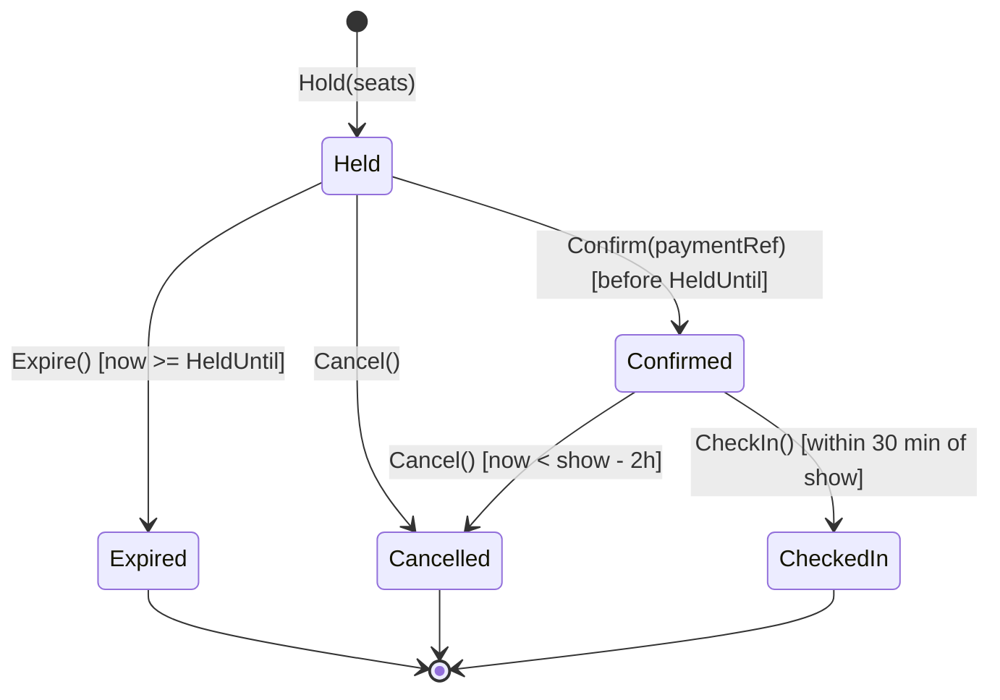
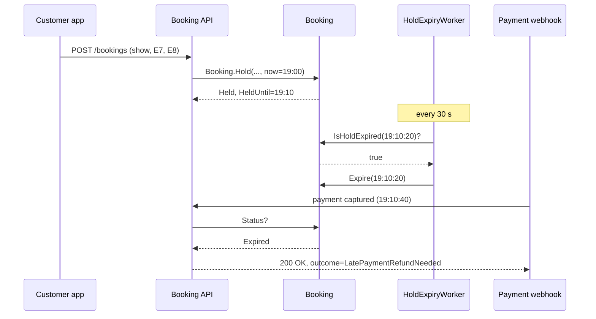

Most bugs in business software are not wrong calculations. They are objects in a state they should never have reached: a ticket that is both *cancelled* and *checked in*, an order that was delivered before it was paid, a database connection nobody closed. This lesson is about controlling an object's whole life — how it is born, how it changes, and how it ends.

## Learning objectives

By the end of this lesson you will be able to:

1. Describe the three phases of an object's life: creation, transitions and ending (terminal state or disposal).
2. Replace a pile of boolean flags (`IsPaid`, `IsCancelled`, `IsExpired`) with one explicit status and a transition table.
3. Write creation methods that only ever produce a valid object.
4. Handle time-based transitions (a seat hold that expires after 10 minutes) with an injected `TimeProvider`, so they are testable.
5. Implement `IDisposable` correctly for objects that hold a scarce resource, and know who is responsible for disposing what in ASP.NET Core.
6. Recognise lifecycle failure modes in production: late events, races between two transitions, and lost updates.

## Prerequisites

- [Encapsulation and invariant protection](#/lesson/m07-encapsulation-invariants): we rely on private setters and guard clauses.
- [State machine diagrams](#/lesson/m05-state-diagrams): we draw the lifecycle before we code it.

You do not need to know the [State pattern](#/lesson/m06-state) yet. This lesson shows the simpler table-driven approach first and explains when to upgrade.

## Explain it like I'm a beginner

Think about booking a movie ticket in a city like Pune. You pick seats E7 and E8 for the 7:30 pm show. The app says: *"Seats held for 10:00 minutes. Complete payment."*

From that moment your booking goes through a short life:

1. **Held** — the seats are yours for 10 minutes. Nobody else can pick them.
2. **Confirmed** — you paid ₹560. You get a QR code.
3. **Checked in** — the usher scans the QR code at the door. Done.

Other paths exist too. If you don't pay within 10 minutes, the hold **expires** and the seats go back on sale. If you change your mind before the show, you can **cancel** — but only until 2 hours before it starts.

Now imagine the app stored this as separate yes/no boxes: `isPaid`, `isCancelled`, `isExpired`, `isCheckedIn`. Four boxes allow 16 combinations. Only 5 of them make sense. The other 11 — like "paid **and** expired **and** checked in" — are bugs waiting to happen.

The fix is like a board game. Your token sits on exactly **one square** at a time (the state). The rules printed on the board say which squares you can move to from here (the transitions). Some squares are the end of the game (terminal states). You never pick up the token and drop it anywhere you like.

There is one more part of life: **cleaning up**. Some objects borrow something scarce — a lock on seats, a file, a network connection. When they are done, they must hand it back, like returning a library book. In .NET that is called **disposal** (`IDisposable`).

## First-principles explanation

### The three phases

Every object that models something real has three phases:

| Phase | Question it answers | Typical C# tools |
|---|---|---|
| **Creation** | Can this object exist at all? What does it start as? | Constructors, static factory methods, `required` members |
| **Transitions** | What can happen to it next, and when? | A status enum, a transition table, guard methods, the State pattern |
| **Ending** | When is it finished? What must be released? | Terminal states, `IDisposable` / `IAsyncDisposable`, DI lifetimes |

Most designs get creation and ending wrong more often than transitions, because those phases are easy to forget.

### Creation: never hand out a half-built object

A "half-built" object is one that exists but is not usable yet. A classic sign is a constructor with no parameters followed by ten property setters, and an `Init()` method you must remember to call. Until someone calls `Init()`, every method on it is a trap.

The rule is simple: **an object is valid from the moment the constructor (or factory method) returns.** If the inputs are bad, creation fails, and no object exists.

A **static factory method** (a named method that creates an instance) often reads better than a constructor: `Booking.Hold(...)` says what is happening, and a later `Booking.CreateComplimentary(...)` can start in a different state.

### Transitions: one status, a table of allowed moves

An object's **state** (the current values of its fields) and its **status** (the named stage of its life) are related but different. Status is the coarse part: *Held*, *Confirmed*, *Cancelled*. We keep it as **one field** of an enum type, so impossible combinations cannot be represented.

Then we write the allowed moves down as data — a **transition table** (a dictionary from "current status" to "statuses you may move to"):

| From | Allowed to |
|---|---|
| Held | Confirmed, Cancelled, Expired |
| Confirmed | Cancelled, CheckedIn |
| Cancelled, Expired, CheckedIn | — (terminal) |

Every state change goes through one private method, `MoveTo(target)`, that checks the table. Public methods such as `Confirm` and `Cancel` add the **guards** — extra conditions that depend on data, not just on the status. "You can cancel a confirmed booking, *but only until 2 hours before the show*" is a guard.

Why a table rather than `if` statements in each method? Because the table is the whole lifecycle in one place: you can test it exhaustively and compare it with what the product owner wrote.

### Time is an input, not a global

The hold expires 10 minutes after it was created. If the code calls `DateTime.UtcNow` inside the object, two problems appear:

1. Tests must wait 10 real minutes, or cannot test expiry at all.
2. The object's behaviour changes depending on when you look at it, with no visible input.

Instead, pass "now" in as a parameter, or inject a `TimeProvider` (built into .NET 8 and later). In tests you replace it with a fake clock you can move forward by 11 minutes instantly.

Notice something subtle: **an expired hold does not change itself.** Objects do not have their own heartbeat. At 7:10:01 the booking is still `Held` in memory and in the database — it is only *overdue*. Something must observe the overdue hold and move it to `Expired`. That is usually:

- a **background worker** that sweeps overdue holds every 30 seconds, and
- a **check on access** (when payment arrives, check `IsHoldExpired(now)` before confirming).

You need both. The sweep frees the seats for other customers. The check on access stops a payment that arrives at 7:10:05 from confirming a hold that the sweeper has not reached yet.

### Ending: terminal states and disposal

There are two different kinds of "end":

- A **terminal state** is a business ending. A cancelled booking still exists — you keep it for refunds, audit and reports. It just accepts no more transitions.
- **Disposal** is a technical ending. An object that holds an unmanaged or scarce resource (a lock, a file handle, a socket, a pooled connection) must give it back. The .NET garbage collector frees *memory* eventually, but it does not know your seat lock is precious. You implement `IDisposable` and the caller uses `using` so release happens at a known moment, even if an exception is thrown.

Good disposal has four properties: it releases the resource, it is **idempotent** (calling `Dispose` twice is harmless), it never throws, and after it the object refuses further use (`ObjectDisposedException`).

**Who disposes?** The owner. If you create it with `new`, you dispose it. If the DI container created it, the container disposes it at the end of its lifetime: scoped services at the end of the HTTP request, singletons when the app shuts down, transients when their scope ends. Never dispose something you were *given* through a constructor — you would be breaking it for everyone else who shares it.

### When it is useful, and when it is not

Explicit lifecycle modelling pays off when an object has **three or more statuses**, money or inventory depends on them, or several actors (customer, worker, admin, payment webhook) can change the same object. It is unnecessary for plain data carriers — a `MovieDto` or a log line has no lifecycle worth modelling. Keep those as simple records.

### Trade-offs

| You gain | You pay |
|---|---|
| Impossible states cannot be represented | More up-front thinking; product must agree on the states |
| One place to read the whole lifecycle | Changing the lifecycle needs data migration for stored statuses |
| Exhaustive tests of every transition | Time-based transitions need a background process to observe them |
| Predictable resource release | Disposal rules must be learned (who owns what) |

## Visual explanation

### Lifecycle of a booking



How to read it: the black dot is creation, and the only way in is `Hold`. Each arrow is a method on the `Booking` class. Text in square brackets is a **guard** — the arrow is only allowed when that condition is true. Three states have arrows to the final dot: those are terminal. Notice there is no arrow from `Expired` to `Confirmed`. A payment that arrives late can never confirm a booking; the code must refund it instead. Drawing the diagram first makes that business decision visible before anyone writes code.

### Hold, pay and a late payment



This shows the failure mode that a happy-path design misses. The customer paid, but 40 seconds too late. Because `Expired` is terminal, the API does not confirm; it records that a refund is needed and returns 200 to the payment provider so the webhook is not retried forever. If the worker had not run yet, the API would still detect the overdue hold through `IsHoldExpired(now)` and expire it itself. Two paths, one rule.

## Step-by-step example

### Step 1 — the flag soup

```csharp
public class Booking
{
    public bool IsPaid { get; set; }
    public bool IsCancelled { get; set; }
    public bool IsExpired { get; set; }
    public bool IsCheckedIn { get; set; }
    public DateTime CreatedAt { get; set; } = DateTime.Now;
}

// somewhere in a controller
if (!booking.IsCancelled && !booking.IsExpired) { booking.IsPaid = true; }
```

Anyone can set any flag. `CreatedAt` uses local server time, so a server in Mumbai and one in Frankfurt disagree. The rule "can't pay an expired booking" lives in a controller, where the batch job will never see it.

### Step 2 — one status, private setter

Replace the four booleans with `public BookingStatus Status { get; private set; }`. Now only the class itself can change it, and the 11 impossible combinations are gone.

### Step 3 — a transition table and one `MoveTo`

Put the allowed moves in a static dictionary. Every public method ends by calling `MoveTo(target, now, reason)`, which checks the table, appends to a history list and bumps a version number.

### Step 4 — guards and time

`Confirm` checks the payment reference and that the hold is not overdue. `Cancel` checks the 2-hour cut-off. Each method takes `now` as a parameter; the service passes `clock.GetUtcNow()`.

### Step 5 — observe time from outside

Add a background worker that calls `Expire` on overdue holds, and make the payment path check for overdue holds too.

### Step 6 — release resources deterministically

Creating a hold must check seat availability and insert the booking without another request sneaking in between. In-process we guard that with a short-lived **seat lock lease** that implements `IDisposable` and is used with `using`. Across several servers, the real guarantee comes from the database (see the callout below).

## Production-style C# implementation

```text
Cinema.Api/
  Program.cs
  Bookings/
    BookingStatus.cs
    Booking.cs
    BookingTransitionException.cs
    SeatLocks.cs
    BookingRepository.cs
    BookingService.cs
    HoldExpiryWorker.cs
```

```csharp file=Bookings/BookingStatus.cs
namespace Cinema.Bookings;

public enum BookingStatus
{
    Held,
    Confirmed,
    Cancelled,
    Expired,
    CheckedIn,
}

public sealed record BookingStatusChange(BookingStatus From, BookingStatus To, DateTimeOffset At, string Reason);
```

```csharp file=Bookings/BookingTransitionException.cs
namespace Cinema.Bookings;

/// <summary>Thrown when a caller asks for a move the lifecycle does not allow.</summary>
public sealed class BookingTransitionException(Guid bookingId, BookingStatus from, BookingStatus to, string message)
    : InvalidOperationException(message)
{
    public Guid BookingId { get; } = bookingId;
    public BookingStatus From { get; } = from;
    public BookingStatus To { get; } = to;
}

public sealed class SeatsUnavailableException(Guid showId, IReadOnlyCollection<string> seats)
    : InvalidOperationException($"Seats {string.Join(", ", seats)} are not available for show {showId}.")
{
    public Guid ShowId { get; } = showId;
    public IReadOnlyCollection<string> Seats { get; } = seats;
}
```

```csharp file=Bookings/Booking.cs
namespace Cinema.Bookings;

public sealed class Booking
{
    // The whole lifecycle in one place. Terminal states map to an empty array.
    private static readonly IReadOnlyDictionary<BookingStatus, BookingStatus[]> Allowed =
        new Dictionary<BookingStatus, BookingStatus[]>
        {
            [BookingStatus.Held] = [BookingStatus.Confirmed, BookingStatus.Cancelled, BookingStatus.Expired],
            [BookingStatus.Confirmed] = [BookingStatus.Cancelled, BookingStatus.CheckedIn],
            [BookingStatus.Cancelled] = [],
            [BookingStatus.Expired] = [],
            [BookingStatus.CheckedIn] = [],
        };

    public static readonly TimeSpan HoldDuration = TimeSpan.FromMinutes(10);
    public static readonly TimeSpan CancellationCutoff = TimeSpan.FromHours(2);
    public static readonly TimeSpan CheckInWindow = TimeSpan.FromMinutes(30);
    public const int MaxSeatsPerBooking = 10;

    private readonly List<BookingStatusChange> _history = [];

    private Booking(Guid id, Guid showId, IReadOnlyList<string> seats, decimal amount,
                    DateTimeOffset showStartsAt, DateTimeOffset heldAt)
    {
        Id = id;
        ShowId = showId;
        Seats = seats;
        Amount = amount;
        ShowStartsAt = showStartsAt;
        HeldAt = heldAt;
        HeldUntil = heldAt + HoldDuration;
        Status = BookingStatus.Held;
    }

    public Guid Id { get; }
    public Guid ShowId { get; }
    public IReadOnlyList<string> Seats { get; }
    public decimal Amount { get; }
    public DateTimeOffset ShowStartsAt { get; }
    public DateTimeOffset HeldAt { get; }
    public DateTimeOffset HeldUntil { get; }
    public BookingStatus Status { get; private set; }
    public string? PaymentReference { get; private set; }
    /// <summary>Incremented on every transition; used for optimistic concurrency.</summary>
    public int Version { get; private set; }
    public IReadOnlyList<BookingStatusChange> History => _history;
    public bool IsTerminal => Allowed[Status].Length == 0;

    /// <summary>Creation: the only way to get a Booking. Either it is valid, or it does not exist.</summary>
    public static Booking Hold(Guid showId, IEnumerable<string> seats, decimal amount,
                               DateTimeOffset showStartsAt, DateTimeOffset now)
    {
        ArgumentNullException.ThrowIfNull(seats);
        var seatList = seats.Select(s => s.Trim().ToUpperInvariant()).ToArray();
        if (seatList.Length is 0 or > MaxSeatsPerBooking)
            throw new ArgumentException($"A booking needs 1 to {MaxSeatsPerBooking} seats.", nameof(seats));
        if (seatList.Distinct().Count() != seatList.Length)
            throw new ArgumentException("Seats must be distinct.", nameof(seats));
        ArgumentOutOfRangeException.ThrowIfNegativeOrZero(amount);
        if (now >= showStartsAt)
            throw new ArgumentException("Cannot hold seats for a show that has started.", nameof(showStartsAt));

        return new Booking(Guid.NewGuid(), showId, seatList, amount, showStartsAt, now);
    }

    public bool CanMoveTo(BookingStatus target) => Allowed[Status].Contains(target);

    public bool IsHoldExpired(DateTimeOffset now) => Status == BookingStatus.Held && now >= HeldUntil;

    public void Confirm(string paymentReference, DateTimeOffset now)
    {
        ArgumentException.ThrowIfNullOrWhiteSpace(paymentReference);
        if (IsHoldExpired(now))
            throw new BookingTransitionException(Id, Status, BookingStatus.Confirmed,
                $"Hold expired at {HeldUntil:O}; payment must be refunded.");
        MoveTo(BookingStatus.Confirmed, now, $"Paid ({paymentReference})");
        PaymentReference = paymentReference;
    }

    public void Cancel(string reason, DateTimeOffset now)
    {
        if (Status == BookingStatus.Confirmed && now > ShowStartsAt - CancellationCutoff)
            throw new BookingTransitionException(Id, Status, BookingStatus.Cancelled,
                "Confirmed bookings can only be cancelled up to 2 hours before the show.");
        MoveTo(BookingStatus.Cancelled, now, reason);
    }

    public void Expire(DateTimeOffset now)
    {
        if (!IsHoldExpired(now))
            throw new BookingTransitionException(Id, Status, BookingStatus.Expired, "Hold is not overdue.");
        MoveTo(BookingStatus.Expired, now, "Hold timed out");
    }

    public void CheckIn(DateTimeOffset now)
    {
        if (now < ShowStartsAt - CheckInWindow)
            throw new BookingTransitionException(Id, Status, BookingStatus.CheckedIn, "Check-in has not opened yet.");
        MoveTo(BookingStatus.CheckedIn, now, "Scanned at entry");
    }

    private void MoveTo(BookingStatus target, DateTimeOffset now, string reason)
    {
        if (!CanMoveTo(target))
            throw new BookingTransitionException(Id, Status, target, $"Cannot move a booking from {Status} to {target}.");
        _history.Add(new BookingStatusChange(Status, target, now, reason));
        Status = target;
        Version++;
    }
}
```

The class has no public setters and no public constructor. The only way in is `Hold`, and the only way to change status is through a method that names a business action. `Version` supports optimistic concurrency in the repository: a save succeeds only if nobody else saved a newer version in between.

```csharp file=Bookings/SeatLocks.cs
namespace Cinema.Bookings;

public interface ISeatLockRegistry
{
    /// <summary>Returns a lease, or null if any seat is locked by someone else right now.</summary>
    SeatLockLease? TryAcquire(Guid showId, IReadOnlyCollection<string> seats);
}

/// <summary>In-process lock for the "check availability, then insert" critical section.
/// Enough for one server; across servers rely on the database unique index.</summary>
public sealed class InMemorySeatLockRegistry : ISeatLockRegistry
{
    private readonly HashSet<(Guid, string)> _locked = [];
    private readonly Lock _gate = new();

    public SeatLockLease? TryAcquire(Guid showId, IReadOnlyCollection<string> seats)
    {
        lock (_gate)
        {
            if (seats.Any(s => _locked.Contains((showId, s)))) return null;
            foreach (var s in seats) _locked.Add((showId, s));
        }
        return new SeatLockLease(this, showId, seats);
    }

    internal void Release(Guid showId, IReadOnlyCollection<string> seats)
    {
        lock (_gate)
            foreach (var s in seats) _locked.Remove((showId, s));
    }
}

/// <summary>Owns a scarce resource. Dispose releases it exactly once, never throws.</summary>
public sealed class SeatLockLease : IDisposable
{
    private InMemorySeatLockRegistry? _owner;
    private readonly Guid _showId;
    private readonly IReadOnlyCollection<string> _seats;

    internal SeatLockLease(InMemorySeatLockRegistry owner, Guid showId, IReadOnlyCollection<string> seats)
    {
        _owner = owner;
        _showId = showId;
        _seats = seats;
    }

    public void Dispose()
    {
        // Interlocked makes Dispose idempotent even if two threads race to call it.
        var owner = Interlocked.Exchange(ref _owner, null);
        owner?.Release(_showId, _seats);
    }
}
```

`System.Threading.Lock` is the dedicated lock type added in .NET 9; `lock` on it is slightly cheaper and clearer than locking on a plain `object`. The lease has no finaliser: it holds no unmanaged handle, so the full "dispose pattern" with `Dispose(bool)` and `~SeatLockLease()` would add nothing. You need a finaliser only when you directly own an OS handle — and then prefer `SafeHandle`.

```csharp file=Bookings/BookingRepository.cs
using System.Collections.Concurrent;

namespace Cinema.Bookings;

public sealed class ConcurrencyConflictException(Guid id) : Exception($"Booking {id} was changed by someone else.");

public interface IBookingRepository
{
    Task<Booking?> GetAsync(Guid id, CancellationToken ct);
    Task<bool> AnySeatTakenAsync(Guid showId, IReadOnlyCollection<string> seats, CancellationToken ct);
    Task AddAsync(Booking booking, CancellationToken ct);
    /// <summary>Saves only if the stored version still equals expectedVersion.</summary>
    Task SaveAsync(Booking booking, int expectedVersion, CancellationToken ct);
    Task<IReadOnlyList<Booking>> ListOverdueHoldsAsync(DateTimeOffset now, int max, CancellationToken ct);
}

public sealed class InMemoryBookingRepository : IBookingRepository
{
    private readonly ConcurrentDictionary<Guid, (Booking Booking, int Version)> _rows = new();

    public Task<Booking?> GetAsync(Guid id, CancellationToken ct) =>
        Task.FromResult(_rows.TryGetValue(id, out var row) ? row.Booking : null);

    public Task<bool> AnySeatTakenAsync(Guid showId, IReadOnlyCollection<string> seats, CancellationToken ct) =>
        Task.FromResult(_rows.Values.Any(r => r.Booking.ShowId == showId
                                            && r.Booking.Status is BookingStatus.Held or BookingStatus.Confirmed or BookingStatus.CheckedIn
                                            && r.Booking.Seats.Intersect(seats).Any()));

    public Task AddAsync(Booking booking, CancellationToken ct)
    {
        if (!_rows.TryAdd(booking.Id, (booking, booking.Version)))
            throw new InvalidOperationException($"Booking {booking.Id} already exists.");
        return Task.CompletedTask;
    }

    public Task SaveAsync(Booking booking, int expectedVersion, CancellationToken ct)
    {
        var current = _rows[booking.Id];
        // Compare-and-swap: the in-memory twin of "UPDATE ... WHERE id = @id AND version = @expected".
        if (current.Version != expectedVersion || !_rows.TryUpdate(booking.Id, (booking, booking.Version), current))
            throw new ConcurrencyConflictException(booking.Id);
        return Task.CompletedTask;
    }

    public Task<IReadOnlyList<Booking>> ListOverdueHoldsAsync(DateTimeOffset now, int max, CancellationToken ct) =>
        Task.FromResult<IReadOnlyList<Booking>>(_rows.Values.Select(r => r.Booking)
            .Where(b => b.IsHoldExpired(now)).OrderBy(b => b.HeldUntil).Take(max).ToList());
}
```

```csharp file=Bookings/BookingService.cs
using Microsoft.Extensions.Logging;

namespace Cinema.Bookings;

public sealed record HoldSeatsCommand(Guid ShowId, IReadOnlyList<string> Seats, decimal Amount, DateTimeOffset ShowStartsAt);

public enum ConfirmOutcome { Confirmed, AlreadyConfirmed, LatePaymentRefundNeeded }

public sealed class BookingService(IBookingRepository repo, ISeatLockRegistry locks, TimeProvider clock,
                                   ILogger<BookingService> logger)
{
    public async Task<Booking> HoldSeatsAsync(HoldSeatsCommand cmd, CancellationToken ct)
    {
        // The lease is released when this method exits, on success or on exception.
        using var lease = locks.TryAcquire(cmd.ShowId, cmd.Seats)
            ?? throw new SeatsUnavailableException(cmd.ShowId, cmd.Seats.ToArray());

        if (await repo.AnySeatTakenAsync(cmd.ShowId, cmd.Seats, ct))
            throw new SeatsUnavailableException(cmd.ShowId, cmd.Seats.ToArray());

        var booking = Booking.Hold(cmd.ShowId, cmd.Seats, cmd.Amount, cmd.ShowStartsAt, clock.GetUtcNow());
        await repo.AddAsync(booking, ct);
        logger.LogInformation("Held {SeatCount} seats for show {ShowId} until {HeldUntil}",
            booking.Seats.Count, booking.ShowId, booking.HeldUntil);
        return booking;
    }

    /// <summary>Called by the payment webhook. Must be idempotent: providers retry.</summary>
    public async Task<ConfirmOutcome> ConfirmAsync(Guid bookingId, string paymentReference, CancellationToken ct)
    {
        var booking = await repo.GetAsync(bookingId, ct) ?? throw new KeyNotFoundException($"Booking {bookingId} not found.");
        var expected = booking.Version;
        var now = clock.GetUtcNow();

        if (booking.Status == BookingStatus.Confirmed && booking.PaymentReference == paymentReference)
            return ConfirmOutcome.AlreadyConfirmed;

        if (booking.IsHoldExpired(now))
        {
            booking.Expire(now);
            await repo.SaveAsync(booking, expected, ct);
            logger.LogWarning("Late payment {PaymentRef} for expired booking {BookingId}", paymentReference, bookingId);
            return ConfirmOutcome.LatePaymentRefundNeeded;
        }
        if (booking.Status == BookingStatus.Expired)
            return ConfirmOutcome.LatePaymentRefundNeeded;

        booking.Confirm(paymentReference, now);
        await repo.SaveAsync(booking, expected, ct);
        return ConfirmOutcome.Confirmed;
    }

    public async Task<int> ExpireOverdueHoldsAsync(int batchSize, CancellationToken ct)
    {
        var now = clock.GetUtcNow();
        var expired = 0;
        foreach (var booking in await repo.ListOverdueHoldsAsync(now, batchSize, ct))
        {
            var expected = booking.Version;
            try
            {
                booking.Expire(now);
                await repo.SaveAsync(booking, expected, ct);
                expired++;
            }
            catch (Exception ex) when (ex is ConcurrencyConflictException or BookingTransitionException)
            {
                // Someone confirmed or cancelled it a moment ago. That transition wins; skip.
                logger.LogDebug(ex, "Skipped expiring booking {BookingId}", booking.Id);
            }
        }
        return expired;
    }
}
```

```csharp file=Bookings/HoldExpiryWorker.cs
using Microsoft.Extensions.DependencyInjection;
using Microsoft.Extensions.Hosting;
using Microsoft.Extensions.Logging;

namespace Cinema.Bookings;

/// <summary>Objects have no heartbeat. This worker observes time and moves overdue holds to Expired.</summary>
public sealed class HoldExpiryWorker(IServiceScopeFactory scopes, TimeProvider clock, ILogger<HoldExpiryWorker> logger)
    : BackgroundService
{
    private static readonly TimeSpan Interval = TimeSpan.FromSeconds(30);

    protected override async Task ExecuteAsync(CancellationToken stoppingToken)
    {
        using var timer = new PeriodicTimer(Interval, clock);
        while (await timer.WaitForNextTickAsync(stoppingToken))
        {
            try
            {
                // BackgroundService is a singleton; BookingService is scoped. Create a scope per sweep
                // so scoped dependencies are created and disposed correctly.
                await using var scope = scopes.CreateAsyncScope();
                var service = scope.ServiceProvider.GetRequiredService<BookingService>();
                var count = await service.ExpireOverdueHoldsAsync(batchSize: 500, stoppingToken);
                if (count > 0) logger.LogInformation("Expired {Count} overdue holds", count);
            }
            catch (Exception ex) when (ex is not OperationCanceledException)
            {
                logger.LogError(ex, "Hold expiry sweep failed; will retry next tick");
            }
        }
    }
}
```

```csharp file=Program.cs
using Cinema.Bookings;

var builder = WebApplication.CreateBuilder(args);

builder.Services.AddSingleton(TimeProvider.System);
builder.Services.AddSingleton<ISeatLockRegistry, InMemorySeatLockRegistry>();
builder.Services.AddSingleton<IBookingRepository, InMemoryBookingRepository>();
builder.Services.AddScoped<BookingService>();
builder.Services.AddHostedService<HoldExpiryWorker>();

var app = builder.Build();

app.MapPost("/bookings", async (HoldSeatsCommand cmd, BookingService svc, CancellationToken ct) =>
{
    try
    {
        var b = await svc.HoldSeatsAsync(cmd, ct);
        return Results.Created($"/bookings/{b.Id}", new { b.Id, b.Status, b.HeldUntil });
    }
    catch (SeatsUnavailableException ex) { return Results.Problem(ex.Message, statusCode: StatusCodes.Status409Conflict); }
    catch (ArgumentException ex) { return Results.Problem(ex.Message, statusCode: StatusCodes.Status400BadRequest); }
});

app.MapPost("/payments/webhook", async (Guid bookingId, string paymentRef, BookingService svc, CancellationToken ct) =>
    Results.Ok(new { outcome = (await svc.ConfirmAsync(bookingId, paymentRef, ct)).ToString() }));

app.Run();
```

:::callout type=warning title="The in-process lock is not your safety net"
`InMemorySeatLockRegistry` only protects one server. With three API instances behind a load balancer, two customers can hold E7 at the same moment. The real guarantee belongs in PostgreSQL, for example a partial unique index on a `booking_seats` table that carries the booking status: `CREATE UNIQUE INDEX ux_active_seat ON booking_seats (show_id, seat_no) WHERE status IN ('Held', 'Confirmed', 'CheckedIn');`. The second insert then fails with a unique-violation error, which you translate into `SeatsUnavailableException`. Keep the in-process lock only as a cheap way to reduce contention.
:::

## Bad design vs good design

**Bad**: the flag-soup class from Step 1, plus a cron job that runs `UPDATE bookings SET is_expired = true WHERE created_at < now() - interval '10 minutes'`, plus a webhook handler that runs `UPDATE bookings SET is_paid = true WHERE id = @id`.

What goes wrong:

- The webhook can mark an **expired** booking as paid. The seat was already resold. Two people turn up for E7.
- The cron job's SQL also expires bookings that were already paid, because it does not look at `is_paid`.
- Nothing records *when* or *why* status changed, so support staff can't answer "why was my booking cancelled?".
- Tests need a real clock and a real database.

**Good**: the implementation above. One status field, one transition table, guards inside the class, time passed in, an audit history, a version number for concurrent writers, and a lease disposed with `using`.

**When is the good design overkill?** With two statuses (say `Active`/`Archived`) and nothing important hanging on them, a `bool IsArchived` with a private setter and an `Archive()` method is fine. Upgrade when a third status shows up.

:::callout type=tradeoff title="Transition table vs State pattern"
The table works well while each state differs mostly in *which moves are allowed*. When each state also needs very different *behaviour* (different pricing, different notifications, different validation), move to the [State pattern](#/lesson/m06-state), where each state is its own class. Many teams start with the table and only a few objects ever need the upgrade.
:::

## Practical playground

Run the program, then implement `Cancel` so that the last two lines behave as the comments say. The transition table is already there.

:::playground type=csharp title="Booking lifecycle"
```csharp file=Program.cs
using System;
using System.Collections.Generic;
using System.Linq;

public enum Status { Held, Confirmed, Cancelled, Expired }

public sealed class MiniBooking
{
    private static readonly Dictionary<Status, Status[]> Allowed = new()
    {
        [Status.Held] = new[] { Status.Confirmed, Status.Cancelled, Status.Expired },
        [Status.Confirmed] = new[] { Status.Cancelled },
        [Status.Cancelled] = Array.Empty<Status>(),
        [Status.Expired] = Array.Empty<Status>(),
    };

    public MiniBooking(DateTimeOffset showAt) { ShowAt = showAt; }
    public DateTimeOffset ShowAt { get; }
    public Status Status { get; private set; } = Status.Held;
    public List<string> History { get; } = new();

    public void Confirm() => MoveTo(Status.Confirmed);

    // TODO: confirmed bookings may be cancelled only until 2 hours before ShowAt.
    public void Cancel(DateTimeOffset now) => throw new NotImplementedException();

    private void MoveTo(Status target)
    {
        if (!Allowed[Status].Contains(target))
            throw new InvalidOperationException($"{Status} -> {target} is not allowed");
        History.Add($"{Status} -> {target}");
        Status = target;
    }
}

public static class Program
{
    public static void Main()
    {
        var show = new DateTimeOffset(2026, 11, 7, 19, 30, 0, TimeSpan.FromHours(5.5));
        var b = new MiniBooking(show);
        b.Confirm();
        Console.WriteLine($"Status: {b.Status}");
        Try(() => b.Cancel(show.AddHours(-1)));   // expect: refused, too late
        Try(() => b.Cancel(show.AddHours(-3)));   // expect: Cancelled
        Console.WriteLine(string.Join(" | ", b.History));
    }

    private static void Try(Action a)
    {
        try { a(); Console.WriteLine("OK"); }
        catch (Exception ex) { Console.WriteLine($"{ex.GetType().Name}: {ex.Message}"); }
    }
}
```
:::

## Exercises

:::exercise id=m07-lifecycle-state-ex1 difficulty=beginner kind=code title="Replace boolean flags with a status"
A food-ordering app tracks orders with `IsAccepted`, `IsDelivered` and `IsCancelled` booleans. Rewrite `FoodOrder` so it has one `Status` property with a private setter and three methods: `Accept()`, `Deliver()` and `Cancel()`.
::requirements
- New orders start as `Placed`.
- `Placed → Accepted → Delivered`. `Placed → Cancelled` and `Accepted → Cancelled` are also allowed.
- `Delivered` and `Cancelled` are terminal.
- Any other move throws `InvalidOperationException` and leaves the status unchanged.
::acceptance
- `new FoodOrder().Status` is `Placed`.
- `Accept()` then `Deliver()` ends in `Delivered`.
- `Deliver()` on a `Placed` order throws `InvalidOperationException`.
- `Cancel()` on a `Delivered` order throws, and the status stays `Delivered`.
::hint
Start by writing the table of allowed moves on paper. How many rows does it have?
::hint
Store the table as a `Dictionary<OrderStatus, OrderStatus[]>` in a `static readonly` field.
::hint
Write one private `MoveTo(OrderStatus target)` that checks the table and throws. Every public method is then a one-liner.
::hint
```csharp
private void MoveTo(OrderStatus target)
{
    if (!Allowed[Status].Contains(target))
        throw new InvalidOperationException($"Cannot move from {Status} to {target}.");
    Status = target;
}
```
::starter
```csharp file=FoodOrder.cs
using System;
using System.Collections.Generic;
using System.Linq;

public enum OrderStatus { Placed, Accepted, Delivered, Cancelled }

public sealed class FoodOrder
{
    public OrderStatus Status { get; private set; } = OrderStatus.Placed;

    public void Accept() => throw new NotImplementedException();
    public void Deliver() => throw new NotImplementedException();
    public void Cancel() => throw new NotImplementedException();
}
```
::tests
```csharp file=FoodOrderTests.cs
using System;
using Xunit;

public class FoodOrderTests
{
    [Fact] public void Starts_placed() => Assert.Equal(OrderStatus.Placed, new FoodOrder().Status);

    [Fact]
    public void Happy_path_reaches_delivered()
    {
        var o = new FoodOrder();
        o.Accept();
        o.Deliver();
        Assert.Equal(OrderStatus.Delivered, o.Status);
    }

    [Fact] public void Cannot_deliver_unaccepted() =>
        Assert.Throws<InvalidOperationException>(() => new FoodOrder().Deliver());

    [Fact]
    public void Cancel_allowed_from_placed_and_accepted()
    {
        var a = new FoodOrder(); a.Cancel();
        var b = new FoodOrder(); b.Accept(); b.Cancel();
        Assert.Equal(OrderStatus.Cancelled, a.Status);
        Assert.Equal(OrderStatus.Cancelled, b.Status);
    }

    [Fact]
    public void Terminal_state_is_unchanged_after_bad_move()
    {
        var o = new FoodOrder(); o.Accept(); o.Deliver();
        Assert.Throws<InvalidOperationException>(() => o.Cancel());
        Assert.Equal(OrderStatus.Delivered, o.Status);
    }

    [Fact]
    public void Cannot_accept_twice()
    {
        var o = new FoodOrder(); o.Accept();
        Assert.Throws<InvalidOperationException>(() => o.Accept());
    }
}
```
::solution
The table *is* the lifecycle. Every public method names a business action and delegates to `MoveTo`.

```csharp file=FoodOrder.cs
using System;
using System.Collections.Generic;
using System.Linq;

public enum OrderStatus { Placed, Accepted, Delivered, Cancelled }

public sealed class FoodOrder
{
    private static readonly Dictionary<OrderStatus, OrderStatus[]> Allowed = new()
    {
        [OrderStatus.Placed] = new[] { OrderStatus.Accepted, OrderStatus.Cancelled },
        [OrderStatus.Accepted] = new[] { OrderStatus.Delivered, OrderStatus.Cancelled },
        [OrderStatus.Delivered] = Array.Empty<OrderStatus>(),
        [OrderStatus.Cancelled] = Array.Empty<OrderStatus>(),
    };

    public OrderStatus Status { get; private set; } = OrderStatus.Placed;

    public void Accept() => MoveTo(OrderStatus.Accepted);
    public void Deliver() => MoveTo(OrderStatus.Delivered);
    public void Cancel() => MoveTo(OrderStatus.Cancelled);

    private void MoveTo(OrderStatus target)
    {
        if (!Allowed[Status].Contains(target))
            throw new InvalidOperationException($"Cannot move from {Status} to {target}.");
        Status = target;
    }
}
```
::mistakes
- Keeping the old booleans "for compatibility" alongside `Status`. They will drift apart.
- Changing `Status` before checking the table, so a failed move leaves the object in the wrong state.
- Writing `if (Status == Placed || Status == Accepted)` in each method — it works, but the lifecycle is now scattered across three methods.
::extensions
Add a `History` list of `(From, To)` pairs and a test that the full happy path records exactly two entries.
:::

:::exercise id=m07-lifecycle-state-ex2 difficulty=beginner kind=code title="A seat hold that expires, tested without waiting"
Implement `SeatHold`, which is valid for a fixed duration from creation. It reads time only from an injected `TimeProvider`.
::requirements
- `IsExpired` is true once `now >= CreatedAt + Duration`.
- `Remaining` returns the time left, never negative.
- `Extend()` adds 5 minutes, but only once, and only while not expired. Otherwise it throws `InvalidOperationException`.
::acceptance
- At 9:59 after creation (duration 10 min), `IsExpired` is false and `Remaining` is 1 second.
- At exactly 10:00 it is expired, and `Remaining` is `TimeSpan.Zero`.
- A second `Extend()` throws.
- `Extend()` after expiry throws.
- Tests run instantly using a fake clock.
::hint
Never call `DateTimeOffset.UtcNow` inside the class. Where does "now" come from instead?
::hint
Store `CreatedAt = clock.GetUtcNow()` in the constructor, and compare against `clock.GetUtcNow()` on each read.
::hint
The test fake already exists: `ManualClock` overrides `GetUtcNow()` and has an `Advance` method.
::hint
`Remaining` is `ExpiresAt - now`, clamped with `TimeSpan.Zero` if negative. `ExpiresAt` changes when you extend, so make it a private-set property.
::starter
```csharp file=SeatHold.cs
using System;

public sealed class SeatHold
{
    private readonly TimeProvider _clock;

    public SeatHold(TimeProvider clock, TimeSpan duration)
    {
        _clock = clock;
        throw new NotImplementedException();
    }

    public DateTimeOffset CreatedAt { get; }
    public DateTimeOffset ExpiresAt { get; private set; }
    public bool IsExpired => throw new NotImplementedException();
    public TimeSpan Remaining => throw new NotImplementedException();
    public void Extend() => throw new NotImplementedException();
}

public sealed class ManualClock(DateTimeOffset start) : TimeProvider
{
    private DateTimeOffset _now = start;
    public override DateTimeOffset GetUtcNow() => _now;
    public void Advance(TimeSpan by) => _now += by;
}
```
::tests
```csharp file=SeatHoldTests.cs
using System;
using Xunit;

public class SeatHoldTests
{
    private static readonly DateTimeOffset T0 = new(2026, 11, 7, 13, 30, 0, TimeSpan.Zero);

    [Fact]
    public void Not_expired_one_second_before()
    {
        var clock = new ManualClock(T0);
        var hold = new SeatHold(clock, TimeSpan.FromMinutes(10));
        clock.Advance(TimeSpan.FromSeconds(599));
        Assert.False(hold.IsExpired);
        Assert.Equal(TimeSpan.FromSeconds(1), hold.Remaining);
    }

    [Fact]
    public void Expired_exactly_at_deadline()
    {
        var clock = new ManualClock(T0);
        var hold = new SeatHold(clock, TimeSpan.FromMinutes(10));
        clock.Advance(TimeSpan.FromMinutes(10));
        Assert.True(hold.IsExpired);
        Assert.Equal(TimeSpan.Zero, hold.Remaining);
    }

    [Fact]
    public void Extend_once_adds_five_minutes()
    {
        var clock = new ManualClock(T0);
        var hold = new SeatHold(clock, TimeSpan.FromMinutes(10));
        hold.Extend();
        clock.Advance(TimeSpan.FromMinutes(14));
        Assert.False(hold.IsExpired);
        Assert.Throws<InvalidOperationException>(() => hold.Extend());
    }

    [Fact]
    public void Cannot_extend_after_expiry()
    {
        var clock = new ManualClock(T0);
        var hold = new SeatHold(clock, TimeSpan.FromMinutes(10));
        clock.Advance(TimeSpan.FromMinutes(11));
        Assert.Throws<InvalidOperationException>(() => hold.Extend());
    }

    [Fact]
    public void Rejects_non_positive_duration() =>
        Assert.Throws<ArgumentOutOfRangeException>(() => new SeatHold(new ManualClock(T0), TimeSpan.Zero));
}
```
::solution
Time enters through one door, the `TimeProvider`. Everything else is arithmetic.

```csharp file=SeatHold.cs
using System;

public sealed class SeatHold
{
    private static readonly TimeSpan Extension = TimeSpan.FromMinutes(5);
    private readonly TimeProvider _clock;
    private bool _extended;

    public SeatHold(TimeProvider clock, TimeSpan duration)
    {
        ArgumentNullException.ThrowIfNull(clock);
        if (duration <= TimeSpan.Zero) throw new ArgumentOutOfRangeException(nameof(duration), "Duration must be positive.");
        _clock = clock;
        CreatedAt = clock.GetUtcNow();
        ExpiresAt = CreatedAt + duration;
    }

    public DateTimeOffset CreatedAt { get; }
    public DateTimeOffset ExpiresAt { get; private set; }
    public bool IsExpired => _clock.GetUtcNow() >= ExpiresAt;

    public TimeSpan Remaining
    {
        get
        {
            var left = ExpiresAt - _clock.GetUtcNow();
            return left > TimeSpan.Zero ? left : TimeSpan.Zero;
        }
    }

    public void Extend()
    {
        if (IsExpired) throw new InvalidOperationException("Cannot extend an expired hold.");
        if (_extended) throw new InvalidOperationException("A hold can be extended only once.");
        ExpiresAt += Extension;
        _extended = true;
    }
}

public sealed class ManualClock(DateTimeOffset start) : TimeProvider
{
    private DateTimeOffset _now = start;
    public override DateTimeOffset GetUtcNow() => _now;
    public void Advance(TimeSpan by) => _now += by;
}
```
In production you can use `FakeTimeProvider` from the `Microsoft.Extensions.TimeProvider.Testing` package instead of writing `ManualClock`.
::mistakes
- Using `>` instead of `>=` for expiry: at exactly 10:00 the hold is still "valid", so two customers can both hold the seat for that instant.
- Calling `DateTime.Now` (local time) — the hold length changes on servers in different time zones and during daylight-saving changes abroad.
- Returning a negative `Remaining`, which shows "-00:42" on the countdown screen.
:::

:::exercise id=m07-lifecycle-state-ex3 difficulty=intermediate kind=code title="Table-driven payment lifecycle with history"
Model a card payment attempt in a payment-processing service. It moves `Initiated → Authorized → Captured → Refunded`. `Initiated` and `Authorized` can also move to `Failed`, and `Authorized` can move to `Voided` (the hold on the card is released without charging).
::requirements
- `PaymentAttempt.Start(decimal amount)` is the only way to create one; amount must be positive.
- Methods: `Authorize(string authCode)`, `Capture()`, `Refund()`, `Void()`, `Fail(string reason)`.
- Every successful move appends a `PaymentTransition(From, To, Note)` to `History`.
- `AllowedNext()` returns the statuses reachable from the current status.
- Illegal moves throw `InvalidOperationException` and do not change history.
::acceptance
- Full path Start → Authorize → Capture → Refund gives 3 history entries in order.
- `Capture()` on an `Initiated` attempt throws.
- `AllowedNext()` for `Authorized` is exactly `{Captured, Voided, Failed}`.
- `Refunded`, `Voided` and `Failed` have no allowed next statuses.
- `Start(0)` throws `ArgumentOutOfRangeException`.
::hint
Same shape as exercise 1, but now you also record *why* each move happened.
::hint
`History` should be exposed as `IReadOnlyList<PaymentTransition>` backed by a private `List`.
::hint
Have `MoveTo(target, note)` check the table, add history, then set `Status` — in that order, so a throw leaves everything untouched.
::hint
```csharp
public IReadOnlyCollection<PaymentStatus> AllowedNext() => Allowed[Status];
```
::starter
```csharp file=PaymentAttempt.cs
using System;
using System.Collections.Generic;
using System.Linq;

public enum PaymentStatus { Initiated, Authorized, Captured, Refunded, Voided, Failed }

public sealed record PaymentTransition(PaymentStatus From, PaymentStatus To, string Note);

public sealed class PaymentAttempt
{
    private PaymentAttempt(decimal amount) { Amount = amount; }

    public decimal Amount { get; }
    public PaymentStatus Status { get; private set; } = PaymentStatus.Initiated;
    public string? AuthCode { get; private set; }
    public IReadOnlyList<PaymentTransition> History => throw new NotImplementedException();

    public static PaymentAttempt Start(decimal amount) => throw new NotImplementedException();
    public IReadOnlyCollection<PaymentStatus> AllowedNext() => throw new NotImplementedException();
    public void Authorize(string authCode) => throw new NotImplementedException();
    public void Capture() => throw new NotImplementedException();
    public void Refund() => throw new NotImplementedException();
    public void Void() => throw new NotImplementedException();
    public void Fail(string reason) => throw new NotImplementedException();
}
```
::tests
```csharp file=PaymentAttemptTests.cs
using System;
using System.Linq;
using Xunit;

public class PaymentAttemptTests
{
    [Fact]
    public void Full_path_records_history_in_order()
    {
        var p = PaymentAttempt.Start(560m);
        p.Authorize("A123"); p.Capture(); p.Refund();
        Assert.Equal(PaymentStatus.Refunded, p.Status);
        Assert.Equal(3, p.History.Count);
        Assert.Equal(PaymentStatus.Initiated, p.History[0].From);
        Assert.Equal(PaymentStatus.Refunded, p.History[2].To);
        Assert.Equal("A123", p.AuthCode);
    }

    [Fact] public void Cannot_capture_before_authorize() =>
        Assert.Throws<InvalidOperationException>(() => PaymentAttempt.Start(100m).Capture());

    [Fact]
    public void Failed_move_leaves_history_untouched()
    {
        var p = PaymentAttempt.Start(100m);
        Assert.Throws<InvalidOperationException>(() => p.Refund());
        Assert.Empty(p.History);
        Assert.Equal(PaymentStatus.Initiated, p.Status);
    }

    [Fact]
    public void Allowed_next_from_authorized()
    {
        var p = PaymentAttempt.Start(100m);
        p.Authorize("X");
        var next = p.AllowedNext().OrderBy(s => s).ToArray();
        Assert.Equal(new[] { PaymentStatus.Captured, PaymentStatus.Voided, PaymentStatus.Failed }, next);
    }

    [Fact]
    public void Terminal_states_have_no_next()
    {
        var v = PaymentAttempt.Start(1m); v.Authorize("X"); v.Void();
        var f = PaymentAttempt.Start(1m); f.Fail("Declined by issuer");
        Assert.Empty(v.AllowedNext());
        Assert.Empty(f.AllowedNext());
        Assert.Equal("Declined by issuer", f.History.Single().Note);
    }

    [Fact] public void Amount_must_be_positive() =>
        Assert.Throws<ArgumentOutOfRangeException>(() => PaymentAttempt.Start(0m));
}
```
::solution
```csharp file=PaymentAttempt.cs
using System;
using System.Collections.Generic;
using System.Linq;

public enum PaymentStatus { Initiated, Authorized, Captured, Refunded, Voided, Failed }

public sealed record PaymentTransition(PaymentStatus From, PaymentStatus To, string Note);

public sealed class PaymentAttempt
{
    private static readonly Dictionary<PaymentStatus, PaymentStatus[]> Allowed = new()
    {
        [PaymentStatus.Initiated] = new[] { PaymentStatus.Authorized, PaymentStatus.Failed },
        [PaymentStatus.Authorized] = new[] { PaymentStatus.Captured, PaymentStatus.Voided, PaymentStatus.Failed },
        [PaymentStatus.Captured] = new[] { PaymentStatus.Refunded },
        [PaymentStatus.Refunded] = Array.Empty<PaymentStatus>(),
        [PaymentStatus.Voided] = Array.Empty<PaymentStatus>(),
        [PaymentStatus.Failed] = Array.Empty<PaymentStatus>(),
    };

    private readonly List<PaymentTransition> _history = new();

    private PaymentAttempt(decimal amount) { Amount = amount; }

    public decimal Amount { get; }
    public PaymentStatus Status { get; private set; } = PaymentStatus.Initiated;
    public string? AuthCode { get; private set; }
    public IReadOnlyList<PaymentTransition> History => _history;

    public static PaymentAttempt Start(decimal amount)
    {
        ArgumentOutOfRangeException.ThrowIfNegativeOrZero(amount);
        return new PaymentAttempt(amount);
    }

    public IReadOnlyCollection<PaymentStatus> AllowedNext() => Allowed[Status];

    public void Authorize(string authCode)
    {
        ArgumentException.ThrowIfNullOrWhiteSpace(authCode);
        MoveTo(PaymentStatus.Authorized, $"Auth code {authCode}");
        AuthCode = authCode;
    }

    public void Capture() => MoveTo(PaymentStatus.Captured, $"Captured {Amount}");
    public void Refund() => MoveTo(PaymentStatus.Refunded, $"Refunded {Amount}");
    public void Void() => MoveTo(PaymentStatus.Voided, "Authorization released");
    public void Fail(string reason) => MoveTo(PaymentStatus.Failed, reason);

    private void MoveTo(PaymentStatus target, string note)
    {
        if (!Allowed[Status].Contains(target))
            throw new InvalidOperationException($"Payment cannot move from {Status} to {target}.");
        _history.Add(new PaymentTransition(Status, target, note));
        Status = target;
    }
}
```
Note that `Authorize` sets `AuthCode` *after* `MoveTo` succeeds. If you set it first and the move throws, the object is left with an auth code but the wrong status.
::alternatives
If partial captures and partial refunds are needed (capture ₹400 of an ₹560 authorization, refund ₹100 twice), status alone is not enough. Add amounts (`CapturedAmount`, `RefundedAmount`) with guards, and let `Captured` → `PartiallyRefunded` → `Refunded` depend on those numbers.
::mistakes
- Returning the internal `List` from `History`; callers can then `Clear()` the audit trail.
- Allowing `Failed → Initiated` "to retry". A retry is a *new* attempt with a new id; reusing one hides the failed attempt from reconciliation.
:::

:::exercise id=m07-lifecycle-state-ex4 difficulty=intermediate kind=design title="Design the lifecycle of a food delivery order"
A cloud-kitchen platform in Bengaluru needs a model for orders. An order is placed by a customer, accepted or rejected by the restaurant within 3 minutes, prepared, picked up by a rider, and delivered. Customers can cancel free of charge until the restaurant starts preparing; after that a cancellation fee applies. If no rider is assigned within 15 minutes of the food being ready, support is alerted.

Open the starter model in the LLD designer and complete it: statuses, the order class with its lifecycle methods, the components that observe time, and who owns the cancellation fee rule.
::acceptance
- An `OrderStatus` enum with every state, including the terminal ones.
- `DeliveryOrder` exposes intention-revealing methods (not a public `Status` setter).
- Time-based transitions (restaurant timeout, rider timeout) are owned by a separate component, not by the order itself.
- The cancellation fee rule lives in one class and is testable without a database.
- The relationship between order and rider assignment is clear (who owns whom).
::hint
List the states first: Placed, Accepted, Rejected, Preparing, ReadyForPickup, PickedUp, Delivered, Cancelled. Which are terminal?
::hint
Two different clocks run here: "restaurant must answer in 3 minutes" and "rider must be assigned 15 minutes after ready". Who notices that time has passed?
::hint
The fee depends on status at the moment of cancellation. Make it a small policy class: `CancellationFeePolicy.FeeFor(DeliveryOrder order)`.
::hint
Rider assignment has its own lifecycle (offered, accepted, declined). Model it as a separate class composed by the order, so declining a rider does not change the order's status.
::starter
```json file=delivery-order.json
{
  "classes": [
    { "id": "Status", "name": "OrderStatus", "kind": "enum", "fields": ["Placed", "Accepted", "Delivered"], "methods": [] },
    { "id": "Order", "name": "DeliveryOrder", "kind": "class",
      "fields": ["-Guid Id", "-OrderStatus Status"],
      "methods": ["+void Accept(DateTimeOffset now)"],
      "responsibility": "Owns the order lifecycle" }
  ],
  "relations": [ { "from": "Order", "to": "Status", "kind": "association" } ]
}
```
::solution
```json file=delivery-order.json
{
  "classes": [
    { "id": "Status", "name": "OrderStatus", "kind": "enum",
      "fields": ["Placed", "Accepted", "Rejected", "Preparing", "ReadyForPickup", "PickedUp", "Delivered", "Cancelled"], "methods": [] },
    { "id": "Order", "name": "DeliveryOrder", "kind": "class",
      "fields": ["-Guid Id", "-OrderStatus Status", "-DateTimeOffset PlacedAt", "-DateTimeOffset? ReadyAt", "-int Version", "-List~OrderStatusChange~ History"],
      "methods": ["+static DeliveryOrder Place(Cart cart, DateTimeOffset now)", "+void Accept(DateTimeOffset now)", "+void Reject(string reason, DateTimeOffset now)", "+void StartPreparing(DateTimeOffset now)", "+void MarkReady(DateTimeOffset now)", "+void AssignRider(RiderId rider, DateTimeOffset now)", "+void PickUp(DateTimeOffset now)", "+void Deliver(DateTimeOffset now)", "+void Cancel(string reason, DateTimeOffset now)", "+bool IsAwaitingRestaurantTooLong(DateTimeOffset now)", "+bool IsAwaitingRiderTooLong(DateTimeOffset now)"],
      "responsibility": "Owns status, transition table and guards; records history" },
    { "id": "Change", "name": "OrderStatusChange", "kind": "record",
      "fields": ["+OrderStatus From", "+OrderStatus To", "+DateTimeOffset At", "+string Reason"], "methods": [],
      "responsibility": "Audit entry for one transition" },
    { "id": "Assign", "name": "RiderAssignment", "kind": "class",
      "fields": ["-RiderId Rider", "-AssignmentStatus Status", "-DateTimeOffset OfferedAt"],
      "methods": ["+void Accept()", "+void Decline()"],
      "responsibility": "Lifecycle of one offer to one rider; independent of order status" },
    { "id": "Fee", "name": "CancellationFeePolicy", "kind": "class",
      "fields": ["-decimal _feePercent"],
      "methods": ["+decimal FeeFor(DeliveryOrder order)"],
      "responsibility": "Free before Preparing; percentage of food value after" },
    { "id": "Watch", "name": "OrderTimeoutWorker", "kind": "class",
      "fields": ["-TimeProvider _clock", "-IOrderRepository _repo"],
      "methods": ["+Task SweepAsync(CancellationToken ct)"],
      "responsibility": "Observes time: auto-rejects unanswered orders after 3 min, alerts support after 15 min without rider" },
    { "id": "Repo", "name": "IOrderRepository", "kind": "interface", "fields": [],
      "methods": ["Task~DeliveryOrder~ GetAsync(Guid id)", "Task SaveAsync(DeliveryOrder order, int expectedVersion)"] }
  ],
  "relations": [
    { "from": "Order", "to": "Status", "kind": "association" },
    { "from": "Order", "to": "Change", "kind": "composition", "multiplicity": "0..*" },
    { "from": "Order", "to": "Assign", "kind": "composition", "multiplicity": "0..*", "label": "offers" },
    { "from": "Fee", "to": "Order", "kind": "dependency", "label": "reads status" },
    { "from": "Watch", "to": "Repo", "kind": "dependency" },
    { "from": "Watch", "to": "Order", "kind": "dependency", "label": "calls Reject / raises alert" }
  ]
}
```
Key decisions:

- **Terminal states**: Rejected, Delivered, Cancelled.
- **Time is observed outside** the order by `OrderTimeoutWorker`. The order only answers questions such as `IsAwaitingRestaurantTooLong(now)`.
- **Rider assignments are composed** by the order. A declined offer changes the assignment, not the order. The order stays `ReadyForPickup` until some assignment is accepted.
- **The fee rule** is a policy class, so finance can change "20 % after preparing" without touching the lifecycle.
::alternatives
If each status needs very different behaviour (different notifications, different refund logic), use the [State pattern](#/lesson/m06-state) with one class per status. For eight states with mostly "which moves are allowed" differences, a table is simpler.
::mistakes
- Making `RiderAssigned` an order status. A rider can decline and be replaced many times; that is a separate lifecycle.
- Letting the order call `DateTime.UtcNow` to auto-reject itself in a getter. Reading a property should never change state.
:::

:::exercise id=m07-lifecycle-state-ex5 difficulty=advanced kind=code title="An inventory reservation that always gives stock back"
In an inventory-management service, checkout reserves stock before payment. If anything fails — payment declined, exception, timeout — the stock must go back. Implement `Warehouse.Reserve` returning a `StockReservation : IDisposable`.
::requirements
- `Reserve(sku, qty)` reduces `Available(sku)` immediately; throws `InvalidOperationException` if not enough stock.
- `reservation.Commit()` makes the reduction permanent (the order was paid).
- `Dispose()` returns the stock **unless** committed. It is idempotent and thread-safe: 8 threads disposing the same reservation return the stock exactly once.
- After `Dispose`, calling `Commit` throws `ObjectDisposedException`.
- `Warehouse` must be thread-safe for concurrent `Reserve` calls on the same SKU.
::acceptance
- Stock 10, reserve 3, dispose → available is 10.
- Stock 10, reserve 3, commit, dispose → available is 7.
- Concurrent disposal from 8 threads → available returns to its original value exactly.
- 100 parallel `Reserve(sku, 1)` calls against stock 50 → exactly 50 succeed and available is 0.
::hint
`using var r = warehouse.Reserve("RICE-5KG", 3);` — what does the caller do on the happy path, and what happens on every other path?
::hint
Think of disposal as a one-way switch. `Interlocked.Exchange(ref _state, Disposed)` returns the *old* value; only the thread that saw the old value acts.
::hint
Keep the stock counts in a `Dictionary<string, int>` guarded by a `Lock`. Reserve and Release both take the lock.
::hint
Use three states for the reservation: `0 = Open`, `1 = Committed`, `2 = Disposed`. `Commit` moves Open → Committed with `Interlocked.CompareExchange`. `Dispose` exchanges to Disposed and releases stock only if the previous value was Open.
::hint
```csharp
public void Dispose()
{
    var previous = Interlocked.Exchange(ref _state, Disposed);
    if (previous == Open) _warehouse.Release(Sku, Quantity);
}
```
::starter
```csharp file=Warehouse.cs
using System;
using System.Collections.Generic;
using System.Threading;

public sealed class Warehouse
{
    public void AddStock(string sku, int qty) => throw new NotImplementedException();
    public int Available(string sku) => throw new NotImplementedException();
    public StockReservation Reserve(string sku, int qty) => throw new NotImplementedException();
    internal void Release(string sku, int qty) => throw new NotImplementedException();
}

public sealed class StockReservation : IDisposable
{
    internal StockReservation(Warehouse warehouse, string sku, int quantity)
    {
        throw new NotImplementedException();
    }

    public string Sku { get; } = "";
    public int Quantity { get; }
    public bool IsCommitted => throw new NotImplementedException();
    public void Commit() => throw new NotImplementedException();
    public void Dispose() => throw new NotImplementedException();
}
```
::tests
```csharp file=WarehouseTests.cs
using System;
using System.Linq;
using System.Threading;
using System.Threading.Tasks;
using Xunit;

public class WarehouseTests
{
    private static Warehouse With(string sku, int qty) { var w = new Warehouse(); w.AddStock(sku, qty); return w; }

    [Fact]
    public void Dispose_without_commit_returns_stock()
    {
        var w = With("RICE", 10);
        using (w.Reserve("RICE", 3)) Assert.Equal(7, w.Available("RICE"));
        Assert.Equal(10, w.Available("RICE"));
    }

    [Fact]
    public void Commit_keeps_reduction()
    {
        var w = With("RICE", 10);
        using (var r = w.Reserve("RICE", 3)) r.Commit();
        Assert.Equal(7, w.Available("RICE"));
    }

    [Fact]
    public void Exception_path_returns_stock()
    {
        var w = With("RICE", 10);
        try { using var r = w.Reserve("RICE", 4); throw new TimeoutException("payment gateway"); }
        catch (TimeoutException) { }
        Assert.Equal(10, w.Available("RICE"));
    }

    [Fact] public void Insufficient_stock_throws() =>
        Assert.Throws<InvalidOperationException>(() => With("RICE", 2).Reserve("RICE", 3));

    [Fact]
    public void Commit_after_dispose_throws()
    {
        var r = With("RICE", 5).Reserve("RICE", 1);
        r.Dispose();
        Assert.Throws<ObjectDisposedException>(() => r.Commit());
    }

    [Fact]
    public void Concurrent_dispose_releases_once()
    {
        var w = With("DAL", 20);
        var r = w.Reserve("DAL", 5);
        Parallel.For(0, 8, _ => r.Dispose());
        Assert.Equal(20, w.Available("DAL"));
    }

    [Fact]
    public void Parallel_reserves_never_oversell()
    {
        var w = With("OIL", 50);
        var ok = 0;
        Parallel.For(0, 100, _ =>
        {
            try { w.Reserve("OIL", 1).Commit(); Interlocked.Increment(ref ok); }
            catch (InvalidOperationException) { }
        });
        Assert.Equal(50, ok);
        Assert.Equal(0, w.Available("OIL"));
    }
}
```
::solution
```csharp file=Warehouse.cs
using System;
using System.Collections.Generic;
using System.Threading;

public sealed class Warehouse
{
    private readonly Dictionary<string, int> _available = new();
    private readonly Lock _gate = new();

    public void AddStock(string sku, int qty)
    {
        ArgumentOutOfRangeException.ThrowIfNegativeOrZero(qty);
        lock (_gate) _available[sku] = _available.GetValueOrDefault(sku) + qty;
    }

    public int Available(string sku)
    {
        lock (_gate) return _available.GetValueOrDefault(sku);
    }

    public StockReservation Reserve(string sku, int qty)
    {
        ArgumentOutOfRangeException.ThrowIfNegativeOrZero(qty);
        lock (_gate)
        {
            var have = _available.GetValueOrDefault(sku);
            if (have < qty) throw new InvalidOperationException($"Only {have} of {sku} available; {qty} requested.");
            _available[sku] = have - qty;
        }
        return new StockReservation(this, sku, qty);
    }

    internal void Release(string sku, int qty)
    {
        lock (_gate) _available[sku] = _available.GetValueOrDefault(sku) + qty;
    }
}

public sealed class StockReservation : IDisposable
{
    private const int Open = 0, Committed = 1, Disposed = 2;
    private readonly Warehouse _warehouse;
    private int _state = Open;

    internal StockReservation(Warehouse warehouse, string sku, int quantity)
    {
        _warehouse = warehouse;
        Sku = sku;
        Quantity = quantity;
    }

    public string Sku { get; }
    public int Quantity { get; }
    public bool IsCommitted => Volatile.Read(ref _state) == Committed;

    public void Commit()
    {
        var previous = Interlocked.CompareExchange(ref _state, Committed, Open);
        ObjectDisposedException.ThrowIf(previous == Disposed, this);
    }

    public void Dispose()
    {
        var previous = Interlocked.Exchange(ref _state, Disposed);
        if (previous == Open) _warehouse.Release(Sku, Quantity);
    }
}
```
The reservation is a tiny state machine of its own: Open → Committed, Open → Disposed (stock returned), Committed → Disposed (nothing returned). `Interlocked` makes each move atomic without a lock, so concurrent `Dispose` calls cannot both see "Open".
::alternatives
In a real multi-server system, stock lives in PostgreSQL and the reservation is a row with an `expires_at` column. A worker returns expired reservations, exactly like the seat-hold sweeper in this lesson. `IDisposable` then only covers the in-request path; the expiry sweep covers crashes, where `Dispose` never runs.
::mistakes
- Releasing stock in a finaliser (`~StockReservation`). Finalisers run at an unpredictable time, maybe never before the process exits.
- Checking `if (!_disposed) { Release(); _disposed = true; }` without atomics. Two threads can both pass the check and return stock twice.
- Throwing from `Dispose`. It runs inside `finally` blocks, and a throw there hides the original exception.
::extensions
Make `Warehouse.Reserve` accept several SKUs at once and reserve all-or-nothing.
:::

## Automated testing

Lifecycle code is ideal for tests, because it is pure logic once time is passed in.

**1. Exhaustive transition tests.** With 5 statuses there are 25 (from, to) pairs. Generate all of them and assert that exactly the table's pairs succeed. This catches a missing or extra arrow immediately.

```csharp
public class BookingTransitionTableTests
{
    private static readonly DateTimeOffset Show = new(2026, 11, 7, 14, 0, 0, TimeSpan.Zero);

    [Theory]
    [InlineData(BookingStatus.Held, BookingStatus.Confirmed, true)]
    [InlineData(BookingStatus.Held, BookingStatus.CheckedIn, false)]
    [InlineData(BookingStatus.Expired, BookingStatus.Confirmed, false)]
    [InlineData(BookingStatus.Confirmed, BookingStatus.CheckedIn, true)]
    public void Table_matches_the_diagram(BookingStatus from, BookingStatus to, bool allowed)
    {
        var b = BookingIn(from);
        Assert.Equal(allowed, b.CanMoveTo(to));
    }

    // Drives a fresh booking into the requested status through public methods only.
    private static Booking BookingIn(BookingStatus status) { /* Hold, then Confirm/Expire/Cancel as needed */ throw new NotImplementedException(); }
}
```

**2. Guard tests with a fake clock.** Use a `ManualClock` (or `FakeTimeProvider`) to test edges: the hold at 9:59 and at 10:00, cancellation at 2 h 0 min 1 s and at 1 h 59 min 59 s before the show.

**3. Race tests for the service.** Using the in-memory repository, load the same booking twice, confirm through one copy and expire through the other. Assert that the second save throws `ConcurrencyConflictException` and that the stored status is whichever save won first. That is exactly what happens in production when the webhook and the sweeper meet.

**4. Disposal tests.** Assert that resources come back on the success path, the exception path and after double disposal (see exercise 5).

Edge cases worth a test: holding 0 or 11 seats, duplicate seats (`E7`, `e7 `), a show that has already started, and a payment webhook delivered twice with the same reference (must return `AlreadyConfirmed`, not throw).

## Real-world application

- **Ticketing and travel.** Cinema, airline and railway booking systems all hold inventory for a short window, then confirm or release. The "late payment after expiry → automatic refund" path is a normal part of any system like this, not an edge case.
- **Payments.** Card payments follow authorize → capture → refund, with void as the escape hatch. UPI collect requests have their own expiry window, after which the request can no longer be approved.
- **Infrastructure project platforms.** A measurement book entry or a running-account bill typically moves Draft → Submitted → Verified → Approved → Paid, with rejection paths back to Draft. Each move is usually tied to a role, and the audit history is a contractual requirement.
- **.NET itself.** `HttpClient` handlers, `DbContext`, `Stream` and `CancellationTokenSource` all implement `IDisposable`. ASP.NET Core disposes scoped services at the end of each request, which is why a `DbContext` must never be captured by a singleton.

## Interview questions

:::interview
::q beginner
Why is one `Status` enum better than several boolean flags?
::a
`n` booleans allow 2ⁿ combinations, and most are meaningless (paid **and** expired). One enum allows exactly the listed states, so impossible combinations cannot be represented. It also gives one place — a transition table — to define which moves are legal, which you can test exhaustively and draw as a diagram.
::q beginner
What does "an object is valid from the moment it is constructed" mean, and how do you achieve it?
::a
There is no window in which the object exists but breaks if used. Achieve it by validating all inputs in the constructor or a static factory method and throwing before any instance escapes; by avoiding public parameterless constructors plus setters; and by avoiding `Init()` methods that must be called after `new`. Named factories such as `Booking.Hold(...)` also document the starting state.
::q intermediate
A seat hold expires after 10 minutes. How does it actually become `Expired`?
::a
Nothing happens on its own; objects have no heartbeat. Two mechanisms work together: a background worker sweeps overdue holds periodically (freeing seats for others), and every operation that depends on the hold — especially payment confirmation — checks `IsHoldExpired(now)` on access. Time is injected through `TimeProvider` so both are testable. The sweep and the confirm can race, so saves use optimistic concurrency (a version column) and the loser either retries or skips.
::q intermediate
Who is responsible for disposing an object in an ASP.NET Core app?
::a
The owner. If your code created it with `new`, your code disposes it, usually with `using`. If the DI container created it, the container disposes it when its lifetime ends: scoped services at the end of the request scope, singletons at app shutdown. Never dispose a dependency you received via the constructor, because others share it. In a `BackgroundService` (a singleton), create a scope per unit of work with `IServiceScopeFactory.CreateAsyncScope()` so scoped services are disposed after each run.
::q advanced
The payment webhook and the expiry sweeper both act on the same booking at the same second. Walk through what happens and how you make it safe.
::a
Both load version 3. The webhook calls `Confirm` (now version 4), the sweeper calls `Expire` (also version 4 in its copy). Each issues `UPDATE ... SET status=..., version=4 WHERE id=@id AND version=3`. Only one update affects a row; the other gets 0 rows and raises a concurrency conflict. If the webhook won, the booking is confirmed and the sweeper skips it. If the sweeper won, the webhook reloads, sees `Expired`, and records "late payment, refund needed" instead of failing. Both paths must be idempotent because the payment provider retries webhooks. A design without the version check can confirm a booking whose seats were already released and resold.
::q advanced
When would you replace the transition table with the State pattern, and when with a workflow engine?
::a
Use the State pattern when states differ in *behaviour*, not just in allowed moves — for example each state computes fees, validates edits or sends notifications differently. Use a workflow engine (or a durable orchestration) when the process is long-running, spans several services, involves human approvals and timers measured in days, and needs visual monitoring or versioned definitions. For a single aggregate with under ten states and data-driven guards, the table is simpler, faster to test and easier to read.
:::

## Summary and revision

**Key takeaways**

- Every important object has three phases: creation, transitions and ending. Design all three.
- Creation must produce a valid object or nothing. Prefer named static factories for clarity.
- Use one status enum and a transition table; route every change through one `MoveTo` method; add data-based guards in the public methods.
- Time is an input. Inject `TimeProvider`, and remember that something outside the object must observe the passage of time.
- Terminal states are business endings; disposal is a technical ending. Dispose what you own, exactly once, without throwing.
- Concurrent transitions on the same object need optimistic concurrency and idempotent handlers.

**Terminology**: lifecycle, status, transition table, guard, terminal state, static factory method, `TimeProvider`, `IDisposable`, idempotent disposal, optimistic concurrency, service lifetime.

:::flashcards
Q: What are the three phases of an object's lifecycle?
A: Creation (valid starting state), transitions (allowed moves with guards) and ending (terminal state or disposal).
Q: Why replace `IsPaid`, `IsCancelled`, `IsExpired` flags with one enum?
A: Flags allow impossible combinations (2ⁿ of them); a single enum allows only the defined states.
Q: What is a guard in a state machine?
A: A data-based condition that must be true for an allowed transition to happen, e.g. "cancel only until 2 hours before the show".
Q: Does an expired seat hold change its status on its own?
A: No. A background sweeper or a check on access (IsHoldExpired(now)) must move it to Expired.
Q: Four properties of a correct Dispose method?
A: Releases the resource, is idempotent, never throws, and later use throws ObjectDisposedException.
Q: Who disposes a scoped service in ASP.NET Core?
A: The DI container, at the end of the request scope. Never dispose an injected dependency yourself.
Q: Why does a BackgroundService create a scope per run?
A: It is a singleton; scoped services (like a DbContext) must be created and disposed per unit of work.
Q: How do you stop two concurrent transitions from overwriting each other?
A: Optimistic concurrency — save with WHERE version = expected and treat 0 affected rows as a conflict.
:::

## Knowledge check

:::quiz pass=70
::q single
A booking has `IsPaid`, `IsCancelled` and `IsCheckedIn` booleans. Support finds a record where all three are true. What is the root design problem?
- [ ] The database lacks an index.
- [x] The model allows impossible combinations because status is spread across independent flags.
- [ ] The booleans should be nullable.
- [ ] Check-in should be stored in a separate table.
> Three booleans give 8 combinations. A single status enum with a transition table makes the impossible ones unrepresentable.
::q single
A payment webhook arrives 30 seconds after a seat hold's deadline, but the expiry worker has not run yet. The booking is still `Held` in the database. What should happen?
- [ ] Confirm it — the status says Held.
- [x] Detect the overdue hold with `IsHoldExpired(now)`, expire it, and record that a refund is needed.
- [ ] Return 500 so the provider retries later.
- [ ] Extend the hold by 10 minutes and confirm.
> The status lags behind time. Checking on access applies the same rule as the sweeper, so behaviour doesn't depend on when the worker last ran.
::q single
Where should the rule "confirmed bookings can be cancelled only until 2 hours before the show" live?
- [ ] In the API endpoint.
- [ ] In the admin panel and the API, copied.
- [x] In the `Booking.Cancel` method, as a guard.
- [ ] In a database trigger only.
> Every caller — API, admin tool, batch job — goes through `Cancel`, so the rule is applied consistently and tested once.
::q multi
Which statements about `Dispose` are correct? (Select all that apply.)
- [x] Calling it twice must be harmless.
- [x] It should not throw exceptions.
- [ ] You should dispose dependencies that were injected into your constructor.
- [x] Using the object after disposal should throw `ObjectDisposedException`.
> Injected dependencies are owned by the DI container (or whoever created them). Disposing them breaks other users.
::q single
A `BackgroundService` needs `BookingService`, which is registered as scoped. What is the correct approach?
- [ ] Inject `BookingService` directly into the worker's constructor.
- [x] Inject `IServiceScopeFactory` and create a scope for each sweep.
- [ ] Change `BookingService` to a singleton and keep its `DbContext` inside.
- [ ] Use `new BookingService(...)` in the worker.
> Hosted services are singletons. Injecting a scoped service directly is a captive dependency; ASP.NET Core's scope validation rejects it in Development.
::q single
Why does `Booking.Confirm` take `now` as a parameter instead of reading `DateTime.UtcNow`?
- [ ] It is faster.
- [x] So the expiry rule is deterministic and testable at exact boundaries.
- [ ] Because `DateTime.UtcNow` is deprecated.
- [ ] To support time zones in the database.
> Passing time in (or injecting `TimeProvider`) lets tests check 9:59 and 10:00 instantly and makes behaviour depend only on visible inputs.
::q single
Your booking has 4 states, and each state differs only in which moves are allowed. A colleague proposes the State pattern with one class per state. What is the best response?
- [ ] Agree — the State pattern is always better than a table.
- [x] A transition table is simpler here; move to State classes if states start to differ in behaviour.
- [ ] Use a workflow engine.
- [ ] Remove the states and use booleans.
> Pick the simplest design that makes impossible states unrepresentable. Upgrade when the need appears.
:::

## Completion criteria

You have finished this lesson when you can:

- [ ] Score at least 70 % on the knowledge check.
- [ ] Complete exercises 1 and 2 with all tests passing.
- [ ] Complete exercise 3 or 5, and the design exercise 4, and compare with the solutions.
- [ ] Draw the lifecycle of an object from your own work (an invoice, a tender, a leave request) with guards and terminal states, in under five minutes.
- [ ] Explain who disposes a scoped service and why a singleton must not hold one.
