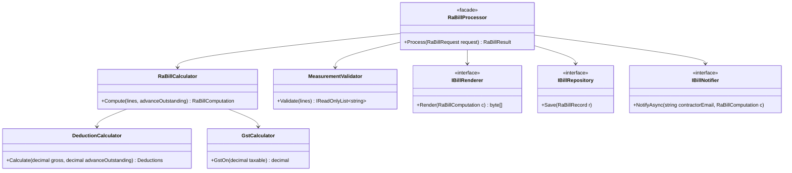
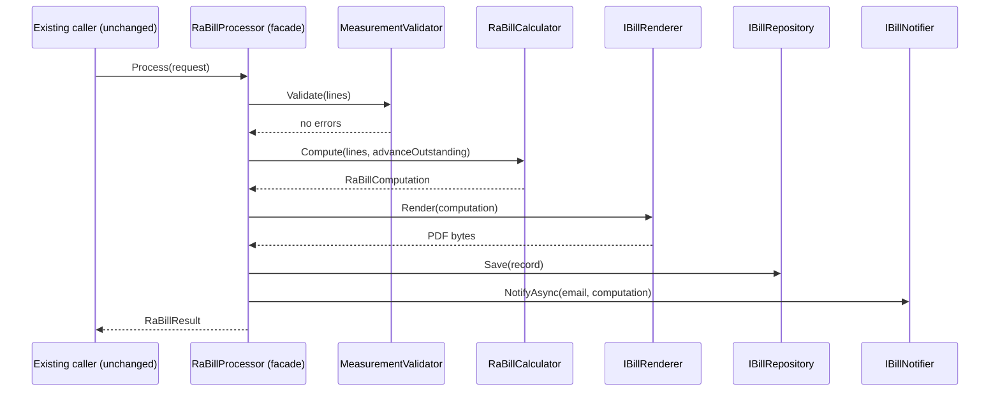
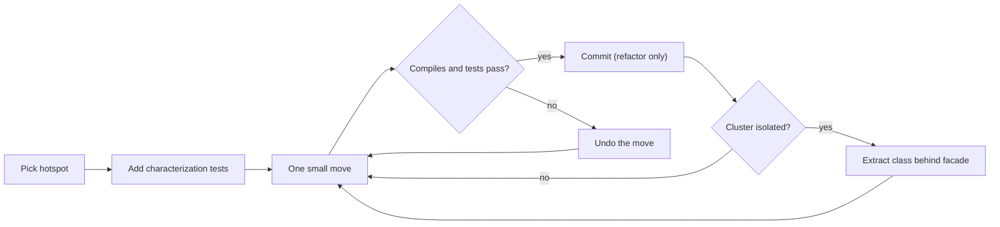

Every codebase older than two years has one: the class everybody is afraid of. It's 2,000 lines long, has 40 fields and 15 constructor parameters, and every new feature "just needs one more method" in it. This lesson shows how to take such a class apart without breaking production and without a big-bang rewrite.

## Learning objectives

By the end of this lesson you will be able to:

1. Recognise a large class (a "god class") from its size, its fields, its dependencies and its change history, and explain why it slows teams down.
2. Find the hidden responsibilities inside it by grouping methods by the fields they use (cohesion analysis) and by who asks for changes.
3. Build a safety net of characterization tests before changing anything.
4. Apply Extract Method, Extract Class, Move Method, Introduce Parameter Object and Replace Conditional with Polymorphism in small, verifiable steps.
5. Keep callers working with a facade while the inside is restructured, then retire the facade.
6. Avoid the classic failure modes: big-bang rewrites, splitting by technical layer, mixing refactoring with behaviour changes.

## Prerequisites

- [Single Responsibility Principle](#/lesson/m04-srp): "one reason to change" is the main tool for deciding where to cut.
- [Code smells](#/lesson/m04-code-smells): Large Class, Long Method, Feature Envy, Data Clumps.
- [Refactoring legacy code](#/lesson/m04-refactoring-legacy): seams and working in small steps.

## Explain it like I'm a beginner

Picture a site office on a highway project where one person, Ramesh, does everything. He checks the measurements engineers send in, calculates the bill amounts, works out tax, deducts retention money, prints the bill, emails the contractor, files a copy, and answers every phone call about any of it.

At first this works. Ramesh knows everything. But as the project grows:

- When the tax rule changes, someone has to explain it to Ramesh, who is also busy printing bills.
- When Ramesh is on leave, nothing moves.
- A mistake in printing can somehow change a tax figure, because it's all in Ramesh's head and on Ramesh's desk.
- Two engineers can't hand him work at the same time without getting in each other's way.

The fix isn't to fire Ramesh and hire a whole new team overnight (a rewrite). That would stop all billing for weeks. Instead, you:

1. **Watch what he does for a week** and write down every output, so you'll know if anything changes. (Characterization tests.)
2. **Notice which papers he uses for which job.** Tax work uses the rate sheet and the gross amount. Printing uses the letterhead and the template. Those are separate jobs. (Grouping methods by fields.)
3. **Move one job at a time to a new desk**, with Ramesh still the person contractors talk to. He just passes the tax work to the tax desk now. (Extract Class behind a facade.)
4. **Check after every move** that the bills look exactly the same.
5. When all jobs have their own desks, contractors can go straight to the right desk, and Ramesh's role becomes "coordinator". (Retire or slim the facade.)

A large class is Ramesh. Refactoring it is moving jobs to new desks, one at a time, checking the output after each move.

## First-principles explanation

### What makes a class "too large"

Size alone isn't the problem. A 600-line class implementing one clear algorithm can be fine. The problem is **many unrelated reasons to change in one place**. Signals, roughly from most to least reliable:

| Signal | What to look for |
|---|---|
| **Change history** | The file appears in a large share of commits and pull requests, often for unrelated features. Merge conflicts on it are routine. |
| **Field clusters** | Groups of fields used by disjoint groups of methods: `_gstRate`, `_tdsRate` used only by tax methods; `_pdfTemplate`, `_logoPath` used only by rendering. |
| **Constructor parameters** | More than about 6–7 injected dependencies, from unrelated areas (repository, SMTP, PDF engine, tax rules, clock, feature flags…). |
| **Method name prefixes** | `ValidateX`, `ValidateY`, `RenderX`, `RenderY`, `EmailX`. Prefixes are often class names waiting to happen. |
| **Section comments** | `// ===== GST =====`, `// ===== PDF =====`. Each banner marks a candidate class. |
| **Long parameter lists and data clumps** | The same three or four parameters (`fromDate, toDate, projectId`) travel together through many methods. |
| **Size metrics** | Lines of code, number of methods, cyclomatic complexity, class coupling. Visual Studio's code metrics report these, as do other static analysis tools. Useful for ranking, not for deciding. |

A powerful combination is **hotspot analysis**: rank files by "how often they change" × "how complex they are". A complex class nobody touches is low priority. A complex class touched in most sprints is where refactoring pays back fastest. Adam Tornhill's book *Your Code as a Crime Scene* describes this technique in depth.

### Why large classes hurt

1. **Change risk.** Every change happens next to unrelated code that shares fields. Changing the retention calculation can break PDF rendering if both read a mutable `_currentBill` field.
2. **Testing cost.** To test the tax calculation, you must construct the class, which needs 15 dependencies, most irrelevant to tax.
3. **Team throughput.** Several developers working on different features all edit the same file. Merge conflicts and code-review load grow with team size.
4. **Comprehension.** Nobody can hold 2,000 lines in their head, so people add code instead of reusing what exists. The class grows faster.
5. **Hidden coupling.** Private helper methods and shared fields let distant features depend on each other invisibly.

### Cohesion: the measurable version of "belongs together"

**Cohesion** means how strongly the parts of a class relate to each other. A practical measure is **LCOM4** (Lack of Cohesion of Methods, version 4, by Hitz and Montazeri):

1. Draw each method as a node.
2. Connect two methods if they use the same field, or if one calls the other.
3. Count the connected groups (components).

LCOM4 = 1 means one cohesive class. LCOM4 = 4 means the class is really four classes that happen to share a file. Each component is a candidate for Extract Class. You'll write this analysis in exercise 5.

Field usage isn't the whole story. Also ask **who requests changes** to each part (the SRP's "actor"). Tax rules change when Finance or the law changes. Bill layout changes when the client wants a new format. Measurement validation changes when site engineers find new kinds of mistakes. Different actors → different classes.

### The safety net: characterization tests

Before you move anything, you need to know if you broke it. In legacy code there often are no tests, and nobody knows exactly what the code *should* do. Michael Feathers' answer is the **characterization test**: a test that records what the code *currently does*, right or wrong.

1. Call the code with a realistic input.
2. Write an assertion with a dummy expected value, run it, and let it fail.
3. Copy the actual output into the assertion. Now the test describes current behaviour.
4. Repeat with inputs that exercise each branch.

For calculations, the **golden master** variant is efficient: run the old code over hundreds or thousands of real or generated inputs, save the outputs, and compare the refactored code's outputs against them. Any difference is either a bug you introduced or a bug you've just discovered in the old code. Both are worth knowing; decide deliberately which to keep.

### The refactoring moves

Martin Fowler's catalogue names the moves. The ones you'll use most on a large class:

| Move | What it does | Typical trigger |
|---|---|---|
| **Extract Method** | Turn a block inside a long method into a named method | A comment explaining what the next 20 lines do |
| **Replace Temp with Query** | Replace a local variable with a method call | The temp blocks extracting a method |
| **Introduce Parameter Object** | Group parameters that travel together into a record | `(DateOnly from, DateOnly to)` everywhere |
| **Extract Class** | Move a cluster of fields and the methods that use them into a new class | A field cluster with its own methods |
| **Move Method / Move Field** | Put a method in the class whose data it uses most | Feature Envy: a method that mostly reads another object's fields |
| **Replace Conditional with Polymorphism** | Replace a `switch` on a type code with strategy classes | `switch (contractType)` repeated in several methods |
| **Hide Delegate / Facade** | Keep the old public API, delegate to the new classes | Many callers you can't change at once |
| **Inline Class** | Merge a class that does too little back into its user | You over-split |

Feathers adds two moves for when you must add a feature *before* refactoring is done:

- **Sprout Method / Sprout Class**: write the new logic in a new, tested method or class, and call it from the old code with a single line.
- **Wrap Method**: rename the old method, create a new one with the old name that calls the old one plus the new behaviour.

Both stop the large class from growing while you're shrinking it.

### The process

1. **Pick the hotspot**, not the ugliest class.
2. **Add characterization tests** around the public methods you'll touch.
3. **Make one small move** (often Extract Method first, to make the clusters visible).
4. **Compile, run tests, commit.** Each commit is a pure refactoring: no behaviour change.
5. **Repeat** until a cluster is isolated, then Extract Class.
6. **Keep the old public API** as a facade, delegating to the new classes.
7. **Migrate callers** to the new classes when it's useful, then remove facade methods nobody uses.

Steps should be minutes long, not days. If a step takes a day, it was several steps.

### When not to refactor

- **Code that works and nobody changes.** Low churn means low payback.
- **Code scheduled for replacement** within a few months.
- **No safety net and no way to build one.** Then the first job is tests, not structure.
- **In the same pull request as a feature.** Do the refactoring first (or after), in its own commits, so reviewers can check "no behaviour changed".

### Trade-offs

| You gain | You pay |
|---|---|
| Smaller classes with one reason to change | More files and types to navigate |
| Each part testable alone with few dependencies | Time spent on tests and moves that don't ship features |
| Parallel work on different parts, fewer merge conflicts | Temporary duplication while the facade and new classes coexist |
| Easier onboarding | Risk of over-splitting into tiny classes that ping-pong calls |

## Visual explanation

### Class diagram: after the split



The old `RaBillProcessor` kept its name and its public `Process` method, so none of its 14 callers changed. Inside, it now only coordinates. Calculation is a pure sub-tree (`RaBillCalculator` with `DeductionCalculator` and `GstCalculator`) that needs no infrastructure to test. Rendering, saving and notifying are behind interfaces because they talk to the outside world. Each box has one kind of reason to change: Finance rules, measurement rules, document layout, storage, messaging.

### Sequence: the facade delegating



The caller's view is identical to before the refactoring. That's what lets you do this work incrementally in a live system: each extracted class goes in behind the facade in its own commit, and characterization tests run against `Process` the whole time. Later, a new caller that only needs a quote (no PDF, no email) can call `RaBillCalculator` directly.

### The refactoring loop



The key edge is "no → undo". If a move breaks tests, don't debug a half-done refactoring; revert it and take a smaller step. Steps are cheap when they're small, and version control makes undo free.

## Step-by-step example

### Step 1 — the class as you find it

An abridged extract of the original (the real one is about 2,100 lines):

```csharp
public class RaBillProcessor
{
    private readonly IDbConnection _db; private readonly SmtpClient _smtp; private readonly PdfEngine _pdf;
    private decimal _gstRate = 0.18m, _retentionPct = 0.05m, _tdsPct = 0.02m, _advanceRecoveryPct = 0.10m;
    private string _logoPath = "", _templatePath = "";
    private RaBill? _current;                       // shared mutable state used by 30 methods

    public RaBillResult Process(RaBillRequest req)
    {
        _current = LoadBill(req.BillId);
        // ===== validate measurements =====
        foreach (var l in req.Lines) { if (l.Quantity <= 0) throw new Exception("bad qty " + l.ItemCode); /* 40 more lines */ }
        // ===== amounts =====
        decimal gross = 0; foreach (var l in req.Lines) gross += Math.Round(l.Quantity * l.Rate, 2);
        var gst = Math.Round(gross * _gstRate, 2);
        var retention = Math.Round(gross * _retentionPct, 2);
        var tds = Math.Round(gross * _tdsPct, 2);
        var recovery = Math.Min(req.AdvanceOutstanding, Math.Round(gross * _advanceRecoveryPct, 2));
        var net = gross + gst - retention - tds - recovery;
        // ===== pdf =====  (120 lines)   ===== save =====  (60 lines)   ===== email =====  (45 lines)
        return new RaBillResult(/* ... */);
    }
    // ... 60 more methods
}
```

### Step 2 — characterization tests first

Run `Process` against 20 real past bills (anonymised) and a few thousand generated ones. Record gross, GST, each deduction and net payable. Store them. Every following step must reproduce them exactly. The playground below shows this technique.

### Step 3 — extract methods to make clusters visible

Turn each banner into a method: `ValidateMeasurements`, `ComputeGross`, `ComputeDeductions`, `RenderPdf`, `SaveBill`, `EmailContractor`. Replace temps with queries where they block extraction. Now the field usage is visible: `ComputeDeductions` uses only `_retentionPct`, `_tdsPct` and `_advanceRecoveryPct`. Commit.

### Step 4 — extract classes, one cluster at a time

Move `ComputeDeductions` and its three fields into `DeductionCalculator`. The old method becomes a one-line delegation. Run tests, commit. Then GST, then the calculator that composes them, then rendering behind `IBillRenderer`, and so on. Each extraction is its own commit, and each is easy to review because no logic changed.

### Step 5 — remove shared mutable state

`_current` was the glue that let any method reach any data. After extraction, each class receives what it needs as parameters and returns results. This is usually the step that removes the subtle bugs.

## Production-style C# implementation

```text
Contracts.Billing/
  Program.cs
  Billing/Model.cs                 records: lines, request, computation, record
  Billing/MeasurementValidator.cs
  Billing/Calculators.cs           GST, deductions, RA bill calculator (pure)
  Billing/Ports.cs                 renderer, repository, notifier + simple adapters
  Billing/RaBillProcessor.cs       the facade, same public API as before
```

```csharp file=Billing/Model.cs
namespace Contracts.Billing;

/// <summary>One measured item from the measurement book: e.g. "Earthwork in embankment", 1,250.5 m³ at ₹285.</summary>
public sealed record MeasurementLine(string ItemCode, string Description, decimal Quantity, string Unit, decimal Rate)
{
    public decimal Amount => Math.Round(Quantity * Rate, 2, MidpointRounding.AwayFromZero);
}

public sealed record RaBillRequest(int BillNumber, string ContractorEmail, IReadOnlyList<MeasurementLine> Lines,
                                   decimal AdvanceOutstanding);

public sealed record Deductions(decimal Retention, decimal Tds, decimal AdvanceRecovery)
{
    public decimal Total => Retention + Tds + AdvanceRecovery;
}

public sealed record RaBillComputation(decimal Gross, decimal Gst, Deductions Deductions)
{
    public decimal NetPayable => Gross + Gst - Deductions.Total;
}

public sealed record RaBillRecord(int BillNumber, RaBillComputation Computation, byte[] Document);

public sealed record RaBillResult(bool Accepted, IReadOnlyList<string> Errors, RaBillComputation? Computation);
```

```csharp file=Billing/MeasurementValidator.cs
namespace Contracts.Billing;

/// <summary>Changes when site engineers find new kinds of measurement mistakes.</summary>
public sealed class MeasurementValidator
{
    private static readonly HashSet<string> KnownUnits = new(StringComparer.OrdinalIgnoreCase) { "m", "m2", "m3", "t", "kg", "nos", "rmt" };

    public IReadOnlyList<string> Validate(IReadOnlyList<MeasurementLine> lines)
    {
        var errors = new List<string>();
        if (lines.Count == 0) errors.Add("A bill needs at least one measurement line.");
        foreach (var l in lines)
        {
            if (l.Quantity <= 0) errors.Add($"{l.ItemCode}: quantity must be positive.");
            if (l.Rate <= 0) errors.Add($"{l.ItemCode}: rate must be positive.");
            if (!KnownUnits.Contains(l.Unit)) errors.Add($"{l.ItemCode}: unknown unit '{l.Unit}'.");
        }
        foreach (var dup in lines.GroupBy(l => l.ItemCode).Where(g => g.Count() > 1))
            errors.Add($"{dup.Key}: appears {dup.Count()} times; combine the measurements.");
        return errors;
    }
}
```

```csharp file=Billing/Calculators.cs
using Microsoft.Extensions.Options;

namespace Contracts.Billing;

/// <summary>Rates are illustrative. Real contracts and tax law define their own; keep them in configuration.</summary>
public sealed class BillingRates
{
    public decimal GstRate { get; set; } = 0.18m;
    public decimal RetentionRate { get; set; } = 0.05m;
    public decimal TdsRate { get; set; } = 0.02m;
    public decimal AdvanceRecoveryRate { get; set; } = 0.10m;
}

/// <summary>Changes when tax rules change.</summary>
public sealed class GstCalculator(IOptions<BillingRates> rates)
{
    public decimal GstOn(decimal taxable) => Round(taxable * rates.Value.GstRate);
    internal static decimal Round(decimal v) => Math.Round(v, 2, MidpointRounding.AwayFromZero);
}

/// <summary>Changes when contract deduction clauses change.</summary>
public sealed class DeductionCalculator(IOptions<BillingRates> rates)
{
    public Deductions Calculate(decimal gross, decimal advanceOutstanding)
    {
        var r = rates.Value;
        var retention = GstCalculator.Round(gross * r.RetentionRate);
        var tds = GstCalculator.Round(gross * r.TdsRate);                  // on the value excluding GST
        var recovery = Math.Min(Math.Max(advanceOutstanding, 0m), GstCalculator.Round(gross * r.AdvanceRecoveryRate));
        return new Deductions(retention, tds, recovery);
    }
}

/// <summary>Pure composition of the money rules. No I/O, so tests need no doubles.</summary>
public sealed class RaBillCalculator(GstCalculator gst, DeductionCalculator deductions)
{
    public RaBillComputation Compute(IReadOnlyList<MeasurementLine> lines, decimal advanceOutstanding)
    {
        var gross = lines.Sum(l => l.Amount);
        return new RaBillComputation(gross, gst.GstOn(gross), deductions.Calculate(gross, advanceOutstanding));
    }
}
```

```csharp file=Billing/Ports.cs
using System.Collections.Concurrent;
using System.Globalization;
using System.Text;
using Microsoft.Extensions.Logging;

namespace Contracts.Billing;

public interface IBillRenderer { byte[] Render(int billNumber, RaBillComputation computation); }
public interface IBillRepository { void Save(RaBillRecord record); }
public interface IBillNotifier { Task NotifyAsync(string contractorEmail, int billNumber, RaBillComputation computation, CancellationToken ct); }

/// <summary>Placeholder renderer: plain text. A PDF adapter would implement the same interface.</summary>
public sealed class TextBillRenderer : IBillRenderer
{
    private static readonly CultureInfo India = CultureInfo.GetCultureInfo("en-IN");
    public byte[] Render(int billNumber, RaBillComputation c) => Encoding.UTF8.GetBytes(string.Create(India,
        $"RA Bill {billNumber}\nGross {c.Gross:N2}\nGST {c.Gst:N2}\nRetention {c.Deductions.Retention:N2}\n" +
        $"TDS {c.Deductions.Tds:N2}\nAdvance recovery {c.Deductions.AdvanceRecovery:N2}\nNet payable {c.NetPayable:N2}\n"));
}

public sealed class InMemoryBillRepository : IBillRepository
{
    private readonly ConcurrentDictionary<int, RaBillRecord> _bills = new();
    public void Save(RaBillRecord record) => _bills[record.BillNumber] = record;
    public RaBillRecord? Find(int billNumber) => _bills.TryGetValue(billNumber, out var r) ? r : null;
}

public sealed class LoggingBillNotifier(ILogger<LoggingBillNotifier> logger) : IBillNotifier
{
    public Task NotifyAsync(string contractorEmail, int billNumber, RaBillComputation c, CancellationToken ct)
    {
        logger.LogInformation("RA bill {Bill} ready for {Email}: net {Net}", billNumber, contractorEmail, c.NetPayable);
        return Task.CompletedTask;
    }
}
```

```csharp file=Billing/RaBillProcessor.cs
namespace Contracts.Billing;

/// <summary>Facade: same public API the 14 existing callers use. It only coordinates now.</summary>
public sealed class RaBillProcessor(MeasurementValidator validator, RaBillCalculator calculator, IBillRenderer renderer,
                                    IBillRepository repository, IBillNotifier notifier)
{
    public async Task<RaBillResult> ProcessAsync(RaBillRequest request, CancellationToken ct = default)
    {
        var errors = validator.Validate(request.Lines);
        if (errors.Count > 0) return new RaBillResult(false, errors, null);

        var computation = calculator.Compute(request.Lines, request.AdvanceOutstanding);
        var document = renderer.Render(request.BillNumber, computation);
        repository.Save(new RaBillRecord(request.BillNumber, computation, document));
        await notifier.NotifyAsync(request.ContractorEmail, request.BillNumber, computation, ct);
        return new RaBillResult(true, [], computation);
    }
}
```

```csharp file=Program.cs
using Contracts.Billing;

var builder = WebApplication.CreateBuilder(args);

builder.Services.Configure<BillingRates>(builder.Configuration.GetSection("BillingRates"));
builder.Services.AddSingleton<MeasurementValidator>();
builder.Services.AddSingleton<GstCalculator>();
builder.Services.AddSingleton<DeductionCalculator>();
builder.Services.AddSingleton<RaBillCalculator>();
builder.Services.AddSingleton<IBillRenderer, TextBillRenderer>();
builder.Services.AddSingleton<IBillRepository, InMemoryBillRepository>();
builder.Services.AddSingleton<IBillNotifier, LoggingBillNotifier>();
builder.Services.AddScoped<RaBillProcessor>();

var app = builder.Build();

// Existing endpoint: unchanged contract.
app.MapPost("/ra-bills", async (RaBillRequest req, RaBillProcessor processor, CancellationToken ct) =>
{
    var result = await processor.ProcessAsync(req, ct);
    return result.Accepted ? Results.Ok(result.Computation) : Results.BadRequest(result.Errors);
});

// New endpoint made cheap by the split: a quote with no PDF, no save, no email.
app.MapPost("/ra-bills/quote", (RaBillRequest req, MeasurementValidator v, RaBillCalculator calc) =>
    v.Validate(req.Lines) is { Count: > 0 } errors
        ? Results.BadRequest(errors)
        : Results.Ok(calc.Compute(req.Lines, req.AdvanceOutstanding)));

app.Run();
```

The second endpoint shows the payoff. Before the split, a "quote" meant calling the god class with a flag like `dryRun: true` and hoping every side effect checked it. Now it's three lines that reuse the pure calculator.

## Bad design vs good design

**Bad refactoring #1, the big-bang rewrite.** "We'll write `RaBillProcessorV2` from scratch in two sprints." Three months later, V2 handles 80 % of cases, the old class has gained six new features nobody ported, and both are in production. The rewrite lost the undocumented rules the old code encoded, such as a special rounding for one state's contracts that a client had demanded years ago.

**Bad refactoring #2, splitting by technical layer.** The 2,000-line class becomes `RaBillHelper`, `RaBillUtils`, `RaBillManager` and `RaBillCommon`, each 500 lines. Every feature still touches all four, the fields are now passed around in a `context` object, and the "one reason to change" problem is unchanged. File size went down; cohesion didn't go up.

**Bad refactoring #3, too fine.** Every line becomes a class: `RetentionCalculator`, `TdsCalculator`, `AdvanceRecoveryCalculator`, `NetPayableCalculator`, each with an interface and a DI registration. Understanding one bill now means opening 12 files that call each other in a chain. The fix is **Inline Class** until each class has a meaningful responsibility, as in `DeductionCalculator` above.

**Good**: the version above. Split along reasons to change (validation, money rules, rendering, storage, messaging), keep the old API as a facade, keep the money rules pure, and move in small commits with characterization tests.

**Is it worth it?** For a class with low churn, often not; leave it alone and use Sprout Class for new features. For a hotspot that the team touches every sprint, the investment usually pays back within a few months through fewer regressions and faster changes. That's a judgement, not a measured number; track lead time and bug counts on the area before and after to see if it's true for your team.

:::callout type=mistake title="Refactoring and changing behaviour in one commit"
A pull request that moves 400 lines *and* fixes a rounding bug is almost impossible to review: is the diff a move or a change? Keep "pure move" commits separate from "behaviour change" commits. If the golden master tests show a difference during a move, you've either made a mistake or found an old bug; either way, stop and handle it in its own commit.
:::

## Practical playground

This is a golden-master check. `LegacyCalculator` is the original tangled code; `RefactoredCalculator` is the new one. The program runs both over 5,000 generated bills with a fixed random seed and counts differences. Try introducing a "small" change in the refactored version (round TDS with `ToEven` instead of `AwayFromZero`) and see how quickly the golden master catches it.

:::playground type=csharp title="Golden master: old vs new"
```csharp file=Program.cs
using System;
using System.Collections.Generic;
using System.Linq;

public sealed record Line(decimal Qty, decimal Rate);

public static class LegacyCalculator
{
    // Tangled original: everything inline, temps everywhere.
    public static (decimal Gross, decimal Net) Compute(List<Line> lines, decimal adv)
    {
        decimal g = 0;
        foreach (var l in lines) g += Math.Round(l.Qty * l.Rate, 2, MidpointRounding.AwayFromZero);
        var gst = Math.Round(g * 0.18m, 2, MidpointRounding.AwayFromZero);
        var ret = Math.Round(g * 0.05m, 2, MidpointRounding.AwayFromZero);
        var tds = Math.Round(g * 0.02m, 2, MidpointRounding.AwayFromZero);
        var rec = Math.Round(g * 0.10m, 2, MidpointRounding.AwayFromZero);
        if (adv < rec) rec = adv < 0 ? 0 : adv;
        return (g, g + gst - ret - tds - rec);
    }
}

public static class RefactoredCalculator
{
    private static decimal R(decimal v) => Math.Round(v, 2, MidpointRounding.AwayFromZero);
    public static decimal Gross(IEnumerable<Line> lines) => lines.Sum(l => R(l.Qty * l.Rate));
    public static decimal Gst(decimal gross) => R(gross * 0.18m);
    public static decimal Deductions(decimal gross, decimal adv) =>
        R(gross * 0.05m) + R(gross * 0.02m) + Math.Min(Math.Max(adv, 0m), R(gross * 0.10m));
    public static (decimal Gross, decimal Net) Compute(List<Line> lines, decimal adv)
    {
        var g = Gross(lines);
        return (g, g + Gst(g) - Deductions(g, adv));
    }
}

public static class Program
{
    public static void Main()
    {
        var rng = new Random(20260401);   // fixed seed: the same "random" bills every run
        int cases = 5000, mismatches = 0;
        for (var i = 0; i < cases; i++)
        {
            var lines = Enumerable.Range(0, rng.Next(1, 12))
                .Select(_ => new Line(Math.Round((decimal)rng.NextDouble() * 2000m, 3), Math.Round((decimal)rng.NextDouble() * 900m + 10m, 2)))
                .ToList();
            var adv = rng.Next(0, 4) == 0 ? -1m : Math.Round((decimal)rng.NextDouble() * 500_000m, 2);
            var a = LegacyCalculator.Compute(lines, adv);
            var b = RefactoredCalculator.Compute(lines, adv);
            if (a != b)
            {
                if (++mismatches <= 3) Console.WriteLine($"Mismatch #{mismatches}: legacy {a}, refactored {b}");
            }
        }
        Console.WriteLine($"{cases} bills compared, {mismatches} mismatches.");
    }
}
```
:::

## Exercises

:::exercise id=m07-refactoring-large-classes-ex1 difficulty=beginner kind=code title="Extract methods from a net-payable calculation"
`NetPayable.Calculate` is one long method with temps. Extract three public static methods, `Retention(gross)`, `Tds(gross)` and `AdvanceRecovery(gross, outstanding)`, and make `Calculate` use them. Behaviour must not change.
::requirements
- Retention = 5 % of gross; TDS = 2 % of gross; advance recovery = 10 % of gross, but never more than the outstanding advance and never negative.
- Every amount is rounded to 2 decimals, midpoint away from zero, exactly as the original does.
- `Calculate(gross, outstanding)` = gross − retention − TDS − recovery.
::acceptance
- `Retention(1_00_000)` = 5,000; `Tds(1_00_000)` = 2,000.
- `AdvanceRecovery(1_00_000, 4_000)` = 4,000 (capped by outstanding); `AdvanceRecovery(1_00_000, 50_000)` = 10,000.
- A negative outstanding gives recovery 0.
- `Calculate` returns the same values as the original for all test inputs.
::hint
Start with the block that computes retention. Select it, Extract Method, and give it the gross as its only input.
::hint
The `rec` temp is assigned twice in the original. Fold both assignments into one expression inside `AdvanceRecovery` before extracting.
::hint
Keep the rounding helper private and shared, so all three methods round the same way.
::hint
`Math.Min(Math.Max(outstanding, 0m), R(gross * 0.10m))` captures both caps.
::starter
```csharp file=NetPayable.cs
using System;

public static class NetPayable
{
    public static decimal Calculate(decimal gross, decimal outstanding)
    {
        // retention
        var ret = Math.Round(gross * 0.05m, 2, MidpointRounding.AwayFromZero);
        // tds
        var tds = Math.Round(gross * 0.02m, 2, MidpointRounding.AwayFromZero);
        // advance recovery
        var rec = Math.Round(gross * 0.10m, 2, MidpointRounding.AwayFromZero);
        if (outstanding < rec) rec = outstanding;
        if (rec < 0) rec = 0;
        return gross - ret - tds - rec;
    }

    public static decimal Retention(decimal gross) => throw new NotImplementedException();
    public static decimal Tds(decimal gross) => throw new NotImplementedException();
    public static decimal AdvanceRecovery(decimal gross, decimal outstanding) => throw new NotImplementedException();
}
```
::tests
```csharp file=NetPayableTests.cs
using Xunit;

public class NetPayableTests
{
    [Fact] public void Retention_is_five_percent() => Assert.Equal(5000m, NetPayable.Retention(100000m));
    [Fact] public void Tds_is_two_percent() => Assert.Equal(2000m, NetPayable.Tds(100000m));
    [Fact] public void Recovery_capped_by_outstanding() => Assert.Equal(4000m, NetPayable.AdvanceRecovery(100000m, 4000m));
    [Fact] public void Recovery_ten_percent() => Assert.Equal(10000m, NetPayable.AdvanceRecovery(100000m, 50000m));
    [Fact] public void Negative_outstanding_is_zero() => Assert.Equal(0m, NetPayable.AdvanceRecovery(100000m, -10m));
    [Fact] public void Rounds_away_from_zero() => Assert.Equal(0.03m, NetPayable.Retention(0.5m));

    [Theory]
    [InlineData(100000, 50000, 83000)]
    [InlineData(100000, 4000, 89000)]
    [InlineData(123456.78, 0, 114814.80)]
    [InlineData(0, 1000, 0)]
    public void Calculate_unchanged(decimal gross, decimal outstanding, decimal expected) =>
        Assert.Equal(expected, NetPayable.Calculate(gross, outstanding));
}
```
::solution
```csharp file=NetPayable.cs
using System;

public static class NetPayable
{
    public static decimal Calculate(decimal gross, decimal outstanding) =>
        gross - Retention(gross) - Tds(gross) - AdvanceRecovery(gross, outstanding);

    public static decimal Retention(decimal gross) => R(gross * 0.05m);
    public static decimal Tds(decimal gross) => R(gross * 0.02m);
    public static decimal AdvanceRecovery(decimal gross, decimal outstanding) =>
        Math.Min(Math.Max(outstanding, 0m), R(gross * 0.10m));

    private static decimal R(decimal v) => Math.Round(v, 2, MidpointRounding.AwayFromZero);
}
```

The comments in the original (`// retention`, `// tds`) were method names in disguise. Once the methods exist, the comments aren't needed.

Check the third theory row by hand, the way you would when writing a characterization test: retention = 123,456.78 × 0.05 = 6,172.839 → 6,172.84; TDS = 2,469.1356 → 2,469.14; recovery = 0 because nothing is outstanding. Net = 123,456.78 − 6,172.84 − 2,469.14 = 114,814.80. The expected values in such a test should always come from running the *original* code, not from your own arithmetic: if the two disagree, the original's behaviour is what you must preserve (or deliberately change in a separate commit).
::mistakes
- Changing the rounding mode while extracting ("ToEven is the default anyway"). That's a behaviour change.
- Leaving the old inline code in place and *also* adding the new methods, so two copies drift apart.
- Extracting with `ref` parameters because the temp `rec` is reassigned. Fold the logic into one expression first.
:::

:::exercise id=m07-refactoring-large-classes-ex2 difficulty=beginner kind=code title="Introduce a BillPeriod parameter object"
Many methods in the billing class take `(DateOnly from, DateOnly to)`, and each one re-checks that `from <= to`. Introduce a `BillPeriod` record that validates once, and use it in `MeasurementFilter.InPeriod`.
::requirements
- `BillPeriod(DateOnly From, DateOnly To)` throws `ArgumentException` when `To` is before `From`.
- `Contains(DateOnly d)` is inclusive at both ends.
- `Days` returns the number of calendar days, inclusive (1 March to 31 March is 31 days).
- `BillPeriod.ForMonth(int year, int month)` creates a full-month period.
- `MeasurementFilter.InPeriod(entries, period)` returns entries whose `MeasuredOn` is inside the period, in input order.
::acceptance
- `new BillPeriod(Mar 10, Mar 1)` throws.
- `ForMonth(2028, 2).Days` = 29 (leap year), `ForMonth(2026, 2).Days` = 28.
- `Contains` is true on both boundary dates and false one day outside.
- The filter keeps order and excludes out-of-period entries.
::hint
Data that travels together and is validated together is one concept. Give it a name and a home.
::hint
Validate in the constructor, once. The starter already uses a non-positional record with an explicit constructor and get-only properties, so the values can't be changed after validation.
::hint
```csharp
public BillPeriod(DateOnly from, DateOnly to)
{
    if (to < from) throw new ArgumentException("End is before start.", nameof(to));
    From = from; To = to;
}
```
::hint
`Days => To.DayNumber - From.DayNumber + 1`; `ForMonth => new(new DateOnly(y, m, 1), new DateOnly(y, m, DateTime.DaysInMonth(y, m)))`.
::starter
```csharp file=BillPeriod.cs
using System;
using System.Collections.Generic;
using System.Linq;

public sealed record MeasurementEntry(string ItemCode, decimal Quantity, DateOnly MeasuredOn);

public sealed record BillPeriod
{
    public BillPeriod(DateOnly from, DateOnly to) => throw new NotImplementedException();
    public DateOnly From { get; }
    public DateOnly To { get; }
    public int Days => throw new NotImplementedException();
    public bool Contains(DateOnly date) => throw new NotImplementedException();
    public static BillPeriod ForMonth(int year, int month) => throw new NotImplementedException();
}

public static class MeasurementFilter
{
    public static IReadOnlyList<MeasurementEntry> InPeriod(IEnumerable<MeasurementEntry> entries, BillPeriod period) =>
        throw new NotImplementedException();
}
```
::tests
```csharp file=BillPeriodTests.cs
using System;
using System.Linq;
using Xunit;

public class BillPeriodTests
{
    [Fact] public void Reversed_dates_throw() => Assert.Throws<ArgumentException>(() => new BillPeriod(new DateOnly(2026, 3, 10), new DateOnly(2026, 3, 1)));
    [Fact] public void Leap_february() => Assert.Equal(29, BillPeriod.ForMonth(2028, 2).Days);
    [Fact] public void Normal_february() => Assert.Equal(28, BillPeriod.ForMonth(2026, 2).Days);
    [Fact] public void Single_day_period() => Assert.Equal(1, new BillPeriod(new DateOnly(2026, 3, 5), new DateOnly(2026, 3, 5)).Days);

    [Fact]
    public void Contains_is_inclusive()
    {
        var p = BillPeriod.ForMonth(2026, 3);
        Assert.True(p.Contains(new DateOnly(2026, 3, 1)));
        Assert.True(p.Contains(new DateOnly(2026, 3, 31)));
        Assert.False(p.Contains(new DateOnly(2026, 2, 28)));
        Assert.False(p.Contains(new DateOnly(2026, 4, 1)));
    }

    [Fact]
    public void Filter_keeps_order()
    {
        var entries = new[]
        {
            new MeasurementEntry("EW-01", 120m, new DateOnly(2026, 3, 30)),
            new MeasurementEntry("GSB-02", 40m, new DateOnly(2026, 2, 27)),
            new MeasurementEntry("WMM-03", 55m, new DateOnly(2026, 3, 2)),
        };
        var result = MeasurementFilter.InPeriod(entries, BillPeriod.ForMonth(2026, 3));
        Assert.Equal(new[] { "EW-01", "WMM-03" }, result.Select(e => e.ItemCode).ToArray());
    }

    [Fact] public void Value_equality() => Assert.Equal(BillPeriod.ForMonth(2026, 3), new BillPeriod(new DateOnly(2026, 3, 1), new DateOnly(2026, 3, 31)));
}
```
::solution
```csharp file=BillPeriod.cs
using System;
using System.Collections.Generic;
using System.Linq;

public sealed record MeasurementEntry(string ItemCode, decimal Quantity, DateOnly MeasuredOn);

public sealed record BillPeriod
{
    public BillPeriod(DateOnly from, DateOnly to)
    {
        if (to < from) throw new ArgumentException($"Period end {to} is before start {from}.", nameof(to));
        From = from;
        To = to;
    }

    public DateOnly From { get; }
    public DateOnly To { get; }
    public int Days => To.DayNumber - From.DayNumber + 1;
    public bool Contains(DateOnly date) => date >= From && date <= To;

    public static BillPeriod ForMonth(int year, int month) =>
        new(new DateOnly(year, month, 1), new DateOnly(year, month, DateTime.DaysInMonth(year, month)));
}

public static class MeasurementFilter
{
    public static IReadOnlyList<MeasurementEntry> InPeriod(IEnumerable<MeasurementEntry> entries, BillPeriod period) =>
        entries.Where(e => period.Contains(e.MeasuredOn)).ToList();
}
```

The validation that used to be repeated in many methods now happens once, in the constructor. Every method that takes a `BillPeriod` can trust it. This is how a parameter object often becomes the seed of a real domain concept: next, "Is this period overlapping a previous bill?" will want to live on `BillPeriod` too.
::mistakes
- Making `From` and `To` settable, so a valid period can be made invalid later.
- An exclusive end date in `Contains`, which drops the last day's measurements from every bill.
- Introducing the record but keeping the old `(from, to)` overloads forever. Migrate callers, then delete them.
:::

:::exercise id=m07-refactoring-large-classes-ex3 difficulty=intermediate kind=code title="Extract Class behind a facade"
`ContractorAccount` mixes three responsibilities: contact details, bank details and advance balance. Extract `BankDetails` (with IFSC validation and a masked account number) and `ContactDetails`, while keeping the old `ContractorAccount` members working so existing callers don't change.
::requirements
- `BankDetails(string ifsc, string accountNumber)`: IFSC is normalised to upper case and must match 4 letters, `0`, then 6 letters or digits (e.g. `SBIN0001234`). Account number is 9–18 digits. Invalid input throws `ArgumentException`.
- `BankDetails.Masked` shows only the last 4 digits: `XXXXXX7890` (same length as the original).
- `ContactDetails(string name, string email)` trims both; email must contain `@`.
- `ContractorAccount` exposes `Bank` and `Contact` properties **and** keeps the old members `Ifsc`, `AccountNumber`, `Email`, `Name`, `MaskedAccount` and `UpdateBank(ifsc, account)`, delegating to the new classes.
- Advance logic (`AdvanceOutstanding`, `RecoverAdvance`) stays in `ContractorAccount`.
::acceptance
- `new BankDetails("sbin0001234", "123456789012").Ifsc == "SBIN0001234"`.
- Invalid IFSC `SBIN1001234` or account `12AB` throws.
- `MaskedAccount` for `1234567890` is `XXXXXX7890`.
- Old members still return the same values as before.
- `UpdateBank` with invalid data throws and leaves the old bank details unchanged.
::hint
Look at which fields each method uses. `_ifsc` and `_accountNumber` are used only by bank-related methods: that's the first cluster.
::hint
Create `BankDetails` as an immutable class or record with the validation in its constructor. Then replace the two fields in `ContractorAccount` with one `BankDetails` field.
::hint
`UpdateBank` builds a *new* `BankDetails` first and only assigns it if construction succeeded. That gives you "unchanged on failure" for free.
::hint
Old members become one-liners: `public string Ifsc => Bank.Ifsc;`. Mark them `[Obsolete("Use Bank.Ifsc")]` later, once callers can migrate.
::starter
```csharp file=ContractorAccount.cs
using System;
using System.Linq;
using System.Text.RegularExpressions;

public sealed class BankDetails
{
    public BankDetails(string ifsc, string accountNumber) => throw new NotImplementedException();
    public string Ifsc { get; } = "";
    public string AccountNumber { get; } = "";
    public string Masked => throw new NotImplementedException();
}

public sealed class ContactDetails
{
    public ContactDetails(string name, string email) => throw new NotImplementedException();
    public string Name { get; } = "";
    public string Email { get; } = "";
}

/// <summary>The original large class. Today it validates bank and contact data inline.</summary>
public sealed class ContractorAccount
{
    private string _name;
    private string _email;
    private string _ifsc;
    private string _accountNumber;
    private decimal _advanceOutstanding;

    public ContractorAccount(string name, string email, string ifsc, string accountNumber, decimal advance)
    {
        _name = name.Trim();
        _email = email.Trim();
        _ifsc = ifsc.ToUpperInvariant();
        _accountNumber = accountNumber;
        _advanceOutstanding = advance;
    }

    public BankDetails Bank => throw new NotImplementedException();
    public ContactDetails Contact => throw new NotImplementedException();

    public string Name => _name;
    public string Email => _email;
    public string Ifsc => _ifsc;
    public string AccountNumber => _accountNumber;
    public string MaskedAccount => new string('X', _accountNumber.Length - 4) + _accountNumber[^4..];
    public void UpdateBank(string ifsc, string accountNumber) { _ifsc = ifsc.ToUpperInvariant(); _accountNumber = accountNumber; }

    public decimal AdvanceOutstanding => _advanceOutstanding;
    public decimal RecoverAdvance(decimal requested)
    {
        var amount = Math.Min(Math.Max(requested, 0m), _advanceOutstanding);
        _advanceOutstanding -= amount;
        return amount;
    }
}
```
::tests
```csharp file=ContractorAccountTests.cs
using System;
using Xunit;

public class ContractorAccountTests
{
    private static ContractorAccount Make() => new(" Shree Infra Pvt Ltd ", " accounts@shreeinfra.example ", "sbin0001234", "1234567890", 500000m);

    [Fact] public void Ifsc_normalised() => Assert.Equal("SBIN0001234", new BankDetails("sbin0001234", "123456789012").Ifsc);
    [Fact] public void Bad_ifsc_throws() => Assert.Throws<ArgumentException>(() => new BankDetails("SBIN1001234", "123456789"));
    [Fact] public void Bad_account_throws() => Assert.Throws<ArgumentException>(() => new BankDetails("SBIN0001234", "12AB"));
    [Fact] public void Masked() => Assert.Equal("XXXXXX7890", new BankDetails("HDFC0000123", "1234567890").Masked);
    [Fact] public void Contact_trims() => Assert.Equal("Shree Infra Pvt Ltd", new ContactDetails(" Shree Infra Pvt Ltd ", "a@b.example").Name);
    [Fact] public void Bad_email_throws() => Assert.Throws<ArgumentException>(() => new ContactDetails("X", "not-an-email"));

    [Fact]
    public void Old_members_still_work()
    {
        var a = Make();
        Assert.Equal("Shree Infra Pvt Ltd", a.Name);
        Assert.Equal("accounts@shreeinfra.example", a.Email);
        Assert.Equal("SBIN0001234", a.Ifsc);
        Assert.Equal("1234567890", a.AccountNumber);
        Assert.Equal("XXXXXX7890", a.MaskedAccount);
        Assert.Same(a.Bank, a.Bank);
        Assert.Equal(a.Bank.Ifsc, a.Ifsc);
        Assert.Equal(a.Contact.Email, a.Email);
    }

    [Fact]
    public void Failed_update_leaves_bank_unchanged()
    {
        var a = Make();
        Assert.Throws<ArgumentException>(() => a.UpdateBank("BAD", "1"));
        Assert.Equal("SBIN0001234", a.Ifsc);
        a.UpdateBank("icic0004567", "998877665544");
        Assert.Equal("ICIC0004567", a.Bank.Ifsc);
    }

    [Fact]
    public void Advance_logic_unchanged()
    {
        var a = Make();
        Assert.Equal(200000m, a.RecoverAdvance(200000m));
        Assert.Equal(300000m, a.RecoverAdvance(999999m));
        Assert.Equal(0m, a.AdvanceOutstanding);
    }
}
```
::solution
```csharp file=ContractorAccount.cs
using System;
using System.Linq;
using System.Text.RegularExpressions;

public sealed class BankDetails
{
    private static readonly Regex IfscFormat = new("^[A-Z]{4}0[A-Z0-9]{6}$", RegexOptions.CultureInvariant);

    public BankDetails(string ifsc, string accountNumber)
    {
        var i = (ifsc ?? "").Trim().ToUpperInvariant();
        var a = (accountNumber ?? "").Trim();
        if (!IfscFormat.IsMatch(i)) throw new ArgumentException($"'{ifsc}' is not a valid IFSC.", nameof(ifsc));
        if (a.Length is < 9 or > 18 || !a.All(char.IsAsciiDigit))
            throw new ArgumentException("Account number must be 9 to 18 digits.", nameof(accountNumber));
        Ifsc = i;
        AccountNumber = a;
    }

    public string Ifsc { get; }
    public string AccountNumber { get; }
    public string Masked => new string('X', AccountNumber.Length - 4) + AccountNumber[^4..];
}

public sealed class ContactDetails
{
    public ContactDetails(string name, string email)
    {
        var n = (name ?? "").Trim();
        var e = (email ?? "").Trim();
        if (n.Length == 0) throw new ArgumentException("Name is required.", nameof(name));
        if (!e.Contains('@')) throw new ArgumentException($"'{email}' is not a valid email.", nameof(email));
        Name = n;
        Email = e;
    }

    public string Name { get; }
    public string Email { get; }
}

public sealed class ContractorAccount
{
    private decimal _advanceOutstanding;

    public ContractorAccount(string name, string email, string ifsc, string accountNumber, decimal advance)
    {
        Contact = new ContactDetails(name, email);
        Bank = new BankDetails(ifsc, accountNumber);
        _advanceOutstanding = advance;
    }

    public BankDetails Bank { get; private set; }
    public ContactDetails Contact { get; }

    // Facade members kept for existing callers. Mark [Obsolete] once callers can migrate.
    public string Name => Contact.Name;
    public string Email => Contact.Email;
    public string Ifsc => Bank.Ifsc;
    public string AccountNumber => Bank.AccountNumber;
    public string MaskedAccount => Bank.Masked;
    public void UpdateBank(string ifsc, string accountNumber) => Bank = new BankDetails(ifsc, accountNumber);

    public decimal AdvanceOutstanding => _advanceOutstanding;
    public decimal RecoverAdvance(decimal requested)
    {
        var amount = Math.Min(Math.Max(requested, 0m), _advanceOutstanding);
        _advanceOutstanding -= amount;
        return amount;
    }
}
```

Two things improved beyond structure. Validation now exists (the original happily stored any IFSC), and a failed bank update can't leave the account half-changed, because the new value is built completely before it's assigned. Notice the validation *is* a behaviour change: in a real codebase you'd ship the extraction first, then add validation in a separate commit, after checking existing data passes it.
::alternatives
`BankDetails` and `ContactDetails` are good candidates for `sealed record`s with a validating constructor, which also gives them value equality. If existing database rows may contain invalid IFSCs, add a `BankDetails.FromTrusted(...)` factory for loading legacy data and use the validating constructor for new input.
::mistakes
- Deleting the old members in the same change, breaking every caller at once.
- Assigning fields one at a time in `UpdateBank`, so an exception halfway leaves a new IFSC with the old account.
- Moving the advance logic too. It has nothing to do with bank or contact details; extraction is per cluster, not "move everything".
:::

:::exercise id=m07-refactoring-large-classes-ex4 difficulty=intermediate kind=design title="Plan the split of a TenderManager god class"
An e-procurement module has a `TenderManager` with 1,800 lines, 31 fields and these public methods (grouped here for you, but scattered in the file):

`RegisterBidder`, `VerifyBidderDocuments`, `BlacklistBidder`, `PublishTender`, `IssueCorrigendum`, `ExtendDeadline`, `RecordEmdPayment` (earnest money deposit), `RefundEmd`, `ForfeitEmd`, `OpenTechnicalBids`, `ScoreTechnicalBid`, `OpenFinancialBids`, `DetermineL1` (lowest bidder), `SendBidderSms`, `SendBidderEmail`, `GenerateComparativeStatementPdf`, `WriteAuditLog`.

Design the target classes in the LLD designer and describe the order in which you would extract them.
::acceptance
- Each new class has one clear reason to change and a short responsibility statement.
- `TenderManager` remains as a thin facade (or is replaced by a small set of application services) so callers keep working during migration.
- Notifications, PDF generation and audit logging are behind interfaces.
- The extraction order starts with the lowest-risk, highest-value cluster and says why.
- No class is named `Helper`, `Utils` or `Manager2`.
::hint
Group the methods by the *data* they touch: bidder records, tender notice and dates, EMD money, bids and scores, outbound messages, documents, audit.
::hint
Who asks for changes? Procurement officers (tender lifecycle), finance (EMD), evaluation committee (scoring rules), IT/compliance (audit), communications (SMS/email wording).
::hint
Start extraction where the code is most isolated and most often changed. Notifications and PDF generation are usually the easiest first moves because they only *read* data.
::hint
Money and evaluation rules deserve pure classes (easy to test with characterization tests). Lifecycle rules (published → corrigendum → closed → opened) may become a state machine later.
::starter
```json file=design.json
{
  "classes": [
    { "id": "TM", "name": "TenderManager", "kind": "class", "fields": ["-31 fields"], "methods": ["+RegisterBidder()", "+PublishTender()", "+RecordEmdPayment()", "+OpenTechnicalBids()", "+DetermineL1()", "+SendBidderSms()", "+GenerateComparativeStatementPdf()", "+WriteAuditLog()"], "responsibility": "Everything" }
  ],
  "relations": []
}
```
::solution
```json file=design.json
{
  "classes": [
    { "id": "TM", "name": "TenderManager", "kind": "class", "fields": [], "methods": ["+(old public API, delegating)"], "responsibility": "Facade during migration; deleted when callers move" },
    { "id": "Reg", "name": "BidderRegistry", "kind": "class", "fields": [], "methods": ["+Register(BidderApplication a)", "+VerifyDocuments(BidderId id)", "+Blacklist(BidderId id, string reason)"], "responsibility": "Bidder records and eligibility" },
    { "id": "Life", "name": "TenderLifecycle", "kind": "class", "fields": [], "methods": ["+Publish(TenderId id)", "+IssueCorrigendum(TenderId id, Corrigendum c)", "+ExtendDeadline(TenderId id, DateTimeOffset d)"], "responsibility": "Tender notice, dates and status transitions" },
    { "id": "Emd", "name": "EmdLedger", "kind": "class", "fields": [], "methods": ["+RecordPayment(BidId b, Money m)", "+Refund(BidId b)", "+Forfeit(BidId b, string reason)"], "responsibility": "Earnest money: finance rules" },
    { "id": "Eval", "name": "BidEvaluation", "kind": "class", "fields": [], "methods": ["+OpenTechnical(TenderId id)", "+Score(BidId b, TechnicalScore s)", "+OpenFinancial(TenderId id)", "+DetermineL1(TenderId id) BidId"], "responsibility": "Evaluation committee rules" },
    { "id": "L1", "name": "L1Selector", "kind": "class", "fields": [], "methods": ["+Select(IReadOnlyList~FinancialBid~ bids) BidId"], "responsibility": "Pure: lowest evaluated price, tie-break rules" },
    { "id": "Notif", "name": "IBidderNotifier", "kind": "interface", "fields": [], "methods": ["+Task NotifyAsync(BidderId id, BidderMessage m)"], "responsibility": "SMS and email behind one port" },
    { "id": "Doc", "name": "IComparativeStatementRenderer", "kind": "interface", "fields": [], "methods": ["+byte[] Render(ComparativeStatement s)"] },
    { "id": "Audit", "name": "IAuditTrail", "kind": "interface", "fields": [], "methods": ["+Task RecordAsync(AuditEntry e)"], "responsibility": "Compliance: append-only log" }
  ],
  "relations": [
    { "from": "TM", "to": "Reg", "kind": "dependency" },
    { "from": "TM", "to": "Life", "kind": "dependency" },
    { "from": "TM", "to": "Emd", "kind": "dependency" },
    { "from": "TM", "to": "Eval", "kind": "dependency" },
    { "from": "Eval", "to": "L1", "kind": "dependency" },
    { "from": "Eval", "to": "Doc", "kind": "dependency" },
    { "from": "Reg", "to": "Audit", "kind": "dependency" },
    { "from": "Life", "to": "Audit", "kind": "dependency" },
    { "from": "Emd", "to": "Audit", "kind": "dependency" },
    { "from": "Eval", "to": "Audit", "kind": "dependency" },
    { "from": "Life", "to": "Notif", "kind": "dependency" },
    { "from": "Eval", "to": "Notif", "kind": "dependency" }
  ]
}
```

**Extraction order and reasons:**

1. **`IBidderNotifier`** (SMS + email). Read-only, isolated, changes often (wording, providers). Lowest risk; immediately removes SMTP and SMS dependencies from the god class's constructor.
2. **`IComparativeStatementRenderer`**. Also read-only. Characterization test: compare generated PDFs' text content for a set of past tenders.
3. **`IAuditTrail`**. Cross-cutting; extracting it early means later extractions can call it directly.
4. **`L1Selector`** (pure). Highest business risk if wrong, so extract early *with* a golden-master test over every past tender's bids. Pure code makes this cheap.
5. **`EmdLedger`**. Money; needs transactions. Extract once audit is in place.
6. **`BidEvaluation`**, **`TenderLifecycle`**, **`BidderRegistry`**. These share the most state, so they come last, once the easy pieces are gone and the remaining field clusters are obvious.

After step 6, new callers use the specific classes. `TenderManager` methods get `[Obsolete]`, and the facade is deleted when the last caller moves.
::mistakes
- Starting with the hardest, most tangled cluster (bid evaluation) because it's "the core". You'll be stuck for weeks with nothing merged.
- Extracting `TenderValidationHelper` and `TenderUtils`: technical groupings that every feature still has to touch.
- Making notifications part of `BidderRegistry` because "bidders receive them". They change for different reasons and have different dependencies.
:::

:::exercise id=m07-refactoring-large-classes-ex5 difficulty=advanced kind=code title="Suggest Extract Class candidates with LCOM4"
Write `CohesionAnalyzer.Components`, which takes a description of a class (for each method: the fields it uses and the methods it calls) and returns the LCOM4 components: groups of methods connected by shared fields or calls. Each component is a candidate class.
::requirements
- Two methods are connected if they use at least one common field, or if either calls the other.
- Connection is transitive: if A–B and B–C are connected, A, B and C form one component.
- Calls to methods not in the input (e.g. `ToString`) are ignored.
- Return components with their methods sorted ordinally, and components sorted by their first method name.
- `Lcom4` returns the number of components.
::acceptance
- A class with tax methods using `_gstRate` and rendering methods using `_template` (and no calls between them) has LCOM4 = 2.
- A method that calls one method from each group joins them into one component.
- A method that uses no fields and calls nothing is its own component.
- Results are deterministic.
::hint
This is "connected components in an undirected graph". Nodes are methods.
::hint
Build edges two ways: for each field, connect all methods using it; for each call, connect caller and callee (if the callee is in the class).
::hint
Union-find (disjoint set) is the neatest structure: `Find(x)` returns the group leader, `Union(a, b)` merges groups.
::hint
```csharp
string Find(string x) { while (parent[x] != x) x = parent[x] = parent[parent[x]]; return x; }
void Union(string a, string b) { var ra = Find(a); var rb = Find(b); if (ra != rb) parent[rb] = ra; }
```
::hint
After all unions, group methods by `Find(method)`, sort each group, then sort the groups by their first element.
::starter
```csharp file=CohesionAnalyzer.cs
using System;
using System.Collections.Generic;
using System.Linq;

public sealed record MethodInfo(string Name, string[] UsesFields, string[] Calls);

public static class CohesionAnalyzer
{
    public static IReadOnlyList<IReadOnlyList<string>> Components(IReadOnlyList<MethodInfo> methods) =>
        throw new NotImplementedException();

    public static int Lcom4(IReadOnlyList<MethodInfo> methods) => Components(methods).Count;
}
```
::tests
```csharp file=CohesionAnalyzerTests.cs
using System.Collections.Generic;
using System.Linq;
using Xunit;

public class CohesionAnalyzerTests
{
    private static MethodInfo M(string n, string[] f, params string[] calls) => new(n, f, calls);
    private static readonly string[] None = new string[0];

    private static List<MethodInfo> GodClass() => new()
    {
        M("ComputeGst", new[] { "_gstRate" }),
        M("ComputeCess", new[] { "_gstRate", "_cessRate" }),
        M("RenderHeader", new[] { "_template", "_logo" }),
        M("RenderBody", new[] { "_template" }, "RenderHeader", "ToString"),
        M("Ping", None),
    };

    [Fact] public void Separate_clusters() => Assert.Equal(3, CohesionAnalyzer.Lcom4(GodClass()));

    [Fact]
    public void Component_contents_sorted()
    {
        var c = CohesionAnalyzer.Components(GodClass());
        Assert.Equal(new[] { "ComputeCess", "ComputeGst" }, c[0].ToArray());
        Assert.Equal(new[] { "Ping" }, c[1].ToArray());
        Assert.Equal(new[] { "RenderBody", "RenderHeader" }, c[2].ToArray());
    }

    [Fact]
    public void A_bridging_call_joins_components()
    {
        var m = GodClass();
        m.Add(M("Process", None, "ComputeGst", "RenderBody"));
        var c = CohesionAnalyzer.Components(m);
        Assert.Equal(2, c.Count);
        Assert.Equal(new[] { "ComputeCess", "ComputeGst", "Process", "RenderBody", "RenderHeader" }, c[0].ToArray());
    }

    [Fact]
    public void Transitive_through_fields()
    {
        var m = new List<MethodInfo> { M("A", new[] { "x" }), M("B", new[] { "x", "y" }), M("C", new[] { "y" }) };
        Assert.Equal(1, CohesionAnalyzer.Lcom4(m));
    }

    [Fact] public void Empty_class() => Assert.Equal(0, CohesionAnalyzer.Lcom4(new List<MethodInfo>()));
}
```
::solution
```csharp file=CohesionAnalyzer.cs
using System;
using System.Collections.Generic;
using System.Linq;

public sealed record MethodInfo(string Name, string[] UsesFields, string[] Calls);

public static class CohesionAnalyzer
{
    public static IReadOnlyList<IReadOnlyList<string>> Components(IReadOnlyList<MethodInfo> methods)
    {
        var parent = methods.ToDictionary(m => m.Name, m => m.Name, StringComparer.Ordinal);

        string Find(string x)
        {
            while (parent[x] != x) x = parent[x] = parent[parent[x]];
            return x;
        }
        void Union(string a, string b)
        {
            var ra = Find(a);
            var rb = Find(b);
            if (ra != rb) parent[rb] = ra;
        }

        var firstUserOfField = new Dictionary<string, string>(StringComparer.Ordinal);
        foreach (var m in methods)
        {
            foreach (var f in m.UsesFields)
            {
                if (firstUserOfField.TryGetValue(f, out var other)) Union(m.Name, other);
                else firstUserOfField[f] = m.Name;
            }
            foreach (var callee in m.Calls)
                if (parent.ContainsKey(callee)) Union(m.Name, callee);
        }

        return methods.GroupBy(m => Find(m.Name))
                      .Select(g => (IReadOnlyList<string>)g.Select(m => m.Name).OrderBy(n => n, StringComparer.Ordinal).ToList())
                      .OrderBy(g => g[0], StringComparer.Ordinal)
                      .ToList();
    }

    public static int Lcom4(IReadOnlyList<MethodInfo> methods) => Components(methods).Count;
}
```

Connecting each method to the *first* user of a field is enough: union is transitive, so all users of the field end up in one set without comparing every pair. With path halving in `Find`, the whole analysis is close to linear in the number of field uses and calls.

How to use it for real: Roslyn can produce the input (fields and methods referenced in each method body). Then read the components as hypotheses, not answers. A `Process` method that calls everything will bridge all components into one; exclude coordinator methods from the analysis to see the clusters underneath, which is exactly the facade you'll keep.
::mistakes
- Comparing every pair of methods for shared fields: correct, but O(n² × fields) and slow on a 200-method class.
- Following calls to methods outside the class, which merges unrelated components through `ToString` or `Dispose`.
- Treating LCOM4 = 1 as proof of good design. A class can be one connected component and still mix concerns through a single shared field.
:::

## Automated testing

Three layers of tests support a large-class refactoring.

**1. Characterization tests on the facade.** Written before you start, run after every move.

```csharp
public class RaBillProcessorCharacterizationTests
{
    // Values captured by running the ORIGINAL class on anonymised past bills.
    [Theory]
    [InlineData(17, 1_250.5, 285.00, 0, 356_392.50, 64_150.65, 17_819.63, 7_127.85, 0.00)]
    [InlineData(18, 840.0, 1_120.00, 50_000, 940_800.00, 169_344.00, 47_040.00, 18_816.00, 50_000.00)]
    public async Task Matches_original(int bill, decimal qty, decimal rate, decimal advance,
        decimal gross, decimal gst, decimal retention, decimal tds, decimal recovery)
    {
        var processor = TestHost.CreateProcessor();
        var result = await processor.ProcessAsync(new RaBillRequest(bill, "a@b.example",
            new[] { new MeasurementLine("EW-01", "Earthwork", qty, "m3", rate) }, advance));

        var c = result.Computation!;
        Assert.Equal(gross, c.Gross);
        Assert.Equal(gst, c.Gst);
        Assert.Equal(retention, c.Deductions.Retention);
        Assert.Equal(tds, c.Deductions.Tds);
        Assert.Equal(recovery, c.Deductions.AdvanceRecovery);
    }
}
```

**2. Golden master over many inputs**, as in the playground: thousands of generated cases with a fixed seed, comparing old and new. Keep the old implementation in the test project until the refactoring is finished, then delete it and keep the recorded outputs as a snapshot file.

**3. Focused unit tests on each extracted class.** These are the long-term tests. `DeductionCalculator` gets boundary tests (outstanding advance exactly equal to 10 %, negative outstanding, zero gross). `MeasurementValidator` gets one test per rule. They need no doubles, because the classes are pure.

Practical tips:

- Commit after every green run. If a move goes wrong, `git reset --hard` to the last green commit is faster than debugging.
- Use your IDE's automated refactorings (Extract Method, Move to new file, Rename) rather than hand edits; they don't make typos.
- Watch for tests that start needing *more* setup after a move. That usually means a method was moved to the wrong class (Feature Envy).
- Approval-testing libraries (such as Verify for .NET) automate the "record output, compare later" workflow, including for documents and JSON.

## Real-world application

- **ERP and billing systems** commonly accumulate "processor" and "manager" classes that own an entire business document's lifecycle. Splitting them along validation, calculation, rendering and integration lines is one of the most common large refactorings.
- **ASP.NET MVC controllers** with 40 actions and 20 dependencies are large classes too. Moving to one handler per use case (vertical slices) or minimal API endpoint groups is Extract Class at the controller level. See [Vertical slice architecture](#/lesson/m02-vertical-slice).
- **Game engines and UI code** split large "GameManager" or "MainForm" classes into components (input, physics, rendering) for the same reasons.
- **Open-source projects** often document large refactorings as a series of small pull requests, each with "no behaviour change" in the description, which is the commit discipline from this lesson applied at community scale.
- **Infrastructure project platforms** (progress tracking, measurement books, RA billing) are prime candidates: the rules come from contracts, change per client, and are easiest to keep correct when each rule set is a small, pure, well-tested class.

## Interview questions

:::interview
::q beginner
What is a "god class", and why is it a problem?
::a
A class that has taken on many unrelated responsibilities: it has many fields, many dependencies and many methods, and it changes for many different reasons. It's a problem because every change risks breaking unrelated features, it's hard to test (you must build all its dependencies), several developers edit it at once (merge conflicts), and nobody can understand it fully, so it keeps growing. It violates the Single Responsibility Principle at scale.
::q beginner
What is a characterization test?
::a
A test that records what existing code currently does, so you can detect any change while refactoring. You run the code with an input, capture the actual output, and assert on it. It doesn't claim the behaviour is correct, only that it hasn't changed. For calculations, running old and new code over many inputs and comparing (a golden master) is a scalable version.
::q intermediate
How do you decide where to split a large class?
::a
Look for clusters of fields used by distinct groups of methods (LCOM-style analysis), method-name prefixes and section comments, data clumps of parameters, and above all different *reasons to change*: which stakeholders request changes to which parts. Change history helps too: methods that always change together belong together. Split along those lines, not by technical layer (helpers, utils), and keep pure business rules separate from I/O.
::q intermediate
Why keep a facade during the refactoring rather than updating every caller?
::a
It lets you change the internals in many small, safe steps while callers keep compiling and working. Characterization tests can run against the same public API the whole time. You can migrate callers gradually later, mark old members `[Obsolete]`, and delete the facade when nobody uses it. Updating all callers at once turns a series of small refactorings into one huge, risky change.
::q advanced
Your team proposes rewriting a 3,000-line class from scratch instead of refactoring it. How do you respond?
::a
Ask what the rewrite would preserve. Legacy classes encode undocumented rules and bug fixes; a rewrite tends to lose them, and the old class keeps changing while the new one is built, so they diverge. A rewrite also delivers nothing until it's finished. I'd propose incremental refactoring behind a facade with characterization and golden-master tests, prioritising the parts that change most. If a rewrite is truly needed (wrong technology, unfixable design), do it incrementally too: branch by abstraction, route a fraction of traffic or a subset of cases to the new code, compare results in production (shadow mode), and expand gradually.
::q advanced
After splitting a large class, the team now has 30 tiny classes, and following one request means opening 12 files. What went wrong, and what would you do?
::a
They over-split: responsibilities were divided below the level of a meaningful reason to change, so behaviour is spread thin and classes ping-pong calls (often with Feature Envy). Fix with Inline Class and Move Method to regroup by cohesion: each class should own a coherent rule set and its data. Remove interfaces that exist only for one implementation inside the domain. Measure by asking "if rule X changes, how many files change?" The goal is one or two, not one, and certainly not twelve.
:::

## Summary and revision

**Key takeaways**

- A large class is a problem because of mixed reasons to change, not because of line count alone. Use change history plus field clusters to find the real responsibilities.
- Build a safety net first: characterization tests and a golden master over many inputs.
- Move in small, reversible steps: Extract Method to reveal clusters, then Extract Class, Move Method, Introduce Parameter Object. Compile, test, commit after each.
- Keep the old public API as a facade so callers don't change; retire it later.
- Split by responsibility and actor, not by technical layer. Keep money and rule calculations pure.
- Don't mix refactoring with behaviour changes in one commit. Don't rewrite from scratch unless you can do that incrementally too.

**Terminology**: god class, hotspot, cohesion, LCOM4, characterization test, golden master, Extract Method, Extract Class, Move Method, Introduce Parameter Object, Replace Temp with Query, Inline Class, Sprout Class, Wrap Method, facade, branch by abstraction, Feature Envy, data clump.

:::flashcards
Q: What is the most reliable signal that a class should be split?
A: It changes for several unrelated reasons (different stakeholders, different features) — visible in change history and in field clusters used by disjoint groups of methods.
Q: What does LCOM4 measure?
A: The number of connected groups of methods, where methods are connected by shared fields or calls; >1 suggests several classes in one.
Q: What is a characterization test?
A: A test that pins the code's current behaviour (right or wrong) so refactoring can be checked against it.
Q: Why use a facade during a large-class refactoring?
A: Callers keep working and tests keep targeting the same API while the internals are moved in small steps.
Q: Sprout Class — what and when?
A: Write new behaviour in a new, tested class and call it from the legacy class with one line; use it when you must add a feature before refactoring is done.
Q: What is a data clump, and which refactoring fixes it?
A: Parameters that always travel together (from, to, projectId); Introduce Parameter Object.
Q: Name two bad ways to split a god class.
A: By technical layer (Helper/Utils/Manager) and into tiny classes per line of logic that ping-pong calls.
Q: Why separate refactoring commits from behaviour-change commits?
A: So reviewers and tests can confirm "no behaviour changed" for moves, and changes are reviewed on their own.
:::

## Knowledge check

:::quiz pass=70
::q single
Two classes are candidates for refactoring: A is 2,500 lines and hasn't changed in two years; B is 900 lines and appears in most pull requests this quarter. Which first, and why?
- [ ] A, because it's bigger.
- [x] B, because refactoring pays back where change is frequent.
- [ ] Both at once in a rewrite.
- [ ] Neither; size doesn't matter.
> Hotspot thinking: complexity × change frequency. A stable class costs little even if it's large.
::q single
You're about to restructure a billing class that has no tests. What should you do first?
- [ ] Extract classes carefully and test manually afterwards.
- [x] Write characterization tests that capture current outputs for realistic inputs.
- [ ] Rewrite it with tests from the start.
- [ ] Add interfaces for every method.
> Without a safety net you can't tell whether a move changed behaviour. Characterization tests are the cheapest net.
::q multi
Which are good signs of a separate responsibility inside a large class? (Select all that apply.)
- [x] A group of fields used only by a group of methods with a shared prefix.
- [x] A section comment like `// ===== PDF generation =====`.
- [ ] Two methods that both return `decimal`.
- [x] Changes to that part are always requested by a different team.
> Return types say nothing about responsibility. Field clusters, banners and different change requesters do.
::q single
A teammate's PR moves the GST code into `GstCalculator` and also changes the rounding from `ToEven` to `AwayFromZero`. What's the best feedback?
- [ ] Approve; both changes are improvements.
- [x] Split it: one pure-move commit, then a separate behaviour change with its own tests and sign-off.
- [ ] Reject the extraction and keep the rounding fix.
- [ ] Ask them to also move TDS in the same PR.
> Mixed commits hide behaviour changes inside large diffs. Money rounding especially needs its own review.
::q single
After extraction, a method in `InvoiceRenderer` reads seven properties of `RaBillComputation` and computes the net amount itself. What smell is this, and what's the fix?
- [ ] Data clump; Introduce Parameter Object.
- [x] Feature Envy; move the net-amount logic onto `RaBillComputation`.
- [ ] Large class; Extract Class.
- [ ] Shotgun surgery; Inline Class.
> The method uses another object's data more than its own. Move the behaviour to where the data lives, as `NetPayable` is in the implementation.
::q single
You must add a new "priority bill" rule this week, but the refactoring of the large class isn't finished. Best approach?
- [ ] Add 50 more lines to the large class; refactor later.
- [x] Sprout Class: write and test the rule in a new class, and call it from the large class with one line.
- [ ] Pause the feature until refactoring is done.
- [ ] Copy the large class and modify the copy.
> Sprout Class delivers the feature with tests and stops the large class from growing.
::q single
A 1,800-line class becomes `TenderHelper`, `TenderUtils`, `TenderCommon` and `TenderManager`, each about 450 lines. Every feature still changes all four. What went wrong?
- [ ] Nothing; the files are smaller.
- [x] It was split by technical grouping, not by responsibility, so cohesion didn't improve.
- [ ] It needs more files.
- [ ] The classes should be static.
> Smaller files with the same mixed reasons to change don't reduce change risk. Split along responsibilities and actors.
:::

## Completion criteria

You have finished this lesson when you can:

- [ ] Score at least 70 % on the knowledge check.
- [ ] Complete exercises 1 and 2. Your downloaded project's `dotnet test` should pass.
- [ ] Complete at least one of exercises 3–5 and compare your answer with the solution.
- [ ] For the largest class in a codebase you know, list its responsibilities, the actor behind each, and the first extraction you'd make.
