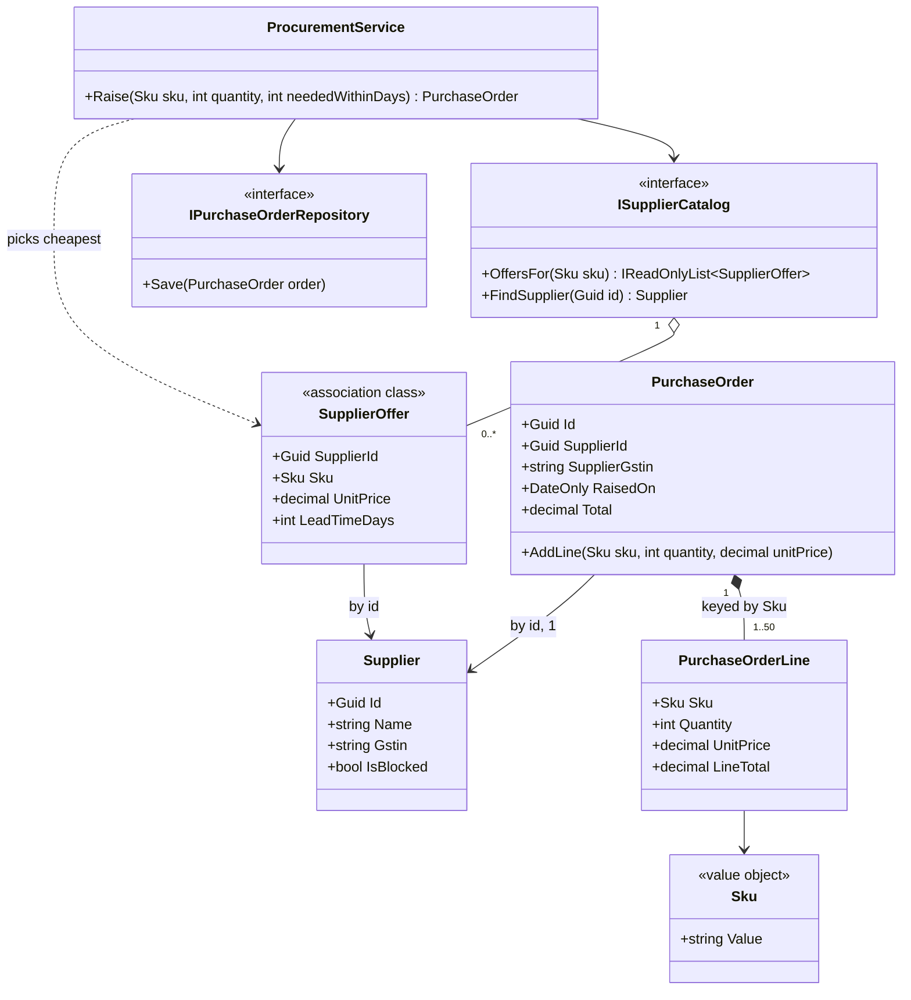
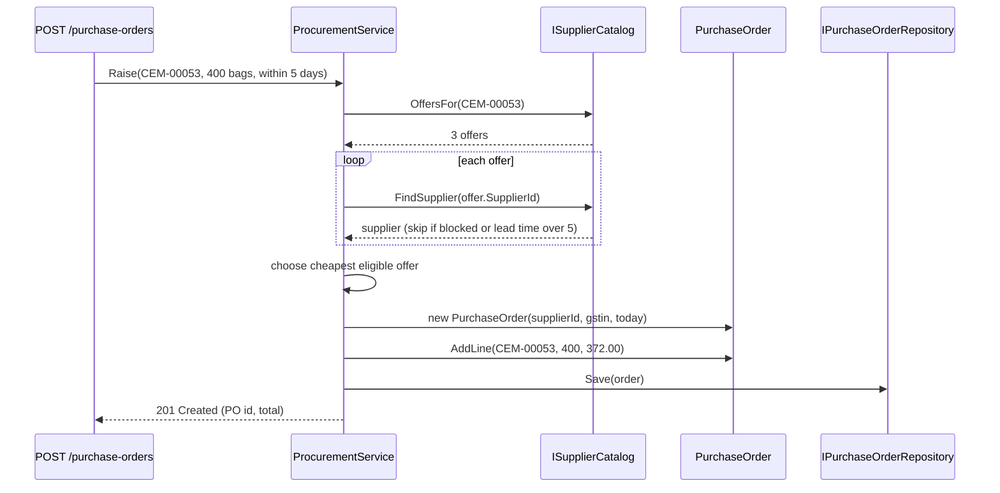

Classes on their own do nothing interesting. The behaviour of a system comes from how objects *use* each other. This lesson is about drawing and coding those connections well: which kinds of relationship exist, how many objects sit on each end, and which direction you can travel.

The running example is a purchasing module for a building-materials distributor. Exercises use a library, a company org chart, a supplier catalogue and a parking lot.

## Learning objectives

By the end of this lesson you will be able to:

1. Name the six relationship kinds in a class diagram (dependency, association, aggregation, composition, generalisation, realisation) and the C# code shape each one produces.
2. Choose multiplicities (1, 0..1, 0..\*, 1..\*) and enforce them in code rather than in comments.
3. Decide navigability: when a relationship should be one-way, and how to keep a two-way relationship consistent.
4. Choose between holding an object reference and holding an id, and explain why ids are usually better across boundaries.
5. Model many-to-many relationships that carry data with an association class, and keyed relationships with a qualified association.
6. Spot relationship smells: needless two-way links, cycles, and "everything knows everything" models.

## Prerequisites

- [Identifying classes and responsibilities](#/lesson/m07-classes-responsibilities): you know how to find the classes.
- [Identifying entities, value objects and services](#/lesson/m07-entities-values-services): relationships behave differently for entities and values.
- [Class diagrams](#/lesson/m05-class-diagrams): the basic notation for lines, arrows and diamonds.

## Explain it like I'm a beginner

Think about the people in your phone's contact list. You have their number. Most of them do *not* have yours. That is a **one-way relationship**: you can reach them, they cannot reach you.

Some relationships are two-way: you and your best friend both have each other's numbers. That is handy, but there is a cost. If you change your number, you must tell your friend, or the two lists disagree.

Now think about *how many*. You have exactly **one** mother, **zero or one** spouse, and **any number** of friends. Those counts are rules. If an app let you add two mothers, it would have a bug.

And think about *how* you know someone:

- A colleague you work with every day is a lasting relationship. You keep their number. (**Association**)
- The plumber you called once to fix a tap is a passing relationship. You used them for one job and did not save the number. (**Dependency**)

Designing object relationships means answering the same three questions for every pair of classes:

1. **What kind** of relationship is it: a passing use, or a lasting link?
2. **How many** objects are on each side? (multiplicity)
3. **Which direction** can you travel? (navigability)

## First-principles explanation

### The six relationship kinds

| Kind | Meaning | UML symbol | Typical C# shape | Example |
|---|---|---|---|---|
| **Dependency** | "uses, briefly" | dashed arrow `..>` | method parameter, local variable, return type, static call | `Tariff.FeeFor(Ticket t)` uses a ticket for one call |
| **Association** | "knows about, lastingly" | solid line or arrow `-->` | field holding a reference or an id | `PurchaseOrder` knows its `SupplierId` |
| **Aggregation** | "has, but does not own" | hollow diamond `o--` | collection of references to objects with their own life | a `Project` lists `Engineer`s assigned to it |
| **Composition** | "owns; parts die with the whole" | filled diamond `*--` | private collection the owner creates and controls | `PurchaseOrder` owns its `PurchaseOrderLine`s |
| **Generalisation** | "is a kind of" | solid line, hollow triangle `<\|--` | `class Truck : Vehicle` | inheritance |
| **Realisation** | "implements a contract" | dashed line, hollow triangle `<\|..` | `class SmsNotifier : INotifier` | interface implementation |

Aggregation and composition are special kinds of association; the [next lesson](#/lesson/m07-association-aggregation-composition) covers them in depth. Generalisation and realisation are covered with [interfaces and abstractions](#/lesson/m07-interfaces-abstractions). This lesson focuses on the two you will draw most: **dependency** and **association**.

**Dependency vs association in one test:** after the method returns, does the object still hold the other one? If no, it is a dependency. If yes (in a field), it is an association.

Why the distinction matters: a dependency only affects one method. An association affects the object's whole life: its constructor, its equality, how it is saved, how it is serialised, and every test that builds it.

### Multiplicity: how many on each end

Multiplicity is written at each end of a line:

| Notation | Meaning | C# shape | PostgreSQL shape |
|---|---|---|---|
| `1` | exactly one | non-nullable reference or id, set in the constructor | `NOT NULL` foreign key |
| `0..1` | optional | nullable: `Guid? ManagerId` | nullable foreign key |
| `0..*` or `*` | any number | `IReadOnlyList<T>` backed by a private `List<T>` | child table with a foreign key |
| `1..*` | at least one | collection plus a rule: constructor requires the first item, removal of the last is refused | child table, plus an application rule (SQL cannot easily enforce "at least one child") |
| `m..n` | a range | collection plus a guard in `Add` | application rule or check trigger |

The key idea: **a multiplicity is a business rule, and rules belong in code.** If the diagram says "a purchase order has 1 to 50 lines", then `AddLine` should refuse the 51st and the order should refuse to be submitted with zero. A comment saying "max 50" protects nothing.

### Navigability: which way can you travel?

An arrowhead on an association shows navigability: `PurchaseOrder --> Supplier` means the order can find its supplier, but the supplier object has no list of orders.

**Default to one-way.** Each extra direction costs you:

1. **Consistency work.** With `order.Supplier` *and* `supplier.Orders`, every change must update both sides, or they disagree.
2. **Memory and loading.** Loading one supplier must not drag 40,000 historic orders into memory.
3. **Cycles.** `System.Text.Json` throws on object cycles by default. Two-way links are the usual cause.
4. **Coupling.** If `Supplier` knows about `PurchaseOrder`, a change to orders can break suppliers.

How to choose the direction: follow the use cases. "When raising an order, we need the supplier's GSTIN" → the order needs to reach the supplier. "Show all open orders for a supplier" is a *query*, and queries do not need an object link: `orders.FindOpenBySupplier(supplierId)` in a repository answers it without `supplier.Orders`.

**When two-way is right:** when both directions are used constantly inside one consistency boundary, for example `Order ↔ OrderLine` inside one aggregate where a line needs its order's currency. Then pick **one side as the owner** of the link and make the other side's setter private, so there is exactly one way to change it. Exercise 3 practises this.

### Reference by object or by id?

An association can be coded two ways:

```csharp
public Supplier Supplier { get; }   // object reference
public Guid SupplierId { get; }     // identity reference
```

| Object reference | Id reference |
|---|---|
| Convenient: `order.Supplier.Gstin` | Need a lookup to get supplier details |
| Pulls the other object into memory, and with ORMs, possibly a whole graph | Loads nothing extra |
| Tempts code to change the other object (`order.Supplier.Block()`) | Cannot change what you cannot reach |
| Ties two objects' lifecycles and transactions together | Each can be saved, cached and scaled independently |

A good default, which Domain-Driven Design formalises as **reference other aggregates by identity** ([see Aggregates](#/lesson/m08-aggregates)): use object references *inside* a cluster of objects that change together (an order and its lines), and ids *between* clusters that change independently (an order and its supplier). The supplier's name might change next month; the order should keep its own copy of anything it must not lose, such as the supplier's GSTIN at the time of ordering.

### Many-to-many and association classes

A supplier sells many products, and a product is sold by many suppliers. In a database you would create a junction table. In an object model you ask: **does the link itself carry data?**

If yes, and here it does (each supplier quotes its own price and lead time per product), the link becomes a class of its own, called an **association class**: `SupplierOffer(SupplierId, Sku, UnitPrice, LeadTimeDays)`. Beginners often put `Price` on `Product`, which cannot represent two suppliers' prices, or a `List<Product>` on `Supplier`, which has nowhere to store the price.

Other everyday association classes: `Enrollment` (student–course, with grade), `Assignment` (engineer–project, with role and dates), `Membership` (user–group, with joined date), `Loan` (member–copy, with due date).

### Qualified associations: keyed links

Sometimes you navigate a relationship by a key: "the line for SKU `CEM-00053` on this order", "the offer from supplier S for product P". UML calls this a **qualified association**. In C# it is a `Dictionary<TKey, T>`. The qualifier changes the multiplicity: an order has many lines, but *at most one line per SKU*. Using a dictionary makes that rule structural. You cannot accidentally add two lines for the same cement.

### Self-associations and cycles

A class can relate to itself: `Employee --> Employee : reports to (0..1)`. This forms a tree, and trees need guards: an employee cannot report to themselves, and Asha cannot report to Ravi if Ravi (indirectly) reports to Asha. The guard lives in the method that sets the link.

### Dependency direction

Every arrow is a dependency in the compiler's sense too. Two rules keep the graph healthy:

- **Point arrows towards stable things.** Domain classes should not depend on repositories, HTTP or SMS clients. Application services depend on domain classes, not the other way round.
- **Avoid cycles between classes and between projects.** If `A → B → C → A`, none of them can be understood, tested or changed alone. [Dependency graphs and circular dependencies](#/lesson/m07-dependency-graphs) covers breaking cycles.

### When to keep it simple

Not every relationship needs analysis. For a reporting screen that joins five tables and shows a grid, model a flat read record (a DTO) and skip navigability decisions entirely. Relationship design matters where objects *change* and rules must hold.

## Visual explanation

### Class diagram: the purchasing model



How to read it:

- **Solid arrows** (`-->`) are associations held in fields. `ProcurementService` holds its catalog and repository for its whole life.
- **The dashed arrow** to `SupplierOffer` is a dependency: the service looks at offers inside one method call and keeps none.
- **`PurchaseOrder *-- PurchaseOrderLine`** is composition with multiplicity `1..50`, keyed by SKU (at most one line per SKU).
- **`PurchaseOrder --> Supplier : by id`** is a one-way association coded as a `Guid`. Supplier has no list of orders. "Orders for this supplier" is a repository query.
- **`SupplierOffer`** is the association class for the many-to-many link between suppliers and products.

### Sequence diagram: raising a purchase order



Notice how navigability shows up at runtime. The service *navigates* from an offer to its supplier using an id lookup (`FindSupplier`), because offers reference suppliers by id. The order is born with the supplier's id and a copy of the GSTIN, not with a live `Supplier` object. Nothing in this flow needs `supplier.Orders`, which is why that direction does not exist.

## Step-by-step example

### Step 1: list the pairs

From the requirement "Raise a purchase order for a product from the cheapest unblocked supplier who can deliver in time", list every pair of classes that must interact: service–catalog, catalog–offer, offer–supplier, order–supplier, order–line, line–SKU.

### Step 2: kind of relationship

For each pair, ask "does it keep the other after the method returns?"

- Service keeps the catalog → association.
- Service looks at offers during `Raise` only → dependency.
- Order keeps its lines and creates them → composition.
- Order keeps a link to its supplier → association.

### Step 3: multiplicity

Ask a domain expert, not your intuition. "Can an order have zero lines?" (No, not when submitted.) "Is there a limit?" (The ERP export accepts at most 50.) "Can one order mix suppliers?" (No: one supplier per order.) Write the answers on the diagram, then plan the code that enforces each one.

### Step 4: direction

Walk the use cases and mark which way each one travels. Leave out directions no use case needs.

### Step 5: object or id

Order and lines change together → object references. Order and supplier change independently → id plus a snapshot of the GSTIN.

## Production-style C# implementation

```text
Purchasing.Api/
  Program.cs
  Purchasing/
    Sku.cs
    Supplier.cs
    PurchaseOrder.cs
    Catalog.cs
    ProcurementService.cs
```

```csharp file=Purchasing/Sku.cs
using System.Text.RegularExpressions;

namespace Purchasing;

/// <summary>Value object: a stock-keeping unit code such as CEM-00053.</summary>
public sealed partial record Sku
{
    public string Value { get; }
    public Sku(string value)
    {
        var v = (value ?? "").Trim().ToUpperInvariant();
        if (!Format().IsMatch(v)) throw new ArgumentException($"'{value}' is not a valid SKU (ABC-12345).", nameof(value));
        Value = v;
    }
    public override string ToString() => Value;

    [GeneratedRegex("^[A-Z]{3}-[0-9]{5}$")] private static partial Regex Format();
}
```

```csharp file=Purchasing/Supplier.cs
namespace Purchasing;

/// <summary>Entity. Knows nothing about purchase orders: navigability is one-way, from order to supplier.</summary>
public sealed class Supplier(Guid id, string name, string gstin)
{
    public Guid Id { get; } = id;
    public string Name { get; private set; } = name;
    public string Gstin { get; } = gstin;
    public bool IsBlocked { get; private set; }

    public void Block() => IsBlocked = true;
    public void Rename(string name) => Name = string.IsNullOrWhiteSpace(name) ? throw new ArgumentException("Name required.") : name;
}

/// <summary>Association class for the many-to-many Supplier–Product link. The link itself carries data.</summary>
public sealed record SupplierOffer(Guid SupplierId, Sku Sku, decimal UnitPrice, int LeadTimeDays)
{
    public decimal UnitPrice { get; } = UnitPrice > 0 ? UnitPrice : throw new ArgumentOutOfRangeException(nameof(UnitPrice));
    public int LeadTimeDays { get; } = LeadTimeDays >= 0 ? LeadTimeDays : throw new ArgumentOutOfRangeException(nameof(LeadTimeDays));
}
```

```csharp file=Purchasing/PurchaseOrder.cs
namespace Purchasing;

public sealed class PurchaseOrderRuleException(string message) : Exception(message);

/// <summary>Part of the PurchaseOrder composition. Created and changed only by its order.</summary>
public sealed class PurchaseOrderLine
{
    internal PurchaseOrderLine(Sku sku, int quantity, decimal unitPrice)
    {
        Sku = sku;
        Quantity = quantity;
        UnitPrice = unitPrice;
    }

    public Sku Sku { get; }
    public int Quantity { get; private set; }
    public decimal UnitPrice { get; }
    public decimal LineTotal => Quantity * UnitPrice;

    internal void Increase(int quantity) => Quantity += quantity;
}

/// <summary>
/// Supplier association: by id (1), plus a snapshot of the GSTIN at ordering time.
/// Lines: composition, qualified by Sku (at most one line per SKU), multiplicity 1..50 on submit.
/// </summary>
public sealed class PurchaseOrder
{
    public const int MaxLines = 50;
    private readonly Dictionary<Sku, PurchaseOrderLine> _lines = new();

    public PurchaseOrder(Guid supplierId, string supplierGstin, DateOnly raisedOn)
    {
        if (supplierId == Guid.Empty) throw new ArgumentException("Supplier is required.", nameof(supplierId));
        Id = Guid.NewGuid();
        SupplierId = supplierId;
        SupplierGstin = supplierGstin;
        RaisedOn = raisedOn;
    }

    public Guid Id { get; }
    public Guid SupplierId { get; }
    public string SupplierGstin { get; }
    public DateOnly RaisedOn { get; }
    public bool IsSubmitted { get; private set; }
    public IReadOnlyCollection<PurchaseOrderLine> Lines => _lines.Values;
    public decimal Total => _lines.Values.Sum(l => l.LineTotal);

    public void AddLine(Sku sku, int quantity, decimal unitPrice)
    {
        if (IsSubmitted) throw new PurchaseOrderRuleException("A submitted order cannot change.");
        if (quantity <= 0) throw new ArgumentOutOfRangeException(nameof(quantity), "Quantity must be positive.");

        if (_lines.TryGetValue(sku, out var existing))
        {
            if (existing.UnitPrice != unitPrice)
                throw new PurchaseOrderRuleException($"{sku} is already on the order at a different price.");
            existing.Increase(quantity);
            return;
        }
        if (_lines.Count == MaxLines) throw new PurchaseOrderRuleException($"An order can have at most {MaxLines} lines.");
        _lines.Add(sku, new PurchaseOrderLine(sku, quantity, unitPrice));
    }

    public void Submit()
    {
        if (_lines.Count == 0) throw new PurchaseOrderRuleException("An order needs at least one line.");
        IsSubmitted = true;
    }
}
```

```csharp file=Purchasing/Catalog.cs
using System.Collections.Concurrent;

namespace Purchasing;

public interface ISupplierCatalog
{
    IReadOnlyList<SupplierOffer> OffersFor(Sku sku);
    Supplier? FindSupplier(Guid id);
}

public interface IPurchaseOrderRepository
{
    void Save(PurchaseOrder order);
    IReadOnlyList<PurchaseOrder> FindBySupplier(Guid supplierId);   // the "supplier → orders" direction, as a query
}

/// <summary>Offers are a qualified association: at most one offer per (supplier, SKU).</summary>
public sealed class InMemorySupplierCatalog : ISupplierCatalog
{
    private readonly ConcurrentDictionary<Guid, Supplier> _suppliers = new();
    private readonly ConcurrentDictionary<(Guid SupplierId, Sku Sku), SupplierOffer> _offers = new();

    public void AddSupplier(Supplier supplier) => _suppliers[supplier.Id] = supplier;

    public void Upsert(SupplierOffer offer)
    {
        if (!_suppliers.ContainsKey(offer.SupplierId))
            throw new InvalidOperationException($"Unknown supplier {offer.SupplierId}.");
        _offers[(offer.SupplierId, offer.Sku)] = offer;     // a new quote replaces the old one
    }

    public IReadOnlyList<SupplierOffer> OffersFor(Sku sku) => _offers.Values.Where(o => o.Sku == sku).ToList();
    public Supplier? FindSupplier(Guid id) => _suppliers.GetValueOrDefault(id);
}

public sealed class InMemoryPurchaseOrderRepository : IPurchaseOrderRepository
{
    private readonly ConcurrentDictionary<Guid, PurchaseOrder> _orders = new();
    public void Save(PurchaseOrder order) => _orders[order.Id] = order;
    public IReadOnlyList<PurchaseOrder> FindBySupplier(Guid supplierId) =>
        _orders.Values.Where(o => o.SupplierId == supplierId).ToList();
}
```

```csharp file=Purchasing/ProcurementService.cs
using Microsoft.Extensions.Logging;

namespace Purchasing;

/// <summary>Associations: catalog, repository, clock (fields). Dependency: SupplierOffer (used inside Raise only).</summary>
public sealed class ProcurementService(
    ISupplierCatalog catalog,
    IPurchaseOrderRepository orders,
    TimeProvider clock,
    ILogger<ProcurementService> logger)
{
    public PurchaseOrder Raise(Sku sku, int quantity, int neededWithinDays)
    {
        var best = catalog.OffersFor(sku)
            .Where(o => o.LeadTimeDays <= neededWithinDays)
            .Select(o => (Offer: o, Supplier: catalog.FindSupplier(o.SupplierId)))
            .Where(x => x.Supplier is { IsBlocked: false })
            .OrderBy(x => x.Offer.UnitPrice)
            .ThenBy(x => x.Offer.LeadTimeDays)
            .FirstOrDefault();

        if (best.Supplier is null)
            throw new PurchaseOrderRuleException($"No unblocked supplier can deliver {sku} within {neededWithinDays} days.");

        var today = DateOnly.FromDateTime(clock.GetUtcNow().UtcDateTime);
        var order = new PurchaseOrder(best.Supplier.Id, best.Supplier.Gstin, today);
        order.AddLine(sku, quantity, best.Offer.UnitPrice);
        order.Submit();
        orders.Save(order);

        logger.LogInformation("Raised PO {OrderId} for {Quantity} x {Sku} with {Supplier} at {Price}",
            order.Id, quantity, sku, best.Supplier.Name, best.Offer.UnitPrice);
        return order;
    }
}
```

```csharp file=Program.cs
using Purchasing;

var builder = WebApplication.CreateBuilder(args);

var catalog = new InMemorySupplierCatalog();
var western = new Supplier(Guid.NewGuid(), "Western Cement Traders", "27AAAPL1234C1ZV");
var deccan = new Supplier(Guid.NewGuid(), "Deccan Build Supplies", "29AABCU9603R1ZM");
catalog.AddSupplier(western);
catalog.AddSupplier(deccan);
catalog.Upsert(new SupplierOffer(western.Id, new Sku("CEM-00053"), 372.00m, 3));
catalog.Upsert(new SupplierOffer(deccan.Id, new Sku("CEM-00053"), 365.00m, 7));

builder.Services.AddSingleton(TimeProvider.System);
builder.Services.AddSingleton<ISupplierCatalog>(catalog);
builder.Services.AddSingleton<IPurchaseOrderRepository, InMemoryPurchaseOrderRepository>();
builder.Services.AddScoped<ProcurementService>();

var app = builder.Build();

app.MapPost("/purchase-orders", (string sku, int quantity, int neededWithinDays, ProcurementService procurement) =>
{
    try
    {
        var po = procurement.Raise(new Sku(sku), quantity, neededWithinDays);
        return Results.Created($"/purchase-orders/{po.Id}", new { po.Id, po.SupplierId, po.Total });
    }
    catch (ArgumentException ex) { return Results.Problem(ex.Message, statusCode: StatusCodes.Status400BadRequest); }
    catch (PurchaseOrderRuleException ex) { return Results.Problem(ex.Message, statusCode: StatusCodes.Status422UnprocessableEntity); }
});

app.MapGet("/suppliers/{id:guid}/purchase-orders", (Guid id, IPurchaseOrderRepository orders) =>
    Results.Ok(orders.FindBySupplier(id).Select(o => new { o.Id, o.RaisedOn, o.Total })));

app.Run();
```

Design notes:

- **The API never returns domain objects directly.** It projects to anonymous DTOs, which avoids serialising object graphs (and cycles) by accident.
- **`GET /suppliers/{id}/purchase-orders`** gives you the "supplier → orders" direction without adding `Supplier.Orders`. Navigability in the model and navigation in the API are different things.
- **`SupplierGstin` is copied onto the order.** If the supplier's registration changes later, the order still shows what was legally on the invoice. Snapshotting is a deliberate choice when you reference by id.
- **In EF Core**, `PurchaseOrderLine` would be an owned collection of `PurchaseOrder`, and `SupplierId` a plain foreign-key property with no navigation property.

## Bad design vs good design

**Bad: everything knows everything.**

```csharp
public class Supplier { public List<PurchaseOrder> Orders { get; set; } = new(); public List<Product> Products { get; set; } = new(); }
public class Product  { public List<Supplier> Suppliers { get; set; } = new(); public decimal Price { get; set; } }
public class PurchaseOrder { public Supplier Supplier { get; set; } = null!; public List<PurchaseOrderLine> Lines { get; set; } = new(); }
public class PurchaseOrderLine { public PurchaseOrder Order { get; set; } = null!; public Product Product { get; set; } = null!; public int Qty { get; set; } }
```

What goes wrong:

- `Product.Price` cannot represent two suppliers quoting different prices. The link data has nowhere to live.
- `supplier.Orders.Add(po)` without setting `po.Supplier` (or the reverse) leaves the two sides disagreeing.
- Returning a `Supplier` from an API throws `JsonException: A possible object cycle was detected` (Supplier → Orders → Supplier).
- Loading one supplier with an ORM's lazy loading can pull thousands of orders and every product.
- Public `List<T>` setters mean anyone can add a 51st line or a second line for the same SKU.

**Good**: the implementation above. One-way links chosen by use case, ids across independent objects, an association class for the many-to-many, a keyed collection for "one line per SKU", and private collections with guarded `Add` methods.

**Is it worth it?** For a prototype with three tables and no rules, the "bad" version ships faster and an ORM will happily map it. The costs arrive with scale and rules: the first cycle exception in production, the first wrong price, the first inconsistent two-way link. Trim directions *before* you have a large codebase relying on them, because removing a navigation property later touches every query that used it.

:::callout type=tip title="Three questions for every line on your diagram"
1. Is it held in a field (association) or only used in a method (dependency)?
2. What are the multiplicities, and which method enforces each one?
3. Which use case needs each direction? Delete the directions nobody needs.
:::

## Practical playground

The playground shows a two-way link going out of sync, then fixes it with a single owning side. Run it, then:

1. Comment out the call to `SetTeamInternal` inside `Team.Add`. What does the output show?
2. Add an `Employee.Team` public setter and set it directly. Which invariant breaks?
3. Replace `Employee.Team` with `Guid? TeamId`. What becomes simpler, and what lookup do you now need?

:::playground type=csharp title="Keeping a two-way association consistent"
```csharp file=Program.cs
using System;
using System.Collections.Generic;
using System.Linq;

public sealed class Employee(string name)
{
    public string Name { get; } = name;
    public Team? Team { get; private set; }                 // read-only from outside
    internal void SetTeamInternal(Team? team) => Team = team;
}

public sealed class Team(string name)
{
    private readonly List<Employee> _members = new();
    public string Name { get; } = name;
    public IReadOnlyList<Employee> Members => _members;

    // The owning side: the only way to change the link, so both ends always agree.
    public void Add(Employee e)
    {
        e.Team?.Remove(e);
        _members.Add(e);
        e.SetTeamInternal(this);
    }

    public void Remove(Employee e)
    {
        if (_members.Remove(e)) e.SetTeamInternal(null);
    }
}

public static class Program
{
    public static void Main()
    {
        var bridges = new Team("Bridges");
        var tunnels = new Team("Tunnels");
        var asha = new Employee("Asha");

        bridges.Add(asha);
        Console.WriteLine($"Asha's team: {asha.Team?.Name}; Bridges members: {bridges.Members.Count}");

        tunnels.Add(asha);                                  // moving teams
        Console.WriteLine($"Asha's team: {asha.Team?.Name}; Bridges: {bridges.Members.Count}; Tunnels: {tunnels.Members.Count}");

        var consistent = new[] { bridges, tunnels }.All(t => t.Members.All(m => m.Team == t));
        Console.WriteLine($"Both sides agree: {consistent}");
    }
}
```
:::

## Exercises

:::exercise id=m07-relationships-ex1 difficulty=beginner kind=design title="Relationships and multiplicities in a library"
Model the relationships in this library requirement. Choose the kind, multiplicity and direction of every line.

> A **title** (ISBN, name) has one or more **authors**, and an author may have written many titles. The library holds one or more **copies** of each title. A **member** may have up to 5 active **loans**; each loan is for exactly one copy. A **reservation** links a member to a title (not a copy) with the date reserved. A `FineCalculator` computes a fine from a loan when it is returned.
::acceptance
- Title–Author is many-to-many and has no link data, so no association class is needed (or justify one, such as author order on the cover).
- Title–Copy is `1` to `1..*`; Copy references Title by ISBN or id.
- Member–Loan has multiplicity `0..5` on the loan side.
- Reservation is an association class between Member and Title, with a date.
- `FineCalculator` has a dependency (dashed) on `Loan`, not an association.
- At least one relationship is deliberately one-way, with a reason.
::hint
For each pair, first ask "is it held in a field, or only used in a method?" That sorts dependencies from associations.
::hint
A reservation has its own data (date reserved, position in queue). Data on a link means association class.
::hint
Does `Title` need a list of its copies, or does `Copy` need to know its title? Which use case travels which way? "How many copies are available?" can be a query.
::hint
Mark `Member → Loan` as composition-like ownership with `0..5`, `Loan → Copy` as a one-way association with multiplicity `1`, and `FineCalculator ..> Loan` as a dependency.
::starter
```json file=library-relationships.json
{
  "classes": [
    { "id": "Title", "name": "Title", "kind": "class", "fields": ["+string Isbn", "+string Name"], "methods": [] },
    { "id": "Author", "name": "Author", "kind": "class", "fields": ["+Guid Id", "+string Name"], "methods": [] },
    { "id": "Copy", "name": "BookCopy", "kind": "class", "fields": ["+Guid Id"], "methods": [] },
    { "id": "Member", "name": "Member", "kind": "class", "fields": ["+Guid Id"], "methods": [] },
    { "id": "Loan", "name": "Loan", "kind": "class", "fields": [], "methods": [] }
  ],
  "relations": []
}
```
::solution
```json file=library-relationships.json
{
  "classes": [
    { "id": "Title", "name": "Title", "kind": "class", "fields": ["+string Isbn", "+string Name", "-List~Guid~ _authorIds"], "methods": [],
      "responsibility": "Catalogue entry; knows its authors by id" },
    { "id": "Author", "name": "Author", "kind": "class", "fields": ["+Guid Id", "+string Name"], "methods": [],
      "responsibility": "Knows nothing about titles; 'titles by author' is a query" },
    { "id": "Copy", "name": "BookCopy", "kind": "class", "fields": ["+Guid Id", "+string Isbn", "+CopyStatus Status"], "methods": ["+void MarkOnLoan()"],
      "responsibility": "Physical item; references its title by ISBN" },
    { "id": "Member", "name": "Member", "kind": "class", "fields": ["+Guid Id", "-List~Loan~ _loans"], "methods": ["+Loan Borrow(BookCopy copy, DateOnly today)"],
      "responsibility": "Owns its loans; enforces max 5 active" },
    { "id": "Loan", "name": "Loan", "kind": "class", "fields": ["+Guid CopyId", "+DateOnly DueOn", "+DateOnly? ReturnedOn"], "methods": [],
      "responsibility": "One copy, one member, with dates" },
    { "id": "Res", "name": "Reservation", "kind": "record", "fields": ["+Guid MemberId", "+string Isbn", "+DateOnly ReservedOn"], "methods": [],
      "responsibility": "Association class: Member to Title, carries the date" },
    { "id": "Fine", "name": "FineCalculator", "kind": "class", "fields": [], "methods": ["+decimal FineFor(Loan loan, DateOnly returnedOn)"],
      "responsibility": "Stateless; uses a loan only during the call" }
  ],
  "relations": [
    { "from": "Title", "to": "Author", "kind": "association", "label": "written by (ids)", "multiplicity": "1..*" },
    { "from": "Copy", "to": "Title", "kind": "association", "label": "copy of (by ISBN)", "multiplicity": "1" },
    { "from": "Member", "to": "Loan", "kind": "composition", "multiplicity": "0..5" },
    { "from": "Loan", "to": "Copy", "kind": "association", "label": "for (by id)", "multiplicity": "1" },
    { "from": "Res", "to": "Member", "kind": "association", "multiplicity": "1" },
    { "from": "Res", "to": "Title", "kind": "association", "multiplicity": "1" },
    { "from": "Fine", "to": "Loan", "kind": "dependency" }
  ]
}
```

One-way choices: `Author` has no list of titles (the catalogue search answers "books by Ruskin Bond"), and `Title` has no list of copies (availability is a query over copies). Both avoid loading hundreds of objects to show one title page.

The `0..5` multiplicity on loans counts *active* loans. In code, that is the guard in `Member.Borrow`, not the size of the list, because returned loans stay in the history.
::alternatives
If the order of authors on the cover matters (first author, second author), Title–Author gets link data and becomes an association class `Authorship(Isbn, AuthorId, Position)`.
::mistakes
- Drawing `FineCalculator --> Loan` as an association. The calculator holds no loan between calls.
- Linking a reservation to a copy. Members reserve a title; whichever copy comes back first fulfils it.
- Making every line two-way "for convenience".
:::

:::exercise id=m07-relationships-ex2 difficulty=beginner kind=code title="Enforce multiplicity with a qualified association"
A `DeliveryChallan` (a goods dispatch note) must have between 1 and 10 lines, and at most one line per SKU. Adding the same SKU again should increase its quantity. Enforce these rules in code.
::requirements
- `AddLine(string sku, int quantity)` merges into an existing line for the same SKU (case-insensitive).
- An 11th distinct SKU is refused with `InvalidOperationException`.
- `RemoveLine(string sku)` removes a line, but removing the last line is refused.
- `Lines` is read-only from outside.
::acceptance
- Adding `cem-00053 × 10` then `CEM-00053 × 5` gives one line with quantity 15.
- 10 distinct SKUs are accepted; the 11th throws `InvalidOperationException`.
- Removing the only line throws `InvalidOperationException`.
- A non-positive quantity throws `ArgumentOutOfRangeException`.
- The challan is created with its first line, so it can never exist with zero lines.
::hint
"At most one per key" is exactly what a dictionary gives you. What should the key be?
::hint
Use `Dictionary<string, int>` with `StringComparer.OrdinalIgnoreCase` so `cem-00053` and `CEM-00053` are the same key.
::hint
To guarantee `1..*`, require the first line in the constructor and refuse to remove the last one.
::hint
```csharp
if (_lines.TryGetValue(sku, out var q)) { _lines[sku] = q + quantity; return; }
if (_lines.Count == MaxLines) throw new InvalidOperationException(...);
_lines[sku] = quantity;
```
::starter
```csharp file=DeliveryChallan.cs
using System;
using System.Collections.Generic;

public sealed class DeliveryChallan
{
    public const int MaxLines = 10;

    public DeliveryChallan(string firstSku, int firstQuantity) => throw new NotImplementedException();

    public IReadOnlyDictionary<string, int> Lines => throw new NotImplementedException();
    public void AddLine(string sku, int quantity) => throw new NotImplementedException();
    public void RemoveLine(string sku) => throw new NotImplementedException();
}
```
::tests
```csharp file=DeliveryChallanTests.cs
using System;
using Xunit;

public class DeliveryChallanTests
{
    [Fact]
    public void Same_sku_merges_case_insensitively()
    {
        var c = new DeliveryChallan("cem-00053", 10);
        c.AddLine("CEM-00053", 5);
        Assert.Single(c.Lines);
        Assert.Equal(15, c.Lines["CEM-00053"]);
    }

    [Fact]
    public void Eleventh_distinct_sku_refused()
    {
        var c = new DeliveryChallan("SKU-00000", 1);
        for (var i = 1; i < 10; i++) c.AddLine($"SKU-0000{i}", 1);
        Assert.Equal(10, c.Lines.Count);
        Assert.Throws<InvalidOperationException>(() => c.AddLine("SKU-00010", 1));
    }

    [Fact]
    public void Merging_into_full_challan_is_allowed()
    {
        var c = new DeliveryChallan("SKU-00000", 1);
        for (var i = 1; i < 10; i++) c.AddLine($"SKU-0000{i}", 1);
        c.AddLine("SKU-00003", 4);
        Assert.Equal(5, c.Lines["SKU-00003"]);
    }

    [Fact]
    public void Cannot_remove_last_line() =>
        Assert.Throws<InvalidOperationException>(() => new DeliveryChallan("A", 1).RemoveLine("A"));

    [Fact]
    public void Can_remove_when_more_than_one()
    {
        var c = new DeliveryChallan("A", 1);
        c.AddLine("B", 2);
        c.RemoveLine("a");
        Assert.Single(c.Lines);
    }

    [Fact]
    public void Non_positive_quantity_refused() =>
        Assert.Throws<ArgumentOutOfRangeException>(() => new DeliveryChallan("A", 1).AddLine("B", 0));

    [Fact]
    public void Constructor_validates_first_line() =>
        Assert.Throws<ArgumentOutOfRangeException>(() => new DeliveryChallan("A", -1));
}
```
::solution
```csharp file=DeliveryChallan.cs
using System;
using System.Collections.Generic;

public sealed class DeliveryChallan
{
    public const int MaxLines = 10;
    private readonly Dictionary<string, int> _lines = new(StringComparer.OrdinalIgnoreCase);

    public DeliveryChallan(string firstSku, int firstQuantity) => AddLine(firstSku, firstQuantity);

    public IReadOnlyDictionary<string, int> Lines => _lines;

    public void AddLine(string sku, int quantity)
    {
        if (string.IsNullOrWhiteSpace(sku)) throw new ArgumentException("SKU is required.", nameof(sku));
        if (quantity <= 0) throw new ArgumentOutOfRangeException(nameof(quantity), "Quantity must be positive.");

        if (_lines.TryGetValue(sku, out var existing)) { _lines[sku] = existing + quantity; return; }
        if (_lines.Count == MaxLines) throw new InvalidOperationException($"A challan can have at most {MaxLines} lines.");
        _lines[sku] = quantity;
    }

    public void RemoveLine(string sku)
    {
        if (!_lines.ContainsKey(sku)) throw new InvalidOperationException($"No line for {sku}.");
        if (_lines.Count == 1) throw new InvalidOperationException("A challan needs at least one line.");
        _lines.Remove(sku);
    }
}
```

The multiplicity `1..10, unique by SKU` now lives in three places that the compiler and tests protect: the dictionary key, the constructor, and two guards. The diagram and the code say the same thing.
::mistakes
- Checking the 10-line limit *before* the merge check, which wrongly refuses adding more cement to a full challan.
- Exposing `Dictionary<string, int>` as the property type, which lets callers call `Add` directly and skip every guard. `IReadOnlyDictionary` prevents that.
- Using an ordinal (case-sensitive) comparer, so `cem-00053` and `CEM-00053` become two lines.
:::

:::exercise id=m07-relationships-ex3 difficulty=intermediate kind=code title="A self-association without cycles: the reporting line"
In a leave management system, an employee reports to at most one manager (`0..1`), and a manager has any number of direct reports. Leave approvals walk up this chain. Implement the two-way association safely.
::requirements
- `Employee.AssignManager(Employee? manager)` is the only way to change the link; it updates both `Manager` and the old and new managers' `DirectReports`.
- Refuse an employee managing themselves, and refuse any assignment that would create a cycle (Asha → Ravi → Asha), with `InvalidOperationException`.
- `ChainOfCommand()` returns managers from the immediate one upwards.
- `DirectReports` is read-only from outside.
::acceptance
- Assigning Ravi as Neha's manager adds Neha to Ravi's direct reports.
- Moving Neha from Ravi to Meera removes her from Ravi's list.
- Assigning `null` removes the manager on both sides.
- Making Asha report to Neha, when Neha (indirectly) reports to Asha, throws and leaves the structure unchanged.
- Neha's chain of command is Ravi, then Asha.
::hint
Which side owns the link? Pick the employee side (`AssignManager`) and give `DirectReports` no public way to change.
::hint
To detect a cycle: walk up from the proposed manager. If you meet `this`, the assignment would make a loop.
::hint
Order of operations: validate (self, cycle) → remove from old manager's list → set new manager → add to new manager's list. Validation before mutation keeps "unchanged on failure" true.
::hint
```csharp
for (var m = manager; m is not null; m = m.Manager)
    if (ReferenceEquals(m, this)) throw new InvalidOperationException(...);
```
::starter
```csharp file=Employee.cs
using System;
using System.Collections.Generic;

public sealed class Employee(string name)
{
    public string Name { get; } = name;
    public Employee? Manager => throw new NotImplementedException();
    public IReadOnlyList<Employee> DirectReports => throw new NotImplementedException();

    public void AssignManager(Employee? manager) => throw new NotImplementedException();
    public IReadOnlyList<Employee> ChainOfCommand() => throw new NotImplementedException();
}
```
::tests
```csharp file=EmployeeTests.cs
using System;
using System.Linq;
using Xunit;

public class EmployeeTests
{
    [Fact]
    public void Assign_updates_both_sides()
    {
        var ravi = new Employee("Ravi");
        var neha = new Employee("Neha");
        neha.AssignManager(ravi);
        Assert.Same(ravi, neha.Manager);
        Assert.Contains(neha, ravi.DirectReports);
    }

    [Fact]
    public void Moving_removes_from_old_manager()
    {
        var ravi = new Employee("Ravi");
        var meera = new Employee("Meera");
        var neha = new Employee("Neha");
        neha.AssignManager(ravi);
        neha.AssignManager(meera);
        Assert.Empty(ravi.DirectReports);
        Assert.Single(meera.DirectReports);
    }

    [Fact]
    public void Null_clears_both_sides()
    {
        var ravi = new Employee("Ravi");
        var neha = new Employee("Neha");
        neha.AssignManager(ravi);
        neha.AssignManager(null);
        Assert.Null(neha.Manager);
        Assert.Empty(ravi.DirectReports);
    }

    [Fact]
    public void Self_management_refused()
    {
        var neha = new Employee("Neha");
        Assert.Throws<InvalidOperationException>(() => neha.AssignManager(neha));
    }

    [Fact]
    public void Cycle_refused_and_structure_unchanged()
    {
        var asha = new Employee("Asha");
        var ravi = new Employee("Ravi");
        var neha = new Employee("Neha");
        ravi.AssignManager(asha);
        neha.AssignManager(ravi);
        Assert.Throws<InvalidOperationException>(() => asha.AssignManager(neha));
        Assert.Null(asha.Manager);
        Assert.Empty(neha.DirectReports);
    }

    [Fact]
    public void Chain_of_command_walks_upwards()
    {
        var asha = new Employee("Asha");
        var ravi = new Employee("Ravi");
        var neha = new Employee("Neha");
        ravi.AssignManager(asha);
        neha.AssignManager(ravi);
        Assert.Equal(new[] { "Ravi", "Asha" }, neha.ChainOfCommand().Select(e => e.Name).ToArray());
    }
}
```
::solution
```csharp file=Employee.cs
using System;
using System.Collections.Generic;

public sealed class Employee(string name)
{
    private readonly List<Employee> _directReports = new();
    public string Name { get; } = name;
    public Employee? Manager { get; private set; }
    public IReadOnlyList<Employee> DirectReports => _directReports;

    public void AssignManager(Employee? manager)
    {
        if (ReferenceEquals(manager, Manager)) return;
        for (var m = manager; m is not null; m = m.Manager)
            if (ReferenceEquals(m, this))
                throw new InvalidOperationException($"{Name} cannot report to {manager!.Name}: that would create a cycle.");

        Manager?._directReports.Remove(this);
        Manager = manager;
        manager?._directReports.Add(this);
    }

    public IReadOnlyList<Employee> ChainOfCommand()
    {
        var chain = new List<Employee>();
        for (var m = Manager; m is not null; m = m.Manager) chain.Add(m);
        return chain;
    }
}
```

The self-check is covered by the cycle loop: when `manager == this`, the first iteration finds it. Private members of `Employee` are accessible from other `Employee` instances, which is what lets the owning side update the other side's list without exposing a public `AddReport` method.
::alternatives
In a real HR system with 5,000 employees, the org chart is usually stored as `ManagerId` (a `Guid?`) per employee, and "direct reports" is a query. The cycle check then walks up by id through a repository. Object references in both directions are fine when the whole tree is loaded into memory for one operation, such as an org-chart editor.
::mistakes
- Updating only `Manager` and forgetting `DirectReports`, or vice versa.
- Checking only the immediate manager for cycles (`manager.Manager == this`), which misses longer loops.
- Removing from the old manager's list *before* validation; when the cycle check fails, the old link is lost.
::extensions
Add `ApproverFor(int leaveDays)`: up to 3 days goes to the immediate manager, more than 3 days to the manager's manager, falling back up the chain when someone is missing.
:::

:::exercise id=m07-relationships-ex4 difficulty=intermediate kind=code title="An association class for supplier offers"
Implement the many-to-many link between suppliers and products as an association class. Each supplier can quote one price and lead time per SKU. Procurement needs "the best offer for a SKU within N days" and "all SKUs a supplier offers".
::requirements
- `SupplierCatalog.Quote(supplierId, sku, unitPrice, leadTimeDays)` adds or replaces the offer for that (supplier, SKU) pair.
- `BestOffer(sku, maxLeadTimeDays)` returns the cheapest eligible offer, ties broken by shorter lead time, or `null`.
- `SkusOfferedBy(supplierId)` returns the SKUs in alphabetical order.
- `Withdraw(supplierId, sku)` removes one offer.
- Prices must be positive and lead time non-negative (`ArgumentOutOfRangeException`).
::acceptance
- Two quotes from the same supplier for the same SKU keep only the latest.
- For `CEM-00053` with offers ₹372 (3 days) and ₹365 (7 days), best within 5 days is ₹372; within 10 days is ₹365.
- Two offers at the same price pick the shorter lead time.
- A SKU with no offers returns `null`.
- After `Withdraw`, the supplier no longer lists that SKU.
::hint
What uniquely identifies an offer? That pair is your dictionary key.
::hint
A tuple `(Guid SupplierId, string Sku)` works as a dictionary key because tuples have value equality.
::hint
`BestOffer`: filter by SKU and lead time, then `OrderBy(price).ThenBy(leadTime).FirstOrDefault()`.
::hint
Make `SupplierOffer` a `record` with validation in property initialisers or a constructor, so invalid offers cannot exist.
::starter
```csharp file=SupplierCatalog.cs
using System;
using System.Collections.Generic;
using System.Linq;

public sealed record SupplierOffer
{
    public SupplierOffer(Guid supplierId, string sku, decimal unitPrice, int leadTimeDays) => throw new NotImplementedException();
    public Guid SupplierId { get; }
    public string Sku { get; } = "";
    public decimal UnitPrice { get; }
    public int LeadTimeDays { get; }
}

public sealed class SupplierCatalog
{
    public void Quote(Guid supplierId, string sku, decimal unitPrice, int leadTimeDays) => throw new NotImplementedException();
    public SupplierOffer? BestOffer(string sku, int maxLeadTimeDays) => throw new NotImplementedException();
    public IReadOnlyList<string> SkusOfferedBy(Guid supplierId) => throw new NotImplementedException();
    public void Withdraw(Guid supplierId, string sku) => throw new NotImplementedException();
}
```
::tests
```csharp file=SupplierCatalogTests.cs
using System;
using Xunit;

public class SupplierCatalogTests
{
    private static readonly Guid A = Guid.NewGuid();
    private static readonly Guid B = Guid.NewGuid();

    [Fact]
    public void Requote_replaces()
    {
        var c = new SupplierCatalog();
        c.Quote(A, "CEM-00053", 380m, 3);
        c.Quote(A, "CEM-00053", 372m, 3);
        Assert.Equal(372m, c.BestOffer("CEM-00053", 10)!.UnitPrice);
        Assert.Single(c.SkusOfferedBy(A));
    }

    [Fact]
    public void Best_respects_lead_time()
    {
        var c = new SupplierCatalog();
        c.Quote(A, "CEM-00053", 372m, 3);
        c.Quote(B, "CEM-00053", 365m, 7);
        Assert.Equal(A, c.BestOffer("CEM-00053", 5)!.SupplierId);
        Assert.Equal(B, c.BestOffer("CEM-00053", 10)!.SupplierId);
    }

    [Fact]
    public void Tie_breaks_on_lead_time()
    {
        var c = new SupplierCatalog();
        c.Quote(A, "STL-00012", 61m, 6);
        c.Quote(B, "STL-00012", 61m, 2);
        Assert.Equal(B, c.BestOffer("STL-00012", 10)!.SupplierId);
    }

    [Fact] public void No_offer_is_null() => Assert.Null(new SupplierCatalog().BestOffer("XYZ-00001", 10));

    [Fact]
    public void Skus_sorted_and_withdraw_works()
    {
        var c = new SupplierCatalog();
        c.Quote(A, "STL-00012", 61m, 2);
        c.Quote(A, "CEM-00053", 372m, 3);
        Assert.Equal(new[] { "CEM-00053", "STL-00012" }, c.SkusOfferedBy(A));
        c.Withdraw(A, "CEM-00053");
        Assert.Equal(new[] { "STL-00012" }, c.SkusOfferedBy(A));
    }

    [Fact] public void Invalid_price_refused() =>
        Assert.Throws<ArgumentOutOfRangeException>(() => new SupplierCatalog().Quote(A, "CEM-00053", 0m, 3));
}
```
::solution
```csharp file=SupplierCatalog.cs
using System;
using System.Collections.Generic;
using System.Linq;

public sealed record SupplierOffer
{
    public SupplierOffer(Guid supplierId, string sku, decimal unitPrice, int leadTimeDays)
    {
        if (string.IsNullOrWhiteSpace(sku)) throw new ArgumentException("SKU is required.", nameof(sku));
        if (unitPrice <= 0) throw new ArgumentOutOfRangeException(nameof(unitPrice), "Price must be positive.");
        if (leadTimeDays < 0) throw new ArgumentOutOfRangeException(nameof(leadTimeDays), "Lead time cannot be negative.");
        SupplierId = supplierId;
        Sku = sku.ToUpperInvariant();
        UnitPrice = unitPrice;
        LeadTimeDays = leadTimeDays;
    }
    public Guid SupplierId { get; }
    public string Sku { get; } = "";
    public decimal UnitPrice { get; }
    public int LeadTimeDays { get; }
}

public sealed class SupplierCatalog
{
    private readonly Dictionary<(Guid SupplierId, string Sku), SupplierOffer> _offers = new();

    public void Quote(Guid supplierId, string sku, decimal unitPrice, int leadTimeDays)
    {
        var offer = new SupplierOffer(supplierId, sku, unitPrice, leadTimeDays);
        _offers[(offer.SupplierId, offer.Sku)] = offer;
    }

    public SupplierOffer? BestOffer(string sku, int maxLeadTimeDays) =>
        _offers.Values
            .Where(o => o.Sku == sku.ToUpperInvariant() && o.LeadTimeDays <= maxLeadTimeDays)
            .OrderBy(o => o.UnitPrice)
            .ThenBy(o => o.LeadTimeDays)
            .FirstOrDefault();

    public IReadOnlyList<string> SkusOfferedBy(Guid supplierId) =>
        _offers.Keys.Where(k => k.SupplierId == supplierId).Select(k => k.Sku).OrderBy(s => s, StringComparer.Ordinal).ToList();

    public void Withdraw(Guid supplierId, string sku)
    {
        if (!_offers.Remove((supplierId, sku.ToUpperInvariant())))
            throw new InvalidOperationException($"Supplier {supplierId} has no offer for {sku}.");
    }
}
```

Neither `Supplier` nor `Product` holds a list of the other. The link and its data live in one place, so "replace a quote" is a single dictionary write rather than an update to two lists. In PostgreSQL this maps to a `supplier_offers` table with a composite primary key `(supplier_id, sku)`.
::mistakes
- Putting `UnitPrice` on `Product`, which allows only one price for all suppliers.
- Storing offers in a `List` and appending on every quote, so stale prices are still picked.
- Forgetting the tie-breaker, which makes `BestOffer` depend on insertion order.
:::

:::exercise id=m07-relationships-ex5 difficulty=advanced kind=design title="Untangle a parking lot model"
A parking-lot codebase has this model, and the team reports: JSON cycle errors in the admin API, slow loading of `ParkingLot`, and a bug where a spot showed "occupied" after the car left.

- `ParkingLot` has `List<Floor> Floors`, `List<Ticket> AllTickets` and `List<Vehicle> VehiclesInside`.
- `Floor` has `ParkingLot Lot` and `List<Spot> Spots`.
- `Spot` has `Floor Floor`, `Vehicle? CurrentVehicle` and `Ticket? CurrentTicket`.
- `Vehicle` has `Spot? CurrentSpot` and `List<Ticket> Tickets`.
- `Ticket` has `Vehicle Vehicle`, `Spot Spot` and `Payment? Payment`.
- `Payment` has `Ticket Ticket`.

Redesign the relationships. For each link, state keep/remove/change, the new direction, and whether it is an object reference or an id. Produce the new model.
::acceptance
- No relationship is two-way unless a named use case needs both directions inside one consistency boundary.
- Historic tickets are not held in memory by `ParkingLot`.
- "Which vehicle is in this spot?" has a single source of truth.
- `Ticket` references spot and vehicle by id or value, not by live object.
- `Payment` is either owned by the ticket or references it by id, not both directions.
::hint
Count the two-way links: Lot↔Floor, Floor↔Spot, Spot↔Vehicle, Spot↔Ticket, Vehicle↔Ticket, Ticket↔Payment. Each one is two places to update.
::hint
The "occupied after the car left" bug is a symptom of storing the same fact in three places (`Spot.CurrentVehicle`, `Vehicle.CurrentSpot`, `ParkingLot.VehiclesInside`). Pick one.
::hint
Use cases: park (find free spot, issue ticket), exit (find ticket, pay, free spot), show free counts. Which directions do they really need? "All tickets ever" is a reporting query, not an object list.
::hint
One workable design: Lot `*--` Floor `*--` Spot (one-way, down). Spot knows `ActiveTicketId: Guid?` only. Ticket holds `SpotCode` and `PlateNumber` (values) and owns `Payment?` (composition). Vehicle becomes a value object (plate + type) with no links.
::starter
```json file=parking-relationships.json
{
  "classes": [
    { "id": "Lot", "name": "ParkingLot", "kind": "class", "fields": [], "methods": [] },
    { "id": "Floor", "name": "Floor", "kind": "class", "fields": [], "methods": [] },
    { "id": "Spot", "name": "Spot", "kind": "class", "fields": [], "methods": [] },
    { "id": "Vehicle", "name": "Vehicle", "kind": "class", "fields": [], "methods": [] },
    { "id": "Ticket", "name": "Ticket", "kind": "class", "fields": [], "methods": [] },
    { "id": "Payment", "name": "Payment", "kind": "class", "fields": [], "methods": [] }
  ],
  "relations": []
}
```
::solution
| Old link | Decision | Why |
|---|---|---|
| Lot ↔ Floor | One-way, Lot `*--` Floor | Nobody navigates from a floor to its lot during park/exit |
| Floor ↔ Spot | One-way, Floor `*--` Spot | Floors find free spots; spots do not need their floor object (the spot code `F2-C017` encodes it) |
| Lot → AllTickets | Remove | Historic tickets go to `ITicketRepository`; queries by date answer reports |
| Lot → VehiclesInside | Remove | Derived: "active tickets" is the single source of truth |
| Spot ↔ Vehicle | Remove both | Replaced by `Spot.ActiveTicketId` |
| Spot ↔ Ticket | One-way each, by id/value | Spot holds `Guid? ActiveTicketId`; ticket holds `SpotCode` |
| Vehicle ↔ Ticket | Ticket holds a `Vehicle` value | A vehicle has no lifecycle in this system; plate + type is a value |
| Ticket ↔ Payment | Ticket `*--` Payment | Payment cannot exist without its ticket; no back-link needed |

```json file=parking-relationships.json
{
  "classes": [
    { "id": "Lot", "name": "ParkingLot", "kind": "class", "fields": ["-List~Floor~ _floors"],
      "methods": ["+Spot? FindFreeSpot(SpotSize size)"], "responsibility": "Owns floors; no ticket history" },
    { "id": "Floor", "name": "Floor", "kind": "class", "fields": ["+int Number", "-List~Spot~ _spots"],
      "methods": ["+int FreeCount(SpotSize size)"], "responsibility": "Owns spots" },
    { "id": "Spot", "name": "Spot", "kind": "class", "fields": ["+string Code", "+SpotSize Size", "+Guid? ActiveTicketId"],
      "methods": ["+void Occupy(Guid ticketId)", "+void Release(Guid ticketId)"],
      "responsibility": "Single source of truth for occupancy" },
    { "id": "Vehicle", "name": "Vehicle", "kind": "record", "fields": ["+string Plate", "+VehicleType Type"], "methods": [],
      "responsibility": "Value object; no links" },
    { "id": "Ticket", "name": "Ticket", "kind": "class",
      "fields": ["+Guid Id", "+Vehicle Vehicle", "+string SpotCode", "+DateTimeOffset EnteredAt", "+Payment? Payment"],
      "methods": ["+void Pay(decimal amount, DateTimeOffset at)"], "responsibility": "Entity; references the spot by code" },
    { "id": "Payment", "name": "Payment", "kind": "record", "fields": ["+decimal Amount", "+DateTimeOffset PaidAt", "+string Method"], "methods": [],
      "responsibility": "Owned by its ticket" },
    { "id": "Repo", "name": "ITicketRepository", "kind": "interface", "fields": [],
      "methods": ["+Ticket? FindActiveByPlate(string plate)", "+IReadOnlyList~Ticket~ ClosedBetween(DateOnly from, DateOnly to)"] }
  ],
  "relations": [
    { "from": "Lot", "to": "Floor", "kind": "composition", "multiplicity": "1..*" },
    { "from": "Floor", "to": "Spot", "kind": "composition", "multiplicity": "1..*" },
    { "from": "Spot", "to": "Ticket", "kind": "association", "label": "ActiveTicketId (id)", "multiplicity": "0..1" },
    { "from": "Ticket", "to": "Spot", "kind": "association", "label": "SpotCode (value)", "multiplicity": "1" },
    { "from": "Ticket", "to": "Vehicle", "kind": "composition" },
    { "from": "Ticket", "to": "Payment", "kind": "composition", "multiplicity": "0..1" }
  ]
}
```

The model now has no object cycles, so the admin API can serialise any object. `ParkingLot` loads floors and spots only (a few hundred objects), not years of tickets. Occupancy has one source of truth (`Spot.ActiveTicketId`), and `Release(ticketId)` refuses to free a spot for the wrong ticket, which prevents the "occupied after exit" class of bug.
::alternatives
If the lot is a single small site and the whole model fits in memory, keeping `Spot.CurrentTicket` as an object reference is acceptable, as long as only `ParkingLot` methods change it. The important fix is a single owner for each fact, not ids everywhere.
::mistakes
- Removing every relationship and replacing them all with ids, including inside the Lot–Floor–Spot cluster, which then needs lookups for simple traversals.
- Keeping `VehiclesInside` "for speed". A derived list that must be updated by hand will drift; compute it or cache it with a clear invalidation rule.
- Making `Payment` point back to `Ticket` "in case we need it".
:::

## Automated testing

Relationships produce three kinds of bug: wrong multiplicity, inconsistent two-way links, and leaking graphs. Test each.

**Multiplicity tests**: the boundary values of every multiplicity on your diagram.

```csharp
public class PurchaseOrderMultiplicityTests
{
    private static PurchaseOrder NewOrder() => new(Guid.NewGuid(), "27AAAPL1234C1ZV", new DateOnly(2026, 6, 1));

    [Fact]
    public void Submit_with_zero_lines_is_refused() =>
        Assert.Throws<PurchaseOrderRuleException>(() => NewOrder().Submit());

    [Fact]
    public void Fifty_first_distinct_line_is_refused()
    {
        var po = NewOrder();
        for (var i = 0; i < PurchaseOrder.MaxLines; i++) po.AddLine(new Sku($"SKU-{i:00000}"), 1, 10m);
        Assert.Throws<PurchaseOrderRuleException>(() => po.AddLine(new Sku("SKU-99999"), 1, 10m));
    }

    [Fact]
    public void Same_sku_merges_instead_of_adding_a_line()
    {
        var po = NewOrder();
        po.AddLine(new Sku("CEM-00053"), 100, 372m);
        po.AddLine(new Sku("cem-00053"), 50, 372m);
        Assert.Single(po.Lines);
        Assert.Equal(150 * 372m, po.Total);
    }
}
```

**Consistency tests** for every two-way link: after each operation (add, move, remove), assert both sides agree. A helper such as `AssertConsistent(team)` that checks `team.Members.All(m => m.Team == team)` keeps these short.

**Graph tests**: serialise each API response type with `System.Text.Json` in a test. A cycle throws `JsonException` in the test instead of in production.

**Selection tests** for dependencies: `ProcurementService` with an in-memory catalog containing a blocked cheap supplier, a slow cheap supplier and a fast expensive one. Assert which one wins for each deadline.

## Real-world application

- **EF Core** turns these decisions into mapping: a navigation property is an association with navigability; a foreign-key property without a navigation is "reference by id"; owned types are composition; skip navigations or an explicit join entity are many-to-many (use the explicit join entity, an association class, when the link has data).
- **APIs.** Returning entity graphs from endpoints causes cycles and over-fetching. Teams project to DTOs or enable `ReferenceHandler.IgnoreCycles` as a stopgap; the DTO approach is the durable fix.
- **Microservices.** Across service boundaries, every association is by id, because the other object lives in another database. Practising "id across boundaries" inside a monolith makes later splits easier.
- **Infrastructure projects.** A road project has packages, packages have chainage segments, and segments have measurement entries. Contractors and consultants are associated by id, because they appear on many projects and change independently.

## Interview questions

:::interview
::q beginner
What is the difference between a dependency and an association?
::a
A dependency is a short-lived use: one class uses another as a method parameter, local variable or return type, and does not keep it. An association is a lasting link: one class holds a reference (or an id) to another in a field. The test is whether the object still holds the other one after the method returns. Associations affect construction, persistence, serialisation and tests; dependencies affect only the method that uses them.
::q beginner
What does multiplicity `1..*` mean, and how do you enforce it in C#?
::a
At least one, with no upper limit. Enforce it by requiring the first item in the constructor (so the object never exists with zero) and refusing to remove the last item, or by checking it at a lifecycle point such as `Submit()`. Expose the collection as `IReadOnlyList` or `IReadOnlyCollection` so callers cannot bypass the guards.
::q intermediate
Why prefer one-way associations, and how do you keep a two-way association consistent when you need one?
::a
Each extra direction adds consistency work, memory and loading cost, possible serialisation cycles, and coupling. Navigate only where a use case needs it, and answer reverse questions with repository queries. When two-way is genuinely needed, make one side the owner: only its method changes the link and it updates both ends, while the other side exposes a private setter or an internal method. Then test that both ends agree after add, move and remove.
::q intermediate
When does a many-to-many relationship need its own class?
::a
When the link itself has data or behaviour: a supplier's price and lead time per product, a student's grade per course, an engineer's role and dates on a project. That class is an association class. Without it, the data ends up on the wrong side (one price per product) or nowhere. If the link has no data, a list of ids on one side, or a simple join table, is enough.
::q advanced
Should an `Order` hold a `Customer` object or a `CustomerId`?
::a
Usually the id. The order and the customer change independently, are saved in separate transactions, and may live in different modules or services. Holding the object drags the customer (and potentially its graph) into every order load, tempts code to modify the customer through the order, and couples their lifecycles. Copy onto the order any customer data that must be frozen at ordering time, such as the billing address and GSTIN. Hold object references only inside a cluster that changes together, such as an order and its lines.
::q advanced
Your domain model has a cycle: `Project → Contract → Contractor → Project`. What problems does it cause and how would you break it?
::a
Cycles mean none of the classes can be understood, loaded, serialised or tested alone; ORMs may load huge graphs; JSON serialisation fails; and changes ripple around the loop. Break it by asking which direction each use case needs. Typically `Contractor` does not need `Projects`: "projects for a contractor" is a query. Replace the back-reference with nothing (use a repository query) or with an id. If the cycle spans modules, introduce an interface in the lower module or an event so the dependency points one way.
:::

## Summary and revision

**Key takeaways**

- Six relationship kinds: dependency (uses briefly), association (keeps a link), aggregation and composition (has, owns), generalisation (is a kind of), realisation (implements).
- Multiplicities are business rules. Enforce each one in code: constructors, guards and read-only collections.
- Default to one-way navigation chosen by use cases. Answer reverse questions with queries.
- If you need two-way, make one side the owner of the link and test consistency.
- Use object references inside a cluster that changes together, and ids between independent objects. Snapshot data that must not change.
- Many-to-many with data → association class. Keyed "one per X" → qualified association (dictionary).

**Terminology**: dependency, association, aggregation, composition, generalisation, realisation, multiplicity, navigability, association class, qualified association, reference by identity, snapshot, self-association.

:::flashcards
Q: Dependency or association: what is the one-question test?
A: Does the object still hold the other one after the method returns? Yes = association, no = dependency.
Q: How do you enforce multiplicity 1..* in C#?
A: Require the first item in the constructor, refuse removal of the last item, expose the collection read-only.
Q: What is navigability?
A: Which direction(s) you can travel along an association, shown by arrowheads.
Q: Why default to one-way associations?
A: Two-way links need consistency work, cost memory and loading, cause serialisation cycles and add coupling.
Q: When do you need an association class?
A: When a many-to-many link carries its own data, e.g. a supplier's price and lead time per product.
Q: What is a qualified association in C#?
A: A keyed collection (Dictionary) that allows at most one linked object per key, e.g. one order line per SKU.
Q: Object reference or id between an Order and its Customer?
A: Usually the id, plus a snapshot of data that must be frozen at ordering time.
Q: How do you keep a two-way link consistent?
A: Make one side the owner; only its methods change the link and they update both ends.
:::

## Knowledge check

:::quiz pass=70
::q single
`InvoicePrinter.Print(Invoice invoice)` formats an invoice and keeps no reference to it. Which relationship is this?
- [x] A dependency from `InvoicePrinter` to `Invoice`.
- [ ] An association from `InvoicePrinter` to `Invoice`.
- [ ] Composition, because the printer uses the invoice's parts.
- [ ] Generalisation.
> The printer uses the invoice only for the duration of one call. No field holds it.
::q single
A `Course` has `List<Student> Students` and each `Student` has `List<Course> Courses`. Now the university needs to record each student's grade per course. What is the best change?
- [ ] Add `Grade` to `Student`.
- [ ] Add `Dictionary<Student, string> Grades` to `Course` and keep both lists.
- [x] Introduce an `Enrollment(StudentId, CourseId, Grade)` association class and remove the two lists.
- [ ] Add `Grade` to `Course`.
> The grade belongs to the link, not to either end. An association class gives it a home and removes the two-way consistency problem.
::q single
After `team.Members.Add(employee)`, some code shows the employee in the team, but `employee.Team` is still `null`. What is the root cause?
- [ ] The list is not thread-safe.
- [x] The two-way association has no single owning side, so one end was updated without the other.
- [ ] `Team` should be a struct.
- [ ] The employee needs an id.
> Expose `Members` read-only and change the link only through `team.Add(employee)`, which updates both ends.
::q multi
Which are good reasons to reference another object by id rather than by object reference? (Select all that apply.)
- [x] The two objects are saved in separate transactions and change independently.
- [x] The other object may live in another module or service.
- [ ] You want to call methods that change the other object.
- [x] Loading the other object would drag a large graph into memory.
> Ids decouple lifecycles, loading and ownership. Being able to change the other object easily is a risk, not a reason.
::q single
A diagram says "an order has 1 to 50 lines". Where should this rule be enforced?
- [ ] In a comment on the `Lines` property.
- [ ] Only in the database with a check constraint.
- [x] In the order's methods: `AddLine` refuses the 51st, and `Submit` refuses zero lines.
- [ ] In the API controller.
> Multiplicities are business rules and belong with the object that owns the collection. Other layers may add defensive checks, but the model must not depend on them.
::q single
Returning a `Supplier` entity from an API throws "A possible object cycle was detected". What is the most durable fix?
- [ ] Set `ReferenceHandler.Preserve` globally and move on.
- [x] Remove navigation directions that no use case needs and return DTOs from the API.
- [ ] Switch to Newtonsoft.Json.
- [ ] Make every property nullable.
> Serializer settings hide the symptom. The cycle comes from two-way links and from exposing domain graphs directly.
::q single
Which relationship does `Dictionary<Sku, OrderLine>` on `Order` best express?
- [ ] Generalisation.
- [x] A qualified association: at most one line per SKU.
- [ ] A dependency.
- [ ] Realisation.
> The key (qualifier) reduces "many lines" to "at most one line per key", making uniqueness structural.
:::

## Completion criteria

You have finished this lesson when you can:

- [ ] Score at least 70 % on the knowledge check.
- [ ] Complete exercises 2, 3 and 4 with all tests passing.
- [ ] Complete one design exercise (1 or 5) and explain each direction you kept.
- [ ] Look at one entity in your own project, list its navigation properties, and name the use case for each. Mark any with no use case for removal.
