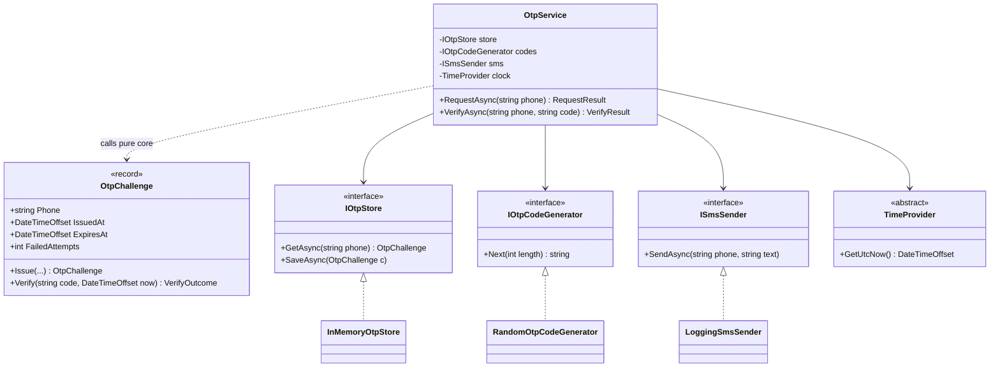
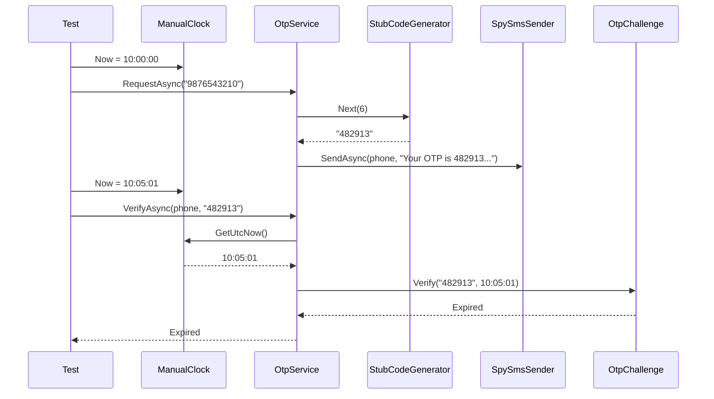

A class is "testable" when you can put it in a known situation, poke it, and check what happened, all in a few milliseconds and with the same result every time. Most hard-to-test code isn't hard because the logic is complicated. It is hard because the class quietly reaches out for things it was never given: the system clock, a random number, a file, the network, a static configuration object. This lesson is about designing those hidden inputs out.

## Learning objectives

By the end of this lesson you will be able to:

1. Spot the hidden inputs and outputs that make a class hard to test: time, randomness, static state, I/O and `new`-ing collaborators.
2. Explain what a **seam** is and create one with constructor injection, a delegate, or `TimeProvider`.
3. Choose the right test double (dummy, stub, spy, fake, mock) and hand-write it without a mocking library.
4. Split a feature into a pure decision-making core and a thin shell that does I/O (functional core, imperative shell).
5. Recognise over-abstraction: interfaces nobody needs, and tests that check calls instead of behaviour.
6. Build an OTP verification service whose expiry, lockout and resend rules are all tested without waiting or sending real SMS.

## Prerequisites

- [Dependency injection](#/lesson/m03-dependency-injection): we pass collaborators in through constructors.
- [Dependency Inversion Principle](#/lesson/m04-dip): depend on abstractions you own.
- [Testing and debugging basics](#/lesson/m01-testing-debugging): you should have written an xUnit `[Fact]`.

## Explain it like I'm a beginner

Imagine you are testing a new pressure cooker. You want to check one thing: does the safety valve release at the right pressure?

If the cooker is welded to a gas pipe in your kitchen, testing is painful. You need real gas, a real flame, and you have to wait 15 minutes for every test. If the valve fails you can't tell if the problem is the valve, the flame, or the gas supply.

Now imagine the cooker has a **standard socket** where the heat source plugs in. In the factory, the tester plugs in an electric heater that can jump to exactly 1.2 bar in two seconds. The same cooker, at home, plugs into a gas stove. The cooker didn't change. Only what's plugged into the socket did.

Code works the same way.

- The **cooker** is your class with the business rule ("an OTP expires after 5 minutes").
- The **gas pipe welded on** is code like `DateTime.Now` or `new SmtpClient()` written directly inside the class.
- The **socket** is a **seam**: a place where you can swap what the class uses without editing the class. In C#, that's usually a constructor parameter typed as an interface or abstract class.
- The **factory heater** is a **test double**: a simple stand-in that you fully control in a test.

Once the class has sockets for time, randomness and messaging, a test can say: "It's 10:00:00. The code is 482913. Now it's 10:05:01. Verify 482913." and check "expired" in a millisecond, with no waiting and no real SMS.

## First-principles explanation

### What a test needs

A good unit test controls every **input**, triggers the behaviour, and observes every **output** that matters. Anything the class reads or writes that the test can't control or observe is a problem.

**Hidden inputs** (things the class reads without being given them):

| Hidden input | Typical code | Why it hurts |
|---|---|---|
| Current time | `DateTime.Now`, `DateTime.UtcNow` | Tests depend on when they run; "expires in 5 minutes" needs a 5-minute test |
| Randomness | `Random.Shared.Next()`, `Guid.NewGuid()` | You can't predict the OTP, so you can't type it in |
| Environment | `Environment.GetEnvironmentVariable`, static `Config.Get("x")` | Tests leak settings into each other |
| Files and network | `File.ReadAllText`, `new HttpClient()` | Slow, flaky, needs setup |
| Global mutable state | static fields, singletons accessed via `Instance` | Test order changes results |

**Hidden outputs** (side effects the test can't see): emails sent, rows written, log entries, messages published.

### Seams

Michael Feathers, in *Working Effectively with Legacy Code*, defines a **seam** as a place where you can change behaviour without editing in that place. In C# the useful seams are:

1. **Object seam**: a constructor parameter of an interface or abstract type (`ISmsSender`, `TimeProvider`). The most common and the most explicit.
2. **Delegate seam**: a `Func<DateTimeOffset>` or `Func<int, string>` parameter. Lighter than an interface; good for one function.
3. **Parameter seam**: pass the value itself. `Verify(code, now)` instead of reading the clock inside. The lightest seam of all, and often the best.
4. **Configuration seam**: `IOptions<OtpPolicy>` so tests set "validity = 5 minutes" explicitly.

### TimeProvider: the built-in clock seam

Since .NET 8, the BCL has `System.TimeProvider`, an abstract class with `GetUtcNow()`, `GetLocalNow()`, `GetTimestamp()` and timer creation. Production code registers `TimeProvider.System`. Tests use a subclass whose `GetUtcNow()` returns whatever the test says. Microsoft ships one, `FakeTimeProvider`, in the `Microsoft.Extensions.TimeProvider.Testing` NuGet package, and you can also write your own in five lines. Prefer `TimeProvider` to inventing your own `IClock` in new code, because libraries (and `Task.Delay` overloads) understand it.

### Test doubles: five kinds

Gerard Meszaros named the stand-ins, and Martin Fowler popularised the terms. They differ by *what you use them for*:

| Double | What it does | Example |
|---|---|---|
| **Dummy** | Fills a parameter that the test doesn't use | `NullLogger<T>.Instance` |
| **Stub** | Returns canned answers | A code generator that always returns `"482913"` |
| **Spy** | Records what was called so the test can check it | An SMS sender that adds each message to a list |
| **Fake** | A working, simplified implementation | An in-memory OTP store backed by a `Dictionary` |
| **Mock** | Pre-programmed with expectations; fails if calls don't match | Usually created by a library like Moq or NSubstitute |

Hand-written stubs, spies and fakes cover most needs and are easy to read. A fake in-memory store also gets reused across dozens of tests, which is a better investment than configuring a mock in each one.

### State verification vs interaction verification

- **State verification**: after the action, check the result or the state. "Verify returned `Expired`." "The store now holds a challenge with 1 failed attempt."
- **Interaction verification**: check that a collaborator was called in a certain way. "`SendAsync` was called once with this text."

Prefer state verification. Interaction checks couple the test to *how* the class works, so a harmless refactor (batching two calls into one) breaks tests even though behaviour is correct. Use interaction checks only for real outputs at a boundary: the SMS that must be sent, the event that must be published.

### Functional core, imperative shell

Gary Bernhardt's idea: put the **decisions** in pure code (same inputs → same outputs, no I/O), and keep a thin outer **shell** that gathers inputs, calls the core, and performs the effects.

For the OTP feature:

- **Core** (`OtpChallenge`): "Given this challenge, this code and this time, is the result Success, Wrong, Expired or Locked, and what's the new challenge?" Pure. Tests need no doubles at all, just values.
- **Shell** (`OtpService`): reads the clock, loads from the store, calls the core, saves, sends the SMS. Few branches, so few tests.

This is the **Humble Object** idea too: make the hard-to-test part (I/O) so simple ("humble") that it barely needs testing, and move the logic into something easy to test.

### When it is unnecessary

- **Pure code is already testable.** A GST calculator that takes an amount and a rate doesn't need an interface. Don't create `ITaxCalculator` just to mock it in the tests of a class that uses it; use the real one.
- **Value objects and records** never need doubles.
- **One-implementation interfaces "for testing"** are worth it at boundaries (clock, network, database, message bus). Inside your own domain logic, they mostly add files.
- **Too many seams** is a smell. A constructor with 9 dependencies is not a testing problem; it's a class doing too much ([see Refactoring large classes](#/lesson/m07-refactoring-large-classes)).

### Trade-offs

| You gain | You pay |
|---|---|
| Fast, deterministic tests that run in milliseconds | More constructor parameters and DI registrations |
| Clear list of what a class depends on | Some indirection when reading code |
| Business rules tested without infrastructure | Doubles can drift from real behaviour; you still need integration tests |
| Easier refactoring, because tests check behaviour | Upfront design thought about where effects happen |

## Visual explanation

### Class diagram



The service (the shell) has four seams, one for each hidden input or output: the store, the code generator (randomness), the SMS sender (output), and `TimeProvider` (time). `OtpChallenge` (the core) has no seams at all because it doesn't need any: it receives the time and the code as plain parameters. In tests, each seam gets a double: a fake store, a stub generator, a spy SMS sender and a manual clock.

### Sequence diagram: a test of expiry



The test moves time forward by setting a property, so a five-minute rule is tested in well under a millisecond. The stub generator makes the code predictable, so the test can "type" it. The spy records the SMS, so a separate test can check its wording. Notice the core makes the actual decision; the service only fetched the time and passed it on.

## Step-by-step example

### Step 1 — the untestable version

```csharp
public class OtpManager
{
    private static readonly Dictionary<string, (string Code, DateTime Expiry, int Fails)> Store = new();

    public void Send(string phone)
    {
        var code = Random.Shared.Next(100000, 999999).ToString();
        Store[phone] = (code, DateTime.Now.AddMinutes(5), 0);
        new SmsGatewayClient(Environment.GetEnvironmentVariable("SMS_KEY")!).Send(phone, $"OTP {code}");
    }

    public bool Verify(string phone, string code)
    {
        var e = Store[phone];
        if (DateTime.Now > e.Expiry) return false;
        if (e.Fails >= 3) return false;
        if (e.Code != code) { Store[phone] = e with { Fails = e.Fails + 1 }; return false; }
        return true;
    }
}
```

Count the hidden inputs: a static store shared by every test, `Random.Shared`, `DateTime.Now` (local time, so also time-zone dependent), an environment variable, and a real SMS gateway created with `new`. And `Verify` returns only `bool`, so a test can't tell "expired" from "locked" from "wrong code". There's a subtler bug too: `Random.Next(100000, 999999)` never produces `999999`, and it isn't a cryptographically secure random source.

### Step 2 — pull the decisions into a pure core

Write `OtpChallenge` as an immutable record. `Verify(code, now, policy)` returns a result enum *and* the next challenge. No clock, no store, no SMS. You can now write a dozen tests for expiry, lockout and success with nothing but values.

### Step 3 — give the shell seams

`OtpService` takes `IOtpStore`, `IOtpCodeGenerator`, `ISmsSender`, `TimeProvider`, `IOptions<OtpPolicy>` and a logger through its constructor. Each replaces one hidden input from Step 1.

### Step 4 — wire real implementations in Program.cs

Production registers `TimeProvider.System`, a secure random generator and the real SMS client. Tests construct `OtpService` directly with doubles; they don't need the DI container at all.

## Production-style C# implementation

```text
Citizen.Api/
  Program.cs
  Otp/
    OtpPolicy.cs           options
    OtpChallenge.cs        pure core: decisions only
    Ports.cs               IOtpStore, IOtpCodeGenerator, ISmsSender
    Adapters.cs            in-memory store, secure generator, logging SMS sender
    OtpService.cs          imperative shell
```

```csharp file=Otp/OtpPolicy.cs
namespace Citizen.Otp;

public sealed class OtpPolicy
{
    public int Length { get; set; } = 6;
    public TimeSpan Validity { get; set; } = TimeSpan.FromMinutes(5);
    public int MaxAttempts { get; set; } = 3;
    public TimeSpan ResendCooldown { get; set; } = TimeSpan.FromSeconds(30);
}

public enum VerifyResult { Success, WrongCode, Expired, Locked, NotFound }
public enum RequestResult { Sent, TooSoon }
```

```csharp file=Otp/OtpChallenge.cs
using System.Security.Cryptography;
using System.Text;

namespace Citizen.Otp;

public readonly record struct VerifyOutcome(VerifyResult Result, OtpChallenge Next);

/// <summary>Pure core: every decision about an OTP, with time and code passed in as values.</summary>
public sealed record OtpChallenge(string Phone, string CodeHash, DateTimeOffset IssuedAt, DateTimeOffset ExpiresAt,
                                  int FailedAttempts, bool Used)
{
    public static OtpChallenge Issue(string phone, string code, DateTimeOffset now, OtpPolicy policy) =>
        new(phone, Hash(phone, code), now, now + policy.Validity, 0, false);

    public bool CanResend(DateTimeOffset now, OtpPolicy policy) =>
        Used || FailedAttempts >= policy.MaxAttempts || now - IssuedAt >= policy.ResendCooldown;

    public VerifyOutcome Verify(string code, DateTimeOffset now, OtpPolicy policy)
    {
        if (Used) return new(VerifyResult.Expired, this);
        if (FailedAttempts >= policy.MaxAttempts) return new(VerifyResult.Locked, this);
        if (now >= ExpiresAt) return new(VerifyResult.Expired, this);

        var match = CryptographicOperations.FixedTimeEquals(
            Convert.FromHexString(CodeHash), Convert.FromHexString(Hash(Phone, code)));
        if (match) return new(VerifyResult.Success, this with { Used = true });

        var next = this with { FailedAttempts = FailedAttempts + 1 };
        return new(next.FailedAttempts >= policy.MaxAttempts ? VerifyResult.Locked : VerifyResult.WrongCode, next);
    }

    // Demo only: production systems should use an HMAC with a server-side secret key.
    private static string Hash(string phone, string code) =>
        Convert.ToHexString(SHA256.HashData(Encoding.UTF8.GetBytes($"{phone}:{code}")));
}
```

Three design choices make this core easy to test. Time arrives as a parameter, not from a clock. It returns a *new* challenge rather than mutating itself, so a test can compare before and after. And the result is an enum with five values instead of a `bool`, so each rule has its own observable outcome. The fixed-time comparison avoids leaking, through response timing, how many leading characters matched.

```csharp file=Otp/Ports.cs
namespace Citizen.Otp;

public interface IOtpStore
{
    Task<OtpChallenge?> GetAsync(string phone, CancellationToken ct);
    Task SaveAsync(OtpChallenge challenge, CancellationToken ct);
}

public interface IOtpCodeGenerator
{
    string Next(int length);
}

public interface ISmsSender
{
    Task SendAsync(string phone, string text, CancellationToken ct);
}
```

```csharp file=Otp/Adapters.cs
using System.Collections.Concurrent;
using System.Security.Cryptography;
using Microsoft.Extensions.Logging;

namespace Citizen.Otp;

/// <summary>Good enough for a single instance and for tests. Use Redis or PostgreSQL when scaled out.</summary>
public sealed class InMemoryOtpStore : IOtpStore
{
    private readonly ConcurrentDictionary<string, OtpChallenge> _items = new();
    public Task<OtpChallenge?> GetAsync(string phone, CancellationToken ct) =>
        Task.FromResult(_items.TryGetValue(phone, out var c) ? c : null);
    public Task SaveAsync(OtpChallenge challenge, CancellationToken ct)
    {
        _items[challenge.Phone] = challenge;
        return Task.CompletedTask;
    }
}

public sealed class SecureOtpCodeGenerator : IOtpCodeGenerator
{
    public string Next(int length) =>
        string.Create(length, 0, static (span, _) =>
        {
            for (var i = 0; i < span.Length; i++) span[i] = (char)('0' + RandomNumberGenerator.GetInt32(10));
        });
}

public sealed class LoggingSmsSender(ILogger<LoggingSmsSender> logger) : ISmsSender
{
    public Task SendAsync(string phone, string text, CancellationToken ct)
    {
        // Never log the OTP itself in production. We log only the masked number.
        logger.LogInformation("SMS queued to ******{Last4}", phone[^4..]);
        return Task.CompletedTask;
    }
}
```

```csharp file=Otp/OtpService.cs
using Microsoft.Extensions.Logging;
using Microsoft.Extensions.Options;

namespace Citizen.Otp;

/// <summary>Imperative shell: reads time, loads, calls the core, saves, sends. Few branches of its own.</summary>
public sealed class OtpService(IOtpStore store, IOtpCodeGenerator codes, ISmsSender sms, TimeProvider clock,
                               IOptions<OtpPolicy> options, ILogger<OtpService> logger)
{
    private readonly OtpPolicy _policy = options.Value;

    public async Task<RequestResult> RequestAsync(string phone, CancellationToken ct)
    {
        var now = clock.GetUtcNow();
        var existing = await store.GetAsync(phone, ct);
        if (existing is not null && !existing.CanResend(now, _policy)) return RequestResult.TooSoon;

        var code = codes.Next(_policy.Length);
        await store.SaveAsync(OtpChallenge.Issue(phone, code, now, _policy), ct);
        await sms.SendAsync(phone, $"Your OTP is {code}. It is valid for {_policy.Validity.TotalMinutes:0} minutes. Do not share it.", ct);
        return RequestResult.Sent;
    }

    public async Task<VerifyResult> VerifyAsync(string phone, string code, CancellationToken ct)
    {
        var challenge = await store.GetAsync(phone, ct);
        if (challenge is null) return VerifyResult.NotFound;

        var outcome = challenge.Verify(code, clock.GetUtcNow(), _policy);
        if (!ReferenceEquals(outcome.Next, challenge)) await store.SaveAsync(outcome.Next, ct);
        if (outcome.Result == VerifyResult.Locked)
            logger.LogWarning("OTP locked for ******{Last4}", phone[^4..]);
        return outcome.Result;
    }
}
```

```csharp file=Program.cs
using Citizen.Otp;

var builder = WebApplication.CreateBuilder(args);

builder.Services.Configure<OtpPolicy>(builder.Configuration.GetSection("Otp"));
builder.Services.AddSingleton(TimeProvider.System);               // the clock seam, real implementation
builder.Services.AddSingleton<IOtpStore, InMemoryOtpStore>();
builder.Services.AddSingleton<IOtpCodeGenerator, SecureOtpCodeGenerator>();
builder.Services.AddSingleton<ISmsSender, LoggingSmsSender>();     // swap for a real SMS gateway adapter
builder.Services.AddScoped<OtpService>();

var app = builder.Build();

app.MapPost("/otp/request", async (OtpRequest req, OtpService otp, CancellationToken ct) =>
    await otp.RequestAsync(req.Phone, ct) == RequestResult.Sent
        ? Results.Accepted()
        : Results.Problem("Please wait before requesting another OTP.", statusCode: StatusCodes.Status429TooManyRequests));

app.MapPost("/otp/verify", async (OtpVerify req, OtpService otp, CancellationToken ct) =>
    await otp.VerifyAsync(req.Phone, req.Code, ct) switch
    {
        VerifyResult.Success => Results.Ok(),
        VerifyResult.Locked => Results.Problem("Too many attempts.", statusCode: StatusCodes.Status423Locked),
        _ => Results.Problem("Invalid or expired OTP.", statusCode: StatusCodes.Status400BadRequest),
    });

app.Run();

public sealed record OtpRequest(string Phone);
public sealed record OtpVerify(string Phone, string Code);
```

The API deliberately returns the same message for "wrong" and "expired", so an attacker can't learn which one happened. The test suite, however, *can* see the difference, because `OtpService` returns the detailed enum. Testability and security don't conflict here; the endpoint just maps detail to a safe message.

## Bad design vs good design

**Bad**: the `OtpManager` from Step 1. To test expiry you'd have to `Thread.Sleep(TimeSpan.FromMinutes(5))`. To test a correct code you'd have to read the static dictionary through reflection. Every test run sends a real SMS and costs money. Tests interfere through the static store, so they pass alone and fail together.

**Also bad, in the other direction**: an "over-seamed" design.

```csharp
public sealed class OtpService(IOtpStore store, IOtpCodeGenerator codes, ISmsSender sms, IClock clock,
    IOtpHasher hasher, IOtpExpiryCalculator expiry, IOtpAttemptCounter attempts, IOtpMessageFormatter fmt,
    IStringComparer cmp) { /* ... */ }
```

Every tiny calculation has its own interface, so each test configures nine doubles, and the logic that matters (how expiry, attempts and match interact) is spread across nine classes and tested nowhere as a whole. Tests become lists of "verify `expiry.Calculate` was called once". Rename one method and 40 tests break.

**Good**: seams only where the outside world leaks in (time, randomness, storage, SMS), and all the rules together in one pure core that needs no doubles.

**Is the improvement worth it?** For a one-off admin script that runs once a month, a `DateTime.UtcNow` call is fine. For anything with time-based rules, security rules or money, the seams pay for themselves the first time a test catches an off-by-one at the expiry boundary.

:::callout type=tip title="A quick testability check"
Ask of any class: "Could I write a test for its most important rule in under 10 lines, without touching the network, disk, clock or a static?" If not, find the hidden input and give it a seam, or move the rule into a pure function that takes the input as a parameter.
:::

## Practical playground

The pure core needs no doubles at all. Run it, then change the times and codes and predict each result before running again.

:::playground type=csharp title="Pure OTP core"
```csharp file=Program.cs
using System;

public enum Result { Success, WrongCode, Expired, Locked }

public sealed record Challenge(string Code, DateTimeOffset ExpiresAt, int Fails)
{
    public (Result, Challenge) Verify(string code, DateTimeOffset now, int maxAttempts = 3)
    {
        if (Fails >= maxAttempts) return (Result.Locked, this);
        if (now >= ExpiresAt) return (Result.Expired, this);
        if (code == Code) return (Result.Success, this);
        var next = this with { Fails = Fails + 1 };
        return (next.Fails >= maxAttempts ? Result.Locked : Result.WrongCode, next);
    }
}

public static class Program
{
    public static void Main()
    {
        var t0 = new DateTimeOffset(2026, 1, 26, 10, 0, 0, TimeSpan.FromHours(5.5));
        var c = new Challenge("482913", t0.AddMinutes(5), 0);

        Console.WriteLine($"Right code at +1 min:      {c.Verify("482913", t0.AddMinutes(1)).Item1}");
        Console.WriteLine($"Right code at +5 min:      {c.Verify("482913", t0.AddMinutes(5)).Item1}  (boundary: is 5:00 expired?)");

        var (r1, c1) = c.Verify("111111", t0.AddMinutes(1));
        var (r2, c2) = c1.Verify("222222", t0.AddMinutes(2));
        var (r3, c3) = c2.Verify("333333", t0.AddMinutes(3));
        Console.WriteLine($"Three wrong codes:         {r1}, {r2}, {r3}");
        Console.WriteLine($"Right code after lockout:  {c3.Verify("482913", t0.AddMinutes(3)).Item1}");
        Console.WriteLine($"Original is unchanged:     Fails = {c.Fails}");
    }
}
```
:::

## Exercises

:::exercise id=m07-testable-design-ex1 difficulty=beginner kind=code title="Give office hours a clock seam"
A municipal help-desk counter is open 09:30 to 17:30 India Standard Time (IST, UTC+05:30), Monday to Saturday. The original code used `DateTime.Now`, so its tests only passed during office hours. Implement `CounterHours.IsOpen()` using an injected `TimeProvider`.
::requirements
- Convert the provider's UTC time to IST with a fixed +05:30 offset (IST has no daylight saving).
- Open at exactly 09:30:00; closed at exactly 17:30:00.
- Closed all day Sunday.
::acceptance
- Monday 10:00 IST → open; Monday 09:29:59 IST → closed; Monday 17:30:00 IST → closed.
- Sunday 11:00 IST → closed.
- 04:30 UTC on a Saturday (10:00 IST) → open: the conversion is applied.
- No call to `DateTime.Now`, `DateTime.UtcNow` or `DateTimeOffset.Now` in the class.
::hint
The class must never ask the machine for the time. It asks the `TimeProvider` it was given.
::hint
`clock.GetUtcNow().ToOffset(TimeSpan.FromHours(5.5))` gives you the IST wall-clock time.
::hint
Compare `TimeOnly.FromTimeSpan(ist.TimeOfDay)` against `new TimeOnly(9, 30)` and `new TimeOnly(17, 30)`. Use `>=` for opening and `<` for closing.
::hint
```csharp
var ist = clock.GetUtcNow().ToOffset(Ist);
if (ist.DayOfWeek == DayOfWeek.Sunday) return false;
```
::starter
```csharp file=CounterHours.cs
using System;

public sealed class CounterHours
{
    private static readonly TimeSpan Ist = TimeSpan.FromHours(5.5);
    private readonly TimeProvider _clock;

    public CounterHours(TimeProvider clock) => _clock = clock;

    public bool IsOpen() => throw new NotImplementedException();
}
```
::tests
```csharp file=CounterHoursTests.cs
using System;
using Xunit;

public sealed class ManualClock(DateTimeOffset now) : TimeProvider
{
    public DateTimeOffset Now { get; set; } = now;
    public override DateTimeOffset GetUtcNow() => Now.ToUniversalTime();
}

public class CounterHoursTests
{
    private static readonly TimeSpan Ist = TimeSpan.FromHours(5.5);
    // 2026-03-02 is a Monday; 2026-03-07 is a Saturday; 2026-03-08 is a Sunday.
    private static bool OpenAt(int day, int h, int m, int s = 0) =>
        new CounterHours(new ManualClock(new DateTimeOffset(2026, 3, day, h, m, s, Ist))).IsOpen();

    [Fact] public void Monday_morning_open() => Assert.True(OpenAt(2, 10, 0));
    [Fact] public void Just_before_opening_closed() => Assert.False(OpenAt(2, 9, 29, 59));
    [Fact] public void Opening_instant_open() => Assert.True(OpenAt(2, 9, 30));
    [Fact] public void Closing_instant_closed() => Assert.False(OpenAt(2, 17, 30));
    [Fact] public void Sunday_closed() => Assert.False(OpenAt(8, 11, 0));
    [Fact] public void Saturday_open() => Assert.True(OpenAt(7, 12, 0));

    [Fact]
    public void Converts_from_utc() =>
        Assert.True(new CounterHours(new ManualClock(new DateTimeOffset(2026, 3, 7, 4, 30, 0, TimeSpan.Zero))).IsOpen());

    [Fact]
    public void Same_instance_follows_the_clock()
    {
        var clock = new ManualClock(new DateTimeOffset(2026, 3, 2, 9, 0, 0, Ist));
        var hours = new CounterHours(clock);
        Assert.False(hours.IsOpen());
        clock.Now = clock.Now.AddHours(1);
        Assert.True(hours.IsOpen());
    }
}
```
::solution
```csharp file=CounterHours.cs
using System;

public sealed class CounterHours
{
    private static readonly TimeSpan Ist = TimeSpan.FromHours(5.5);
    private static readonly TimeOnly Opens = new(9, 30);
    private static readonly TimeOnly Closes = new(17, 30);
    private readonly TimeProvider _clock;

    public CounterHours(TimeProvider clock) => _clock = clock;

    public bool IsOpen()
    {
        var ist = _clock.GetUtcNow().ToOffset(Ist);
        if (ist.DayOfWeek == DayOfWeek.Sunday) return false;
        var t = TimeOnly.FromTimeSpan(ist.TimeOfDay);
        return t >= Opens && t < Closes;
    }
}
```

The last test is the interesting one: the same `CounterHours` instance gives different answers as the clock moves, which proves it reads time on each call instead of caching it in the constructor.
::alternatives
An even simpler seam is a parameter: `bool IsOpenAt(DateTimeOffset instant)`. Then `IsOpen()` is a one-liner calling `IsOpenAt(_clock.GetUtcNow())`, and most tests use the pure method directly. For real time-zone rules (DST countries), use `TimeZoneInfo.FindSystemTimeZoneById` and make sure the server has time-zone data installed.
::mistakes
- Reading the time once in the constructor, so a long-lived singleton never notices the day changing.
- Using `GetLocalNow()`, which depends on the server's time zone setting; servers often run in UTC.
- Using `<=` for closing time, which keeps the counter open at 17:30:00.
:::

:::exercise id=m07-testable-design-ex2 difficulty=beginner kind=code title="Rent reminders with a stub and a spy"
A housing society app sends a reminder to each flat whose maintenance fee is unpaid and was due more than 3 days ago. Implement `RentReminderService.SendDueReminders()` using only the injected `IDuesRepository`, `INotifier` and `TimeProvider`. The tests supply a stub repository, a spy notifier and a manual clock.
::requirements
- Remind only dues where `Paid` is false and `today > DueDate + 3 days` (in UTC dates).
- The message must include the flat number and the amount in Indian format, like `₹2,500.00` or `₹1,25,000.00` (format with the `en-IN` culture, not the server's culture).
- Return how many reminders were sent.
::acceptance
- With dues due 10, 4 and 2 days ago (unpaid), exactly two reminders are sent.
- Paid dues are never reminded.
- Due exactly 3 days ago: no reminder yet.
- Each message contains the flat number and the formatted amount.
::hint
The service has three seams. The tests already provide the doubles; your job is to use only those, not `DateTime`.
::hint
Get "today" as `DateOnly.FromDateTime(clock.GetUtcNow().UtcDateTime)`.
::hint
The condition is `!d.Paid && today > d.DueDate.AddDays(3)`.
::hint
Format money with `string.Create(CultureInfo.GetCultureInfo("en-IN"), $"₹{d.Amount:N2}")`, which gives `₹2,500.00` and `₹1,25,000.00` (Indian digit grouping).
::starter
```csharp file=RentReminderService.cs
using System;
using System.Collections.Generic;
using System.Globalization;
using System.Linq;

public sealed record Due(string Flat, decimal Amount, DateOnly DueDate, bool Paid);

public interface IDuesRepository { IReadOnlyList<Due> GetAll(); }
public interface INotifier { void Notify(string flat, string message); }

public sealed class RentReminderService(IDuesRepository dues, INotifier notifier, TimeProvider clock)
{
    public int SendDueReminders() => throw new NotImplementedException();
}
```
::tests
```csharp file=RentReminderServiceTests.cs
using System;
using System.Collections.Generic;
using System.Linq;
using Xunit;

public sealed class StubDues(params Due[] items) : IDuesRepository
{
    public IReadOnlyList<Due> GetAll() => items;
}

public sealed class SpyNotifier : INotifier
{
    public List<(string Flat, string Message)> Sent { get; } = new();
    public void Notify(string flat, string message) => Sent.Add((flat, message));
}

public sealed class FixedClock(DateTimeOffset now) : TimeProvider
{
    public override DateTimeOffset GetUtcNow() => now;
}

public class RentReminderServiceTests
{
    private static readonly DateOnly Today = new(2026, 5, 20);
    private static readonly FixedClock Clock = new(new DateTimeOffset(2026, 5, 20, 6, 0, 0, TimeSpan.Zero));

    [Fact]
    public void Reminds_only_overdue_unpaid()
    {
        var spy = new SpyNotifier();
        var svc = new RentReminderService(new StubDues(
            new Due("A-101", 2500m, Today.AddDays(-10), false),
            new Due("A-102", 2500m, Today.AddDays(-4), false),
            new Due("B-201", 2500m, Today.AddDays(-2), false),
            new Due("B-202", 2500m, Today.AddDays(-30), true)), spy, Clock);

        Assert.Equal(2, svc.SendDueReminders());
        Assert.Equal(new[] { "A-101", "A-102" }, spy.Sent.Select(s => s.Flat).ToArray());
    }

    [Fact]
    public void Exactly_three_days_is_not_overdue()
    {
        var spy = new SpyNotifier();
        new RentReminderService(new StubDues(new Due("C-301", 1000m, Today.AddDays(-3), false)), spy, Clock).SendDueReminders();
        Assert.Empty(spy.Sent);
    }

    [Fact]
    public void Message_has_flat_and_indian_formatted_amount()
    {
        var spy = new SpyNotifier();
        new RentReminderService(new StubDues(new Due("D-404", 125000m, Today.AddDays(-5), false)), spy, Clock).SendDueReminders();
        var msg = Assert.Single(spy.Sent).Message;
        Assert.Contains("D-404", msg);
        Assert.Contains("₹1,25,000.00", msg);
    }
}
```
::solution
```csharp file=RentReminderService.cs
using System;
using System.Collections.Generic;
using System.Globalization;
using System.Linq;

public sealed record Due(string Flat, decimal Amount, DateOnly DueDate, bool Paid);

public interface IDuesRepository { IReadOnlyList<Due> GetAll(); }
public interface INotifier { void Notify(string flat, string message); }

public sealed class RentReminderService(IDuesRepository dues, INotifier notifier, TimeProvider clock)
{
    private const int GraceDays = 3;
    private static readonly CultureInfo India = CultureInfo.GetCultureInfo("en-IN");

    public int SendDueReminders()
    {
        var today = DateOnly.FromDateTime(clock.GetUtcNow().UtcDateTime);
        var overdue = dues.GetAll().Where(d => !d.Paid && today > d.DueDate.AddDays(GraceDays)).ToList();
        foreach (var d in overdue)
            notifier.Notify(d.Flat, string.Create(India, $"Flat {d.Flat}: maintenance of ₹{d.Amount:N2} was due on {d.DueDate:dd MMM yyyy}. Please pay to avoid a late fee."));
        return overdue.Count;
    }
}
```

The stub decides the *inputs* (which dues exist), the spy captures the *outputs* (which messages went out), and the clock fixes "today". Each double is a few lines and readable in the test file.
::mistakes
- Using `DateTime.Today`, which ignores the injected clock and uses the server's local date.
- Formatting with the current culture, so the test passes on an Indian laptop and fails on a UTC build server with `en-US`.
- Asserting on the exact full message text, which breaks on every copy change. Assert on the parts that matter.
:::

:::exercise id=m07-testable-design-ex3 difficulty=intermediate kind=code title="Extract a pure late-fee core"
An electricity distribution company charges a late payment surcharge (LPS). The rule, simplified for this exercise: no surcharge within a 7-day grace period after the due date; after that, 1.5 % of the unpaid amount for each started 30-day period after the due date; total surcharge capped at 18 % of the bill. Implement the pure function `LateFee.Calculate`, then the thin shell `BillPaymentService.QuoteToday`.
::requirements
- `LateFee.Calculate(decimal amount, DateOnly dueDate, DateOnly paidOn)` is static and pure: no clock, no I/O.
- Days late = `paidOn - dueDate` in days. 0–7 days → 0. 8–30 days → 1 period. 31–60 → 2 periods, and so on.
- Round the result to 2 decimals, midpoint away from zero.
- `BillPaymentService.QuoteToday(bill)` reads today from `TimeProvider` and calls the pure function.
::acceptance
- ₹4,000 bill paid 5 days late → ₹0. Paid 8 days late → ₹60. Paid 31 days late → ₹120.
- Paid 400 days late → capped at 18 %: ₹720.
- Paid before the due date → ₹0.
- `QuoteToday` uses the injected clock (tests use a fixed date).
::hint
Write all the cases as a table of (amount, days late, expected) first. That table becomes an `[InlineData]` theory.
::hint
Started periods = `ceil(daysLate / 30)` for days beyond grace. With integers: `(daysLate + 29) / 30`.
::hint
Surcharge = `amount × 1.5 % × periods`, then `Math.Min(that, amount × 18 %)`.
::hint
`paidOn.DayNumber - dueDate.DayNumber` gives the days between two `DateOnly` values.
::starter
```csharp file=LateFee.cs
using System;

public static class LateFee
{
    public const int GraceDays = 7;
    public const decimal RatePerPeriod = 0.015m;
    public const decimal Cap = 0.18m;

    public static decimal Calculate(decimal amount, DateOnly dueDate, DateOnly paidOn) => throw new NotImplementedException();
}

public sealed record Bill(string ConsumerNo, decimal Amount, DateOnly DueDate);

public sealed class BillPaymentService(TimeProvider clock)
{
    public decimal QuoteToday(Bill bill) => throw new NotImplementedException();
}
```
::tests
```csharp file=LateFeeTests.cs
using System;
using Xunit;

public class LateFeeTests
{
    private static readonly DateOnly Due = new(2026, 4, 10);

    [Theory]
    [InlineData(4000, 5, 0)]
    [InlineData(4000, 7, 0)]
    [InlineData(4000, 8, 60)]
    [InlineData(4000, 30, 60)]
    [InlineData(4000, 31, 120)]
    [InlineData(4000, 400, 720)]
    [InlineData(4000, -3, 0)]
    [InlineData(1333.33, 45, 40)]
    public void Calculates(decimal amount, int daysLate, decimal expected) =>
        Assert.Equal(expected, LateFee.Calculate(amount, Due, Due.AddDays(daysLate)));

    private sealed class FixedClock(DateTimeOffset now) : TimeProvider { public override DateTimeOffset GetUtcNow() => now; }

    [Fact]
    public void Shell_uses_injected_clock()
    {
        var svc = new BillPaymentService(new FixedClock(new DateTimeOffset(2026, 5, 11, 12, 0, 0, TimeSpan.Zero)));
        Assert.Equal(120m, svc.QuoteToday(new Bill("1100234567", 4000m, Due)));
    }
}
```
::solution
```csharp file=LateFee.cs
using System;

public static class LateFee
{
    public const int GraceDays = 7;
    public const decimal RatePerPeriod = 0.015m;
    public const decimal Cap = 0.18m;

    public static decimal Calculate(decimal amount, DateOnly dueDate, DateOnly paidOn)
    {
        var daysLate = paidOn.DayNumber - dueDate.DayNumber;
        if (daysLate <= GraceDays) return 0m;
        var periods = (daysLate + 29) / 30;
        var fee = Math.Min(amount * RatePerPeriod * periods, amount * Cap);
        return Math.Round(fee, 2, MidpointRounding.AwayFromZero);
    }
}

public sealed record Bill(string ConsumerNo, decimal Amount, DateOnly DueDate);

public sealed class BillPaymentService(TimeProvider clock)
{
    public decimal QuoteToday(Bill bill) =>
        LateFee.Calculate(bill.Amount, bill.DueDate, DateOnly.FromDateTime(clock.GetUtcNow().UtcDateTime));
}
```

All the rules live in eight lines of pure code covered by an eight-row table. The shell has one line and one test. That ratio is the goal of functional core, imperative shell. Check the ₹1,333.33 row by hand: 45 days is 2 periods, so 1,333.33 × 0.03 = 39.9999, which rounds to ₹40.00.
::alternatives
Make the rates configurable via `IOptions<LateFeePolicy>` and pass the policy into the pure function as a parameter. Regulators change surcharge rates, and a policy object keeps the function pure while removing the constants.
::mistakes
- Using `double` for money: `4000 * 0.015` as `double` is fine, but sums of many such values drift.
- Counting *completed* periods (`daysLate / 30`) instead of *started* ones.
- Putting the clock read inside `Calculate`, which forces every one of the eight tests to fake time.
:::

:::exercise id=m07-testable-design-ex4 difficulty=intermediate kind=design title="Find the seams in a monthly report job"
This class runs on the 1st of every month, builds a seller-payouts report for an online marketplace and emails it to the finance head:

```csharp
public class MonthlyReportJob
{
    public void Run()
    {
        if (DateTime.Now.Day != 1) return;
        var cs = ConfigurationManager.AppSettings["Db"];
        var rows = new SqlReportReader(cs).Read(DateTime.Now.AddMonths(-1));
        var total = rows.Sum(r => r.Amount);
        var html = $"<h1>Payments</h1><p>Total ₹{total:N2}</p>" + string.Join("", rows.Select(r => $"<tr><td>{r.Seller}</td><td>{r.Amount}</td></tr>"));
        File.WriteAllText($@"C:\reports\{DateTime.Now:yyyyMM}.html", html);
        new SmtpClient("smtp.office.local").Send("reports@corp", "finance-head@corp", "Monthly seller payouts", html);
    }
}
```

Redesign it in the LLD designer so that the report content can be tested without a database, file system, SMTP server or the real date.
::acceptance
- Every hidden input (time, configuration, database) and output (file, email) has a seam.
- The report-building logic is a pure class or function that takes rows and a month and returns the report.
- The job class is a thin shell with no formatting logic.
- The design doesn't add an interface for the pure report builder.
::hint
List the hidden inputs first: there are at least three. Then list the hidden outputs: there are two.
::hint
"Is today the 1st?" is scheduling, not report logic. Who should decide when the job runs?
::hint
Ports to create: something that reads payment rows for a month, something that stores a report, something that sends email. Plus `TimeProvider`.
::hint
The pure part, `PaymentReportBuilder.Build(month, rows)`, returns a `PaymentReport` record (title, total, HTML). It needs no interface because it has no side effects.
::starter
```json file=design.json
{
  "classes": [
    { "id": "Job", "name": "MonthlyReportJob", "kind": "class", "fields": [], "methods": ["+void Run()"], "responsibility": "Everything" },
    { "id": "Reader", "name": "SqlReportReader", "kind": "class", "fields": ["-string connectionString"], "methods": ["+List~PaymentRow~ Read(DateTime month)"] }
  ],
  "relations": [ { "from": "Job", "to": "Reader", "kind": "dependency", "label": "new" } ]
}
```
::solution
```json file=design.json
{
  "classes": [
    { "id": "Job", "name": "MonthlyPaymentReportJob", "kind": "class", "fields": ["-IPaymentRowSource rows", "-IReportArchive archive", "-IEmailSender email", "-TimeProvider clock", "-IOptions~ReportOptions~ options"], "methods": ["+Task RunAsync(CancellationToken ct)"], "responsibility": "Shell: picks last month, loads rows, builds, archives, emails" },
    { "id": "Builder", "name": "PaymentReportBuilder", "kind": "class", "fields": [], "methods": ["+PaymentReport Build(YearMonth month, IReadOnlyList~PaymentRow~ rows)"], "responsibility": "Pure: totals and HTML; no I/O" },
    { "id": "Report", "name": "PaymentReport", "kind": "record", "fields": ["+string Title", "+decimal Total", "+string Html"], "methods": [] },
    { "id": "Row", "name": "PaymentRow", "kind": "record", "fields": ["+string Seller", "+decimal Amount"], "methods": [] },
    { "id": "Src", "name": "IPaymentRowSource", "kind": "interface", "fields": [], "methods": ["+Task~IReadOnlyList~PaymentRow~~ ForMonthAsync(YearMonth m)"] },
    { "id": "Arc", "name": "IReportArchive", "kind": "interface", "fields": [], "methods": ["+Task SaveAsync(string name, string html)"] },
    { "id": "Mail", "name": "IEmailSender", "kind": "interface", "fields": [], "methods": ["+Task SendAsync(string to, string subject, string html)"] },
    { "id": "Opts", "name": "ReportOptions", "kind": "class", "fields": ["+string Recipient", "+string ArchiveFolder"], "methods": [] },
    { "id": "PgSrc", "name": "PostgresPaymentRowSource", "kind": "class", "fields": [], "methods": [], "responsibility": "Adapter: SQL query" },
    { "id": "FileArc", "name": "FileReportArchive", "kind": "class", "fields": [], "methods": [], "responsibility": "Adapter: writes to disk or blob storage" },
    { "id": "Smtp", "name": "SmtpEmailSender", "kind": "class", "fields": [], "methods": [], "responsibility": "Adapter: SMTP" },
    { "id": "Sched", "name": "Scheduler (cron / hosted service)", "kind": "class", "fields": [], "methods": [], "responsibility": "Decides WHEN: 1st of month 06:00 IST" }
  ],
  "relations": [
    { "from": "Job", "to": "Builder", "kind": "dependency", "label": "calls" },
    { "from": "Job", "to": "Src", "kind": "dependency" },
    { "from": "Job", "to": "Arc", "kind": "dependency" },
    { "from": "Job", "to": "Mail", "kind": "dependency" },
    { "from": "Job", "to": "Opts", "kind": "dependency" },
    { "from": "Builder", "to": "Report", "kind": "dependency", "label": "creates" },
    { "from": "Builder", "to": "Row", "kind": "dependency" },
    { "from": "PgSrc", "to": "Src", "kind": "implements" },
    { "from": "FileArc", "to": "Arc", "kind": "implements" },
    { "from": "Smtp", "to": "Mail", "kind": "implements" },
    { "from": "Sched", "to": "Job", "kind": "dependency", "label": "triggers" }
  ]
}
```

Hidden inputs → seams: `DateTime.Now` → `TimeProvider` (the job computes "last month" from it); `ConfigurationManager` → `IOptions<ReportOptions>` and a DI-configured data source; `new SqlReportReader` → `IPaymentRowSource`. Hidden outputs → seams: `File.WriteAllText` → `IReportArchive`; `new SmtpClient` → `IEmailSender`.

The "is it the 1st?" check moved out completely. Scheduling belongs to the scheduler (a cron-style hosted service, a Kubernetes CronJob, or a cloud scheduler), which also makes it possible to re-run a failed month by hand. The builder has no interface: tests call it directly with three rows and check the total and the HTML. The HTML builder should also HTML-encode seller names (sellers choose their own shop names, so this is an injection risk), a bug the original had.
::mistakes
- Creating `IPaymentReportBuilder` just to mock it in the job's tests. Use the real pure builder.
- Keeping `if (now.Day != 1) return;` inside the job, which makes manual re-runs impossible.
- Passing `IServiceProvider` into the job and resolving things inside it: dependencies are hidden again.
:::

:::exercise id=m07-testable-design-ex5 difficulty=advanced kind=code title="A retry helper you can test without sleeping"
Calls to a courier partner's shipment-tracking API fail intermittently. Write `RetryExecutor.ExecuteAsync`, which retries transient failures with exponential backoff and jitter. It must be fully testable: no real waiting and no real randomness in tests.
::requirements
- Constructor takes `RetryPolicy` (max attempts, base delay, max delay), a delay seam `Func<TimeSpan, CancellationToken, Task>` and a jitter seam `Func<double>` returning values in [0, 1).
- Delay before retry *n* (n = 1, 2, …) = `min(maxDelay, baseDelay × 2^(n−1))`, then multiplied by `(0.5 + jitter × 0.5)`, so it lies between 50 % and 100 % of the backoff (sometimes called "equal jitter").
- Retry only when the exception is a `TransientException`. Anything else is re-thrown immediately.
- After `MaxAttempts` total attempts, re-throw the last exception.
- Honour cancellation: pass the token to the delay seam.
- `RetryExecutor.Default(policy)` builds one with `Task.Delay` and `Random.Shared.NextDouble`.
::acceptance
- Succeeds on attempt 3 → returns the value, with two recorded delays of 200 ms and 400 ms (jitter = 1.0⁻, base 200 ms).
- With jitter returning 0, delays are halved: 100 ms, 200 ms.
- Delays never exceed `MaxDelay`.
- A non-transient exception causes zero delays and is re-thrown.
- After 4 failed attempts with `MaxAttempts = 4`, the `TransientException` is re-thrown and exactly 3 delays were recorded.
- The test suite runs in milliseconds.
::hint
Waiting and randomness are both hidden inputs. The requirements already tell you the seams: two delegates.
::hint
In a test, the delay seam just records the `TimeSpan` into a list and returns `Task.CompletedTask`.
::hint
Loop `for attempt = 1..MaxAttempts`: try the operation; on `TransientException` when `attempt < MaxAttempts`, compute the delay and await the seam; otherwise rethrow.
::hint
`catch (TransientException) when (attempt < _policy.MaxAttempts)` lets the last failure propagate naturally with its original stack trace.
::hint
```csharp
var backoff = Math.Min(_policy.MaxDelay.TotalMilliseconds, _policy.BaseDelay.TotalMilliseconds * Math.Pow(2, attempt - 1));
var delay = TimeSpan.FromMilliseconds(backoff * (0.5 + _jitter() * 0.5));
```
::starter
```csharp file=RetryExecutor.cs
using System;
using System.Threading;
using System.Threading.Tasks;

public sealed class TransientException(string message) : Exception(message);

public sealed record RetryPolicy(int MaxAttempts, TimeSpan BaseDelay, TimeSpan MaxDelay);

public sealed class RetryExecutor
{
    private readonly RetryPolicy _policy;
    private readonly Func<TimeSpan, CancellationToken, Task> _delay;
    private readonly Func<double> _jitter;

    public RetryExecutor(RetryPolicy policy, Func<TimeSpan, CancellationToken, Task> delay, Func<double> jitter)
    {
        _policy = policy;
        _delay = delay;
        _jitter = jitter;
    }

    public static RetryExecutor Default(RetryPolicy policy) => throw new NotImplementedException();

    public Task<T> ExecuteAsync<T>(Func<CancellationToken, Task<T>> operation, CancellationToken ct = default) =>
        throw new NotImplementedException();
}
```
::tests
```csharp file=RetryExecutorTests.cs
using System;
using System.Collections.Generic;
using System.Threading;
using System.Threading.Tasks;
using Xunit;

public class RetryExecutorTests
{
    private static readonly RetryPolicy Policy = new(4, TimeSpan.FromMilliseconds(200), TimeSpan.FromSeconds(1));
    private readonly List<TimeSpan> _delays = new();

    private RetryExecutor Make(double jitter) =>
        new(Policy, (d, _) => { _delays.Add(d); return Task.CompletedTask; }, () => jitter);

    private static Func<CancellationToken, Task<string>> FailTimes(int failures, Func<Exception>? error = null)
    {
        var calls = 0;
        return _ => ++calls <= failures ? throw (error?.Invoke() ?? new TransientException("503")) : Task.FromResult("record-ok");
    }

    [Fact]
    public async Task Succeeds_after_two_failures()
    {
        var result = await Make(0.999999).ExecuteAsync(FailTimes(2));
        Assert.Equal("record-ok", result);
        Assert.Equal(2, _delays.Count);
        Assert.InRange(_delays[0].TotalMilliseconds, 199.0, 200.0);
        Assert.InRange(_delays[1].TotalMilliseconds, 399.0, 400.0);
    }

    [Fact]
    public async Task Zero_jitter_halves_delays()
    {
        await Make(0).ExecuteAsync(FailTimes(2));
        Assert.Equal(new[] { TimeSpan.FromMilliseconds(100), TimeSpan.FromMilliseconds(200) }, _delays.ToArray());
    }

    [Fact]
    public async Task Delays_are_capped()
    {
        var ex = new RetryExecutor(new RetryPolicy(6, TimeSpan.FromMilliseconds(200), TimeSpan.FromMilliseconds(500)),
            (d, _) => { _delays.Add(d); return Task.CompletedTask; }, () => 0.999999);
        await ex.ExecuteAsync(FailTimes(5));
        Assert.All(_delays, d => Assert.True(d <= TimeSpan.FromMilliseconds(500)));
        Assert.Equal(5, _delays.Count);
    }

    [Fact]
    public async Task Non_transient_is_not_retried()
    {
        await Assert.ThrowsAsync<InvalidOperationException>(() => Make(0).ExecuteAsync(FailTimes(1, () => new InvalidOperationException("bad request"))));
        Assert.Empty(_delays);
    }

    [Fact]
    public async Task Gives_up_after_max_attempts()
    {
        await Assert.ThrowsAsync<TransientException>(() => Make(0).ExecuteAsync(FailTimes(10)));
        Assert.Equal(3, _delays.Count);
    }

    [Fact]
    public async Task Passes_cancellation_token_to_delay()
    {
        using var cts = new CancellationTokenSource();
        CancellationToken seen = default;
        var ex = new RetryExecutor(Policy, (_, t) => { seen = t; return Task.CompletedTask; }, () => 0);
        await ex.ExecuteAsync(FailTimes(1), cts.Token);
        Assert.Equal(cts.Token, seen);
    }

    [Fact]
    public void Default_factory_builds() => Assert.NotNull(RetryExecutor.Default(Policy));
}
```
::solution
```csharp file=RetryExecutor.cs
using System;
using System.Threading;
using System.Threading.Tasks;

public sealed class TransientException(string message) : Exception(message);

public sealed record RetryPolicy(int MaxAttempts, TimeSpan BaseDelay, TimeSpan MaxDelay);

public sealed class RetryExecutor
{
    private readonly RetryPolicy _policy;
    private readonly Func<TimeSpan, CancellationToken, Task> _delay;
    private readonly Func<double> _jitter;

    public RetryExecutor(RetryPolicy policy, Func<TimeSpan, CancellationToken, Task> delay, Func<double> jitter)
    {
        if (policy.MaxAttempts < 1) throw new ArgumentOutOfRangeException(nameof(policy), "MaxAttempts must be at least 1.");
        _policy = policy;
        _delay = delay;
        _jitter = jitter;
    }

    public static RetryExecutor Default(RetryPolicy policy) =>
        new(policy, (d, ct) => Task.Delay(d, ct), Random.Shared.NextDouble);

    public async Task<T> ExecuteAsync<T>(Func<CancellationToken, Task<T>> operation, CancellationToken ct = default)
    {
        for (var attempt = 1; ; attempt++)
        {
            try
            {
                return await operation(ct);
            }
            catch (TransientException) when (attempt < _policy.MaxAttempts)
            {
                await _delay(DelayFor(attempt), ct);
            }
        }
    }

    private TimeSpan DelayFor(int attempt)
    {
        var backoffMs = Math.Min(_policy.MaxDelay.TotalMilliseconds,
                                 _policy.BaseDelay.TotalMilliseconds * Math.Pow(2, attempt - 1));
        return TimeSpan.FromMilliseconds(backoffMs * (0.5 + _jitter() * 0.5));
    }
}
```

Two delegates replaced two hidden inputs. In production, `Default` plugs in `Task.Delay` and `Random.Shared`; in tests, a lambda records the delays and a constant fixes the jitter. The exception filter (`when`) means the final failure isn't caught at all, so it propagates with its original stack trace.
::alternatives
.NET 8+ offers `Task.Delay(TimeSpan, TimeProvider, CancellationToken)`. Injecting `TimeProvider` and using `FakeTimeProvider.Advance()` in tests is the more standard option when you can add the `Microsoft.Extensions.TimeProvider.Testing` package. In real projects, prefer a proven resilience library (Polly v8 or `Microsoft.Extensions.Http.Resilience`) over a hand-rolled retry; this exercise is about the seams, not about replacing them.
::mistakes
- Calling `Task.Delay` directly, so the "gives up after 4 attempts" test takes over a second and gets slower as the policy grows.
- Using `Random.Shared` inside the method, so delay assertions are flaky.
- Retrying every exception, including 400 Bad Request, which will never succeed.
- Catching the last failure and throwing a new exception, losing the original stack trace.
:::

## Automated testing

Here is how the OTP service is tested. Notice how small each double is, and that the core gets the most tests while the shell gets a few.

```csharp
public sealed class ManualClock(DateTimeOffset start) : TimeProvider
{
    public DateTimeOffset Now { get; set; } = start;
    public override DateTimeOffset GetUtcNow() => Now;
    public void Advance(TimeSpan by) => Now += by;
}

public sealed class StubCodes(string code) : IOtpCodeGenerator { public string Next(int length) => code; }

public sealed class SpySms : ISmsSender
{
    public List<(string Phone, string Text)> Sent { get; } = new();
    public Task SendAsync(string phone, string text, CancellationToken ct) { Sent.Add((phone, text)); return Task.CompletedTask; }
}

public class OtpServiceTests
{
    private readonly ManualClock _clock = new(new DateTimeOffset(2026, 1, 26, 4, 30, 0, TimeSpan.Zero));
    private readonly SpySms _sms = new();
    private readonly OtpService _svc;

    public OtpServiceTests() =>
        _svc = new OtpService(new InMemoryOtpStore(), new StubCodes("482913"), _sms, _clock,
                              Options.Create(new OtpPolicy()), NullLogger<OtpService>.Instance);

    [Fact]
    public async Task Code_expires_after_five_minutes()
    {
        await _svc.RequestAsync("9876543210", default);
        _clock.Advance(TimeSpan.FromMinutes(5));
        Assert.Equal(VerifyResult.Expired, await _svc.VerifyAsync("9876543210", "482913", default));
    }

    [Fact]
    public async Task Third_wrong_code_locks()
    {
        await _svc.RequestAsync("9876543210", default);
        await _svc.VerifyAsync("9876543210", "000000", default);
        await _svc.VerifyAsync("9876543210", "000001", default);
        Assert.Equal(VerifyResult.Locked, await _svc.VerifyAsync("9876543210", "000002", default));
        Assert.Equal(VerifyResult.Locked, await _svc.VerifyAsync("9876543210", "482913", default));
    }

    [Fact]
    public async Task Resend_is_rate_limited()
    {
        Assert.Equal(RequestResult.Sent, await _svc.RequestAsync("9876543210", default));
        _clock.Advance(TimeSpan.FromSeconds(10));
        Assert.Equal(RequestResult.TooSoon, await _svc.RequestAsync("9876543210", default));
        Assert.Single(_sms.Sent);
    }
}
```

The test pyramid for this feature:

- **Many** core tests on `OtpChallenge`: boundaries (exactly 5:00, exactly 3 attempts), used codes, wrong then right.
- **A few** shell tests like the ones above, using doubles.
- **One or two** integration tests for each real adapter: the PostgreSQL or Redis store against a real database in a container, and a contract test for the SMS gateway against its sandbox. Doubles can lie; these tests catch the lies.
- **A wiring test** that builds the real `ServiceProvider` with `ValidateOnBuild = true` to catch missing registrations and captive dependencies.

## Real-world application

- **ASP.NET Core** itself is built on seams: `ILogger<T>`, `IOptions<T>`, `IHttpClientFactory`, `TimeProvider`, `IHostEnvironment`. `WebApplicationFactory<T>` lets integration tests swap any registration.
- **Payments and banking**: OTP expiry, settlement cut-off times (for example, a batch that closes at a fixed time of day) and interest accrual all depend on time, and all are tested with a controllable clock.
- **Government portals** with grievance deadlines (an SLA of N working days) must handle holidays and weekends. A pure `WorkingDayCalculator` with a holiday list as input is easy to test against the official calendar.
- **Food delivery and ride-hailing**: surge multipliers, late-delivery refunds and driver incentive slabs are pure calculations over time and distance. Keeping them pure makes it practical to test them against worked examples from the policy document.
- **Mobile and IoT**: devices that sync on a schedule use injected clocks and fake network layers so tests can simulate "offline for 3 days".

## Interview questions

:::interview
::q beginner
What makes a class hard to unit test?
::a
Hidden inputs and outputs: reading the clock (`DateTime.Now`), randomness, environment variables or static configuration, global mutable state, files and network, and creating collaborators with `new` inside methods. Each one is something the test can't control or observe. The fix is to pass them in through seams (constructor parameters, delegates or plain method parameters) or to move the logic into a pure function that receives them as values.
::q beginner
What's the difference between a stub and a spy?
::a
A stub provides canned answers to the class under test (an input). A spy records what the class did to it (an output) so the test can check afterwards. A hand-written SMS sender that stores messages in a list is a spy; a code generator that always returns "482913" is a stub. Fakes are working lightweight implementations (an in-memory store); mocks are pre-programmed with expected calls and verify them, usually via a library.
::q intermediate
What is "functional core, imperative shell", and why does it help testing?
::a
Put all decisions in pure functions or immutable objects that take every input as a parameter and return results without side effects. Keep a thin outer layer that reads the clock, loads data, calls the core and performs effects (save, send). The core is tested with plain values, no doubles, and can have dozens of fast tests. The shell has few branches, so a handful of tests with doubles plus a few integration tests cover it. It also makes the business rules easier to read because they aren't tangled with I/O.
::q intermediate
Why prefer state verification over interaction verification?
::a
State verification checks outcomes (return value, stored state), which only change when behaviour changes. Interaction verification checks which methods were called with which arguments, which couples tests to the implementation. Harmless refactors then break tests, and teams start to fear refactoring. Use interaction checks only for real outputs at a boundary that have no observable state, like "an email was sent" or "an event was published".
::q advanced
A team mocks everything: every class has an interface, and tests verify call sequences. Tests are brittle and bugs still reach production. What would you change?
::a
Stop mocking internal collaborators: use real domain objects and pure classes in tests, and keep doubles for true boundaries (clock, database, network, message bus). Replace interaction assertions with state/outcome assertions. Introduce reusable fakes (in-memory repository) instead of per-test mock setup. Move logic into a pure core so it can be tested with values. Add integration tests for adapters (real PostgreSQL in a container) and contract tests for external APIs, because mocks can't catch mismatches with real behaviour. Remove single-implementation interfaces that exist only for mocking internal code.
::q advanced
How would you test code that depends on timers or `Task.Delay`, such as a token-refresh loop or a retry policy?
::a
Make waiting a seam. Options: inject `TimeProvider` and use `Task.Delay(delay, timeProvider, ct)` or `timeProvider.CreateTimer`, then use `FakeTimeProvider` from `Microsoft.Extensions.TimeProvider.Testing` and call `Advance` to fire timers instantly. Or inject a delay delegate that records the requested delays. Also make randomness (jitter) injectable. Keep the scheduling decision ("what delay next?") as a pure function that can be tested with a table. Never use real sleeps in unit tests: they're slow and flaky under CI load.
:::

## Summary and revision

**Key takeaways**

- Hard-to-test code is usually code with hidden inputs (time, randomness, config, I/O, statics) and hidden outputs (email, files, writes).
- A seam lets you change what a class uses without editing it: constructor parameter, delegate, method parameter, or options.
- Use `TimeProvider` for time and inject randomness. Never call `DateTime.Now` in business logic.
- Prefer hand-written stubs, spies and fakes. Verify state and outcomes; verify interactions only at real boundaries.
- Put decisions in a pure core and keep the I/O shell humble.
- Don't over-seam: pure classes and value objects need no interfaces. Many constructor parameters signal a class that does too much.

**Terminology**: seam, hidden input, test double, dummy, stub, spy, fake, mock, state verification, interaction verification, functional core, imperative shell, Humble Object, `TimeProvider`, `FakeTimeProvider`.

:::flashcards
Q: What is a seam?
A: A place where you can change a class's behaviour without editing it — usually a constructor parameter typed as an interface, an abstract class like TimeProvider, or a delegate.
Q: Name four common hidden inputs.
A: The clock, randomness, environment/static configuration, and files or network (also global mutable state).
Q: Stub vs spy vs fake?
A: Stub returns canned answers; spy records calls for later checks; fake is a working simplified implementation such as an in-memory store.
Q: What does "functional core, imperative shell" mean?
A: Decisions live in pure code that takes all inputs as values; a thin outer shell does I/O and calls the core.
Q: Which BCL type should you inject for time in .NET 8+?
A: System.TimeProvider; register TimeProvider.System in production and a fake subclass in tests.
Q: Why avoid verifying every call on a mock?
A: It couples tests to implementation, so harmless refactors break tests. Verify outcomes instead.
Q: When is an interface "for testing" not worth it?
A: For pure, deterministic code and value objects — use the real thing in tests.
Q: A constructor has 9 dependencies. What does that suggest?
A: The class has too many responsibilities; split it rather than adding more doubles.
:::

## Knowledge check

:::quiz pass=70
::q single
A `LoanEligibility.Check()` method reads `DateTime.Now` to compute the applicant's age. Tests fail on the applicant's birthday. Best fix?
- [ ] Run tests only on certain dates.
- [x] Pass the current date in (as a parameter or via `TimeProvider`) so tests control it.
- [ ] Use `DateTime.UtcNow` instead.
- [ ] Mock `DateTime`.
> Switching to UTC still reads the machine clock. The date must come through a seam. `DateTime` itself can't be mocked because it's a static API.
::q single
You need to check that exactly one SMS is sent when an OTP is requested. Which double fits best?
- [ ] Dummy
- [ ] Stub
- [x] Spy
- [ ] None; use the real gateway.
> A spy records calls so the test can assert on the output. Sending a real SMS in a unit test is slow, costs money and is flaky.
::q multi
Which of these are hidden inputs that hurt testability? (Select all that apply.)
- [x] `Random.Shared.Next()` inside a method
- [x] A static `AppSettings.Current` object read in a method
- [ ] A constructor parameter of type `IOptions<T>`
- [x] `File.Exists(path)` inside a domain rule
- [ ] A method parameter `DateOnly today`
> Constructor and method parameters are seams: the test supplies them. The other three are read from the environment without the test's control.
::q single
A `GstCalculator` is pure: amount and rate in, tax out. An `InvoiceService` uses it. In `InvoiceService` tests, what should you use?
- [ ] A mock `IGstCalculator` with expectations.
- [x] The real `GstCalculator`.
- [ ] A spy that records calculations.
- [ ] Skip testing tax in InvoiceService.
> Pure, fast, deterministic collaborators don't need doubles. Using the real one tests real behaviour and avoids an interface that exists only for mocking.
::q single
Which design puts the OTP expiry decision in the easiest place to test?
- [ ] Inside the controller action.
- [ ] Inside the SMS sender.
- [x] In a pure method `Verify(code, now, policy)` on an immutable challenge object.
- [ ] In a database trigger.
> A pure method takes all inputs as values and returns a result, so tests need no doubles at all.
::q single
A test suite for a retry helper takes 40 seconds because it really waits between attempts. What is the root design issue?
- [ ] The retry count is too high.
- [x] Waiting is a hidden dependency; the delay should come through a seam (TimeProvider or a delay delegate).
- [ ] xUnit is slow.
- [ ] Tests should run in parallel.
> Make the delay injectable and the tests record the requested delays instead of waiting.
::q single
Your class's constructor takes 11 interfaces and every test configures all of them. What does this most likely indicate?
- [ ] You need a better mocking library.
- [x] The class has too many responsibilities and should be split.
- [ ] Interfaces should be replaced with static classes.
- [ ] Tests should use the real DI container.
> Testing pain is design feedback. Splitting the class reduces both its dependencies and the setup each test needs.
:::

## Completion criteria

You have finished this lesson when you can:

- [ ] Score at least 70 % on the knowledge check.
- [ ] Complete exercises 1 and 2. Your downloaded project's `dotnet test` should pass.
- [ ] Complete at least one of exercises 3–5 and compare your answer with the solution.
- [ ] Take one class from your own codebase, list its hidden inputs and outputs, and sketch the seams you would add.
