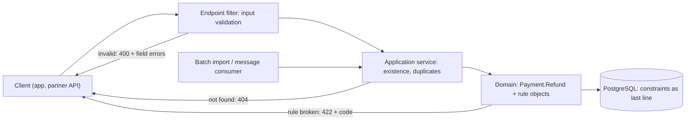
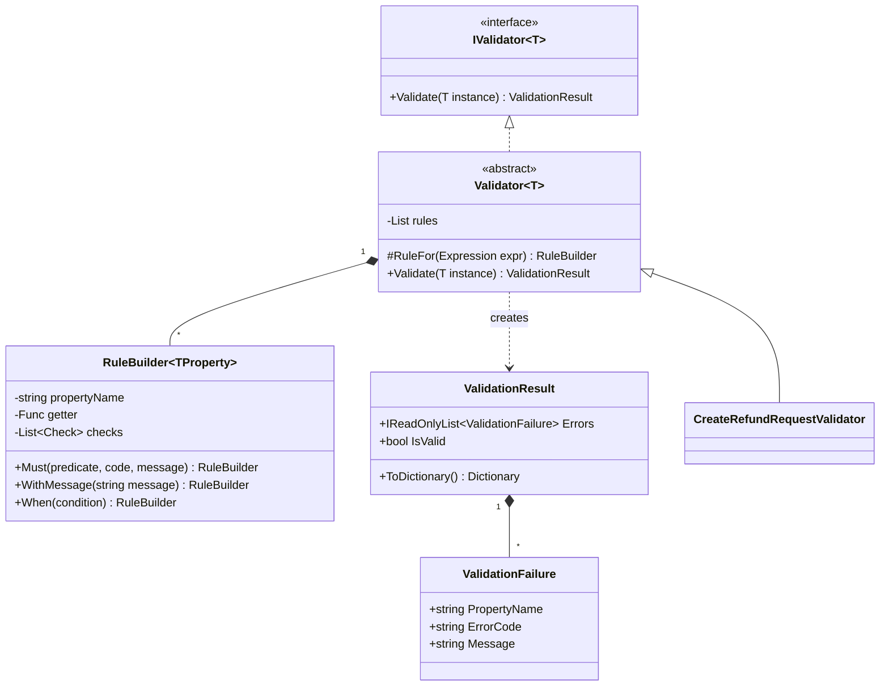
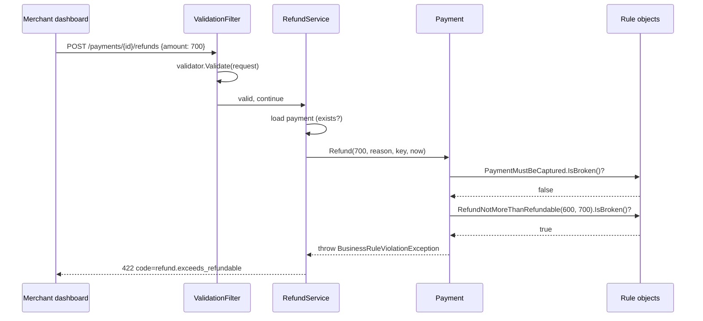

"Validation" is one word for several different jobs. Checking that an amount field is a number is not the same job as checking that a refund doesn't exceed what the customer paid. Mixing them up leads to rules that are duplicated, skipped, or enforced in the wrong place. This lesson separates the jobs and gives each one a home.

## Learning objectives

By the end of this lesson you will be able to:

1. Tell apart **input validation**, **application checks** and **domain rules**, and place each in the right layer.
2. Build a small FluentValidation-style validator by hand (`RuleFor(x => x.Amount).GreaterThan(0)`) and understand how such libraries work.
3. Express business rules as small, named, testable **rule objects**.
4. Return validation errors as RFC 9457 Problem Details with field-level messages, and rule violations as 422 responses with stable error codes.
5. Decide between collecting all errors and failing fast, and between throwing and returning results.
6. Avoid the common traps: duplicated rules, client-only validation, and "valid" objects that become invalid later.

## Prerequisites

- [Encapsulation and invariant protection](#/lesson/m07-encapsulation-invariants): guard clauses keep objects valid.
- [Domain modeling](#/lesson/m07-domain-modeling): aggregates own their rules.

## Explain it like I'm a beginner

Picture the counter at a busy post office in Chennai where you send a money order.

1. **The form check.** The clerk glances at your form first. Is the PIN code six digits? Is the amount written in figures? Is it signed? This is quick, needs no records, and if something is wrong the clerk hands the form back with *every* mistake circled, so you can fix them all at once.
2. **The records check.** Next the clerk looks things up. Does this receiving post office exist? Have you already sent the same money order today (a duplicate)? This needs the post office's records.
3. **The rules of the service.** Finally there are rules that belong to money orders themselves: you can't send more than the allowed limit; a money order that has already been paid out can't be cancelled. These rules apply no matter which counter, app or agent you use.

Software has the same three layers:

- **Input validation** (the form check): is the request well-formed? Fast, needs no database, returns all problems at once.
- **Application checks** (the records check): do the referenced things exist, is this a duplicate? Needs data.
- **Domain rules** (the rules of the service): business rules that must always hold, enforced by the domain objects themselves.

A form check alone is not enough. A perfectly filled-in form can still ask for something the rules forbid. And domain rules alone are not friendly: they stop at the first broken rule and speak in business terms, not "field X is missing".

## First-principles explanation

### Three kinds of check

| | Input validation | Application checks | Domain rules (invariants and policies) |
|---|---|---|---|
| **Question** | Is the request well-formed? | Does it make sense given current data? | Is this allowed by the business? |
| **Examples** | Amount > 0; VPA looks like `name@bank`; reason ≤ 200 chars | Payment id exists; idempotency key not reused | Refund ≤ captured − already refunded; refunds only within 180 days |
| **Needs** | Only the request | Database / other services | The aggregate's own state (+ inputs passed in) |
| **Lives in** | API edge: validator, endpoint filter | Application service | Entity / value object / rule objects |
| **On failure** | 400 with *all* field errors | 404 / 409 | 422 with a rule code |
| **Can be skipped by a new caller?** | Yes — each entry point has its own | Yes, if the service is bypassed | **No** — that's the point |

The last row is the key idea. Input validation protects the *API*. Domain rules protect the *data*. A batch import, a message consumer or an admin tool may never go through your API validator, but every one of them must call `Payment.Refund(...)`, so the domain rules always run.

### Do I validate twice, then?

Partly, yes — and that is fine when the two checks have different jobs. "Amount must be positive" appears in both the input validator (to give a friendly field error) and as a guard clause in the domain (to protect the invariant). The input check is for the user; the domain check is the safety net. What you must *not* duplicate is a real business rule, such as "refund ≤ refundable amount". Put that only in the domain; the API learns about it through a 422 response.

### Always-valid domain objects

An **always-valid** domain object can never exist in an invalid state: its constructor validates, its methods check rules before changing anything. That removes a whole class of bugs ("somebody created a `Payment` with a negative amount"). The alternative — objects that can be invalid with an `IsValid()` method you must remember to call — moves the burden to every caller, and someone will forget.

Value objects make this cheap. If `Vpa` (a UPI address) can only be created through `Vpa.Parse`, every method that takes a `Vpa` knows it is well-formed. Validation happens once, at the boundary, and the type carries the proof.

### Collect all errors, or fail fast?

- **Input validation should collect** all errors. A user who submits a form with three mistakes wants to see all three, not fix one, resubmit, and discover the next. Martin Fowler calls this the *notification* pattern: collect problems in a list instead of throwing on the first.
- **Domain rules usually fail fast.** If the payment isn't captured, it is pointless to also say the window has closed. Throw (or return a failure) at the first broken rule.

### How a FluentValidation-style validator works

Libraries like FluentValidation let you write:

```csharp
RuleFor(x => x.Amount).GreaterThan(0).LessThanOrEqualTo(1_000_000);
RuleFor(x => x.Reason).NotEmpty().MaximumLength(200);
```

Under the hood there is nothing magic:

1. `RuleFor` receives an **expression tree** (`Expression<Func<T, TProperty>>`), not just a delegate. It reads the property name (`"Amount"`) from the expression for error messages, and compiles it into a delegate to read the value.
2. Each chained call (`GreaterThan`, `NotEmpty`) adds a **check** — a predicate plus an error code and message — to a list on that property's rule.
3. `Validate(instance)` runs every property rule, collects failures into a result, and returns it. Nothing throws.

We will build exactly this in about 100 lines. In real projects you might use the library, which adds async rules, localisation, nested validators and collection rules. Building it once shows you what you're depending on. Note also that ASP.NET Core 10 has built-in minimal API validation for Data Annotation attributes (`builder.Services.AddValidation()`), which covers simple shape rules without any library.

### Rule objects

A **business rule object** is a small class that names one rule, holds the data it needs, and answers "is this rule broken?":

```csharp
public interface IBusinessRule
{
    string Code { get; }      // stable, for clients: "refund.exceeds_refundable"
    string Message { get; }   // for people
    bool IsBroken();
}
```

Why not just an `if` inside `Payment.Refund`? For a couple of rules, an `if` is fine. Rule objects start paying off when:

- rules have **names the business uses** ("the 180-day refund window") and you want them visible in code and logs,
- the **same rule is used in several methods** or aggregates,
- you want to **test rules alone** with simple inputs, or
- you want to **list** which rules apply to an operation (for documentation or a "why was this refused?" screen).

They are close cousins of the [Specification pattern](#/lesson/m06-specification). A specification answers "does this object satisfy a condition?" and is often reused for querying; a rule object answers "is this operation allowed?" and carries its own error code and message.

### Exceptions or results for rule violations?

Both are used in production .NET code. Throwing a `BusinessRuleViolationException` keeps domain methods simple and is easy to map to HTTP once, centrally. Returning a `Result` makes failure explicit in the method signature and avoids exceptions for outcomes that are common. The [next lesson](#/lesson/m07-domain-exceptions) compares them in detail. This lesson throws for domain rules and returns a result for input validation — a common, pragmatic split.

### When validation design is overkill

A small internal tool with one entry point and a handful of rules doesn't need rule objects or a validation framework. Data Annotations on the request type plus guard clauses in the entity are enough. Introduce the layered approach when there are several entry points, rules that change, or money involved.

### Trade-offs

| You gain | You pay |
|---|---|
| Rules enforced for every caller | Some checks appear twice (input + domain guard) |
| Friendly, field-level errors at the API | A validator class per request type |
| Named, testable business rules | More small classes |
| Stable error codes clients can rely on | Codes become a public contract you must version |

## Visual explanation

### Where each check lives



Read it left to right. A request from the client is first checked for shape by the endpoint filter, which can reject it with every field error at once. The application service then looks up data. The domain enforces business rules. Notice the second entry point at the bottom: a batch import never passes the endpoint filter, but it still goes through the application service and the domain, so the rules that matter still apply. The database adds constraints (`CHECK (amount > 0)`, unique keys) as a final safety net against bugs in any layer.

### Inside the hand-rolled validator



`Validator<T>` keeps a list of property rules. Each `RuleFor` call creates a `RuleBuilder` for one property and returns it so you can chain checks. Extension methods such as `NotEmpty` and `GreaterThan` are just shortcuts for `Must(...)` with a ready-made code and message. `Validate` walks every rule and returns a `ValidationResult` — it never throws. A concrete validator like `CreateRefundRequestValidator` only declares rules in its constructor.

### A refund request end to end



The request passed input validation: 700 is a positive number with a valid idempotency key. It failed a business rule: the customer paid ₹1,000 and ₹400 was already refunded, so only ₹600 is refundable. The error code is stable (`refund.exceeds_refundable`) so the merchant dashboard can show a specific message such as "You can refund at most ₹600". The rules run in order and stop at the first broken one.

## Step-by-step example

### Step 1 — the tangled version

```csharp
app.MapPost("/payments/{id}/refunds", (Guid id, RefundDto dto, PaymentDb db) =>
{
    if (dto.Amount <= 0) return Results.BadRequest("amount must be positive");
    var p = db.Payments.Find(id);
    if (p == null) return Results.NotFound();
    if (dto.Amount > p.Amount - p.Refunds.Sum(r => r.Amount)) return Results.BadRequest("too much");
    if (DateTime.Now - p.CapturedAt > TimeSpan.FromDays(180)) return Results.BadRequest("too late");
    p.Refunds.Add(new Refund { Amount = dto.Amount });
    db.SaveChanges();
    return Results.Ok();
});
```

Every kind of check is mixed together. It stops at the first error even for form problems. The "too much" rule lives in the endpoint, so the nightly refund-import job doesn't have it. Error responses are plain strings, so the dashboard can't tell "too much" from "too late" without parsing English.

### Step 2 — pull out the input validator

The shape checks (amount > 0, reason length, idempotency key format) move into `CreateRefundRequestValidator`, run by an endpoint filter that returns 400 Problem Details with every field error.

### Step 3 — move business rules into the domain

`Payment.Refund(...)` becomes the only way to add a refund. Its rules — captured status, 180-day window, maximum refundable, at most 10 refunds — become rule objects checked in order.

### Step 4 — leave the application service thin

It loads the payment (404 if missing), calls `Refund`, and saves. Idempotency — "same key, same request → same result" — is handled by the aggregate, because it already holds its refunds.

### Step 5 — map errors centrally

`BusinessRuleViolationException` becomes 422 with `code` in the Problem Details, in one place.

## Production-style C# implementation

```text
Payments.Api/
  Program.cs
  Validation/ValidationCore.cs
  Validation/RuleBuilderExtensions.cs
  Validation/ValidationFilter.cs
  Refunds/BusinessRules.cs
  Refunds/Payment.cs
  Refunds/RefundApi.cs
```

```csharp file=Validation/ValidationCore.cs
using System.Linq.Expressions;

namespace Payments.Validation;

public sealed record ValidationFailure(string PropertyName, string ErrorCode, string Message);

public sealed class ValidationResult(IReadOnlyList<ValidationFailure> errors)
{
    public IReadOnlyList<ValidationFailure> Errors { get; } = errors;
    public bool IsValid => Errors.Count == 0;

    /// <summary>Shape expected by Results.ValidationProblem: property name to messages.</summary>
    public Dictionary<string, string[]> ToDictionary() =>
        Errors.GroupBy(e => e.PropertyName).ToDictionary(g => g.Key, g => g.Select(e => e.Message).ToArray());
}

public interface IValidator<in T>
{
    ValidationResult Validate(T instance);
}

internal interface IPropertyRule<in T>
{
    void Run(T instance, List<ValidationFailure> failures);
}

public abstract class Validator<T> : IValidator<T>
{
    private readonly List<IPropertyRule<T>> _rules = [];

    protected RuleBuilder<T, TProperty> RuleFor<TProperty>(Expression<Func<T, TProperty>> property)
    {
        // Read the name from the expression tree; compile it once to read values quickly.
        var name = property.Body is MemberExpression member
            ? member.Member.Name
            : throw new ArgumentException("Use a simple property expression such as x => x.Amount.", nameof(property));
        var builder = new RuleBuilder<T, TProperty>(name, property.Compile());
        _rules.Add(builder);
        return builder;
    }

    public ValidationResult Validate(T instance)
    {
        ArgumentNullException.ThrowIfNull(instance);
        var failures = new List<ValidationFailure>();
        foreach (var rule in _rules) rule.Run(instance, failures);
        return new ValidationResult(failures);
    }
}

/// <summary>All checks for one property. Stops at the first failing check for that property
/// (one message per field is friendlier), but other properties are still validated.</summary>
public sealed class RuleBuilder<T, TProperty> : IPropertyRule<T>
{
    private sealed record Check(Func<T, TProperty, bool> IsValid, string Code, string Message);

    private readonly string _propertyName;
    private readonly Func<T, TProperty> _getter;
    private readonly List<Check> _checks = [];
    private Func<T, bool>? _condition;

    internal RuleBuilder(string propertyName, Func<T, TProperty> getter)
    {
        _propertyName = propertyName;
        _getter = getter;
    }

    public RuleBuilder<T, TProperty> Must(Func<TProperty, bool> predicate, string code, string message) =>
        Must((_, value) => predicate(value), code, message);

    /// <summary>Cross-field check: the predicate sees the whole object too.</summary>
    public RuleBuilder<T, TProperty> Must(Func<T, TProperty, bool> predicate, string code, string message)
    {
        _checks.Add(new Check(predicate, code, message));
        return this;
    }

    public RuleBuilder<T, TProperty> WithMessage(string message)
    {
        if (_checks.Count == 0) throw new InvalidOperationException("WithMessage must follow a check.");
        _checks[^1] = _checks[^1] with { Message = message };
        return this;
    }

    public RuleBuilder<T, TProperty> When(Func<T, bool> condition)
    {
        _condition = condition;
        return this;
    }

    void IPropertyRule<T>.Run(T instance, List<ValidationFailure> failures)
    {
        if (_condition is not null && !_condition(instance)) return;
        var value = _getter(instance);
        foreach (var check in _checks)
        {
            if (check.IsValid(instance, value)) continue;
            failures.Add(new ValidationFailure(_propertyName, check.Code, check.Message.Replace("{PropertyName}", _propertyName)));
            return;
        }
    }
}
```

```csharp file=Validation/RuleBuilderExtensions.cs
using System.Text.RegularExpressions;

namespace Payments.Validation;

public static class RuleBuilderExtensions
{
    public static RuleBuilder<T, string?> NotEmpty<T>(this RuleBuilder<T, string?> rule) =>
        rule.Must(v => !string.IsNullOrWhiteSpace(v), "not_empty", "{PropertyName} is required.");

    public static RuleBuilder<T, string?> Length<T>(this RuleBuilder<T, string?> rule, int min, int max) =>
        rule.Must(v => v is null || (v.Length >= min && v.Length <= max), "length",
                  $"{{PropertyName}} must be {min} to {max} characters.");

    public static RuleBuilder<T, string?> MaximumLength<T>(this RuleBuilder<T, string?> rule, int max) =>
        rule.Must(v => v is null || v.Length <= max, "max_length", $"{{PropertyName}} must be at most {max} characters.");

    public static RuleBuilder<T, string?> Matches<T>(this RuleBuilder<T, string?> rule, Regex pattern, string description) =>
        rule.Must(v => v is null || pattern.IsMatch(v), "format", $"{{PropertyName}} must be {description}.");

    public static RuleBuilder<T, TP> GreaterThan<T, TP>(this RuleBuilder<T, TP> rule, TP limit) where TP : IComparable<TP> =>
        rule.Must(v => v.CompareTo(limit) > 0, "greater_than", $"{{PropertyName}} must be greater than {limit}.");

    public static RuleBuilder<T, TP> LessThanOrEqualTo<T, TP>(this RuleBuilder<T, TP> rule, TP limit) where TP : IComparable<TP> =>
        rule.Must(v => v.CompareTo(limit) <= 0, "less_or_equal", $"{{PropertyName}} must be at most {limit}.");

    public static RuleBuilder<T, decimal> MaxDecimalPlaces<T>(this RuleBuilder<T, decimal> rule, int places) =>
        rule.Must(v => decimal.Round(v, places) == v, "decimal_places", $"{{PropertyName}} can have at most {places} decimal places.");
}
```

```csharp file=Validation/ValidationFilter.cs
namespace Payments.Validation;

/// <summary>Runs IValidator&lt;TRequest&gt; before the endpoint. Returns 400 Problem Details
/// with every field error, so the client can fix them all at once.</summary>
public sealed class ValidationFilter<TRequest>(IValidator<TRequest> validator) : IEndpointFilter
{
    public async ValueTask<object?> InvokeAsync(EndpointFilterInvocationContext context, EndpointFilterDelegate next)
    {
        var request = context.Arguments.OfType<TRequest>().FirstOrDefault();
        if (request is null)
            return Results.Problem("Request body is missing.", statusCode: StatusCodes.Status400BadRequest);

        var result = validator.Validate(request);
        return result.IsValid ? await next(context) : Results.ValidationProblem(result.ToDictionary());
    }
}
```

```csharp file=Refunds/BusinessRules.cs
namespace Payments.Refunds;

public interface IBusinessRule
{
    string Code { get; }
    string Message { get; }
    bool IsBroken();
}

public sealed class BusinessRuleViolationException(IBusinessRule rule) : Exception(rule.Message)
{
    public IBusinessRule Rule { get; } = rule;
    public string Code => Rule.Code;
}

public static class BusinessRule
{
    public static void Check(IBusinessRule rule)
    {
        if (rule.IsBroken()) throw new BusinessRuleViolationException(rule);
    }
}

public sealed class PaymentMustBeCaptured(PaymentStatus status) : IBusinessRule
{
    public string Code => "refund.not_captured";
    public string Message => $"Only captured payments can be refunded; this payment is {status}.";
    public bool IsBroken() => status != PaymentStatus.Captured;
}

public sealed class RefundWithinWindow(DateTimeOffset capturedAt, DateTimeOffset now, TimeSpan window) : IBusinessRule
{
    public string Code => "refund.window_closed";
    public string Message => $"Refunds are allowed for {window.TotalDays:0} days after capture; this payment was captured on {capturedAt:yyyy-MM-dd}.";
    public bool IsBroken() => now - capturedAt > window;
}

public sealed class RefundNotMoreThanRefundable(decimal refundable, decimal requested) : IBusinessRule
{
    public string Code => "refund.exceeds_refundable";
    public string Message => $"Requested {requested:0.00} but only {refundable:0.00} can still be refunded.";
    public bool IsBroken() => requested > refundable;
}

public sealed class RefundCountBelowLimit(int existingRefunds, int maxRefunds) : IBusinessRule
{
    public string Code => "refund.too_many";
    public string Message => $"A payment can have at most {maxRefunds} refunds.";
    public bool IsBroken() => existingRefunds >= maxRefunds;
}
```

```csharp file=Refunds/Payment.cs
namespace Payments.Refunds;

public enum PaymentStatus { Authorized, Captured, Failed }

public sealed record RefundEntry(Guid Id, decimal Amount, string Reason, string IdempotencyKey, DateTimeOffset At);

public sealed class Payment
{
    public static readonly TimeSpan RefundWindow = TimeSpan.FromDays(180);
    public const int MaxRefunds = 10;

    private readonly List<RefundEntry> _refunds = [];

    private Payment(Guid id, decimal amount, PaymentStatus status, DateTimeOffset? capturedAt)
    {
        Id = id;
        Amount = amount;
        Status = status;
        CapturedAt = capturedAt;
    }

    public Guid Id { get; }
    public decimal Amount { get; }
    public PaymentStatus Status { get; private set; }
    public DateTimeOffset? CapturedAt { get; private set; }
    public IReadOnlyList<RefundEntry> Refunds => _refunds;
    public decimal RefundedAmount => _refunds.Sum(r => r.Amount);
    public decimal RefundableAmount => Status == PaymentStatus.Captured ? Amount - RefundedAmount : 0m;

    public static Payment Captured(Guid id, decimal amount, DateTimeOffset capturedAt)
    {
        ArgumentOutOfRangeException.ThrowIfNegativeOrZero(amount);
        return new Payment(id, amount, PaymentStatus.Captured, capturedAt);
    }

    public static Payment Authorized(Guid id, decimal amount)
    {
        ArgumentOutOfRangeException.ThrowIfNegativeOrZero(amount);
        return new Payment(id, amount, PaymentStatus.Authorized, null);
    }

    /// <summary>The only way to add a refund. Same idempotency key + same amount returns the original refund.</summary>
    public RefundEntry Refund(decimal amount, string reason, string idempotencyKey, DateTimeOffset now)
    {
        // Guard clauses: programmer errors / safety net behind input validation.
        ArgumentOutOfRangeException.ThrowIfNegativeOrZero(amount);
        ArgumentException.ThrowIfNullOrWhiteSpace(idempotencyKey);

        var previous = _refunds.FirstOrDefault(r => r.IdempotencyKey == idempotencyKey);
        if (previous is not null)
        {
            BusinessRule.Check(new IdempotentReplayMustMatch(previous.Amount, amount));
            return previous;
        }

        // Business rules, in the order a support agent would explain them.
        BusinessRule.Check(new PaymentMustBeCaptured(Status));
        BusinessRule.Check(new RefundWithinWindow(CapturedAt!.Value, now, RefundWindow));
        BusinessRule.Check(new RefundCountBelowLimit(_refunds.Count, MaxRefunds));
        BusinessRule.Check(new RefundNotMoreThanRefundable(RefundableAmount, amount));

        var refund = new RefundEntry(Guid.NewGuid(), amount, reason, idempotencyKey, now);
        _refunds.Add(refund);
        return refund;
    }
}

public sealed class IdempotentReplayMustMatch(decimal originalAmount, decimal requestedAmount) : IBusinessRule
{
    public string Code => "refund.idempotency_mismatch";
    public string Message => $"This idempotency key was already used for a refund of {originalAmount:0.00}.";
    public bool IsBroken() => originalAmount != requestedAmount;
}
```

```csharp file=Refunds/RefundApi.cs
using System.Collections.Concurrent;
using System.Text.RegularExpressions;
using Payments.Validation;

namespace Payments.Refunds;

/// <summary>Input DTO: shape only. Nullable because clients can omit fields.</summary>
public sealed record CreateRefundRequest(decimal Amount, string? Currency, string? Reason, string? IdempotencyKey);

public sealed record RefundResponse(Guid RefundId, decimal Amount, decimal RemainingRefundable);

public sealed partial class CreateRefundRequestValidator : Validator<CreateRefundRequest>
{
    [GeneratedRegex("^[A-Za-z0-9_-]+$")]
    private static partial Regex KeyPattern();

    public CreateRefundRequestValidator()
    {
        RuleFor(x => x.Amount).GreaterThan(0m).LessThanOrEqualTo(10_00_000m).MaxDecimalPlaces(2);
        RuleFor(x => x.Currency).NotEmpty()
            .Must(c => c == "INR", "unsupported_currency", "Only INR refunds are supported.");
        RuleFor(x => x.Reason).NotEmpty().MaximumLength(200);
        RuleFor(x => x.IdempotencyKey).NotEmpty().Length(8, 64).Matches(KeyPattern(), "letters, digits, '-' or '_'");
    }
}

public interface IPaymentStore
{
    Task<Payment?> FindAsync(Guid id, CancellationToken ct);
    Task SaveAsync(Payment payment, CancellationToken ct);
}

public sealed class InMemoryPaymentStore : IPaymentStore
{
    private readonly ConcurrentDictionary<Guid, Payment> _payments = new();
    public InMemoryPaymentStore(IEnumerable<Payment>? seed = null)
    {
        foreach (var p in seed ?? []) _payments[p.Id] = p;
    }
    public Task<Payment?> FindAsync(Guid id, CancellationToken ct) => Task.FromResult(_payments.GetValueOrDefault(id));
    public Task SaveAsync(Payment payment, CancellationToken ct) { _payments[payment.Id] = payment; return Task.CompletedTask; }
}

/// <summary>Application service: existence check, call the domain, save. No business rules here.</summary>
public sealed class RefundService(IPaymentStore store, TimeProvider clock)
{
    public async Task<RefundResponse?> RefundAsync(Guid paymentId, CreateRefundRequest request, CancellationToken ct)
    {
        var payment = await store.FindAsync(paymentId, ct);
        if (payment is null) return null;

        var refund = payment.Refund(request.Amount, request.Reason!, request.IdempotencyKey!, clock.GetUtcNow());
        await store.SaveAsync(payment, ct);
        return new RefundResponse(refund.Id, refund.Amount, payment.RefundableAmount);
    }
}
```

```csharp file=Program.cs
using Payments.Refunds;
using Payments.Validation;

var builder = WebApplication.CreateBuilder(args);

builder.Services.AddProblemDetails();
builder.Services.AddSingleton(TimeProvider.System);
builder.Services.AddSingleton<IValidator<CreateRefundRequest>, CreateRefundRequestValidator>();
builder.Services.AddSingleton<IPaymentStore>(_ => new InMemoryPaymentStore(
[
    Payment.Captured(Guid.Parse("4b1e7c52-0000-4000-8000-000000000001"), 1000m, DateTimeOffset.UtcNow.AddDays(-3)),
]));
builder.Services.AddScoped<RefundService>();

var app = builder.Build();

app.MapPost("/payments/{paymentId:guid}/refunds",
    async (Guid paymentId, CreateRefundRequest request, RefundService service, CancellationToken ct) =>
    {
        try
        {
            var result = await service.RefundAsync(paymentId, request, ct);
            return result is null
                ? Results.Problem($"Payment {paymentId} not found.", statusCode: StatusCodes.Status404NotFound)
                : Results.Ok(result);
        }
        catch (BusinessRuleViolationException ex)
        {
            return Results.Problem(ex.Message, statusCode: StatusCodes.Status422UnprocessableEntity,
                title: "Business rule violated", extensions: new Dictionary<string, object?> { ["code"] = ex.Code });
        }
    })
   .AddEndpointFilter<ValidationFilter<CreateRefundRequest>>();

app.Run();
```

A request with `amount: -5`, no reason and a 3-character key gets one 400 response listing all three problems. A well-formed request for ₹700 on a ₹1,000 payment with ₹400 already refunded gets a 422 with `code: refund.exceeds_refundable`. A replay with the same key and amount returns the original refund instead of refunding twice.

:::callout type=warning title="Client-side validation is a convenience, not a control"
Checks in the browser or the mobile app make forms friendlier, but anyone can call your API directly with `curl`. Every rule the client checks must also be checked on the server.
:::

:::callout type=tip title="Let the database say no too"
A `CHECK (amount > 0)` constraint and a unique index on `(payment_id, idempotency_key)` in PostgreSQL catch bugs that slip past every layer, including concurrent duplicate requests that both pass the in-memory idempotency check. Translate the unique-violation error into the same "replay" behaviour.
:::

## Bad design vs good design

**Bad**: one endpoint does everything (Step 1). Variations seen in real systems:

- Data Annotations like `[Range(1, 100000)]` on the **domain entity**, so the rule only runs when MVC model binding touches it. The batch import never triggers it.
- An `IsValid()` method on the entity that callers are "supposed" to call before saving.
- Business rules duplicated in JavaScript, the API, and a stored procedure — each with slightly different limits after two years.
- Errors as free-text strings; the mobile app searches for the word "exceeds" to choose which screen to show.

**Good**: input validator at the edge (400 with all field errors), thin application service (404/409), domain rules inside the aggregate as named rule objects (422 with stable codes), database constraints as a last line of defence.

**When is this too much?** For an internal admin form with three fields and no money involved, Data Annotations on the request DTO and guard clauses in the entity are plenty. Rule objects earn their keep when the rules have business names, change, or are reused.

## Practical playground

Run the validator. It reports two errors. Add a rule so that a `Phone` that is not exactly 10 digits is also reported, and check that all three errors print together.

:::playground type=csharp title="Collect-all-errors validator"
```csharp file=Program.cs
using System;
using System.Collections.Generic;
using System.Linq;

public sealed record SendSmsRequest(string? Phone, string? TemplateId, string? Body);

public static class SmsValidator
{
    public static List<string> Validate(SendSmsRequest r)
    {
        var errors = new List<string>();
        if (string.IsNullOrWhiteSpace(r.TemplateId)) errors.Add("TemplateId is required.");
        if (string.IsNullOrEmpty(r.Body) || r.Body.Length > 160) errors.Add("Body must be 1 to 160 characters.");
        // TODO: Phone must be exactly 10 digits.
        return errors;
    }
}

public static class Program
{
    public static void Main()
    {
        var request = new SendSmsRequest("98765", null, new string('x', 170));
        var errors = SmsValidator.Validate(request);
        Console.WriteLine(errors.Count == 0 ? "Valid" : string.Join(Environment.NewLine, errors));
    }
}
```
:::

## Exercises

:::exercise id=m07-validation-rules-ex1 difficulty=beginner kind=code title="Validate an SMS request and report every problem"
A notification service sends transactional SMS in India. Write `SmsRequestValidator.Validate`, returning **all** problems as `FieldError(Field, Message)` records.
::requirements
- `Phone`: required; after removing spaces, must be `+91` followed by 10 digits, the first of which is 6, 7, 8 or 9.
- `TemplateId`: required (Indian operators require a registered template id for commercial SMS); 19 digits.
- `Body`: required; at most 160 characters.
- Return an empty list when everything is valid. One error per field at most.
::acceptance
- `+91 98765 43210`, a 19-digit template id and a short body → no errors.
- `+9112345` → one `Phone` error.
- Phone missing, template missing and a 161-character body → three errors, one per field.
- `+91 58765 43210` (starts with 5) → `Phone` error.
::hint
Collect into a `List<FieldError>`. Never `return` early after the first problem.
::hint
Write a small helper per field, each returning `FieldError?`, then keep the non-null ones.
::hint
For the phone, normalise first: `phone.Replace(" ", "")`. Then a regex `^\+91[6-9]\d{9}$` does the rest.
::hint
```csharp
var errors = new List<FieldError>();
if (CheckPhone(r.Phone) is { } e1) errors.Add(e1);
```
::starter
```csharp file=SmsRequestValidator.cs
using System;
using System.Collections.Generic;
using System.Text.RegularExpressions;

public sealed record SmsRequest(string? Phone, string? TemplateId, string? Body);
public sealed record FieldError(string Field, string Message);

public static class SmsRequestValidator
{
    public static IReadOnlyList<FieldError> Validate(SmsRequest request) => throw new NotImplementedException();
}
```
::tests
```csharp file=SmsRequestValidatorTests.cs
using System.Linq;
using Xunit;

public class SmsRequestValidatorTests
{
    private const string Template = "1107161234567890123";

    [Fact] public void Valid_request_has_no_errors() =>
        Assert.Empty(SmsRequestValidator.Validate(new SmsRequest("+91 98765 43210", Template, "Your OTP is 4821")));

    [Fact]
    public void Short_phone_is_one_error()
    {
        var e = Assert.Single(SmsRequestValidator.Validate(new SmsRequest("+9112345", Template, "Hi")));
        Assert.Equal("Phone", e.Field);
    }

    [Fact]
    public void Collects_all_errors()
    {
        var errors = SmsRequestValidator.Validate(new SmsRequest(null, "", new string('x', 161)));
        Assert.Equal(new[] { "Body", "Phone", "TemplateId" }, errors.Select(e => e.Field).OrderBy(f => f).ToArray());
    }

    [Fact] public void Indian_mobile_must_start_with_6_to_9() =>
        Assert.Equal("Phone", Assert.Single(SmsRequestValidator.Validate(new SmsRequest("+91 58765 43210", Template, "Hi"))).Field);

    [Fact] public void Template_must_be_19_digits() =>
        Assert.Equal("TemplateId", Assert.Single(SmsRequestValidator.Validate(new SmsRequest("+919876543210", "12345", "Hi"))).Field);
}
```
::solution
```csharp file=SmsRequestValidator.cs
using System;
using System.Collections.Generic;
using System.Text.RegularExpressions;

public sealed record SmsRequest(string? Phone, string? TemplateId, string? Body);
public sealed record FieldError(string Field, string Message);

public static class SmsRequestValidator
{
    private static readonly Regex IndianMobile = new(@"^\+91[6-9]\d{9}$", RegexOptions.Compiled);
    private static readonly Regex TemplateIdPattern = new(@"^\d{19}$", RegexOptions.Compiled);

    public static IReadOnlyList<FieldError> Validate(SmsRequest request)
    {
        ArgumentNullException.ThrowIfNull(request);
        var errors = new List<FieldError>();
        if (CheckPhone(request.Phone) is { } phone) errors.Add(phone);
        if (CheckTemplate(request.TemplateId) is { } template) errors.Add(template);
        if (CheckBody(request.Body) is { } body) errors.Add(body);
        return errors;
    }

    private static FieldError? CheckPhone(string? phone)
    {
        if (string.IsNullOrWhiteSpace(phone)) return new("Phone", "Phone is required.");
        return IndianMobile.IsMatch(phone.Replace(" ", "")) ? null
            : new("Phone", "Phone must be +91 followed by a 10-digit mobile number starting with 6–9.");
    }

    private static FieldError? CheckTemplate(string? id)
    {
        if (string.IsNullOrWhiteSpace(id)) return new("TemplateId", "TemplateId is required.");
        return TemplateIdPattern.IsMatch(id) ? null : new("TemplateId", "TemplateId must be 19 digits.");
    }

    private static FieldError? CheckBody(string? body)
    {
        if (string.IsNullOrEmpty(body)) return new("Body", "Body is required.");
        return body.Length <= 160 ? null : new("Body", $"Body must be at most 160 characters (has {body.Length}).");
    }
}
```
The 160-character limit is for plain GSM-7 text in one SMS segment. Messages with Hindi, Tamil or emoji use Unicode (UCS-2) encoding, where one segment holds 70 characters. A production validator would detect the encoding and either count segments or reject long Unicode bodies.
::mistakes
- Returning after the first error — the user fixes the phone, resubmits, and only then learns the template id is missing.
- Validating the phone without normalising spaces, so `+91 98765 43210` fails.
- Treating these checks as business rules and throwing exceptions; a malformed request is an expected, everyday event.
:::

:::exercise id=m07-validation-rules-ex2 difficulty=beginner kind=written title="Sort the checks into layers"
For a UPI payment-collection feature, decide for each check whether it is **input validation**, an **application check** or a **domain rule**, and what HTTP status a failure should return. Give one sentence of reasoning per item.

1. `amount` is a number with at most 2 decimal places.
2. The payer VPA looks like `name@bank`.
3. The merchant id in the URL exists.
4. A collect request expires after 30 minutes and cannot be approved after that.
5. The same `requestId` sent twice must not create two collect requests.
6. A merchant on the "starter" plan can collect at most ₹2,00,000 per day.
7. `description` is at most 50 characters.
8. A refunded collect request cannot be refunded again.
::acceptance
- Each item is assigned to exactly one layer, with a status code.
- Items needing stored data are not put in input validation.
- Rules that must hold for every entry point are in the domain.
- The reasoning mentions *what data the check needs*.
::hint
Ask of each check: "Can I decide this with only the request in my hand?"
::hint
If the answer needs a database, is it about whether something *exists/duplicates*, or about what the business *allows*?
::hint
A rule that the nightly batch job must also obey belongs in the domain, regardless of where else you display it.
::solution
| # | Layer | Status | Reasoning |
|---|---|---|---|
| 1 | Input | 400 | Needs only the request. |
| 2 | Input (format) | 400 | A regex on the request. Whether the VPA is *real* is checked later by the payment network. |
| 3 | Application | 404 | Needs a lookup; it's about existence, not policy. |
| 4 | Domain | 422 | A lifecycle rule of the collect request; must hold for every caller (see [Object lifecycle](#/lesson/m07-lifecycle-state)). |
| 5 | Application (idempotency), backed by a unique constraint | 200 with the original result (or 409 if the body differs) | Needs stored data; a replay is not an error. |
| 6 | Domain policy, with data fetched by the application service | 422 | A business limit; the service sums today's collections and passes the total into the domain check. |
| 7 | Input | 400 | Needs only the request. |
| 8 | Domain | 422 | The collect request's own state decides it. |

Item 6 is the subtle one: it needs data from outside the aggregate (today's total), but it is still a business rule. The application service gathers the data; a rule object such as `DailyLimitNotExceeded(todayTotal, amount, planLimit)` makes the decision.
::mistakes
- Putting item 3 in input validation by querying the database inside the validator. That makes "shape" checks slow and harder to test; keep data lookups in the application service.
- Returning 400 for item 4. The request was well-formed; the business refused it. 422 tells the client to change the *action*, not the *format*.
:::

:::exercise id=m07-validation-rules-ex3 difficulty=intermediate kind=code title="Build the RuleFor validator core"
Implement the core of a FluentValidation-style validator. The starter has the public API; you fill in `RuleFor`, `Validate`, `Must`, `WithMessage` and `When`, plus the `NotEmpty` and `GreaterThan` extensions.
::requirements
- `RuleFor(x => x.Prop)` reads the property name from the expression and throws `ArgumentException` for anything else (e.g. `x => x.Amount * 2`).
- Within one property, stop at the first failing check. Across properties, collect everything.
- `{PropertyName}` in a message is replaced with the property's name.
- `WithMessage` replaces the message of the *last* check added.
- `When(condition)` skips the whole property rule if the condition is false.
::acceptance
- A payout request with amount 0 and empty VPA gives exactly 2 errors, `Amount` and `Vpa`.
- An empty VPA gives only the `NotEmpty` error, not also the format error.
- `WithMessage("UPI ID is required")` changes the message seen by the client.
- The `Note` rule only runs when `Amount > 10_000`.
- A non-member expression in `RuleFor` throws `ArgumentException`.
::hint
`Expression<Func<T, TProperty>>` has a `Body`. For `x => x.Amount`, what type is the body?
::hint
`property.Body is MemberExpression m ? m.Member.Name : throw ...`, and `property.Compile()` gives you the getter.
::hint
Store each check as a small record: predicate, code, message. Make the rule's `Run` loop over checks and `return` after the first failure.
::hint
For `WithMessage`, replace the last element: `_checks[^1] = _checks[^1] with { Message = message };` (needs `Check` to be a record).
::hint
```csharp
void IPropertyRule<T>.Run(T instance, List<ValidationFailure> failures)
{
    if (_condition is not null && !_condition(instance)) return;
    var value = _getter(instance);
    foreach (var c in _checks)
        if (!c.IsValid(value)) { failures.Add(new(_name, c.Code, c.Message.Replace("{PropertyName}", _name))); return; }
}
```
::starter
```csharp file=MiniValidation.cs
using System;
using System.Collections.Generic;
using System.Linq;
using System.Linq.Expressions;

public sealed record ValidationFailure(string PropertyName, string ErrorCode, string Message);

public sealed class ValidationResult(IReadOnlyList<ValidationFailure> errors)
{
    public IReadOnlyList<ValidationFailure> Errors { get; } = errors;
    public bool IsValid => Errors.Count == 0;
}

public interface IPropertyRule<in T> { void Run(T instance, List<ValidationFailure> failures); }

public abstract class Validator<T>
{
    protected RuleBuilder<T, TProperty> RuleFor<TProperty>(Expression<Func<T, TProperty>> property) =>
        throw new NotImplementedException();

    public ValidationResult Validate(T instance) => throw new NotImplementedException();
}

public sealed class RuleBuilder<T, TProperty> : IPropertyRule<T>
{
    internal RuleBuilder(string propertyName, Func<T, TProperty> getter) { }

    public RuleBuilder<T, TProperty> Must(Func<TProperty, bool> predicate, string code, string message) =>
        throw new NotImplementedException();
    public RuleBuilder<T, TProperty> WithMessage(string message) => throw new NotImplementedException();
    public RuleBuilder<T, TProperty> When(Func<T, bool> condition) => throw new NotImplementedException();
    void IPropertyRule<T>.Run(T instance, List<ValidationFailure> failures) => throw new NotImplementedException();
}

public static class RuleBuilderExtensions
{
    public static RuleBuilder<T, string?> NotEmpty<T>(this RuleBuilder<T, string?> rule) => throw new NotImplementedException();
    public static RuleBuilder<T, TP> GreaterThan<T, TP>(this RuleBuilder<T, TP> rule, TP limit) where TP : IComparable<TP> =>
        throw new NotImplementedException();
}

// ---- Example validator used by the tests. Do not change. ----
public sealed record PayoutRequest(decimal Amount, string? Vpa, string? Note);

public sealed class PayoutRequestValidator : Validator<PayoutRequest>
{
    public PayoutRequestValidator()
    {
        RuleFor(x => x.Amount).GreaterThan(0m);
        RuleFor(x => x.Vpa).NotEmpty().WithMessage("UPI ID is required")
            .Must(v => v!.Contains('@'), "format", "{PropertyName} must look like name@bank");
        RuleFor(x => x.Note).NotEmpty().When(x => x.Amount > 10_000m);
    }
}

public sealed class BadValidator : Validator<PayoutRequest>
{
    public BadValidator() { RuleFor(x => x.Amount * 2); }
}
```
::tests
```csharp file=MiniValidationTests.cs
using System;
using System.Linq;
using Xunit;

public class MiniValidationTests
{
    private static readonly PayoutRequestValidator V = new();

    [Fact] public void Valid_request() => Assert.True(V.Validate(new PayoutRequest(500m, "asha@okaxis", null)).IsValid);

    [Fact]
    public void Collects_across_properties()
    {
        var r = V.Validate(new PayoutRequest(0m, "", null));
        Assert.Equal(new[] { "Amount", "Vpa" }, r.Errors.Select(e => e.PropertyName).ToArray());
    }

    [Fact]
    public void Stops_at_first_failure_per_property_and_uses_custom_message()
    {
        var e = Assert.Single(V.Validate(new PayoutRequest(10m, "", null)).Errors);
        Assert.Equal("UPI ID is required", e.Message);
        Assert.Equal("not_empty", e.ErrorCode);
    }

    [Fact]
    public void Replaces_property_name_placeholder()
    {
        var e = Assert.Single(V.Validate(new PayoutRequest(10m, "asha", null)).Errors);
        Assert.Equal("Vpa must look like name@bank", e.Message);
    }

    [Fact]
    public void When_controls_the_rule()
    {
        Assert.True(V.Validate(new PayoutRequest(9_000m, "a@b", null)).IsValid);
        Assert.Equal("Note", Assert.Single(V.Validate(new PayoutRequest(20_000m, "a@b", null)).Errors).PropertyName);
    }

    [Fact] public void Non_member_expression_rejected() =>
        Assert.Throws<ArgumentException>(() => new BadValidator());
}
```
::solution
```csharp file=MiniValidation.cs
using System;
using System.Collections.Generic;
using System.Linq;
using System.Linq.Expressions;

public sealed record ValidationFailure(string PropertyName, string ErrorCode, string Message);

public sealed class ValidationResult(IReadOnlyList<ValidationFailure> errors)
{
    public IReadOnlyList<ValidationFailure> Errors { get; } = errors;
    public bool IsValid => Errors.Count == 0;
}

public interface IPropertyRule<in T> { void Run(T instance, List<ValidationFailure> failures); }

public abstract class Validator<T>
{
    private readonly List<IPropertyRule<T>> _rules = new();

    protected RuleBuilder<T, TProperty> RuleFor<TProperty>(Expression<Func<T, TProperty>> property)
    {
        var name = property.Body is MemberExpression member
            ? member.Member.Name
            : throw new ArgumentException("RuleFor needs a simple property expression such as x => x.Amount.", nameof(property));
        var builder = new RuleBuilder<T, TProperty>(name, property.Compile());
        _rules.Add(builder);
        return builder;
    }

    public ValidationResult Validate(T instance)
    {
        var failures = new List<ValidationFailure>();
        foreach (var rule in _rules) rule.Run(instance, failures);
        return new ValidationResult(failures);
    }
}

public sealed class RuleBuilder<T, TProperty> : IPropertyRule<T>
{
    private sealed record Check(Func<TProperty, bool> IsValid, string Code, string Message);

    private readonly string _name;
    private readonly Func<T, TProperty> _getter;
    private readonly List<Check> _checks = new();
    private Func<T, bool>? _condition;

    internal RuleBuilder(string propertyName, Func<T, TProperty> getter)
    {
        _name = propertyName;
        _getter = getter;
    }

    public RuleBuilder<T, TProperty> Must(Func<TProperty, bool> predicate, string code, string message)
    {
        _checks.Add(new Check(predicate, code, message));
        return this;
    }

    public RuleBuilder<T, TProperty> WithMessage(string message)
    {
        if (_checks.Count == 0) throw new InvalidOperationException("WithMessage must follow a check.");
        _checks[^1] = _checks[^1] with { Message = message };
        return this;
    }

    public RuleBuilder<T, TProperty> When(Func<T, bool> condition)
    {
        _condition = condition;
        return this;
    }

    void IPropertyRule<T>.Run(T instance, List<ValidationFailure> failures)
    {
        if (_condition is not null && !_condition(instance)) return;
        var value = _getter(instance);
        foreach (var check in _checks)
        {
            if (check.IsValid(value)) continue;
            failures.Add(new ValidationFailure(_name, check.Code, check.Message.Replace("{PropertyName}", _name)));
            return;
        }
    }
}

public static class RuleBuilderExtensions
{
    public static RuleBuilder<T, string?> NotEmpty<T>(this RuleBuilder<T, string?> rule) =>
        rule.Must(v => !string.IsNullOrWhiteSpace(v), "not_empty", "{PropertyName} is required.");

    public static RuleBuilder<T, TP> GreaterThan<T, TP>(this RuleBuilder<T, TP> rule, TP limit) where TP : IComparable<TP> =>
        rule.Must(v => v.CompareTo(limit) > 0, "greater_than", $"{{PropertyName}} must be greater than {limit}.");
}

// ---- Example validator used by the tests. Do not change. ----
public sealed record PayoutRequest(decimal Amount, string? Vpa, string? Note);

public sealed class PayoutRequestValidator : Validator<PayoutRequest>
{
    public PayoutRequestValidator()
    {
        RuleFor(x => x.Amount).GreaterThan(0m);
        RuleFor(x => x.Vpa).NotEmpty().WithMessage("UPI ID is required")
            .Must(v => v!.Contains('@'), "format", "{PropertyName} must look like name@bank");
        RuleFor(x => x.Note).NotEmpty().When(x => x.Amount > 10_000m);
    }
}

public sealed class BadValidator : Validator<PayoutRequest>
{
    public BadValidator() { RuleFor(x => x.Amount * 2); }
}
```
Stopping per property is what makes the `v!.Contains('@')` check safe: it never runs on an empty value, because `NotEmpty` failed first. Real libraries make this configurable (FluentValidation calls it the cascade mode).
::alternatives
For a struct property such as `int`, `x => x.Count` is a `MemberExpression`. But for a value-type property used through an interface or with a conversion, the body can be a `UnaryExpression` (`Convert`) wrapping the member. A robust `RuleFor` unwraps `UnaryExpression` before looking for the member.
::mistakes
- Using `Func<T, TProperty>` instead of `Expression<...>`: a delegate has no readable property name.
- Calling `property.Compile()` on every `Validate` call. Compiling an expression is relatively expensive; do it once in `RuleFor`.
- Making `When` apply only to the last check instead of the whole rule — both designs exist, but you must pick one and document it.
:::

:::exercise id=m07-validation-rules-ex4 difficulty=intermediate kind=code title="Refund rules as rule objects"
Implement the refund rules of a payment as rule objects, and make `RefundablePayment.Refund` check them in order.
::requirements
- `MustBeCaptured(bool isCaptured)` — code `refund.not_captured`.
- `WithinRefundWindow(capturedAt, now, days)` — code `refund.window_closed`; refunds allowed up to and including exactly `days` after capture.
- `NotMoreThanRefundable(refundable, requested)` — code `refund.exceeds_refundable`.
- `RefundablePayment.Refund(amount, now)` checks the rules in that order with `RuleCheck.Check`, which throws `RuleViolationException` carrying the broken rule's code. On success it adds the amount to `Refunded`.
::acceptance
- ₹1,000 captured, refund ₹400 then ₹600 → `Refunded` is ₹1,000.
- Then refund ₹1 → code `refund.exceeds_refundable`.
- Refund on day 181 of a 180-day window → `refund.window_closed`; day 180 is allowed.
- An uncaptured payment that is also outside the window reports `refund.not_captured` (first rule wins).
- Each rule can be tested on its own without a payment.
::hint
Each rule is a tiny class: constructor takes the data, `IsBroken()` returns a bool.
::hint
"Up to and including 180 days" — compare `now - capturedAt > TimeSpan.FromDays(days)`.
::hint
The order of `RuleCheck.Check` calls *is* the priority of error messages.
::hint
```csharp
public void Refund(decimal amount, DateTimeOffset now)
{
    RuleCheck.Check(new MustBeCaptured(IsCaptured));
    RuleCheck.Check(new WithinRefundWindow(CapturedAt, now, 180));
    RuleCheck.Check(new NotMoreThanRefundable(Amount - Refunded, amount));
    Refunded += amount;
}
```
::starter
```csharp file=RefundRules.cs
using System;

public interface IBusinessRule
{
    string Code { get; }
    string Message { get; }
    bool IsBroken();
}

public sealed class RuleViolationException(IBusinessRule rule) : Exception(rule.Message)
{
    public string Code { get; } = rule.Code;
}

public static class RuleCheck
{
    public static void Check(IBusinessRule rule) => throw new NotImplementedException();
}

public sealed class MustBeCaptured(bool isCaptured) : IBusinessRule
{
    public string Code => throw new NotImplementedException();
    public string Message => throw new NotImplementedException();
    public bool IsBroken() => throw new NotImplementedException();
}

public sealed class WithinRefundWindow(DateTimeOffset capturedAt, DateTimeOffset now, int days) : IBusinessRule
{
    public string Code => throw new NotImplementedException();
    public string Message => throw new NotImplementedException();
    public bool IsBroken() => throw new NotImplementedException();
}

public sealed class NotMoreThanRefundable(decimal refundable, decimal requested) : IBusinessRule
{
    public string Code => throw new NotImplementedException();
    public string Message => throw new NotImplementedException();
    public bool IsBroken() => throw new NotImplementedException();
}

public sealed class RefundablePayment(decimal amount, bool isCaptured, DateTimeOffset capturedAt)
{
    public const int RefundWindowDays = 180;
    public decimal Amount { get; } = amount;
    public bool IsCaptured { get; } = isCaptured;
    public DateTimeOffset CapturedAt { get; } = capturedAt;
    public decimal Refunded { get; private set; }

    public void Refund(decimal amount, DateTimeOffset now) => throw new NotImplementedException();
}
```
::tests
```csharp file=RefundRulesTests.cs
using System;
using Xunit;

public class RefundRulesTests
{
    private static readonly DateTimeOffset Captured = new(2026, 4, 1, 10, 0, 0, TimeSpan.Zero);

    [Fact]
    public void Partial_refunds_up_to_full_amount()
    {
        var p = new RefundablePayment(1000m, true, Captured);
        p.Refund(400m, Captured.AddDays(1));
        p.Refund(600m, Captured.AddDays(2));
        Assert.Equal(1000m, p.Refunded);
        var ex = Assert.Throws<RuleViolationException>(() => p.Refund(1m, Captured.AddDays(3)));
        Assert.Equal("refund.exceeds_refundable", ex.Code);
    }

    [Fact]
    public void Window_is_inclusive()
    {
        var p = new RefundablePayment(1000m, true, Captured);
        p.Refund(10m, Captured.AddDays(180));
        var ex = Assert.Throws<RuleViolationException>(() => p.Refund(10m, Captured.AddDays(181)));
        Assert.Equal("refund.window_closed", ex.Code);
    }

    [Fact]
    public void First_broken_rule_wins()
    {
        var p = new RefundablePayment(1000m, false, Captured);
        Assert.Equal("refund.not_captured",
            Assert.Throws<RuleViolationException>(() => p.Refund(10m, Captured.AddDays(400))).Code);
    }

    [Theory]
    [InlineData(10000, 10000, false)]
    [InlineData(10000, 10001, true)]
    public void Refundable_rule_alone(int refundablePaise, int requestedPaise, bool broken) =>
        Assert.Equal(broken, new NotMoreThanRefundable(refundablePaise / 100m, requestedPaise / 100m).IsBroken());

    [Fact]
    public void Rules_have_messages()
    {
        Assert.Contains("180", new WithinRefundWindow(Captured, Captured.AddDays(200), 180).Message);
        Assert.False(string.IsNullOrWhiteSpace(new MustBeCaptured(false).Message));
    }
}
```
::solution
```csharp file=RefundRules.cs
using System;

public interface IBusinessRule
{
    string Code { get; }
    string Message { get; }
    bool IsBroken();
}

public sealed class RuleViolationException(IBusinessRule rule) : Exception(rule.Message)
{
    public string Code { get; } = rule.Code;
}

public static class RuleCheck
{
    public static void Check(IBusinessRule rule)
    {
        if (rule.IsBroken()) throw new RuleViolationException(rule);
    }
}

public sealed class MustBeCaptured(bool isCaptured) : IBusinessRule
{
    public string Code => "refund.not_captured";
    public string Message => "Only captured payments can be refunded.";
    public bool IsBroken() => !isCaptured;
}

public sealed class WithinRefundWindow(DateTimeOffset capturedAt, DateTimeOffset now, int days) : IBusinessRule
{
    public string Code => "refund.window_closed";
    public string Message => $"Refunds are allowed up to {days} days after capture (captured {capturedAt:yyyy-MM-dd}).";
    public bool IsBroken() => now - capturedAt > TimeSpan.FromDays(days);
}

public sealed class NotMoreThanRefundable(decimal refundable, decimal requested) : IBusinessRule
{
    public string Code => "refund.exceeds_refundable";
    public string Message => $"Requested {requested:0.00}, but only {refundable:0.00} can be refunded.";
    public bool IsBroken() => requested > refundable;
}

public sealed class RefundablePayment(decimal amount, bool isCaptured, DateTimeOffset capturedAt)
{
    public const int RefundWindowDays = 180;
    public decimal Amount { get; } = amount;
    public bool IsCaptured { get; } = isCaptured;
    public DateTimeOffset CapturedAt { get; } = capturedAt;
    public decimal Refunded { get; private set; }

    public void Refund(decimal amount, DateTimeOffset now)
    {
        ArgumentOutOfRangeException.ThrowIfNegativeOrZero(amount);
        RuleCheck.Check(new MustBeCaptured(IsCaptured));
        RuleCheck.Check(new WithinRefundWindow(CapturedAt, now, RefundWindowDays));
        RuleCheck.Check(new NotMoreThanRefundable(Amount - Refunded, amount));
        Refunded += amount;
    }
}
```
The payment reads like a checklist, and each rule has its own tests with plain values. Support staff can be given the list of codes and what they mean.
::alternatives
If you want *all* broken rules (for a "why can't I refund?" screen), evaluate them into a list instead of throwing on the first: `rules.Where(r => r.IsBroken()).Select(r => r.Code)`. Keep the throwing version for the actual operation.
::mistakes
- Using `>=` in the window rule, which refuses refunds on day 180 when the policy says "up to and including".
- Putting the refundable calculation inside the rule (`payment.Amount - payment.Refunded`) so the rule depends on the whole payment class; pass in the numbers it needs.
:::

:::exercise id=m07-validation-rules-ex5 difficulty=advanced kind=design title="Validation pipeline for a multi-channel notification service"
Design the validation for a notification service that sends SMS, email and WhatsApp messages for an e-commerce company. Requirements from the product team:

- Every request has a recipient, a channel, a template id and template variables.
- SMS: Indian mobile number; registered template; body ≤ 160 GSM-7 characters after variables are filled in (70 for Unicode).
- Email: valid address; subject ≤ 150 characters; attachments ≤ 10 MB in total.
- WhatsApp: the user must have opted in; only approved templates outside a 24-hour customer-service window.
- Promotional messages must not be sent between 9 pm and 9 am in the user's time zone (quiet hours); transactional messages (OTP, order updates) are exempt.
- A user can receive at most 5 promotional messages per day across all channels.

Model the classes in the LLD designer. Show which checks are input validation, which are application checks, and which are domain rules, and how per-channel rules are added without editing a central `switch`.
::acceptance
- Input validators per request shape, separate from rules needing data (opt-in, daily count, template registry).
- Channel-specific rules are pluggable (new channel = new classes + registration).
- Quiet hours and daily limit are rule objects that receive the data they need (user's time zone, today's count) rather than querying it themselves.
- One component composes the rules and returns all broken rules with codes, so the caller can decide to reject, delay (quiet hours) or drop.
- The design states which failures are permanent (bad number) and which are temporary (quiet hours → schedule for 9 am).
::hint
Separate three questions: "Is the request well-formed?", "What do we know about this user and template?" and "Is sending allowed now?".
::hint
A `NotificationContext` record can carry everything the rules need: the request, the user's preferences, the template, today's promotional count and the current time.
::hint
Give rules a channel filter: `IChannelRule { bool AppliesTo(Channel c); RuleOutcome Evaluate(NotificationContext ctx); }`. Register them all in DI and let a `NotificationPolicy` run the applicable ones.
::hint
Not every broken rule means "reject". Make the outcome richer than a bool: `Allow`, `Reject(code)`, `Defer(until, code)`.
::starter
```json file=notification-validation.json
{
  "classes": [
    { "id": "Req", "name": "SendNotificationRequest", "kind": "record",
      "fields": ["+string Recipient", "+Channel Channel", "+string TemplateId"], "methods": [] },
    { "id": "Svc", "name": "NotificationService", "kind": "class", "fields": [],
      "methods": ["+Task SendAsync(SendNotificationRequest r)"], "responsibility": "Validates and sends" }
  ],
  "relations": [ { "from": "Svc", "to": "Req", "kind": "dependency" } ]
}
```
::solution
```json file=notification-validation.json
{
  "classes": [
    { "id": "Req", "name": "SendNotificationRequest", "kind": "record",
      "fields": ["+string Recipient", "+Channel Channel", "+string TemplateId", "+Dictionary~string,string~ Variables", "+MessageCategory Category", "+string IdempotencyKey"], "methods": [] },
    { "id": "InVal", "name": "SendNotificationRequestValidator", "kind": "class", "fields": [],
      "methods": ["+ValidationResult Validate(SendNotificationRequest r)"],
      "responsibility": "Input shape only: required fields, recipient format per channel, key length" },
    { "id": "Ctx", "name": "NotificationContext", "kind": "record",
      "fields": ["+SendNotificationRequest Request", "+UserPreferences User", "+TemplateInfo Template", "+string RenderedBody", "+int PromotionalSentToday", "+DateTimeOffset Now"], "methods": [],
      "responsibility": "Everything rules need, gathered once by the application service" },
    { "id": "IRule", "name": "INotificationRule", "kind": "interface", "fields": [],
      "methods": ["bool AppliesTo(Channel channel, MessageCategory category)", "RuleOutcome Evaluate(NotificationContext ctx)"] },
    { "id": "Outcome", "name": "RuleOutcome", "kind": "record",
      "fields": ["+OutcomeKind Kind", "+string? Code", "+DateTimeOffset? RetryAt"], "methods": ["+static RuleOutcome Allow()", "+static RuleOutcome Reject(string code)", "+static RuleOutcome Defer(DateTimeOffset until, string code)"] },
    { "id": "SmsLen", "name": "SmsLengthRule", "kind": "class", "fields": [], "methods": ["+RuleOutcome Evaluate(NotificationContext ctx)"],
      "responsibility": "160 GSM-7 / 70 Unicode chars after rendering; Reject sms.too_long" },
    { "id": "SmsTpl", "name": "RegisteredSmsTemplateRule", "kind": "class", "fields": [], "methods": ["+RuleOutcome Evaluate(NotificationContext ctx)"],
      "responsibility": "Template registered for SMS; Reject sms.template_unregistered" },
    { "id": "Mail", "name": "EmailAttachmentSizeRule", "kind": "class", "fields": ["-long _maxBytes"], "methods": ["+RuleOutcome Evaluate(NotificationContext ctx)"] },
    { "id": "WaOpt", "name": "WhatsAppOptInRule", "kind": "class", "fields": [], "methods": ["+RuleOutcome Evaluate(NotificationContext ctx)"],
      "responsibility": "User opted in; Reject whatsapp.no_opt_in" },
    { "id": "WaWin", "name": "WhatsAppTemplateWindowRule", "kind": "class", "fields": [], "methods": ["+RuleOutcome Evaluate(NotificationContext ctx)"],
      "responsibility": "Outside 24 h window only approved templates" },
    { "id": "Quiet", "name": "QuietHoursRule", "kind": "class", "fields": ["-TimeOnly _start", "-TimeOnly _end"], "methods": ["+RuleOutcome Evaluate(NotificationContext ctx)"],
      "responsibility": "Promotional only; Defer until 09:00 in user's time zone" },
    { "id": "Daily", "name": "DailyPromotionalLimitRule", "kind": "class", "fields": ["-int _max"], "methods": ["+RuleOutcome Evaluate(NotificationContext ctx)"],
      "responsibility": "Promotional only; Reject promo.daily_limit when count >= 5" },
    { "id": "Policy", "name": "NotificationPolicy", "kind": "class", "fields": ["-IEnumerable~INotificationRule~ _rules"],
      "methods": ["+PolicyDecision Decide(NotificationContext ctx)"],
      "responsibility": "Runs applicable rules; any Reject wins; else latest Defer; else Allow; returns all codes" },
    { "id": "App", "name": "NotificationService", "kind": "class", "fields": ["-IUserPreferencesStore _users", "-ITemplateRegistry _templates", "-ISendLog _log", "-TimeProvider _clock"],
      "methods": ["+Task~SendResult~ SendAsync(SendNotificationRequest r, CancellationToken ct)"],
      "responsibility": "Application checks (user exists, template exists, idempotency), builds context, applies decision" }
  ],
  "relations": [
    { "from": "App", "to": "InVal", "kind": "dependency", "label": "via endpoint filter" },
    { "from": "App", "to": "Ctx", "kind": "dependency", "label": "builds" },
    { "from": "App", "to": "Policy", "kind": "dependency" },
    { "from": "Policy", "to": "IRule", "kind": "aggregation", "multiplicity": "1..*" },
    { "from": "SmsLen", "to": "IRule", "kind": "implements" },
    { "from": "SmsTpl", "to": "IRule", "kind": "implements" },
    { "from": "Mail", "to": "IRule", "kind": "implements" },
    { "from": "WaOpt", "to": "IRule", "kind": "implements" },
    { "from": "WaWin", "to": "IRule", "kind": "implements" },
    { "from": "Quiet", "to": "IRule", "kind": "implements" },
    { "from": "Daily", "to": "IRule", "kind": "implements" },
    { "from": "IRule", "to": "Outcome", "kind": "dependency" }
  ]
}
```
**Layers.** The request validator checks shape (400). `NotificationService` performs application checks (user and template exist, idempotency key) and gathers data into `NotificationContext`. Rule objects decide policy using only the context — no database calls — so they are trivially testable.

**Extensibility.** Each rule declares `AppliesTo(channel, category)`. Adding Telegram means new rule classes and DI registrations; `NotificationPolicy` does not change. This is the [Chain of Responsibility](#/lesson/m06-chain-of-responsibility) idea without the chain: every applicable rule runs, and the policy combines outcomes.

**Outcomes.** Bad number or unregistered template → `Reject` (permanent, don't retry). Quiet hours → `Defer(09:00 local)`: the service schedules the message instead of failing. Daily limit → `Reject` for promotional messages only; transactional messages skip that rule via `AppliesTo`.

**Concurrency note.** The daily count is read before sending; two concurrent sends may both see 4. If the limit is legal or contractual, enforce it with an atomic counter (`UPDATE ... SET count = count + 1 WHERE count < 5 RETURNING count`).
::alternatives
If rules change weekly and are owned by non-developers, store parameters (quiet-hour times, daily limits per segment) in configuration with `IOptionsMonitor`, keeping the rule *types* in code. A full rules engine is rarely worth it for this size.
::mistakes
- Letting `QuietHoursRule` call the user database. Rules that do I/O are slow, hard to test and easy to call in loops.
- Treating quiet hours as an error returned to the caller. It's a scheduling decision, not a failure.
- One giant `NotificationValidator` with `switch (channel)` — every new channel edits it.
:::

## Automated testing

Validation code is cheap to test and expensive to get wrong, so test it densely.

**1. Input validators: one test per rule plus a "collects all" test.**

```csharp
public class CreateRefundRequestValidatorTests
{
    private static readonly CreateRefundRequestValidator V = new();
    private static CreateRefundRequest Valid => new(250m, "INR", "Damaged item", "refund-7f3a9c21");

    [Fact] public void Valid_request_passes() => Assert.True(V.Validate(Valid).IsValid);

    [Theory]
    [InlineData(0)]
    [InlineData(-1)]
    [InlineData(1000001)]
    public void Amount_out_of_range(int amount) =>
        Assert.Contains(V.Validate(Valid with { Amount = amount }).Errors, e => e.PropertyName == "Amount");

    [Fact]
    public void Reports_every_bad_field()
    {
        var result = V.Validate(new CreateRefundRequest(0m, "USD", "", "abc"));
        Assert.Equal(4, result.Errors.Select(e => e.PropertyName).Distinct().Count());
    }
}
```

**2. Rule objects: plain values, boundary cases.** Exactly 180 days and 180 days plus one second; refundable equal to requested; one paisa over.

**3. Aggregate tests: rule order and idempotency.** Assert the *code* of the exception, not the message — messages change with copywriting; codes are a contract. Replaying a refund with the same key must return the same refund id and not change `RefundedAmount`.

**4. One HTTP-level test per mapping** with `WebApplicationFactory`: invalid body → 400 with an `errors` object; broken rule → 422 with `code`; unknown payment → 404. You don't need to repeat every rule at this level.

**5. A "same rules everywhere" test.** If you have a batch import path, run one rule-breaking record through it and assert it is rejected with the same code. This catches the classic "rules only in the controller" regression.

## Real-world application

- **Payment gateways** validate request shape at the API (amount format, currency, idempotency key), then apply business rules such as refund limits and windows inside the payment model. Most publish stable error codes so merchants can react programmatically.
- **Indian SMS and WhatsApp messaging** has regulatory rules (registered sender ids and templates, opt-in for WhatsApp business messages). Notification platforms implement these as per-channel rules, separate from request validation.
- **Government grievance and tender portals** commonly combine form validation (mandatory fields, file type and size) with business rules (submission deadlines, eligibility criteria, one bid per bidder) that must also apply to bulk uploads and back-office corrections.
- **ASP.NET Core** itself returns RFC 9457 Problem Details for validation errors (`Results.ValidationProblem`), and from .NET 10 minimal APIs can validate Data Annotations automatically with `AddValidation()`.

## Interview questions

:::interview
::q beginner
What is the difference between input validation and business rules?
::a
Input validation checks that a request is well-formed — required fields, formats, ranges — using only the request. It belongs at the API edge and should report all problems at once (400). Business rules decide whether an operation is allowed given the state of the domain, such as "refund ≤ refundable amount". They belong inside the domain so every entry point obeys them, and they usually stop at the first broken rule (422 with a code).
::q beginner
Why is client-side validation not enough?
::a
The client is not under your control. Anyone can call the API directly, old app versions keep running, and other systems integrate without your UI. Client-side checks improve user experience; server-side checks protect the system. Every rule must be enforced on the server.
::q intermediate
How does a FluentValidation-style `RuleFor(x => x.Amount)` know the property name?
::a
It takes an `Expression<Func<T, TProperty>>` rather than a plain delegate. The compiler builds an expression tree whose body is a `MemberExpression`; the validator reads `Member.Name` ("Amount") for error messages and compiles the expression once into a delegate to read values. Chained calls add checks to that property's rule, and `Validate` runs all of them, collecting failures.
::q intermediate
When would you use business rule objects instead of `if` statements in the entity?
::a
When rules have business names you want visible, are reused across methods or aggregates, need their own tests with simple inputs, or need to be listed (for documentation or "why was this refused?" screens). Each rule object holds the data it needs, exposes `IsBroken()`, a stable code and a message. For two or three simple local checks, plain guard clauses are clearer.
::q advanced
A rule needs data outside the aggregate: "a merchant on the starter plan can refund at most ₹50,000 per day". Where does it go and how do you make it safe under concurrency?
::a
The application service gathers the data (today's refunded total and the merchant's plan) and passes it into a rule object checked by the domain operation, so the decision stays in the domain while I/O stays outside. The check-then-act race means two concurrent refunds can both see ₹45,000 and both pass. If the limit is strict, enforce it atomically: a per-merchant daily counter row updated with a conditional `UPDATE ... WHERE total + @amount <= @limit`, or optimistic concurrency on a merchant-day aggregate. If occasional small overruns are acceptable, document it and monitor.
::q advanced
How do you return validation and rule errors so that clients can rely on them?
::a
Use RFC 9457 Problem Details consistently. For input errors: 400 with an `errors` map from field name to messages, so forms can highlight fields. For rule violations: 422 with a stable machine-readable `code` (e.g. `refund.exceeds_refundable`), a human `detail`, and optionally data such as the refundable amount. Treat codes as a versioned public contract: never reuse a code for a different meaning, document them, and add new codes rather than changing old ones. Messages may change and be localised; clients should branch on codes.
:::

## Summary and revision

**Key takeaways**

- Three jobs: input validation (shape, at the edge, collect all), application checks (existence and duplicates, needs data), domain rules (business policy, inside the model, fail fast).
- Input checks protect the API; domain rules protect the data. Only domain rules are guaranteed to run for every entry point.
- A FluentValidation-style validator is an expression tree for the name, a compiled getter for the value, and a list of checks.
- Rule objects give business rules names, codes and their own tests.
- Return 400 Problem Details with field errors for bad input, 422 with stable codes for broken rules, and back everything with database constraints.

**Terminology**: input validation, application check, business rule, invariant, always-valid model, notification pattern, expression tree, rule object, Problem Details, idempotency key.

:::flashcards
Q: Input validation vs domain rule — where does each live?
A: Input validation at the API edge (validator/endpoint filter); domain rules inside entities and rule objects.
Q: Should input validation stop at the first error?
A: No. Collect all errors so the user can fix them at once (notification pattern).
Q: Which HTTP status for a well-formed request that breaks a business rule?
A: 422 Unprocessable Content, with a stable error code in Problem Details.
Q: How does RuleFor(x => x.Amount) get the name "Amount"?
A: From the MemberExpression in the Expression<Func<T, TProperty>> tree.
Q: What does a business rule object contain?
A: The data it needs, IsBroken(), a stable Code and a human Message.
Q: Why is client-side validation not a control?
A: Anyone can call the API directly; it only improves user experience.
Q: What is an always-valid domain object?
A: One that validates on creation and before every change, so it can never exist in an invalid state.
Q: Why branch on error codes rather than messages?
A: Messages change and get translated; codes are a stable contract.
:::

## Knowledge check

:::quiz pass=70
::q single
A refund request has a negative amount, a missing reason and a 3-character idempotency key. What should the API return?
- [ ] 400 with the first error only.
- [x] 400 with all three field errors.
- [ ] 422 with code `refund.invalid`.
- [ ] 500, because the domain threw.
> These are shape problems, detectable from the request alone. Collect and return them all so the client can fix everything in one go.
::q single
The nightly refund-import job creates refunds larger than the captured amount, although the API rejects them. What is the most likely cause?
- [ ] The import job uses a different database.
- [x] The "refund ≤ refundable" rule lives in the API layer rather than in the domain model.
- [ ] The API validator is too strict.
- [ ] The job runs at night.
> Rules that must hold for every entry point belong in the domain. Only then do the API, imports and consumers all obey them.
::q single
Where should "the payment id in the URL must exist" be checked?
- [ ] In the input validator, with a database query.
- [x] In the application service, returning 404 if not found.
- [ ] In the `Payment` constructor.
- [ ] In the client.
> It needs data and it's about existence, not business policy. Keeping database calls out of input validators keeps them fast and simple to test.
::q multi
Which statements about rule objects are true? (Select all that apply.)
- [x] Each one can be unit tested with plain values.
- [x] They carry a stable code that clients can rely on.
- [ ] They should query the database themselves to get the data they need.
- [x] The order in which you check them decides which error the user sees first.
> Rule objects should receive the data they need. Rules that do I/O are slow and hard to test.
::q single
A validator chain is `RuleFor(x => x.Vpa).NotEmpty().Must(v => v!.Contains('@'), ...)`. Why is it important that checks stop at the first failure for a property?
- [ ] It runs faster.
- [x] Later checks may assume earlier ones passed, e.g. `Contains` on a null value would throw.
- [ ] Because ASP.NET Core requires one error per field.
- [ ] So that other properties are not validated.
> Stopping per property keeps later checks safe and gives one clear message per field. Other properties are still validated.
::q single
A client retries a refund with the same idempotency key and the same amount after a network timeout. What should happen?
- [ ] 422 `refund.duplicate`.
- [ ] A second refund is created.
- [x] The original refund is returned; nothing new is created.
- [ ] 409 Conflict.
> A replay is not an error. Returning the original result makes retries safe. A *different* amount with the same key is a conflict.
::q single
Your internal admin tool has one form with three fields and no money involved. What validation design fits?
- [ ] A rule-object framework with codes and a policy class.
- [x] Data Annotations on the request DTO plus guard clauses in the entity.
- [ ] Client-side validation only.
- [ ] A rules engine.
> Match the weight of the design to the stakes. Layered rules pay off with many rules, several entry points and money.
:::

## Completion criteria

You have finished this lesson when you can:

- [ ] Score at least 70 % on the knowledge check.
- [ ] Complete exercises 1 and 3 with all tests passing.
- [ ] Complete exercise 4 or the design exercise 5, and the written exercise 2.
- [ ] Explain, for any check in your own project, which layer it belongs to and what status code its failure returns.
- [ ] Explain how `RuleFor(x => x.Amount)` reads the property name.
