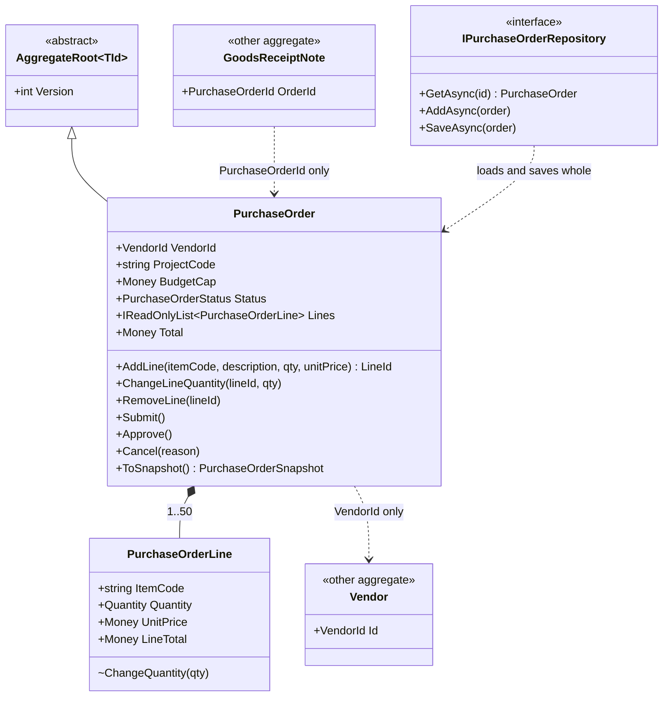
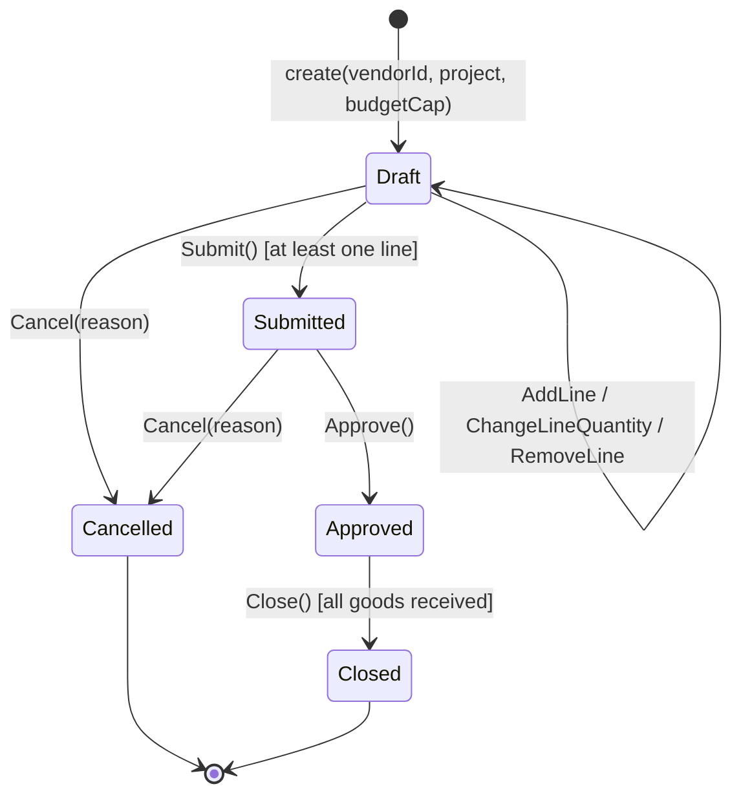
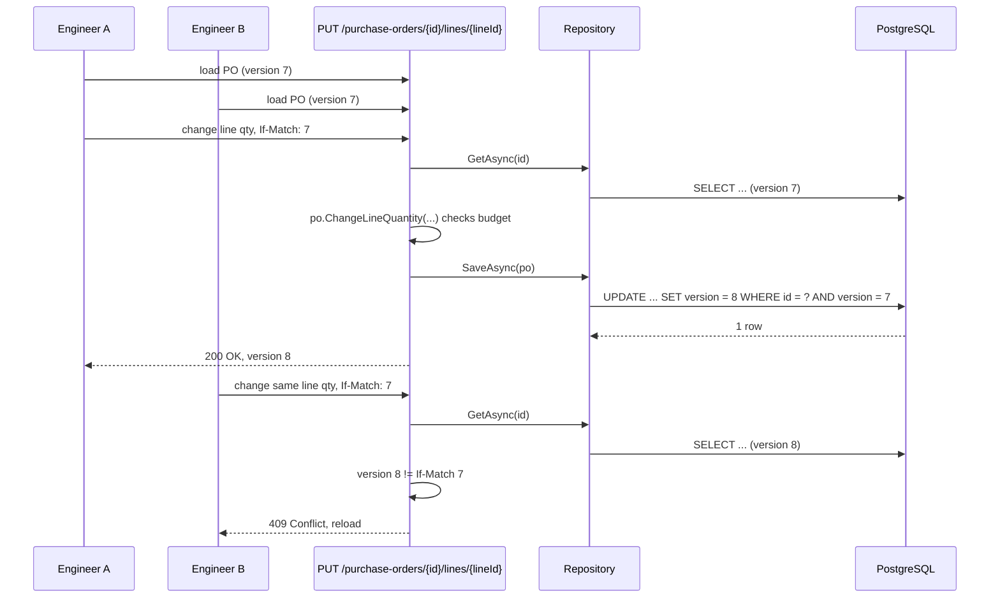

The [previous lesson](#/lesson/m08-entities-value-objects) gave you the atoms: entities and value objects. This lesson is about molecules. In a real system an order has lines, a contract has milestones, an invoice has items, and some rules only make sense across the whole group: "the order total cannot exceed the sanctioned budget", "milestone shares add up to 100 %". An **aggregate** is the cluster of objects you treat as one unit so that those rules are always true, and the **aggregate root** is the one object through which the outside world is allowed to touch the cluster.

The example is a purchase order (PO) in a procurement system for construction projects: a site engineer drafts a PO against a project budget, adds lines for cement, steel and aggregates (the gravel kind), submits it, and a manager approves it. Two engineers editing the same PO at the same time is a daily event, so concurrency is part of the design, not an afterthought.

## Learning objectives

By the end of this lesson you will be able to:

1. Define *aggregate*, *aggregate root* and *invariant*, and explain why the three ideas only make sense together.
2. Draw a consistency boundary around a purchase order and defend which rules are inside it and which are not.
3. Implement an aggregate root in C# whose child entities can only be changed through the root, with invariants checked on every mutation.
4. Apply the "small aggregates" and "reference other aggregates by id" rules, and explain the cost of ignoring them (lock contention, giant loads, false conflicts).
5. Protect an aggregate against lost updates with optimistic concurrency (a version number), and map a conflict to an HTTP 409.
6. Reconstitute an aggregate from stored state without re-running creation rules, and explain why that is safe.
7. Recognise when an aggregate is too big, too small, or not needed at all.

## Prerequisites

- [Entities and value objects in DDD](#/lesson/m08-entities-value-objects): `Entity<TId>`, `Money`, `Quantity`, strongly typed ids.
- [Encapsulation and invariant protection](#/lesson/m07-encapsulation-invariants): guard clauses, private setters, read-only collections.
- [Association, aggregation and composition](#/lesson/m07-association-aggregation-composition): who owns whom.
- [Deadlocks, optimistic and pessimistic locking](#/lesson/m09-locking): what a lost update is and how a row version prevents it.

## Explain it like I'm a beginner

Think of a purchase order as a **paper file in a folder**. The folder holds the cover sheet (vendor, project, budget) and the line sheets (40 tonnes of steel, 500 bags of cement). The site office has one rule written on the folder in red: *the total of all line sheets must not exceed the sanctioned budget on the cover sheet*.

If anyone could grab a single line sheet from the folder and change "40 tonnes" to "400 tonnes", the red rule would break and nobody would notice until the accounts team found it. So the office has a procedure: **you hand your change to the clerk who owns the folder**. The clerk recalculates the total, refuses the change if it busts the budget, and only then updates the sheet.

- The **folder** is the aggregate: the cover sheet plus its line sheets, which must stay consistent with each other.
- The **clerk** is the aggregate root: the only way in. In code, the `PurchaseOrder` object owns the lines, and the lines have no public way to be changed except through it.
- The **red rule** is an invariant: something that must be true after every single change, not just "eventually".

Two more parts of the analogy matter.

**The folder does not contain the vendor's whole file.** It has the vendor's *code* written on the cover sheet. If you want to know the vendor's phone number, you look up their file in another cabinet. Copying the vendor's entire file into every PO folder would make every folder huge and every vendor address change a nightmare. In code: an aggregate references other aggregates **by id**, never by holding the object.

**Two engineers cannot both edit the same folder at once.** In the paper world the folder is physically with one person. In software, two people can load the same PO on two screens. The fix is a **version number** stamped on the folder: each save says "I am updating version 7". If the stored version is already 8 because someone else saved first, the save is rejected and the second person must reload and look at what changed. That is optimistic concurrency.

## First-principles explanation

### The problem aggregates solve

Business rules come in two flavours:

- **Rules about one object**: "quantity must be positive". Value objects and entity methods handle these (previous lesson).
- **Rules about a group of objects**: "the sum of the lines must not exceed the budget", "a PO with no lines cannot be submitted", "no two lines may have the same item code". No single line can check these; only something that sees the whole group can.

Without a boundary, these group rules end up in whichever service happens to touch the lines. Three services add lines in three ways, two of them check the budget, one forgets. The database ends up with over-budget POs and nobody knows which code path produced them.

The aggregate is the answer: pick the group, pick one object to be its guardian, and route every change through that guardian so that the group rules are checked **in exactly one place, on every change**.

### Definitions, precisely

- **Aggregate**: a cluster of entities and value objects that must be kept consistent as a unit. It is a *consistency boundary*: inside it, invariants are true after every operation (strong consistency). Between aggregates, consistency may be *eventual* (reached a little later, usually through events).
- **Aggregate root**: the single entity in the cluster that outside code is allowed to hold a reference to and call methods on. Child entities are reached only via the root, and are changed only by the root's methods.
- **Invariant**: a rule that must hold at the end of every operation on the aggregate. "Total ≤ budget" is an invariant of the PO aggregate. "The vendor must be active" is **not** an invariant of the PO aggregate, because the vendor lives in a different aggregate and can change without the PO knowing.
- **Transaction boundary**: one aggregate is loaded, changed and saved in one database transaction. Vernon's rule of thumb: *modify one aggregate per transaction*. The [transaction boundaries lesson](#/lesson/m08-transaction-boundaries) goes deeper; here we just design for it.

### How the root enforces the boundary in C#

1. Child collections are private fields (`List<PurchaseOrderLine> _lines`) exposed as `IReadOnlyList<T>`. Nobody outside can `.Add` to them.
2. Child entity constructors and mutators are `internal` (or private nested classes), so only the aggregate's assembly can create or change them. The root's method (`ChangeLineQuantity(lineId, qty)`) finds the child and changes it *after* checking invariants.
3. Every mutating method on the root follows the same shape: *check state → check invariant with the proposed change → apply*. Never apply first and validate after; a thrown exception would leave the aggregate corrupt in memory.
4. The root has no public setters. State changes have business names: `Submit()`, `Approve()`, `Cancel(reason)`.

### Why small aggregates

Vernon's essays make the case with numbers that still hold. Imagine a `Project` aggregate holding every PO, invoice, document and team member of a three-year highway project, say 12,000 child objects.

- **Load cost**: every change to one PO line loads 12,000 objects. Even at 50 µs per object that is 600 ms before you do anything, and tens of megabytes of memory per request.
- **False conflicts**: with one version number on the whole project, an engineer adding a document and an accountant approving an invoice conflict with each other although their changes are unrelated. On a busy project the retry rate climbs until people give up.
- **Lock contention**: with pessimistic locking instead, the same two people simply wait for each other.

So: make the aggregate as small as the true invariants allow. The PO *must* include its lines because the budget invariant spans them. It must *not* include the vendor, the project, or the goods receipts, because no rule needs to be true across them at the same instant. When you are tempted to put two things in one aggregate, ask: *is there a rule that must be true across them after every single change?* If the honest answer is "it would be nice if they were in sync", that is eventual consistency and belongs between aggregates.

### Referencing by id

A PO holds `VendorId`, not `Vendor`. Consequences:

- Loading a PO never loads the vendor. The PO repository returns only the PO cluster.
- The PO cannot call `vendor.Deactivate()`, which is correct: that is the vendor aggregate's business.
- If the PO needs vendor data to make a decision (say, the vendor's payment terms), the *application service* fetches the vendor and passes the needed value in, or a *domain service* takes both ([next lesson](#/lesson/m08-repositories-domain-services)).

### Concurrency: optimistic, with a version

Two users load PO version 7. User A adds a line and saves: the database row becomes version 8. User B changes a quantity and saves with "expected version 7". The repository's `UPDATE ... WHERE version = 7` touches zero rows, so it throws `ConcurrencyException`, and the API returns `409 Conflict`. User B's screen reloads and shows A's new line.

Why optimistic and not a database lock? Because a user may hold a PO open for twenty minutes over lunch. A pessimistic lock would block everyone else for that long. Optimistic concurrency costs nothing until a real conflict happens, and real conflicts on the *same* aggregate are rare precisely because aggregates are small.

In PostgreSQL with EF Core you get this almost for free: Npgsql can use the hidden system column `xmin` as the concurrency token, or you add your own `version integer` column and mark it `.IsConcurrencyToken()`. With a hand-written repository you write the `WHERE version = @expected` yourself. In this lesson's in-memory repository we do exactly that.

### Reconstitution: loading is not creating

When the repository loads a PO from the database, it should **not** call `AddLine` fifty times, because `AddLine` checks the budget and the Draft status. The stored PO might be Approved (so `AddLine` would throw) or might have been created under an older budget rule. Loading rebuilds the object from trusted stored state; creating runs the rules. In code this is a private constructor plus a static `FromSnapshot(...)` factory, or, with EF Core, a parameterless private constructor and field-backed collections. The invariants were enforced when the state was written; re-checking on load only causes crashes on old data.

### When you do not need an aggregate

- Pure CRUD screens with no cross-object rules (a list of project codes and names). An aggregate here is a class with one field and a lot of ceremony.
- Reporting and read models. Queries do not change state, so they need no invariants and no root; they can join anything they like ([CQRS](#/lesson/m08-cqrs-fundamentals)).
- Reference data loaded once at startup.

The signal that you *do* need one: a rule that spans several objects and that has already been violated in production at least once.

## Visual explanation

### Class diagram: the boundary



Read the diagram as a map of territory. `PurchaseOrder` and its `PurchaseOrderLine`s are inside the boundary (filled diamond: composition, the lines die with the order). The line's `ChangeQuantity` is marked `~` (internal) because only the root may call it. `Vendor` and `GoodsReceiptNote` are **separate aggregates**; the dotted arrows carry only an id, never an object reference. The repository (next lesson) deals in whole aggregates: it never loads or saves a line on its own.

### State diagram: the root's life cycle



Lines can only be edited in `Draft`; this is a *state-dependent invariant*: the rule "lines are frozen" switches on at `Submit()`. An `Approved` PO cannot be cancelled here (a real system would route that through a change order with its own approvals). The guard in square brackets on `Submit` is a cross-line invariant: it needs the whole collection to evaluate.

### Sequence diagram: two engineers, one PO



Both engineers started from version 7. A's update succeeded and bumped the stored version to 8. B's request carries `If-Match: 7`; the version has moved on, so the API refuses without even applying the change. If the two requests had raced more closely (both loaded version 7 *inside* the API), the `UPDATE ... WHERE version = 7` would catch it instead and the repository would throw `ConcurrencyException`. Two layers of defence, same outcome: no lost update.

## Step-by-step example

### Step 1 — the anemic version

```csharp
public class PurchaseOrder
{
    public Guid Id { get; set; }
    public Guid VendorId { get; set; }
    public decimal BudgetCap { get; set; }
    public string Status { get; set; }
    public List<PurchaseOrderLine> Lines { get; set; } = new();
}

// Somewhere in a service:
po.Lines.Add(new PurchaseOrderLine { Qty = 40, UnitPrice = 58000 });
if (po.Lines.Sum(l => l.Qty * l.UnitPrice) > po.BudgetCap) throw new Exception("Over budget");
```

The check runs *after* the add, in one service. A second service that adds lines for a bulk import forgets the check. A third sets `Status = "Approved"` from a background job without checking lines. Every rule is optional.

### Step 2 — find the invariants

Write them down as sentences that must be true after every operation:

1. Total of lines ≤ budget cap.
2. No two lines share an item code.
3. At most 50 lines.
4. Lines change only in `Draft`.
5. `Submit` requires at least one line.
6. All lines are priced in the PO's currency.

Then ask of each: *does it need data from outside the PO?* None of them do. Good: they are all PO invariants. "Vendor must be active" needs the vendor, so it is **not** on the list (exercise 6 explores where it goes).

### Step 3 — close the doors

Make `Lines` read-only, make the line's mutators `internal`, remove every setter, and give the root one method per business operation.

### Step 4 — check before applying

`AddLine` computes what the total *would be* and throws before touching `_lines`. If the check fails, the aggregate is exactly as it was.

### Step 5 — add the version

`AggregateRoot<TId>` carries `Version`. The repository compares it on save. The API exposes it as an `ETag`/`If-Match` pair so clients can detect staleness early.

## Production-style C# implementation

```text
Procurement.Api/
  Program.cs
  Domain/
    Shared.cs                 (DomainException, Entity, ids, Money, Quantity)
    AggregateRoot.cs
    PurchaseOrder.cs
    PurchaseOrderSnapshot.cs
    IPurchaseOrderRepository.cs
  Infrastructure/
    InMemoryPurchaseOrderRepository.cs
```

```csharp file=Domain/Shared.cs
namespace Procurement.Domain;

public sealed class DomainException(string message) : Exception(message);

/// <summary>Raised by a repository when the stored version is not the version the aggregate was loaded with.</summary>
public sealed class ConcurrencyException(string message) : Exception(message);

public abstract class Entity<TId> : IEquatable<Entity<TId>> where TId : notnull
{
    public TId Id { get; }
    protected Entity(TId id) => Id = id;
    public bool Equals(Entity<TId>? other) => other is not null && GetType() == other.GetType() && Id.Equals(other.Id);
    public override bool Equals(object? obj) => Equals(obj as Entity<TId>);
    public override int GetHashCode() => HashCode.Combine(GetType(), Id);
}

public readonly record struct PurchaseOrderId(Guid Value)
{
    public static PurchaseOrderId New() => new(Guid.CreateVersion7());
    public override string ToString() => Value.ToString();
}

public readonly record struct LineId(Guid Value)
{
    public static LineId New() => new(Guid.CreateVersion7());
    public override string ToString() => Value.ToString();
}

public readonly record struct VendorId(Guid Value)
{
    public override string ToString() => Value.ToString();
}

public sealed record Money
{
    public decimal Amount { get; }
    public string Currency { get; }

    public Money(decimal amount, string currency)
    {
        if (string.IsNullOrWhiteSpace(currency) || currency.Length != 3) throw new DomainException("Currency must be a 3-letter code.");
        if (amount < 0) throw new DomainException("Money cannot be negative.");
        if (decimal.Round(amount, 2) != amount) throw new DomainException("Money cannot have more than two decimal places.");
        Amount = amount;
        Currency = currency.ToUpperInvariant();
    }

    public static Money Zero(string currency) => new(0m, currency);
    public static Money Inr(decimal amount) => new(amount, "INR");

    public Money Add(Money other) { EnsureSameCurrency(other); return new Money(Amount + other.Amount, Currency); }
    public Money Subtract(Money other) { EnsureSameCurrency(other); return new Money(Amount - other.Amount, Currency); }
    public Money Multiply(decimal factor) => new(decimal.Round(Amount * factor, 2, MidpointRounding.ToEven), Currency);
    public bool IsGreaterThan(Money other) { EnsureSameCurrency(other); return Amount > other.Amount; }

    public static Money operator +(Money a, Money b) => a.Add(b);
    public static Money operator -(Money a, Money b) => a.Subtract(b);
    public static Money operator *(Money a, decimal f) => a.Multiply(f);

    public override string ToString() => $"{Currency} {Amount:N2}";

    private void EnsureSameCurrency(Money other)
    {
        if (other.Currency != Currency) throw new DomainException($"Currency mismatch: {Currency} vs {other.Currency}.");
    }
}

public enum UnitOfMeasure { Nos, Metre, CubicMetre, Kilogram, Tonne, Litre, Bag }

public sealed record Quantity
{
    public decimal Value { get; }
    public UnitOfMeasure Unit { get; }

    public Quantity(decimal value, UnitOfMeasure unit)
    {
        if (value <= 0) throw new DomainException("Quantity must be positive.");
        if ((unit is UnitOfMeasure.Nos or UnitOfMeasure.Bag) && value != decimal.Truncate(value))
            throw new DomainException($"A count in {unit} must be a whole number.");
        Value = value;
        Unit = unit;
    }

    public Money Times(Money unitPrice) => unitPrice * Value;
    public override string ToString() => $"{Value:0.###} {Unit}";
}
```

```csharp file=Domain/AggregateRoot.cs
namespace Procurement.Domain;

/// <summary>Marker base for aggregate roots. Version is the stored version this instance was loaded from (0 for new).</summary>
public abstract class AggregateRoot<TId> : Entity<TId> where TId : notnull
{
    public int Version { get; }

    protected AggregateRoot(TId id, int version) : base(id)
    {
        if (version < 0) throw new DomainException("Version cannot be negative.");
        Version = version;
    }
}
```

The version is deliberately read-only on the aggregate. The *repository* decides the next version when it writes; the aggregate just remembers what it was loaded from. After a successful save the in-memory instance is stale (its `Version` is one behind the store), which is fine because an application service loads, changes and saves once per request and then discards it.

```csharp file=Domain/PurchaseOrder.cs
namespace Procurement.Domain;

public enum PurchaseOrderStatus { Draft, Submitted, Approved, Cancelled, Closed }

/// <summary>Child entity. Created and mutated only by PurchaseOrder (internal members).</summary>
public sealed class PurchaseOrderLine : Entity<LineId>
{
    public string ItemCode { get; }
    public string Description { get; }
    public Quantity Quantity { get; private set; }
    public Money UnitPrice { get; }
    public Money LineTotal => Quantity.Times(UnitPrice);

    internal PurchaseOrderLine(LineId id, string itemCode, string description, Quantity quantity, Money unitPrice) : base(id)
    {
        ItemCode = string.IsNullOrWhiteSpace(itemCode) ? throw new DomainException("Item code is required.") : itemCode.Trim().ToUpperInvariant();
        Description = string.IsNullOrWhiteSpace(description) ? throw new DomainException("Description is required.") : description.Trim();
        Quantity = quantity;
        UnitPrice = unitPrice;
    }

    internal void ChangeQuantity(Quantity newQuantity) => Quantity = newQuantity;
}

/// <summary>Aggregate root. Invariants: total within budget cap; unique item codes; at most MaxLines lines;
/// lines editable only in Draft; same currency throughout; Submit needs at least one line.</summary>
public sealed class PurchaseOrder : AggregateRoot<PurchaseOrderId>
{
    public const int MaxLines = 50;

    private readonly List<PurchaseOrderLine> _lines = new();

    public VendorId VendorId { get; }
    public string ProjectCode { get; }
    public Money BudgetCap { get; }
    public PurchaseOrderStatus Status { get; private set; }
    public string? CancellationReason { get; private set; }
    public IReadOnlyList<PurchaseOrderLine> Lines => _lines;
    public Money Total => _lines.Aggregate(Money.Zero(BudgetCap.Currency), (sum, l) => sum + l.LineTotal);

    public PurchaseOrder(PurchaseOrderId id, VendorId vendorId, string projectCode, Money budgetCap)
        : this(id, vendorId, projectCode, budgetCap, PurchaseOrderStatus.Draft, null, version: 0)
    {
        if (budgetCap.Amount <= 0) throw new DomainException("Budget cap must be positive.");
    }

    // Reconstitution constructor: trusts stored state, runs no creation rules.
    private PurchaseOrder(PurchaseOrderId id, VendorId vendorId, string projectCode, Money budgetCap,
                          PurchaseOrderStatus status, string? cancellationReason, int version) : base(id, version)
    {
        if (vendorId == default) throw new DomainException("Vendor is required.");
        VendorId = vendorId;
        ProjectCode = string.IsNullOrWhiteSpace(projectCode) ? throw new DomainException("Project code is required.") : projectCode.Trim();
        BudgetCap = budgetCap;
        Status = status;
        CancellationReason = cancellationReason;
    }

    public LineId AddLine(string itemCode, string description, Quantity quantity, Money unitPrice)
    {
        EnsureDraft();
        if (_lines.Count >= MaxLines) throw new DomainException($"A purchase order cannot have more than {MaxLines} lines.");
        if (unitPrice.Currency != BudgetCap.Currency) throw new DomainException($"Lines must be priced in {BudgetCap.Currency}.");
        var code = itemCode.Trim().ToUpperInvariant();
        if (_lines.Any(l => l.ItemCode == code)) throw new DomainException($"Item {code} is already on this order; change its quantity instead.");

        var line = new PurchaseOrderLine(LineId.New(), code, description, quantity, unitPrice);
        EnsureWithinBudget(Total + line.LineTotal);     // check with the proposed state...
        _lines.Add(line);                               // ...then apply
        return line.Id;
    }

    public void ChangeLineQuantity(LineId lineId, Quantity newQuantity)
    {
        EnsureDraft();
        var line = FindLine(lineId);
        if (newQuantity.Unit != line.Quantity.Unit) throw new DomainException($"Line {line.ItemCode} is measured in {line.Quantity.Unit}.");
        var proposedTotal = Total - line.LineTotal + newQuantity.Times(line.UnitPrice);
        EnsureWithinBudget(proposedTotal);
        line.ChangeQuantity(newQuantity);
    }

    public void RemoveLine(LineId lineId)
    {
        EnsureDraft();
        _lines.Remove(FindLine(lineId));
    }

    public void Submit()
    {
        EnsureDraft();
        if (_lines.Count == 0) throw new DomainException("Cannot submit a purchase order with no lines.");
        Status = PurchaseOrderStatus.Submitted;
    }

    public void Approve()
    {
        if (Status != PurchaseOrderStatus.Submitted) throw new DomainException($"Only a submitted order can be approved (current: {Status}).");
        Status = PurchaseOrderStatus.Approved;
    }

    public void Cancel(string reason)
    {
        if (Status is not (PurchaseOrderStatus.Draft or PurchaseOrderStatus.Submitted))
            throw new DomainException($"A {Status} order cannot be cancelled; raise a change order instead.");
        if (string.IsNullOrWhiteSpace(reason)) throw new DomainException("A cancellation reason is required.");
        Status = PurchaseOrderStatus.Cancelled;
        CancellationReason = reason.Trim();
    }

    public void Close()
    {
        if (Status != PurchaseOrderStatus.Approved) throw new DomainException("Only an approved order can be closed.");
        Status = PurchaseOrderStatus.Closed;
    }

    private void EnsureDraft()
    {
        if (Status != PurchaseOrderStatus.Draft) throw new DomainException($"Lines can only be changed while the order is in Draft (current: {Status}).");
    }

    private void EnsureWithinBudget(Money proposedTotal)
    {
        if (proposedTotal.IsGreaterThan(BudgetCap))
            throw new DomainException($"Total {proposedTotal} would exceed the budget cap {BudgetCap}.");
    }

    private PurchaseOrderLine FindLine(LineId lineId) =>
        _lines.FirstOrDefault(l => l.Id == lineId) ?? throw new DomainException($"Line {lineId} is not on this order.");

    // ---- Persistence boundary: snapshots in, snapshots out. No ORM attributes in the domain. ----

    public PurchaseOrderSnapshot ToSnapshot() => new(
        Id.Value, VendorId.Value, ProjectCode, BudgetCap.Amount, BudgetCap.Currency, Status.ToString(), CancellationReason, Version,
        _lines.Select(l => new PurchaseOrderLineSnapshot(l.Id.Value, l.ItemCode, l.Description, l.Quantity.Value, l.Quantity.Unit.ToString(), l.UnitPrice.Amount)).ToList());

    public static PurchaseOrder FromSnapshot(PurchaseOrderSnapshot s)
    {
        var order = new PurchaseOrder(new PurchaseOrderId(s.Id), new VendorId(s.VendorId), s.ProjectCode,
            new Money(s.BudgetCap, s.Currency), Enum.Parse<PurchaseOrderStatus>(s.Status), s.CancellationReason, s.Version);
        foreach (var l in s.Lines)
            order._lines.Add(new PurchaseOrderLine(new LineId(l.Id), l.ItemCode, l.Description,
                new Quantity(l.Quantity, Enum.Parse<UnitOfMeasure>(l.Unit)), new Money(l.UnitPrice, s.Currency)));
        return order;
    }
}
```

Three things to notice.

**Check, then apply.** `AddLine` computes `Total + line.LineTotal` and throws *before* `_lines.Add`. If it applied first and threw after, the in-memory aggregate would be over budget, and a careless caller who caught the exception could still save it.

**`FromSnapshot` bypasses `AddLine`.** It writes into `_lines` directly. Stored state was valid when written; a `Closed` PO with 50 lines must load even though `AddLine` would refuse every one of them. The value objects (`Money`, `Quantity`) still validate themselves on the way in, which catches genuinely corrupt storage without re-running business workflow rules.

**No ORM in the domain.** The snapshot records are plain data. An EF Core implementation would instead configure field access for `_lines` and a private constructor; the point is the same: persistence details stay out of the aggregate's public surface.

```csharp file=Domain/PurchaseOrderSnapshot.cs
namespace Procurement.Domain;

public sealed record PurchaseOrderLineSnapshot(Guid Id, string ItemCode, string Description, decimal Quantity, string Unit, decimal UnitPrice);

public sealed record PurchaseOrderSnapshot(
    Guid Id, Guid VendorId, string ProjectCode, decimal BudgetCap, string Currency, string Status, string? CancellationReason,
    int Version, IReadOnlyList<PurchaseOrderLineSnapshot> Lines);
```

```csharp file=Domain/IPurchaseOrderRepository.cs
namespace Procurement.Domain;

/// <summary>One repository per aggregate. It loads and saves the whole PurchaseOrder, never a line on its own.</summary>
public interface IPurchaseOrderRepository
{
    Task<PurchaseOrder?> GetAsync(PurchaseOrderId id, CancellationToken ct = default);
    Task AddAsync(PurchaseOrder order, CancellationToken ct = default);
    /// <summary>Throws ConcurrencyException if the stored version differs from order.Version.</summary>
    Task SaveAsync(PurchaseOrder order, CancellationToken ct = default);
}
```

```csharp file=Infrastructure/InMemoryPurchaseOrderRepository.cs
using System.Collections.Concurrent;
using Procurement.Domain;

namespace Procurement.Infrastructure;

/// <summary>Stores snapshots, so every Get returns a fresh instance (like a real database session would).
/// SaveAsync implements the optimistic check "UPDATE ... WHERE version = expected".</summary>
public sealed class InMemoryPurchaseOrderRepository : IPurchaseOrderRepository
{
    private readonly ConcurrentDictionary<Guid, PurchaseOrderSnapshot> _store = new();

    public Task<PurchaseOrder?> GetAsync(PurchaseOrderId id, CancellationToken ct = default) =>
        Task.FromResult(_store.TryGetValue(id.Value, out var s) ? PurchaseOrder.FromSnapshot(s) : null);

    public Task AddAsync(PurchaseOrder order, CancellationToken ct = default)
    {
        var snapshot = order.ToSnapshot() with { Version = 1 };
        if (!_store.TryAdd(order.Id.Value, snapshot)) throw new ConcurrencyException($"Purchase order {order.Id} already exists.");
        return Task.CompletedTask;
    }

    public Task SaveAsync(PurchaseOrder order, CancellationToken ct = default)
    {
        if (!_store.TryGetValue(order.Id.Value, out var current))
            throw new ConcurrencyException($"Purchase order {order.Id} does not exist; use AddAsync.");
        var next = order.ToSnapshot() with { Version = current.Version + 1 };
        // Atomic compare-and-swap on the whole snapshot: succeeds only if nobody saved since we loaded.
        if (!_store.TryUpdate(order.Id.Value, next, current) || current.Version != order.Version)
            throw new ConcurrencyException($"Purchase order {order.Id} was modified by someone else (stored version {current.Version}, yours {order.Version}).");
        return Task.CompletedTask;
    }
}
```

`TryUpdate(key, newValue, comparisonValue)` only replaces the entry if the stored value still equals `current`, which is the in-memory equivalent of `UPDATE ... WHERE version = @expected`. Because `PurchaseOrderSnapshot` is a record, "equals" means "same content", so any intervening save changes the comparison and fails the swap.

```csharp file=Program.cs
using Procurement.Domain;
using Procurement.Infrastructure;

var builder = WebApplication.CreateBuilder(args);
builder.Services.AddSingleton<IPurchaseOrderRepository, InMemoryPurchaseOrderRepository>();
var app = builder.Build();

app.MapPost("/purchase-orders", async (CreatePurchaseOrderRequest req, IPurchaseOrderRepository repo, CancellationToken ct) =>
{
    try
    {
        var po = new PurchaseOrder(PurchaseOrderId.New(), new VendorId(req.VendorId), req.ProjectCode, new Money(req.BudgetCap, req.Currency));
        await repo.AddAsync(po, ct);
        return Results.Created($"/purchase-orders/{po.Id}", new { id = po.Id.Value, version = 1 });
    }
    catch (DomainException ex) { return Results.Problem(ex.Message, statusCode: 400); }
});

app.MapPost("/purchase-orders/{id:guid}/lines", async (Guid id, AddLineRequest req, HttpRequest http, IPurchaseOrderRepository repo, CancellationToken ct) =>
{
    var po = await repo.GetAsync(new PurchaseOrderId(id), ct);
    if (po is null) return Results.NotFound();
    if (http.Headers.IfMatch.Count > 0 && http.Headers.IfMatch.ToString().Trim('"') != po.Version.ToString())
        return Results.Problem("The purchase order has changed since you loaded it. Reload and retry.", statusCode: 409);
    try
    {
        var lineId = po.AddLine(req.ItemCode, req.Description, new Quantity(req.Quantity, Enum.Parse<UnitOfMeasure>(req.Unit, ignoreCase: true)), new Money(req.UnitPrice, po.BudgetCap.Currency));
        await repo.SaveAsync(po, ct);
        return Results.Ok(new { lineId = lineId.Value, total = po.Total.Amount, version = po.Version + 1 });
    }
    catch (DomainException ex) { return Results.Problem(ex.Message, statusCode: 422); }
    catch (ConcurrencyException ex) { return Results.Problem(ex.Message, statusCode: 409); }
});

app.MapPost("/purchase-orders/{id:guid}/submit", async (Guid id, IPurchaseOrderRepository repo, CancellationToken ct) =>
{
    var po = await repo.GetAsync(new PurchaseOrderId(id), ct);
    if (po is null) return Results.NotFound();
    try { po.Submit(); await repo.SaveAsync(po, ct); return Results.NoContent(); }
    catch (DomainException ex) { return Results.Problem(ex.Message, statusCode: 422); }
    catch (ConcurrencyException ex) { return Results.Problem(ex.Message, statusCode: 409); }
});

app.Run();

public sealed record CreatePurchaseOrderRequest(Guid VendorId, string ProjectCode, decimal BudgetCap, string Currency);
public sealed record AddLineRequest(string ItemCode, string Description, decimal Quantity, string Unit, decimal UnitPrice);
```

The endpoints are doing orchestration that belongs in an [application service](#/lesson/m08-application-services); we leave it inline here to keep the focus on the aggregate. Note the status codes: `400` for malformed input, `422` for a valid request the business rules reject, `409` for a version conflict.

:::callout type=tip title="The same aggregate with EF Core and PostgreSQL"
With EF Core you keep the aggregate exactly as above (minus the snapshot methods) and configure it from the outside:

```csharp
// Infrastructure/PurchaseOrderConfiguration.cs — snippet, not compiled here
builder.ToTable("purchase_orders");
builder.HasKey(o => o.Id);
builder.Property(o => o.Id).HasConversion(id => id.Value, v => new PurchaseOrderId(v));
builder.OwnsOne(o => o.BudgetCap, m => { m.Property(x => x.Amount).HasColumnName("budget_cap").HasColumnType("numeric(18,2)"); m.Property(x => x.Currency).HasColumnName("currency"); });
builder.HasMany(o => o.Lines).WithOne().OnDelete(DeleteBehavior.Cascade);
builder.Navigation(o => o.Lines).UsePropertyAccessMode(PropertyAccessMode.Field);   // write to _lines, not a setter
builder.Property(o => o.Version).IsConcurrencyToken();                            // or Npgsql: builder.UseXminAsConcurrencyToken()
```

`SaveChangesAsync` then throws `DbUpdateConcurrencyException` when the `WHERE version = @p` update affects zero rows; map it to `409` in one exception handler. The domain project still has no EF Core reference.
:::

## Bad design vs good design

**Bad: the giant `Project` aggregate.** One root holding every PO, invoice, document and daily progress report of a highway project. Real consequences we have seen in systems like this: loading a project to add one document took 4–6 seconds and 80 MB; every two users saving anything on the same project conflicted; and the team "fixed" it by removing the version check, which brought back lost updates.

**Bad: no aggregate at all.** `PurchaseOrderLine` has its own repository and its own endpoint. Adding a line never sees the other lines, so the budget rule lives in a trigger, in a service, and in a nightly report that emails the exceptions.

**Good: the implementation above.** The PO owns its lines and nothing else. The budget rule runs in one method on every change. Vendors, goods receipts and invoices are their own aggregates linked by id. Conflicts are detected per PO, so two engineers on two different POs never collide.

**When "bad" is fine.** A master-data screen for unit-of-measure codes has no cross-row rules. A plain table with a plain CRUD service is the right design; wrapping it in an aggregate adds ceremony and nothing else.

:::callout type=warning title="Aggregates are about rules, not about navigation"
A common mistake is to let the ORM's navigation properties decide the aggregate: "PO has a Vendor navigation, so Vendor is part of the PO". Navigation is a query convenience; the aggregate boundary is a *rule* boundary. If no rule must be true across PO and Vendor at the same instant, Vendor is outside, however convenient `po.Vendor.Name` might be in a report. Reports should use a read model instead.
:::

:::callout type=tradeoff title="Eventual consistency between aggregates"
Because the goods receipt note is a separate aggregate, "received quantity ≤ ordered quantity" cannot be a hard invariant checked in one transaction across both. You can (a) pass the ordered quantities into the GRN at creation as a snapshot and check against those (exercise 5), accepting that a later PO change is not reflected; (b) publish a `GoodsReceived` domain event and let a handler update the PO's received quantities a moment later ([domain events](#/lesson/m08-domain-events)); or (c) merge them into one aggregate if the business truly requires instant consistency and accepts the contention. Most procurement teams choose (a) + (b).
:::

## Practical playground

Run the program, then try to break the budget: change the second `AddLine` quantity to `60`, or add a third line with the item code `STEEL-TMT-12` again. Then move `Submit()` above the first `AddLine` and see which rule fires.

:::playground type=csharp title="A purchase order that guards its own rules"
```csharp file=Program.cs
using System;
using System.Collections.Generic;
using System.Linq;

public sealed class DomainException : Exception { public DomainException(string m) : base(m) { } }

public enum Status { Draft, Submitted, Approved }

public sealed class Line
{
    public Guid Id { get; } = Guid.NewGuid();
    public string ItemCode { get; }
    public decimal Qty { get; private set; }
    public decimal UnitPrice { get; }
    public decimal Total => Qty * UnitPrice;
    internal Line(string code, decimal qty, decimal price) { ItemCode = code; Qty = qty; UnitPrice = price; }
    internal void ChangeQty(decimal qty) => Qty = qty;
}

public sealed class PurchaseOrder
{
    private readonly List<Line> _lines = new();
    public decimal BudgetCap { get; }
    public Status Status { get; private set; } = Status.Draft;
    public IReadOnlyList<Line> Lines => _lines;
    public decimal Total => _lines.Sum(l => l.Total);

    public PurchaseOrder(decimal budgetCap) => BudgetCap = budgetCap;

    public Guid AddLine(string code, decimal qty, decimal unitPrice)
    {
        if (Status != Status.Draft) throw new DomainException("Lines are frozen after submit.");
        if (qty <= 0) throw new DomainException("Quantity must be positive.");
        if (_lines.Any(l => l.ItemCode == code)) throw new DomainException($"{code} already on order.");
        var line = new Line(code, qty, unitPrice);
        if (Total + line.Total > BudgetCap) throw new DomainException($"Total {Total + line.Total:N0} exceeds cap {BudgetCap:N0}.");
        _lines.Add(line);
        return line.Id;
    }

    public void Submit()
    {
        if (_lines.Count == 0) throw new DomainException("Nothing to submit.");
        Status = Status.Submitted;
    }
}

public static class Program
{
    public static void Main()
    {
        var po = new PurchaseOrder(budgetCap: 3_000_000m);
        po.AddLine("STEEL-TMT-12", 40m, 58_000m);     // 23,20,000
        po.AddLine("CEMENT-OPC-53", 1000m, 380m);     // 3,80,000  -> total 27,00,000
        Console.WriteLine($"Total {po.Total:N0} of cap {po.BudgetCap:N0}, status {po.Status}");
        po.Submit();
        Console.WriteLine($"Status {po.Status}");
        try { po.AddLine("SAND-RIVER", 50m, 1_800m); }
        catch (DomainException ex) { Console.WriteLine($"Refused: {ex.Message}"); }
    }
}
```
:::

## Exercises

:::exercise id=m08-aggregates-ex1 difficulty=beginner kind=code title="Enforce the purchase-order invariants in AddLine"
Implement `PurchaseOrder.AddLine` so that every invariant below is checked **before** the line is added. The starter has the aggregate's shape and a working `Submit`.
::requirements
- Lines can only be added while `Status == Draft`.
- At most `MaxLines` (50) lines.
- Item codes are unique on an order (case-insensitive, trimmed).
- The running total (existing lines + the new line) must not exceed `BudgetCap`.
- If any check fails, throw `DomainException` and leave `Lines` unchanged.
::acceptance
- Adding 40 × 58,000 to a 30,00,000 cap succeeds; `Total` is 23,20,000.
- Adding a second line that pushes the total to 30,00,001 throws and the line count stays at 1.
- Adding `"steel-tmt-12"` when `"STEEL-TMT-12"` exists throws.
- The 51st line throws.
- `AddLine` after `Submit()` throws.
::hint
Order the checks cheapest-first: status, count, duplicate code, then the budget (which needs a sum).
::hint
Compute the proposed total as `Total + qty * unitPrice` and compare *before* calling `_lines.Add`.
::hint
Normalise the item code once (`Trim().ToUpperInvariant()`) and compare against normalised stored codes.
::hint
```csharp
var code = itemCode.Trim().ToUpperInvariant();
if (_lines.Any(l => l.ItemCode == code)) throw new DomainException(...);
var proposed = Total + quantity * unitPrice;
if (proposed > BudgetCap) throw new DomainException(...);
_lines.Add(new PurchaseOrderLine(Guid.NewGuid(), code, quantity, unitPrice));
```
::starter
```csharp file=PurchaseOrder.cs
using System;
using System.Collections.Generic;
using System.Linq;

public sealed class DomainException : Exception
{
    public DomainException(string message) : base(message) { }
}

public enum PurchaseOrderStatus { Draft, Submitted, Approved, Cancelled }

public sealed class PurchaseOrderLine
{
    public Guid Id { get; }
    public string ItemCode { get; }
    public decimal Quantity { get; private set; }
    public decimal UnitPrice { get; }
    public decimal LineTotal => Quantity * UnitPrice;

    internal PurchaseOrderLine(Guid id, string itemCode, decimal quantity, decimal unitPrice)
    {
        Id = id; ItemCode = itemCode; Quantity = quantity; UnitPrice = unitPrice;
    }

    internal void ChangeQuantity(decimal quantity) => Quantity = quantity;
}

public sealed class PurchaseOrder
{
    public const int MaxLines = 50;
    private readonly List<PurchaseOrderLine> _lines = new();

    public Guid Id { get; } = Guid.NewGuid();
    public decimal BudgetCap { get; }
    public PurchaseOrderStatus Status { get; private set; } = PurchaseOrderStatus.Draft;
    public IReadOnlyList<PurchaseOrderLine> Lines => _lines;
    public decimal Total => _lines.Sum(l => l.LineTotal);

    public PurchaseOrder(decimal budgetCap)
    {
        if (budgetCap <= 0) throw new DomainException("Budget cap must be positive.");
        BudgetCap = budgetCap;
    }

    public Guid AddLine(string itemCode, decimal quantity, decimal unitPrice)
    {
        if (string.IsNullOrWhiteSpace(itemCode)) throw new DomainException("Item code is required.");
        if (quantity <= 0) throw new DomainException("Quantity must be positive.");
        if (unitPrice < 0) throw new DomainException("Unit price cannot be negative.");
        throw new NotImplementedException("Enforce the aggregate invariants, then add the line.");
    }

    public void Submit()
    {
        if (Status != PurchaseOrderStatus.Draft) throw new DomainException("Only a draft can be submitted.");
        if (_lines.Count == 0) throw new DomainException("Cannot submit an order with no lines.");
        Status = PurchaseOrderStatus.Submitted;
    }
}
```
::tests
```csharp file=PurchaseOrderTests.cs
using Xunit;

public class PurchaseOrderTests
{
    [Fact]
    public void Adds_line_within_budget()
    {
        var po = new PurchaseOrder(3_000_000m);
        po.AddLine("STEEL-TMT-12", 40m, 58_000m);
        Assert.Single(po.Lines);
        Assert.Equal(2_320_000m, po.Total);
    }

    [Fact]
    public void Rejects_line_that_breaks_budget_and_leaves_state_unchanged()
    {
        var po = new PurchaseOrder(3_000_000m);
        po.AddLine("STEEL-TMT-12", 40m, 58_000m);
        Assert.Throws<DomainException>(() => po.AddLine("CEMENT", 1_789m, 380.2m)); // 2,320,000 + 680,177.80 = 3,000,177.80 > cap
        Assert.Single(po.Lines);
        Assert.Equal(2_320_000m, po.Total);
    }

    [Fact]
    public void Exactly_at_budget_is_allowed()
    {
        var po = new PurchaseOrder(1_000m);
        po.AddLine("A", 2m, 500m);
        Assert.Equal(1_000m, po.Total);
    }

    [Fact]
    public void Rejects_duplicate_item_code_case_insensitively()
    {
        var po = new PurchaseOrder(3_000_000m);
        po.AddLine("STEEL-TMT-12", 1m, 58_000m);
        Assert.Throws<DomainException>(() => po.AddLine(" steel-tmt-12 ", 1m, 58_000m));
    }

    [Fact]
    public void Rejects_more_than_max_lines()
    {
        var po = new PurchaseOrder(1_000_000m);
        for (var i = 0; i < PurchaseOrder.MaxLines; i++) po.AddLine($"ITEM-{i}", 1m, 1m);
        Assert.Throws<DomainException>(() => po.AddLine("ONE-TOO-MANY", 1m, 1m));
        Assert.Equal(PurchaseOrder.MaxLines, po.Lines.Count);
    }

    [Fact]
    public void Rejects_add_after_submit()
    {
        var po = new PurchaseOrder(1_000_000m);
        po.AddLine("A", 1m, 1m);
        po.Submit();
        Assert.Throws<DomainException>(() => po.AddLine("B", 1m, 1m));
    }

    [Fact]
    public void Lines_cannot_be_added_from_outside()
    {
        var po = new PurchaseOrder(1_000m);
        Assert.IsAssignableFrom<System.Collections.Generic.IReadOnlyList<PurchaseOrderLine>>(po.Lines);
    }
}
```
::solution
```csharp file=PurchaseOrder.cs
using System;
using System.Collections.Generic;
using System.Linq;

public sealed class DomainException : Exception
{
    public DomainException(string message) : base(message) { }
}

public enum PurchaseOrderStatus { Draft, Submitted, Approved, Cancelled }

public sealed class PurchaseOrderLine
{
    public Guid Id { get; }
    public string ItemCode { get; }
    public decimal Quantity { get; private set; }
    public decimal UnitPrice { get; }
    public decimal LineTotal => Quantity * UnitPrice;

    internal PurchaseOrderLine(Guid id, string itemCode, decimal quantity, decimal unitPrice)
    {
        Id = id; ItemCode = itemCode; Quantity = quantity; UnitPrice = unitPrice;
    }

    internal void ChangeQuantity(decimal quantity) => Quantity = quantity;
}

public sealed class PurchaseOrder
{
    public const int MaxLines = 50;
    private readonly List<PurchaseOrderLine> _lines = new();

    public Guid Id { get; } = Guid.NewGuid();
    public decimal BudgetCap { get; }
    public PurchaseOrderStatus Status { get; private set; } = PurchaseOrderStatus.Draft;
    public IReadOnlyList<PurchaseOrderLine> Lines => _lines;
    public decimal Total => _lines.Sum(l => l.LineTotal);

    public PurchaseOrder(decimal budgetCap)
    {
        if (budgetCap <= 0) throw new DomainException("Budget cap must be positive.");
        BudgetCap = budgetCap;
    }

    public Guid AddLine(string itemCode, decimal quantity, decimal unitPrice)
    {
        if (string.IsNullOrWhiteSpace(itemCode)) throw new DomainException("Item code is required.");
        if (quantity <= 0) throw new DomainException("Quantity must be positive.");
        if (unitPrice < 0) throw new DomainException("Unit price cannot be negative.");

        if (Status != PurchaseOrderStatus.Draft) throw new DomainException($"Lines can only be added in Draft (current: {Status}).");
        if (_lines.Count >= MaxLines) throw new DomainException($"At most {MaxLines} lines are allowed.");

        var code = itemCode.Trim().ToUpperInvariant();
        if (_lines.Any(l => l.ItemCode == code)) throw new DomainException($"Item {code} is already on this order.");

        var proposedTotal = Total + quantity * unitPrice;
        if (proposedTotal > BudgetCap) throw new DomainException($"Total {proposedTotal:N2} would exceed the budget cap {BudgetCap:N2}.");

        var line = new PurchaseOrderLine(Guid.NewGuid(), code, quantity, unitPrice);
        _lines.Add(line);
        return line.Id;
    }

    public void Submit()
    {
        if (Status != PurchaseOrderStatus.Draft) throw new DomainException("Only a draft can be submitted.");
        if (_lines.Count == 0) throw new DomainException("Cannot submit an order with no lines.");
        Status = PurchaseOrderStatus.Submitted;
    }
}
```

Every check happens before `_lines.Add`. The second test proves the point: after the rejected add, the count and total are exactly what they were.
::mistakes
- Adding the line and then checking `Total > BudgetCap`, with a `_lines.Remove` in a `catch`. Works until someone adds a second exit path, then it leaks.
- Comparing item codes with `==` on raw input; `"steel-tmt-12 "` slips through.
- Exposing `List<PurchaseOrderLine>` directly "for the mapper". The mapper gets a back door and so does everyone else.
::extensions
Add `ChangeLineQuantity(Guid lineId, decimal newQuantity)` with the same budget check, computing the proposed total as `Total - old + new`.
:::

:::exercise id=m08-aggregates-ex2 difficulty=beginner kind=code title="The root owns the life cycle: Submit, Approve, Cancel, Close"
Implement the state transitions on `PurchaseOrder`. Each method is a guarded transition; wrong-state calls throw `DomainException` and leave the status unchanged.
::requirements
- `Submit`: only from `Draft`, requires at least one line.
- `Approve`: only from `Submitted`.
- `Cancel(reason)`: from `Draft` or `Submitted`; requires a non-blank reason, which is stored in `CancellationReason`.
- `Close`: only from `Approved`.
- `AddLine` (already implemented) must keep refusing when not in `Draft`.
::acceptance
- A draft with no lines cannot be submitted.
- Draft → Approve throws; Submitted → Approve succeeds.
- Approved → Cancel throws; the status remains `Approved`.
- Cancel with `"  "` throws; cancel with `"vendor blacklisted"` stores that reason trimmed.
- Close from `Approved` succeeds; from `Submitted` throws.
::hint
Each method is two or three lines: a guard on `Status`, maybe a guard on data, then the assignment.
::hint
Use a pattern: `if (Status is not (PurchaseOrderStatus.Draft or PurchaseOrderStatus.Submitted)) throw ...`.
::hint
Store the reason trimmed; check it *before* changing the status so a bad reason leaves the order where it was.
::starter
```csharp file=PurchaseOrder.cs
using System;
using System.Collections.Generic;
using System.Linq;

public sealed class DomainException : Exception
{
    public DomainException(string message) : base(message) { }
}

public enum PurchaseOrderStatus { Draft, Submitted, Approved, Cancelled, Closed }

public sealed class PurchaseOrderLine
{
    public Guid Id { get; }
    public string ItemCode { get; }
    public decimal Quantity { get; }
    public decimal UnitPrice { get; }
    public decimal LineTotal => Quantity * UnitPrice;
    internal PurchaseOrderLine(Guid id, string itemCode, decimal quantity, decimal unitPrice)
    {
        Id = id; ItemCode = itemCode; Quantity = quantity; UnitPrice = unitPrice;
    }
}

public sealed class PurchaseOrder
{
    private readonly List<PurchaseOrderLine> _lines = new();

    public Guid Id { get; } = Guid.NewGuid();
    public decimal BudgetCap { get; }
    public PurchaseOrderStatus Status { get; private set; } = PurchaseOrderStatus.Draft;
    public string? CancellationReason { get; private set; }
    public IReadOnlyList<PurchaseOrderLine> Lines => _lines;
    public decimal Total => _lines.Sum(l => l.LineTotal);

    public PurchaseOrder(decimal budgetCap)
    {
        if (budgetCap <= 0) throw new DomainException("Budget cap must be positive.");
        BudgetCap = budgetCap;
    }

    public Guid AddLine(string itemCode, decimal quantity, decimal unitPrice)
    {
        if (Status != PurchaseOrderStatus.Draft) throw new DomainException("Lines can only be added in Draft.");
        var code = itemCode.Trim().ToUpperInvariant();
        if (_lines.Any(l => l.ItemCode == code)) throw new DomainException($"Item {code} already on order.");
        if (Total + quantity * unitPrice > BudgetCap) throw new DomainException("Over budget.");
        var line = new PurchaseOrderLine(Guid.NewGuid(), code, quantity, unitPrice);
        _lines.Add(line);
        return line.Id;
    }

    public void Submit() => throw new NotImplementedException();
    public void Approve() => throw new NotImplementedException();
    public void Cancel(string reason) => throw new NotImplementedException();
    public void Close() => throw new NotImplementedException();
}
```
::tests
```csharp file=PurchaseOrderLifecycleTests.cs
using Xunit;

public class PurchaseOrderLifecycleTests
{
    private static PurchaseOrder DraftWithLine()
    {
        var po = new PurchaseOrder(1_000_000m);
        po.AddLine("CEMENT-OPC-53", 500m, 380m);
        return po;
    }

    [Fact]
    public void Empty_draft_cannot_be_submitted()
    {
        var po = new PurchaseOrder(1_000m);
        Assert.Throws<DomainException>(po.Submit);
        Assert.Equal(PurchaseOrderStatus.Draft, po.Status);
    }

    [Fact]
    public void Submit_then_approve()
    {
        var po = DraftWithLine();
        po.Submit();
        Assert.Equal(PurchaseOrderStatus.Submitted, po.Status);
        po.Approve();
        Assert.Equal(PurchaseOrderStatus.Approved, po.Status);
    }

    [Fact]
    public void Cannot_approve_a_draft()
    {
        var po = DraftWithLine();
        Assert.Throws<DomainException>(po.Approve);
        Assert.Equal(PurchaseOrderStatus.Draft, po.Status);
    }

    [Fact]
    public void Cannot_cancel_after_approval()
    {
        var po = DraftWithLine();
        po.Submit();
        po.Approve();
        Assert.Throws<DomainException>(() => po.Cancel("changed my mind"));
        Assert.Equal(PurchaseOrderStatus.Approved, po.Status);
    }

    [Fact]
    public void Cancel_requires_reason_and_stores_it_trimmed()
    {
        var po = DraftWithLine();
        Assert.Throws<DomainException>(() => po.Cancel("   "));
        Assert.Equal(PurchaseOrderStatus.Draft, po.Status);
        po.Cancel("  vendor blacklisted ");
        Assert.Equal(PurchaseOrderStatus.Cancelled, po.Status);
        Assert.Equal("vendor blacklisted", po.CancellationReason);
    }

    [Fact]
    public void Close_only_from_approved()
    {
        var po = DraftWithLine();
        po.Submit();
        Assert.Throws<DomainException>(po.Close);
        po.Approve();
        po.Close();
        Assert.Equal(PurchaseOrderStatus.Closed, po.Status);
    }

    [Fact]
    public void Lines_frozen_after_submit()
    {
        var po = DraftWithLine();
        po.Submit();
        Assert.Throws<DomainException>(() => po.AddLine("SAND", 1m, 1m));
    }
}
```
::solution
```csharp file=PurchaseOrder.cs
using System;
using System.Collections.Generic;
using System.Linq;

public sealed class DomainException : Exception
{
    public DomainException(string message) : base(message) { }
}

public enum PurchaseOrderStatus { Draft, Submitted, Approved, Cancelled, Closed }

public sealed class PurchaseOrderLine
{
    public Guid Id { get; }
    public string ItemCode { get; }
    public decimal Quantity { get; }
    public decimal UnitPrice { get; }
    public decimal LineTotal => Quantity * UnitPrice;
    internal PurchaseOrderLine(Guid id, string itemCode, decimal quantity, decimal unitPrice)
    {
        Id = id; ItemCode = itemCode; Quantity = quantity; UnitPrice = unitPrice;
    }
}

public sealed class PurchaseOrder
{
    private readonly List<PurchaseOrderLine> _lines = new();

    public Guid Id { get; } = Guid.NewGuid();
    public decimal BudgetCap { get; }
    public PurchaseOrderStatus Status { get; private set; } = PurchaseOrderStatus.Draft;
    public string? CancellationReason { get; private set; }
    public IReadOnlyList<PurchaseOrderLine> Lines => _lines;
    public decimal Total => _lines.Sum(l => l.LineTotal);

    public PurchaseOrder(decimal budgetCap)
    {
        if (budgetCap <= 0) throw new DomainException("Budget cap must be positive.");
        BudgetCap = budgetCap;
    }

    public Guid AddLine(string itemCode, decimal quantity, decimal unitPrice)
    {
        if (Status != PurchaseOrderStatus.Draft) throw new DomainException("Lines can only be added in Draft.");
        var code = itemCode.Trim().ToUpperInvariant();
        if (_lines.Any(l => l.ItemCode == code)) throw new DomainException($"Item {code} already on order.");
        if (Total + quantity * unitPrice > BudgetCap) throw new DomainException("Over budget.");
        var line = new PurchaseOrderLine(Guid.NewGuid(), code, quantity, unitPrice);
        _lines.Add(line);
        return line.Id;
    }

    public void Submit()
    {
        if (Status != PurchaseOrderStatus.Draft) throw new DomainException($"Only a draft can be submitted (current: {Status}).");
        if (_lines.Count == 0) throw new DomainException("Cannot submit an order with no lines.");
        Status = PurchaseOrderStatus.Submitted;
    }

    public void Approve()
    {
        if (Status != PurchaseOrderStatus.Submitted) throw new DomainException($"Only a submitted order can be approved (current: {Status}).");
        Status = PurchaseOrderStatus.Approved;
    }

    public void Cancel(string reason)
    {
        if (Status is not (PurchaseOrderStatus.Draft or PurchaseOrderStatus.Submitted))
            throw new DomainException($"A {Status} order cannot be cancelled.");
        if (string.IsNullOrWhiteSpace(reason)) throw new DomainException("A cancellation reason is required.");
        Status = PurchaseOrderStatus.Cancelled;
        CancellationReason = reason.Trim();
    }

    public void Close()
    {
        if (Status != PurchaseOrderStatus.Approved) throw new DomainException($"Only an approved order can be closed (current: {Status}).");
        Status = PurchaseOrderStatus.Closed;
    }
}
```

With five states and a handful of transitions, guard clauses are the clearest option. If the transition table grows (ten states, role-dependent transitions, timeouts), move to the [State pattern](#/lesson/m06-state) or an explicit transition table, still *inside* the aggregate.
::mistakes
- A public `Status` setter "for the admin screen". Every rule in this exercise becomes optional the moment it exists.
- Checking the reason *after* setting `Status = Cancelled`. The test for a blank reason catches exactly that.
:::

:::exercise id=m08-aggregates-ex3 difficulty=intermediate kind=design title="Split the giant Project aggregate"
A legacy system has one `Project` aggregate root that holds everything about a highway project: purchase orders (with lines), goods receipt notes, contractor invoices, site documents, team members and daily progress reports. A typical project has roughly 400 POs, 1,200 GRNs, 900 invoices, 15,000 documents and 1,000 progress reports. Users complain that saving anything is slow and that "someone else changed this project" errors appear many times a day.

Redesign this as several small aggregates. For each, state its root, its true invariants, and how it refers to the others. Use the LLD designer; mark aggregate roots as `class` with "Aggregate root" in `responsibility`, and show id-only references as `association` relations labelled "by id".
::acceptance
- At least five separate aggregates, each with a stated invariant that genuinely spans its children (or a note that it has none and is a single-entity aggregate).
- `PurchaseOrder` contains its lines and nothing else.
- No aggregate holds an object reference to another aggregate; all cross-aggregate links are ids.
- `Project` shrinks to a small root (code, name, sanctioned budget, status) with at most one or two child collections.
- A short note on which cross-aggregate rules become eventually consistent and how (events or snapshot-at-creation).
::hint
List every rule the current system enforces. For each one, ask which objects it needs *at the same instant*. Group only those.
::hint
"Total of all approved POs must not exceed the project's sanctioned budget" is a tempting invariant that would keep POs inside Project. Ask whether the business would accept a check that is a few seconds stale, or a reservation step, before paying the cost of a giant aggregate.
::hint
Documents and progress reports typically have *no* cross-object rules at all. Each is its own tiny aggregate (or just a table).
::hint
A GRN needs the ordered quantities to validate receipts. Copy the needed figures in at creation (a snapshot) and reference the PO by id; do not hold the PO.
::starter
```json
{
  "classes": [
    { "id": "Project", "name": "Project", "kind": "class", "fields": ["-ProjectId Id", "-string Code", "-Money SanctionedBudget"], "methods": [], "responsibility": "Aggregate root. TODO: what stays inside?" },
    { "id": "PurchaseOrder", "name": "PurchaseOrder", "kind": "class", "fields": ["-PurchaseOrderId Id", "-ProjectId ProjectId", "-VendorId VendorId", "-Money BudgetCap"], "methods": ["+LineId AddLine(...)", "+void Submit()"], "responsibility": "Aggregate root. Invariant: total <= BudgetCap" }
  ],
  "relations": [
    { "from": "PurchaseOrder", "to": "Project", "kind": "association", "label": "by id" }
  ]
}
```
::solution
```json
{
  "classes": [
    { "id": "Project", "name": "Project", "kind": "class",
      "fields": ["-ProjectId Id", "-string Code", "-string Name", "-Money SanctionedBudget", "-Money CommittedBudget", "-ProjectStatus Status", "-List~TeamAssignment~ _team"],
      "methods": ["+void Commit(Money amount)", "+void Release(Money amount)", "+void AssignEngineer(EmployeeId id, Role role)", "+void Close()"],
      "responsibility": "Aggregate root. Invariants: CommittedBudget <= SanctionedBudget; no duplicate team assignment; cannot close with open commitments" },
    { "id": "TeamAssignment", "name": "TeamAssignment", "kind": "record", "fields": ["+EmployeeId EmployeeId", "+Role Role", "+DateOnly From"], "methods": [], "responsibility": "Value inside Project" },
    { "id": "PurchaseOrder", "name": "PurchaseOrder", "kind": "class",
      "fields": ["-PurchaseOrderId Id", "-ProjectId ProjectId", "-VendorId VendorId", "-Money BudgetCap", "-PurchaseOrderStatus Status", "-List~PurchaseOrderLine~ _lines", "-int Version"],
      "methods": ["+LineId AddLine(...)", "+void ChangeLineQuantity(LineId, Quantity)", "+void Submit()", "+void Approve()"],
      "responsibility": "Aggregate root. Invariants: total <= BudgetCap; unique item codes; <= 50 lines; lines frozen after Submit" },
    { "id": "PurchaseOrderLine", "name": "PurchaseOrderLine", "kind": "class", "fields": ["-LineId Id", "-string ItemCode", "-Quantity Quantity", "-Money UnitPrice"], "methods": ["~void ChangeQuantity(Quantity)"], "responsibility": "Child entity of PurchaseOrder" },
    { "id": "GoodsReceiptNote", "name": "GoodsReceiptNote", "kind": "class",
      "fields": ["-GrnId Id", "-PurchaseOrderId OrderId", "-List~OrderedLine~ _ordered", "-List~Receipt~ _receipts", "-GrnStatus Status"],
      "methods": ["+void Receive(LineId line, Quantity qty, DateOnly on)", "+bool IsComplete"],
      "responsibility": "Aggregate root. Invariant: cumulative received per line <= ordered (snapshot at creation) + 5 % tolerance" },
    { "id": "OrderedLine", "name": "OrderedLine", "kind": "record", "fields": ["+LineId LineId", "+Quantity Ordered"], "methods": [], "responsibility": "Snapshot of PO line copied at GRN creation" },
    { "id": "ContractorInvoice", "name": "ContractorInvoice", "kind": "class",
      "fields": ["-InvoiceId Id", "-PurchaseOrderId OrderId", "-VendorId VendorId", "-List~InvoiceItem~ _items", "-Money Total", "-InvoiceStatus Status"],
      "methods": ["+void AddItem(...)", "+void Certify(EmployeeId by)", "+void MarkPaid(PaymentRef ref)"],
      "responsibility": "Aggregate root. Invariants: items sum to Total; GST computed once per invoice; cannot pay before certify" },
    { "id": "SiteDocument", "name": "SiteDocument", "kind": "class", "fields": ["-DocumentId Id", "-ProjectId ProjectId", "-string Title", "-Uri Location", "-DocumentVersion Version"], "methods": ["+void Supersede(Uri newLocation)"], "responsibility": "Aggregate root (single entity). Invariant: version increases monotonically" },
    { "id": "DailyProgressReport", "name": "DailyProgressReport", "kind": "class", "fields": ["-DprId Id", "-ProjectId ProjectId", "-DateOnly Date", "-List~WorkItemProgress~ _items"], "methods": ["+void Record(WorkItemId, Quantity)"], "responsibility": "Aggregate root. Invariant: one report per project per date; progress per item is non-negative" },
    { "id": "Vendor", "name": "Vendor", "kind": "class", "fields": ["-VendorId Id", "-string LegalName", "-Gstin Gstin", "-bool IsActive"], "methods": ["+void Deactivate()"], "responsibility": "Aggregate root (single entity)" }
  ],
  "relations": [
    { "from": "Project", "to": "TeamAssignment", "kind": "composition", "multiplicity": "0..*" },
    { "from": "PurchaseOrder", "to": "PurchaseOrderLine", "kind": "composition", "multiplicity": "1..50" },
    { "from": "PurchaseOrder", "to": "Project", "kind": "association", "label": "by id" },
    { "from": "PurchaseOrder", "to": "Vendor", "kind": "association", "label": "by id" },
    { "from": "GoodsReceiptNote", "to": "OrderedLine", "kind": "composition" },
    { "from": "GoodsReceiptNote", "to": "PurchaseOrder", "kind": "association", "label": "by id" },
    { "from": "ContractorInvoice", "to": "PurchaseOrder", "kind": "association", "label": "by id" },
    { "from": "ContractorInvoice", "to": "Vendor", "kind": "association", "label": "by id" },
    { "from": "SiteDocument", "to": "Project", "kind": "association", "label": "by id" },
    { "from": "DailyProgressReport", "to": "Project", "kind": "association", "label": "by id" }
  ]
}
```

The reasoning behind the cuts:

- **Project** keeps only what has a project-wide rule: the sanctioned versus committed budget, and the team list (no duplicate assignments). It shrinks from ~18,000 children to a handful. `CommittedBudget` is updated by a handler when a PO is approved (`PurchaseOrderApproved` event, next-but-one lesson), so "committed ≤ sanctioned" is checked inside the Project aggregate, a moment after approval. If that moment is unacceptable, use a two-step reservation: the application service first calls `project.Commit(amount)` and saves, then approves the PO in a second transaction, compensating if the second step fails.
- **PurchaseOrder** is unchanged from the lesson. Its 400 instances are now 400 independent version counters instead of one.
- **GoodsReceiptNote** copies the ordered quantities at creation. A later PO change is not reflected, which the business accepts because POs are frozen after submit anyway.
- **ContractorInvoice** has its own money rules (items sum to total, GST once). It references the PO and vendor by id; matching invoice to GRN ("three-way match") is a domain service that reads all three.
- **SiteDocument** and **DailyProgressReport** have almost no cross-object rules. They become tiny aggregates. 15,000 documents no longer load when someone adds a team member.
- **Vendor** was never part of the project; it just had a navigation property. Now it is explicitly a separate aggregate referenced by id.

Expected effect (estimate, not a benchmark): the save path for "add a document" goes from loading tens of thousands of rows to loading one, and version conflicts drop from "many per day" to "only when two people edit the same PO or the same invoice at the same time", which is rare.
::alternatives
If the business insists that *no* PO may ever be approved beyond the sanctioned budget, even for a second, you can make `Project` the root for *approvals* only: `project.ApprovePurchaseOrder(poId, amount)` updates `CommittedBudget` and emits an event that moves the PO to Approved. The PO remains its own aggregate for everything else. This keeps the hard rule while still avoiding a giant aggregate.
::mistakes
- Keeping `List<PurchaseOrder>` inside `Project` "so we can compute the committed budget". Compute it from a stored figure maintained by events, or from a query, not by loading 400 aggregates.
- Splitting *too* far: making `PurchaseOrderLine` its own aggregate breaks the budget invariant.
:::

:::exercise id=m08-aggregates-ex4 difficulty=intermediate kind=code title="An in-memory repository with optimistic concurrency"
Implement `InMemoryPurchaseOrderRepository` over snapshots so that two independently loaded copies of the same order cannot both save: the second save must throw `ConcurrencyException`. The aggregate (`PurchaseOrder`) with `ToSnapshot`/`FromSnapshot` is already written.
::requirements
- `GetAsync` returns a **new** `PurchaseOrder` instance built from the stored snapshot, or `null` when absent.
- `AddAsync` stores the snapshot with `Version = 1`; adding the same id twice throws `ConcurrencyException`.
- `SaveAsync` succeeds only if the stored version equals `order.Version`, then stores `Version + 1`; otherwise throws `ConcurrencyException`.
- Saving an order that was never added throws `ConcurrencyException`.
- The check-and-store must be atomic (use `ConcurrentDictionary.TryUpdate` with the comparison value).
::acceptance
- Add → Get returns an order with the same id, `Version == 1`, and `ReferenceEquals(original, loaded)` is false.
- Get twice, mutate both, save first OK, save second throws `ConcurrencyException`.
- After a successful save, a fresh Get shows `Version == 2` and the change.
- Get of an unknown id returns null.
::hint
Store `PurchaseOrderSnapshot` values, not `PurchaseOrder` objects. A snapshot is a record, so two loads give two independent aggregates.
::hint
`AddAsync`: `_store.TryAdd(id, order.ToSnapshot() with { Version = 1 })`.
::hint
`SaveAsync`: read `current`; if `current.Version != order.Version` throw; build `next = order.ToSnapshot() with { Version = current.Version + 1 }`; `TryUpdate(id, next, current)` must return true, else throw.
::hint
```csharp
if (!_store.TryGetValue(key, out var current)) throw new ConcurrencyException("...");
if (current.Version != order.Version) throw new ConcurrencyException("...");
var next = order.ToSnapshot() with { Version = current.Version + 1 };
if (!_store.TryUpdate(key, next, current)) throw new ConcurrencyException("...");
```
::starter
```csharp file=Repository.cs
using System;
using System.Collections.Concurrent;
using System.Collections.Generic;
using System.Linq;
using System.Threading;
using System.Threading.Tasks;

public sealed class DomainException : Exception { public DomainException(string m) : base(m) { } }
public sealed class ConcurrencyException : Exception { public ConcurrencyException(string m) : base(m) { } }

public sealed record LineSnapshot(Guid Id, string ItemCode, decimal Quantity, decimal UnitPrice);
public sealed record PurchaseOrderSnapshot(Guid Id, decimal BudgetCap, string Status, int Version, IReadOnlyList<LineSnapshot> Lines);

public enum PurchaseOrderStatus { Draft, Submitted }

public sealed class PurchaseOrderLine
{
    public Guid Id { get; }
    public string ItemCode { get; }
    public decimal Quantity { get; private set; }
    public decimal UnitPrice { get; }
    public decimal LineTotal => Quantity * UnitPrice;
    internal PurchaseOrderLine(Guid id, string code, decimal qty, decimal price) { Id = id; ItemCode = code; Quantity = qty; UnitPrice = price; }
    internal void ChangeQuantity(decimal qty) => Quantity = qty;
}

public sealed class PurchaseOrder
{
    private readonly List<PurchaseOrderLine> _lines = new();
    public Guid Id { get; }
    public decimal BudgetCap { get; }
    public PurchaseOrderStatus Status { get; private set; }
    public int Version { get; }
    public IReadOnlyList<PurchaseOrderLine> Lines => _lines;
    public decimal Total => _lines.Sum(l => l.LineTotal);

    public PurchaseOrder(decimal budgetCap) : this(Guid.NewGuid(), budgetCap, PurchaseOrderStatus.Draft, 0) { }

    private PurchaseOrder(Guid id, decimal budgetCap, PurchaseOrderStatus status, int version)
    {
        Id = id; BudgetCap = budgetCap; Status = status; Version = version;
    }

    public Guid AddLine(string itemCode, decimal quantity, decimal unitPrice)
    {
        if (Status != PurchaseOrderStatus.Draft) throw new DomainException("Frozen.");
        if (_lines.Any(l => l.ItemCode == itemCode)) throw new DomainException("Duplicate item.");
        if (Total + quantity * unitPrice > BudgetCap) throw new DomainException("Over budget.");
        var line = new PurchaseOrderLine(Guid.NewGuid(), itemCode, quantity, unitPrice);
        _lines.Add(line);
        return line.Id;
    }

    public void ChangeLineQuantity(Guid lineId, decimal quantity)
    {
        if (Status != PurchaseOrderStatus.Draft) throw new DomainException("Frozen.");
        var line = _lines.FirstOrDefault(l => l.Id == lineId) ?? throw new DomainException("No such line.");
        if (Total - line.LineTotal + quantity * line.UnitPrice > BudgetCap) throw new DomainException("Over budget.");
        line.ChangeQuantity(quantity);
    }

    public void Submit()
    {
        if (_lines.Count == 0) throw new DomainException("No lines.");
        Status = PurchaseOrderStatus.Submitted;
    }

    public PurchaseOrderSnapshot ToSnapshot() =>
        new(Id, BudgetCap, Status.ToString(), Version, _lines.Select(l => new LineSnapshot(l.Id, l.ItemCode, l.Quantity, l.UnitPrice)).ToList());

    public static PurchaseOrder FromSnapshot(PurchaseOrderSnapshot s)
    {
        var po = new PurchaseOrder(s.Id, s.BudgetCap, Enum.Parse<PurchaseOrderStatus>(s.Status), s.Version);
        foreach (var l in s.Lines) po._lines.Add(new PurchaseOrderLine(l.Id, l.ItemCode, l.Quantity, l.UnitPrice));
        return po;
    }
}

public interface IPurchaseOrderRepository
{
    Task<PurchaseOrder?> GetAsync(Guid id, CancellationToken ct = default);
    Task AddAsync(PurchaseOrder order, CancellationToken ct = default);
    Task SaveAsync(PurchaseOrder order, CancellationToken ct = default);
}

public sealed class InMemoryPurchaseOrderRepository : IPurchaseOrderRepository
{
    private readonly ConcurrentDictionary<Guid, PurchaseOrderSnapshot> _store = new();

    public Task<PurchaseOrder?> GetAsync(Guid id, CancellationToken ct = default) => throw new NotImplementedException();
    public Task AddAsync(PurchaseOrder order, CancellationToken ct = default) => throw new NotImplementedException();
    public Task SaveAsync(PurchaseOrder order, CancellationToken ct = default) => throw new NotImplementedException();
}
```
::tests
```csharp file=RepositoryTests.cs
using System;
using System.Threading.Tasks;
using Xunit;

public class RepositoryTests
{
    private static async Task<(InMemoryPurchaseOrderRepository repo, Guid id)> SeedAsync()
    {
        var repo = new InMemoryPurchaseOrderRepository();
        var po = new PurchaseOrder(1_000_000m);
        po.AddLine("CEMENT", 100m, 380m);
        await repo.AddAsync(po);
        return (repo, po.Id);
    }

    [Fact]
    public async Task Get_returns_fresh_instance_with_version_1()
    {
        var repo = new InMemoryPurchaseOrderRepository();
        var original = new PurchaseOrder(1_000m);
        await repo.AddAsync(original);
        var loaded = await repo.GetAsync(original.Id);
        Assert.NotNull(loaded);
        Assert.Equal(original.Id, loaded!.Id);
        Assert.Equal(1, loaded.Version);
        Assert.False(ReferenceEquals(original, loaded));
    }

    [Fact]
    public async Task Unknown_id_returns_null()
    {
        var repo = new InMemoryPurchaseOrderRepository();
        Assert.Null(await repo.GetAsync(Guid.NewGuid()));
    }

    [Fact]
    public async Task Adding_same_order_twice_throws()
    {
        var repo = new InMemoryPurchaseOrderRepository();
        var po = new PurchaseOrder(1_000m);
        await repo.AddAsync(po);
        await Assert.ThrowsAsync<ConcurrencyException>(() => repo.AddAsync(po));
    }

    [Fact]
    public async Task Second_writer_loses()
    {
        var (repo, id) = await SeedAsync();
        var engineerA = (await repo.GetAsync(id))!;
        var engineerB = (await repo.GetAsync(id))!;

        engineerA.AddLine("STEEL", 1m, 58_000m);
        engineerB.AddLine("SAND", 10m, 1_800m);

        await repo.SaveAsync(engineerA);
        await Assert.ThrowsAsync<ConcurrencyException>(() => repo.SaveAsync(engineerB));

        var stored = (await repo.GetAsync(id))!;
        Assert.Equal(2, stored.Version);
        Assert.Equal(2, stored.Lines.Count);
        Assert.Contains(stored.Lines, l => l.ItemCode == "STEEL");
        Assert.DoesNotContain(stored.Lines, l => l.ItemCode == "SAND");
    }

    [Fact]
    public async Task Reload_then_save_succeeds()
    {
        var (repo, id) = await SeedAsync();
        var first = (await repo.GetAsync(id))!;
        first.Submit();
        await repo.SaveAsync(first);

        var second = (await repo.GetAsync(id))!;          // reload: version 2
        Assert.Equal(PurchaseOrderStatus.Submitted, second.Status);
        Assert.Equal(2, second.Version);
    }

    [Fact]
    public async Task Save_without_add_throws()
    {
        var repo = new InMemoryPurchaseOrderRepository();
        await Assert.ThrowsAsync<ConcurrencyException>(() => repo.SaveAsync(new PurchaseOrder(1_000m)));
    }
}
```
::solution
```csharp file=Repository.cs
using System;
using System.Collections.Concurrent;
using System.Collections.Generic;
using System.Linq;
using System.Threading;
using System.Threading.Tasks;

public sealed class DomainException : Exception { public DomainException(string m) : base(m) { } }
public sealed class ConcurrencyException : Exception { public ConcurrencyException(string m) : base(m) { } }

public sealed record LineSnapshot(Guid Id, string ItemCode, decimal Quantity, decimal UnitPrice);
public sealed record PurchaseOrderSnapshot(Guid Id, decimal BudgetCap, string Status, int Version, IReadOnlyList<LineSnapshot> Lines);

public enum PurchaseOrderStatus { Draft, Submitted }

public sealed class PurchaseOrderLine
{
    public Guid Id { get; }
    public string ItemCode { get; }
    public decimal Quantity { get; private set; }
    public decimal UnitPrice { get; }
    public decimal LineTotal => Quantity * UnitPrice;
    internal PurchaseOrderLine(Guid id, string code, decimal qty, decimal price) { Id = id; ItemCode = code; Quantity = qty; UnitPrice = price; }
    internal void ChangeQuantity(decimal qty) => Quantity = qty;
}

public sealed class PurchaseOrder
{
    private readonly List<PurchaseOrderLine> _lines = new();
    public Guid Id { get; }
    public decimal BudgetCap { get; }
    public PurchaseOrderStatus Status { get; private set; }
    public int Version { get; }
    public IReadOnlyList<PurchaseOrderLine> Lines => _lines;
    public decimal Total => _lines.Sum(l => l.LineTotal);

    public PurchaseOrder(decimal budgetCap) : this(Guid.NewGuid(), budgetCap, PurchaseOrderStatus.Draft, 0) { }

    private PurchaseOrder(Guid id, decimal budgetCap, PurchaseOrderStatus status, int version)
    {
        Id = id; BudgetCap = budgetCap; Status = status; Version = version;
    }

    public Guid AddLine(string itemCode, decimal quantity, decimal unitPrice)
    {
        if (Status != PurchaseOrderStatus.Draft) throw new DomainException("Frozen.");
        if (_lines.Any(l => l.ItemCode == itemCode)) throw new DomainException("Duplicate item.");
        if (Total + quantity * unitPrice > BudgetCap) throw new DomainException("Over budget.");
        var line = new PurchaseOrderLine(Guid.NewGuid(), itemCode, quantity, unitPrice);
        _lines.Add(line);
        return line.Id;
    }

    public void ChangeLineQuantity(Guid lineId, decimal quantity)
    {
        if (Status != PurchaseOrderStatus.Draft) throw new DomainException("Frozen.");
        var line = _lines.FirstOrDefault(l => l.Id == lineId) ?? throw new DomainException("No such line.");
        if (Total - line.LineTotal + quantity * line.UnitPrice > BudgetCap) throw new DomainException("Over budget.");
        line.ChangeQuantity(quantity);
    }

    public void Submit()
    {
        if (_lines.Count == 0) throw new DomainException("No lines.");
        Status = PurchaseOrderStatus.Submitted;
    }

    public PurchaseOrderSnapshot ToSnapshot() =>
        new(Id, BudgetCap, Status.ToString(), Version, _lines.Select(l => new LineSnapshot(l.Id, l.ItemCode, l.Quantity, l.UnitPrice)).ToList());

    public static PurchaseOrder FromSnapshot(PurchaseOrderSnapshot s)
    {
        var po = new PurchaseOrder(s.Id, s.BudgetCap, Enum.Parse<PurchaseOrderStatus>(s.Status), s.Version);
        foreach (var l in s.Lines) po._lines.Add(new PurchaseOrderLine(l.Id, l.ItemCode, l.Quantity, l.UnitPrice));
        return po;
    }
}

public interface IPurchaseOrderRepository
{
    Task<PurchaseOrder?> GetAsync(Guid id, CancellationToken ct = default);
    Task AddAsync(PurchaseOrder order, CancellationToken ct = default);
    Task SaveAsync(PurchaseOrder order, CancellationToken ct = default);
}

public sealed class InMemoryPurchaseOrderRepository : IPurchaseOrderRepository
{
    private readonly ConcurrentDictionary<Guid, PurchaseOrderSnapshot> _store = new();

    public Task<PurchaseOrder?> GetAsync(Guid id, CancellationToken ct = default) =>
        Task.FromResult(_store.TryGetValue(id, out var s) ? PurchaseOrder.FromSnapshot(s) : null);

    public Task AddAsync(PurchaseOrder order, CancellationToken ct = default)
    {
        var snapshot = order.ToSnapshot() with { Version = 1 };
        if (!_store.TryAdd(order.Id, snapshot)) throw new ConcurrencyException($"Order {order.Id} already exists.");
        return Task.CompletedTask;
    }

    public Task SaveAsync(PurchaseOrder order, CancellationToken ct = default)
    {
        if (!_store.TryGetValue(order.Id, out var current))
            throw new ConcurrencyException($"Order {order.Id} was never added.");
        if (current.Version != order.Version)
            throw new ConcurrencyException($"Order {order.Id} is at version {current.Version}; you loaded version {order.Version}.");

        var next = order.ToSnapshot() with { Version = current.Version + 1 };
        if (!_store.TryUpdate(order.Id, next, current))
            throw new ConcurrencyException($"Order {order.Id} was modified concurrently.");
        return Task.CompletedTask;
    }
}
```

The version check appears twice on purpose. The explicit `current.Version != order.Version` gives a clear message in the common case. The `TryUpdate(..., current)` closes the tiny window between reading `current` and writing `next` in which another thread could sneak in: it only swaps if the stored value is still *exactly* `current` (record equality), which is the in-memory twin of `UPDATE ... WHERE version = @expected`.
::mistakes
- Storing the `PurchaseOrder` object itself. Both "engineers" then share one instance, the test for independent copies fails, and the concurrency problem is hidden rather than solved.
- Checking the version and then calling `_store[key] = next` (an unconditional write). Two threads can both pass the check.
- Letting `SaveAsync` succeed for an order that was never added, silently creating it. Creation and update have different intent; keep them separate.
:::

:::exercise id=m08-aggregates-ex5 difficulty=advanced kind=code title="A second aggregate: goods receipt with a snapshot of the order"
Implement `GoodsReceiptNote`, a separate aggregate that records deliveries against a purchase order. It must **not** hold a `PurchaseOrder` reference. Instead it is created with the order id and a snapshot of the ordered quantities per line, and enforces the receiving rules against that snapshot.
::requirements
- Constructor takes `orderId` and a list of `OrderedLine(Guid LineId, decimal Ordered)`; an empty list or a non-positive ordered quantity throws `DomainException`.
- `Receive(lineId, quantity)` adds to the cumulative received quantity for that line. Unknown line or non-positive quantity throws.
- Over-receipt tolerance: cumulative received may exceed ordered by at most 5 % (`ordered * 1.05m`); beyond that, throw and leave the state unchanged.
- `IsComplete` is true when every line has received at least its ordered quantity. Once complete, `Status` becomes `Completed` and further `Receive` calls throw.
- `Received(lineId)` returns the cumulative quantity (0 if nothing received yet).
::acceptance
- Two receipts of 20 against 40 ordered give `Received == 40` and `IsComplete == true`.
- Receiving 42 against 40 is allowed (5 %); receiving 43 throws and `Received` stays as before.
- Receiving a lineId not in the snapshot throws.
- After completion, any further `Receive` throws `DomainException`.
::hint
Keep two dictionaries keyed by line id: ordered (immutable after construction) and received (mutable). Or a single dictionary of a small mutable record.
::hint
Compute `proposed = received + quantity` and compare with `ordered * 1.05m` *before* writing.
::hint
Completion is a derived fact: after every successful `Receive`, evaluate `IsComplete` and flip `Status` if true.
::hint
```csharp
var cap = ordered * 1.05m;
if (_received[lineId] + quantity > cap) throw new DomainException(...);
_received[lineId] += quantity;
if (_ordered.All(kv => _received[kv.Key] >= kv.Value)) Status = GrnStatus.Completed;
```
::starter
```csharp file=GoodsReceiptNote.cs
using System;
using System.Collections.Generic;
using System.Linq;

public sealed class DomainException : Exception { public DomainException(string m) : base(m) { } }

public enum GrnStatus { Open, Completed }

/// <summary>Snapshot of one PO line, copied in when the GRN is created. The GRN never loads the PO.</summary>
public sealed record OrderedLine(Guid LineId, decimal Ordered);

public sealed class GoodsReceiptNote
{
    public const decimal OverReceiptTolerance = 0.05m;

    private readonly Dictionary<Guid, decimal> _ordered = new();
    private readonly Dictionary<Guid, decimal> _received = new();

    public Guid Id { get; } = Guid.NewGuid();
    public Guid OrderId { get; }
    public GrnStatus Status { get; private set; } = GrnStatus.Open;

    public GoodsReceiptNote(Guid orderId, IReadOnlyList<OrderedLine> orderedLines)
    {
        OrderId = orderId;
        throw new NotImplementedException("Validate and copy the ordered quantities.");
    }

    public void Receive(Guid lineId, decimal quantity) => throw new NotImplementedException();

    public decimal Received(Guid lineId) => throw new NotImplementedException();

    public bool IsComplete => throw new NotImplementedException();
}
```
::tests
```csharp file=GoodsReceiptNoteTests.cs
using System;
using Xunit;

public class GoodsReceiptNoteTests
{
    private static readonly Guid Steel = Guid.NewGuid();
    private static readonly Guid Cement = Guid.NewGuid();

    private static GoodsReceiptNote NewGrn() =>
        new(Guid.NewGuid(), new[] { new OrderedLine(Steel, 40m), new OrderedLine(Cement, 500m) });

    [Fact]
    public void Empty_order_lines_throw() =>
        Assert.Throws<DomainException>(() => new GoodsReceiptNote(Guid.NewGuid(), Array.Empty<OrderedLine>()));

    [Fact]
    public void Non_positive_ordered_throws() =>
        Assert.Throws<DomainException>(() => new GoodsReceiptNote(Guid.NewGuid(), new[] { new OrderedLine(Steel, 0m) }));

    [Fact]
    public void Partial_receipts_accumulate()
    {
        var grn = NewGrn();
        grn.Receive(Steel, 20m);
        grn.Receive(Steel, 20m);
        Assert.Equal(40m, grn.Received(Steel));
        Assert.Equal(0m, grn.Received(Cement));
        Assert.False(grn.IsComplete);
    }

    [Fact]
    public void Within_tolerance_is_allowed()
    {
        var grn = NewGrn();
        grn.Receive(Steel, 42m);
        Assert.Equal(42m, grn.Received(Steel));
    }

    [Fact]
    public void Beyond_tolerance_throws_and_leaves_state()
    {
        var grn = NewGrn();
        grn.Receive(Steel, 30m);
        Assert.Throws<DomainException>(() => grn.Receive(Steel, 13m));   // 43 > 42
        Assert.Equal(30m, grn.Received(Steel));
    }

    [Fact]
    public void Unknown_line_throws()
    {
        var grn = NewGrn();
        Assert.Throws<DomainException>(() => grn.Receive(Guid.NewGuid(), 1m));
    }

    [Fact]
    public void Completes_when_all_lines_received_and_then_freezes()
    {
        var grn = NewGrn();
        grn.Receive(Steel, 40m);
        grn.Receive(Cement, 500m);
        Assert.True(grn.IsComplete);
        Assert.Equal(GrnStatus.Completed, grn.Status);
        Assert.Throws<DomainException>(() => grn.Receive(Steel, 1m));
    }

    [Fact]
    public void Non_positive_receipt_throws()
    {
        var grn = NewGrn();
        Assert.Throws<DomainException>(() => grn.Receive(Steel, 0m));
        Assert.Throws<DomainException>(() => grn.Receive(Steel, -5m));
    }
}
```
::solution
```csharp file=GoodsReceiptNote.cs
using System;
using System.Collections.Generic;
using System.Linq;

public sealed class DomainException : Exception { public DomainException(string m) : base(m) { } }

public enum GrnStatus { Open, Completed }

public sealed record OrderedLine(Guid LineId, decimal Ordered);

public sealed class GoodsReceiptNote
{
    public const decimal OverReceiptTolerance = 0.05m;

    private readonly Dictionary<Guid, decimal> _ordered = new();
    private readonly Dictionary<Guid, decimal> _received = new();

    public Guid Id { get; } = Guid.NewGuid();
    public Guid OrderId { get; }
    public GrnStatus Status { get; private set; } = GrnStatus.Open;

    public GoodsReceiptNote(Guid orderId, IReadOnlyList<OrderedLine> orderedLines)
    {
        if (orderId == Guid.Empty) throw new DomainException("Order id is required.");
        if (orderedLines is null || orderedLines.Count == 0) throw new DomainException("A GRN needs at least one ordered line.");
        OrderId = orderId;
        foreach (var line in orderedLines)
        {
            if (line.Ordered <= 0) throw new DomainException($"Ordered quantity for line {line.LineId} must be positive.");
            if (!_ordered.TryAdd(line.LineId, line.Ordered)) throw new DomainException($"Line {line.LineId} appears twice.");
            _received[line.LineId] = 0m;
        }
    }

    public void Receive(Guid lineId, decimal quantity)
    {
        if (Status == GrnStatus.Completed) throw new DomainException("This GRN is complete; raise a new one for extra deliveries.");
        if (quantity <= 0) throw new DomainException("Received quantity must be positive.");
        if (!_ordered.TryGetValue(lineId, out var ordered)) throw new DomainException($"Line {lineId} is not on the order.");

        var cap = ordered * (1 + OverReceiptTolerance);
        var proposed = _received[lineId] + quantity;
        if (proposed > cap)
            throw new DomainException($"Receiving {quantity} would bring line {lineId} to {proposed}, above the allowed {cap} (ordered {ordered} + 5 %).");

        _received[lineId] = proposed;
        if (IsComplete) Status = GrnStatus.Completed;
    }

    public decimal Received(Guid lineId) =>
        _received.TryGetValue(lineId, out var r) ? r : throw new DomainException($"Line {lineId} is not on the order.");

    public bool IsComplete => _ordered.All(kv => _received[kv.Key] >= kv.Value);
}
```

What this demonstrates about boundaries: the GRN enforces "received ≤ ordered + 5 %" entirely from data it owns. It never loads the PO, so receiving goods never conflicts with someone editing the PO, and the two aggregates can live in different services or databases. The price is that the snapshot can go stale if the PO changes after the GRN is created; the business accepts this because POs are frozen after submission, and a change order creates a new GRN.
::alternatives
If tolerance varies by item category (steel ±2 %, sand ±10 %), pass the tolerance in the `OrderedLine` snapshot too. If the business wants the PO to know its received quantities, publish a `GoodsReceived` event and let a handler update the PO (next-but-one lesson); do not reach into the PO from here.
::mistakes
- Holding a `PurchaseOrder` field "just to read the quantities". The GRN now cannot be loaded without the PO, and two aggregates become one in practice.
- Updating `_received` before the tolerance check. The "leaves state" test catches it.
- Computing `IsComplete` with `>` instead of `>=`, so exact deliveries never complete.
:::

:::exercise id=m08-aggregates-ex6 difficulty=intermediate kind=written title="Is 'the vendor must be active' an invariant of the purchase order?"
Product asks: "A PO must never be approved for an inactive vendor." A developer proposes adding `Vendor Vendor` to `PurchaseOrder` so that `Approve()` can check `Vendor.IsActive`. Write a half-page answer: is this rule a PO invariant? Where should it be enforced? What race condition remains, and how would you handle it?
::acceptance
- Correctly identifies that the rule spans two aggregates and therefore is not a PO invariant.
- Proposes enforcement in the application service (load vendor, check, then call `po.Approve()`), or passing a value (`vendorIsActive`) into `Approve`, with the trade-offs of each.
- Names the race (vendor deactivated between the check and the save) and offers a mitigation (accept and compensate via a `VendorDeactivated` handler that flags open POs; or a pessimistic lock on the vendor row for the approval transaction; or a check inside the same transaction with `SELECT ... FOR SHARE`).
- Explains the cost of the developer's proposal: PO loads the vendor, vendor changes cause PO version conflicts or stale data, boundary blurred.
::hint
Ask the boundary question: does the rule need the vendor's state at the *same instant* as the PO's state? Can the PO even know when the vendor changes?
::hint
There is a difference between "the PO checks a fact it was told" (`Approve(bool vendorActive)` or a `VendorStatus` value) and "the PO holds the vendor".
::hint
Think about the window between reading the vendor and committing the PO. How long is it? How bad is a PO approved one second before deactivation? Who cleans it up?
::solution
**Not a PO invariant.** An invariant is something the aggregate can guarantee after every one of its own operations. The PO cannot guarantee anything about the vendor's `IsActive`, because the vendor changes through the vendor aggregate without the PO's knowledge. Holding a `Vendor` object inside the PO does not change that; it just gives the PO a stale copy and couples the two aggregates (every PO load now loads a vendor; vendor edits start to interfere with PO saves).

**Where it belongs.** It is a *cross-aggregate policy*, enforced by the application service that handles "approve PO":

1. Load the PO and the vendor (two repositories, two small reads).
2. If the vendor is inactive, return a business error.
3. Call `po.Approve()` and save.

A variation keeps the rule visible in the domain: `po.Approve(VendorStanding standing)` where `VendorStanding` is a value object the service builds from the vendor; the PO then refuses to approve if `standing.IsActive` is false. This documents the rule in the aggregate without the aggregate owning the vendor. Choose this if the rule has nuance the PO should express (for example "inactive vendors are allowed for POs under ₹10,000").

**The remaining race.** Between step 2 and the commit in step 3 the vendor could be deactivated. The window is milliseconds. Options, from cheapest to strictest:

- *Accept and compensate*: a `VendorDeactivated` domain event handler finds approved-but-unfulfilled POs for that vendor and flags them for review. This is the usual choice; the business consequence of a one-second window is tiny and the compensation is needed anyway for POs approved long before deactivation.
- *Pessimistic lock*: in the approval transaction, `SELECT ... FOR SHARE` on the vendor row so a concurrent deactivation waits until the approval commits. Simple in PostgreSQL, but it makes the vendor row a contention point if approvals are frequent.
- *Merge the aggregates*: only if the business truly demands instant consistency, which here it does not.

**Cost of the proposal** (`Vendor` inside `PurchaseOrder`): larger loads, two sources of truth for vendor data, and a blurred boundary that will tempt the next developer to call `po.Vendor.Deactivate()` from PO code. It solves nothing, because the copy can still be stale by the time the PO is saved.
::mistakes
- Treating "it would be convenient to navigate `po.Vendor`" as a reason to merge aggregates. Convenience for queries is what read models are for.
- Ignoring the race entirely, or over-engineering it with distributed locks when a compensating handler is cheaper and needed anyway.
:::

## Automated testing

Aggregates are tested as **black boxes through the root**: call public methods, assert on public state, never reach into `_lines`. Four kinds of tests cover almost everything.

**1. Invariant tests: one per rule, including the "state unchanged after rejection" assertion.**

```csharp
[Fact]
public void Rejecting_a_line_leaves_the_order_as_it_was()
{
    var po = new PurchaseOrder(PurchaseOrderId.New(), new VendorId(Guid.NewGuid()), "NH-48-PKG3", Money.Inr(3_000_000m));
    po.AddLine("STEEL-TMT-12", "TMT bars 12 mm", new Quantity(40m, UnitOfMeasure.Tonne), Money.Inr(58_000m));
    var before = po.Total;

    Assert.Throws<DomainException>(() =>
        po.AddLine("CEMENT-OPC-53", "OPC 53 grade", new Quantity(2_000m, UnitOfMeasure.Bag), Money.Inr(380m)));

    Assert.Single(po.Lines);
    Assert.Equal(before, po.Total);
}
```

**2. Transition tests**: every legal and illegal transition from every state. A `[Theory]` with `InlineData` over `(fromState, action, allowed)` keeps this compact and makes the state table visible.

**3. Round-trip tests**: `FromSnapshot(po.ToSnapshot())` equals `po` in every observable way, including for states that creation would refuse (an Approved PO with 50 lines). This catches reconstitution code that re-runs creation rules.

**4. Concurrency tests**: through the repository, as in exercise 4. Load twice, change both, save both, assert the second throws and the stored state is the first writer's.

What you do **not** test at this level: HTTP status codes, JSON shapes, database mappings. Those belong to thin integration tests over the API with a real PostgreSQL in a container, and they stay few because the rules are already covered here.

A note on test data: build a tiny `PurchaseOrderBuilder` test helper (`.WithBudget(...)`, `.WithLines(n)`, `.Submitted()`) once the tests grow past a dozen. Repeating a six-argument constructor in forty tests is where test suites start to rot.

## Real-world application

- **Procurement and ERP platforms** model PO, GRN and invoice as separate aggregates and implement the "three-way match" (PO vs GRN vs invoice) as a service over the three, exactly because the three change at different times by different people.
- **E-commerce order systems** keep `Order` small (lines, totals, status) and put inventory reservation, payment and shipment in their own aggregates coordinated by events. An `Order` that owned stock levels would turn every checkout into a contention point on popular items.
- **Banking ledgers** treat an `Account` as an aggregate whose invariant is "balance never below the overdraft limit"; a transfer touches two accounts and is therefore *not* one aggregate operation but a process (two transactions plus compensation, or a saga).
- **EF Core and Npgsql** support optimistic concurrency natively: a `[ConcurrencyCheck]`/`IsConcurrencyToken()` column or PostgreSQL's `xmin` system column, surfaced as `DbUpdateConcurrencyException`. The pattern in this lesson maps one-to-one onto it.
- **HTTP** has first-class support for the same idea: `ETag` on responses and `If-Match` on writes, which is how well-designed REST APIs let clients detect stale edits before the database does.

## Interview questions

:::interview
::q beginner
What is an aggregate, and what is an aggregate root?
::a
An aggregate is a cluster of related objects (entities and value objects) that must stay consistent as a unit, so that its business rules (invariants) are true after every change. The aggregate root is the single entity that outside code holds a reference to and calls methods on; all changes to the cluster go through it. Example: a `PurchaseOrder` root with its `PurchaseOrderLine` children; the rule "total ≤ budget" is checked by the root on every line change.
::q beginner
Why should a purchase order hold a `VendorId` instead of a `Vendor` object?
::a
Because the vendor is a separate aggregate with its own life cycle and rules. Holding the id keeps the PO small to load, stops PO code from changing the vendor, and avoids stale copies and false version conflicts when the vendor changes. If PO logic needs vendor data, the application service fetches it and passes in the needed value.
::q intermediate
What does "one aggregate per transaction" mean and why is it recommended?
::a
Each database transaction should load, modify and save a single aggregate instance. Because the aggregate is the consistency boundary, one transaction per aggregate guarantees its invariants atomically without locking unrelated data. Modifying two aggregates in one transaction couples their lifecycles and scales badly (bigger locks, more conflicts); coordinate them with domain events and eventual consistency instead. There are pragmatic exceptions in a monolith with one database, but they should be deliberate, not accidental.
::q intermediate
How does optimistic concurrency protect an aggregate, and how is it exposed over HTTP?
::a
The aggregate carries a version number loaded from the store. On save, the repository issues `UPDATE ... WHERE id = ? AND version = ?` and increments the version. If zero rows are affected, someone else saved first, and a `ConcurrencyException` (EF Core: `DbUpdateConcurrencyException`) is raised and mapped to `409 Conflict`. Over HTTP the version travels as an `ETag` on reads and an `If-Match` header on writes so the server can reject stale edits before touching the domain. It is cheap because conflicts are rare on small aggregates, and it never blocks a user who holds a screen open.
::q advanced
A team has a `Project` aggregate with thousands of children and constant version conflicts. Walk through how you would split it and what becomes eventually consistent.
::a
List every rule and ask which objects it needs at the same instant. Rules confined to a PO (total ≤ cap, unique items) make `PurchaseOrder` its own aggregate; the same for invoices, GRNs, documents and daily reports. `Project` keeps only project-wide facts: sanctioned and committed budget, team. "Committed ≤ sanctioned" is maintained by a handler for `PurchaseOrderApproved` that calls `project.Commit(amount)` in its own transaction, so it is eventually consistent by a few hundred milliseconds. If the business cannot tolerate that, make `Project` the root for *approval* only (`project.ApprovePurchaseOrder(id, amount)`) and let an event move the PO's status, or use a reservation step. Measure the result: loads shrink from thousands of rows to tens, and conflicts drop to the genuinely concurrent edits of the same PO.
::q advanced
Why should loading an aggregate from the database not go through its normal creation and mutation methods?
::a
Those methods enforce *workflow* rules for the current moment: `AddLine` refuses when the PO is not in Draft and checks today's budget cap. Stored state may legitimately violate those rules now (an Approved PO with 50 lines was valid when written; a cap may have been lowered later). Replaying creation on load would crash on valid historical data. Reconstitution should write fields directly (private constructor + factory, or ORM field access), while still letting value objects validate their own format, which catches real corruption without re-running business workflow.
:::

## Summary and revision

**Key takeaways**

- An aggregate is a consistency boundary: the set of objects whose invariants must be true after every change. The root is its only door.
- Expose children as read-only, make their mutators internal, and check invariants with the *proposed* state before applying anything.
- Keep aggregates small; include an object only if a rule must be true across it and the root at the same instant.
- Reference other aggregates by id. Pass needed values in from the application service.
- Use a version number and `UPDATE ... WHERE version = ?` (optimistic concurrency) to stop lost updates; map conflicts to `409`.
- Reconstitute from stored state without re-running creation rules.
- Between aggregates, accept eventual consistency and coordinate with domain events.

**Terminology**: aggregate, aggregate root, invariant, consistency boundary, transaction boundary, reference by id, optimistic concurrency, version / concurrency token, lost update, reconstitution, snapshot, eventual consistency.

:::flashcards
Q: What is the one question that decides whether an object belongs inside an aggregate?
A: Is there a rule that must be true across it and the root at the same instant, after every change? If not, it is a separate aggregate referenced by id.
Q: Why must invariant checks run before the change is applied?
A: So a rejected operation leaves the aggregate exactly as it was; apply-then-validate leaves a corrupt in-memory state that a careless caller could save.
Q: What is a lost update and what prevents it?
A: Two users load the same version, both save, and the second silently overwrites the first. A version check on save (optimistic concurrency) rejects the second write.
Q: Which HTTP status for a version conflict, and which headers carry the version?
A: 409 Conflict; ETag on responses and If-Match on writes.
Q: Why is a giant aggregate slow and conflict-prone?
A: Every change loads all children, and one version number makes unrelated edits by different users conflict with each other.
Q: Why does FromSnapshot bypass AddLine?
A: Stored state was valid when written; re-running creation rules on load would reject legitimate historical state such as an approved order's lines.
Q: How does a GRN check receipts against the order without holding the PO?
A: It copies the ordered quantities at creation (a snapshot) and references the PO by id.
Q: What does "one aggregate per transaction" buy you?
A: Atomic invariants for that aggregate with minimal locking; cross-aggregate consistency is handled with events.
:::

## Knowledge check

:::quiz pass=70
::q single
Which of these is a genuine invariant of the `PurchaseOrder` aggregate?
- [ ] The vendor must be active.
- [x] The total of all lines must not exceed the budget cap.
- [ ] The project's committed budget must not exceed its sanctioned budget.
- [ ] The goods received must not exceed the ordered quantity.
> Only the second rule can be checked using data the PO owns, after every PO operation. The others need the vendor, the project, or the GRN, which are separate aggregates.
::q single
`AddLine` adds the line to `_lines`, then checks the total and throws if over budget. What is wrong?
- [ ] Nothing; the exception prevents the save.
- [x] The in-memory aggregate is now over budget; any caller that catches the exception and saves anyway persists an invalid state.
- [ ] Exceptions are too slow for this.
- [ ] `_lines` should be public so the caller can roll back.
> Check with the proposed state, then apply. A rejected operation must leave the aggregate unchanged.
::q multi
Which are good reasons to keep aggregates small? (Select all that apply.)
- [x] Less data loaded per change.
- [x] Fewer false version conflicts between unrelated edits.
- [ ] Smaller aggregates need no invariants.
- [x] Each aggregate can be stored and scaled independently.
> Small aggregates still have invariants; that is their whole point. The other three are the practical benefits.
::q single
Engineer A and Engineer B both load PO version 7. A saves first. What happens to B's save with optimistic concurrency?
- [ ] It succeeds and overwrites A's change.
- [ ] It waits until A finishes.
- [x] The `UPDATE ... WHERE version = 7` affects zero rows, a concurrency exception is raised, and the API returns 409.
- [ ] Both changes are merged automatically.
> Optimistic concurrency detects the conflict at write time and asks the second writer to reload. Merging is a business decision, not something the repository can do.
::q single
A `GoodsReceiptNote` needs the ordered quantities to validate receipts. What is the recommended way to get them?
- [ ] Hold a `PurchaseOrder` reference inside the GRN.
- [x] Copy the ordered quantities into the GRN at creation and reference the PO by id.
- [ ] Query the PO table from inside `Receive`.
- [ ] Merge GRN into the PO aggregate.
> Snapshot-at-creation keeps the GRN independent; the PO is frozen after submit so the snapshot stays accurate. Querying from inside a domain method couples the domain to infrastructure.
::q single
Why does `FromSnapshot` write directly into `_lines` instead of calling `AddLine`?
- [ ] For performance only.
- [x] Stored state may be in a status where `AddLine` would refuse (for example Approved), and workflow rules should not be re-run on historical data.
- [ ] Because `AddLine` is private.
- [ ] Because snapshots are always invalid.
> Reconstitution trusts the stored state; value objects still validate format on the way in.
::q single
A master-data table of unit-of-measure codes (code, description) has no cross-row rules. What should you build?
- [ ] An aggregate root with a child collection of codes.
- [x] A plain entity or table with a simple CRUD service.
- [ ] A domain service with optimistic concurrency.
- [ ] A saga.
> Aggregates exist to protect invariants. With no invariants, they are ceremony.
::q single
Which status code best fits "the order was already submitted, so lines cannot be added"?
- [ ] 400 Bad Request
- [x] 422 Unprocessable Content (or 409 if your API treats it as a state conflict)
- [ ] 500 Internal Server Error
- [ ] 404 Not Found
> The request was well-formed; the business state rejected it. 422 (or 409) tells the client that fixing the JSON will not help.
:::

## Completion criteria

You have finished this lesson when you can:

- [ ] Score at least 70 % on the knowledge check.
- [ ] Complete exercises 1 and 2; `dotnet test` on the downloaded project passes.
- [ ] Complete exercise 4 and explain, in your own words, why two loads must give two independent instances for the concurrency test to mean anything.
- [ ] Complete exercise 3 or 5 and justify every id-only reference in your design.
- [ ] Write the answer to exercise 6 and compare it with the model answer.
