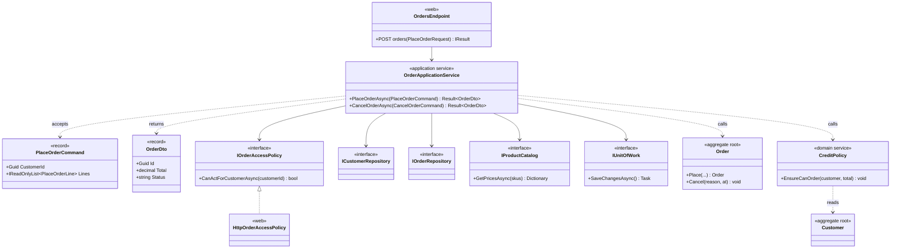
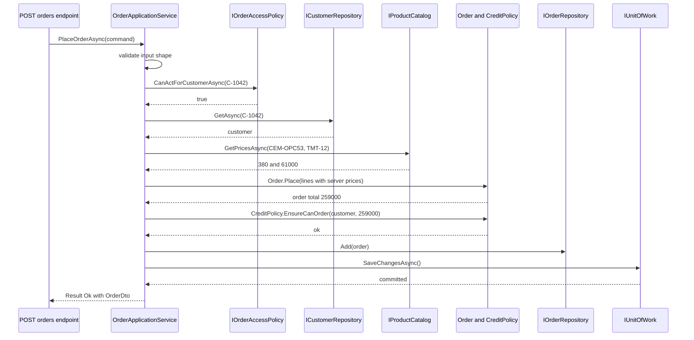

You now have aggregates that protect their rules, repositories that load and store them, domain services for rules that span aggregates, and domain events for reactions. Something still has to **run a use case from start to finish**: "a site engineer places an order for 200 bags of cement and 3 tonnes of steel". Who checks that this engineer may order for this customer account? Who loads the customer, fetches current prices, asks the domain to create the order, commits the transaction and returns something the API can serialise?

That is the **application service**. It is the conductor of the orchestra: it does not play any instrument (no business rules), but without it nobody starts on time. Get it right and your domain stays clean and your API stays thin. Get it wrong and the application service quietly becomes the place where all the business logic lives, and your "domain model" turns into a set of data bags.

The example is a B2B order-management system for a building-materials distributor. Contractors' site offices order against a customer account that has a credit limit. Prices come from a catalogue. Orders below ₹5,000 are not accepted.

## Learning objectives

By the end of this lesson you will be able to:

1. Explain the job of an application service: one use case, orchestration only.
2. Structure a use case as validate input, authorize, load, call the domain, commit, map to a DTO.
3. Keep business rules out of the application layer and recognise when one has leaked in.
4. Use DTOs (commands in, result DTOs out) so domain objects never cross the API boundary.
5. Control transactions: one use case, one unit of work, one commit.
6. Add authorization hooks without making the application layer depend on ASP.NET Core.
7. Handle cross-cutting concerns (transactions, idempotency, logging) with decorators instead of copy-paste.

## Prerequisites

- [Repositories and domain services](#/lesson/m08-repositories-domain-services): the application service is the main caller of repositories.
- [Aggregates and aggregate roots](#/lesson/m08-aggregates): the service changes at most one aggregate per use case in most designs.
- [DTOs, entities, mapping and validation](#/lesson/m03-dtos-mapping-validation): input validation vs domain validation.
- [Authentication and authorization](#/lesson/m03-authn-authz): policies, requirements and handlers in ASP.NET Core.

## Explain it like I'm a beginner

Picture a hospital reception desk. A patient arrives and says "I need my follow-up appointment with Dr Rao". The receptionist:

1. Checks the form is filled in (name, date of birth). That is **input validation**.
2. Checks the patient's ID card and that they are allowed to book for this person (themselves, or their child). That is **authorization**.
3. Pulls the patient's file and the doctor's calendar. That is **loading**.
4. Asks the calendar system to book the slot. The calendar knows the rules: Dr Rao does not work Sundays, follow-ups must be within 30 days. That is **the domain** doing its job.
5. Stamps and files the booking. That is **committing**.
6. Hands the patient a printed slip with the time and room number. That is **returning a DTO**.

The receptionist does not decide medical rules. If she started saying "actually, I think you need a 45-minute slot because of your condition", she would be doing the doctor's job, badly, and differently from the receptionist at the next desk.

An application service is that receptionist. One method per use case (`PlaceOrder`, `CancelOrder`, `ApproveVariation`). It coordinates; it does not decide business rules. Those live in the aggregates and domain services, where every use case shares them.

## First-principles explanation

### What an application service is

Evans defines the application layer as the layer that "defines the jobs the software is supposed to do and directs the expressive domain objects to work out problems". It is **thin**: it does not hold business rules or business state. It holds the *workflow of one request*.

Typical responsibilities:

| Step | Owned by the application service? | Example |
|---|---|---|
| Accept a command DTO | Yes | `PlaceOrderCommand(CustomerId, Lines)` |
| Validate input shape | Yes (or a validator it calls) | "At least one line", "quantity is a positive whole number" |
| Authorize the caller for the resource | Yes, through a hook | "This user may order for customer C-1042" |
| Load aggregates | Yes, via repositories | `customers.GetAsync(id)` |
| Fetch data the domain needs | Yes, via ports | Current prices from the catalogue |
| Apply business rules | **No** — delegate to the domain | `Order.Place(...)`, `CreditPolicy.EnsureCanOrder(...)` |
| Commit the transaction | Yes | `unitOfWork.SaveChangesAsync()` |
| Map the result to a DTO | Yes | `OrderDto(Id, Total, Status)` |
| Translate domain failures to application results | Yes | `DomainException` → `Result.BusinessRule(...)` |

### Input validation vs business rules

This distinction decides whether your application service stays thin.

- **Input validation** asks "is this request well-formed?" It does not need the database or the domain's state. Examples: required fields, string lengths, a quantity that parses as a positive integer, a GSTIN in the right format. It belongs at the edge: the application service or a validator it calls (FluentValidation, data annotations, or plain code).
- **Business rules** ask "is this allowed, given the state of the business?" Examples: "orders below ₹5,000 are not accepted", "a blocked customer cannot order", "the order total plus outstanding balance must not exceed the credit limit". They belong in the domain.

A useful test: **if the rule would be the same for a mobile app, a CSV import and a nightly batch job, it is a business rule**, and it must live where all three can reach it: the domain. If it is about the shape of one particular input channel (JSON field names, maximum upload size), it is input validation.

### DTOs in and out

Application services take **commands** (input DTOs) and return **result DTOs**. They never accept or return aggregates.

- Accepting an `Order` entity from the API invites over-posting (the client sets `Status = Approved`) and couples the JSON contract to your domain model.
- Returning an `Order` entity leaks internals, breaks when you rename a private field, and can trigger lazy-loading or serialisation cycles.

Commands are named after intent (`PlaceOrderCommand`, `CancelOrderCommand`), not after entities (`OrderDto` used for everything). Note that the command for placing an order carries SKUs and quantities, **not prices**. Prices come from the catalogue on the server. Trusting a client-supplied price is a classic security bug.

### Transactions: one use case, one commit

The application service is the natural **transaction boundary**. A use case starts a unit of work (in EF Core, a scoped `DbContext`), changes aggregates, and commits once with `SaveChangesAsync`. If anything fails before the commit, nothing is saved.

Two rules make this safe:

1. **Commit exactly once, at the end.** Calling `SaveChangesAsync` halfway and again at the end creates two transactions. A failure in between leaves half a use case committed.
2. **Prefer changing one aggregate per transaction.** If a use case seems to need two aggregates changed atomically, re-examine the boundaries; usually one changes now and the other reacts to a domain event. The [Transaction boundaries lesson](#/lesson/m08-transaction-boundaries) covers this properly.

With EF Core and PostgreSQL, transient failures (a failover, a dropped connection) can be retried with an execution strategy. The whole use case must then be retryable, which is another reason to keep side effects out of the middle of it.

### Authorization hooks

Authorization comes in two flavours:

- **Coarse-grained**: "is the caller an authenticated user with the `Ordering` scope?" Put this on the endpoint (`RequireAuthorization("OrderingPolicy")`). The application service never sees unauthenticated calls.
- **Resource-based**: "may *this* user act for *this* customer account?" This depends on data in the request (the customer id) or loaded from the database (the order's customer). It must run inside the use case, after you know the resource.

Resource-based checks belong in the application service, through a **hook**: a small interface owned by the application layer, such as `IOrderAccessPolicy.CanActForCustomerAsync(customerId)`. The web layer implements it with ASP.NET Core's `IAuthorizationService` and the current `ClaimsPrincipal`. The application layer stays free of `HttpContext`, and tests use a fake that returns `true` or `false`.

Is authorization a business rule? Partly. "Only the customer's own users, or our sales admins, can order for an account" is a *security policy*, not a domain invariant: the `Order` aggregate does not care who clicked the button. Keep it out of the aggregate. A rule like "orders above ₹10 lakh need a second approver" *is* a business rule and belongs in the domain (as an approval state on the order).

### Error handling: results at the boundary

The domain signals broken rules with exceptions (`DomainException`) or results; the application service translates them into something the API can turn into HTTP status codes. A small `Result<T>` with an error kind (`Validation`, `NotFound`, `Forbidden`, `BusinessRule`, `Conflict`) keeps endpoints trivial: `Validation` → 400, `NotFound` → 404, `Forbidden` → 403, `BusinessRule` → 422, `Conflict` → 409.

### Cross-cutting concerns

Logging, transactions, idempotency, retries and metrics apply to *every* use case. Copy-pasting them into each method is how application services get fat. Instead, wrap handlers with **decorators** (or MediatR-style pipeline behaviours): `TransactionalDecorator`, `IdempotencyDecorator`, `LoggingDecorator`. Exercise 5 builds two of them.

### Application service shapes

| Shape | Looks like | Good for |
|---|---|---|
| One service class per aggregate | `OrderApplicationService.PlaceAsync`, `.CancelAsync` | Small to medium modules; easy to find |
| One handler per use case | `PlaceOrderHandler.HandleAsync(PlaceOrderCommand)` | Larger modules, [vertical slices](#/lesson/m08-vertical-slice), decorators per handler |
| Endpoint-as-service | Logic directly in a minimal-API lambda | Tiny apps and CRUD; becomes a smell once rules appear |

All three are valid. The responsibilities are the same; only the packaging differs.

### When it is unnecessary

- **Pure CRUD**: a "units of measure" admin screen. An endpoint that maps a DTO to an EF entity and saves is honest. Adding a command, a handler and a result type triples the code for no benefit.
- **Queries**: reads do not need aggregates, transactions or domain rules. A query handler that projects straight from the database to a DTO is better than loading aggregates in an application service (see [CQRS fundamentals](#/lesson/m08-cqrs-fundamentals)).

### Trade-offs

| You gain | You pay |
|---|---|
| One obvious place per use case; easy to read top to bottom | More classes (commands, DTOs, handlers) |
| Domain stays free of HTTP, auth and persistence concerns | Mapping code between domain and DTOs |
| Use cases callable from API, jobs and tests alike | Discipline needed to keep rules out of the layer |
| Cross-cutting concerns in decorators, written once | Indirection: the call stack has more frames to step through |

## Visual explanation

### Class diagram



How to read it: the endpoint only knows the application service. The application service depends on **interfaces** (ports) for everything outside the domain: access policy, repositories, catalogue, unit of work. It calls the domain (`Order.Place`, `CreditPolicy`) for every rule. It takes a command and returns a DTO, never an `Order`. The only class that knows about ASP.NET Core authorization is `HttpOrderAccessPolicy` in the web layer, which implements the application layer's `IOrderAccessPolicy`.

### Sequence diagram



Read it as a checklist. Validation and authorization happen **before** any expensive or sensitive work. Loading uses ports. The domain is asked twice: once to create a valid order (minimum value, line rules) and once to check credit (a rule spanning customer and order). Only then does anything get added and committed, in one transaction. If the credit check throws a `DomainException`, the service returns a `BusinessRule` result and `SaveChangesAsync` is never called, so nothing is persisted.

## Step-by-step example

### Step 1: the fat endpoint

```csharp
app.MapPost("/orders", async (PlaceOrderRequest req, AppDbContext db, ClaimsPrincipal user) =>
{
    var customer = await db.Customers.FindAsync(req.CustomerId);
    if (customer is null) return Results.NotFound();
    if (user.FindFirst("customer_id")?.Value != req.CustomerId.ToString()) return Results.Forbid();
    var total = req.Lines.Sum(l => l.Quantity * l.UnitPrice);          // price from the client!
    if (total < 5000) return Results.BadRequest("Minimum order is 5000");
    if (customer.Outstanding + total > customer.CreditLimit) return Results.BadRequest("Credit limit");
    var order = new OrderEntity { CustomerId = req.CustomerId, Total = total, Status = "Placed" };
    db.Orders.Add(order);
    await db.SaveChangesAsync();
    return Results.Ok(order);                                           // entity returned to the client
});
```

Count the problems: client-supplied prices; business rules (minimum value, credit) in an HTTP handler, so the CSV import duplicates them; an entity returned as JSON; authorization tied to `ClaimsPrincipal`; nothing testable without a web host.

### Step 2: move rules into the domain

`Order.Place(...)` enforces the ₹5,000 minimum and line rules. `CreditPolicy.EnsureCanOrder(customer, total)` enforces credit. Both throw `DomainException`.

### Step 3: introduce the command, DTO and result

`PlaceOrderCommand(CustomerId, Lines[Sku, Quantity])` with no prices. `OrderDto(Id, Total, LineCount, Status)`. `Result<OrderDto>` with error kinds.

### Step 4: extract the application service

The endpoint becomes three lines: build the command, call the service, map the result to HTTP. The service follows the checklist from the sequence diagram.

### Step 5: put authorization behind a hook

`IOrderAccessPolicy` in the application layer, `HttpOrderAccessPolicy` in the web layer using `IAuthorizationService` with a resource-based requirement.

## Production-style C# implementation

```text
Ordering.Api/
  Program.cs
  Domain/
    Ordering.cs              (DomainException, Customer, Order, CreditPolicy)
  Application/
    Result.cs
    Ports.cs                 (repositories, catalogue, unit of work, access policy)
    OrderApplicationService.cs
  Web/
    OrderAuthorization.cs    (requirement, handler, HttpOrderAccessPolicy)
    ResultHttpMapping.cs
  Infrastructure/
    InMemoryOrdering.cs
```

```csharp file=Domain/Ordering.cs
namespace Ordering.Domain;

public sealed class DomainException : Exception
{
    public DomainException(string message) : base(message) { }
}

public sealed class Customer
{
    public Customer(Guid id, string name, decimal creditLimit, decimal outstanding = 0m)
    {
        Id = id; Name = name; CreditLimit = creditLimit; Outstanding = outstanding;
    }
    public Guid Id { get; }
    public string Name { get; }
    public decimal CreditLimit { get; private set; }
    public decimal Outstanding { get; private set; }
    public bool IsBlocked { get; private set; }

    public void Block() => IsBlocked = true;
    public void RecordInvoice(decimal amount) => Outstanding += amount;
}

public sealed record OrderLineSpec(string Sku, int Quantity, decimal UnitPrice);

public sealed record OrderLine(string Sku, int Quantity, decimal UnitPrice)
{
    public decimal Total => Quantity * UnitPrice;
}

public enum OrderStatus { Placed, Dispatched, Delivered, Cancelled }

public sealed class Order
{
    public const decimal MinimumOrderValue = 5000m;
    public const int MaxLines = 50;
    private readonly List<OrderLine> _lines = new();

    private Order() { }

    public Guid Id { get; private set; }
    public Guid CustomerId { get; private set; }
    public DateTimeOffset PlacedAt { get; private set; }
    public OrderStatus Status { get; private set; }
    public string? CancellationReason { get; private set; }
    public IReadOnlyList<OrderLine> Lines => _lines;
    public decimal Total => _lines.Sum(l => l.Total);

    /// <summary>Factory that enforces every rule for a new order. Duplicate SKUs are merged into one line.</summary>
    public static Order Place(Guid id, Guid customerId, IReadOnlyList<OrderLineSpec> lines, DateTimeOffset placedAt)
    {
        if (lines.Count == 0) throw new DomainException("An order needs at least one line.");
        var order = new Order { Id = id, CustomerId = customerId, PlacedAt = placedAt, Status = OrderStatus.Placed };
        foreach (var group in lines.GroupBy(l => l.Sku))
        {
            var qty = group.Sum(l => l.Quantity);
            if (qty <= 0) throw new DomainException($"Quantity for {group.Key} must be positive.");
            order._lines.Add(new OrderLine(group.Key, qty, group.First().UnitPrice));
        }
        if (order._lines.Count > MaxLines) throw new DomainException($"An order can have at most {MaxLines} lines.");
        if (order.Total < MinimumOrderValue) throw new DomainException($"Minimum order value is {MinimumOrderValue:N0}.");
        return order;
    }

    public void Cancel(string reason, DateTimeOffset at)
    {
        if (Status != OrderStatus.Placed) throw new DomainException($"An order that is {Status} cannot be cancelled.");
        Status = OrderStatus.Cancelled;
        CancellationReason = reason;
    }
}

/// <summary>Domain service: the credit rule spans the customer and the new order.</summary>
public sealed class CreditPolicy
{
    public void EnsureCanOrder(Customer customer, decimal orderTotal)
    {
        if (customer.IsBlocked) throw new DomainException("This customer account is blocked.");
        if (customer.Outstanding + orderTotal > customer.CreditLimit)
            throw new DomainException($"Credit limit exceeded: available {customer.CreditLimit - customer.Outstanding:N0}, order {orderTotal:N0}.");
    }
}
```

```csharp file=Application/Result.cs
namespace Ordering.Application;

public enum ErrorKind { Validation, NotFound, Forbidden, BusinessRule, Conflict }

public interface IResult
{
    bool IsSuccess { get; }
}

public sealed record Result<T> : IResult
{
    private Result(bool ok, T? value, ErrorKind? error, string? message)
    {
        IsSuccess = ok; Value = value; Error = error; Message = message;
    }
    public bool IsSuccess { get; }
    public T? Value { get; }
    public ErrorKind? Error { get; }
    public string? Message { get; }

    public static Result<T> Ok(T value) => new(true, value, null, null);
    public static Result<T> Fail(ErrorKind error, string message) => new(false, default, error, message);
}
```

```csharp file=Application/Ports.cs
using Ordering.Domain;

namespace Ordering.Application;

public interface ICustomerRepository { Task<Customer?> GetAsync(Guid id, CancellationToken ct = default); }

public interface IOrderRepository
{
    Task<Order?> GetAsync(Guid id, CancellationToken ct = default);
    void Add(Order order);
}

/// <summary>Current prices, owned by the catalogue context. Missing SKUs are simply absent from the result.</summary>
public interface IProductCatalog
{
    Task<IReadOnlyDictionary<string, decimal>> GetPricesAsync(IEnumerable<string> skus, CancellationToken ct = default);
}

public interface IUnitOfWork { Task SaveChangesAsync(CancellationToken ct = default); }

/// <summary>Authorization hook. The application layer asks; the web layer decides using claims and policies.</summary>
public interface IOrderAccessPolicy
{
    Task<bool> CanActForCustomerAsync(Guid customerId, CancellationToken ct = default);
}
```

```csharp file=Application/OrderApplicationService.cs
using Microsoft.Extensions.Logging;
using Ordering.Domain;

namespace Ordering.Application;

public sealed record PlaceOrderLine(string Sku, int Quantity);
public sealed record PlaceOrderCommand(Guid CustomerId, IReadOnlyList<PlaceOrderLine> Lines);
public sealed record CancelOrderCommand(Guid OrderId, string Reason);
public sealed record OrderDto(Guid Id, Guid CustomerId, decimal Total, int LineCount, string Status);

/// <summary>
/// One method per use case. Each method: validate input, authorize, load, call the domain,
/// commit once, map to a DTO. No business rules live here.
/// </summary>
public sealed class OrderApplicationService(
    IOrderAccessPolicy access,
    ICustomerRepository customers,
    IOrderRepository orders,
    IProductCatalog catalog,
    CreditPolicy creditPolicy,
    IUnitOfWork unitOfWork,
    TimeProvider clock,
    ILogger<OrderApplicationService> logger)
{
    public async Task<Result<OrderDto>> PlaceOrderAsync(PlaceOrderCommand command, CancellationToken ct = default)
    {
        // 1. Input shape (not business rules).
        if (command.Lines is null || command.Lines.Count == 0)
            return Result<OrderDto>.Fail(ErrorKind.Validation, "At least one line is required.");
        if (command.Lines.Any(l => string.IsNullOrWhiteSpace(l.Sku) || l.Quantity <= 0))
            return Result<OrderDto>.Fail(ErrorKind.Validation, "Every line needs a SKU and a positive quantity.");

        // 2. Resource-based authorization, before touching data.
        if (!await access.CanActForCustomerAsync(command.CustomerId, ct))
            return Result<OrderDto>.Fail(ErrorKind.Forbidden, "You cannot order for this customer.");

        // 3. Load what the domain needs.
        var customer = await customers.GetAsync(command.CustomerId, ct);
        if (customer is null) return Result<OrderDto>.Fail(ErrorKind.NotFound, "Customer not found.");

        var skus = command.Lines.Select(l => l.Sku).Distinct().ToList();
        var prices = await catalog.GetPricesAsync(skus, ct);
        var unknown = skus.Where(s => !prices.ContainsKey(s)).ToList();
        if (unknown.Count > 0)
            return Result<OrderDto>.Fail(ErrorKind.Validation, $"Unknown SKU(s): {string.Join(", ", unknown)}.");

        // 4. Let the domain decide.
        Order order;
        try
        {
            var lines = command.Lines.Select(l => new OrderLineSpec(l.Sku, l.Quantity, prices[l.Sku])).ToList();
            order = Order.Place(Guid.NewGuid(), customer.Id, lines, clock.GetUtcNow());
            creditPolicy.EnsureCanOrder(customer, order.Total);
        }
        catch (DomainException ex)
        {
            return Result<OrderDto>.Fail(ErrorKind.BusinessRule, ex.Message);
        }

        // 5. One commit for the whole use case.
        orders.Add(order);
        await unitOfWork.SaveChangesAsync(ct);
        logger.LogInformation("Order {OrderId} placed for customer {CustomerId}, total {Total}", order.Id, customer.Id, order.Total);

        // 6. DTO out.
        return Result<OrderDto>.Ok(ToDto(order));
    }

    public async Task<Result<OrderDto>> CancelOrderAsync(CancelOrderCommand command, CancellationToken ct = default)
    {
        if (string.IsNullOrWhiteSpace(command.Reason))
            return Result<OrderDto>.Fail(ErrorKind.Validation, "A cancellation reason is required.");

        var order = await orders.GetAsync(command.OrderId, ct);
        if (order is null) return Result<OrderDto>.Fail(ErrorKind.NotFound, "Order not found.");

        if (!await access.CanActForCustomerAsync(order.CustomerId, ct))
            return Result<OrderDto>.Fail(ErrorKind.Forbidden, "You cannot manage this order.");

        try { order.Cancel(command.Reason.Trim(), clock.GetUtcNow()); }
        catch (DomainException ex) { return Result<OrderDto>.Fail(ErrorKind.BusinessRule, ex.Message); }

        await unitOfWork.SaveChangesAsync(ct);
        return Result<OrderDto>.Ok(ToDto(order));
    }

    private static OrderDto ToDto(Order o) => new(o.Id, o.CustomerId, o.Total, o.Lines.Count, o.Status.ToString());
}
```

```csharp file=Web/OrderAuthorization.cs
using Microsoft.AspNetCore.Authorization;
using Ordering.Application;

namespace Ordering.Web;

public sealed record CustomerResource(Guid CustomerId);

public sealed class ActForCustomerRequirement : IAuthorizationRequirement { }

/// <summary>A user may act for a customer if they belong to that account, or are a sales admin.</summary>
public sealed class ActForCustomerHandler : AuthorizationHandler<ActForCustomerRequirement, CustomerResource>
{
    protected override Task HandleRequirementAsync(AuthorizationHandlerContext context, ActForCustomerRequirement requirement, CustomerResource resource)
    {
        if (context.User.IsInRole("SalesAdmin") ||
            context.User.HasClaim("customer_id", resource.CustomerId.ToString()))
        {
            context.Succeed(requirement);
        }
        return Task.CompletedTask;
    }
}

/// <summary>Implements the application-layer hook with ASP.NET Core resource-based authorization.</summary>
public sealed class HttpOrderAccessPolicy(IAuthorizationService authorization, IHttpContextAccessor http) : IOrderAccessPolicy
{
    public async Task<bool> CanActForCustomerAsync(Guid customerId, CancellationToken ct = default)
    {
        var user = http.HttpContext?.User;
        if (user?.Identity?.IsAuthenticated != true) return false;
        var result = await authorization.AuthorizeAsync(user, new CustomerResource(customerId), new ActForCustomerRequirement());
        return result.Succeeded;
    }
}
```

```csharp file=Web/ResultHttpMapping.cs
using Ordering.Application;

namespace Ordering.Web;

public static class ResultHttpMapping
{
    public static Microsoft.AspNetCore.Http.IResult ToHttp<T>(this Result<T> result) => result.IsSuccess
        ? Results.Ok(result.Value)
        : result.Error switch
        {
            ErrorKind.Validation => Results.Problem(result.Message, statusCode: StatusCodes.Status400BadRequest),
            ErrorKind.NotFound => Results.Problem(result.Message, statusCode: StatusCodes.Status404NotFound),
            ErrorKind.Forbidden => Results.Problem(result.Message, statusCode: StatusCodes.Status403Forbidden),
            ErrorKind.BusinessRule => Results.Problem(result.Message, statusCode: StatusCodes.Status422UnprocessableEntity),
            ErrorKind.Conflict => Results.Problem(result.Message, statusCode: StatusCodes.Status409Conflict),
            _ => Results.Problem("Unexpected error.", statusCode: StatusCodes.Status500InternalServerError),
        };
}
```

```csharp file=Infrastructure/InMemoryOrdering.cs
using System.Collections.Concurrent;
using Ordering.Application;
using Ordering.Domain;

namespace Ordering.Infrastructure;

public sealed class InMemoryOrderingStore
{
    public ConcurrentDictionary<Guid, Customer> Customers { get; } = new();
    public ConcurrentDictionary<Guid, Order> Orders { get; } = new();
    public ConcurrentDictionary<string, decimal> Prices { get; } = new(StringComparer.OrdinalIgnoreCase);
}

public sealed class InMemoryCustomerRepository(InMemoryOrderingStore store) : ICustomerRepository
{
    public Task<Customer?> GetAsync(Guid id, CancellationToken ct = default) => Task.FromResult(store.Customers.GetValueOrDefault(id));
}

/// <summary>Scoped. New orders are staged until the unit of work commits.</summary>
public sealed class InMemoryOrderRepository(InMemoryOrderingStore store, InMemoryUnitOfWork unitOfWork) : IOrderRepository
{
    public Task<Order?> GetAsync(Guid id, CancellationToken ct = default) => Task.FromResult(store.Orders.GetValueOrDefault(id));
    public void Add(Order order) => unitOfWork.Stage(() => store.Orders[order.Id] = order);
}

public sealed class InMemoryProductCatalog(InMemoryOrderingStore store) : IProductCatalog
{
    public Task<IReadOnlyDictionary<string, decimal>> GetPricesAsync(IEnumerable<string> skus, CancellationToken ct = default) =>
        Task.FromResult<IReadOnlyDictionary<string, decimal>>(skus
            .Where(s => store.Prices.ContainsKey(s))
            .ToDictionary(s => s, s => store.Prices[s]));
}

public sealed class InMemoryUnitOfWork : IUnitOfWork
{
    private readonly List<Action> _pending = new();
    public void Stage(Action write) => _pending.Add(write);

    public Task SaveChangesAsync(CancellationToken ct = default)
    {
        foreach (var write in _pending) write();   // a real implementation commits one PostgreSQL transaction here
        _pending.Clear();
        return Task.CompletedTask;
    }
}
```

```csharp file=Program.cs
using Ordering.Application;
using Ordering.Domain;
using Ordering.Infrastructure;
using Ordering.Web;
using Microsoft.AspNetCore.Authorization;

var builder = WebApplication.CreateBuilder(args);

// Web concerns: authentication scheme (JWT bearer or cookies) is configured here in a real app.
builder.Services.AddAuthentication();
builder.Services.AddAuthorization();
builder.Services.AddHttpContextAccessor();
builder.Services.AddSingleton<IAuthorizationHandler, ActForCustomerHandler>();
builder.Services.AddScoped<IOrderAccessPolicy, HttpOrderAccessPolicy>();

// Domain.
builder.Services.AddSingleton<CreditPolicy>();
builder.Services.AddSingleton(TimeProvider.System);

// Infrastructure.
builder.Services.AddSingleton<InMemoryOrderingStore>();
builder.Services.AddScoped<InMemoryUnitOfWork>();
builder.Services.AddScoped<IUnitOfWork>(sp => sp.GetRequiredService<InMemoryUnitOfWork>());
builder.Services.AddScoped<ICustomerRepository, InMemoryCustomerRepository>();
builder.Services.AddScoped<IOrderRepository, InMemoryOrderRepository>();
builder.Services.AddScoped<IProductCatalog, InMemoryProductCatalog>();

// Application.
builder.Services.AddScoped<OrderApplicationService>();

var app = builder.Build();
app.UseAuthentication();
app.UseAuthorization();

var orders = app.MapGroup("/orders").RequireAuthorization();   // coarse-grained: must be signed in

orders.MapPost("/", async (PlaceOrderCommand command, OrderApplicationService service, CancellationToken ct) =>
    (await service.PlaceOrderAsync(command, ct)).ToHttp());

orders.MapPost("/{id:guid}/cancel", async (Guid id, CancelOrderBody body, OrderApplicationService service, CancellationToken ct) =>
    (await service.CancelOrderAsync(new CancelOrderCommand(id, body.Reason), ct)).ToHttp());

app.Run();

public sealed record CancelOrderBody(string Reason);
```

Two details worth pointing out. First, the endpoint uses the command record directly as the request body because it already has the right shape; if the public JSON contract should differ (versioning, different names), add a separate request DTO and map it. Second, the cancel endpoint takes the order id from the route and the reason from the body, then builds the command, so a client cannot cancel order A by sending order B's id in the body.

### Transactions and retries with EF Core

With EF Core on PostgreSQL, the scoped `DbContext` is the unit of work and `SaveChangesAsync` runs one transaction. If you enable retries (`EnableRetryOnFailure`), wrap the **whole use case** in the execution strategy so a retry re-runs the reads too (not compiled here):

```csharp
var strategy = db.Database.CreateExecutionStrategy();
return await strategy.ExecuteAsync(async () =>
{
    db.ChangeTracker.Clear();                  // start each attempt from a clean slate
    return await inner.PlaceOrderAsync(command, ct);
});
```

Do not perform external side effects (emails, HTTP calls) inside a retried block. Raise a domain event and let an outbox deliver them after the commit ([Domain events](#/lesson/m08-domain-events)).

## Bad design vs good design

### Bad: business rules in the application service

```csharp
public async Task<Result<OrderDto>> PlaceOrderAsync(PlaceOrderCommand cmd)
{
    var customer = await customers.GetAsync(cmd.CustomerId);
    var total = ...;
    if (total < 5000) return Fail("Minimum order value is 5,000");                 // business rule
    if (customer.Outstanding + total > customer.CreditLimit) return Fail("Credit"); // business rule
    if (DateTime.Now.DayOfWeek == DayOfWeek.Sunday) total *= 1.02m;                  // business rule, untestable clock
    var order = new Order { CustomerId = cmd.CustomerId, Total = total, Status = OrderStatus.Placed };  // public setters
    ...
}
```

Problems: the CSV-import job and the mobile API each need a copy of these rules, and copies drift (one team updates the minimum to ₹7,500, the other does not). `Order` has public setters, so any code can create an invalid order. `DateTime.Now` makes the Sunday surcharge untestable. This is the **anaemic domain model** with a "transaction script" on top. Transaction scripts are a legitimate pattern for simple apps; the problem is pretending to do DDD while doing this.

### Bad: two commits in one use case

```csharp
orders.Add(order);
await uow.SaveChangesAsync();            // commit 1
customer.ReserveCredit(order.Total);
await uow.SaveChangesAsync();            // commit 2: if this fails, the order exists without reserved credit
```

### Good

The implementation above: rules in `Order.Place` and `CreditPolicy`, a single commit at the end, DTOs at the boundary, authorization through a hook, and time from an injected `TimeProvider`.

### Is the improvement worth it?

Yes, as soon as a use case can be triggered from more than one place or has more than a couple of rules. For a single-screen CRUD form, the fat endpoint is honestly fine.

## Practical playground

The playground has a working `PlaceOrder` flow with in-memory fakes. Run it to see three outcomes (success, below minimum, credit exceeded). Then add a fourth case: a user who is not allowed to order for the customer. Notice you only need to change the fake access policy, not the service.

:::playground type=csharp title="A thin use case with fakes"
```csharp file=Program.cs
using System;
using System.Collections.Generic;
using System.Linq;
using System.Threading.Tasks;

public sealed class DomainException : Exception { public DomainException(string m) : base(m) { } }

public sealed class Customer
{
    public Customer(Guid id, decimal limit, decimal outstanding) { Id = id; CreditLimit = limit; Outstanding = outstanding; }
    public Guid Id { get; }
    public decimal CreditLimit { get; }
    public decimal Outstanding { get; }
}

public sealed class Order
{
    private Order(Guid customerId, decimal total) { Id = Guid.NewGuid(); CustomerId = customerId; Total = total; }
    public Guid Id { get; }
    public Guid CustomerId { get; }
    public decimal Total { get; }
    public static Order Place(Guid customerId, IEnumerable<(string Sku, int Qty, decimal Price)> lines)
    {
        var total = lines.Sum(l => l.Qty * l.Price);
        if (total < 5000m) throw new DomainException($"Minimum order value is 5,000 (was {total:N0}).");
        return new Order(customerId, total);
    }
}

public sealed class CreditPolicy
{
    public void EnsureCanOrder(Customer c, decimal total)
    {
        if (c.Outstanding + total > c.CreditLimit) throw new DomainException("Credit limit exceeded.");
    }
}

public sealed record PlaceOrderCommand(Guid CustomerId, IReadOnlyList<(string Sku, int Qty)> Lines);
public sealed record OrderDto(Guid Id, decimal Total);

public sealed class OrderApplicationService
{
    private readonly Dictionary<Guid, Customer> _customers;
    private readonly Dictionary<string, decimal> _prices;
    private readonly Func<Guid, bool> _canActFor;
    private readonly List<Order> _saved = new();
    private readonly CreditPolicy _credit = new();

    public OrderApplicationService(Dictionary<Guid, Customer> customers, Dictionary<string, decimal> prices, Func<Guid, bool> canActFor)
    { _customers = customers; _prices = prices; _canActFor = canActFor; }

    public int SavedCount => _saved.Count;

    public string PlaceOrder(PlaceOrderCommand cmd)
    {
        if (cmd.Lines.Count == 0) return "400 at least one line";
        if (!_canActFor(cmd.CustomerId)) return "403 forbidden";
        if (!_customers.TryGetValue(cmd.CustomerId, out var customer)) return "404 customer not found";
        try
        {
            var order = Order.Place(customer.Id, cmd.Lines.Select(l => (l.Sku, l.Qty, _prices[l.Sku])));
            _credit.EnsureCanOrder(customer, order.Total);
            _saved.Add(order);                         // the "commit"
            return $"200 order {order.Id.ToString()[..8]} total {order.Total:N0}";
        }
        catch (DomainException ex) { return "422 " + ex.Message; }
    }
}

public static class Program
{
    public static void Main()
    {
        var c = new Customer(Guid.NewGuid(), limit: 500_000m, outstanding: 300_000m);
        var prices = new Dictionary<string, decimal> { ["CEM-OPC53"] = 380m, ["TMT-12"] = 61_000m };
        var svc = new OrderApplicationService(new() { [c.Id] = c }, prices, canActFor: id => true);

        Console.WriteLine(svc.PlaceOrder(new PlaceOrderCommand(c.Id, new[] { ("CEM-OPC53", 200) })));
        Console.WriteLine(svc.PlaceOrder(new PlaceOrderCommand(c.Id, new[] { ("CEM-OPC53", 10) })));
        Console.WriteLine(svc.PlaceOrder(new PlaceOrderCommand(c.Id, new[] { ("TMT-12", 4) })));
        Console.WriteLine($"orders saved: {svc.SavedCount}");
    }
}
```
:::

## Exercises

:::exercise id=m08-application-services-ex1 difficulty=beginner kind=code title="Write the CancelOrder use case"
Implement `OrderAppService.CancelAsync`. All rules about *when* an order may be cancelled already live in `Order.Cancel`. Your job is orchestration only.
::requirements
- Blank reason → `Validation`.
- Unknown order → `NotFound`.
- Access policy says no → `Forbidden`.
- `Order.Cancel` throws `DomainException` → `BusinessRule` with the domain's message.
- On success, commit exactly once and return `OrderStatusDto(OrderId, "Cancelled")`.
- On any failure, do **not** commit.
::acceptance
- All tests pass.
- `CancelAsync` contains no `if` that inspects `order.Status`.
- The cancellation time comes from the injected `TimeProvider`.
::hint
Write the method as a numbered list of steps first, then turn each into two lines of code.
::hint
Check authorization *after* loading the order, because the order tells you which customer it belongs to.
::hint
Wrap only the domain call in `try/catch (DomainException)`. Do not catch `Exception`.
::hint
```csharp
try { order.Cancel(cmd.Reason, _clock.GetUtcNow()); }
catch (DomainException ex) { return Result<OrderStatusDto>.Fail(ErrorKind.BusinessRule, ex.Message); }
await _uow.SaveChangesAsync(ct);
```
::starter
```csharp file=CancelOrder.cs
using System;
using System.Collections.Generic;
using System.Threading;
using System.Threading.Tasks;

public sealed class DomainException : Exception { public DomainException(string m) : base(m) { } }

public enum OrderStatus { Placed, Dispatched, Cancelled }

public sealed class Order
{
    public Order(Guid id, Guid customerId, OrderStatus status = OrderStatus.Placed) { Id = id; CustomerId = customerId; Status = status; }
    public Guid Id { get; }
    public Guid CustomerId { get; }
    public OrderStatus Status { get; private set; }
    public DateTimeOffset? CancelledAt { get; private set; }

    public void Cancel(string reason, DateTimeOffset at)
    {
        if (Status == OrderStatus.Dispatched) throw new DomainException("A dispatched order cannot be cancelled. Raise a return instead.");
        if (Status == OrderStatus.Cancelled) throw new DomainException("The order is already cancelled.");
        Status = OrderStatus.Cancelled;
        CancelledAt = at;
    }
}

public enum ErrorKind { Validation, NotFound, Forbidden, BusinessRule }
public sealed record Result<T>(bool IsSuccess, T? Value, ErrorKind? Error, string? Message)
{
    public static Result<T> Ok(T v) => new(true, v, null, null);
    public static Result<T> Fail(ErrorKind e, string m) => new(false, default, e, m);
}

public interface IOrderRepository { Task<Order?> GetAsync(Guid id, CancellationToken ct); }
public interface IUnitOfWork { Task SaveChangesAsync(CancellationToken ct); }
public interface IOrderAccessPolicy { Task<bool> CanActForCustomerAsync(Guid customerId, CancellationToken ct); }

public sealed record CancelOrderCommand(Guid OrderId, string Reason);
public sealed record OrderStatusDto(Guid OrderId, string Status);

public sealed class OrderAppService
{
    private readonly IOrderRepository _orders;
    private readonly IUnitOfWork _uow;
    private readonly IOrderAccessPolicy _access;
    private readonly TimeProvider _clock;

    public OrderAppService(IOrderRepository orders, IUnitOfWork uow, IOrderAccessPolicy access, TimeProvider clock)
    { _orders = orders; _uow = uow; _access = access; _clock = clock; }

    public Task<Result<OrderStatusDto>> CancelAsync(CancelOrderCommand cmd, CancellationToken ct = default) =>
        throw new NotImplementedException();
}
```
::tests
```csharp file=CancelOrderTests.cs
using System;
using System.Collections.Generic;
using System.Threading;
using System.Threading.Tasks;
using Xunit;

public class CancelOrderTests
{
    private sealed class Repo : IOrderRepository
    {
        public Dictionary<Guid, Order> Items { get; } = new();
        public Task<Order?> GetAsync(Guid id, CancellationToken ct) => Task.FromResult(Items.GetValueOrDefault(id));
    }
    private sealed class Uow : IUnitOfWork { public int Saves; public Task SaveChangesAsync(CancellationToken ct) { Saves++; return Task.CompletedTask; } }
    private sealed class Access : IOrderAccessPolicy
    {
        public bool Allow = true; public Guid? AskedFor;
        public Task<bool> CanActForCustomerAsync(Guid customerId, CancellationToken ct) { AskedFor = customerId; return Task.FromResult(Allow); }
    }
    private sealed class FixedClock : TimeProvider
    {
        public static readonly DateTimeOffset Now = new DateTimeOffset(2026, 10, 20, 9, 30, 0, TimeSpan.Zero);
        public override DateTimeOffset GetUtcNow() => Now;
    }

    private readonly Repo _repo = new();
    private readonly Uow _uow = new();
    private readonly Access _access = new();
    private OrderAppService Svc() => new OrderAppService(_repo, _uow, _access, new FixedClock());

    private Order Seed(OrderStatus status = OrderStatus.Placed)
    {
        var o = new Order(Guid.NewGuid(), Guid.NewGuid(), status);
        _repo.Items[o.Id] = o;
        return o;
    }

    [Fact]
    public async Task Cancels_and_commits_once()
    {
        var o = Seed();
        var r = await Svc().CancelAsync(new CancelOrderCommand(o.Id, "Site postponed"));
        Assert.True(r.IsSuccess);
        Assert.Equal(new OrderStatusDto(o.Id, "Cancelled"), r.Value);
        Assert.Equal(1, _uow.Saves);
        Assert.Equal(FixedClock.Now, o.CancelledAt);
    }

    [Fact]
    public async Task Blank_reason_is_validation()
    {
        var o = Seed();
        var r = await Svc().CancelAsync(new CancelOrderCommand(o.Id, "  "));
        Assert.Equal(ErrorKind.Validation, r.Error);
        Assert.Equal(0, _uow.Saves);
    }

    [Fact]
    public async Task Unknown_order_is_not_found()
    {
        var r = await Svc().CancelAsync(new CancelOrderCommand(Guid.NewGuid(), "x"));
        Assert.Equal(ErrorKind.NotFound, r.Error);
        Assert.Equal(0, _uow.Saves);
    }

    [Fact]
    public async Task Authorizes_against_the_orders_customer()
    {
        var o = Seed();
        _access.Allow = false;
        var r = await Svc().CancelAsync(new CancelOrderCommand(o.Id, "x"));
        Assert.Equal(ErrorKind.Forbidden, r.Error);
        Assert.Equal(o.CustomerId, _access.AskedFor);
        Assert.Equal(OrderStatus.Placed, o.Status);
        Assert.Equal(0, _uow.Saves);
    }

    [Fact]
    public async Task Domain_rule_becomes_business_rule_error()
    {
        var o = Seed(OrderStatus.Dispatched);
        var r = await Svc().CancelAsync(new CancelOrderCommand(o.Id, "Changed mind"));
        Assert.Equal(ErrorKind.BusinessRule, r.Error);
        Assert.Contains("dispatched", r.Message);
        Assert.Equal(0, _uow.Saves);
    }
}
```
::solution
The method reads like the checklist: validate, load, authorize, delegate, commit, map.

```csharp file=CancelOrder.cs
using System;
using System.Collections.Generic;
using System.Threading;
using System.Threading.Tasks;

public sealed class DomainException : Exception { public DomainException(string m) : base(m) { } }

public enum OrderStatus { Placed, Dispatched, Cancelled }

public sealed class Order
{
    public Order(Guid id, Guid customerId, OrderStatus status = OrderStatus.Placed) { Id = id; CustomerId = customerId; Status = status; }
    public Guid Id { get; }
    public Guid CustomerId { get; }
    public OrderStatus Status { get; private set; }
    public DateTimeOffset? CancelledAt { get; private set; }

    public void Cancel(string reason, DateTimeOffset at)
    {
        if (Status == OrderStatus.Dispatched) throw new DomainException("A dispatched order cannot be cancelled. Raise a return instead.");
        if (Status == OrderStatus.Cancelled) throw new DomainException("The order is already cancelled.");
        Status = OrderStatus.Cancelled;
        CancelledAt = at;
    }
}

public enum ErrorKind { Validation, NotFound, Forbidden, BusinessRule }
public sealed record Result<T>(bool IsSuccess, T? Value, ErrorKind? Error, string? Message)
{
    public static Result<T> Ok(T v) => new(true, v, null, null);
    public static Result<T> Fail(ErrorKind e, string m) => new(false, default, e, m);
}

public interface IOrderRepository { Task<Order?> GetAsync(Guid id, CancellationToken ct); }
public interface IUnitOfWork { Task SaveChangesAsync(CancellationToken ct); }
public interface IOrderAccessPolicy { Task<bool> CanActForCustomerAsync(Guid customerId, CancellationToken ct); }

public sealed record CancelOrderCommand(Guid OrderId, string Reason);
public sealed record OrderStatusDto(Guid OrderId, string Status);

public sealed class OrderAppService
{
    private readonly IOrderRepository _orders;
    private readonly IUnitOfWork _uow;
    private readonly IOrderAccessPolicy _access;
    private readonly TimeProvider _clock;

    public OrderAppService(IOrderRepository orders, IUnitOfWork uow, IOrderAccessPolicy access, TimeProvider clock)
    { _orders = orders; _uow = uow; _access = access; _clock = clock; }

    public async Task<Result<OrderStatusDto>> CancelAsync(CancelOrderCommand cmd, CancellationToken ct = default)
    {
        if (string.IsNullOrWhiteSpace(cmd.Reason))
            return Result<OrderStatusDto>.Fail(ErrorKind.Validation, "A cancellation reason is required.");

        var order = await _orders.GetAsync(cmd.OrderId, ct);
        if (order is null)
            return Result<OrderStatusDto>.Fail(ErrorKind.NotFound, "Order not found.");

        if (!await _access.CanActForCustomerAsync(order.CustomerId, ct))
            return Result<OrderStatusDto>.Fail(ErrorKind.Forbidden, "You cannot manage this order.");

        try { order.Cancel(cmd.Reason.Trim(), _clock.GetUtcNow()); }
        catch (DomainException ex) { return Result<OrderStatusDto>.Fail(ErrorKind.BusinessRule, ex.Message); }

        await _uow.SaveChangesAsync(ct);
        return Result<OrderStatusDto>.Ok(new OrderStatusDto(order.Id, order.Status.ToString()));
    }
}
```

Notice the order of checks: validation first (cheap, no I/O), then load, then authorization (it needs the order's customer), then the domain. Returning `NotFound` before `Forbidden` can reveal that an order id exists. If order ids are guessable and that matters, return `NotFound` for both cases.
::mistakes
- Re-checking `order.Status == Dispatched` in the service "to give a nicer message". Now the rule lives in two places.
- Catching `Exception` and turning bugs (a `NullReferenceException`) into `BusinessRule` results.
- Calling `SaveChangesAsync` before checking authorization.
:::

:::exercise id=m08-application-services-ex2 difficulty=beginner kind=written title="Find the business rules hiding in the application service"
A contract-management team wrote this application service for approving a variation (a change to the scope or price of a signed contract). List every line that is a business rule, explain why, and say where it should move.

```csharp
public async Task<Result<VariationDto>> ApproveAsync(Guid variationId, Guid approverId)
{
    var v = await variations.GetAsync(variationId);
    if (v is null) return NotFound();
    var contract = await contracts.GetAsync(v.ContractId);
    if (v.Status != "Submitted") return Fail("Only submitted variations can be approved");
    if (v.Amount > contract.Value * 0.10m && !await users.IsInRoleAsync(approverId, "Director"))
        return Fail("Variations above 10 % need a director");
    if (v.CreatedBy == approverId) return Fail("You cannot approve your own variation");
    v.Status = "Approved";
    v.ApprovedBy = approverId;
    contract.Value += v.Amount;
    await uow.SaveChangesAsync();
    await email.SendAsync(contract.VendorEmail, "Variation approved");
    return Ok(Map(v));
}
```
::acceptance
- Identifies the status check, the 10 % threshold, and the self-approval rule as business rules, and moves them into the `Variation` aggregate (or a domain service for the threshold).
- Notes that `v.Status = "Approved"` and `contract.Value += ...` use public setters and bypass invariants.
- Points out that changing both the variation and the contract in one transaction crosses aggregate boundaries, and suggests a domain event.
- Points out that the email is sent after the commit but outside any outbox, so it can be lost, and in the wrong layer.
::hint
For each `if`, ask: would a batch import of approved variations need the same check?
::hint
Is "director" a security role or a business authority level? Can it be passed into the domain as a value?
::hint
How many aggregates are modified? What does the [Transaction boundaries lesson](#/lesson/m08-transaction-boundaries) say about that?
::solution
**Business rules that must move into the domain:**

1. `v.Status != "Submitted"`: a state-transition rule of the variation. Move into `Variation.Approve(...)`, which throws if the variation is not submitted.
2. The 10 % threshold with a director: a business authority rule ("delegation of financial powers", common in Indian public-sector contracts). It spans the variation and the contract value. Make it explicit: `Variation.Approve(ApproverAuthority authority, decimal contractValue)`, where the application service builds `ApproverAuthority` (for example `Director` or `Manager`) from the user directory. The domain decides whether that authority suffices. Alternatively a domain service `VariationApprovalPolicy`.
3. `v.CreatedBy == approverId`: segregation of duties, a business rule. Move into `Approve`, which receives the approver id.

**Encapsulation problems:** `v.Status = "Approved"` and `contract.Value += v.Amount` use public setters. Status should be an enum changed only by `Approve`. Contract value should change only through a contract method such as `ApplyApprovedVariation(variationId, amount)`, which can enforce its own rules (for example "cumulative variations may not exceed 25 % without re-tender").

**Transaction boundary:** the service changes two aggregates in one transaction. Under load, two variations approved at the same time on the same contract conflict on the contract row. Better: `Variation.Approve` raises `VariationApproved`; a handler (via the outbox) calls `contract.ApplyApprovedVariation(...)` in its own transaction, idempotent on the variation id.

**Side effect:** the email is sent after commit, in process, with no retry. If the process dies right after the commit, the vendor is never told. Raise the event and let an outbox-backed consumer send the email.

**What stays in the application service:** load the variation, look up the approver's authority, call `variation.Approve(...)`, commit, map the DTO. About ten lines.
::mistakes
- Treating the "director" check as pure authorization and leaving it in an endpoint attribute. It depends on the amount, which is domain data.
- Moving rules into a "VariationValidator" class in the application layer. That is still the application layer.
:::

:::exercise id=m08-application-services-ex3 difficulty=intermediate kind=code title="Orchestrate PlaceOrder without owning any rule"
Implement `PlaceOrderService.PlaceAsync`. The domain (`Order.Place`, `CreditPolicy`) is complete. Your code must validate input shape, authorize, load the customer, fetch server-side prices, call the domain, add, commit and return a DTO.
::requirements
- No lines, a blank SKU, or a quantity ≤ 0 → `Validation`. Check this before any port is called.
- Access denied → `Forbidden`, checked before loading the customer.
- Unknown customer → `NotFound`.
- SKUs missing from the catalogue → `Validation`, listing all missing SKUs in the message.
- Prices **always** come from the catalogue.
- Any `DomainException` (minimum value, credit) → `BusinessRule` with the domain's message. Nothing is added or committed.
- Success: add the order, commit once, return `OrderDto(Id, Total, LineCount)`.
::acceptance
- All tests pass.
- The service contains no number such as `5000` and no credit arithmetic.
- The catalogue is called once, with distinct SKUs.
::hint
Follow the same checklist as the cancel use case, with one extra step: fetching prices.
::hint
Use `Distinct()` on the SKUs before calling the catalogue, and compare the returned keys to find missing ones.
::hint
Put both domain calls (`Order.Place` and `CreditPolicy.EnsureCanOrder`) in one `try` block.
::hint
```csharp
var skus = cmd.Lines.Select(l => l.Sku).Distinct().ToList();
var prices = await _catalog.GetPricesAsync(skus, ct);
var missing = skus.Where(s => !prices.ContainsKey(s)).ToList();
```
::starter
```csharp file=PlaceOrder.cs
using System;
using System.Collections.Generic;
using System.Linq;
using System.Threading;
using System.Threading.Tasks;

public sealed class DomainException : Exception { public DomainException(string m) : base(m) { } }

public sealed class Customer
{
    public Customer(Guid id, decimal creditLimit, decimal outstanding = 0m, bool blocked = false)
    { Id = id; CreditLimit = creditLimit; Outstanding = outstanding; IsBlocked = blocked; }
    public Guid Id { get; }
    public decimal CreditLimit { get; }
    public decimal Outstanding { get; }
    public bool IsBlocked { get; }
}

public sealed record OrderLineSpec(string Sku, int Quantity, decimal UnitPrice);

public sealed class Order
{
    private readonly List<OrderLineSpec> _lines;
    private Order(Guid id, Guid customerId, List<OrderLineSpec> lines) { Id = id; CustomerId = customerId; _lines = lines; }
    public Guid Id { get; }
    public Guid CustomerId { get; }
    public IReadOnlyList<OrderLineSpec> Lines => _lines;
    public decimal Total => _lines.Sum(l => l.Quantity * l.UnitPrice);

    public static Order Place(Guid id, Guid customerId, IReadOnlyList<OrderLineSpec> lines)
    {
        var merged = lines.GroupBy(l => l.Sku).Select(g => new OrderLineSpec(g.Key, g.Sum(l => l.Quantity), g.First().UnitPrice)).ToList();
        var order = new Order(id, customerId, merged);
        if (order.Total < 5000m) throw new DomainException("Minimum order value is 5,000.");
        return order;
    }
}

public sealed class CreditPolicy
{
    public void EnsureCanOrder(Customer c, decimal total)
    {
        if (c.IsBlocked) throw new DomainException("Customer account is blocked.");
        if (c.Outstanding + total > c.CreditLimit) throw new DomainException("Credit limit exceeded.");
    }
}

public enum ErrorKind { Validation, NotFound, Forbidden, BusinessRule }
public sealed record Result<T>(bool IsSuccess, T? Value, ErrorKind? Error, string? Message)
{
    public static Result<T> Ok(T v) => new(true, v, null, null);
    public static Result<T> Fail(ErrorKind e, string m) => new(false, default, e, m);
}

public interface ICustomerRepository { Task<Customer?> GetAsync(Guid id, CancellationToken ct); }
public interface IOrderRepository { void Add(Order order); }
public interface IProductCatalog { Task<IReadOnlyDictionary<string, decimal>> GetPricesAsync(IReadOnlyList<string> skus, CancellationToken ct); }
public interface IUnitOfWork { Task SaveChangesAsync(CancellationToken ct); }
public interface IOrderAccessPolicy { Task<bool> CanActForCustomerAsync(Guid customerId, CancellationToken ct); }

public sealed record PlaceOrderLine(string Sku, int Quantity);
public sealed record PlaceOrderCommand(Guid CustomerId, IReadOnlyList<PlaceOrderLine> Lines);
public sealed record OrderDto(Guid Id, decimal Total, int LineCount);

public sealed class PlaceOrderService
{
    private readonly IOrderAccessPolicy _access;
    private readonly ICustomerRepository _customers;
    private readonly IProductCatalog _catalog;
    private readonly IOrderRepository _orders;
    private readonly IUnitOfWork _uow;
    private readonly CreditPolicy _credit;

    public PlaceOrderService(IOrderAccessPolicy access, ICustomerRepository customers, IProductCatalog catalog,
        IOrderRepository orders, IUnitOfWork uow, CreditPolicy credit)
    { _access = access; _customers = customers; _catalog = catalog; _orders = orders; _uow = uow; _credit = credit; }

    public Task<Result<OrderDto>> PlaceAsync(PlaceOrderCommand cmd, CancellationToken ct = default) =>
        throw new NotImplementedException();
}
```
::tests
```csharp file=PlaceOrderTests.cs
using System;
using System.Collections.Generic;
using System.Linq;
using System.Threading;
using System.Threading.Tasks;
using Xunit;

public class PlaceOrderTests
{
    private sealed class Log { public List<string> Calls { get; } = new(); }
    private sealed class Access : IOrderAccessPolicy
    {
        private readonly Log _log; public bool Allow = true;
        public Access(Log log) => _log = log;
        public Task<bool> CanActForCustomerAsync(Guid id, CancellationToken ct) { _log.Calls.Add("access"); return Task.FromResult(Allow); }
    }
    private sealed class Customers : ICustomerRepository
    {
        private readonly Log _log; public Dictionary<Guid, Customer> Items { get; } = new();
        public Customers(Log log) => _log = log;
        public Task<Customer?> GetAsync(Guid id, CancellationToken ct) { _log.Calls.Add("customer"); return Task.FromResult(Items.GetValueOrDefault(id)); }
    }
    private sealed class Catalog : IProductCatalog
    {
        private readonly Log _log; public Dictionary<string, decimal> Prices { get; } = new();
        public List<IReadOnlyList<string>> Requests { get; } = new();
        public Catalog(Log log) => _log = log;
        public Task<IReadOnlyDictionary<string, decimal>> GetPricesAsync(IReadOnlyList<string> skus, CancellationToken ct)
        {
            _log.Calls.Add("catalog"); Requests.Add(skus);
            return Task.FromResult<IReadOnlyDictionary<string, decimal>>(skus.Where(Prices.ContainsKey).ToDictionary(s => s, s => Prices[s]));
        }
    }
    private sealed class Orders : IOrderRepository { public List<Order> Added { get; } = new(); public void Add(Order o) => Added.Add(o); }
    private sealed class Uow : IUnitOfWork { public int Saves; public Task SaveChangesAsync(CancellationToken ct) { Saves++; return Task.CompletedTask; } }

    private readonly Log _log = new();
    private readonly Access _access;
    private readonly Customers _customers;
    private readonly Catalog _catalog;
    private readonly Orders _orders = new();
    private readonly Uow _uow = new();
    private readonly Customer _customer = new Customer(Guid.NewGuid(), creditLimit: 500_000m, outstanding: 100_000m);

    public PlaceOrderTests()
    {
        _access = new Access(_log);
        _customers = new Customers(_log);
        _catalog = new Catalog(_log);
        _customers.Items[_customer.Id] = _customer;
        _catalog.Prices["CEM"] = 380m;
        _catalog.Prices["TMT"] = 61_000m;
    }

    private PlaceOrderService Svc() => new PlaceOrderService(_access, _customers, _catalog, _orders, _uow, new CreditPolicy());
    private PlaceOrderCommand Cmd(params PlaceOrderLine[] lines) => new PlaceOrderCommand(_customer.Id, lines);

    [Fact]
    public async Task Places_order_with_catalogue_prices()
    {
        var r = await Svc().PlaceAsync(Cmd(new PlaceOrderLine("CEM", 200), new PlaceOrderLine("TMT", 3)));
        Assert.True(r.IsSuccess);
        Assert.Equal(76_000m + 183_000m, r.Value!.Total);
        Assert.Equal(2, r.Value.LineCount);
        Assert.Single(_orders.Added);
        Assert.Equal(1, _uow.Saves);
    }

    [Fact]
    public async Task Invalid_input_calls_no_port()
    {
        var r = await Svc().PlaceAsync(Cmd(new PlaceOrderLine("CEM", 0)));
        Assert.Equal(ErrorKind.Validation, r.Error);
        Assert.Empty(_log.Calls);
        var r2 = await Svc().PlaceAsync(Cmd());
        Assert.Equal(ErrorKind.Validation, r2.Error);
        var r3 = await Svc().PlaceAsync(Cmd(new PlaceOrderLine(" ", 5)));
        Assert.Equal(ErrorKind.Validation, r3.Error);
        Assert.Empty(_log.Calls);
    }

    [Fact]
    public async Task Forbidden_before_loading()
    {
        _access.Allow = false;
        var r = await Svc().PlaceAsync(Cmd(new PlaceOrderLine("CEM", 200)));
        Assert.Equal(ErrorKind.Forbidden, r.Error);
        Assert.Equal(new[] { "access" }, _log.Calls);
    }

    [Fact]
    public async Task Unknown_customer()
    {
        var r = await Svc().PlaceAsync(new PlaceOrderCommand(Guid.NewGuid(), new[] { new PlaceOrderLine("CEM", 200) }));
        Assert.Equal(ErrorKind.NotFound, r.Error);
        Assert.Equal(0, _uow.Saves);
    }

    [Fact]
    public async Task Missing_skus_are_listed()
    {
        var r = await Svc().PlaceAsync(Cmd(new PlaceOrderLine("CEM", 200), new PlaceOrderLine("SAND", 2), new PlaceOrderLine("GRAVEL", 1)));
        Assert.Equal(ErrorKind.Validation, r.Error);
        Assert.Contains("SAND", r.Message);
        Assert.Contains("GRAVEL", r.Message);
        Assert.Empty(_orders.Added);
    }

    [Fact]
    public async Task Catalogue_called_once_with_distinct_skus()
    {
        await Svc().PlaceAsync(Cmd(new PlaceOrderLine("CEM", 100), new PlaceOrderLine("CEM", 100)));
        var req = Assert.Single(_catalog.Requests);
        Assert.Equal(new[] { "CEM" }, req);
    }

    [Fact]
    public async Task Below_minimum_is_business_rule()
    {
        var r = await Svc().PlaceAsync(Cmd(new PlaceOrderLine("CEM", 5)));
        Assert.Equal(ErrorKind.BusinessRule, r.Error);
        Assert.Contains("Minimum", r.Message);
        Assert.Empty(_orders.Added);
        Assert.Equal(0, _uow.Saves);
    }

    [Fact]
    public async Task Credit_exceeded_is_business_rule()
    {
        var r = await Svc().PlaceAsync(Cmd(new PlaceOrderLine("TMT", 7)));
        Assert.Equal(ErrorKind.BusinessRule, r.Error);
        Assert.Contains("Credit", r.Message);
        Assert.Equal(0, _uow.Saves);
    }
}
```
::solution
```csharp file=PlaceOrder.cs
using System;
using System.Collections.Generic;
using System.Linq;
using System.Threading;
using System.Threading.Tasks;

public sealed class DomainException : Exception { public DomainException(string m) : base(m) { } }

public sealed class Customer
{
    public Customer(Guid id, decimal creditLimit, decimal outstanding = 0m, bool blocked = false)
    { Id = id; CreditLimit = creditLimit; Outstanding = outstanding; IsBlocked = blocked; }
    public Guid Id { get; }
    public decimal CreditLimit { get; }
    public decimal Outstanding { get; }
    public bool IsBlocked { get; }
}

public sealed record OrderLineSpec(string Sku, int Quantity, decimal UnitPrice);

public sealed class Order
{
    private readonly List<OrderLineSpec> _lines;
    private Order(Guid id, Guid customerId, List<OrderLineSpec> lines) { Id = id; CustomerId = customerId; _lines = lines; }
    public Guid Id { get; }
    public Guid CustomerId { get; }
    public IReadOnlyList<OrderLineSpec> Lines => _lines;
    public decimal Total => _lines.Sum(l => l.Quantity * l.UnitPrice);

    public static Order Place(Guid id, Guid customerId, IReadOnlyList<OrderLineSpec> lines)
    {
        var merged = lines.GroupBy(l => l.Sku).Select(g => new OrderLineSpec(g.Key, g.Sum(l => l.Quantity), g.First().UnitPrice)).ToList();
        var order = new Order(id, customerId, merged);
        if (order.Total < 5000m) throw new DomainException("Minimum order value is 5,000.");
        return order;
    }
}

public sealed class CreditPolicy
{
    public void EnsureCanOrder(Customer c, decimal total)
    {
        if (c.IsBlocked) throw new DomainException("Customer account is blocked.");
        if (c.Outstanding + total > c.CreditLimit) throw new DomainException("Credit limit exceeded.");
    }
}

public enum ErrorKind { Validation, NotFound, Forbidden, BusinessRule }
public sealed record Result<T>(bool IsSuccess, T? Value, ErrorKind? Error, string? Message)
{
    public static Result<T> Ok(T v) => new(true, v, null, null);
    public static Result<T> Fail(ErrorKind e, string m) => new(false, default, e, m);
}

public interface ICustomerRepository { Task<Customer?> GetAsync(Guid id, CancellationToken ct); }
public interface IOrderRepository { void Add(Order order); }
public interface IProductCatalog { Task<IReadOnlyDictionary<string, decimal>> GetPricesAsync(IReadOnlyList<string> skus, CancellationToken ct); }
public interface IUnitOfWork { Task SaveChangesAsync(CancellationToken ct); }
public interface IOrderAccessPolicy { Task<bool> CanActForCustomerAsync(Guid customerId, CancellationToken ct); }

public sealed record PlaceOrderLine(string Sku, int Quantity);
public sealed record PlaceOrderCommand(Guid CustomerId, IReadOnlyList<PlaceOrderLine> Lines);
public sealed record OrderDto(Guid Id, decimal Total, int LineCount);

public sealed class PlaceOrderService
{
    private readonly IOrderAccessPolicy _access;
    private readonly ICustomerRepository _customers;
    private readonly IProductCatalog _catalog;
    private readonly IOrderRepository _orders;
    private readonly IUnitOfWork _uow;
    private readonly CreditPolicy _credit;

    public PlaceOrderService(IOrderAccessPolicy access, ICustomerRepository customers, IProductCatalog catalog,
        IOrderRepository orders, IUnitOfWork uow, CreditPolicy credit)
    { _access = access; _customers = customers; _catalog = catalog; _orders = orders; _uow = uow; _credit = credit; }

    public async Task<Result<OrderDto>> PlaceAsync(PlaceOrderCommand cmd, CancellationToken ct = default)
    {
        // 1. Shape.
        if (cmd.Lines is null || cmd.Lines.Count == 0)
            return Result<OrderDto>.Fail(ErrorKind.Validation, "At least one line is required.");
        if (cmd.Lines.Any(l => string.IsNullOrWhiteSpace(l.Sku) || l.Quantity <= 0))
            return Result<OrderDto>.Fail(ErrorKind.Validation, "Every line needs a SKU and a positive quantity.");

        // 2. Authorization hook.
        if (!await _access.CanActForCustomerAsync(cmd.CustomerId, ct))
            return Result<OrderDto>.Fail(ErrorKind.Forbidden, "You cannot order for this customer.");

        // 3. Load.
        var customer = await _customers.GetAsync(cmd.CustomerId, ct);
        if (customer is null) return Result<OrderDto>.Fail(ErrorKind.NotFound, "Customer not found.");

        var skus = cmd.Lines.Select(l => l.Sku).Distinct().ToList();
        var prices = await _catalog.GetPricesAsync(skus, ct);
        var missing = skus.Where(s => !prices.ContainsKey(s)).ToList();
        if (missing.Count > 0)
            return Result<OrderDto>.Fail(ErrorKind.Validation, $"Unknown SKU(s): {string.Join(", ", missing)}.");

        // 4. Domain decides.
        Order order;
        try
        {
            var lines = cmd.Lines.Select(l => new OrderLineSpec(l.Sku, l.Quantity, prices[l.Sku])).ToList();
            order = Order.Place(Guid.NewGuid(), customer.Id, lines);
            _credit.EnsureCanOrder(customer, order.Total);
        }
        catch (DomainException ex)
        {
            return Result<OrderDto>.Fail(ErrorKind.BusinessRule, ex.Message);
        }

        // 5. Commit once. 6. Map.
        _orders.Add(order);
        await _uow.SaveChangesAsync(ct);
        return Result<OrderDto>.Ok(new OrderDto(order.Id, order.Total, order.Lines.Count));
    }
}
```

The service contains decisions about *flow* ("stop if forbidden") but none about *business* ("minimum ₹5,000", "credit"). If finance raises the minimum to ₹7,500 tomorrow, this class does not change.
::alternatives
Instead of `try/catch`, the domain could return `Result` values (`Order.TryPlace(...)`). This avoids exceptions for expected outcomes and makes the flow explicit, at the cost of more plumbing in the domain. Both are fine; be consistent within a codebase. See [Options pattern and Result pattern](#/lesson/m06-options-result).
::mistakes
- Adding `UnitPrice` to `PlaceOrderLine` "for convenience". Clients would set their own prices.
- Calling the catalogue once per line.
- Calling `_orders.Add` before the domain checks, then "removing" it on failure.
:::

:::exercise id=m08-application-services-ex4 difficulty=intermediate kind=design title="Design the application layer for contract variations"
Design the application layer for a contract-management module with three use cases: **SubmitVariation**, **ApproveVariation** and **GetVariationsForContract**. Use the LLD designer.

Constraints: approvers' authority levels come from an HR directory (external); approvals above 10 % of contract value need a Director; vendors must be told about approvals; the "variations for contract" screen shows 200 rows with vendor names and running totals.
::acceptance
- Commands and result DTOs are separate records; no aggregate appears in a public method signature.
- Each command use case depends on ports (repositories, directory, unit of work, access policy), not on concrete infrastructure.
- Business rules (status transitions, authority threshold, self-approval) are in the `Variation` aggregate or a domain service, not in the application layer.
- The query use case reads through a query port that returns DTOs and does not load aggregates.
- Vendor notification happens through a domain event, not a direct call in the approve use case.
::hint
Start from the use cases: what does each one need to *read*, *decide* and *write*?
::hint
The HR directory gives you an authority level. Represent it as a domain value (`ApproverAuthority`) so the domain can decide.
::hint
For the screen, a separate `IVariationQueries` returning `VariationRowDto` avoids loading 200 aggregates and joining vendor names in memory.
::hint
Classes to include: `SubmitVariationCommand`, `ApproveVariationCommand`, `VariationDto`, `VariationRowDto`, `VariationApplicationService` (or two handlers), `IVariationRepository`, `IContractRepository`, `IApproverDirectory`, `IVariationQueries`, `IUnitOfWork`, `IContractAccessPolicy`, `Variation`, `ApproverAuthority`, `VariationApproved`.
::starter
```json
{
  "classes": [
    { "id": "VariationApplicationService", "name": "VariationApplicationService", "kind": "class", "fields": [], "methods": ["+Task Approve(...)"], "responsibility": "TODO" },
    { "id": "Variation", "name": "Variation", "kind": "class", "fields": ["-Guid Id", "-Guid ContractId", "-decimal Amount"], "methods": [], "responsibility": "Aggregate root" }
  ],
  "relations": []
}
```
::solution
```json
{
  "classes": [
    { "id": "Submit", "name": "SubmitVariationCommand", "kind": "record", "fields": ["+Guid ContractId", "+decimal Amount", "+string Description"], "methods": [] },
    { "id": "Approve", "name": "ApproveVariationCommand", "kind": "record", "fields": ["+Guid VariationId"], "methods": [], "responsibility": "Approver id comes from the current user, not the body" },
    { "id": "Dto", "name": "VariationDto", "kind": "record", "fields": ["+Guid Id", "+string Status", "+decimal Amount"], "methods": [] },
    { "id": "Row", "name": "VariationRowDto", "kind": "record", "fields": ["+Guid Id", "+string VendorName", "+decimal Amount", "+decimal RunningTotal", "+string Status"], "methods": [] },
    { "id": "App", "name": "VariationApplicationService", "kind": "class", "fields": [],
      "methods": ["+Task~Result~VariationDto~~ SubmitAsync(SubmitVariationCommand c)", "+Task~Result~VariationDto~~ ApproveAsync(ApproveVariationCommand c)"],
      "responsibility": "Orchestration only: validate, authorize, load, call domain, commit once, map" },
    { "id": "Queries", "name": "IVariationQueries", "kind": "interface", "fields": [], "methods": ["Task~IReadOnlyList~VariationRowDto~~ ForContractAsync(Guid contractId)"], "responsibility": "Read side. SQL projection, no aggregates" },
    { "id": "VarRepo", "name": "IVariationRepository", "kind": "interface", "fields": [], "methods": ["Task~Variation~ GetAsync(Guid id)", "void Add(Variation v)"] },
    { "id": "ConRepo", "name": "IContractRepository", "kind": "interface", "fields": [], "methods": ["Task~Contract~ GetAsync(Guid id)"] },
    { "id": "Dir", "name": "IApproverDirectory", "kind": "interface", "fields": [], "methods": ["Task~ApproverAuthority~ GetAuthorityAsync(Guid userId)"], "responsibility": "Port to the HR directory" },
    { "id": "Access", "name": "IContractAccessPolicy", "kind": "interface", "fields": [], "methods": ["Task~bool~ CanManageAsync(Guid contractId)"], "responsibility": "Authorization hook implemented in the web layer" },
    { "id": "Uow", "name": "IUnitOfWork", "kind": "interface", "fields": [], "methods": ["Task SaveChangesAsync()"] },
    { "id": "Variation", "name": "Variation", "kind": "class",
      "fields": ["-Guid Id", "-Guid ContractId", "-decimal Amount", "-Guid CreatedBy", "-VariationStatus Status"],
      "methods": ["+static Variation Submit(Guid contractId, decimal amount, string description, Guid by)", "+void Approve(Guid approverId, ApproverAuthority authority, decimal contractValue)"],
      "responsibility": "Aggregate root. Rules: only Submitted can be approved; no self-approval; above 10 % of contract value needs Director. Raises VariationApproved" },
    { "id": "Authority", "name": "ApproverAuthority", "kind": "enum", "fields": ["Engineer", "Manager", "Director"], "methods": [], "responsibility": "Domain value built from the directory" },
    { "id": "Event", "name": "VariationApproved", "kind": "record", "fields": ["+Guid VariationId", "+Guid ContractId", "+decimal Amount"], "methods": [], "responsibility": "Domain event. Mapped to an integration event for vendor notification and contract value update via outbox" }
  ],
  "relations": [
    { "from": "App", "to": "VarRepo", "kind": "dependency" },
    { "from": "App", "to": "ConRepo", "kind": "dependency" },
    { "from": "App", "to": "Dir", "kind": "dependency" },
    { "from": "App", "to": "Access", "kind": "dependency" },
    { "from": "App", "to": "Uow", "kind": "dependency" },
    { "from": "App", "to": "Submit", "kind": "dependency", "label": "accepts" },
    { "from": "App", "to": "Approve", "kind": "dependency", "label": "accepts" },
    { "from": "App", "to": "Dto", "kind": "dependency", "label": "returns" },
    { "from": "App", "to": "Variation", "kind": "dependency", "label": "calls" },
    { "from": "Variation", "to": "Authority", "kind": "dependency" },
    { "from": "Variation", "to": "Event", "kind": "dependency", "label": "raises" },
    { "from": "Queries", "to": "Row", "kind": "dependency", "label": "returns" }
  ]
}
```

**Reasoning.** The approve use case reads the variation (to change it) and the contract (only for its value; it does not change it), asks the directory for the approver's authority, and passes both as values into `Variation.Approve`. All three rules live there, so a batch approval job gets them for free. The approver id comes from the authenticated user, never from the request body. The vendor email and the contract-value update react to `VariationApproved` through the outbox, so the approve transaction touches one aggregate. The screen uses `IVariationQueries`, a single SQL query with a window function for the running total (`sum(amount) over (order by submitted_at)`), instead of loading 200 aggregates.
::mistakes
- Putting `ApproverId` in the approve command body, which lets a user approve as someone else.
- Returning `Variation` from `IVariationQueries` "to reuse the mapping".
- Making `ApproveAsync` also call `contract.ApplyVariation(...)` in the same transaction.
:::

:::exercise id=m08-application-services-ex5 difficulty=advanced kind=code title="Transaction and idempotency decorators for command handlers"
Cross-cutting concerns belong in decorators, not in every handler. Implement two decorators around `ICommandHandler<TCommand, TResult>`:

1. `TransactionalDecorator`: begins a transaction, runs the inner handler, commits on success, rolls back on a failed result or an exception.
2. `IdempotencyDecorator`: for commands with an idempotency key, returns the stored result of an earlier successful call with the same key and the same payload, without running the inner handler again.
::requirements
- `TransactionalDecorator`: exactly one of `CommitAsync` or `RollbackAsync` is called per invocation. A result with `IsSuccess == false` rolls back and is returned. An exception rolls back and is rethrown unchanged.
- `IdempotencyDecorator`: a blank key throws `ArgumentException`. If a stored entry exists with the same request hash, return its result without calling the inner handler. If the hash differs, throw `IdempotencyConflictException`. Otherwise call the inner handler and store the result **only if it succeeded**.
- The request hash is the SHA-256 (hex) of the command serialised with `System.Text.Json`.
- Composition `Transactional(Idempotency(handler))` must work: a replay commits an empty transaction and returns the stored result.
::acceptance
- All tests pass.
- Neither decorator knows the concrete command type.
- Failed results are not stored, so a client can fix the problem and retry with the same key.
::hint
Both decorators implement the same interface as the handler they wrap. Constrain `TResult : IResult` so the transactional decorator can read `IsSuccess`.
::hint
For the transactional decorator, a `try/catch` with a `committed` flag is easier to get right than nested `try/finally`.
::hint
Hash: `Convert.ToHexString(SHA256.HashData(JsonSerializer.SerializeToUtf8Bytes(command)))`.
::hint
```csharp
var existing = await _store.GetAsync(command.IdempotencyKey, ct);
if (existing is not null)
    return existing.RequestHash == hash ? (TResult)existing.Result : throw new IdempotencyConflictException(command.IdempotencyKey);
```
::starter
```csharp file=Decorators.cs
using System;
using System.Collections.Generic;
using System.Security.Cryptography;
using System.Text.Json;
using System.Threading;
using System.Threading.Tasks;

public interface IResult { bool IsSuccess { get; } }

public sealed record OrderResult(bool IsSuccess, Guid? OrderId, string? Error) : IResult;

public interface ICommandHandler<TCommand, TResult> where TResult : IResult
{
    Task<TResult> HandleAsync(TCommand command, CancellationToken ct);
}

public interface IHasIdempotencyKey { string IdempotencyKey { get; } }

public interface ITransaction
{
    Task CommitAsync(CancellationToken ct);
    Task RollbackAsync(CancellationToken ct);
}

public interface ITransactionFactory { Task<ITransaction> BeginAsync(CancellationToken ct); }

public sealed record StoredResponse(string RequestHash, object Result);

public interface IIdempotencyStore
{
    Task<StoredResponse?> GetAsync(string key, CancellationToken ct);
    Task SaveAsync(string key, StoredResponse response, CancellationToken ct);
}

public sealed class IdempotencyConflictException : Exception
{
    public IdempotencyConflictException(string key) : base($"Idempotency key '{key}' was already used with a different request.") { }
}

public sealed class TransactionalDecorator<TCommand, TResult> : ICommandHandler<TCommand, TResult> where TResult : IResult
{
    public TransactionalDecorator(ICommandHandler<TCommand, TResult> inner, ITransactionFactory transactions) => throw new NotImplementedException();
    public Task<TResult> HandleAsync(TCommand command, CancellationToken ct) => throw new NotImplementedException();
}

public sealed class IdempotencyDecorator<TCommand, TResult> : ICommandHandler<TCommand, TResult>
    where TCommand : IHasIdempotencyKey where TResult : IResult
{
    public IdempotencyDecorator(ICommandHandler<TCommand, TResult> inner, IIdempotencyStore store) => throw new NotImplementedException();
    public static string Hash(TCommand command) => throw new NotImplementedException();
    public Task<TResult> HandleAsync(TCommand command, CancellationToken ct) => throw new NotImplementedException();
}
```
::tests
```csharp file=DecoratorTests.cs
using System;
using System.Collections.Generic;
using System.Threading;
using System.Threading.Tasks;
using Xunit;

public sealed record PlaceOrder(string IdempotencyKey, Guid CustomerId, int Bags) : IHasIdempotencyKey;

public class DecoratorTests
{
    private sealed class Handler : ICommandHandler<PlaceOrder, OrderResult>
    {
        public int Calls; public bool Fail; public bool Throw;
        public Task<OrderResult> HandleAsync(PlaceOrder c, CancellationToken ct)
        {
            Calls++;
            if (Throw) throw new TimeoutException("db timeout");
            return Task.FromResult(Fail ? new OrderResult(false, null, "Minimum order value") : new OrderResult(true, Guid.NewGuid(), null));
        }
    }
    private sealed class Tx : ITransaction
    {
        private readonly List<string> _log; public Tx(List<string> log) => _log = log;
        public Task CommitAsync(CancellationToken ct) { _log.Add("commit"); return Task.CompletedTask; }
        public Task RollbackAsync(CancellationToken ct) { _log.Add("rollback"); return Task.CompletedTask; }
    }
    private sealed class TxFactory : ITransactionFactory
    {
        public List<string> Log { get; } = new();
        public Task<ITransaction> BeginAsync(CancellationToken ct) { Log.Add("begin"); return Task.FromResult<ITransaction>(new Tx(Log)); }
    }
    private sealed class Store : IIdempotencyStore
    {
        public Dictionary<string, StoredResponse> Items { get; } = new();
        public Task<StoredResponse?> GetAsync(string key, CancellationToken ct) => Task.FromResult(Items.GetValueOrDefault(key));
        public Task SaveAsync(string key, StoredResponse r, CancellationToken ct) { Items[key] = r; return Task.CompletedTask; }
    }

    private static readonly Guid Customer = Guid.NewGuid();

    [Fact]
    public async Task Transaction_commits_on_success()
    {
        var tx = new TxFactory();
        var sut = new TransactionalDecorator<PlaceOrder, OrderResult>(new Handler(), tx);
        var r = await sut.HandleAsync(new PlaceOrder("k1", Customer, 200), default);
        Assert.True(r.IsSuccess);
        Assert.Equal(new[] { "begin", "commit" }, tx.Log);
    }

    [Fact]
    public async Task Transaction_rolls_back_failed_result()
    {
        var tx = new TxFactory();
        var sut = new TransactionalDecorator<PlaceOrder, OrderResult>(new Handler { Fail = true }, tx);
        var r = await sut.HandleAsync(new PlaceOrder("k1", Customer, 5), default);
        Assert.False(r.IsSuccess);
        Assert.Equal(new[] { "begin", "rollback" }, tx.Log);
    }

    [Fact]
    public async Task Transaction_rolls_back_and_rethrows()
    {
        var tx = new TxFactory();
        var sut = new TransactionalDecorator<PlaceOrder, OrderResult>(new Handler { Throw = true }, tx);
        await Assert.ThrowsAsync<TimeoutException>(() => sut.HandleAsync(new PlaceOrder("k1", Customer, 5), default));
        Assert.Equal(new[] { "begin", "rollback" }, tx.Log);
    }

    [Fact]
    public async Task Replay_returns_stored_result_without_running_handler()
    {
        var h = new Handler();
        var sut = new IdempotencyDecorator<PlaceOrder, OrderResult>(h, new Store());
        var cmd = new PlaceOrder("k-42", Customer, 200);
        var first = await sut.HandleAsync(cmd, default);
        var second = await sut.HandleAsync(cmd with { }, default);
        Assert.Equal(1, h.Calls);
        Assert.Equal(first.OrderId, second.OrderId);
    }

    [Fact]
    public async Task Same_key_different_payload_conflicts()
    {
        var sut = new IdempotencyDecorator<PlaceOrder, OrderResult>(new Handler(), new Store());
        await sut.HandleAsync(new PlaceOrder("k-42", Customer, 200), default);
        await Assert.ThrowsAsync<IdempotencyConflictException>(() => sut.HandleAsync(new PlaceOrder("k-42", Customer, 300), default));
    }

    [Fact]
    public async Task Failed_results_are_not_stored()
    {
        var h = new Handler { Fail = true };
        var store = new Store();
        var sut = new IdempotencyDecorator<PlaceOrder, OrderResult>(h, store);
        await sut.HandleAsync(new PlaceOrder("k-7", Customer, 5), default);
        Assert.Empty(store.Items);
        h.Fail = false;
        var retry = await sut.HandleAsync(new PlaceOrder("k-7", Customer, 5), default);
        Assert.True(retry.IsSuccess);
        Assert.Equal(2, h.Calls);
    }

    [Fact]
    public async Task Blank_key_is_rejected()
    {
        var sut = new IdempotencyDecorator<PlaceOrder, OrderResult>(new Handler(), new Store());
        await Assert.ThrowsAsync<ArgumentException>(() => sut.HandleAsync(new PlaceOrder(" ", Customer, 5), default));
    }

    [Fact]
    public void Hash_is_stable_and_payload_sensitive()
    {
        var a = IdempotencyDecorator<PlaceOrder, OrderResult>.Hash(new PlaceOrder("k", Customer, 1));
        var b = IdempotencyDecorator<PlaceOrder, OrderResult>.Hash(new PlaceOrder("k", Customer, 1));
        var c = IdempotencyDecorator<PlaceOrder, OrderResult>.Hash(new PlaceOrder("k", Customer, 2));
        Assert.Equal(a, b);
        Assert.NotEqual(a, c);
        Assert.Equal(64, a.Length);
    }

    [Fact]
    public async Task Composition_replay_commits_and_returns_stored()
    {
        var h = new Handler();
        var tx = new TxFactory();
        var store = new Store();
        var pipeline = new TransactionalDecorator<PlaceOrder, OrderResult>(new IdempotencyDecorator<PlaceOrder, OrderResult>(h, store), tx);
        var cmd = new PlaceOrder("k-9", Customer, 200);
        var first = await pipeline.HandleAsync(cmd, default);
        var second = await pipeline.HandleAsync(cmd, default);
        Assert.Equal(1, h.Calls);
        Assert.Equal(first, second);
        Assert.Equal(new[] { "begin", "commit", "begin", "commit" }, tx.Log);
    }
}
```
::solution
```csharp file=Decorators.cs
using System;
using System.Collections.Generic;
using System.Security.Cryptography;
using System.Text.Json;
using System.Threading;
using System.Threading.Tasks;

public interface IResult { bool IsSuccess { get; } }

public sealed record OrderResult(bool IsSuccess, Guid? OrderId, string? Error) : IResult;

public interface ICommandHandler<TCommand, TResult> where TResult : IResult
{
    Task<TResult> HandleAsync(TCommand command, CancellationToken ct);
}

public interface IHasIdempotencyKey { string IdempotencyKey { get; } }

public interface ITransaction
{
    Task CommitAsync(CancellationToken ct);
    Task RollbackAsync(CancellationToken ct);
}

public interface ITransactionFactory { Task<ITransaction> BeginAsync(CancellationToken ct); }

public sealed record StoredResponse(string RequestHash, object Result);

public interface IIdempotencyStore
{
    Task<StoredResponse?> GetAsync(string key, CancellationToken ct);
    Task SaveAsync(string key, StoredResponse response, CancellationToken ct);
}

public sealed class IdempotencyConflictException : Exception
{
    public IdempotencyConflictException(string key) : base($"Idempotency key '{key}' was already used with a different request.") { }
}

public sealed class TransactionalDecorator<TCommand, TResult> : ICommandHandler<TCommand, TResult> where TResult : IResult
{
    private readonly ICommandHandler<TCommand, TResult> _inner;
    private readonly ITransactionFactory _transactions;

    public TransactionalDecorator(ICommandHandler<TCommand, TResult> inner, ITransactionFactory transactions)
    {
        _inner = inner; _transactions = transactions;
    }

    public async Task<TResult> HandleAsync(TCommand command, CancellationToken ct)
    {
        var tx = await _transactions.BeginAsync(ct);
        TResult result;
        try
        {
            result = await _inner.HandleAsync(command, ct);
        }
        catch
        {
            await tx.RollbackAsync(CancellationToken.None);   // roll back even if the request was cancelled
            throw;
        }

        if (result.IsSuccess) await tx.CommitAsync(ct);
        else await tx.RollbackAsync(ct);
        return result;
    }
}

public sealed class IdempotencyDecorator<TCommand, TResult> : ICommandHandler<TCommand, TResult>
    where TCommand : IHasIdempotencyKey where TResult : IResult
{
    private readonly ICommandHandler<TCommand, TResult> _inner;
    private readonly IIdempotencyStore _store;

    public IdempotencyDecorator(ICommandHandler<TCommand, TResult> inner, IIdempotencyStore store)
    {
        _inner = inner; _store = store;
    }

    public static string Hash(TCommand command) =>
        Convert.ToHexString(SHA256.HashData(JsonSerializer.SerializeToUtf8Bytes(command)));

    public async Task<TResult> HandleAsync(TCommand command, CancellationToken ct)
    {
        if (string.IsNullOrWhiteSpace(command.IdempotencyKey))
            throw new ArgumentException("An idempotency key is required.", nameof(command));

        var hash = Hash(command);
        var existing = await _store.GetAsync(command.IdempotencyKey, ct);
        if (existing is not null)
        {
            if (existing.RequestHash != hash) throw new IdempotencyConflictException(command.IdempotencyKey);
            return (TResult)existing.Result;
        }

        var result = await _inner.HandleAsync(command, ct);
        if (result.IsSuccess)
            await _store.SaveAsync(command.IdempotencyKey, new StoredResponse(hash, result), ct);
        return result;
    }
}
```

**Why this composition order?** `Transactional(Idempotency(handler))` puts the idempotency record *inside* the same transaction as the order. If the commit fails, the record is rolled back too, so a retry runs the handler again. The opposite order (`Idempotency(Transactional(handler))`) saves the record after the commit, outside the transaction: a crash in between leaves an order with no record, and a retry creates a second order. In production, also add a unique constraint on the key column so two concurrent first requests cannot both run the handler.

**Registration** in ASP.NET Core can be done by hand (`services.AddScoped<ICommandHandler<PlaceOrder, OrderResult>>(sp => new TransactionalDecorator<...>(new IdempotencyDecorator<...>(sp.GetRequiredService<PlaceOrderHandler>(), ...), ...))`) or with a decoration helper such as Scrutor's `Decorate`. See [Idempotency keys](#/lesson/m10-idempotency) for the HTTP side.
::alternatives
MediatR-style pipeline behaviours are the same idea with a generic registration. Some teams prefer one middleware at the HTTP layer for idempotency; it works for HTTP but not for commands arriving from queues or jobs, which is why a handler decorator is often the better seam.
::mistakes
- Storing failed results, so a client that fixes its input and retries with the same key keeps getting the old error.
- Calling both `CommitAsync` and `RollbackAsync` when commit itself throws.
- Using `GetHashCode()` of the command as the request hash. It is not stable across processes.
:::

## Automated testing

Application services are tested with **fakes for every port** and the **real domain**. Do not fake the domain: the point is to check that orchestration and rules work together, and the domain is fast.

```csharp
[Fact]
public async Task PlaceOrder_commits_once_and_returns_dto()
{
    var store = new InMemoryOrderingStore();
    var customer = new Customer(Guid.NewGuid(), "Shree Infra", creditLimit: 1_000_000m);
    store.Customers[customer.Id] = customer;
    store.Prices["CEM-OPC53"] = 380m;
    var uow = new InMemoryUnitOfWork();

    var service = new OrderApplicationService(new AllowAll(), new InMemoryCustomerRepository(store),
        new InMemoryOrderRepository(store, uow), new InMemoryProductCatalog(store), new CreditPolicy(),
        uow, TimeProvider.System, NullLogger<OrderApplicationService>.Instance);

    var result = await service.PlaceOrderAsync(new PlaceOrderCommand(customer.Id, new[] { new PlaceOrderLine("CEM-OPC53", 200) }));

    Assert.True(result.IsSuccess);
    Assert.Equal(76_000m, result.Value!.Total);
    Assert.Single(store.Orders);
}
```

What to cover for each use case:

- **Each failure branch** returns the right `ErrorKind` and **does not commit**. A counting unit-of-work fake makes this a one-line assertion.
- **Order of steps** where it matters for security: authorization before loading sensitive data; no port called for malformed input.
- **Server-side data wins**: prices come from the catalogue even if a future DTO accidentally gains a price field.
- **Authorization handler tests**: `ActForCustomerHandler` with a `ClaimsPrincipal` built in the test (`new ClaimsPrincipal(new ClaimsIdentity(new[] { new Claim("customer_id", id) }, "test"))`).
- **One or two end-to-end tests** with `WebApplicationFactory` to check the endpoint maps `BusinessRule` to 422 and that unauthenticated calls get 401.

## Real-world application

- **B2B ordering portals** for building materials, pharma distribution or FMCG run exactly this flow: account-level authorization, server-side pricing, credit checks, one commit.
- **Public-sector procurement platforms** (e-tendering, GeM-style marketplaces) separate "who may act" (department, role, delegation of financial powers) from "what is allowed" (tender rules), and the application layer is where the two meet.
- **Microsoft's eShop reference application** uses command handlers in its ordering service with pipeline behaviours for logging, validation and transactions, which is the decorator approach from exercise 5.
- **Payment APIs** (Stripe, Razorpay and others publicly document this) accept an idempotency key per request so client retries are safe; the same idea applies to your own command handlers.
- **Infrastructure project systems**: "submit a running-account bill", "approve a measurement book entry" and "release retention" are each one application-service method over rich aggregates.

## Interview questions

:::interview
::q beginner
What does an application service do, and what must it not do?
::a
It runs one use case: validates the input shape, checks the caller may act on the resource, loads aggregates through repositories, calls domain methods and domain services, commits one transaction, and maps the result to a DTO. It must not contain business rules (thresholds, state transitions, calculations); those live in the domain so every entry point shares them.
::q beginner
Why should application services accept and return DTOs instead of entities?
::a
Accepting entities allows over-posting (clients setting fields like `Status`) and couples the API contract to the domain model. Returning entities leaks internals, breaks when the model changes, and can cause serialisation problems such as cycles or lazy loading. Commands express intent; result DTOs expose only what the caller needs.
::q intermediate
Where does authorization belong in a DDD application?
::a
Coarse checks (authenticated, has the right scope) go on the endpoint. Resource-based checks ("may this user act for this customer") go in the application service, through a hook interface the application layer owns, implemented in the web layer with `IAuthorizationService`. Business authority rules that depend on domain data, like "variations above 10 % need a director", go in the domain, with the authority level passed in as a value.
::q intermediate
A use case calls `SaveChangesAsync` twice. What can go wrong and how do you fix it?
::a
Two calls mean two transactions. If the second fails, the first is already committed and the system is in a half-done state. Fix by committing once at the end. If the second change is to a different aggregate, it probably should not be in the same use case at all; raise a domain event and update the other aggregate in its own transaction, with an outbox if it must not be lost.
::q advanced
How do you implement idempotent commands so a client retry after a timeout does not create two orders?
::a
The client sends an idempotency key. A decorator hashes the request, looks up the key, and returns the stored result if the hash matches, rejects a different payload with 409, or otherwise runs the handler and stores the successful result. The record is written in the **same transaction** as the business change (decorator order: transaction outside, idempotency inside), and a unique constraint on the key prevents two concurrent first requests both running. Failed results are not stored, so the client can correct and retry. Keys expire after a sensible period such as 24 hours.
::q advanced
Your application services are 300 lines each. How do you slim them down?
::a
Find business rules and push them into aggregates or domain services; that is usually most of the bulk. Move cross-cutting concerns (logging, transactions, idempotency, retries, metrics) into decorators or pipeline behaviours. Split multi-purpose services into one handler per use case. Move read-only screens to query handlers that project straight to DTOs. Replace multi-aggregate updates with domain events. What remains should read as a short checklist per use case.
:::

## Summary and revision

**Key takeaways**

- An application service runs **one use case**: validate shape, authorize, load, call the domain, commit once, map to a DTO.
- **No business rules** in the application layer. If a CSV import or batch job would need the same check, it belongs in the domain.
- **Commands in, DTOs out.** Never trust client-supplied prices or ids that should come from the session.
- **One use case, one commit.** Prefer one aggregate per transaction; use domain events for the rest.
- **Authorization hooks** keep the application layer free of `HttpContext` while supporting resource-based checks.
- **Decorators** handle transactions, idempotency and logging once, for every handler.
- For CRUD and queries, a thinner approach is fine.

**Terminology**: application service, use case, command, DTO, input validation, business rule, resource-based authorization, unit of work, decorator, idempotency key, transaction script.

:::flashcards
Q: What are the six steps of a typical application-service use case?
A: Validate input shape, authorize, load aggregates, call the domain, commit once, map to a DTO.
Q: Input validation vs business rule: quick test?
A: If a CSV import or batch job would need the same check, it is a business rule and belongs in the domain.
Q: Why must prices come from the server, not the command?
A: Clients can tamper with any field they send; trusting a client price lets them set their own price.
Q: Where do resource-based authorization checks go?
A: In the application service via a hook interface, implemented in the web layer with IAuthorizationService.
Q: What goes wrong with two SaveChangesAsync calls in one use case?
A: Two transactions; a failure after the first leaves a half-completed use case committed.
Q: Which decorator order makes idempotency records transactional?
A: Transactional outside, idempotency inside, so the record commits or rolls back with the business change.
Q: When is an application service unnecessary?
A: Simple CRUD screens and read-only queries; map and save, or project straight to DTOs.
Q: What does a Result error kind map to in HTTP?
A: Validation 400, NotFound 404, Forbidden 403, BusinessRule 422, Conflict 409.
:::

## Knowledge check

:::quiz pass=70
::q single
Where should the rule "orders below ₹5,000 are not accepted" live?
- [ ] In the minimal-API endpoint.
- [ ] In the application service, before calling the domain.
- [x] In the `Order` aggregate's factory or constructor.
- [ ] In a database trigger.
> It is a business rule that every entry point (API, CSV import, batch job) must share, so it belongs in the domain.
::q single
A `PlaceOrderCommand` includes `UnitPrice` for each line "to save a catalogue lookup". What is the main problem?
- [ ] It makes the JSON larger.
- [x] Clients can choose their own prices; prices must come from the server.
- [ ] It breaks the unit of work.
- [ ] It prevents caching.
> Trusting client-supplied money values is a security bug. The catalogue is the source of truth.
::q single
In `CancelOrder`, which order of steps is best?
- [ ] Authorize using the command's customer id, then load the order.
- [x] Validate input, load the order, authorize against the order's customer, call `order.Cancel`, commit.
- [ ] Call `order.Cancel`, commit, then authorize.
- [ ] Commit first, then validate.
> The order tells you which customer owns it. Trusting a customer id from the request would let a user cancel someone else's order.
::q multi
Which belong in an application service? (Select all that apply.)
- [x] Loading aggregates through repositories.
- [x] Translating a `DomainException` into a `BusinessRule` result.
- [ ] Deciding that a dispatched order cannot be cancelled.
- [x] Calling `SaveChangesAsync` once at the end.
> State-transition rules belong to the aggregate. Orchestration, translation and committing belong to the application service.
::q single
Your application layer needs to know if the current user may act for a customer, but you want it free of ASP.NET Core types. What do you do?
- [ ] Inject `HttpContext` into the application service.
- [ ] Skip the check and rely on the endpoint attribute.
- [x] Define `IOrderAccessPolicy` in the application layer and implement it in the web layer using `IAuthorizationService`.
- [ ] Put the check in the `Order` aggregate.
> A hook interface gives resource-based authorization without coupling the application layer to the web framework, and it is easy to fake in tests.
::q single
A client retries `POST /orders` after a timeout, with the same idempotency key and body. The first request actually succeeded. What should happen?
- [ ] A second order is created.
- [ ] 409 Conflict.
- [x] The stored result of the first request is returned and no new order is created.
- [ ] 500, because the key is reused.
> Same key and same payload means a replay. A different payload with the same key is the conflict case.
::q single
A read-only "orders for this customer" screen shows 500 rows. What is the best approach?
- [ ] Load 500 `Order` aggregates via the repository in an application service and map them.
- [x] A query handler that projects straight from the database into row DTOs.
- [ ] Add `IQueryable<Order>` to the repository.
- [ ] Cache all orders in memory.
> Queries do not need aggregates, transactions or rules. Project directly to DTOs.
:::

## Completion criteria

You have finished this lesson when you can:

- [ ] Score at least 70 % on the knowledge check.
- [ ] Complete exercises 1 and 3 with all tests passing.
- [ ] Complete exercise 5 and explain why the transactional decorator must wrap the idempotency decorator.
- [ ] Look at any application service and point to every line that is a business rule in disguise.
- [ ] Explain the difference between coarse-grained, resource-based and domain-authority checks.
