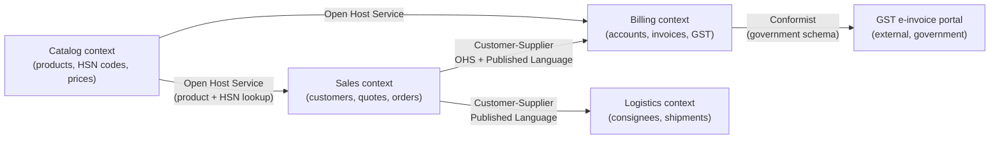
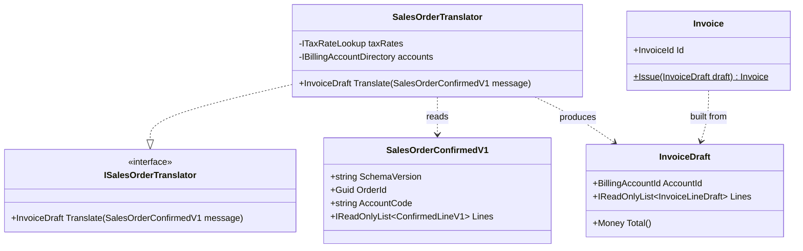
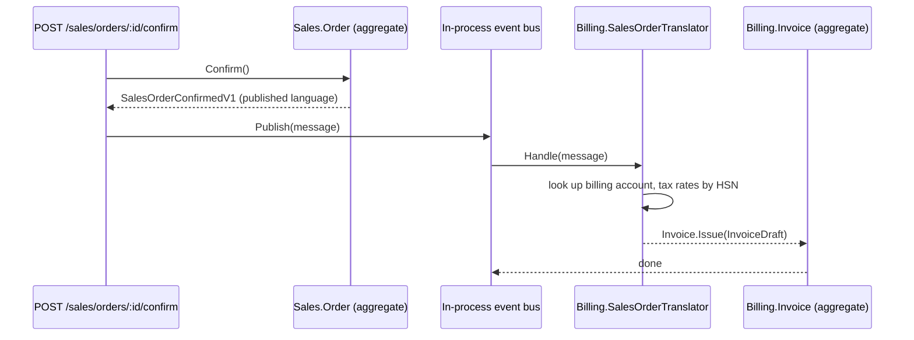

Most of Domain-Driven Design (DDD) that people talk about is *tactical*: entities, value objects, aggregates. But the author of DDD, Eric Evans, has said the most important ideas in the book are the *strategic* ones, and the single most important is the **bounded context**. This lesson is about that idea and the vocabulary that goes with it. It is the foundation for [Strategic and tactical DDD](#/lesson/m08-strategic-tactical) and [Domain-driven modular monoliths](#/lesson/m08-ddd-modular-monolith).

## Learning objectives

By the end of this lesson you will be able to:

1. Explain, with an example, why one shared `Customer` class for a whole company is a trap, and what a bounded context does instead.
2. Define *ubiquitous language* and show how to detect that two teams are using the same word for different things.
3. Draw a context map and label each relationship as partnership, customer–supplier, conformist, anti-corruption layer, open host service, published language, separate ways or shared kernel.
4. Implement a Sales context and a Billing context in one ASP.NET Core modular monolith, with separate models and an anti-corruption layer between them.
5. Design a published language (a versioned contract) and explain how it protects both sides when one side changes.
6. Judge when the ceremony of separate contexts is too much and a single model is the better choice.

## Prerequisites

- [Domain modeling](#/lesson/m07-domain-modeling): you should be comfortable turning business language into classes.
- [Entities and value objects in DDD](#/lesson/m08-entities-value-objects) and [Aggregates and aggregate roots](#/lesson/m08-aggregates): we reuse those terms without re-explaining them.
- [Modular monolith architecture](#/lesson/m02-modular-monolith): bounded contexts usually map to modules.

Helpful but optional: [Adapter](#/lesson/m06-adapter), because an anti-corruption layer is an adapter with a business reason.

## Explain it like I'm a beginner

Imagine a company that sells construction materials to contractors: cement, steel bars, aggregates, tiles. Three departments sit on three floors of the same building.

- **Sales**, on floor 1, talks about *customers*. To them a customer is a company that might buy, with a sales rep assigned, a credit limit and a pipeline stage ("quoted", "negotiating", "won").
- **Billing**, on floor 2, also talks about *customers*. To them a customer is a legal entity with a GST number (GSTIN), a registered address, payment terms ("net 30") and an outstanding balance.
- **Logistics**, on floor 3, barely says "customer". They say *consignee* and *delivery site*: a plot with a pin code, a gate contact's phone number and a crane availability window.

Same word, three meanings. If you ask "how many customers do we have?", Sales says 1,400 (including prospects), Billing says 620 (entities we have ever invoiced), and Logistics shrugs.

Now imagine a software team builds **one** `Customer` class to serve all three floors. It gets `PipelineStage`, `Gstin`, `CreditLimit`, `GateContactPhone`, `CraneWindowStart`… 47 properties. Every floor's change request touches the same class. Billing adds a mandatory `Gstin` validation, and suddenly Sales cannot save a prospect that has not registered for GST yet. Nobody can say which properties are allowed to be empty for whom. That class is a *shared model*, and shared models rot.

A **bounded context** is the opposite decision: draw a line around each floor and let each one have its own model with its own words. Inside the Sales line, `Customer` means exactly one thing. Inside the Billing line, `Customer` means exactly one other thing. The lines are the boundaries; the words inside each line are its **ubiquitous language**, "ubiquitous" because *everyone* inside that boundary (developers, testers, the sales manager) uses the same words with the same meaning, in conversation, in code and in the database.

Between the floors you need a translation step. When Sales marks an order "won", Billing needs to know, but Billing does not want Sales' pipeline stages in its invoice code. So there is a small clerk at the door of the Billing floor who takes the Sales paperwork and rewrites it in Billing terms: "a confirmed order for account 4471 with these lines and this tax category". That clerk is an **anti-corruption layer** (ACL). A **context map** is the floor plan showing which doors exist and who has to adapt to whom.

Analogy: countries and currencies. Each country runs its own currency internally, with its own rules. At the border there is an exchange counter (the ACL). Trade agreements (published languages) define a shared format that several countries agree to use for cross-border paperwork. Nobody tries to make the whole world use one currency because the word "rupee" means something specific *inside India*.

## First-principles explanation

### What a bounded context is

A bounded context is a boundary, usually a module or a service, inside which a particular domain model applies and every term has exactly one meaning. The boundary is explicit: a namespace, a project, a database schema, a team. Outside the boundary the same word can mean something else, and that is fine, because translation happens at the boundary.

Three things live inside one context:

1. **A model**: the classes, aggregates and rules that describe this part of the business.
2. **A language**: the vocabulary the model uses. Code names match what the business people in that context say.
3. **Ownership**: usually one team, one deployable or one module, one database schema.

### What ubiquitous language is

The ubiquitous language is the set of terms that people in a context agree to use with one meaning. The test is brutal and simple: if the sales manager says "won order" and the code says `Order.Status = 3` with a comment, you do not have a ubiquitous language. If the code says `order.MarkWon()` and the database column says `won_at`, you do.

Why does this matter beyond tidiness? Because every translation between "what the business says" and "what the code says" is a place where bugs hide. In a system where the business says "customer" for three different things, a developer who asks "should a customer always have a GSTIN?" gets three different answers and encodes one of them. That is how a prospect without a GST number becomes impossible to save.

### How you discover boundaries

Boundaries follow **meaning**, not **data shape**. Clues that you have crossed a boundary:

- The same word has a different definition ("customer", "order", "product", "account" are the usual suspects).
- The same concept has a different *lifecycle*: a Sales order is "quoted → negotiating → won"; a Billing order is "invoiced → partially paid → settled". They are different state machines.
- A different group of people cares, and they change their minds on a different schedule. Sales rules change every quarter with commission plans; Billing rules change when the tax department changes GST rules.
- Different consistency needs: Billing must never double-invoice; Sales can tolerate a stale pipeline count for an hour.

One warning: a bounded context is *not* the same as a subdomain. A subdomain is a part of the business problem (what the business does). A bounded context is a part of the solution (how we organise models). Ideally they line up one-to-one, but a legacy ERP often forms one context that covers several subdomains. [Strategic and tactical DDD](#/lesson/m08-strategic-tactical) goes deeper into subdomains.

### Context maps and relationship patterns

A context map is a diagram with one box per context and a labelled line for each relationship. The labels are the important part, because they say **who adapts to whom when something changes**. Evans' catalogue:

| Relationship | Plain-English meaning | Who bends when the other changes? |
|---|---|---|
| **Partnership** | Two teams succeed or fail together and plan releases jointly. | Both, by agreement. |
| **Shared kernel** | Two contexts share a small piece of model (code or schema) and change it only together. | Both; every change needs both teams. |
| **Customer–supplier** | Upstream (supplier) provides something downstream (customer) needs; downstream's needs are on upstream's backlog. | Upstream adjusts for downstream, within reason. |
| **Conformist** | Downstream simply adopts upstream's model as-is, because it cannot influence upstream (a big vendor, a government API). | Downstream, completely. |
| **Anti-corruption layer (ACL)** | Downstream builds a translation layer so upstream's model never leaks in. | Downstream builds the translator; its core model stays clean. |
| **Open host service (OHS)** | Upstream publishes a well-defined API for *any* downstream, instead of one-off integrations. | Upstream commits to a stable protocol. |
| **Published language** | A shared, documented, versioned format (JSON schema, Protobuf, an industry standard like ISO 20022) used for exchange. | Both agree on the format; neither exposes internals. |
| **Separate ways** | No integration at all; it is cheaper to duplicate or do it manually. | Nobody. |

"Upstream" and "downstream" describe the direction of influence, like a river: changes flow from upstream to downstream. The context that *produces* data or defines the API is upstream.

These are not mutually exclusive. The classic healthy combination is: upstream offers an **open host service** speaking a **published language**, and each downstream wraps it in a thin **ACL** so its own model stays independent. Most mature integrations look like that.

### Why not one model?

Because of three forces that push against a single model, and they are economic, not aesthetic:

1. **Coordination cost.** With one `Customer` class, every change needs sign-off from every team that uses it. With 3 teams and a 2-day review cycle each, a one-line change can take a week.
2. **Precision.** A model that must satisfy everyone becomes vague. "Status" ends up as a string column with 23 known values across departments.
3. **Independent change.** Billing must react to a GST rule change by a legal deadline. If Billing's model is welded to Sales' model, the Sales team's unrelated refactor can block a legal fix.

### What it costs

Separate contexts are not free. You now have duplication (two `Customer` types with overlapping fields), translation code to write and test, and the possibility of inconsistency between contexts (Sales thinks the account is active; Billing has blocked it for non-payment). You also have to *decide* where the boundaries go, and a wrong boundary is expensive to move. For a 3-person team building a small internal tool, one model is often correct. The brief rule: **split contexts when the meanings diverge or the teams diverge, not before**.

:::callout type=tradeoff title="Duplication across contexts is not a DRY violation"
DRY (don't repeat yourself) is about duplicating *knowledge*, not duplicating *field names*. Sales' `Customer.Name` and Billing's `Customer.LegalName` look similar but encode different knowledge (a display label versus the name on a tax registration). Keeping them separate is correct. See [DRY, KISS and YAGNI](#/lesson/m04-dry-kiss-yagni).
:::

## Visual explanation

### Context map for the materials marketplace



How to read it: arrows point from **upstream** to **downstream**. Sales is upstream of Billing: an order confirmed in Sales causes an invoice in Billing. The label says *how* the relationship is managed. Sales publishes an event in an agreed format (published language) through a stable interface (open host service), so Billing and Logistics can both consume it without Sales caring who is listening. Catalog is a classic open host: everybody needs product data, so Catalog exposes one read API rather than three bespoke ones. Billing is a conformist towards the government e-invoice portal: Billing cannot ask the tax department to change its JSON, so Billing adopts that schema at the boundary, and (sensibly) wraps it in an ACL so the government's field names stay out of the `Invoice` aggregate.

### The anti-corruption layer as classes



The left side (`SalesOrderConfirmedV1`) is the published language: a contract both contexts know, versioned by name. The translator is the only class in Billing that is allowed to see it. It converts Sales words (`AccountCode`, `Sku`, `UnitPricePaise`) into Billing words (`BillingAccountId`, tax-rated `InvoiceLineDraft`, `Money`). Everything to the right of the translator is pure Billing: the `Invoice` aggregate never hears the word "Sales".

### Sequence: an order is won



Sales does its own work and emits a message in the shared format. It does not call Billing, does not know Billing exists, and does not know what an invoice is. The message crosses the boundary, the translator reshapes it, and Billing's aggregate enforces Billing's rules. If tomorrow Logistics also subscribes to the same message, Sales changes nothing.

## Step-by-step example

We will build the Sales and Billing contexts in four steps.

### Step 1 — the shared-model trap (what we are avoiding)

```csharp
// One class to serve every department. Do NOT copy this.
public class Customer
{
    public int Id { get; set; }
    public string Name { get; set; } = "";
    public string? Gstin { get; set; }               // Billing needs it, Sales doesn't have it yet
    public decimal CreditLimit { get; set; }         // Sales
    public string PipelineStage { get; set; } = "";  // Sales: "Quoted", "Won"...
    public string PaymentTerms { get; set; } = "";   // Billing: "Net30"
    public string? GateContactPhone { get; set; }    // Logistics
    public bool IsBlocked { get; set; }              // Billing meaning? Sales meaning? Both?
}
```

Ask three questions about this class and you get three arguments: Is `Gstin` required? Which `IsBlocked` is this? Who may change `CreditLimit`? Those arguments are the smell.

### Step 2 — name the contexts and their words

Write a one-page glossary per context. For our example:

- **Sales**: *Customer* (a company we sell to, may be a prospect), *Quote*, *Order* (an accepted quote; states Draft → Confirmed → Cancelled), *Account code* (Sales' identifier for a customer), *Credit limit*.
- **Billing**: *Billing account* (a legal entity with a GSTIN and payment terms), *Invoice* (states Issued → PartiallyPaid → Settled → Void), *Tax rate* (by HSN code), *Outstanding balance*.

Notice that Billing does not even use the word "customer". Letting each context pick its own nouns is the point.

### Step 3 — choose the relationship

Sales is upstream (an order is confirmed there first). Billing is downstream. We choose **customer–supplier** with a **published language**: Sales emits a `SalesOrderConfirmedV1` message with a documented shape. Billing builds a small **ACL** that translates the message into Billing terms. Why not have Sales call Billing's `CreateInvoice` directly? Because then Sales must know about invoices, tax rates and billing accounts, which are not Sales concepts. The dependency would point the wrong way.

### Step 4 — write the code

The next section shows a compilable modular monolith: one ASP.NET Core process, two contexts in separate namespaces, one contracts namespace, and an in-process bus. Later you could move Billing to its own service with almost no code change, because the boundary is already there.

## Production-style C# implementation

Project layout (single web project, folders per context; in a bigger system each folder becomes a class library with a reference rule enforced by the build):

```text
BuildMart.Api/
  Program.cs
  Contracts/Sales/SalesOrderConfirmedV1.cs      // published language
  Infrastructure/InProcessEventBus.cs
  Sales/Customer.cs
  Sales/Order.cs
  Sales/SalesOrderService.cs
  Billing/Money.cs
  Billing/BillingAccount.cs
  Billing/Invoice.cs
  Billing/Ports.cs
  Billing/Acl/SalesOrderTranslator.cs
  Billing/Acl/SalesOrderConfirmedHandler.cs
```

### The published language

```csharp file=Contracts/Sales/SalesOrderConfirmedV1.cs
namespace BuildMart.Contracts.Sales;

/// <summary>Published language: the shape Sales promises to keep stable for everyone downstream.
/// Rules: additive changes only within V1; breaking changes get a V2 type and a parallel-publish period.</summary>
public sealed record SalesOrderConfirmedV1(
    Guid OrderId,
    string AccountCode,
    DateTimeOffset ConfirmedAt,
    string Currency,
    IReadOnlyList<ConfirmedLineV1> Lines)
{
    public const string SchemaVersion = "sales.order-confirmed.v1";
}

public sealed record ConfirmedLineV1(string Sku, string HsnCode, int Quantity, long UnitPricePaise);
```

Amounts travel as integers in the smallest unit (paise) so no context has to guess the other's decimal rounding. The HSN code (the GST classification of a product) is included because Billing needs it, and Sales has it from Catalog. This is a deliberate upstream concession typical of a customer–supplier relationship.

### Infrastructure: a tiny in-process bus

```csharp file=Infrastructure/InProcessEventBus.cs
using Microsoft.Extensions.DependencyInjection;

namespace BuildMart.Infrastructure;

public interface IIntegrationEventHandler<in T>
{
    Task HandleAsync(T message, CancellationToken ct);
}

public interface IEventBus
{
    Task PublishAsync<T>(T message, CancellationToken ct) where T : notnull;
}

/// <summary>Same-process delivery. Swapping this for RabbitMQ or Kafka later does not touch Sales or Billing.</summary>
public sealed class InProcessEventBus(IServiceProvider services) : IEventBus
{
    public async Task PublishAsync<T>(T message, CancellationToken ct) where T : notnull
    {
        foreach (var handler in services.GetServices<IIntegrationEventHandler<T>>())
            await handler.HandleAsync(message, ct);
    }
}
```

### Sales context

```csharp file=Sales/Customer.cs
namespace BuildMart.Sales;

public enum PipelineStage { Prospect, Quoted, Negotiating, Won, Lost }

/// <summary>Sales' idea of a customer: a company we are trying to sell to. A prospect may have no GST registration yet.</summary>
public sealed class Customer
{
    public string AccountCode { get; }
    public string TradingName { get; private set; }
    public decimal CreditLimit { get; private set; }
    public PipelineStage Stage { get; private set; } = PipelineStage.Prospect;

    public Customer(string accountCode, string tradingName, decimal creditLimit)
    {
        ArgumentException.ThrowIfNullOrWhiteSpace(accountCode);
        ArgumentException.ThrowIfNullOrWhiteSpace(tradingName);
        if (creditLimit < 0) throw new ArgumentOutOfRangeException(nameof(creditLimit));
        AccountCode = accountCode;
        TradingName = tradingName;
        CreditLimit = creditLimit;
    }

    public void MoveTo(PipelineStage stage) => Stage = stage;
}
```

```csharp file=Sales/Order.cs
using BuildMart.Contracts.Sales;

namespace BuildMart.Sales;

public enum OrderStatus { Draft, Confirmed, Cancelled }

public sealed record OrderLine(string Sku, string HsnCode, int Quantity, decimal UnitPrice)
{
    public decimal LineTotal => Quantity * UnitPrice;
}

/// <summary>Sales aggregate. Knows about quotes, credit and confirmation. Knows nothing about invoices or tax.</summary>
public sealed class Order
{
    private readonly List<OrderLine> _lines = new();

    public Guid Id { get; } = Guid.NewGuid();
    public string AccountCode { get; }
    public OrderStatus Status { get; private set; } = OrderStatus.Draft;
    public IReadOnlyList<OrderLine> Lines => _lines;
    public decimal Total => _lines.Sum(l => l.LineTotal);

    public Order(string accountCode)
    {
        ArgumentException.ThrowIfNullOrWhiteSpace(accountCode);
        AccountCode = accountCode;
    }

    public void AddLine(string sku, string hsnCode, int quantity, decimal unitPrice)
    {
        if (Status != OrderStatus.Draft) throw new InvalidOperationException("Only draft orders can change.");
        if (quantity <= 0) throw new ArgumentOutOfRangeException(nameof(quantity));
        _lines.Add(new OrderLine(sku, hsnCode, quantity, unitPrice));
    }

    /// <summary>Confirms the order and returns the message in the published language.</summary>
    public SalesOrderConfirmedV1 Confirm(Customer customer, DateTimeOffset now)
    {
        if (Status != OrderStatus.Draft) throw new InvalidOperationException("Order is not a draft.");
        if (_lines.Count == 0) throw new InvalidOperationException("Order has no lines.");
        if (Total > customer.CreditLimit) throw new InvalidOperationException("Order exceeds credit limit.");

        Status = OrderStatus.Confirmed;
        customer.MoveTo(PipelineStage.Won);

        var lines = _lines.Select(l => new ConfirmedLineV1(l.Sku, l.HsnCode, l.Quantity, ToPaise(l.UnitPrice))).ToList();
        return new SalesOrderConfirmedV1(Id, AccountCode, now, "INR", lines);
    }

    private static long ToPaise(decimal rupees) => (long)Math.Round(rupees * 100m, 0, MidpointRounding.ToEven);
}
```

```csharp file=Sales/SalesOrderService.cs
using BuildMart.Infrastructure;

namespace BuildMart.Sales;

public interface ISalesRepository
{
    Order? FindOrder(Guid id);
    Customer? FindCustomer(string accountCode);
    void Save(Order order);
    void Save(Customer customer);
}

public sealed class InMemorySalesRepository : ISalesRepository
{
    private readonly Dictionary<Guid, Order> _orders = new();
    private readonly Dictionary<string, Customer> _customers = new(StringComparer.OrdinalIgnoreCase);
    public Order? FindOrder(Guid id) => _orders.GetValueOrDefault(id);
    public Customer? FindCustomer(string accountCode) => _customers.GetValueOrDefault(accountCode);
    public void Save(Order order) => _orders[order.Id] = order;
    public void Save(Customer customer) => _customers[customer.AccountCode] = customer;
}

public sealed class SalesOrderService(ISalesRepository repo, IEventBus bus, TimeProvider clock)
{
    public async Task<Guid> ConfirmAsync(Guid orderId, CancellationToken ct)
    {
        var order = repo.FindOrder(orderId) ?? throw new KeyNotFoundException($"Order {orderId} not found.");
        var customer = repo.FindCustomer(order.AccountCode) ?? throw new KeyNotFoundException($"Customer {order.AccountCode} not found.");

        var message = order.Confirm(customer, clock.GetUtcNow());
        repo.Save(order);
        repo.Save(customer);

        // In production this publish goes through a transactional outbox (see m12-outbox); kept in-process here.
        await bus.PublishAsync(message, ct);
        return order.Id;
    }
}
```

### Billing context

```csharp file=Billing/Money.cs
namespace BuildMart.Billing;

/// <summary>Billing value object. Stored in paise so arithmetic is exact.</summary>
public readonly record struct Money(long Paise, string Currency)
{
    public static Money Zero(string currency) => new(0, currency);
    public static Money FromPaise(long paise, string currency) => new(paise, currency);

    public Money Add(Money other)
    {
        if (other.Currency != Currency) throw new InvalidOperationException("Currency mismatch.");
        return new Money(Paise + other.Paise, Currency);
    }

    public Money Multiply(int factor) => new(Paise * factor, Currency);

    /// <summary>Applies a percentage rate (e.g. 18 for 18 %) with banker's rounding to the nearest paisa.</summary>
    public Money Percent(decimal rate) => new((long)Math.Round(Paise * rate / 100m, 0, MidpointRounding.ToEven), Currency);

    public override string ToString() => $"{Currency} {Paise / 100m:0.00}";
}
```

```csharp file=Billing/BillingAccount.cs
namespace BuildMart.Billing;

public readonly record struct BillingAccountId(Guid Value);

public enum PaymentTerms { Immediate, Net15, Net30, Net45 }

/// <summary>Billing's idea of a customer: a legal entity we can invoice. A GSTIN is mandatory here.</summary>
public sealed class BillingAccount
{
    public BillingAccountId Id { get; }
    public string LegalName { get; }
    public string Gstin { get; }
    public PaymentTerms Terms { get; }
    public bool IsOnHold { get; private set; }

    public BillingAccount(BillingAccountId id, string legalName, string gstin, PaymentTerms terms)
    {
        ArgumentException.ThrowIfNullOrWhiteSpace(legalName);
        if (gstin is null || gstin.Length != 15) throw new ArgumentException("GSTIN must be 15 characters.", nameof(gstin));
        Id = id;
        LegalName = legalName;
        Gstin = gstin;
        Terms = terms;
    }

    public void PlaceOnHold() => IsOnHold = true;
    public void ReleaseHold() => IsOnHold = false;
}
```

```csharp file=Billing/Invoice.cs
namespace BuildMart.Billing;

public readonly record struct InvoiceId(Guid Value);

public enum InvoiceStatus { Issued, PartiallyPaid, Settled, Void }

public sealed record InvoiceLineDraft(string Description, int Quantity, Money UnitPrice, decimal TaxRatePercent)
{
    public Money Net => UnitPrice.Multiply(Quantity);
    public Money Tax => Net.Percent(TaxRatePercent);
}

/// <summary>What the ACL hands to the Invoice aggregate. Already in Billing terms.</summary>
public sealed record InvoiceDraft(BillingAccountId AccountId, Guid SourceReference, DateTimeOffset IssuedAt, string Currency, IReadOnlyList<InvoiceLineDraft> Lines)
{
    public Money Total()
    {
        var total = Money.Zero(Currency);
        foreach (var line in Lines) total = total.Add(line.Net).Add(line.Tax);
        return total;
    }
}

public sealed class Invoice
{
    public InvoiceId Id { get; } = new(Guid.NewGuid());
    public BillingAccountId AccountId { get; }
    public Guid SourceReference { get; }
    public DateTimeOffset IssuedAt { get; }
    public DateTimeOffset DueOn { get; }
    public Money Total { get; }
    public Money Paid { get; private set; }
    public InvoiceStatus Status { get; private set; } = InvoiceStatus.Issued;

    private Invoice(InvoiceDraft draft, DateTimeOffset dueOn)
    {
        AccountId = draft.AccountId;
        SourceReference = draft.SourceReference;
        IssuedAt = draft.IssuedAt;
        DueOn = dueOn;
        Total = draft.Total();
        Paid = Money.Zero(draft.Currency);
    }

    public static Invoice Issue(InvoiceDraft draft, BillingAccount account)
    {
        if (account.IsOnHold) throw new InvalidOperationException("Account is on hold; cannot issue invoice.");
        if (draft.Lines.Count == 0) throw new InvalidOperationException("Invoice needs at least one line.");
        var days = account.Terms switch
        {
            PaymentTerms.Immediate => 0,
            PaymentTerms.Net15 => 15,
            PaymentTerms.Net30 => 30,
            _ => 45,
        };
        return new Invoice(draft, draft.IssuedAt.AddDays(days));
    }

    public void RecordPayment(Money amount)
    {
        if (Status is InvoiceStatus.Settled or InvoiceStatus.Void) throw new InvalidOperationException("Invoice is closed.");
        Paid = Paid.Add(amount);
        Status = Paid.Paise >= Total.Paise ? InvoiceStatus.Settled : InvoiceStatus.PartiallyPaid;
    }
}
```

```csharp file=Billing/Ports.cs
namespace BuildMart.Billing;

/// <summary>Ports owned by Billing. The ACL uses them; infrastructure implements them.</summary>
public interface ITaxRateLookup
{
    /// <summary>GST rate in percent for an HSN code, e.g. 18 for 1806 (chocolate), 28 for 2523 (cement).</summary>
    decimal RateFor(string hsnCode);
}

public interface IBillingAccountDirectory
{
    /// <summary>Maps a Sales account code to a Billing account, or null when the entity has not been onboarded for billing.</summary>
    BillingAccount? FindBySalesAccountCode(string salesAccountCode);
}

public interface IInvoiceRepository
{
    Invoice? FindBySource(Guid sourceReference);
    void Add(Invoice invoice);
}

public sealed class InMemoryInvoiceRepository : IInvoiceRepository
{
    private readonly Dictionary<Guid, Invoice> _bySource = new();
    public Invoice? FindBySource(Guid sourceReference) => _bySource.GetValueOrDefault(sourceReference);
    public void Add(Invoice invoice) => _bySource[invoice.SourceReference] = invoice;
}

public sealed class StaticTaxRateLookup : ITaxRateLookup
{
    private static readonly Dictionary<string, decimal> Rates = new()
    {
        ["2523"] = 28m,   // cement
        ["7214"] = 18m,   // steel bars
        ["6907"] = 18m,   // tiles
        ["2517"] = 5m,    // aggregates / crushed stone
    };
    public decimal RateFor(string hsnCode) => Rates.TryGetValue(hsnCode, out var r) ? r : 18m;
}

public sealed class InMemoryBillingAccountDirectory : IBillingAccountDirectory
{
    private readonly Dictionary<string, BillingAccount> _bySalesCode = new(StringComparer.OrdinalIgnoreCase);
    public void Link(string salesAccountCode, BillingAccount account) => _bySalesCode[salesAccountCode] = account;
    public BillingAccount? FindBySalesAccountCode(string salesAccountCode) => _bySalesCode.GetValueOrDefault(salesAccountCode);
}
```

### The anti-corruption layer

```csharp file=Billing/Acl/SalesOrderTranslator.cs
using BuildMart.Contracts.Sales;

namespace BuildMart.Billing.Acl;

public interface ISalesOrderTranslator
{
    /// <summary>Returns a draft in Billing terms, or null when the account cannot be billed yet.</summary>
    InvoiceDraft? Translate(SalesOrderConfirmedV1 message);
}

/// <summary>The only Billing class that understands Sales vocabulary.</summary>
public sealed class SalesOrderTranslator(ITaxRateLookup taxRates, IBillingAccountDirectory accounts) : ISalesOrderTranslator
{
    public InvoiceDraft? Translate(SalesOrderConfirmedV1 message)
    {
        var account = accounts.FindBySalesAccountCode(message.AccountCode);
        if (account is null) return null;

        var lines = message.Lines
            .Select(l => new InvoiceLineDraft(
                Description: l.Sku,
                Quantity: l.Quantity,
                UnitPrice: Money.FromPaise(l.UnitPricePaise, message.Currency),
                TaxRatePercent: taxRates.RateFor(l.HsnCode)))
            .ToList();

        return new InvoiceDraft(account.Id, message.OrderId, message.ConfirmedAt, message.Currency, lines);
    }
}
```

```csharp file=Billing/Acl/SalesOrderConfirmedHandler.cs
using BuildMart.Contracts.Sales;
using BuildMart.Infrastructure;
using Microsoft.Extensions.Logging;

namespace BuildMart.Billing.Acl;

public sealed class SalesOrderConfirmedHandler(
    ISalesOrderTranslator translator,
    IBillingAccountDirectory accounts,
    IInvoiceRepository invoices,
    ILogger<SalesOrderConfirmedHandler> log) : IIntegrationEventHandler<SalesOrderConfirmedV1>
{
    public Task HandleAsync(SalesOrderConfirmedV1 message, CancellationToken ct)
    {
        // Idempotent: the same message delivered twice must not produce two invoices.
        if (invoices.FindBySource(message.OrderId) is not null)
        {
            log.LogInformation("Invoice for order {OrderId} already exists; ignoring duplicate.", message.OrderId);
            return Task.CompletedTask;
        }

        var draft = translator.Translate(message);
        if (draft is null)
        {
            log.LogWarning("Order {OrderId}: account {Code} not onboarded for billing; parked for manual review.", message.OrderId, message.AccountCode);
            return Task.CompletedTask;
        }

        var account = accounts.FindBySalesAccountCode(message.AccountCode)!;
        invoices.Add(Invoice.Issue(draft, account));
        log.LogInformation("Issued invoice for order {OrderId}, total {Total}.", message.OrderId, draft.Total());
        return Task.CompletedTask;
    }
}
```

### Composition root

```csharp file=Program.cs
using BuildMart.Billing;
using BuildMart.Billing.Acl;
using BuildMart.Contracts.Sales;
using BuildMart.Infrastructure;
using BuildMart.Sales;

var builder = WebApplication.CreateBuilder(args);

builder.Services.AddSingleton(TimeProvider.System);
builder.Services.AddSingleton<IEventBus, InProcessEventBus>();

// Sales module
builder.Services.AddSingleton<ISalesRepository, InMemorySalesRepository>();
builder.Services.AddSingleton<SalesOrderService>();

// Billing module
builder.Services.AddSingleton<ITaxRateLookup, StaticTaxRateLookup>();
builder.Services.AddSingleton<InMemoryBillingAccountDirectory>();
builder.Services.AddSingleton<IBillingAccountDirectory>(sp => sp.GetRequiredService<InMemoryBillingAccountDirectory>());
builder.Services.AddSingleton<IInvoiceRepository, InMemoryInvoiceRepository>();
builder.Services.AddSingleton<ISalesOrderTranslator, SalesOrderTranslator>();
builder.Services.AddSingleton<IIntegrationEventHandler<SalesOrderConfirmedV1>, SalesOrderConfirmedHandler>();

var app = builder.Build();

app.MapPost("/sales/orders/{id:guid}/confirm", async (Guid id, SalesOrderService sales, CancellationToken ct) =>
{
    try { return Results.Ok(new { orderId = await sales.ConfirmAsync(id, ct) }); }
    catch (KeyNotFoundException ex) { return Results.NotFound(ex.Message); }
    catch (InvalidOperationException ex) { return Results.Problem(ex.Message, statusCode: StatusCodes.Status409Conflict); }
});

app.Run();
```

Three things to notice in the wiring. First, `Sales` has no `using BuildMart.Billing` anywhere, and `Billing` has no `using BuildMart.Sales`; both reference only `BuildMart.Contracts`. In a multi-project solution you make this a build error by not adding the project reference. Second, the handler is idempotent: an in-process bus never redelivers, but a real broker will, so the ACL is the right place for the dedupe check. Third, the account directory is Billing's: Billing decides how a Sales account code maps to a billing account, not Sales.

## Bad design vs good design

**Bad: one shared `Customer`, one `Order`, direct calls.** `SalesService.ConfirmOrder` calls `BillingService.CreateInvoice(order)` passing the Sales `Order` object. Billing reads `order.Lines[i].Product.HsnCode` straight from Sales' model. Six months later Sales renames `Product` to `CatalogItem` and Billing's build breaks. A year later Sales adds "partial confirmation" and Billing silently invoices the wrong lines because its code assumed all lines were confirmed.

**Good: separate models, published language, ACL.** Sales emits `SalesOrderConfirmedV1`. If Sales adds partial confirmation, it either adds an optional field within V1 (additive, downstream ignores it until ready) or publishes `SalesOrderConfirmedV2` alongside V1 for a transition period. Billing's `Invoice` aggregate never changes because of a Sales refactor.

**Bad in the other direction: over-splitting.** A 4-developer team creates nine bounded contexts for a 20-table application, each with its own contracts project, its own ACL and its own database schema. They spend 40 % of their time writing translators between contexts that are all owned by the same people and change together. The symptom: every feature touches four contexts.

**Good: match boundaries to real seams.** If one team owns Sales and Billing, both change together and the vocabulary genuinely overlaps, keep them as one context with two aggregates. Split later when a second team appears or the words start to diverge. Boundaries are cheaper to add than to remove, but a boundary in the wrong place costs daily.

:::callout type=mistake title="The 'shared kernel' that quietly became a shared model"
Teams often start with a small shared kernel (say, a `Money` type and a `Gstin` value object) and then "just add" `Customer` to it because two contexts need a customer. Within a year the kernel is the shared model from Step 1 with a nicer name. Keep a shared kernel tiny, truly stable and jointly owned; anything with business behaviour belongs to one context.
:::

## Practical playground

The starter has both contexts collapsed into one file. Run it and read the output: a confirmed order becomes an invoice with GST added per line. Then try the experiment in the comment: change the Sales line record and watch whether Billing's `Invoice` has to change (it should not).

:::playground type=csharp title="Sales to Billing through an ACL"
```csharp file=Program.cs
using System;
using System.Collections.Generic;
using System.Linq;

// ---- Published language ----
public sealed record ConfirmedLineV1(string Sku, string HsnCode, int Quantity, long UnitPricePaise);
public sealed record SalesOrderConfirmedV1(Guid OrderId, string AccountCode, string Currency, IReadOnlyList<ConfirmedLineV1> Lines);

// ---- Sales context ----
namespace Sales
{
    public sealed record OrderLine(string Sku, string HsnCode, int Quantity, decimal UnitPrice);
    public sealed class Order
    {
        public Guid Id { get; } = Guid.NewGuid();
        public string AccountCode { get; }
        public List<OrderLine> Lines { get; } = new();
        public Order(string accountCode) => AccountCode = accountCode;
        public SalesOrderConfirmedV1 Confirm() =>
            new(Id, AccountCode, "INR", Lines.Select(l => new ConfirmedLineV1(l.Sku, l.HsnCode, l.Quantity, (long)Math.Round(l.UnitPrice * 100m))).ToList());
    }
}

// ---- Billing context ----
namespace Billing
{
    public readonly record struct Money(long Paise)
    {
        public Money Add(Money o) => new(Paise + o.Paise);
        public Money Percent(decimal rate) => new((long)Math.Round(Paise * rate / 100m, 0, MidpointRounding.ToEven));
        public override string ToString() => $"INR {Paise / 100m:0.00}";
    }
    public sealed record InvoiceLine(string Description, Money Net, Money Tax);
    public sealed class Invoice
    {
        public List<InvoiceLine> Lines { get; } = new();
        public Money Total => Lines.Aggregate(new Money(0), (acc, l) => acc.Add(l.Net).Add(l.Tax));
    }

    // The ACL: the only Billing code that reads Sales vocabulary.
    public static class SalesOrderTranslator
    {
        private static decimal RateFor(string hsn) => hsn switch { "2523" => 28m, "2517" => 5m, _ => 18m };
        public static Invoice ToInvoice(SalesOrderConfirmedV1 m)
        {
            var inv = new Invoice();
            foreach (var l in m.Lines)
            {
                var net = new Money(l.UnitPricePaise * l.Quantity);
                inv.Lines.Add(new InvoiceLine(l.Sku, net, net.Percent(RateFor(l.HsnCode))));
            }
            return inv;
        }
    }
}

public static class Program
{
    public static void Main()
    {
        var order = new Sales.Order("ACC-4471");
        order.Lines.Add(new Sales.OrderLine("CEM-OPC53", "2523", 100, 385.50m));   // 100 bags of cement
        order.Lines.Add(new Sales.OrderLine("AGG-20MM", "2517", 12, 1450m));      // 12 tonnes of aggregate

        var message = order.Confirm();
        var invoice = Billing.SalesOrderTranslator.ToInvoice(message);

        foreach (var l in invoice.Lines) Console.WriteLine($"{l.Description,-10} net {l.Net}  tax {l.Tax}");
        Console.WriteLine($"TOTAL {invoice.Total}");
        // Experiment: add a 'DiscountPercent' field to Sales.OrderLine. Which classes must change? Only Sales and
        // (optionally) the translator. Billing.Invoice stays untouched. That is the boundary doing its job.
    }
}
```
:::

## Exercises

:::exercise id=m08-bounded-contexts-ex1 difficulty=beginner kind=design title="Split a shared Product into per-context models"
A tile retailer has one `Product` class used by Catalog, Warehouse and Billing. It has 31 properties, including `DisplayName`, `MarketingDescription`, `ImageUrls`, `HsnCode`, `GstRatePercent`, `BinLocation`, `ReorderLevel`, `UnitsPerPallet`, `WeightKg` and `IsDiscontinued`. Redesign it as three context-specific models and show the relationships. Use the LLD designer (the starter JSON is loaded for you) to produce your class model.
::requirements
- Each context gets its own type with only the fields it needs.
- The three types share an identifier so they can be correlated, but not a base class.
- State which context is upstream for product identity.
::acceptance
- Three classes (one per context) with no shared base class and no cross-context field access.
- A shared identifier (`Sku` or `ProductId`) appears in all three.
- `IsDiscontinued` is placed in exactly one context, with a note on how the others learn about it.
- A relation shows Catalog as upstream (open host or published language) to the other two.
::hint
Start by writing the three glossaries: what does "product" *mean* in Catalog, in Warehouse, in Billing? The fields will sort themselves by meaning.
::hint
Who creates a product first? That context owns identity, and the others reference it by id.
::hint
"Discontinued" is a catalog decision. Warehouse and Billing need to *know*, not to *decide*. That suggests an event or a lookup, not a shared field.
::hint
In the LLD JSON, model the published event as a `record` class and use `dependency` relations from the downstream classes to it.
::starter
```json
{
  "classes": [
    { "id": "Product", "name": "Product", "kind": "class",
      "fields": ["+string Sku", "+string DisplayName", "+string MarketingDescription", "+string HsnCode", "+decimal GstRatePercent", "+string BinLocation", "+int ReorderLevel", "+int UnitsPerPallet", "+decimal WeightKg", "+bool IsDiscontinued"],
      "methods": [], "responsibility": "Everything about a product for everyone (the shared model to split)" }
  ],
  "relations": []
}
```
::solution
**Glossaries first.** Catalog: a product is *something we offer for sale*, with a name, description, images, HSN code and whether it is still offered. Warehouse: a product is *a stock-keeping unit we store and move*, with a bin, pallet size, weight and reorder level. Billing: a product is *a taxable line item*, with an HSN code and a GST rate.

Note that `HsnCode` legitimately appears in two contexts. Catalog owns it (it is set when a product is onboarded); Billing stores a copy because tax calculation must not depend on Catalog being up, and because the rate that applied at invoice time must be preserved even if Catalog later corrects the code.

```json
{
  "classes": [
    { "id": "CatalogProduct", "name": "CatalogProduct", "kind": "class",
      "fields": ["+Sku Sku", "+string DisplayName", "+string MarketingDescription", "+IReadOnlyList~Uri~ ImageUrls", "+string HsnCode", "+bool IsDiscontinued"],
      "methods": ["+void Discontinue()", "+ProductDiscontinuedV1 ToEvent()"], "responsibility": "Catalog context: what we offer. Owns product identity and the HSN classification." },
    { "id": "StockItem", "name": "StockItem", "kind": "class",
      "fields": ["+Sku Sku", "+string BinLocation", "+int ReorderLevel", "+int UnitsPerPallet", "+decimal WeightKg", "+bool AcceptsInbound"],
      "methods": ["+void StopInbound()"], "responsibility": "Warehouse context: how we store and move it." },
    { "id": "TaxableItem", "name": "TaxableItem", "kind": "class",
      "fields": ["+Sku Sku", "+string HsnCode", "+decimal GstRatePercent"],
      "methods": ["+Money TaxOn(Money net)"], "responsibility": "Billing context: how we tax it. HSN copied at onboarding, not read live." },
    { "id": "Sku", "name": "Sku", "kind": "record", "fields": ["+string Value"], "methods": [], "responsibility": "Shared kernel: the one identifier all contexts agree on." },
    { "id": "ProductDiscontinuedV1", "name": "ProductDiscontinuedV1", "kind": "record",
      "fields": ["+Sku Sku", "+DateTimeOffset EffectiveFrom"], "methods": [], "responsibility": "Published language from Catalog." }
  ],
  "relations": [
    { "from": "CatalogProduct", "to": "Sku", "kind": "composition" },
    { "from": "StockItem", "to": "Sku", "kind": "composition" },
    { "from": "TaxableItem", "to": "Sku", "kind": "composition" },
    { "from": "CatalogProduct", "to": "ProductDiscontinuedV1", "kind": "dependency", "label": "publishes" },
    { "from": "StockItem", "to": "ProductDiscontinuedV1", "kind": "dependency", "label": "consumes via ACL → StopInbound()" },
    { "from": "TaxableItem", "to": "ProductDiscontinuedV1", "kind": "dependency", "label": "consumes (may ignore)" }
  ]
}
```

Catalog is upstream: it creates the `Sku` and publishes `ProductDiscontinuedV1`. Warehouse translates that event into its own concept, `AcceptsInbound = false` (it still needs to ship what is on the shelf, so "discontinued" is not simply copied). Billing can usually ignore it; an invoice for an already-sold discontinued item is still valid.
::mistakes
- Keeping a `ProductBase` class that all three inherit from. The base class becomes the new shared model.
- Giving Warehouse a `bool IsDiscontinued` copied from Catalog without thinking about what Warehouse actually does differently (it is "stop receiving", not "stop existing").
- Making Billing call Catalog live for the GST rate at invoice time, so a Catalog outage blocks invoicing and a later HSN correction silently changes historic invoices.
:::

:::exercise id=m08-bounded-contexts-ex2 difficulty=beginner kind=code title="Implement the Sales-to-Billing translator"
Implement `SalesOrderTranslator.Translate`. It receives a `SalesOrderConfirmedV1` message and must produce an `InvoiceDraft` in Billing terms, applying the GST rate per line from `ITaxRateLookup` and resolving the billing account from `IBillingAccountDirectory`.
::requirements
- Each Sales line becomes one `InvoiceLineDraft` with the unit price converted to `Money` and the tax rate looked up by HSN code.
- If the directory has no billing account for the Sales account code, return `null` (the handler parks the message).
- The draft's `SourceReference` is the Sales `OrderId`.
::acceptance
- A message with two lines produces a draft with two lines and the right rates (28 % for HSN 2523, 5 % for 2517).
- The total of a draft with 100 × ₹385.50 at 28 % and 12 × ₹1,450 at 5 % is ₹67,614.00 (net ₹55,950 + tax ₹11,664).
- An unknown account code yields `null`, not an exception.
::hint
Start with the account lookup; if it is `null`, you are done early.
::hint
`Money.FromPaise(l.UnitPricePaise, message.Currency)` builds the Billing price; the tax rate is `taxRates.RateFor(l.HsnCode)`.
::hint
Project with LINQ: `message.Lines.Select(l => new InvoiceLineDraft(...)).ToList()`.
::hint
```csharp
var account = accounts.FindBySalesAccountCode(message.AccountCode);
if (account is null) return null;
var lines = message.Lines.Select(l => new InvoiceLineDraft(l.Sku, l.Quantity, Money.FromPaise(l.UnitPricePaise, message.Currency), taxRates.RateFor(l.HsnCode))).ToList();
return new InvoiceDraft(account.Id, message.OrderId, message.ConfirmedAt, message.Currency, lines);
```
::starter
```csharp file=Translator.cs
using System;
using System.Collections.Generic;
using System.Linq;

public sealed record ConfirmedLineV1(string Sku, string HsnCode, int Quantity, long UnitPricePaise);
public sealed record SalesOrderConfirmedV1(Guid OrderId, string AccountCode, DateTimeOffset ConfirmedAt, string Currency, IReadOnlyList<ConfirmedLineV1> Lines);

public readonly record struct Money(long Paise, string Currency)
{
    public static Money Zero(string currency) => new(0, currency);
    public static Money FromPaise(long paise, string currency) => new(paise, currency);
    public Money Add(Money other) => new(Paise + other.Paise, Currency);
    public Money Multiply(int factor) => new(Paise * factor, Currency);
    public Money Percent(decimal rate) => new((long)Math.Round(Paise * rate / 100m, 0, MidpointRounding.ToEven), Currency);
}

public readonly record struct BillingAccountId(Guid Value);
public sealed record BillingAccount(BillingAccountId Id, string LegalName, string Gstin);

public sealed record InvoiceLineDraft(string Description, int Quantity, Money UnitPrice, decimal TaxRatePercent)
{
    public Money Net => UnitPrice.Multiply(Quantity);
    public Money Tax => Net.Percent(TaxRatePercent);
}

public sealed record InvoiceDraft(BillingAccountId AccountId, Guid SourceReference, DateTimeOffset IssuedAt, string Currency, IReadOnlyList<InvoiceLineDraft> Lines)
{
    public Money Total()
    {
        var total = Money.Zero(Currency);
        foreach (var l in Lines) total = total.Add(l.Net).Add(l.Tax);
        return total;
    }
}

public interface ITaxRateLookup { decimal RateFor(string hsnCode); }
public interface IBillingAccountDirectory { BillingAccount? FindBySalesAccountCode(string salesAccountCode); }

public sealed class SalesOrderTranslator
{
    private readonly ITaxRateLookup _taxRates;
    private readonly IBillingAccountDirectory _accounts;
    public SalesOrderTranslator(ITaxRateLookup taxRates, IBillingAccountDirectory accounts)
    {
        _taxRates = taxRates;
        _accounts = accounts;
    }

    public InvoiceDraft? Translate(SalesOrderConfirmedV1 message) => throw new NotImplementedException();
}
```
::tests
```csharp file=TranslatorTests.cs
using System;
using System.Collections.Generic;
using Xunit;

public class TranslatorTests
{
    private sealed class FakeRates : ITaxRateLookup
    {
        public decimal RateFor(string hsn) => hsn switch { "2523" => 28m, "2517" => 5m, _ => 18m };
    }
    private sealed class FakeDirectory : IBillingAccountDirectory
    {
        public static readonly BillingAccount Known = new(new BillingAccountId(Guid.NewGuid()), "Shree Builders Pvt Ltd", "06AAACS1234A1Z5");
        public BillingAccount? FindBySalesAccountCode(string code) => code == "ACC-4471" ? Known : null;
    }

    private static SalesOrderConfirmedV1 Message(string account) => new(
        Guid.NewGuid(), account, new DateTimeOffset(2026, 4, 1, 10, 0, 0, TimeSpan.Zero), "INR",
        new List<ConfirmedLineV1>
        {
            new("CEM-OPC53", "2523", 100, 38550),
            new("AGG-20MM", "2517", 12, 145000),
        });

    [Fact]
    public void Translates_lines_with_rates()
    {
        var draft = new SalesOrderTranslator(new FakeRates(), new FakeDirectory()).Translate(Message("ACC-4471"));
        Assert.NotNull(draft);
        Assert.Equal(2, draft!.Lines.Count);
        Assert.Equal(28m, draft.Lines[0].TaxRatePercent);
        Assert.Equal(5m, draft.Lines[1].TaxRatePercent);
        Assert.Equal(FakeDirectory.Known.Id, draft.AccountId);
    }

    [Fact]
    public void Total_includes_tax()
    {
        var draft = new SalesOrderTranslator(new FakeRates(), new FakeDirectory()).Translate(Message("ACC-4471"))!;
        Assert.Equal(6_761_400L, draft.Total().Paise);
    }

    [Fact]
    public void Source_reference_is_order_id()
    {
        var m = Message("ACC-4471");
        var draft = new SalesOrderTranslator(new FakeRates(), new FakeDirectory()).Translate(m)!;
        Assert.Equal(m.OrderId, draft.SourceReference);
    }

    [Fact]
    public void Unknown_account_returns_null()
    {
        var draft = new SalesOrderTranslator(new FakeRates(), new FakeDirectory()).Translate(Message("ACC-0000"));
        Assert.Null(draft);
    }
}
```
::solution
The translator's job is purely to rename and re-type. No business decisions beyond "can we bill this account at all" belong here.

```csharp file=Translator.cs
using System;
using System.Collections.Generic;
using System.Linq;

public sealed record ConfirmedLineV1(string Sku, string HsnCode, int Quantity, long UnitPricePaise);
public sealed record SalesOrderConfirmedV1(Guid OrderId, string AccountCode, DateTimeOffset ConfirmedAt, string Currency, IReadOnlyList<ConfirmedLineV1> Lines);

public readonly record struct Money(long Paise, string Currency)
{
    public static Money Zero(string currency) => new(0, currency);
    public static Money FromPaise(long paise, string currency) => new(paise, currency);
    public Money Add(Money other) => new(Paise + other.Paise, Currency);
    public Money Multiply(int factor) => new(Paise * factor, Currency);
    public Money Percent(decimal rate) => new((long)Math.Round(Paise * rate / 100m, 0, MidpointRounding.ToEven), Currency);
}

public readonly record struct BillingAccountId(Guid Value);
public sealed record BillingAccount(BillingAccountId Id, string LegalName, string Gstin);

public sealed record InvoiceLineDraft(string Description, int Quantity, Money UnitPrice, decimal TaxRatePercent)
{
    public Money Net => UnitPrice.Multiply(Quantity);
    public Money Tax => Net.Percent(TaxRatePercent);
}

public sealed record InvoiceDraft(BillingAccountId AccountId, Guid SourceReference, DateTimeOffset IssuedAt, string Currency, IReadOnlyList<InvoiceLineDraft> Lines)
{
    public Money Total()
    {
        var total = Money.Zero(Currency);
        foreach (var l in Lines) total = total.Add(l.Net).Add(l.Tax);
        return total;
    }
}

public interface ITaxRateLookup { decimal RateFor(string hsnCode); }
public interface IBillingAccountDirectory { BillingAccount? FindBySalesAccountCode(string salesAccountCode); }

public sealed class SalesOrderTranslator
{
    private readonly ITaxRateLookup _taxRates;
    private readonly IBillingAccountDirectory _accounts;
    public SalesOrderTranslator(ITaxRateLookup taxRates, IBillingAccountDirectory accounts)
    {
        _taxRates = taxRates;
        _accounts = accounts;
    }

    public InvoiceDraft? Translate(SalesOrderConfirmedV1 message)
    {
        var account = _accounts.FindBySalesAccountCode(message.AccountCode);
        if (account is null) return null;

        var lines = message.Lines
            .Select(l => new InvoiceLineDraft(l.Sku, l.Quantity, Money.FromPaise(l.UnitPricePaise, message.Currency), _taxRates.RateFor(l.HsnCode)))
            .ToList();

        return new InvoiceDraft(account.Id, message.OrderId, message.ConfirmedAt, message.Currency, lines);
    }
}
```

Checking the number: 100 × 38,550 paise = 3,855,000 net, 28 % tax = 1,079,400. 12 × 145,000 = 1,740,000 net, 5 % tax = 87,000. Net 5,595,000 + tax 1,166,400 = 6,761,400 paise = ₹67,614.00. The arithmetic happens in Billing's `Money`, not in the translator; the translator only renames and re-types.
::mistakes
- Throwing on an unknown account. The message is valid; Billing simply is not ready for it. Parking is a business outcome, not an error.
- Doing tax arithmetic inside the translator. The translator maps; `InvoiceLineDraft` computes.
- Reading the GST rate from the Sales message. Sales does not know tax; that is exactly the kind of knowledge that should not cross the boundary.
:::

:::exercise id=m08-bounded-contexts-ex3 difficulty=intermediate kind=code title="Upcast a V1 message to V2 at the boundary"
Sales is about to publish `SalesOrderConfirmedV2`, which adds a `DeliveryPinCode` and renames `AccountCode` to `SalesAccountCode`. For a transition period Billing will receive both versions. Implement `MessageUpcaster.ToV2` so Billing's handler only ever sees V2.
::requirements
- A V1 message maps to V2 with `DeliveryPinCode = null` and `SalesAccountCode = AccountCode`.
- A V2 message passes through unchanged (same reference).
- An envelope with an unknown schema version throws `UnsupportedSchemaException` naming the version.
::acceptance
- `ToV2(envelope-with-V1)` returns a V2 with all lines copied and `DeliveryPinCode` null.
- `ToV2(envelope-with-V2)` returns the same V2 instance.
- Unknown version throws `UnsupportedSchemaException` whose message contains the version string.
::hint
This is the published-language pattern in motion: downstream absorbs version differences in one place, so the rest of Billing has a single shape to handle.
::hint
Pattern-match on `envelope.SchemaVersion` with a `switch` expression; one arm per known version.
::hint
The payload is typed as `object`; cast with `(SalesOrderConfirmedV1)envelope.Payload` inside the right arm.
::hint
```csharp
return envelope.SchemaVersion switch
{
    SalesOrderConfirmedV1.SchemaVersion => Upcast((SalesOrderConfirmedV1)envelope.Payload),
    SalesOrderConfirmedV2.SchemaVersion => (SalesOrderConfirmedV2)envelope.Payload,
    var v => throw new UnsupportedSchemaException(v),
};
```
::starter
```csharp file=Upcaster.cs
using System;
using System.Collections.Generic;
using System.Linq;

public sealed record ConfirmedLineV1(string Sku, string HsnCode, int Quantity, long UnitPricePaise);
public sealed record SalesOrderConfirmedV1(Guid OrderId, string AccountCode, DateTimeOffset ConfirmedAt, string Currency, IReadOnlyList<ConfirmedLineV1> Lines)
{
    public const string SchemaVersion = "sales.order-confirmed.v1";
}

public sealed record ConfirmedLineV2(string Sku, string HsnCode, int Quantity, long UnitPricePaise);
public sealed record SalesOrderConfirmedV2(Guid OrderId, string SalesAccountCode, DateTimeOffset ConfirmedAt, string Currency, string? DeliveryPinCode, IReadOnlyList<ConfirmedLineV2> Lines)
{
    public const string SchemaVersion = "sales.order-confirmed.v2";
}

public sealed record MessageEnvelope(string SchemaVersion, object Payload);

public sealed class UnsupportedSchemaException : Exception
{
    public UnsupportedSchemaException(string version) : base($"Unsupported schema version '{version}'.") { }
}

public static class MessageUpcaster
{
    public static SalesOrderConfirmedV2 ToV2(MessageEnvelope envelope) => throw new NotImplementedException();
}
```
::tests
```csharp file=UpcasterTests.cs
using System;
using System.Collections.Generic;
using Xunit;

public class UpcasterTests
{
    private static readonly DateTimeOffset When = new(2026, 5, 2, 9, 0, 0, TimeSpan.Zero);

    [Fact]
    public void V1_is_upcast_to_v2()
    {
        var v1 = new SalesOrderConfirmedV1(Guid.NewGuid(), "ACC-1", When, "INR", new List<ConfirmedLineV1> { new("S1", "2523", 2, 100), new("S2", "2517", 1, 50) });
        var v2 = MessageUpcaster.ToV2(new MessageEnvelope(SalesOrderConfirmedV1.SchemaVersion, v1));
        Assert.Equal(v1.OrderId, v2.OrderId);
        Assert.Equal("ACC-1", v2.SalesAccountCode);
        Assert.Null(v2.DeliveryPinCode);
        Assert.Equal(2, v2.Lines.Count);
        Assert.Equal("S2", v2.Lines[1].Sku);
        Assert.Equal(50, v2.Lines[1].UnitPricePaise);
    }

    [Fact]
    public void V2_passes_through_same_instance()
    {
        var v2 = new SalesOrderConfirmedV2(Guid.NewGuid(), "ACC-9", When, "INR", "122001", new List<ConfirmedLineV2>());
        var result = MessageUpcaster.ToV2(new MessageEnvelope(SalesOrderConfirmedV2.SchemaVersion, v2));
        Assert.Same(v2, result);
    }

    [Fact]
    public void Unknown_version_throws()
    {
        var ex = Assert.Throws<UnsupportedSchemaException>(() => MessageUpcaster.ToV2(new MessageEnvelope("sales.order-confirmed.v7", new object())));
        Assert.Contains("v7", ex.Message);
    }
}
```
::solution
```csharp file=Upcaster.cs
using System;
using System.Collections.Generic;
using System.Linq;

public sealed record ConfirmedLineV1(string Sku, string HsnCode, int Quantity, long UnitPricePaise);
public sealed record SalesOrderConfirmedV1(Guid OrderId, string AccountCode, DateTimeOffset ConfirmedAt, string Currency, IReadOnlyList<ConfirmedLineV1> Lines)
{
    public const string SchemaVersion = "sales.order-confirmed.v1";
}

public sealed record ConfirmedLineV2(string Sku, string HsnCode, int Quantity, long UnitPricePaise);
public sealed record SalesOrderConfirmedV2(Guid OrderId, string SalesAccountCode, DateTimeOffset ConfirmedAt, string Currency, string? DeliveryPinCode, IReadOnlyList<ConfirmedLineV2> Lines)
{
    public const string SchemaVersion = "sales.order-confirmed.v2";
}

public sealed record MessageEnvelope(string SchemaVersion, object Payload);

public sealed class UnsupportedSchemaException : Exception
{
    public UnsupportedSchemaException(string version) : base($"Unsupported schema version '{version}'.") { }
}

public static class MessageUpcaster
{
    public static SalesOrderConfirmedV2 ToV2(MessageEnvelope envelope) => envelope.SchemaVersion switch
    {
        SalesOrderConfirmedV1.SchemaVersion => Upcast((SalesOrderConfirmedV1)envelope.Payload),
        SalesOrderConfirmedV2.SchemaVersion => (SalesOrderConfirmedV2)envelope.Payload,
        var v => throw new UnsupportedSchemaException(v),
    };

    private static SalesOrderConfirmedV2 Upcast(SalesOrderConfirmedV1 v1) => new(
        v1.OrderId,
        SalesAccountCode: v1.AccountCode,
        v1.ConfirmedAt,
        v1.Currency,
        DeliveryPinCode: null,
        v1.Lines.Select(l => new ConfirmedLineV2(l.Sku, l.HsnCode, l.Quantity, l.UnitPricePaise)).ToList());
}
```

Why upcast rather than have two handlers? Because every business rule after this point (dedupe, account lookup, tax) would otherwise be written twice. The upcaster is the one place that knows history. When V1 is retired, you delete one `switch` arm.
::alternatives
If the broker supports schema registries (Confluent Schema Registry, Azure Schema Registry), the registry handles compatible evolution (added optional fields) and you only upcast on breaking changes. Renames are breaking, so this exercise still applies.
::mistakes
- Making the handler accept `object` and pattern-match everywhere. Version knowledge leaks into every rule.
- Upcasting by mutating the V1 record in place. Records are immutable for a reason; build a new V2.
:::

:::exercise id=m08-bounded-contexts-ex4 difficulty=intermediate kind=design title="Model a conformist integration behind an ACL"
Billing must submit invoices to a government e-invoicing portal that expects its own JSON schema: `SellerDtls.Gstin`, `BuyerDtls.Gstin`, `ItemList[].HsnCd`, `ItemList[].AssAmt` (assessable amount in rupees with 2 decimals), `ItemList[].GstRt`, and returns an `Irn` (invoice reference number) and `AckNo`. Billing cannot change this schema. Design the classes so Billing's `Invoice` aggregate never contains a portal field name. Produce the model in the LLD designer.
::requirements
- A port owned by Billing (`IEInvoiceRegistrar` or similar) that speaks Billing language.
- An adapter that conforms to the portal schema and translates both ways (request and response).
- The returned `Irn` must be stored, because it is legally required on the printed invoice, but modelled in Billing's terms.
::acceptance
- The `Invoice` class has no field named like a portal field (`AssAmt`, `GstRt`, `SellerDtls`...).
- Exactly one class depends on the portal DTOs.
- The response (`Irn`, `AckNo`) is captured as a Billing value object with a meaningful name.
- Failure handling is described: what happens when the portal is down.
::hint
The portal is upstream and immovable, so Billing is a conformist *at the edge*. The question is how thin you can make the conformist edge.
::hint
Define what Billing wants to say: "register this invoice; tell me its government reference". That is the port.
::hint
Portal DTOs (`EInvoiceRequestDto`, `EInvoiceResponseDto`) live in the adapter's namespace, never in `Billing`.
::hint
Registration is a separate step after issue. An invoice can be `Issued` but `NotYetRegistered`, so model that as a state or an optional value object, and retry registration from a background job.
::starter
```json
{
  "classes": [
    { "id": "Invoice", "name": "Invoice", "kind": "class",
      "fields": ["+InvoiceId Id", "+BillingAccountId AccountId", "+Money Total", "+InvoiceStatus Status"],
      "methods": ["+void RecordPayment(Money amount)"], "responsibility": "Billing aggregate" },
    { "id": "PortalApi", "name": "GovernmentPortalHttpClient", "kind": "class",
      "fields": [], "methods": ["+EInvoiceResponseDto Post(EInvoiceRequestDto dto)"], "responsibility": "External, schema fixed by government" }
  ],
  "relations": []
}
```
::solution
```json
{
  "classes": [
    { "id": "Invoice", "name": "Invoice", "kind": "class",
      "fields": ["+InvoiceId Id", "+BillingAccountId AccountId", "+Money Total", "+InvoiceStatus Status", "+GovernmentRegistration? Registration"],
      "methods": ["+void RecordPayment(Money amount)", "+void MarkRegistered(GovernmentRegistration reg)", "+EInvoiceSubmission ToSubmission(BillingAccount buyer, SellerProfile seller)"],
      "responsibility": "Billing aggregate; knows it must be registered, not how" },
    { "id": "GovernmentRegistration", "name": "GovernmentRegistration", "kind": "record",
      "fields": ["+string ReferenceNumber", "+string AcknowledgementNumber", "+DateTimeOffset RegisteredAt"], "methods": [],
      "responsibility": "Billing value object wrapping IRN + AckNo in Billing words" },
    { "id": "EInvoiceSubmission", "name": "EInvoiceSubmission", "kind": "record",
      "fields": ["+string SellerGstin", "+string BuyerGstin", "+IReadOnlyList~TaxableLine~ Lines", "+Money Total"], "methods": [],
      "responsibility": "Billing-language request: what we want registered" },
    { "id": "IEInvoiceRegistrar", "name": "IEInvoiceRegistrar", "kind": "interface",
      "fields": [], "methods": ["Task~GovernmentRegistration~ RegisterAsync(EInvoiceSubmission s, CancellationToken ct)"],
      "responsibility": "Port owned by Billing" },
    { "id": "PortalAdapter", "name": "GovernmentPortalRegistrar", "kind": "class",
      "fields": ["-GovernmentPortalHttpClient http"],
      "methods": ["+Task~GovernmentRegistration~ RegisterAsync(EInvoiceSubmission s, CancellationToken ct)", "-EInvoiceRequestDto ToDto(EInvoiceSubmission s)", "-GovernmentRegistration FromDto(EInvoiceResponseDto d)"],
      "responsibility": "ACL: the only class that knows AssAmt, GstRt, SellerDtls" },
    { "id": "PortalApi", "name": "GovernmentPortalHttpClient", "kind": "class",
      "fields": [], "methods": ["+EInvoiceResponseDto Post(EInvoiceRequestDto dto)"], "responsibility": "External, schema fixed by government" },
    { "id": "RegistrationJob", "name": "RegisterPendingInvoicesJob", "kind": "class",
      "fields": ["-IInvoiceRepository invoices", "-IEInvoiceRegistrar registrar"], "methods": ["+Task RunAsync(CancellationToken ct)"],
      "responsibility": "Retries unregistered invoices; portal downtime never blocks issuing" }
  ],
  "relations": [
    { "from": "Invoice", "to": "GovernmentRegistration", "kind": "aggregation", "multiplicity": "0..1" },
    { "from": "Invoice", "to": "EInvoiceSubmission", "kind": "dependency", "label": "creates" },
    { "from": "PortalAdapter", "to": "IEInvoiceRegistrar", "kind": "implements" },
    { "from": "PortalAdapter", "to": "PortalApi", "kind": "association" },
    { "from": "RegistrationJob", "to": "IEInvoiceRegistrar", "kind": "dependency" },
    { "from": "RegistrationJob", "to": "Invoice", "kind": "dependency", "label": "MarkRegistered" }
  ]
}
```

**Failure handling.** Issuing an invoice and registering it are separated on purpose. `Invoice.Issue` succeeds even when the portal is down; `Registration` stays `null`. A background job (`RegisterPendingInvoicesJob`) picks up unregistered invoices, calls the port, and on success calls `MarkRegistered`. Retries use exponential backoff; a portal rejection (schema error) is a different outcome from a timeout and is surfaced to an operator queue. The printed invoice shows "registration pending" until then. In India the legal window for e-invoice reporting is time-bound for large taxpayers, so the job also alerts when an invoice is approaching that deadline unregistered.

**Why `GovernmentRegistration` and not `Irn`?** Because the word "IRN" is the portal's. If the government renames it, or a second country's portal is added, the Billing word still describes what it *is*: a registration reference.
::mistakes
- Putting `EInvoiceRequestDto` as a property of `Invoice` "to keep what we sent". Store the submission in Billing terms or as an opaque audit blob in the adapter.
- Calling the portal inside `Invoice.Issue`, so a government outage stops the company invoicing.
- Rounding `AssAmt` to rupees in the aggregate to match the portal. Keep paise internally; round only in `ToDto`.
:::

:::exercise id=m08-bounded-contexts-ex5 difficulty=advanced kind=written title="Draw and defend a context map for a hospital group"
A hospital group runs: Appointments (patients book doctors), Clinical Records (diagnoses, prescriptions; heavily regulated), Pharmacy (stock and dispensing), Billing (bills patients and insurers), Insurance (a dozen external insurers with their own claim formats), and a third-party Lab system the group bought and cannot modify. The word "patient" is used everywhere; "visit" means a booking in Appointments but an "encounter" with clinical content in Clinical Records. Produce a context map with every relationship labelled, and defend each label in one or two sentences.
::acceptance
- Six or more contexts with a relationship type on every edge that exists, plus explicit "separate ways" where you chose no integration.
- At least one of each: customer–supplier, conformist, ACL, open host service with published language.
- A clear statement of which context owns patient identity and how others reference it.
- One paragraph on where a shared kernel is acceptable and why it must stay tiny.
- One paragraph on what you would *merge* if the team were 4 people instead of 40.
::hint
Start from the direction of data flow: who creates a patient first? Who learns about a visit first?
::hint
The Lab system and the insurers cannot be changed. Which relationship does that force, and what do you wrap around it?
::hint
Clinical Records is regulated and conservative; Billing changes with every tariff revision. Do you want Billing's model to depend on Clinical's internals?
::hint
A published "EncounterClosedV1" event from Clinical Records lets Billing and Pharmacy both react without Clinical knowing about money or stock.
::solution
**A defensible map** (one of several):

- **Patient Registry → everyone**: open host service with a published language (`PatientRegisteredV1`, a `PatientId`). The registry owns identity and demographics. Every other context stores `PatientId` and its *own* projection of the patient (Billing: payer and address; Clinical: allergies and blood group; Appointments: contact preferences). Nobody else may create a patient.
- **Appointments → Clinical Records**: customer–supplier. A completed booking opens an encounter; Clinical is the customer and requests fields it needs (doctor, slot, department) on Appointments' backlog. The word "visit" stops at the boundary; Clinical translates it into "encounter" in its ACL.
- **Clinical Records → Billing and Pharmacy**: open host with published language (`EncounterClosedV1` listing procedures by code and prescriptions by drug code). Clinical is regulated and must not be coupled to tariff changes, so it publishes facts and never learns about prices or stock. Billing wraps the event in an ACL to map procedure codes to tariff items; Pharmacy maps drug codes to stock items.
- **Lab system → Clinical Records**: conformist at the edge, wrapped in an ACL. The vendor's result format is adopted as-is in an adapter; Clinical's `LabResult` value object has Clinical's names and units. If the group ever replaces the lab vendor, only the adapter changes.
- **Billing → Insurers**: conformist per insurer, each behind the same `IClaimSubmitter` port with one adapter per insurer format. Twelve conformist edges, one Billing-owned interface.
- **Pharmacy ↔ Billing**: customer–supplier (dispensing produces billable lines) via `MedicationDispensedV1`.
- **Appointments and Pharmacy**: separate ways. Pharmacy does not need bookings. Resist the "it might be useful" integration.

**Shared kernel**: `PatientId`, `Money`, and standard code types (ICD diagnosis code, drug code) as value objects with validation only. No behaviour, no persistence. The moment someone proposes adding `Patient` with properties to the kernel, that is the shared-model trap returning.

**Four people, not forty**: merge Appointments and Clinical Records into one "Care" context with two aggregates, and Billing and Insurance into one "Revenue" context; keep the Patient Registry as a module, not a service. Keep the Lab and insurer adapters as ACLs regardless of team size, because those boundaries are forced by vendors, not by the team. The resulting map has three internal contexts and two external ones, which four people can hold in their heads.
::mistakes
- Letting Billing read Clinical's tables directly "because it is the same database". Regulated data leaks into invoice code, and every Clinical schema change breaks Billing.
- Drawing a map with boxes and arrows but no relationship labels. The labels *are* the map; the boxes alone are a component diagram.
- Making the patient a single shared class because "everyone needs a patient". Everyone needs a `PatientId`; each needs a different patient.
:::

## Automated testing

Bounded contexts give you three testing layers that are each cheap:

**1. Each context on its own**, with no mention of the other. Billing tests build `InvoiceDraft`s directly and never construct a Sales message:

```csharp
public class InvoiceTests
{
    private static BillingAccount Account(PaymentTerms terms = PaymentTerms.Net30) =>
        new(new BillingAccountId(Guid.NewGuid()), "Shree Builders Pvt Ltd", "06AAACS1234A1Z5", terms);

    [Fact]
    public void Due_date_follows_payment_terms()
    {
        var issued = new DateTimeOffset(2026, 4, 1, 0, 0, 0, TimeSpan.Zero);
        var draft = new InvoiceDraft(Account().Id, Guid.NewGuid(), issued, "INR",
            new[] { new InvoiceLineDraft("CEM", 10, Money.FromPaise(38550, "INR"), 28m) });
        var invoice = Invoice.Issue(draft, Account(PaymentTerms.Net30));
        Assert.Equal(issued.AddDays(30), invoice.DueOn);
    }

    [Fact]
    public void Account_on_hold_cannot_be_invoiced()
    {
        var account = Account();
        account.PlaceOnHold();
        var draft = new InvoiceDraft(account.Id, Guid.NewGuid(), DateTimeOffset.UtcNow, "INR",
            new[] { new InvoiceLineDraft("CEM", 1, Money.FromPaise(100, "INR"), 28m) });
        Assert.Throws<InvalidOperationException>(() => Invoice.Issue(draft, account));
    }
}
```

**2. The translator**, with hand-rolled fakes for its ports (exactly as in exercise 2). These are contract tests for the boundary: given a message in the published language, do we produce the right Billing draft?

**3. The published language itself.** Serialize a `SalesOrderConfirmedV1` to JSON and compare it with a checked-in sample file. If a developer renames a property, the test fails and forces the conversation: "this is a breaking change to a contract other teams depend on; it needs a V2". This single test prevents more production incidents than most integration suites.

```csharp
[Fact]
public void V1_contract_has_not_changed()
{
    var sample = new SalesOrderConfirmedV1(Guid.Empty, "ACC-1", DateTimeOffset.UnixEpoch, "INR",
        new[] { new ConfirmedLineV1("S", "2523", 1, 100) });
    var json = System.Text.Json.JsonSerializer.Serialize(sample);
    const string expected = "{\"OrderId\":\"00000000-0000-0000-0000-000000000000\",\"AccountCode\":\"ACC-1\",\"ConfirmedAt\":\"1970-01-01T00:00:00+00:00\",\"Currency\":\"INR\",\"Lines\":[{\"Sku\":\"S\",\"HsnCode\":\"2523\",\"Quantity\":1,\"UnitPricePaise\":100}]}";
    Assert.Equal(expected, json);
}
```

**4. An architecture test.** In a multi-project solution, a test that reflects over the `BuildMart.Billing` assembly and asserts it references no type from `BuildMart.Sales` (libraries such as NetArchTest do this; a hand-rolled check over `Assembly.GetReferencedAssemblies()` works too). This turns the boundary from a convention into a failing build.

## Real-world application

- **Modular monoliths in .NET**: each bounded context becomes a project (or a folder with an `InternalsVisibleTo` discipline), with a `Contracts` project holding published-language records. The in-process bus becomes a real broker only when a context moves out of process. See [Domain-driven modular monoliths](#/lesson/m08-ddd-modular-monolith).
- **Payments and settlements**: a system like a UPI payment app has a Payments context (intents, authorisations) and a Settlement context (batches, bank reconciliation). "Transaction" means something different in each; the published language between them is a settled-payment event, and reconciliation code never reads the payments tables.
- **Infrastructure project platforms**: a highway programme-management system has Progress (physical work done, chainages), Finance (bills certified, payments released) and Contracts (variations, claims). "Milestone" is a schedule concept in Progress and a payment trigger in Finance. Treating them as two words that happen to be spelled the same, linked by a published `MilestoneAchievedV1`, avoids a decade of ambiguous status columns.
- **Government and vendor APIs** (GST portal, insurers, payment gateways, map providers) are the canonical conformist relationships. Wrapping each in an ACL is what lets you swap a vendor in a sprint instead of a year.
- **Microservices**: service boundaries that ignore bounded contexts (one service per table, or per team's whim) produce the "distributed monolith": every change spans five services. Context-aligned services are the ones that can actually deploy independently. See [Microservices architecture](#/lesson/m02-microservices).

## Interview questions

:::interview
::q beginner
What is a bounded context, in one sentence, and why does it exist?
::a
A bounded context is an explicit boundary (a module, service or team) inside which a domain model and its vocabulary have one consistent meaning. It exists because large businesses use the same words for different things, and a single model that tries to satisfy everyone becomes vague, hard to change and owned by nobody.
::q beginner
What is ubiquitous language and how would you check a codebase for it?
::a
It is the shared vocabulary that business people and developers inside one context use identically, in conversation, code and database. To check: pick ten terms the domain expert uses and search the code for them. If the code says `status == 3` where the expert says "won", or `Customer` where the expert says "consignee", the language is not ubiquitous. Renaming to the expert's words is a cheap, high-value refactor.
::q intermediate
Explain customer–supplier, conformist and anti-corruption layer, and when each is the right choice.
::a
In **customer–supplier**, the downstream team's needs are on the upstream team's backlog; use it when both teams are in the same organisation and upstream can reasonably accommodate requests. **Conformist** means downstream adopts upstream's model as-is because upstream will not change for it (a vendor, a government API, a much bigger team); it is cheap but couples you to their model. An **anti-corruption layer** is a translation layer downstream builds so upstream's model never enters its own; it costs code but protects your model. The common combination for immovable upstreams is conformist at the edge with an ACL behind it, so the conformity is confined to one adapter.
::q intermediate
How would you implement two bounded contexts in a single ASP.NET Core application without them bleeding into each other?
::a
Separate projects per context, plus a `Contracts` project for published-language records that both may reference. Neither context project references the other. Communication happens through integration events on an in-process bus (or a mediator) with handlers in the consuming context's ACL. Each context registers its own services via an extension method (`AddBilling(this IServiceCollection)`), owns its own database schema (or tables with a prefix), and does not share `DbContext` types. An architecture test asserts the reference rule. Later, moving one context to its own process replaces the bus implementation and the schema location, not the domain code.
::q advanced
A colleague argues that duplicating `Customer` across Sales and Billing violates DRY and proposes a shared `Customer` entity with a `CustomerType` discriminator. Respond.
::a
DRY is about duplicated *knowledge*, not duplicated *names*. Sales' customer (a prospect with a credit limit and pipeline stage) and Billing's customer (a legal entity with a GSTIN and payment terms) encode different knowledge with different invariants and lifecycles. A shared entity forces every invariant to become optional (`Gstin` nullable so prospects can exist) and couples two teams' release schedules. The duplication that remains, a name and an identifier, is tiny. What *should* be shared is identity: a `CustomerId` or account code that both contexts store, and a published event when the upstream context creates or changes a customer. If the team is small and the two meanings genuinely coincide today, one model is acceptable, but the discriminator is a signal that they already do not.
::q advanced
Sales is about to make a breaking change to the message Billing consumes. Walk through how a published language handles that safely.
::a
First, classify the change: additive (new optional field) is compatible within the same version, and consumers ignore unknown fields, so just ship it. A rename, type change or removed field is breaking, so publish a `V2` type alongside `V1` and emit both for a transition window. Downstream contexts add an upcaster at their boundary that maps V1 to V2 so their handlers only see V2; they switch to V2 when ready. A contract test on the serialized shape of V1 fails if anyone changes it accidentally. Once telemetry shows no V1 consumers, Sales stops emitting V1 and deletes it. The published language is a promise with a version number, and the ACL on each side absorbs the difference during the overlap.
:::

## Summary and revision

**Key takeaways**

- A bounded context is a boundary inside which every word has one meaning and one model applies. Boundaries follow meaning and ownership, not table shapes.
- Ubiquitous language means code, conversation and database use the same words. The same word meaning different things in two departments is the clearest sign of two contexts.
- A context map labels each relationship: partnership, shared kernel, customer–supplier, conformist, ACL, open host service, published language, separate ways. The label says who adapts when something changes.
- The healthy default for integration is upstream publishes a versioned contract; downstream translates it in an ACL. Neither side sees the other's internals.
- Duplicated fields across contexts are not a DRY violation; duplicated *decisions* are.
- Do not over-split. A small team with one vocabulary should keep one context and add boundaries when words or teams diverge.

**Terminology**: bounded context, ubiquitous language, context map, upstream/downstream, partnership, shared kernel, customer–supplier, conformist, anti-corruption layer, open host service, published language, separate ways.

:::flashcards
Q: What is the one-sentence definition of a bounded context?
A: An explicit boundary (module, service, team) inside which a domain model and its vocabulary have exactly one meaning.
Q: What is the quickest sign that two bounded contexts exist?
A: The same word (customer, order, product) has different definitions or different lifecycles for different groups of people.
Q: Upstream vs downstream?
A: Changes flow from upstream to downstream; the context that produces data or defines the API is upstream.
Q: Conformist vs anti-corruption layer?
A: Conformist adopts the upstream model as-is; an ACL translates it so the downstream model stays clean. Often combined: conform at the edge, translate behind it.
Q: What is a published language?
A: A documented, versioned exchange format (records, JSON schema, Protobuf) that both sides agree on so neither exposes internals.
Q: What is an open host service?
A: Upstream exposes one well-defined API for any downstream instead of bespoke integrations per consumer.
Q: Why is a shared kernel dangerous?
A: It tends to grow into a shared model; keep it to tiny, stable, behaviour-free types like identifiers and Money.
Q: Is duplicating Customer in Sales and Billing a DRY violation?
A: No. DRY is about duplicated knowledge; the two types encode different knowledge and invariants.
Q: Where does a duplicate-message check belong when consuming another context's event?
A: In the consuming context's handler/ACL, keyed by the upstream id, so redelivery never creates two invoices.
:::

## Knowledge check

:::quiz pass=70
::q single
Sales says a "customer" can be a prospect with no tax registration. Billing says a "customer" must have a GSTIN. A developer makes `Gstin` nullable on the shared `Customer` class so both work. What is the real problem?
- [ ] Nullable strings are slow.
- [x] Two different concepts are being forced into one model, so Billing's invariant (GSTIN required) can no longer be enforced by the type.
- [ ] GSTIN should be an integer.
- [ ] The class should be a record.
> The nullable field is a symptom. Billing can no longer trust its own rule, and every future rule conflict will be resolved the same way, until the class enforces nothing.
::q single
Your company must send invoices to a government portal with a fixed JSON schema. Which relationship pattern describes this, and what should you do about it?
- [ ] Partnership; schedule joint releases with the government.
- [ ] Customer–supplier; ask the government to add the fields you need.
- [x] Conformist at the edge; wrap the portal in an anti-corruption layer so its field names stay out of your `Invoice` aggregate.
- [ ] Separate ways; do not integrate.
> You cannot influence the upstream, so you conform, but you confine the conformity to one adapter class.
::q multi
Which of the following are legitimate reasons to split one model into two bounded contexts? (Select all that apply.)
- [x] The same word has different definitions for two groups of users.
- [x] Two parts of the system change on different schedules and are owned by different teams.
- [ ] The database has more than 20 tables.
- [x] The same concept has two different lifecycles (state machines).
- [ ] A consultant said microservices are the future.
> Boundaries follow meaning, ownership and lifecycle, never table counts or fashion.
::q single
Sales emits `SalesOrderConfirmedV1`. It needs to rename `AccountCode` to `SalesAccountCode`. What is the safe approach?
- [ ] Rename the property; downstream teams will notice when their deserialization breaks.
- [x] Publish a `V2` alongside `V1` for a transition period; downstream adds an upcaster at its boundary and migrates when ready.
- [ ] Add both properties with the same value forever.
- [ ] Stop publishing events and let Billing poll the Sales database.
> A rename is a breaking change to a published language; versioning plus a transition window is the standard answer.
::q single
Where should the check "we already issued an invoice for this order id" live?
- [ ] In Sales, before publishing.
- [x] In Billing's handler for the integration event, keyed by the upstream order id.
- [ ] In the message broker configuration.
- [ ] Nowhere; brokers never redeliver.
> Consumers own idempotency. Brokers do redeliver, and Sales cannot know what Billing has already processed.
::q single
A team of four builds an internal tool with 15 tables. They propose seven bounded contexts, each with its own contracts project and ACLs. Best advice?
- [ ] Good; more contexts mean better design.
- [x] Start with one or two contexts aligned to genuinely different vocabularies; add boundaries when words or teams diverge, because every boundary costs translation code.
- [ ] Use one context but give each table its own microservice.
- [ ] Use a shared kernel containing all entities.
> Boundaries have a daily cost. Match them to real seams in meaning and ownership.
::q single
Which statement about a shared kernel is correct?
- [ ] It should contain every entity used by more than one context.
- [x] It should be tiny, stable and jointly owned, typically identifiers and simple value objects with no business behaviour.
- [ ] It replaces the need for published languages.
- [ ] It is another name for a shared database.
> Anything with business behaviour belongs to exactly one context; the kernel is for the few truly common primitives.
:::

## Completion criteria

You have finished this lesson when you can:

- [ ] Score at least 70 % on the knowledge check.
- [ ] Complete exercises 2 and 3; your downloaded projects' `dotnet test` should pass.
- [ ] Complete exercise 1 or 4 in the LLD designer and compare with the solution.
- [ ] Draw, from memory, a context map for a business you know with at least four labelled relationships, and explain who adapts to whom on each edge.
