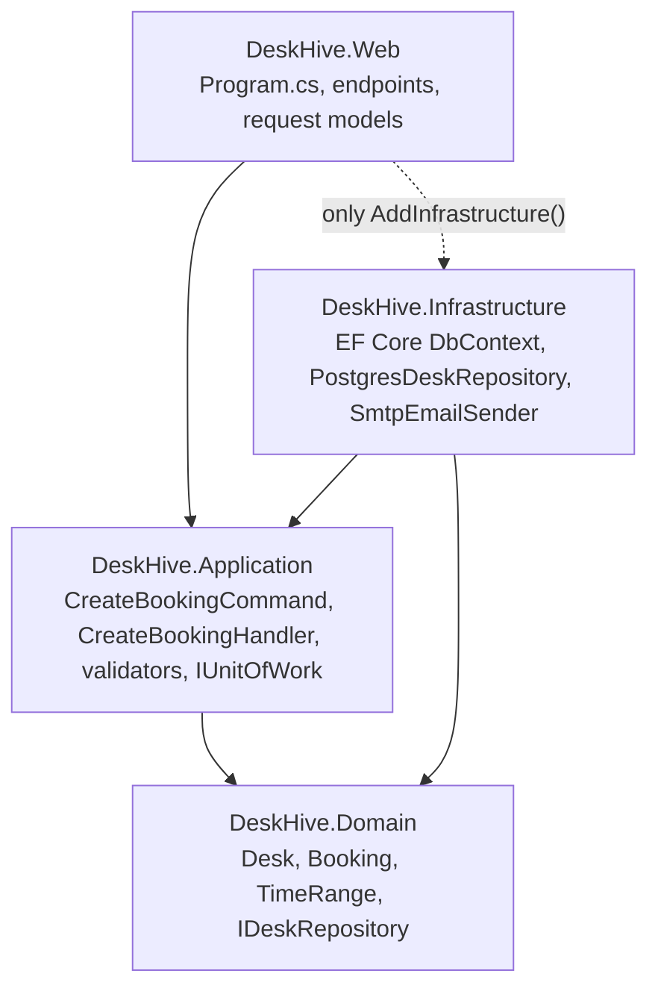
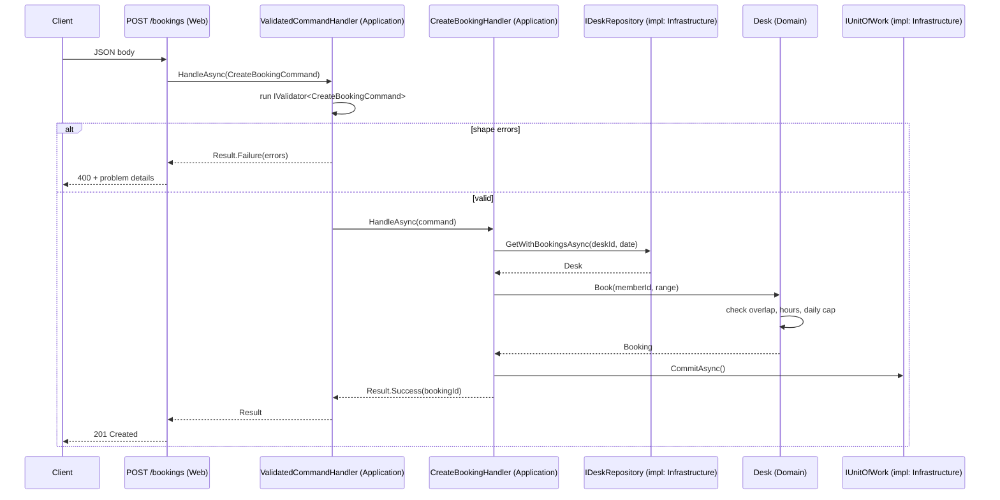
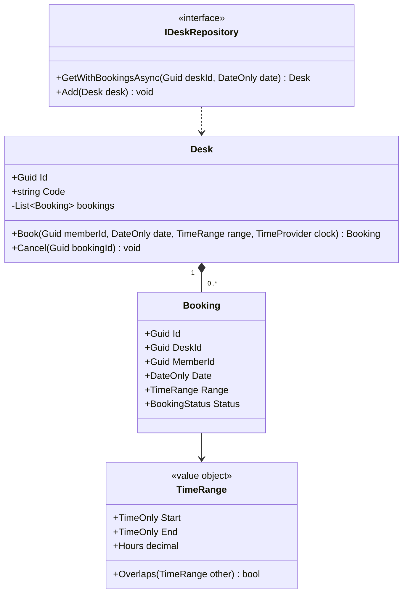

Clean Architecture is the most copied solution template in the .NET world and one of the most misunderstood. Its single idea is small: **source code dependencies point inward, toward business rules.** Everything else (four projects, handlers, interfaces everywhere) is one way of making that idea hard to break. This lesson builds a real example, shows where every kind of file belongs, and then takes a hard look at when the ceremony is worth it.

## Learning objectives

By the end of this lesson you will be able to:

1. State the dependency rule and explain why business rules must not know about the database or the web framework.
2. Create the four projects (Domain, Application, Infrastructure, Web), set the project references correctly, and explain why each reference exists.
3. Write a use case as a command plus a handler, with validation separated from business rules.
4. Decide, for any given class, which project it belongs in, using a short set of questions.
5. Wire infrastructure into the host with DI and cross-cutting decorators (validation, logging).
6. List the honest criticisms of Clean Architecture and recognise when a two-project solution or vertical slices would serve you better.

## Prerequisites

- [Clean Architecture and Onion Architecture](#/lesson/m02-clean-onion): the concept at a high level.
- [Dependency Inversion Principle](#/lesson/m04-dip): the inner layer owns the interfaces.
- [Domain versus infrastructure dependencies](#/lesson/m08-domain-vs-infra): what counts as a domain concern.
- [Application services](#/lesson/m08-application-services): the orchestration role that handlers play.

## Explain it like I'm a beginner

Imagine a co-working space in Bengaluru called DeskHive. Members book desks by the hour. The rules are simple: a desk cannot be double-booked, a booking must be inside opening hours (08:00 to 22:00), and nobody can book more than 10 hours a day.

Where do those rules live? In a quick-and-dirty app they live inside the controller, between the line that reads the HTTP body and the line that calls `SaveChanges`. That works until you want to:

- test the double-booking rule without starting a web server and a database;
- accept bookings from a WhatsApp bot as well as the website;
- swap PostgreSQL for a different store, or add caching, without touching the rules.

Clean Architecture says: **put the rules in the middle, and make everything else depend on them, never the other way round.** Think of an onion. The centre is the business (a desk, a booking, "no overlap"). The next ring is the use cases ("book a desk for member M from 10:00 to 13:00"). The outer ring is the messy world: HTTP, PostgreSQL, email, clocks. Outer rings may know about inner rings. Inner rings must not know the outer ones exist.

Analogy: a courtroom. The law (domain) does not change depending on which building the trial happens in or which stenographer records it. The procedure (use case) applies the law to one case. The building, the microphones and the filing system (infrastructure) can all be replaced without changing a single law.

The technical term for the key trick is **dependency inversion**: the inner ring declares what it needs as an interface (`IDeskRepository`), and the outer ring provides the implementation (`PostgresDeskRepository`). The arrow in the code points inward even though data flows outward.

## First-principles explanation

### The dependency rule

Every version of this idea (Hexagonal/Ports and Adapters, Onion, Clean) shares one rule: **nothing in an inner circle can name anything in an outer circle.** Not a class, not a function, not a namespace, not a data format. In .NET, the easiest way to make that rule unbreakable is to use separate projects, because a project cannot use a type from an assembly it does not reference. The compiler becomes the architecture police.

### The four projects and what each one is for

| Project | Contains | References | Must not reference |
|---|---|---|---|
| `DeskHive.Domain` | Entities, value objects, domain events, domain exceptions, repository *interfaces*, domain services | nothing (BCL only) | anything else |
| `DeskHive.Application` | Use cases (commands, queries, handlers), validation, DTOs, interfaces for external services (`IEmailSender`, `IUnitOfWork`), cross-cutting behaviours | Domain | Infrastructure, Web, EF Core, ASP.NET Core |
| `DeskHive.Infrastructure` | EF Core `DbContext`, repository implementations, email/SMS clients, clock, file storage | Application, Domain | Web |
| `DeskHive.Web` | Minimal API endpoints or controllers, request/response models, `Program.cs` (the composition root), middleware | Application, Infrastructure (only to call `AddInfrastructure()`) | — |

Two things trip people up:

1. **Who owns the interfaces?** The layer that *needs* the capability. `IDeskRepository` is needed by domain and application code, so it lives in Domain (or Application; both are defensible, Domain if the domain itself uses it). `IEmailSender` is needed only by use cases, so it lives in Application. Infrastructure implements them. This is the Dependency Inversion Principle applied with project boundaries.
2. **Why does Web reference Infrastructure at all?** Only so `Program.cs` can call `services.AddInfrastructure(configuration)`. Nothing else in Web should use an Infrastructure type. Some teams move registration into a separate tiny project or use reflection to avoid even this reference. It is not worth the trouble; one controlled reference from the composition root is fine.

### Use cases as commands and handlers

A use case is one thing a user can do: *create a booking*, *cancel a booking*, *list my bookings for a week*. In Clean Architecture it becomes:

- a **request object** describing the intent (`CreateBookingCommand` with desk id, member id, date, start, end),
- a **handler** that loads what it needs through interfaces, calls domain behaviour, saves, and returns a result.

Why not one `BookingService` with twelve methods? You can. The handler-per-use-case shape has three advantages: each handler has only the dependencies that use case needs (a `BookingService` with twelve methods needs the union of all their dependencies); each handler is a natural unit for cross-cutting behaviour (validate, log, time, retry); and the files are small enough that two developers rarely edit the same one. The cost is more files. Libraries such as MediatR package this shape; you do not need a library to use it, and this lesson does not.

### Three kinds of validation

Beginners put everything in one validator. Separate three concerns:

1. **Shape validation** (is `End` after `Start`? is `DeskId` non-empty?). Pure, stateless, knows nothing about the database. Lives in Application next to the command. In production, FluentValidation is the common library; a hand-rolled `IValidator<T>` works just as well and is what we compile here.
2. **Domain rules** (no overlapping bookings, inside opening hours, 10-hour daily cap). These need the aggregate's state. They live in Domain, inside the entity's methods, and they are enforced *every* time, not just at the API.
3. **Existence and authorisation** (does the desk exist? may this member book this desk?). Need repositories or the current user. Live in the handler.

If you put domain rules in the API validator, a background job or a second entry point can bypass them. If you put shape validation in the entity, the entity needs to know about request formats. Keep them apart.

### Where the transaction lives

The handler is the transaction boundary. It opens one unit of work, loads one aggregate (a `Desk` with its bookings for the day), calls a method on it, and commits. If a use case needs two aggregates in one transaction, that is a design smell discussed in [Transaction boundaries](#/lesson/m08-transaction-boundaries). The handler does not know whether `IUnitOfWork.CommitAsync` runs `SaveChangesAsync` on EF Core or does nothing in a test.

### Trade-offs

| You gain | You pay |
|---|---|
| Business rules testable with zero infrastructure | Four projects and more files for every feature |
| Infrastructure swappable (database, email, clock) | Interfaces for things you will never swap (you will not swap PostgreSQL) |
| Clear answer to "where does this go?" | Mapping between layers: request model → command → entity → DTO → response |
| Framework upgrades touch only the outer ring | Indirection makes "follow the code" slower for newcomers |
| Enforced by the compiler, not by discipline | Easy to over-abstract (`IRepository<T>` for everything, `IDateTimeProvider` wrapping `TimeProvider`) |

### When it is unnecessary

- A service with a handful of CRUD endpoints and no real business rules. Two projects (app + tests) or even one, with feature folders, is enough.
- A prototype or internal tool with a lifetime measured in months.
- A team of one or two. The coordination benefits (small files, clear ownership) have no one to benefit.

The [Vertical Slice lesson](#/lesson/m08-vertical-slice) shows the lighter alternative, and the two combine well.

## Visual explanation

### Project dependency graph



Read the arrows as "may reference". Every solid arrow points toward Domain. Domain has no outgoing arrow at all: it compiles against the base class library and nothing else. The dotted arrow from Web to Infrastructure exists only so the composition root can register implementations; no endpoint uses an Infrastructure type directly. If you ever find yourself wanting an arrow from Domain or Application to Infrastructure, you are about to break the rule, and the fix is to declare an interface in the inner project and implement it in the outer one.

### Creating a booking



Follow the ownership of each participant. The endpoint (Web) knows about HTTP and about the command type. The validating decorator and handler (Application) know about the command, the repository *interface* and the domain. The `Desk` (Domain) knows only its own rules. The repository and unit of work implementations (Infrastructure) are reached through interfaces, so the Application project compiles without them. The diagram also shows the three validation kinds in order: shape in the decorator, existence in the handler (a missing desk returns a failure there), domain rules inside `Desk.Book`.

### Domain model



`Desk` is the aggregate root for the "no double-booking" rule, because that rule needs to see all bookings on the desk for a day. `TimeRange` is a value object: two ranges with the same start and end are the same range, and it carries the one behaviour (`Overlaps`) that the rule needs. `IDeskRepository` is drawn in the same diagram because it lives in the Domain project, but note the direction: it depends on `Desk`, and nothing in Domain depends on how it is implemented.

## Step-by-step example

### Step 1 — the starting point: everything in the endpoint

```csharp
// Bad: rules, data access and HTTP in one place
app.MapPost("/bookings", async (BookingRequest req, DeskHiveDbContext db) =>
{
    if (req.End <= req.Start) return Results.BadRequest("End must be after start");
    var clash = await db.Bookings.AnyAsync(b => b.DeskId == req.DeskId && b.Date == req.Date
                                             && b.Start < req.End && req.Start < b.End);
    if (clash) return Results.Conflict("Desk already booked");
    db.Bookings.Add(new Booking { /* ... */ });
    await db.SaveChangesAsync();
    return Results.Created();
});
```

Three rules are missing (opening hours, daily cap, cancelled bookings should not block), and when they are added, this lambda will reach 60 lines. The overlap rule is written as a LINQ expression, so it cannot be unit-tested without a database, and it will be copied into the "move booking" endpoint next month.

### Step 2 — create the projects and references

```bash
dotnet new classlib -n DeskHive.Domain
dotnet new classlib -n DeskHive.Application
dotnet new classlib -n DeskHive.Infrastructure
dotnet new web      -n DeskHive.Web
dotnet add DeskHive.Application    reference DeskHive.Domain
dotnet add DeskHive.Infrastructure reference DeskHive.Application DeskHive.Domain
dotnet add DeskHive.Web            reference DeskHive.Application DeskHive.Infrastructure
```

Domain gets no `dotnet add reference` and no NuGet packages. If a package wants in (even a "harmless" one such as a JSON library), ask what the domain needs it for.

### Step 3 — move the rules into the Domain

`TimeRange.Overlaps`, opening hours, the 10-hour cap and "cancelled bookings do not block" all go into `Desk.Book`. Now the rules have one home, are enforced for every caller, and can be tested with plain objects in microseconds.

### Step 4 — write the use case

`CreateBookingCommand` + `CreateBookingHandler`. The handler is about 20 lines: load, call domain, commit, map to result. A `CreateBookingValidator` checks shape. A `ValidatedCommandHandler` decorator runs validators before any handler.

### Step 5 — implement infrastructure and wire the host

`InMemoryDeskRepository` for this lesson (an EF Core version is sketched below), `AddInfrastructure()` extension, and a thin endpoint that maps the command's `Result` to HTTP status codes.

## Production-style C# implementation

The files below form one compilable set. In a real solution each `file=` path's first folder is a separate project.

```csharp file=Domain/TimeRange.cs
namespace DeskHive.Domain;

/// <summary>Half-open interval [Start, End) on one day. Value object: equality by value, immutable.</summary>
public readonly record struct TimeRange
{
    public TimeOnly Start { get; }
    public TimeOnly End { get; }

    public TimeRange(TimeOnly start, TimeOnly end)
    {
        if (end <= start) throw new DomainRuleViolationException("range.invalid", "End must be after start.");
        Start = start; End = end;
    }

    public decimal Hours => (decimal)(End - Start).TotalHours;

    /// <summary>Two half-open intervals overlap when each starts before the other ends.</summary>
    public bool Overlaps(TimeRange other) => Start < other.End && other.Start < End;

    public bool IsWithin(TimeRange outer) => Start >= outer.Start && End <= outer.End;
}

public sealed class DomainRuleViolationException(string code, string message) : Exception(message)
{
    public string Code { get; } = code;
}
```

```csharp file=Domain/Desk.cs
namespace DeskHive.Domain;

public enum BookingStatus { Active, Cancelled }

public sealed class Booking
{
    public Guid Id { get; }
    public Guid DeskId { get; }
    public Guid MemberId { get; }
    public DateOnly Date { get; }
    public TimeRange Range { get; }
    public BookingStatus Status { get; private set; } = BookingStatus.Active;

    internal Booking(Guid id, Guid deskId, Guid memberId, DateOnly date, TimeRange range)
    {
        Id = id; DeskId = deskId; MemberId = memberId; Date = date; Range = range;
    }

    internal void Cancel() => Status = BookingStatus.Cancelled;
}

/// <summary>Aggregate root. Owns the rule "a desk is never double-booked" and the opening-hours and daily-cap rules.</summary>
public sealed class Desk
{
    public static readonly TimeRange OpeningHours = new(new TimeOnly(8, 0), new TimeOnly(22, 0));
    public const decimal MaxHoursPerMemberPerDay = 10m;

    private readonly List<Booking> _bookings = new();

    public Guid Id { get; }
    public string Code { get; }
    public IReadOnlyCollection<Booking> Bookings => _bookings;

    public Desk(Guid id, string code, IEnumerable<Booking>? existing = null)
    {
        if (string.IsNullOrWhiteSpace(code)) throw new DomainRuleViolationException("desk.code", "Desk code is required.");
        Id = id; Code = code;
        if (existing is not null) _bookings.AddRange(existing);
    }

    public Booking Book(Guid memberId, DateOnly date, TimeRange range, DateTimeOffset now)
    {
        if (date < DateOnly.FromDateTime(now.Date))
            throw new DomainRuleViolationException("booking.past", "Cannot book a past date.");
        if (!range.IsWithin(OpeningHours))
            throw new DomainRuleViolationException("booking.hours", "Bookings must fall within 08:00-22:00.");

        var active = _bookings.Where(b => b.Date == date && b.Status == BookingStatus.Active).ToList();
        if (active.Any(b => b.Range.Overlaps(range)))
            throw new DomainRuleViolationException("booking.conflict", $"Desk {Code} is already booked in that period.");

        var memberHours = active.Where(b => b.MemberId == memberId).Sum(b => b.Range.Hours) + range.Hours;
        if (memberHours > MaxHoursPerMemberPerDay)
            throw new DomainRuleViolationException("booking.cap", $"Members may book at most {MaxHoursPerMemberPerDay} hours per day on a desk.");

        var booking = new Booking(Guid.NewGuid(), Id, memberId, date, range);
        _bookings.Add(booking);
        return booking;
    }

    public void Cancel(Guid bookingId)
    {
        var b = _bookings.FirstOrDefault(x => x.Id == bookingId)
                ?? throw new DomainRuleViolationException("booking.missing", "Booking not found on this desk.");
        b.Cancel();
    }
}

/// <summary>Owned by the Domain because the domain defines what it needs. Implemented in Infrastructure.</summary>
public interface IDeskRepository
{
    Task<Desk?> GetWithBookingsAsync(Guid deskId, DateOnly date, CancellationToken ct);
    void Add(Desk desk);
}
```

The Application project. Notice the complete absence of HTTP and database types.

```csharp file=Application/Abstractions.cs
namespace DeskHive.Application.Abstractions;

public sealed record Error(string Code, string Message);

/// <summary>Errors as values. Handlers never throw for expected business outcomes.</summary>
public sealed class Result<T>
{
    public bool IsSuccess { get; }
    public T? Value { get; }
    public IReadOnlyList<Error> Errors { get; }

    private Result(bool ok, T? value, IReadOnlyList<Error> errors) { IsSuccess = ok; Value = value; Errors = errors; }

    public static Result<T> Success(T value) => new(true, value, Array.Empty<Error>());
    public static Result<T> Failure(IEnumerable<Error> errors) => new(false, default, errors.ToList());
    public static Result<T> Failure(string code, string message) => Failure(new[] { new Error(code, message) });
}

public interface ICommandHandler<in TCommand, TResult>
{
    Task<Result<TResult>> HandleAsync(TCommand command, CancellationToken ct);
}

public interface IValidator<in T>
{
    IReadOnlyList<Error> Validate(T instance);
}

/// <summary>Commit boundary. Infrastructure maps it to DbContext.SaveChangesAsync.</summary>
public interface IUnitOfWork
{
    Task CommitAsync(CancellationToken ct);
}
```

```csharp file=Application/Bookings/CreateBooking.cs
using DeskHive.Application.Abstractions;
using DeskHive.Domain;

namespace DeskHive.Application.Bookings;

public sealed record CreateBookingCommand(Guid DeskId, Guid MemberId, DateOnly Date, TimeOnly Start, TimeOnly End);

public sealed record CreateBookingResult(Guid BookingId, decimal Hours);

/// <summary>Shape validation only. Knows nothing about desks in the database or opening hours.</summary>
public sealed class CreateBookingValidator : IValidator<CreateBookingCommand>
{
    public IReadOnlyList<Error> Validate(CreateBookingCommand c)
    {
        var errors = new List<Error>();
        if (c.DeskId == Guid.Empty) errors.Add(new Error("deskId.required", "Desk id is required."));
        if (c.MemberId == Guid.Empty) errors.Add(new Error("memberId.required", "Member id is required."));
        if (c.End <= c.Start) errors.Add(new Error("range.invalid", "End must be after start."));
        if (c.Start.Minute % 30 != 0 || c.End.Minute % 30 != 0) errors.Add(new Error("range.granularity", "Bookings are made in 30-minute steps."));
        return errors;
    }
}

public sealed class CreateBookingHandler(IDeskRepository desks, IUnitOfWork uow, TimeProvider clock)
    : ICommandHandler<CreateBookingCommand, CreateBookingResult>
{
    public async Task<Result<CreateBookingResult>> HandleAsync(CreateBookingCommand c, CancellationToken ct)
    {
        var desk = await desks.GetWithBookingsAsync(c.DeskId, c.Date, ct);
        if (desk is null) return Result<CreateBookingResult>.Failure("desk.notFound", $"Desk {c.DeskId} does not exist.");

        try
        {
            var booking = desk.Book(c.MemberId, c.Date, new TimeRange(c.Start, c.End), clock.GetUtcNow());
            await uow.CommitAsync(ct);
            return Result<CreateBookingResult>.Success(new CreateBookingResult(booking.Id, booking.Range.Hours));
        }
        catch (DomainRuleViolationException ex)
        {
            return Result<CreateBookingResult>.Failure(ex.Code, ex.Message);
        }
    }
}
```

A cross-cutting behaviour implemented as a decorator (see [Decorator](#/lesson/m06-decorator)): validation runs before any handler, for every command, without the handler knowing.

```csharp file=Application/Behaviors/ValidatedCommandHandler.cs
using DeskHive.Application.Abstractions;

namespace DeskHive.Application.Behaviors;

public sealed class ValidatedCommandHandler<TCommand, TResult>(
    ICommandHandler<TCommand, TResult> inner,
    IEnumerable<IValidator<TCommand>> validators) : ICommandHandler<TCommand, TResult>
{
    public Task<Result<TResult>> HandleAsync(TCommand command, CancellationToken ct)
    {
        var errors = validators.SelectMany(v => v.Validate(command)).ToList();
        return errors.Count > 0
            ? Task.FromResult(Result<TResult>.Failure(errors))
            : inner.HandleAsync(command, ct);
    }
}
```

Infrastructure: the in-memory implementation used here, plus the registration method the host calls.

```csharp file=Infrastructure/InMemoryPersistence.cs
using DeskHive.Application.Abstractions;
using DeskHive.Domain;
using Microsoft.Extensions.DependencyInjection;

namespace DeskHive.Infrastructure;

/// <summary>Stand-in for an EF Core repository. In production: DeskHiveDbContext + Include(d => d.Bookings.Where(b => b.Date == date)).</summary>
public sealed class InMemoryDeskRepository : IDeskRepository
{
    private readonly Dictionary<Guid, Desk> _desks = new();

    public Task<Desk?> GetWithBookingsAsync(Guid deskId, DateOnly date, CancellationToken ct)
        => Task.FromResult(_desks.GetValueOrDefault(deskId));

    public void Add(Desk desk) => _desks[desk.Id] = desk;
}

public sealed class NoOpUnitOfWork : IUnitOfWork
{
    public Task CommitAsync(CancellationToken ct) => Task.CompletedTask;
}

public static class InfrastructureRegistration
{
    public static IServiceCollection AddInfrastructure(this IServiceCollection services)
    {
        var repo = new InMemoryDeskRepository();
        repo.Add(new Desk(Guid.Parse("11111111-1111-1111-1111-111111111111"), "B-07"));
        services.AddSingleton<IDeskRepository>(repo);                 // singleton only because it is in-memory
        services.AddScoped<IUnitOfWork, NoOpUnitOfWork>();
        services.AddSingleton(TimeProvider.System);
        return services;
    }
}
```

The real EF Core version of the repository and unit of work looks like this (not compiled here because EF Core is not available to the checker):

```csharp
public sealed class EfDeskRepository(DeskHiveDbContext db) : IDeskRepository
{
    public Task<Desk?> GetWithBookingsAsync(Guid deskId, DateOnly date, CancellationToken ct) =>
        db.Desks.Include(d => d.Bookings.Where(b => b.Date == date))
                .SingleOrDefaultAsync(d => d.Id == deskId, ct);
    public void Add(Desk desk) => db.Desks.Add(desk);
}

public sealed class EfUnitOfWork(DeskHiveDbContext db) : IUnitOfWork
{
    public Task CommitAsync(CancellationToken ct) => db.SaveChangesAsync(ct);
}
// Registration: services.AddDbContext<DeskHiveDbContext>(o => o.UseNpgsql(cs)); AddScoped<IDeskRepository, EfDeskRepository>(); AddScoped<IUnitOfWork, EfUnitOfWork>();
```

The Web project. `Program.cs` is the composition root: the one place that knows about every layer.

```csharp file=Program.cs
using DeskHive.Application.Abstractions;
using DeskHive.Application.Behaviors;
using DeskHive.Application.Bookings;
using DeskHive.Infrastructure;

var builder = WebApplication.CreateBuilder(args);

builder.Services.AddInfrastructure();
builder.Services.AddScoped<IValidator<CreateBookingCommand>, CreateBookingValidator>();
builder.Services.AddScoped<CreateBookingHandler>();
// Decorate: the interface resolves to the validating wrapper around the real handler.
builder.Services.AddScoped<ICommandHandler<CreateBookingCommand, CreateBookingResult>>(sp =>
    new ValidatedCommandHandler<CreateBookingCommand, CreateBookingResult>(
        sp.GetRequiredService<CreateBookingHandler>(),
        sp.GetServices<IValidator<CreateBookingCommand>>()));

var app = builder.Build();

app.MapPost("/bookings", async (CreateBookingRequest req, ICommandHandler<CreateBookingCommand, CreateBookingResult> handler, CancellationToken ct) =>
{
    var result = await handler.HandleAsync(new CreateBookingCommand(req.DeskId, req.MemberId, req.Date, req.Start, req.End), ct);
    if (result.IsSuccess) return Results.Created($"/bookings/{result.Value!.BookingId}", result.Value);

    var status = result.Errors.Any(e => e.Code == "desk.notFound") ? StatusCodes.Status404NotFound
               : result.Errors.Any(e => e.Code.StartsWith("booking.")) ? StatusCodes.Status409Conflict
               : StatusCodes.Status400BadRequest;
    return Results.Problem(title: "Booking failed", statusCode: status,
        extensions: new Dictionary<string, object?> { ["errors"] = result.Errors });
});

app.Run();

/// <summary>Web-layer request model. Kept separate from the command so the HTTP contract can change without touching Application.</summary>
public sealed record CreateBookingRequest(Guid DeskId, Guid MemberId, DateOnly Date, TimeOnly Start, TimeOnly End);
```

### Where does it go? A decision table

| You are writing... | Project | Why |
|---|---|---|
| "A booking must not overlap another active booking" | Domain | Business rule that must hold for every entry point |
| `IDeskRepository` | Domain (or Application) | Declared by whoever needs it; implemented outside |
| `CreateBookingCommand`, handler | Application | A use case: orchestrates domain and ports |
| "End must be after Start" | Domain (`TimeRange` constructor) and Application validator | The value object guarantees it; the validator gives a friendly 400 before touching the database |
| `IEmailSender`, `IPaymentGateway` | Application | External capability a use case needs |
| `DeskHiveDbContext`, `EfDeskRepository`, `SmtpEmailSender` | Infrastructure | Talks to the outside world |
| `CreateBookingRequest`, endpoint, `ProblemDetails` mapping | Web | HTTP concern |
| `AddInfrastructure()` | Infrastructure | Registration belongs with what it registers |
| Logging the duration of each use case | Application (decorator) | Cross-cutting; no HTTP needed |
| `Money`, `Percentage` value objects | Domain | Core concepts |
| Mapping entity to API response | Web (or Application DTO) | Presentation shape |

:::callout type=mistake title="Three mistakes that quietly break the dependency rule"
1. **EF Core attributes on domain entities** (`[Table]`, `[Column]`). The domain now references `Microsoft.EntityFrameworkCore`. Use the fluent `IEntityTypeConfiguration<T>` in Infrastructure instead.
2. **`IQueryable<T>` leaking out of a repository.** The caller now writes queries that only work against EF Core; the "interface" is a fiction. Return materialised results or purpose-built query methods.
3. **ASP.NET Core's `IHttpContextAccessor` in Application** to read the current user. Declare `ICurrentUser` in Application and implement it in Web.
:::

## Bad design vs good design

**Bad, variant A (no architecture)**: the 60-line endpoint from Step 1. Rules duplicated across endpoints, untestable without a database, bound to one framework.

**Bad, variant B (cargo-cult architecture)**: four projects, plus `IGenericRepository<T>` with `GetAll()`, `IDeskService`, `IBookingService`, `IMapper`, `IDateTimeProvider`, `IGuidGenerator`, a `BaseEntity<TId>`, a `BaseHandler`, and `AutoMapper` profiles for every DTO. Each use case touches eight files, none of which contains a business rule. The team spends its time on plumbing and still writes the overlap check as a LINQ expression in a "service".

Both variants fail the same test: *can you point at the file where "no double-booking" lives, and unit-test it in a millisecond?*

**Good**: the implementation above. Domain holds the rules in `Desk.Book`. Application holds one small handler and one small validator per use case. Infrastructure implements two interfaces. Web maps HTTP to commands and results to status codes. The whole feature is six files, and the dependency rule is enforced by project references.

### Honest criticisms of Clean Architecture

1. **It optimises for swapping things you will not swap.** You will not change databases. The real benefit of the repository interface is testability and a single query vocabulary, not portability. Know which benefit you are buying.
2. **Mapping tax.** Request → command → entity → result → response. Each hop is a place for bugs and for `AutoMapper` magic. Keep hops minimal: a command can often be the request; a result can often be the response.
3. **Layer-by-layer organisation hides features.** To see everything about "cancel booking" you open three projects. Vertical slices fix this; see the [next lesson](#/lesson/m08-vertical-slice) for combining both.
4. **Anemic domains.** Many "Clean" solutions have entities with only properties and all logic in handlers. That is layered architecture with extra folders. The test: domain classes should have methods that throw or decide something.
5. **Templates encourage generic abstractions.** `IRepository<T>` over everything leads to `GetAll()` pulling 50,000 rows. Write specific methods (`GetWithBookingsAsync(deskId, date)`).

The right response to the criticisms is not to abandon the dependency rule. It is to apply it with the minimum ceremony your project needs.

## Practical playground

Run this reduced version, then add the daily 10-hour cap and a test for it.

:::playground type=csharp title="Desk booking rules without any infrastructure"
```csharp file=Program.cs
using System;
using System.Collections.Generic;
using System.Linq;

public readonly record struct TimeRange(TimeOnly Start, TimeOnly End)
{
    public bool Overlaps(TimeRange o) => Start < o.End && o.Start < End;
    public decimal Hours => (decimal)(End - Start).TotalHours;
}

public sealed record Booking(Guid MemberId, DateOnly Date, TimeRange Range);

public sealed class Desk
{
    private readonly List<Booking> _bookings = new();
    public string Code { get; }
    public Desk(string code) => Code = code;

    public Booking Book(Guid memberId, DateOnly date, TimeRange range)
    {
        if (_bookings.Any(b => b.Date == date && b.Range.Overlaps(range)))
            throw new InvalidOperationException($"Desk {Code} already booked in that period.");
        // TODO: enforce opening hours 08:00-22:00 and a 10-hour daily cap per member
        var b = new Booking(memberId, date, range);
        _bookings.Add(b);
        return b;
    }
}

public static class Program
{
    public static void Main()
    {
        var desk = new Desk("B-07");
        var day = new DateOnly(2026, 11, 10);
        var alice = Guid.NewGuid();
        desk.Book(alice, day, new TimeRange(new TimeOnly(9, 0), new TimeOnly(12, 0)));
        Console.WriteLine("Booked 09:00-12:00");
        try
        {
            desk.Book(Guid.NewGuid(), day, new TimeRange(new TimeOnly(11, 0), new TimeOnly(13, 0)));
            Console.WriteLine("BUG: overlap allowed");
        }
        catch (InvalidOperationException ex) { Console.WriteLine($"Rejected: {ex.Message}"); }
    }
}
```
:::

## Exercises

:::exercise id=m08-clean-architecture-aspnet-ex1 difficulty=beginner kind=code title="Implement the overlap and opening-hours rules"
Implement `TimeRange.Overlaps`, `TimeRange.IsWithin` and `Desk.Book` so that the domain enforces: no overlap with an active booking on the same date, bookings only within 08:00–22:00, and cancelled bookings do not block new ones.
::requirements
- `TimeRange` is a half-open interval: 09:00–12:00 and 12:00–14:00 do not overlap.
- `Desk.Book` throws `DomainRuleViolationException` with code `booking.conflict` or `booking.hours`.
- `Desk.Cancel(bookingId)` marks a booking cancelled; a later booking in that slot succeeds.
::acceptance
- Booking 11:00–13:00 after 09:00–12:00 throws `booking.conflict`.
- Booking 12:00–14:00 after 09:00–12:00 succeeds.
- Booking 07:00–09:00 throws `booking.hours`.
- After cancelling the 09:00–12:00 booking, booking 10:00–11:00 succeeds.
- Same time range on a different date succeeds.
::hint
Write `Overlaps` first. On paper, draw two intervals and ask: when do they share at least one instant?
::hint
Two half-open intervals overlap when `a.Start < b.End && b.Start < a.End`. Test it with touching intervals: 9–12 and 12–14 should give false.
::hint
In `Book`, filter `_bookings` by date and `Status == Active` before checking overlaps, otherwise cancelled bookings still block.
::hint
```csharp
if (!range.IsWithin(OpeningHours)) throw new DomainRuleViolationException("booking.hours", "...");
var active = _bookings.Where(b => b.Date == date && b.Status == BookingStatus.Active);
if (active.Any(b => b.Range.Overlaps(range))) throw new DomainRuleViolationException("booking.conflict", "...");
```
::starter
```csharp file=Desk.cs
using System;
using System.Collections.Generic;
using System.Linq;

public sealed class DomainRuleViolationException : Exception
{
    public string Code { get; }
    public DomainRuleViolationException(string code, string message) : base(message) => Code = code;
}

public readonly record struct TimeRange(TimeOnly Start, TimeOnly End)
{
    public bool Overlaps(TimeRange other) => throw new NotImplementedException();
    public bool IsWithin(TimeRange outer) => throw new NotImplementedException();
}

public enum BookingStatus { Active, Cancelled }

public sealed class Booking
{
    public Guid Id { get; } = Guid.NewGuid();
    public Guid MemberId { get; }
    public DateOnly Date { get; }
    public TimeRange Range { get; }
    public BookingStatus Status { get; private set; } = BookingStatus.Active;
    public Booking(Guid memberId, DateOnly date, TimeRange range) { MemberId = memberId; Date = date; Range = range; }
    internal void Cancel() => Status = BookingStatus.Cancelled;
}

public sealed class Desk
{
    public static readonly TimeRange OpeningHours = new TimeRange(new TimeOnly(8, 0), new TimeOnly(22, 0));
    private readonly List<Booking> _bookings = new();
    public string Code { get; }
    public Desk(string code) => Code = code;

    public Booking Book(Guid memberId, DateOnly date, TimeRange range) => throw new NotImplementedException();

    public void Cancel(Guid bookingId)
    {
        var b = _bookings.FirstOrDefault(x => x.Id == bookingId) ?? throw new DomainRuleViolationException("booking.missing", "Not found.");
        b.Cancel();
    }
}
```
::tests
```csharp file=DeskTests.cs
using System;
using Xunit;

public class DeskTests
{
    private static readonly DateOnly Day = new DateOnly(2026, 11, 10);
    private static TimeRange R(int s, int e) => new TimeRange(new TimeOnly(s, 0), new TimeOnly(e, 0));

    [Fact]
    public void Touching_ranges_do_not_overlap() => Assert.False(R(9, 12).Overlaps(R(12, 14)));

    [Fact]
    public void Crossing_ranges_overlap() => Assert.True(R(9, 12).Overlaps(R(11, 13)));

    [Fact]
    public void Overlapping_booking_is_rejected()
    {
        var desk = new Desk("B-07");
        desk.Book(Guid.NewGuid(), Day, R(9, 12));
        var ex = Assert.Throws<DomainRuleViolationException>(() => desk.Book(Guid.NewGuid(), Day, R(11, 13)));
        Assert.Equal("booking.conflict", ex.Code);
    }

    [Fact]
    public void Adjacent_booking_is_allowed()
    {
        var desk = new Desk("B-07");
        desk.Book(Guid.NewGuid(), Day, R(9, 12));
        desk.Book(Guid.NewGuid(), Day, R(12, 14));
    }

    [Fact]
    public void Outside_opening_hours_is_rejected()
    {
        var desk = new Desk("B-07");
        var ex = Assert.Throws<DomainRuleViolationException>(() => desk.Book(Guid.NewGuid(), Day, R(7, 9)));
        Assert.Equal("booking.hours", ex.Code);
    }

    [Fact]
    public void Cancelled_booking_does_not_block()
    {
        var desk = new Desk("B-07");
        var b = desk.Book(Guid.NewGuid(), Day, R(9, 12));
        desk.Cancel(b.Id);
        desk.Book(Guid.NewGuid(), Day, R(10, 11));
    }

    [Fact]
    public void Same_slot_other_day_is_allowed()
    {
        var desk = new Desk("B-07");
        desk.Book(Guid.NewGuid(), Day, R(9, 12));
        desk.Book(Guid.NewGuid(), Day.AddDays(1), R(9, 12));
    }
}
```
::solution
```csharp file=Desk.cs
using System;
using System.Collections.Generic;
using System.Linq;

public sealed class DomainRuleViolationException : Exception
{
    public string Code { get; }
    public DomainRuleViolationException(string code, string message) : base(message) => Code = code;
}

public readonly record struct TimeRange(TimeOnly Start, TimeOnly End)
{
    public bool Overlaps(TimeRange other) => Start < other.End && other.Start < End;
    public bool IsWithin(TimeRange outer) => Start >= outer.Start && End <= outer.End;
}

public enum BookingStatus { Active, Cancelled }

public sealed class Booking
{
    public Guid Id { get; } = Guid.NewGuid();
    public Guid MemberId { get; }
    public DateOnly Date { get; }
    public TimeRange Range { get; }
    public BookingStatus Status { get; private set; } = BookingStatus.Active;
    public Booking(Guid memberId, DateOnly date, TimeRange range) { MemberId = memberId; Date = date; Range = range; }
    internal void Cancel() => Status = BookingStatus.Cancelled;
}

public sealed class Desk
{
    public static readonly TimeRange OpeningHours = new TimeRange(new TimeOnly(8, 0), new TimeOnly(22, 0));
    private readonly List<Booking> _bookings = new();
    public string Code { get; }
    public Desk(string code) => Code = code;

    public Booking Book(Guid memberId, DateOnly date, TimeRange range)
    {
        if (!range.IsWithin(OpeningHours))
            throw new DomainRuleViolationException("booking.hours", "Bookings must fall within 08:00-22:00.");
        var active = _bookings.Where(b => b.Date == date && b.Status == BookingStatus.Active);
        if (active.Any(b => b.Range.Overlaps(range)))
            throw new DomainRuleViolationException("booking.conflict", $"Desk {Code} is already booked in that period.");
        var booking = new Booking(memberId, date, range);
        _bookings.Add(booking);
        return booking;
    }

    public void Cancel(Guid bookingId)
    {
        var b = _bookings.FirstOrDefault(x => x.Id == bookingId) ?? throw new DomainRuleViolationException("booking.missing", "Not found.");
        b.Cancel();
    }
}
```

Every rule is in the Domain and every test runs without a database, a web host or a mock. That is the payoff of the dependency rule.
::mistakes
- Using `<=` in `Overlaps`, which makes 9–12 and 12–14 conflict and loses the venue one slot per booking.
- Checking overlaps against cancelled bookings.
- Putting the opening-hours check in the API validator only, so a background import can create 03:00 bookings.
::extensions
Add the 10-hour daily cap per member and return a `Result` instead of throwing; compare the two styles.
:::

:::exercise id=m08-clean-architecture-aspnet-ex2 difficulty=beginner kind=written title="Where does it go?"
For each item, name the project (Domain, Application, Infrastructure, Web) and give a one-line reason.

1. `Booking.Cancel()` with the rule "cannot cancel less than 1 hour before start".
2. `ICurrentUser { Guid MemberId }`.
3. `JwtCurrentUser` that reads the `sub` claim.
4. `GetMyBookingsQuery` and its handler.
5. `BookingResponse` JSON shape with camel-cased properties.
6. `IEntityTypeConfiguration<Booking>` mapping to table `bookings`.
7. `Percentage` value object used for member discounts.
8. A decorator that logs the duration of every handler.
9. `ISmsSender`.
10. `Program.cs`.
::acceptance
- All ten placed; at least eight match the model answer.
- Each reason mentions either a dependency or a reason to change.
::hint
Ask two questions: "What does this code need to reference?" and "Who would ask for it to change: the business, the product, or operations?"
::hint
Interfaces go where they are *needed*; implementations go where the technology lives.
::hint
If a thing mentions HTTP, JSON, claims or SQL, it is Web or Infrastructure.
::solution
1. **Domain**: a business rule on the aggregate; needs only the clock value passed in.
2. **Application**: handlers need it; it has no HTTP in it.
3. **Web**: reads claims from `HttpContext`, so it must live where ASP.NET Core is referenced.
4. **Application**: a use case.
5. **Web**: presentation shape; the business does not care about camelCase.
6. **Infrastructure**: EF Core mapping; keeps `Microsoft.EntityFrameworkCore` out of Domain.
7. **Domain**: core concept with behaviour (rounding, bounds).
8. **Application**: cross-cutting over handlers; needs `ILogger` from `Microsoft.Extensions.Logging.Abstractions`, which is acceptable in Application (it is an abstraction package, not a framework).
9. **Application**: a capability use cases need; `TwilioSmsSender` would be Infrastructure.
10. **Web**: the composition root is the one place allowed to know every layer.
::mistakes
- Putting `ICurrentUser` in Web because the implementation reads claims. The interface follows the consumer, not the implementation.
:::

:::exercise id=m08-clean-architecture-aspnet-ex3 difficulty=intermediate kind=code title="Validation decorator for command handlers"
Implement `ValidatedCommandHandler<TCommand, TResult>`, a decorator that runs every registered `IValidator<TCommand>`, returns a failed `Result` with all collected errors if any validator reports a problem, and otherwise delegates to the inner handler.
::requirements
- All validators run; errors are concatenated in validator order.
- The inner handler is **not** called when there are errors.
- With zero validators, the inner handler is called directly.
::acceptance
- Two validators each returning one error produce a failure with two errors and the inner handler's call count stays 0.
- With no errors, the inner handler is called exactly once and its result is returned unchanged.
- With no validators registered, the inner handler is called.
::hint
This is the Decorator pattern: same interface in, same interface out, something extra in between.
::hint
`validators.SelectMany(v => v.Validate(command)).ToList()` gathers every error.
::hint
Return `Task.FromResult(Result<TResult>.Failure(errors))` for the failure path; otherwise return `inner.HandleAsync(command, ct)` directly without awaiting (no need for an extra state machine).
::starter
```csharp file=ValidatedCommandHandler.cs
using System;
using System.Collections.Generic;
using System.Linq;
using System.Threading;
using System.Threading.Tasks;

public sealed record Error(string Code, string Message);

public sealed class Result<T>
{
    public bool IsSuccess { get; }
    public T? Value { get; }
    public IReadOnlyList<Error> Errors { get; }
    private Result(bool ok, T? value, IReadOnlyList<Error> errors) { IsSuccess = ok; Value = value; Errors = errors; }
    public static Result<T> Success(T value) => new Result<T>(true, value, Array.Empty<Error>());
    public static Result<T> Failure(IEnumerable<Error> errors) => new Result<T>(false, default, errors.ToList());
}

public interface ICommandHandler<in TCommand, TResult> { Task<Result<TResult>> HandleAsync(TCommand command, CancellationToken ct); }
public interface IValidator<in T> { IReadOnlyList<Error> Validate(T instance); }

public sealed class ValidatedCommandHandler<TCommand, TResult> : ICommandHandler<TCommand, TResult>
{
    private readonly ICommandHandler<TCommand, TResult> _inner;
    private readonly IReadOnlyList<IValidator<TCommand>> _validators;

    public ValidatedCommandHandler(ICommandHandler<TCommand, TResult> inner, IEnumerable<IValidator<TCommand>> validators)
    {
        _inner = inner;
        _validators = validators.ToList();
    }

    public Task<Result<TResult>> HandleAsync(TCommand command, CancellationToken ct) => throw new NotImplementedException();
}
```
::tests
```csharp file=ValidatedCommandHandlerTests.cs
using System;
using System.Collections.Generic;
using System.Threading;
using System.Threading.Tasks;
using Xunit;

public class ValidatedCommandHandlerTests
{
    private sealed record Cmd(string Name);

    private sealed class CountingHandler : ICommandHandler<Cmd, string>
    {
        public int Calls;
        public Task<Result<string>> HandleAsync(Cmd c, CancellationToken ct) { Calls++; return Task.FromResult(Result<string>.Success("ok:" + c.Name)); }
    }

    private sealed class FixedValidator : IValidator<Cmd>
    {
        private readonly Error[] _errors;
        public FixedValidator(params Error[] errors) => _errors = errors;
        public IReadOnlyList<Error> Validate(Cmd c) => _errors;
    }

    [Fact]
    public async Task Errors_from_all_validators_are_collected_and_inner_is_skipped()
    {
        var inner = new CountingHandler();
        var sut = new ValidatedCommandHandler<Cmd, string>(inner, new IValidator<Cmd>[] { new FixedValidator(new Error("a", "A")), new FixedValidator(new Error("b", "B")) });
        var r = await sut.HandleAsync(new Cmd("x"), CancellationToken.None);
        Assert.False(r.IsSuccess);
        Assert.Equal(2, r.Errors.Count);
        Assert.Equal("a", r.Errors[0].Code);
        Assert.Equal("b", r.Errors[1].Code);
        Assert.Equal(0, inner.Calls);
    }

    [Fact]
    public async Task Valid_command_reaches_inner_once()
    {
        var inner = new CountingHandler();
        var sut = new ValidatedCommandHandler<Cmd, string>(inner, new IValidator<Cmd>[] { new FixedValidator() });
        var r = await sut.HandleAsync(new Cmd("x"), CancellationToken.None);
        Assert.True(r.IsSuccess);
        Assert.Equal("ok:x", r.Value);
        Assert.Equal(1, inner.Calls);
    }

    [Fact]
    public async Task No_validators_means_pass_through()
    {
        var inner = new CountingHandler();
        var sut = new ValidatedCommandHandler<Cmd, string>(inner, Array.Empty<IValidator<Cmd>>());
        var r = await sut.HandleAsync(new Cmd("y"), CancellationToken.None);
        Assert.True(r.IsSuccess);
        Assert.Equal(1, inner.Calls);
    }
}
```
::solution
```csharp file=ValidatedCommandHandler.cs
using System;
using System.Collections.Generic;
using System.Linq;
using System.Threading;
using System.Threading.Tasks;

public sealed record Error(string Code, string Message);

public sealed class Result<T>
{
    public bool IsSuccess { get; }
    public T? Value { get; }
    public IReadOnlyList<Error> Errors { get; }
    private Result(bool ok, T? value, IReadOnlyList<Error> errors) { IsSuccess = ok; Value = value; Errors = errors; }
    public static Result<T> Success(T value) => new Result<T>(true, value, Array.Empty<Error>());
    public static Result<T> Failure(IEnumerable<Error> errors) => new Result<T>(false, default, errors.ToList());
}

public interface ICommandHandler<in TCommand, TResult> { Task<Result<TResult>> HandleAsync(TCommand command, CancellationToken ct); }
public interface IValidator<in T> { IReadOnlyList<Error> Validate(T instance); }

public sealed class ValidatedCommandHandler<TCommand, TResult> : ICommandHandler<TCommand, TResult>
{
    private readonly ICommandHandler<TCommand, TResult> _inner;
    private readonly IReadOnlyList<IValidator<TCommand>> _validators;

    public ValidatedCommandHandler(ICommandHandler<TCommand, TResult> inner, IEnumerable<IValidator<TCommand>> validators)
    {
        _inner = inner;
        _validators = validators.ToList();
    }

    public Task<Result<TResult>> HandleAsync(TCommand command, CancellationToken ct)
    {
        var errors = _validators.SelectMany(v => v.Validate(command)).ToList();
        return errors.Count > 0
            ? Task.FromResult(Result<TResult>.Failure(errors))
            : _inner.HandleAsync(command, ct);
    }
}
```

In `Program.cs`, register the concrete handler and then register the interface as a factory that wraps it. With many handlers, write a small helper `services.AddHandler<TCommand, TResult, THandler>()` that does both registrations, or use Scrutor's `Decorate`.
::alternatives
A pipeline of behaviours (`IPipelineBehavior<TRequest, TResponse>` in MediatR style) generalises this to logging, timing and transactions. It is the same decorator idea with a list instead of nesting.
::mistakes
- Stopping at the first validator's errors. The user then fixes one problem per request.
- Throwing a `ValidationException` from the decorator and catching it in middleware. It works, but turns an expected outcome into exception flow; see [Options and Result patterns](#/lesson/m06-options-result).
:::

:::exercise id=m08-clean-architecture-aspnet-ex4 difficulty=intermediate kind=design title="Refactor the fat controller"
A `BookingsController` has a 90-line `Move` action: it validates the request, loads the booking with EF Core, checks the member owns it, checks the new slot is free with a LINQ query, updates the row, sends an SMS via a Twilio client created inline, and returns a response DTO. Produce the list of classes after refactoring to Clean Architecture, with the project for each and the one-sentence responsibility of each.
::acceptance
- The slot-availability rule ends up in the Domain, callable without EF Core.
- SMS sending is behind an interface in Application and implemented in Infrastructure.
- The ownership check and the "booking not found" case are in the handler, returned as `Result` failures.
- The controller or endpoint is under 15 lines and contains no business logic.
::hint
List the five things the action does. Each becomes a class in a different place.
::hint
"Is the new slot free?" is the same rule as in `Desk.Book`. Reuse it: cancel-and-rebook inside the aggregate, or a `Desk.Move(bookingId, newRange)` method.
::hint
Sending the SMS after the commit is a side effect; consider a domain event `BookingMoved` handled after `CommitAsync`, or at least an `ISmsSender` call after the commit, never before.
::solution
- **Domain**: `Desk.Move(Guid bookingId, TimeRange newRange, DateTimeOffset now)` — cancels the old range and applies the same overlap, hours and cap rules; raises `BookingMoved` domain event. `TimeRange` unchanged.
- **Application**: `MoveBookingCommand(BookingId, NewStart, NewEnd)`; `MoveBookingValidator` (shape); `MoveBookingHandler(IDeskRepository, IUnitOfWork, ICurrentUser, TimeProvider)` — loads the desk by booking, returns `booking.notFound` or `booking.forbidden` failures, calls `Desk.Move`, commits, returns `MoveBookingResult`; `ISmsSender`; `NotifyMemberOnBookingMoved : IDomainEventHandler<BookingMoved>` that calls `ISmsSender` after commit.
- **Infrastructure**: `EfDeskRepository.GetByBookingAsync`; `TwilioSmsSender : ISmsSender` with the client injected, not created inline; `EfUnitOfWork` that dispatches domain events after `SaveChangesAsync`.
- **Web**: `MoveBookingRequest`; endpoint `PATCH /bookings/{id}/slot` that maps request → command → `Result` → `200/400/403/404/409`. `JwtCurrentUser : ICurrentUser`.

The controller shrinks to request mapping and status-code mapping. The slot rule has one home and is unit-tested in Domain tests.
::mistakes
- Keeping the LINQ availability check in the handler "because it is faster". It is the same rule duplicated, and it will drift from `Desk.Book`.
- Sending the SMS before `CommitAsync`. If the commit fails, the member gets a message about a move that never happened.
:::

:::exercise id=m08-clean-architecture-aspnet-ex5 difficulty=advanced kind=written title="Write the ADR: full Clean Architecture or not?"
You are the tech lead for an internal tool at an infrastructure consultancy: it records site-visit reports (title, date, project, text, up to 5 photos) and lets managers search them. Four endpoints, two roles, one developer, expected to live two to three years, maybe 200 users. A colleague proposes the standard four-project Clean Architecture template with MediatR, AutoMapper, FluentValidation and a generic repository. Write an Architecture Decision Record (context, options, decision, consequences) that decides how much structure to use.
::acceptance
- At least two options compared, each with concrete costs (files per feature, concepts to learn) and benefits.
- The decision names which Clean Architecture ideas are kept (if any) and which are dropped, and why.
- Consequences include what would trigger revisiting the decision.
::hint
Count what a "create report" feature costs in each option: how many files, how many packages, how many concepts a new developer must learn.
::hint
The dependency rule can be kept cheaply with namespaces and a single architecture test, without four projects.
::hint
Triggers to revisit: a second developer, real business rules appearing (approval workflow, retention policy), or a second entry point (mobile app, batch import).
::solution
**Context.** Four CRUD-ish endpoints, trivial rules (required fields, max 5 photos, only the author or a manager may edit), one developer, small user base, low change pressure.

**Option A — full template**: Domain/Application/Infrastructure/Web, MediatR, AutoMapper, FluentValidation, `IRepository<T>`, `IUnitOfWork`. Create-report feature: command, handler, validator, mapping profile, entity, repository interface, repository implementation, DTO, request model, endpoint — about 10 files across 4 projects, 4 packages, and a newcomer must learn the mediator, mapping conventions and the decorator pipeline. Benefit: ready for growth; rules testable without the database.

**Option B — one web project with feature folders**: `Features/Reports/CreateReport.cs` (request, validation, endpoint handler in one file), `Features/Reports/SearchReports.cs`, a `Domain/` folder for `SiteVisitReport` with its three rules as methods, one `AppDbContext`, one architecture test asserting that the `Domain` namespace references nothing in `Features` or `Data`. Create-report: 1–2 files, 0 extra packages. Rules are still in a domain class and unit-testable. Benefit: a new developer reads one folder per feature.

**Option C — two projects**: `App` and `App.Tests`, otherwise as B. Same as B with a test project, which B needs anyway.

**Decision.** Option C. Keep the dependency rule (domain classes with behaviour, no EF Core types in them, enforced by a namespace-level architecture test). Keep "one handler per endpoint" as a file-organisation habit. Drop separate projects, MediatR, AutoMapper and the generic repository; use `DbContext` directly in feature handlers, with explicit mapping code.

**Consequences.** Faster delivery and a smaller learning curve; infrastructure is not swappable without edits in feature files, which we accept because we will not swap it. Risk: discipline needed to keep rules in domain classes; mitigated by the architecture test and a review checklist. Revisit if: a second team joins, an approval workflow or retention rules appear (real domain logic), or a second entry point (mobile upload, bulk import) needs the same rules. Promotion path: move `Domain/` to its own project first, `Features/` to an Application project only if needed. Both moves are mechanical because the namespaces already match.
::mistakes
- Treating "Clean Architecture" as all-or-nothing. The dependency rule is the valuable part and costs almost nothing; the project count and libraries are optional.
- Choosing the template because "we may need it later" with no named trigger. Speculative generality is a cost today for a benefit that may never come; see [Identifying overengineering and underengineering](#/lesson/m04-over-under-engineering).
:::

## Automated testing

The architecture pays off most visibly in tests, because each layer has a natural test style.

**Domain tests** need nothing but the objects. They are the bulk of your tests and run in microseconds.

```csharp
[Fact]
public void Member_cannot_exceed_ten_hours_on_one_desk_per_day()
{
    var desk = new Desk(Guid.NewGuid(), "B-07");
    var day = new DateOnly(2026, 11, 10);
    var now = new DateTimeOffset(2026, 11, 1, 9, 0, 0, TimeSpan.Zero);
    var m = Guid.NewGuid();
    desk.Book(m, day, new TimeRange(new TimeOnly(8, 0), new TimeOnly(14, 0)), now);   // 6 h
    var ex = Assert.Throws<DomainRuleViolationException>(() =>
        desk.Book(m, day, new TimeRange(new TimeOnly(15, 0), new TimeOnly(20, 0)), now)); // +5 h = 11 h
    Assert.Equal("booking.cap", ex.Code);
}
```

**Handler tests** use hand-rolled fakes for `IDeskRepository` and `IUnitOfWork`. They test orchestration: not-found handling, commit called exactly once on success, never on failure, correct mapping of domain exceptions to `Result` errors.

```csharp
private sealed class FakeDesks(Desk? desk) : IDeskRepository
{
    public Task<Desk?> GetWithBookingsAsync(Guid id, DateOnly d, CancellationToken ct) => Task.FromResult(desk);
    public void Add(Desk desk) { }
}
private sealed class SpyUow : IUnitOfWork { public int Commits; public Task CommitAsync(CancellationToken ct) { Commits++; return Task.CompletedTask; } }

[Fact]
public async Task Conflict_does_not_commit()
{
    var desk = new Desk(Guid.NewGuid(), "B-07");
    var day = new DateOnly(2026, 11, 10);
    var clock = new FixedTimeProvider(new DateTimeOffset(2026, 11, 1, 9, 0, 0, TimeSpan.Zero));
    desk.Book(Guid.NewGuid(), day, new TimeRange(new TimeOnly(9, 0), new TimeOnly(12, 0)), clock.GetUtcNow());
    var uow = new SpyUow();
    var handler = new CreateBookingHandler(new FakeDesks(desk), uow, clock);

    var r = await handler.HandleAsync(new CreateBookingCommand(desk.Id, Guid.NewGuid(), day, new TimeOnly(11, 0), new TimeOnly(13, 0)), default);

    Assert.False(r.IsSuccess);
    Assert.Equal("booking.conflict", r.Errors[0].Code);
    Assert.Equal(0, uow.Commits);
}
```

**Infrastructure tests** hit a real PostgreSQL (Testcontainers or a local instance) and test only the repository: does `GetWithBookingsAsync` load exactly that day's bookings? Keep these few; they are slow.

**Endpoint tests** with `WebApplicationFactory<Program>` check the HTTP mapping: 400 for shape errors, 404 for an unknown desk, 409 for a conflict, 201 with a `Location` header on success. Replace `IDeskRepository` with an in-memory one through `ConfigureTestServices` so these stay fast.

**Architecture tests** assert the dependency rule mechanically: the Domain assembly references no `Microsoft.EntityFrameworkCore` or `Microsoft.AspNetCore` assembly, and no Application type references an Infrastructure type. Ten lines of reflection, as in the [modular monolith lesson](#/lesson/m08-ddd-modular-monolith), or a library such as NetArchTest.

## Real-world application

- **ASP.NET Core reference applications** from Microsoft (eShop and its predecessors) use this layering per service, with `Domain`, `Application`/`UseCases`, `Infrastructure` and an API host, which is why so many teams know the shape.
- **Payment and booking systems** benefit most: rules such as "no double booking", "refund window", "settlement cut-off" are real, change by regulation, and must hold for web, mobile, partner API and back-office batch alike. One domain, many entry points is the sweet spot.
- **Infrastructure project monitoring platforms**: rules such as "a progress claim cannot exceed the BOQ quantity" or "an RFI must be answered within the contractual window" belong in a domain project so that the web portal, the mobile site app and the monthly import job all enforce them identically.
- **Long-lived products** (10+ years) see two or three framework migrations. Teams that kept ASP.NET-specific types out of their rules migrated the outer ring in weeks; teams that did not rewrote.

## Interview questions

:::interview
::q beginner
What is the dependency rule in Clean Architecture?
::a
Source-code dependencies point inward, toward business rules. The Domain references nothing; Application references Domain; Infrastructure and Web reference inward. Nothing in an inner layer may name a type, namespace or data format from an outer layer. In .NET this is enforced by splitting layers into projects, because a project cannot use types from an assembly it does not reference.
::q beginner
Where does the repository interface live, and where does its implementation live?
::a
The interface lives in the inner layer that needs it (Domain or Application), because the inner layer defines what it needs. The implementation (EF Core, Dapper, HTTP client) lives in Infrastructure. This is the Dependency Inversion Principle: the arrow in the code points inward even though data flows outward at runtime.
::q intermediate
How do you separate validation concerns in a Clean Architecture solution?
::a
Three kinds. Shape validation (required fields, end after start) is pure and lives in Application next to the command, often in a decorator that runs before every handler. Domain rules (no double booking, daily cap) live in the aggregate's methods so every entry point enforces them. Existence and authorisation checks (does the desk exist, may this member book it) need repositories or the current user and live in the handler, returning `Result` failures.
::q intermediate
Why does the Web project reference Infrastructure, and is that a violation?
::a
Only so the composition root (`Program.cs`) can call `AddInfrastructure()` to register implementations against the interfaces. It is not a violation of the dependency rule because the Web layer is the outermost ring and is allowed to know about everything; what matters is that no endpoint uses Infrastructure types, and that Application and Domain remain unaware of both. Some teams avoid even this reference with a separate bootstrap project, but the extra ceremony rarely pays.
::q advanced
What are the strongest criticisms of Clean Architecture, and how do you respond to them in practice?
::a
Criticisms: it optimises for swapping infrastructure that is never swapped; it imposes a mapping tax between layers; layer-first organisation scatters a feature across projects; it often produces anemic domains with logic in handlers; templates encourage generic abstractions like `IRepository<T>`. Responses: keep the dependency rule but minimise ceremony (use the command as the request where possible, specific repository methods, no mapping library unless mapping is genuinely complex); organise Application by feature (vertical slices inside the layer); put real behaviour in domain classes; and choose the project count by team size and change pressure rather than by template.
::q advanced
A use case needs to update two aggregates and send an email. How do you structure it?
::a
First question whether two aggregates in one transaction is right; often one is the true consistency boundary and the other can be updated eventually via a domain event. If both really must change atomically, the handler loads both through their repositories, calls domain methods, and commits once through `IUnitOfWork`, which in EF Core is one `SaveChangesAsync` on a shared `DbContext`. The email is a side effect and must happen after the commit, ideally through a domain event (`BookingConfirmed`) dispatched after `SaveChangesAsync`, with an outbox if losing the email is unacceptable. The handler itself stays small: load, call domain, commit, return `Result`.
:::

## Summary and revision

**Key takeaways**

- One rule: dependencies point inward. Domain references nothing; Application references Domain; Infrastructure and Web reference inward. Projects make the compiler enforce it.
- Interfaces live with their consumers (inner layers); implementations live with their technology (Infrastructure).
- Use cases are commands plus handlers. Shape validation in a decorator, business rules in the aggregate, existence and authorisation in the handler.
- The handler is the transaction boundary; side effects happen after the commit.
- Keep the rule, drop the ceremony you do not need: specific repositories, minimal mapping, no library for its own sake. For small projects, feature folders plus one architecture test keep the benefit at a fraction of the cost.

**Terminology**: dependency rule, composition root, use case, command, handler, decorator, `Result`, unit of work, repository, anemic domain, mapping tax.

:::flashcards
Q: What is the one rule all Clean/Onion/Hexagonal variants share?
A: Source-code dependencies point inward toward business rules; inner layers never name outer-layer types.
Q: Which project references nothing but the base class library?
A: Domain.
Q: Where does IEmailSender live, and where does SmtpEmailSender live?
A: IEmailSender in Application (the consumer); SmtpEmailSender in Infrastructure (the technology).
Q: Why does Web reference Infrastructure?
A: Only so Program.cs, the composition root, can call AddInfrastructure() to register implementations.
Q: Name the three kinds of validation and their homes.
A: Shape validation in Application (decorator/validator); domain rules in the aggregate; existence and authorisation in the handler.
Q: What makes a domain "anemic"?
A: Entities with only properties and all logic in services or handlers; the fix is to move rules into entity methods.
Q: How do you run validation before every handler without editing handlers?
A: A decorator (ValidatedCommandHandler) that implements the same ICommandHandler interface and wraps the real handler.
Q: What is the cheap way to keep the dependency rule in a one-project app?
A: Namespaces for Domain/Features/Data plus one architecture test asserting Domain references nothing else.
Q: When is the four-project layout overkill?
A: Small CRUD apps, prototypes, one- or two-person teams with no real business rules or second entry point.
:::

## Knowledge check

:::quiz pass=70
::q single
A developer adds `[Table("bookings")]` from EF Core to the `Booking` class in the Domain project. What is the problem?
- [ ] Nothing; attributes are harmless.
- [x] Domain now depends on EF Core, breaking the dependency rule; use `IEntityTypeConfiguration<Booking>` in Infrastructure instead.
- [ ] The attribute should be on the `Desk` class.
- [ ] EF Core requires attributes to be in the Web project.
> The Domain must compile against the BCL only. Fluent configuration in Infrastructure keeps the mapping with the technology.
::q single
Where should the rule "a member may not exceed 10 hours per day on one desk" be enforced?
- [ ] In the FluentValidation validator for the request.
- [ ] In the endpoint, before calling the handler.
- [x] In `Desk.Book`, inside the Domain.
- [ ] In a SQL check constraint only.
> It is a business rule that must hold for every entry point: web, mobile, batch import. Only the aggregate is on every path.
::q multi
Which belong in the Application project? (Select all that apply.)
- [x] `CreateBookingCommand` and `CreateBookingHandler`
- [x] `IUnitOfWork`
- [ ] `DeskHiveDbContext`
- [x] `ISmsSender`
- [ ] `JwtCurrentUser` reading claims from `HttpContext`
> Use cases and the interfaces they need live in Application. The DbContext and the claims reader are technology and belong in Infrastructure and Web.
::q single
Your handler sends a confirmation email and then calls `CommitAsync`. The commit fails on a unique-constraint violation. What went wrong in the design?
- [ ] The email provider is unreliable.
- [x] A side effect ran before the transaction committed; send after commit (ideally via a domain event, with an outbox if it must not be lost).
- [ ] Unique constraints should not be used.
- [ ] The handler should catch the exception and send a second email.
> Side effects before commit are a classic ordering bug: the user is told about a booking that was never saved.
::q single
A repository interface exposes `IQueryable<Booking> Query()`. Why is this a problem for the dependency rule?
- [ ] `IQueryable` is slow.
- [x] Callers now write EF Core-shaped queries, so Application is coupled to the ORM's behaviour even though it references only an interface.
- [ ] Interfaces cannot return generic types.
- [ ] It makes the repository a singleton.
> The interface is nominal; the real dependency is on LINQ-to-Entities translation rules. Return materialised results from specific methods instead.
::q single
A four-endpoint internal tool, one developer, trivial rules. The template proposes four projects, MediatR, AutoMapper and a generic repository. Best choice?
- [ ] Adopt the full template; it is the standard.
- [x] Keep the dependency rule with namespaces and an architecture test, use feature folders, and skip the extra projects and libraries until a named trigger appears.
- [ ] Put everything in controllers; architecture does not matter for small apps.
- [ ] Use microservices so it can scale.
> The valuable idea is cheap; the ceremony is not. Name the triggers (second team, real rules, second entry point) that would justify promoting to more structure.
::q single
Why is a handler per use case preferred over one `BookingService` with twelve methods?
- [ ] It runs faster.
- [x] Each handler takes only the dependencies its use case needs, is a natural unit for cross-cutting decorators, and keeps files small enough to avoid merge conflicts.
- [ ] Services cannot be registered in DI.
- [ ] It removes the need for interfaces.
> The benefits are about dependencies, composition and team workflow, not performance. A service class is still acceptable for a small feature set.
:::

## Completion criteria

You have finished this lesson when you can:

- [ ] Score at least 70 % on the knowledge check.
- [ ] Complete exercises 1 and 3; the downloaded projects' `dotnet test` should pass.
- [ ] Complete exercise 2 and get at least eight of ten placements right.
- [ ] Draw the four-project dependency graph from memory and explain the one dotted arrow.
- [ ] Explain, in under two minutes, which parts of Clean Architecture you would keep for a small project and which you would drop.
