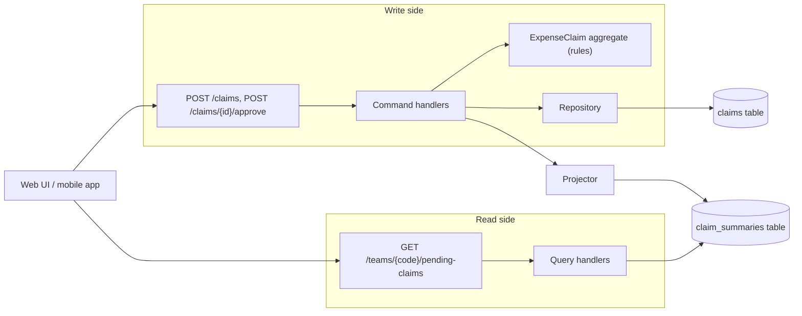
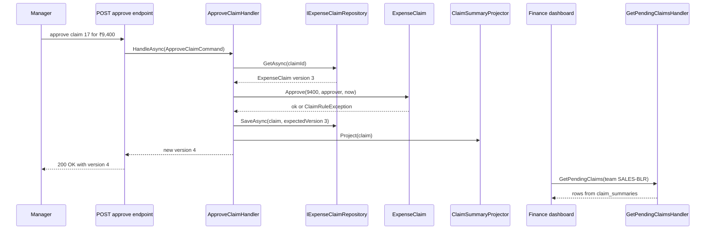
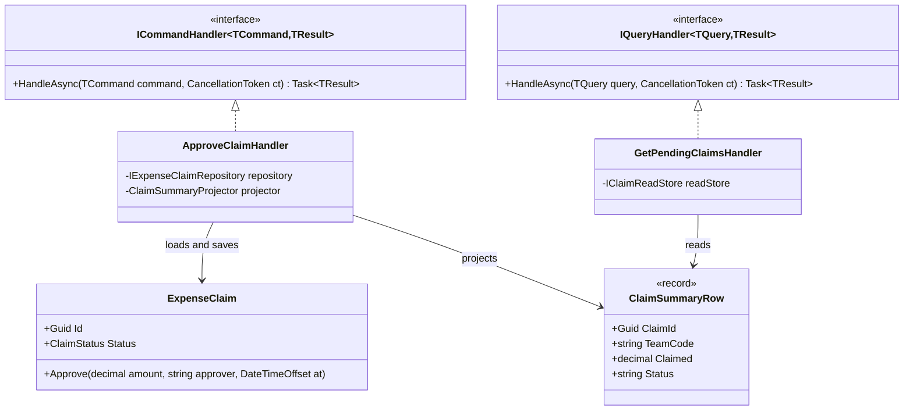

Most business systems read data far more often than they change it. An employee submits an expense claim once, but managers, finance staff and auditors look at lists of claims hundreds of times. Yet many codebases use the very same classes, the same repository and the same table shape for both jobs. The write side wants rich objects that guard rules. The read side wants flat rows, filters and totals. Forcing one model to serve both makes both worse.

**CQRS (Command Query Responsibility Segregation)** is the name for splitting them. This lesson teaches the *simple* version first: one database, two code paths, and a read model that is just another table or view. Event sourcing, message buses and separate databases are optional extras, and we will be honest about when you need them (rarely at first).

The running example is an **expense-claim** feature in a SaaS expense tool (the kind of app where you photograph a receipt and get reimbursed). Employees submit claims for travel, meals and client visits. A manager approves each claim, sometimes for a lower amount than claimed (the hotel bill is approved, the minibar is not). The finance team needs a dashboard of pending claims per team, sorted by how long they have waited.

## Learning objectives

By the end of this lesson you will be able to:

1. Explain the difference between a command and a query, and the older rule it grew from (Command Query Separation).
2. Split an ASP.NET Core feature into command handlers that use the domain model and query handlers that read a flat read model.
3. Keep a read model up to date in the same transaction (synchronous projection) or shortly after (asynchronous projection), and describe the consistency each gives.
4. Design read models around screens and reports rather than around entities.
5. Handle the user-visible effects of eventual consistency, such as "I just saved it, why isn't it in the list?".
6. Decide when CQRS helps, when a single model is better, and why CQRS does **not** require event sourcing.

## Prerequisites

- [Aggregates and aggregate roots](#/lesson/m08-aggregates): the write side of CQRS is usually an aggregate.
- [Application services](#/lesson/m08-application-services): command handlers are application services with a narrow job.
- [Repositories and domain services](#/lesson/m08-repositories-domain-services): we keep repositories on the write side only.
- [Command pattern](#/lesson/m06-command): a command object is a request packaged as data.

If you are new to DDD, you can still follow along. Think "class with rules" when you read "aggregate".

## Explain it like I'm a beginner

Think of a busy railway reservation counter in the 1990s.

At one window, a clerk **books tickets**. She checks the rules: is a berth free, is the passenger's age valid for a concession, has the fare been paid? She writes into the master register carefully, one booking at a time. That is slow, careful work.

At another place, there is a **chart pasted on the platform wall**: the reservation chart. Passengers crowd around it to read their coach and berth. Nobody writes on the chart. It is printed from the register, in exactly the shape passengers need: sorted by coach, with names and berth numbers. It might be printed a little after the last booking, and nobody minds.

Now imagine the railway asked every passenger to read the master register itself, with its crossings-out, fare columns and clerk notes. It would be slow, confusing, and the clerks could not write while 200 people were reading. That is what happens when one model serves both writing and reading.

CQRS says: **keep the careful register for changes (the write model), and print separate charts for reading (read models).**

- A request that changes something ("book this seat", "approve this claim") is a **command**.
- A request that only asks something ("show pending claims for the Bengaluru sales team") is a **query**.
- The printed chart is a **read model** (also called a projection or view model).
- Printing the chart from the register is **projecting**.

## First-principles explanation

### Where it comes from: Command Query Separation

In the late 1980s Bertrand Meyer proposed a rule for methods, **Command Query Separation (CQS)**: a method should either change state (a command) or return data (a query), never both. `stack.Pop()` breaks the rule. `list.Add(x)` and `list.Count` follow it. The benefit is that you can call a query any number of times without fear.

Greg Young and others took this idea up one level, from methods to the architecture of a feature, around 2010. That is CQRS: not just separate *methods*, but separate *models* for writing and reading.

### What it is

CQRS means the code that handles writes and the code that handles reads are separate, and may use different data shapes:

| | Write side (commands) | Read side (queries) |
|---|---|---|
| Purpose | Change state safely | Answer questions quickly |
| Model | Domain model: aggregates with rules | Flat DTOs, one per screen or report |
| Data access | Repository loads one aggregate by id | Direct SQL or a simple read store, many rows |
| Returns | Nothing, or an id or version | Data, never changes anything |
| Validation | Business rules, invariants | Only input checks (page size, filters) |
| Typical volume | Low (tens per second) | High (hundreds or thousands per second) |
| Scaling | Primary database | Can use read replicas, caches, a search index |

### Why it exists — the problem

Look at what a single shared model does in the expense-claim system:

1. **The domain object grows reading baggage.** The finance dashboard wants `EmployeeName`, `TeamName`, `DaysPending` and `ApprovedPercent`. Developers add those to the `ExpenseClaim` entity, and load the `Employee` and `Team` navigations "just for display". Now saving one claim drags three tables into memory.
2. **Queries go through repositories that were built for one-at-a-time loading.** `GetAll()` followed by LINQ filtering in memory is a classic outcome: 40,000 claims loaded to show 25.
3. **The read shape fights the write shape.** The dashboard needs a sum per team and a count per status. The aggregate is shaped around one claim's rules. Every report becomes a clumsy join through objects.
4. **Changes collide.** A tweak to the dashboard (add a column) risks breaking the approval rules, because both live in the same class.

### How it works internally

At the simplest level, CQRS is just a code organisation:

1. Each **command** is a small record (`SubmitClaimCommand`, `ApproveClaimCommand`) handled by exactly one **command handler**. The handler loads the aggregate through a repository, calls a domain method, saves it, and returns at most an id or a version.
2. Each **query** is a small record (`GetPendingClaimsQuery`) handled by one **query handler**. It reads a read model directly and returns DTOs. It never loads aggregates and never calls `SaveChanges`.
3. The **read model** is kept up to date by a **projector**: code that turns write-side changes into read-side rows.

There are three common ways to keep the read model current, from simplest to most complex:

| Option | How | Consistency | Cost |
|---|---|---|---|
| A. Same tables, different queries | Query handlers run SQL (or a database view) over the write tables | Always current | Lowest. Most systems should start here |
| B. Synchronous projection | Command handler writes the aggregate **and** updates a `claim_summaries` table in the same transaction | Always current | Low. Slightly slower writes |
| C. Asynchronous projection | Write side records an event (via an [outbox](#/lesson/m12-outbox)). A background worker updates the read model later | Eventually consistent: usually milliseconds to seconds behind | Higher: workers, retries, idempotency, monitoring |

Option A is still CQRS. The split is in the *code*: the query path does not use the domain model. Many teams get 80 % of the benefit here.

### Commands and queries in detail

**A good command:**

- Is named in the imperative, in the business language: `ApproveClaim`, not `UpdateClaimStatus`.
- Carries the intent and only the data needed: `ClaimId`, `ApprovedAmount`, `ApproverId`.
- Can be rejected. A command is a *request*: "please approve", and the domain may say no ("approved amount cannot exceed the claimed amount").
- Returns little. Returning an id (for a create) or a new version number (for concurrency and read-your-writes) is fine and practical. Returning a full screen DTO couples the write path to the read shape again.

**A good query:**

- Is named after the question: `GetPendingClaims`, `GetClaimHistory`.
- Has no side effects. Calling it twice gives the same answer if nothing else changed.
- Returns exactly the shape the caller needs, already filtered, sorted, paged and totalled.

### When it is useful

- Reads and writes have **very different shapes**: rich rules on write, wide joined reports on read.
- Reads vastly outnumber writes (100 : 1 is common) and you want to scale or cache reads independently.
- Several screens need **different views of the same data**: an employee's "my claims" view, a manager's approval queue, a finance summary.
- The domain model is complex enough to deserve protection from display concerns.
- You plan, or already have, domain events. A projection is a natural consumer.

### When it is unnecessary

- **Simple CRUD.** A master-data screen for "expense categories" with five fields does not need two models. A single EF Core entity and a controller are fine.
- Small apps with a handful of users, where a few joins are fast enough.
- When the team is not ready for eventual consistency and the business cannot tolerate it, avoid option C. Options A and B still apply.

Fowler's warning is worth repeating: for most systems CQRS adds risky complexity. Apply it to the *parts* of a system where reading and writing really differ, not to the whole system by default.

### Trade-offs it introduces

| You gain | You pay |
|---|---|
| Domain model free of display fields | Two models to keep in sync |
| Fast, tailored queries | More classes: a command, a handler, a query, a DTO per use case |
| Reads can scale separately (replicas, caches) | With async projections: stale reads, retries, rebuilds |
| Clear intent: every change is a named business action | Projection bugs are silent: the write succeeds, the screen is wrong |
| Easier to add a new screen without touching rules | Developers must know which side a change belongs to |

## Visual explanation

### Architecture: one database, two paths



Read it from the left. Changes enter through command endpoints. The command handler asks the `ExpenseClaim` aggregate to apply the business rule, and saves it through a repository into the `claims` table. The same handler calls a projector, which updates the flat `claim_summaries` table (option B, same transaction). Queries enter through separate GET endpoints and go straight to `claim_summaries` without touching the aggregate or the repository. In option C the arrow from command handler to projector would be replaced by an event and a background worker. In option A the query handlers would read the `claims` table directly, and there would be no projector at all.

### Command and query, step by step



The manager's request becomes an `ApproveClaimCommand`. The handler loads the aggregate, and the aggregate decides whether approval is allowed. If the rule fails, nothing is saved and the API returns an error. On success, the handler saves with an expected version (optimistic concurrency, from the aggregates lesson), updates the read model, and returns only the new version number. Separately, and at any time, the finance dashboard asks a query handler for pending claims. That path never loads `ExpenseClaim`.

### The pieces as classes



Notice the asymmetry. The command handler depends on the aggregate. The query handler depends only on a flat record. Nothing on the read side knows `ExpenseClaim` exists, which means you can change the dashboard freely, and you can change approval rules without breaking any screen.

## Step-by-step example

### Step 1 — the "one service does everything" version

```csharp
public class ClaimService(AppDbContext db)
{
    public async Task<ClaimDto> Approve(Guid id, decimal amount)
    {
        var claim = await db.Claims.Include(b => b.Employee).Include(b => b.Team)
                                 .Include(b => b.Items).SingleAsync(b => b.Id == id);
        if (amount > claim.Claimed) throw new Exception("too much");
        claim.Status = "Approved";            // rule lives in the service, not the entity
        claim.ApprovedAmount = amount;
        await db.SaveChangesAsync();
        return Map(claim);                     // returns the dashboard DTO from a command
    }

    public async Task<List<ClaimDto>> Pending(string team) =>
        (await db.Claims.Include(b => b.Employee).Include(b => b.Items).ToListAsync())
            .Where(b => b.Team.Code == team && b.Status == "Submitted")
            .Select(Map).ToList();            // loads every claim, filters in memory
}
```

Three smells: the command returns a read DTO, the query loads full entity graphs (and every claim in the database), and the rule "approved ≤ claimed" sits in a service where any other method can skip it.

### Step 2 — separate the methods (CQS)

Split `Approve` so it returns nothing but the new version, and move the rule into the entity: `claim.Approve(amount, approver, now)`. The query method stops calling `Include` and uses `Select` to project straight into the DTO in SQL. This is already a big improvement, and costs almost nothing.

### Step 3 — separate the classes (CQRS, option A)

One handler class per use case: `ApproveClaimHandler`, `SubmitClaimHandler`, `GetPendingClaimsHandler`. Command handlers use a repository. Query handlers use a thin read-only data access (Dapper, raw SQL, or EF Core with `AsNoTracking()` and `Select`). The read side might be a PostgreSQL view:

```sql
CREATE VIEW pending_claims AS
SELECT c.id, t.code AS team_code, e.name AS employee_name, c.claim_no,
       c.claimed_amount, c.submitted_on
FROM claims c
JOIN teams t ON t.id = c.team_id
JOIN employees e ON e.id = c.employee_id
WHERE c.status = 'Submitted';
```

### Step 4 — a dedicated read table (option B)

When the view becomes slow (say, joins across 2 million receipt lines to compute totals) or several screens need precomputed figures, add a `claim_summaries` table. The command handler updates it in the same transaction as the claim. Reads become single-table, indexed lookups.

### Step 5 — only if you must: asynchronous projections (option C)

If the read model lives in a different store (a search index, a reporting database, a cache), or projection work is heavy, publish an event from the write side through an outbox and let a worker update the read model. Now the dashboard can lag behind. The [eventual consistency lesson](#/lesson/m12-eventual-consistency) and [CQRS in production](#/lesson/m16-cqrs) cover this in depth.

## Production-style C# implementation

The code below implements option B: one process, an in-memory store standing in for PostgreSQL, and a projector called inside the command handler. In production, both stores would be tables in the same PostgreSQL database, written in one transaction.

```text
Expenses.Api/
  Program.cs
  Expenses/
    Domain/ExpenseClaim.cs
    Cqrs/Handlers.cs
    Write/ExpenseClaimRepository.cs
    Read/ClaimReadModel.cs
    Commands/SubmitClaim.cs
    Commands/ApproveClaim.cs
    Queries/GetPendingClaims.cs
```

```csharp file=Expenses/Domain/ExpenseClaim.cs
namespace Expenses.Domain;

public enum ClaimStatus { Submitted, Approved, Rejected }

public sealed class ClaimRuleException(string message) : Exception(message);

/// <summary>Write model: an expense claim. All rules live here.</summary>
public sealed class ExpenseClaim
{
    public Guid Id { get; }
    public string TeamCode { get; }
    public string EmployeeName { get; }
    public int ClaimNo { get; }
    public decimal ClaimedAmount { get; }
    public DateOnly SubmittedOn { get; }
    public ClaimStatus Status { get; private set; } = ClaimStatus.Submitted;
    public decimal? ApprovedAmount { get; private set; }
    public string? ApprovedBy { get; private set; }
    public DateTimeOffset? ApprovedAt { get; private set; }
    public string? RejectionReason { get; private set; }
    public int Version { get; internal set; }

    private ExpenseClaim(Guid id, string teamCode, string employeeName, int claimNo, decimal claimed, DateOnly submittedOn)
    {
        Id = id; TeamCode = teamCode; EmployeeName = employeeName;
        ClaimNo = claimNo; ClaimedAmount = claimed; SubmittedOn = submittedOn;
    }

    public static ExpenseClaim Submit(string teamCode, string employeeName, int claimNo, decimal claimed, DateOnly submittedOn)
    {
        if (string.IsNullOrWhiteSpace(teamCode)) throw new ClaimRuleException("Team code is required.");
        if (string.IsNullOrWhiteSpace(employeeName)) throw new ClaimRuleException("Employee is required.");
        if (claimNo <= 0) throw new ClaimRuleException("Claim number must be positive.");
        if (claimed <= 0) throw new ClaimRuleException("Claimed amount must be positive.");
        return new ExpenseClaim(Guid.NewGuid(), teamCode.Trim().ToUpperInvariant(), employeeName.Trim(), claimNo, claimed, submittedOn);
    }

    public void Approve(decimal amount, string approver, DateTimeOffset at)
    {
        if (Status != ClaimStatus.Submitted) throw new ClaimRuleException($"Claim is {Status}; only submitted claims can be approved.");
        if (amount <= 0) throw new ClaimRuleException("Approved amount must be positive.");
        if (amount > ClaimedAmount) throw new ClaimRuleException("Approved amount cannot exceed the claimed amount.");
        if (string.IsNullOrWhiteSpace(approver)) throw new ClaimRuleException("Approver is required.");
        Status = ClaimStatus.Approved; ApprovedAmount = amount; ApprovedBy = approver; ApprovedAt = at;
    }

    public void Reject(string reason)
    {
        if (Status != ClaimStatus.Submitted) throw new ClaimRuleException($"Claim is {Status}; only submitted claims can be rejected.");
        if (string.IsNullOrWhiteSpace(reason)) throw new ClaimRuleException("A rejection reason is required.");
        Status = ClaimStatus.Rejected; RejectionReason = reason;
    }
}
```

The aggregate has no display fields such as `DaysPending` or `TeamName`. Those belong to the read side.

```csharp file=Expenses/Cqrs/Handlers.cs
namespace Expenses.Cqrs;

/// <summary>Changes state. Returns at most an id or a version.</summary>
public interface ICommandHandler<in TCommand, TResult>
{
    Task<TResult> HandleAsync(TCommand command, CancellationToken ct);
}

/// <summary>Reads state. Must have no side effects.</summary>
public interface IQueryHandler<in TQuery, TResult>
{
    Task<TResult> HandleAsync(TQuery query, CancellationToken ct);
}
```

Two tiny interfaces are all the "framework" you need. Libraries such as MediatR or Wolverine add a dispatcher and pipelines, but they are optional (and note that MediatR moved to a commercial licence for new versions in 2025, so check the terms before adopting it). Injecting the handler directly into an endpoint is explicit, easy to follow and easy to debug: "go to definition" lands on the real code.

```csharp file=Expenses/Write/ExpenseClaimRepository.cs
using System.Collections.Concurrent;
using Expenses.Domain;

namespace Expenses.Write;

public sealed class ConcurrencyException(string message) : Exception(message);

public interface IExpenseClaimRepository
{
    Task<ExpenseClaim?> GetAsync(Guid id, CancellationToken ct);
    Task<bool> ExistsAsync(string teamCode, int claimNo, CancellationToken ct);
    /// <summary>Saves and bumps Version. Throws ConcurrencyException if the stored version differs.</summary>
    Task SaveAsync(ExpenseClaim claim, int expectedVersion, CancellationToken ct);
}

/// <summary>Stands in for PostgreSQL. A real version uses EF Core with a concurrency token.</summary>
public sealed class InMemoryExpenseClaimRepository : IExpenseClaimRepository
{
    private readonly ConcurrentDictionary<Guid, ExpenseClaim> _claims = new();
    private readonly Lock _gate = new();

    public Task<ExpenseClaim?> GetAsync(Guid id, CancellationToken ct) =>
        Task.FromResult(_claims.TryGetValue(id, out var b) ? b : null);

    public Task<bool> ExistsAsync(string teamCode, int claimNo, CancellationToken ct) =>
        Task.FromResult(_claims.Values.Any(b => b.TeamCode == teamCode.ToUpperInvariant() && b.ClaimNo == claimNo));

    public Task SaveAsync(ExpenseClaim claim, int expectedVersion, CancellationToken ct)
    {
        lock (_gate)
        {
            var currentVersion = _claims.TryGetValue(claim.Id, out var existing) ? existing.Version : 0;
            if (currentVersion != expectedVersion)
                throw new ConcurrencyException($"Claim {claim.Id} is at version {currentVersion}, expected {expectedVersion}.");
            claim.Version = expectedVersion + 1;
            _claims[claim.Id] = claim;
        }
        return Task.CompletedTask;
    }
}
```

```csharp file=Expenses/Read/ClaimReadModel.cs
using System.Collections.Concurrent;
using Expenses.Domain;

namespace Expenses.Read;

/// <summary>One flat row per claim, shaped for lists and dashboards. No behaviour.</summary>
public sealed record ClaimSummaryRow(
    Guid ClaimId, string TeamCode, string EmployeeName, int ClaimNo,
    decimal Claimed, decimal? Approved, string Status, DateOnly SubmittedOn, int Version);

public interface IClaimReadStore
{
    void Upsert(ClaimSummaryRow row);
    IEnumerable<ClaimSummaryRow> ForProject(string teamCode);
}

public sealed class InMemoryClaimReadStore : IClaimReadStore
{
    private readonly ConcurrentDictionary<Guid, ClaimSummaryRow> _rows = new();

    public void Upsert(ClaimSummaryRow row) =>
        _rows.AddOrUpdate(row.ClaimId, row, (_, old) => row.Version >= old.Version ? row : old);

    public IEnumerable<ClaimSummaryRow> ForProject(string teamCode) =>
        _rows.Values.Where(r => r.TeamCode == teamCode.ToUpperInvariant());
}

/// <summary>Turns the write model into read rows. Called inside the command's transaction (option B).</summary>
public sealed class ClaimSummaryProjector(IClaimReadStore store)
{
    public void Project(ExpenseClaim claim) => store.Upsert(new ClaimSummaryRow(
        claim.Id, claim.TeamCode, claim.EmployeeName, claim.ClaimNo,
        claim.ClaimedAmount, claim.ApprovedAmount, claim.Status.ToString(), claim.SubmittedOn, claim.Version));
}
```

The `Upsert` ignores a row whose version is older than the stored one. That costs one comparison and protects against out-of-order updates if you later move to asynchronous projection.

```csharp file=Expenses/Commands/SubmitClaim.cs
using Expenses.Cqrs;
using Expenses.Domain;
using Expenses.Read;
using Expenses.Write;

namespace Expenses.Commands;

public sealed record SubmitClaimCommand(string TeamCode, string EmployeeName, int ClaimNo, decimal ClaimedAmount);

public sealed class SubmitClaimHandler(IExpenseClaimRepository repository, ClaimSummaryProjector projector, TimeProvider clock)
    : ICommandHandler<SubmitClaimCommand, Guid>
{
    public async Task<Guid> HandleAsync(SubmitClaimCommand c, CancellationToken ct)
    {
        if (await repository.ExistsAsync(c.TeamCode, c.ClaimNo, ct))
            throw new ClaimRuleException($"Claim {c.ClaimNo} already exists for {c.TeamCode}.");

        var today = DateOnly.FromDateTime(clock.GetUtcNow().UtcDateTime);
        var claim = ExpenseClaim.Submit(c.TeamCode, c.EmployeeName, c.ClaimNo, c.ClaimedAmount, today);
        await repository.SaveAsync(claim, expectedVersion: 0, ct);
        projector.Project(claim);       // same unit of work in production
        return claim.Id;                // a create returns only the new id
    }
}
```

The `ExistsAsync` check gives a friendly error, but it is not a guarantee: two double-clicked submits can both pass it before either saves. In PostgreSQL, back it with a unique constraint on `(team_code, claim_no)` and map the unique-violation error (SQLSTATE `23505`) to the same 409 or 422 response. For mobile clients that retry on flaky networks, an `Idempotency-Key` header on `POST /claims` is the more general fix.

```csharp file=Expenses/Commands/ApproveClaim.cs
using Expenses.Cqrs;
using Expenses.Read;
using Expenses.Write;

namespace Expenses.Commands;

public sealed record ApproveClaimCommand(Guid ClaimId, decimal ApprovedAmount, string Approver, int ExpectedVersion);

public sealed class ApproveClaimHandler(IExpenseClaimRepository repository, ClaimSummaryProjector projector, TimeProvider clock)
    : ICommandHandler<ApproveClaimCommand, int>
{
    public async Task<int> HandleAsync(ApproveClaimCommand c, CancellationToken ct)
    {
        var claim = await repository.GetAsync(c.ClaimId, ct)
                   ?? throw new KeyNotFoundException($"Claim {c.ClaimId} not found.");
        if (claim.Version != c.ExpectedVersion)
            throw new ConcurrencyException("The claim was changed by someone else. Reload and try again.");

        claim.Approve(c.ApprovedAmount, c.Approver, clock.GetUtcNow());
        await repository.SaveAsync(claim, c.ExpectedVersion, ct);
        projector.Project(claim);
        return claim.Version;           // new version, so the client can do read-your-writes
    }
}
```

```csharp file=Expenses/Queries/GetPendingClaims.cs
using Expenses.Cqrs;
using Expenses.Read;

namespace Expenses.Queries;

public sealed record GetPendingClaimsQuery(string TeamCode, int Page = 1, int PageSize = 25);

public sealed record PendingClaimDto(Guid ClaimId, int ClaimNo, string Employee, decimal Claimed, int DaysPending, int Version);

public sealed record PendingClaimsPage(IReadOnlyList<PendingClaimDto> Items, int TotalCount, decimal TotalClaimed);

public sealed class GetPendingClaimsHandler(IClaimReadStore store, TimeProvider clock)
    : IQueryHandler<GetPendingClaimsQuery, PendingClaimsPage>
{
    public Task<PendingClaimsPage> HandleAsync(GetPendingClaimsQuery q, CancellationToken ct)
    {
        var page = Math.Max(1, q.Page);
        var size = Math.Clamp(q.PageSize, 1, 100);   // input check, not a business rule
        var today = DateOnly.FromDateTime(clock.GetUtcNow().UtcDateTime);

        var pending = store.ForProject(q.TeamCode).Where(r => r.Status == "Submitted").ToList();
        var items = pending
            .Select(r => new PendingClaimDto(r.ClaimId, r.ClaimNo, r.EmployeeName, r.Claimed,
                                            today.DayNumber - r.SubmittedOn.DayNumber, r.Version))
            .OrderByDescending(d => d.DaysPending).ThenBy(d => d.ClaimNo)
            .Skip((page - 1) * size).Take(size)
            .ToList();

        return Task.FromResult(new PendingClaimsPage(items, pending.Count, pending.Sum(r => r.Claimed)));
    }
}
```

The query handler computes `DaysPending` at read time because it depends on today's date. Storing it would make the row wrong tomorrow. That is a good rule of thumb: **store facts in the read model, compute time-relative values at query time.**

```csharp file=Program.cs
using Expenses.Commands;
using Expenses.Cqrs;
using Expenses.Domain;
using Expenses.Queries;
using Expenses.Read;
using Expenses.Write;

var builder = WebApplication.CreateBuilder(args);

builder.Services.AddSingleton(TimeProvider.System);
builder.Services.AddSingleton<IExpenseClaimRepository, InMemoryExpenseClaimRepository>();
builder.Services.AddSingleton<IClaimReadStore, InMemoryClaimReadStore>();
builder.Services.AddSingleton<ClaimSummaryProjector>();
builder.Services.AddScoped<ICommandHandler<SubmitClaimCommand, Guid>, SubmitClaimHandler>();
builder.Services.AddScoped<ICommandHandler<ApproveClaimCommand, int>, ApproveClaimHandler>();
builder.Services.AddScoped<IQueryHandler<GetPendingClaimsQuery, PendingClaimsPage>, GetPendingClaimsHandler>();

var app = builder.Build();

app.MapPost("/claims", async (SubmitClaimCommand cmd, ICommandHandler<SubmitClaimCommand, Guid> handler, CancellationToken ct) =>
{
    try { return Results.Created($"/claims/{await handler.HandleAsync(cmd, ct)}", null); }
    catch (ClaimRuleException ex) { return Results.Problem(ex.Message, statusCode: 422); }
});

app.MapPost("/claims/{id:guid}/approve", async (Guid id, ApproveRequest body, ICommandHandler<ApproveClaimCommand, int> handler, CancellationToken ct) =>
{
    try
    {
        var version = await handler.HandleAsync(new ApproveClaimCommand(id, body.Amount, body.Approver, body.ExpectedVersion), ct);
        return Results.Ok(new { version });
    }
    catch (KeyNotFoundException) { return Results.NotFound(); }
    catch (ConcurrencyException ex) { return Results.Problem(ex.Message, statusCode: 409); }
    catch (ClaimRuleException ex) { return Results.Problem(ex.Message, statusCode: 422); }
});

app.MapGet("/teams/{code}/pending-claims", async (string code, int? page, IQueryHandler<GetPendingClaimsQuery, PendingClaimsPage> handler, CancellationToken ct) =>
    Results.Ok(await handler.HandleAsync(new GetPendingClaimsQuery(code, page ?? 1), ct)));

app.Run();

public sealed record ApproveRequest(decimal Amount, string Approver, int ExpectedVersion);
```

### What changes with PostgreSQL and EF Core

In a real deployment the two in-memory stores become two tables. The write side uses EF Core with a concurrency token. The read side is best served by plain SQL (or EF Core `AsNoTracking()` with `Select`), because it never needs change tracking:

```sql
CREATE TABLE claim_summaries (
    claim_id         uuid PRIMARY KEY,
    team_code    text        NOT NULL,
    employee_name text        NOT NULL,
    claim_no         int         NOT NULL,
    claimed         numeric(14,2) NOT NULL,
    approved       numeric(14,2),
    status          text        NOT NULL,
    submitted_on    date        NOT NULL,
    version         int         NOT NULL
);
-- The dashboard query filters by team and status, then sorts by age.
CREATE INDEX ix_claim_summaries_pending ON claim_summaries (team_code, submitted_on)
    WHERE status = 'Submitted';
```

A partial index keeps only pending rows in the index, so it stays small even when 95 % of claims are already approved. The command handler wraps `SaveChangesAsync` for the claim and the upsert into `claim_summaries` in one transaction, so both change or neither does.

## Bad design vs good design

**Bad: CQRS everywhere, by default.** A team reads a blog post and splits every entity into commands, queries, handlers, read tables and a message bus. The "currencies" lookup (INR, USD, EUR) now has six classes and an asynchronous projection. A new developer needs a day to add one field. Users see a currency they just created disappear for two seconds, then reappear.

**Bad: commands that return read models.** `ApproveClaim` returns the full `PendingClaimsPage` "to save a round trip". Now every change to the dashboard shape touches the command path, and the command handler must load everything the dashboard needs.

**Bad: queries that go through the aggregate.** `GetPendingClaims` loads 2,000 `ExpenseClaim` aggregates through the repository and maps them. Each one is tracked by EF Core, with rule-checking code that never runs. It's slow, and it tempts someone to add `DaysPending` to the aggregate.

**Good:** apply CQRS to the expense-claim area because the dashboards and the approval rules really differ. Start with option A (separate handlers, SQL queries over the same tables). Add a read table (option B) when a measured query gets slow. Move to asynchronous projection (option C) only when the read store must be separate or projection is heavy. Keep CRUD screens as CRUD.

:::callout type=tradeoff title="CQRS does not mean event sourcing"
CQRS is about separating read and write models. Event sourcing is about storing changes as a sequence of events instead of current state. They work well together, because events are a natural feed for projections, but either can be used without the other. Everything in this lesson uses ordinary state-based tables. See [Event sourcing fundamentals](#/lesson/m08-event-sourcing) for the other half.
:::

:::callout type=mistake title="Separate databases on day one"
A separate read database brings replication, lag, monitoring and failure modes. A second table in the same PostgreSQL database gives you most of the benefit, with no lag and one backup. Move to a separate store only for a reason you can measure: search features, load isolation or a different query engine.
:::

## Practical playground

The playground has a tiny command side and a tiny read side in one file. Run it, then try the challenges in the comments: add a "rejected claims" query, and make the projector skip stale versions.

:::playground type=csharp title="Commands, queries and a read model"
```csharp file=Program.cs
using System;
using System.Collections.Generic;
using System.Linq;

public enum Status { Submitted, Approved }

public sealed class Claim
{
    public Guid Id { get; } = Guid.NewGuid();
    public string Team { get; }
    public int No { get; }
    public decimal Claimed { get; }
    public Status Status { get; private set; } = Status.Submitted;
    public decimal? Approved { get; private set; }
    public int Version { get; set; }
    public Claim(string team, int no, decimal claimed) { Team = team; No = no; Claimed = claimed; }
    public void Approve(decimal amount)
    {
        if (Status != Status.Submitted) throw new InvalidOperationException("Already approved");
        if (amount > Claimed) throw new InvalidOperationException("Cannot approve more than claimed");
        Status = Status.Approved; Approved = amount;
    }
}

public sealed record SummaryRow(Guid Id, string Team, int No, decimal Claimed, decimal? Approved, string Status, int Version);

public static class Program
{
    static readonly Dictionary<Guid, Claim> WriteStore = new();
    static readonly Dictionary<Guid, SummaryRow> ReadStore = new();

    // Projector: write model -> read row. Challenge: ignore rows with an older Version.
    static void Project(Claim b) =>
        ReadStore[b.Id] = new SummaryRow(b.Id, b.Team, b.No, b.Claimed, b.Approved, b.Status.ToString(), b.Version);

    // Command: returns only an id.
    static Guid Submit(string team, int no, decimal claimed)
    {
        var b = new Claim(team, no, claimed) { Version = 1 };
        WriteStore[b.Id] = b; Project(b);
        return b.Id;
    }

    // Command: returns only the new version.
    static int Approve(Guid id, decimal amount)
    {
        var b = WriteStore[id];
        b.Approve(amount); b.Version++;
        Project(b);
        return b.Version;
    }

    // Query: reads only the read store, never the Claim class.
    static IEnumerable<SummaryRow> Pending(string team) =>
        ReadStore.Values.Where(r => r.Team == team && r.Status == "Submitted").OrderBy(r => r.No);

    public static void Main()
    {
        var a = Submit("SALES-BLR", 16, 12_500m);
        var b = Submit("SALES-BLR", 17, 9_800m);
        Submit("SALES-BLR", 18, 4_100m);
        Console.WriteLine($"Approved claim 17, new version {Approve(b, 9_400m)}");
        try { Approve(a, 20_000m); } catch (InvalidOperationException ex) { Console.WriteLine($"Rejected: {ex.Message}"); }

        foreach (var r in Pending("SALES-BLR"))
            Console.WriteLine($"Pending claim {r.No}: {r.Claimed:N0}");
        Console.WriteLine($"Total pending: {Pending("SALES-BLR").Sum(r => r.Claimed):N0}");
        // Challenge: add a query that returns approved claims with the approved percentage of the claim.
    }
}
```
:::

## Exercises

:::exercise id=m08-cqrs-fundamentals-ex1 difficulty=beginner kind=code title="Write the pending-claims query handler"
The finance team wants a list of claims that are waiting for approval in one team, oldest first. The read model already exists. Write the query handler.
::requirements
- Return only rows with `Status == "Submitted"` for the requested team (case-insensitive team code).
- `DaysPending` is the number of days between `SubmittedOn` and the query's `Today`.
- Sort by `DaysPending` descending, then by `ClaimNo` ascending.
- The handler must only read from `IClaimReadStore`. It must not modify anything.
::acceptance
- A team with 3 pending and 1 approved claim returns 3 rows.
- A claim submitted on 1 Oct, queried on 20 Oct, shows 19 days pending.
- Two claims with the same age are ordered by claim number.
- Claims from other teams never appear.
::hint
A query handler is just a function from a question to an answer. Start by filtering, then shape, then sort.
::hint
`DateOnly.DayNumber` gives you an integer day count, so subtraction gives the number of days.
::hint
Use `string.Equals(a, b, StringComparison.OrdinalIgnoreCase)` for the team code.
::hint
```csharp
return store.All()
    .Where(r => /* team and status */)
    .Select(r => new PendingClaimDto(r.ClaimId, r.ClaimNo, r.EmployeeName, r.Claimed, q.Today.DayNumber - r.SubmittedOn.DayNumber))
    .OrderByDescending(d => d.DaysPending).ThenBy(d => d.ClaimNo)
    .ToList();
```
::starter
```csharp file=PendingClaims.cs
using System;
using System.Collections.Generic;
using System.Linq;

public sealed record ClaimSummaryRow(Guid ClaimId, string TeamCode, string EmployeeName, int ClaimNo,
    decimal Claimed, string Status, DateOnly SubmittedOn);

public interface IClaimReadStore { IEnumerable<ClaimSummaryRow> All(); }

public sealed class ListReadStore(IEnumerable<ClaimSummaryRow> rows) : IClaimReadStore
{
    private readonly List<ClaimSummaryRow> _rows = rows.ToList();
    public IEnumerable<ClaimSummaryRow> All() => _rows;
}

public sealed record GetPendingClaimsQuery(string TeamCode, DateOnly Today);
public sealed record PendingClaimDto(Guid ClaimId, int ClaimNo, string Employee, decimal Claimed, int DaysPending);

public sealed class GetPendingClaimsHandler(IClaimReadStore store)
{
    public IReadOnlyList<PendingClaimDto> Handle(GetPendingClaimsQuery q) => throw new NotImplementedException();
}
```
::tests
```csharp file=PendingClaimsTests.cs
using System;
using System.Linq;
using Xunit;

public class PendingClaimsTests
{
    private static readonly DateOnly Today = new(2026, 10, 20);
    private static ClaimSummaryRow Row(string team, int no, string status, DateOnly on) =>
        new(Guid.NewGuid(), team, "Employee " + no, no, 1_000m * no, status, on);

    private static GetPendingClaimsHandler Handler(params ClaimSummaryRow[] rows) => new(new ListReadStore(rows));

    [Fact]
    public void Returns_only_submitted_rows_for_the_team()
    {
        var h = Handler(
            Row("SALES-BLR", 1, "Submitted", new(2026, 10, 1)),
            Row("SALES-BLR", 2, "Submitted", new(2026, 10, 5)),
            Row("SALES-BLR", 3, "Approved", new(2026, 9, 1)),
            Row("SALES-BLR", 4, "Submitted", new(2026, 10, 10)),
            Row("ENG-PUN", 5, "Submitted", new(2026, 9, 1)));
        var result = h.Handle(new GetPendingClaimsQuery("sales-blr", Today));
        Assert.Equal(3, result.Count);
        Assert.DoesNotContain(result, d => d.ClaimNo == 3 || d.ClaimNo == 5);
    }

    [Fact]
    public void Computes_days_pending()
    {
        var result = Handler(Row("P", 1, "Submitted", new(2026, 10, 1))).Handle(new GetPendingClaimsQuery("P", Today));
        Assert.Equal(19, result.Single().DaysPending);
    }

    [Fact]
    public void Oldest_first_then_bill_number()
    {
        var h = Handler(
            Row("P", 7, "Submitted", new(2026, 10, 15)),
            Row("P", 9, "Submitted", new(2026, 10, 1)),
            Row("P", 8, "Submitted", new(2026, 10, 1)));
        var nos = h.Handle(new GetPendingClaimsQuery("P", Today)).Select(d => d.ClaimNo).ToArray();
        Assert.Equal(new[] { 8, 9, 7 }, nos);
    }

    [Fact]
    public void Empty_when_nothing_pending() =>
        Assert.Empty(Handler(Row("P", 1, "Approved", Today)).Handle(new GetPendingClaimsQuery("P", Today)));
}
```
::solution
Filter, project to the DTO with the computed age, then sort. The handler touches only the read store.

```csharp file=PendingClaims.cs
using System;
using System.Collections.Generic;
using System.Linq;

public sealed record ClaimSummaryRow(Guid ClaimId, string TeamCode, string EmployeeName, int ClaimNo,
    decimal Claimed, string Status, DateOnly SubmittedOn);

public interface IClaimReadStore { IEnumerable<ClaimSummaryRow> All(); }

public sealed class ListReadStore(IEnumerable<ClaimSummaryRow> rows) : IClaimReadStore
{
    private readonly List<ClaimSummaryRow> _rows = rows.ToList();
    public IEnumerable<ClaimSummaryRow> All() => _rows;
}

public sealed record GetPendingClaimsQuery(string TeamCode, DateOnly Today);
public sealed record PendingClaimDto(Guid ClaimId, int ClaimNo, string Employee, decimal Claimed, int DaysPending);

public sealed class GetPendingClaimsHandler(IClaimReadStore store)
{
    public IReadOnlyList<PendingClaimDto> Handle(GetPendingClaimsQuery q) =>
        store.All()
            .Where(r => string.Equals(r.TeamCode, q.TeamCode, StringComparison.OrdinalIgnoreCase)
                        && r.Status == "Submitted")
            .Select(r => new PendingClaimDto(r.ClaimId, r.ClaimNo, r.EmployeeName, r.Claimed,
                                            q.Today.DayNumber - r.SubmittedOn.DayNumber))
            .OrderByDescending(d => d.DaysPending)
            .ThenBy(d => d.ClaimNo)
            .ToList();
}
```

`Today` is part of the query rather than read from `DateTime.Now`, so the handler is deterministic and trivially testable. In the production version a `TimeProvider` does the same job.
::mistakes
- Storing `DaysPending` in the read model. It becomes wrong at midnight.
- Loading `ExpenseClaim` aggregates "because the repository already exists".
- Using `ToUpper()` comparisons with culture-sensitive rules. Use ordinal ignore-case.
::extensions
Add paging (`Page`, `PageSize` with a cap of 100) and return the total claimed amount for all pending claims, not just the current page.
:::

:::exercise id=m08-cqrs-fundamentals-ex2 difficulty=beginner kind=code title="A command handler that returns only a version"
Write `ApproveClaimHandler`. It loads the claim, asks the aggregate to approve it, saves it with optimistic concurrency, updates the read model, and returns the new version number. It returns nothing else.
::requirements
- Unknown claim id: throw `KeyNotFoundException`.
- If the command's `ExpectedVersion` differs from the stored version, throw `ConcurrencyException` and change nothing.
- Business rule failures come from `ExpenseClaim.Approve` itself. Do not duplicate them in the handler.
- After a successful save, call the projector so the read row shows `Approved` and the approved amount.
::acceptance
- Approving version 1 returns 2, and the read row shows status `Approved`.
- Approving more than the claim throws `ClaimRuleException`, and the read row still says `Submitted`.
- A stale `ExpectedVersion` throws `ConcurrencyException`.
::hint
The handler is orchestration only: load, call one domain method, save, project, return.
::hint
Order matters. If you project before saving and the save fails, the read model lies.
::hint
`repository.Save(claim, expectedVersion)` already checks the version and bumps it. You can also check early to fail fast.
::hint
```csharp
var claim = repository.Get(c.ClaimId) ?? throw new KeyNotFoundException();
claim.Approve(c.Amount, c.Approver);
repository.Save(claim, c.ExpectedVersion);
projector.Project(claim);
return claim.Version;
```
::starter
```csharp file=ApproveClaim.cs
using System;
using System.Collections.Generic;

public enum ClaimStatus { Submitted, Approved }
public sealed class ClaimRuleException(string m) : Exception(m);
public sealed class ConcurrencyException(string m) : Exception(m);

public sealed class ExpenseClaim(Guid id, decimal claimed)
{
    public Guid Id { get; } = id;
    public decimal Claimed { get; } = claimed;
    public ClaimStatus Status { get; private set; } = ClaimStatus.Submitted;
    public decimal? ApprovedAmount { get; private set; }
    public int Version { get; set; } = 1;

    public void Approve(decimal amount, string approver)
    {
        if (Status != ClaimStatus.Submitted) throw new ClaimRuleException("Only submitted claims can be approved.");
        if (amount <= 0 || amount > Claimed) throw new ClaimRuleException("Approved amount must be between 0 and the claim.");
        if (string.IsNullOrWhiteSpace(approver)) throw new ClaimRuleException("Approver required.");
        Status = ClaimStatus.Approved; ApprovedAmount = amount;
    }
}

public sealed class InMemoryRepository
{
    private readonly Dictionary<Guid, (decimal Claimed, ClaimStatus Status, decimal? Approved, int Version)> _rows = new();
    public void Seed(ExpenseClaim b) => _rows[b.Id] = (b.Claimed, b.Status, b.ApprovedAmount, b.Version);

    public ExpenseClaim? Get(Guid id)
    {
        if (!_rows.TryGetValue(id, out var r)) return null;
        var claim = new ExpenseClaim(id, r.Claimed) { Version = r.Version };
        if (r.Status == ClaimStatus.Approved) claim.Approve(r.Approved!.Value, "restored");
        return claim;
    }

    public void Save(ExpenseClaim claim, int expectedVersion)
    {
        if (_rows[claim.Id].Version != expectedVersion) throw new ConcurrencyException("Version changed.");
        claim.Version = expectedVersion + 1;
        _rows[claim.Id] = (claim.Claimed, claim.Status, claim.ApprovedAmount, claim.Version);
    }
}

public sealed record SummaryRow(Guid ClaimId, string Status, decimal? Approved, int Version);

public sealed class Projector
{
    public Dictionary<Guid, SummaryRow> Rows { get; } = new();
    public void Project(ExpenseClaim b) => Rows[b.Id] = new SummaryRow(b.Id, b.Status.ToString(), b.ApprovedAmount, b.Version);
}

public sealed record ApproveClaimCommand(Guid ClaimId, decimal Amount, string Approver, int ExpectedVersion);

public sealed class ApproveClaimHandler(InMemoryRepository repository, Projector projector)
{
    public int Handle(ApproveClaimCommand c) => throw new NotImplementedException();
}
```
::tests
```csharp file=ApproveClaimTests.cs
using System;
using Xunit;

public class ApproveClaimTests
{
    private static (ApproveClaimHandler H, Projector P, Guid Id) Setup()
    {
        var repo = new InMemoryRepository();
        var projector = new Projector();
        var claim = new ExpenseClaim(Guid.NewGuid(), 9_800m);
        repo.Seed(claim);
        projector.Project(claim);
        return (new ApproveClaimHandler(repo, projector), projector, claim.Id);
    }

    [Fact]
    public void Approve_returns_new_version_and_updates_read_model()
    {
        var (h, p, id) = Setup();
        Assert.Equal(2, h.Handle(new ApproveClaimCommand(id, 9_400m, "Meena Iyer", 1)));
        Assert.Equal("Approved", p.Rows[id].Status);
        Assert.Equal(9_400m, p.Rows[id].Approved);
    }

    [Fact]
    public void Rule_failure_leaves_read_model_untouched()
    {
        var (h, p, id) = Setup();
        Assert.Throws<ClaimRuleException>(() => h.Handle(new ApproveClaimCommand(id, 10_000m, "Meena Iyer", 1)));
        Assert.Equal("Submitted", p.Rows[id].Status);
    }

    [Fact]
    public void Stale_version_is_rejected()
    {
        var (h, p, id) = Setup();
        Assert.Throws<ConcurrencyException>(() => h.Handle(new ApproveClaimCommand(id, 9_000m, "Meena Iyer", 7)));
        Assert.Equal("Submitted", p.Rows[id].Status);
    }

    [Fact]
    public void Unknown_bill_is_not_found()
    {
        var (h, _, _) = Setup();
        Assert.Throws<KeyNotFoundException>(() => h.Handle(new ApproveClaimCommand(Guid.NewGuid(), 1m, "x", 1)));
    }
}
```
::solution
The handler checks the version early (so it fails before running domain logic on stale data), delegates the rule to the aggregate, saves, then projects.

```csharp file=ApproveClaim.cs
using System;
using System.Collections.Generic;

public enum ClaimStatus { Submitted, Approved }
public sealed class ClaimRuleException(string m) : Exception(m);
public sealed class ConcurrencyException(string m) : Exception(m);

public sealed class ExpenseClaim(Guid id, decimal claimed)
{
    public Guid Id { get; } = id;
    public decimal Claimed { get; } = claimed;
    public ClaimStatus Status { get; private set; } = ClaimStatus.Submitted;
    public decimal? ApprovedAmount { get; private set; }
    public int Version { get; set; } = 1;

    public void Approve(decimal amount, string approver)
    {
        if (Status != ClaimStatus.Submitted) throw new ClaimRuleException("Only submitted claims can be approved.");
        if (amount <= 0 || amount > Claimed) throw new ClaimRuleException("Approved amount must be between 0 and the claim.");
        if (string.IsNullOrWhiteSpace(approver)) throw new ClaimRuleException("Approver required.");
        Status = ClaimStatus.Approved; ApprovedAmount = amount;
    }
}

public sealed class InMemoryRepository
{
    private readonly Dictionary<Guid, (decimal Claimed, ClaimStatus Status, decimal? Approved, int Version)> _rows = new();
    public void Seed(ExpenseClaim b) => _rows[b.Id] = (b.Claimed, b.Status, b.ApprovedAmount, b.Version);

    public ExpenseClaim? Get(Guid id)
    {
        if (!_rows.TryGetValue(id, out var r)) return null;
        var claim = new ExpenseClaim(id, r.Claimed) { Version = r.Version };
        if (r.Status == ClaimStatus.Approved) claim.Approve(r.Approved!.Value, "restored");
        return claim;
    }

    public void Save(ExpenseClaim claim, int expectedVersion)
    {
        if (_rows[claim.Id].Version != expectedVersion) throw new ConcurrencyException("Version changed.");
        claim.Version = expectedVersion + 1;
        _rows[claim.Id] = (claim.Claimed, claim.Status, claim.ApprovedAmount, claim.Version);
    }
}

public sealed record SummaryRow(Guid ClaimId, string Status, decimal? Approved, int Version);

public sealed class Projector
{
    public Dictionary<Guid, SummaryRow> Rows { get; } = new();
    public void Project(ExpenseClaim b) => Rows[b.Id] = new SummaryRow(b.Id, b.Status.ToString(), b.ApprovedAmount, b.Version);
}

public sealed record ApproveClaimCommand(Guid ClaimId, decimal Amount, string Approver, int ExpectedVersion);

public sealed class ApproveClaimHandler(InMemoryRepository repository, Projector projector)
{
    public int Handle(ApproveClaimCommand c)
    {
        var claim = repository.Get(c.ClaimId) ?? throw new KeyNotFoundException($"Claim {c.ClaimId} not found.");
        if (claim.Version != c.ExpectedVersion)
            throw new ConcurrencyException("The claim changed since you loaded it.");

        claim.Approve(c.Amount, c.Approver);       // the rule lives in the aggregate
        repository.Save(claim, c.ExpectedVersion); // bumps Version
        projector.Project(claim);                  // only after a successful save
        return claim.Version;
    }
}
```

Returning the version lets the client say "show me the list once it includes version 2", which is the basis of read-your-writes in exercise 5.
::mistakes
- Re-checking `amount > Claimed` in the handler. Duplicated rules drift apart.
- Projecting before saving, so a concurrency failure leaves a "Approved" row for an uncertified claim.
- Returning a `ClaimDto` with every field "for convenience".
::extensions
Add `RejectClaimHandler` with a mandatory reason, and make both handlers share nothing except the repository and projector.
:::

:::exercise id=m08-cqrs-fundamentals-ex3 difficulty=intermediate kind=design title="Design CQRS for a metro smart-card system"
A city metro sells stored-value smart cards. Riders top up via UPI and tap in and out at gates. Requirements:

- Top-up (₹100 to ₹3,000) and fare deduction must never make the balance negative, and every change must be auditable.
- Riders want "my last 30 journeys" in the app.
- Operations wants live footfall per station per 15-minute window for 250 stations.
- Finance wants daily revenue per line.

Gates generate about 2.5 million taps per weekday (an estimate for a large network), heavily peaked at 8–10 am and 6–8 pm. Design the command side and at least three read models. Use the LLD designer.
::acceptance
- Commands are named business actions (top up, tap in, tap out), each with one handler.
- The write model (`Card`) protects the balance rule and does not contain journey lists or station counters.
- At least three read models, each shaped for exactly one screen or report.
- Each read model says how it is updated (sync or async) and how stale it may be.
- No query handler depends on `Card`.
::hint
Start with the rules. Which data must be checked together, at the same instant? That is your aggregate.
::hint
Journeys, footfall and revenue are all derived from taps. They are projections, not parts of the card.
::hint
Footfall for 250 stations at peak is a write-heavy counter. Should it really be updated inside the tap-in transaction?
::hint
Rider journeys can be updated synchronously (one row per tap, same transaction), while footfall and revenue are better as asynchronous projections fed by events, with "up to 1 minute stale" accepted.
::starter
```json
{
  "classes": [
    { "id": "Card", "name": "Card", "kind": "class", "fields": ["-CardId Id", "-Money Balance", "-int Version"], "methods": ["+void TopUp(Money amount, string upiRef)"], "responsibility": "Aggregate root. TODO: rules" },
    { "id": "TopUpHandler", "name": "TopUpCardHandler", "kind": "class", "fields": [], "methods": ["+Task~int~ HandleAsync(TopUpCard cmd)"], "responsibility": "Command handler" }
  ],
  "relations": [ { "from": "TopUpHandler", "to": "Card", "kind": "dependency" } ]
}
```
::solution
```json
{
  "classes": [
    { "id": "Card", "name": "Card", "kind": "class",
      "fields": ["-CardId Id", "-Money Balance", "-TripState OpenTrip", "-int Version"],
      "methods": ["+void TopUp(Money amount, string upiRef)", "+void TapIn(StationId s, DateTimeOffset at)", "+Money TapOut(StationId s, DateTimeOffset at, IFareTable fares)"],
      "responsibility": "Aggregate root. Invariants: balance >= 0 after any fare; one open trip at a time; top-up 100..3000; minimum balance to tap in" },
    { "id": "TopUp", "name": "TopUpCardHandler", "kind": "class", "fields": ["-ICardRepository repo"], "methods": ["+Task~int~ HandleAsync(TopUpCard cmd)"], "responsibility": "Command handler, idempotent on upiRef" },
    { "id": "TapIn", "name": "TapInHandler", "kind": "class", "fields": ["-ICardRepository repo", "-IOutbox outbox"], "methods": ["+Task~int~ HandleAsync(TapIn cmd)"], "responsibility": "Command handler" },
    { "id": "TapOut", "name": "TapOutHandler", "kind": "class", "fields": ["-ICardRepository repo", "-IJourneyWriter journeys", "-IOutbox outbox"], "methods": ["+Task~int~ HandleAsync(TapOut cmd)"], "responsibility": "Command handler; writes journey row in same transaction, records JourneyCompleted in outbox" },
    { "id": "IFareTable", "name": "IFareTable", "kind": "interface", "fields": [], "methods": ["Money FareBetween(StationId from, StationId to, DateTimeOffset at)"], "responsibility": "Domain port for fares" },
    { "id": "JourneyRow", "name": "JourneyHistoryRow", "kind": "record", "fields": ["+CardId CardId", "+string FromStation", "+string ToStation", "+DateTimeOffset In", "+DateTimeOffset Out", "+decimal Fare", "+decimal BalanceAfter"], "methods": [], "responsibility": "Read model for 'my last 30 journeys'. Synchronous, never stale" },
    { "id": "Footfall", "name": "StationFootfallRow", "kind": "record", "fields": ["+StationId Station", "+DateTimeOffset WindowStart", "+int Entries", "+int Exits"], "methods": [], "responsibility": "Read model for operations. Async projection, up to 1 minute stale" },
    { "id": "Revenue", "name": "DailyLineRevenueRow", "kind": "record", "fields": ["+LineId Line", "+DateOnly Day", "+decimal Revenue", "+int Journeys"], "methods": [], "responsibility": "Read model for finance. Async projection, reconciled nightly" },
    { "id": "Projector", "name": "TapProjectionWorker", "kind": "class", "fields": ["-long lastPosition"], "methods": ["+Task ApplyAsync(JourneyCompleted e)", "+Task ApplyAsync(TappedIn e)"], "responsibility": "Background worker; idempotent by event id" },
    { "id": "Q1", "name": "GetMyJourneysHandler", "kind": "class", "fields": [], "methods": ["+Task~IReadOnlyList~JourneyHistoryRow~~ HandleAsync(GetMyJourneys q)"], "responsibility": "Query handler" },
    { "id": "Q2", "name": "GetStationFootfallHandler", "kind": "class", "fields": [], "methods": ["+Task~IReadOnlyList~StationFootfallRow~~ HandleAsync(GetFootfall q)"], "responsibility": "Query handler" }
  ],
  "relations": [
    { "from": "TopUp", "to": "Card", "kind": "dependency" },
    { "from": "TapIn", "to": "Card", "kind": "dependency" },
    { "from": "TapOut", "to": "Card", "kind": "dependency" },
    { "from": "Card", "to": "IFareTable", "kind": "dependency" },
    { "from": "TapOut", "to": "JourneyRow", "kind": "dependency", "label": "writes in same tx" },
    { "from": "Projector", "to": "Footfall", "kind": "dependency", "label": "upserts" },
    { "from": "Projector", "to": "Revenue", "kind": "dependency", "label": "upserts" },
    { "from": "Q1", "to": "JourneyRow", "kind": "dependency" },
    { "from": "Q2", "to": "Footfall", "kind": "dependency" }
  ]
}
```

Reasoning:

- **The aggregate is the card**, because the balance rule and the "one open trip" rule need the same data at the same instant. Journeys are not inside it. Loading 2,000 past journeys to deduct a fare would be absurd.
- **Journey history is synchronous** (option B). A rider who taps out and opens the app expects to see that trip. It is one insert per tap-out in the same transaction, which is cheap.
- **Footfall and revenue are asynchronous** (option C). Updating a single "station X, 8:15 window" counter row inside every tap transaction would make hundreds of gates fight over the same row at peak (lock contention). A worker batches events and upserts counters, a few seconds behind. Operations accepts "up to 1 minute stale" for a live board.
- **Finance reconciles nightly** from the authoritative card transactions, so a projection bug cannot silently change reported revenue.
- **Top-up is idempotent on the UPI reference**, because payment callbacks are retried.
::alternatives
For a smaller network, footfall could be a SQL query with `GROUP BY station, date_bin('15 minutes', tapped_at, ...)` over a tap table with a good index (option A), with no projector at all. Measure before adding asynchronous machinery.
::mistakes
- Putting `List<Journey>` inside `Card` "so we can show history".
- Updating station counters inside the fare transaction, creating a hot row.
- Letting the tap-out command return the rider's full journey list.
:::

:::exercise id=m08-cqrs-fundamentals-ex4 difficulty=intermediate kind=code title="An idempotent projector with per-team totals"
In option C, events reach the projector at least once, so duplicates happen. Write a projector that maintains two read models from claim events: one summary row per claim, and one totals row per team.
::requirements
- Events: `ClaimSubmitted`, `ClaimApproved`, `ClaimRejected`. Each carries `ClaimId`, `TeamCode` and a per-claim `Sequence` number (1, 2, 3...).
- If an event's `Sequence` is less than or equal to the last applied sequence for that claim, ignore it (duplicate or old).
- `TeamTotals` tracks `PendingCount`, `PendingAmount` (sum of claimed amounts of submitted claims) and `ApprovedAmount` (sum of approved amounts).
- Rejecting a claim removes it from pending figures.
::acceptance
- Submit two claims of ₹5,000 and ₹3,000: pending count 2, pending amount ₹8,000.
- Approve the first for ₹4,500: pending count 1, pending ₹3,000, approved ₹4,500.
- Applying the same approve event twice gives the same totals.
- Rejecting the second claim leaves pending count 0.
::hint
A projector is a small state machine per read row. What does each event change?
::hint
Keep `LastSequence` on the claim summary row and check it first, before touching any totals.
::hint
For `ClaimApproved`, you need the claimed amount to subtract from pending. Where can you find it? (In the claim's summary row.)
::hint
```csharp
if (_claims.TryGetValue(e.ClaimId, out var row) && e.Sequence <= row.LastSequence) return;
```
::starter
```csharp file=ClaimProjector.cs
using System;
using System.Collections.Generic;

public abstract record ClaimEvent(Guid ClaimId, string TeamCode, int Sequence);
public sealed record ClaimSubmitted(Guid ClaimId, string TeamCode, int Sequence, decimal Claimed) : ClaimEvent(ClaimId, TeamCode, Sequence);
public sealed record ClaimApproved(Guid ClaimId, string TeamCode, int Sequence, decimal Approved) : ClaimEvent(ClaimId, TeamCode, Sequence);
public sealed record ClaimRejected(Guid ClaimId, string TeamCode, int Sequence, string Reason) : ClaimEvent(ClaimId, TeamCode, Sequence);

public sealed record ClaimRow(Guid ClaimId, string TeamCode, decimal Claimed, decimal? Approved, string Status, int LastSequence);
public sealed record TeamTotals(string TeamCode, int PendingCount, decimal PendingAmount, decimal ApprovedAmount);

public sealed class ClaimProjector
{
    private readonly Dictionary<Guid, ClaimRow> _claims = new();
    private readonly Dictionary<string, TeamTotals> _totals = new();

    public ClaimRow? Claim(Guid id) => _claims.TryGetValue(id, out var r) ? r : null;
    public TeamTotals Totals(string team) =>
        _totals.TryGetValue(team, out var t) ? t : new TeamTotals(team, 0, 0m, 0m);

    public void Apply(ClaimEvent e) => throw new NotImplementedException();
}
```
::tests
```csharp file=ClaimProjectorTests.cs
using System;
using Xunit;

public class ClaimProjectorTests
{
    private static readonly Guid A = Guid.NewGuid();
    private static readonly Guid B = Guid.NewGuid();

    private static ClaimProjector TwoSubmitted()
    {
        var p = new ClaimProjector();
        p.Apply(new ClaimSubmitted(A, "SALES", 1, 5_000m));
        p.Apply(new ClaimSubmitted(B, "SALES", 1, 3_000m));
        return p;
    }

    [Fact]
    public void Submissions_add_to_pending()
    {
        var t = TwoSubmitted().Totals("SALES");
        Assert.Equal(2, t.PendingCount);
        Assert.Equal(8_000m, t.PendingAmount);
    }

    [Fact]
    public void Approval_moves_money_from_pending_to_approved()
    {
        var p = TwoSubmitted();
        p.Apply(new ClaimApproved(A, "SALES", 2, 4_500m));
        var t = p.Totals("SALES");
        Assert.Equal(1, t.PendingCount);
        Assert.Equal(3_000m, t.PendingAmount);
        Assert.Equal(4_500m, t.ApprovedAmount);
        Assert.Equal("Approved", p.Claim(A)!.Status);
    }

    [Fact]
    public void Duplicate_events_are_ignored()
    {
        var p = TwoSubmitted();
        var e = new ClaimApproved(A, "SALES", 2, 4_500m);
        p.Apply(e);
        p.Apply(e);
        p.Apply(new ClaimSubmitted(A, "SALES", 1, 5_000m));
        var t = p.Totals("SALES");
        Assert.Equal(1, t.PendingCount);
        Assert.Equal(4_500m, t.ApprovedAmount);
    }

    [Fact]
    public void Rejection_removes_from_pending()
    {
        var p = TwoSubmitted();
        p.Apply(new ClaimApproved(A, "SALES", 2, 4_500m));
        p.Apply(new ClaimRejected(B, "SALES", 2, "Receipt missing"));
        var t = p.Totals("SALES");
        Assert.Equal(0, t.PendingCount);
        Assert.Equal(0m, t.PendingAmount);
        Assert.Equal("Rejected", p.Claim(B)!.Status);
    }
}
```
::solution
Check the sequence first, then update the claim row and the team totals together. A `switch` on the event type keeps each transition in one place.

```csharp file=ClaimProjector.cs
using System;
using System.Collections.Generic;

public abstract record ClaimEvent(Guid ClaimId, string TeamCode, int Sequence);
public sealed record ClaimSubmitted(Guid ClaimId, string TeamCode, int Sequence, decimal Claimed) : ClaimEvent(ClaimId, TeamCode, Sequence);
public sealed record ClaimApproved(Guid ClaimId, string TeamCode, int Sequence, decimal Approved) : ClaimEvent(ClaimId, TeamCode, Sequence);
public sealed record ClaimRejected(Guid ClaimId, string TeamCode, int Sequence, string Reason) : ClaimEvent(ClaimId, TeamCode, Sequence);

public sealed record ClaimRow(Guid ClaimId, string TeamCode, decimal Claimed, decimal? Approved, string Status, int LastSequence);
public sealed record TeamTotals(string TeamCode, int PendingCount, decimal PendingAmount, decimal ApprovedAmount);

public sealed class ClaimProjector
{
    private readonly Dictionary<Guid, ClaimRow> _claims = new();
    private readonly Dictionary<string, TeamTotals> _totals = new();

    public ClaimRow? Claim(Guid id) => _claims.TryGetValue(id, out var r) ? r : null;
    public TeamTotals Totals(string team) =>
        _totals.TryGetValue(team, out var t) ? t : new TeamTotals(team, 0, 0m, 0m);

    public void Apply(ClaimEvent e)
    {
        var existing = Claim(e.ClaimId);
        if (existing is not null && e.Sequence <= existing.LastSequence) return;   // duplicate or stale

        var totals = Totals(e.TeamCode);
        switch (e)
        {
            case ClaimSubmitted s when existing is null:
                _claims[s.ClaimId] = new ClaimRow(s.ClaimId, s.TeamCode, s.Claimed, null, "Submitted", s.Sequence);
                totals = totals with { PendingCount = totals.PendingCount + 1, PendingAmount = totals.PendingAmount + s.Claimed };
                break;
            case ClaimApproved c when existing is { Status: "Submitted" }:
                _claims[c.ClaimId] = existing with { Approved = c.Approved, Status = "Approved", LastSequence = c.Sequence };
                totals = totals with
                {
                    PendingCount = totals.PendingCount - 1,
                    PendingAmount = totals.PendingAmount - existing.Claimed,
                    ApprovedAmount = totals.ApprovedAmount + c.Approved
                };
                break;
            case ClaimRejected r when existing is { Status: "Submitted" }:
                _claims[r.ClaimId] = existing with { Status = "Rejected", LastSequence = r.Sequence };
                totals = totals with { PendingCount = totals.PendingCount - 1, PendingAmount = totals.PendingAmount - existing.Claimed };
                break;
            default:
                return;   // event out of order (e.g. approve before submit): park it or log it
        }
        _totals[e.TeamCode] = totals;
    }
}
```

In PostgreSQL the same check is a guarded `UPDATE ... WHERE last_sequence < @seq`, and the claim row and totals row are updated in one transaction, so a crash between them cannot double-count.
::alternatives
Instead of incremental totals, recompute the team row from the claim rows (`SUM ... GROUP BY`) after each event. It is slower but self-healing: a bug cannot accumulate drift.
::mistakes
- Checking duplicates by event id only, which misses old events delivered after newer ones.
- Updating totals before checking the sequence.
- Forgetting that approval must subtract the *claimed* amount from pending, not the approved amount.
:::

:::exercise id=m08-cqrs-fundamentals-ex5 difficulty=advanced kind=code title="Read-your-own-writes with a projection checkpoint"
With an asynchronous projection, an approver approves a claim, the page reloads, and the claim is still in the pending list for half a second. Build a `ProjectionCheckpoint` that lets a query wait (briefly) until the read model has caught up to the version the command returned.
::requirements
- `Advance(long position)` is called by the projector after it applies an event. Positions only move forward; a lower value is ignored.
- `WaitForAsync(long position, TimeSpan timeout, CancellationToken ct)` returns `true` as soon as the checkpoint reaches `position`, or `false` if the timeout passes first.
- If the checkpoint is already at or past `position`, return `true` immediately without allocating a timer.
- It must be thread-safe: the projector and many queries run concurrently.
::acceptance
- Waiting for an already reached position completes synchronously with `true`.
- A waiter completes with `true` when another thread advances past its position.
- A waiter for a position never reached returns `false` after the timeout.
- `Current` never decreases.
::hint
Each waiter needs something it can await that another thread can complete. Which BCL type is designed for that?
::hint
`TaskCompletionSource<bool>` with `TaskCreationOptions.RunContinuationsAsynchronously`, so `Advance` does not run query code on the projector's thread.
::hint
Keep a list of `(position, tcs)` under a lock. In `Advance`, complete and remove every waiter whose position is now reached.
::hint
For the timeout: `await Task.WhenAny(tcs.Task, Task.Delay(timeout, ct))`. If the delay wins, remove the waiter and return false.
::hint
```csharp
lock (_gate)
{
    if (_current >= position) return true;
    tcs = new TaskCompletionSource<bool>(TaskCreationOptions.RunContinuationsAsynchronously);
    _waiters.Add((position, tcs));
}
```
::starter
```csharp file=ProjectionCheckpoint.cs
using System;
using System.Collections.Generic;
using System.Threading;
using System.Threading.Tasks;

public sealed class ProjectionCheckpoint
{
    public long Current => throw new NotImplementedException();
    public void Advance(long position) => throw new NotImplementedException();
    public Task<bool> WaitForAsync(long position, TimeSpan timeout, CancellationToken ct = default) =>
        throw new NotImplementedException();
}
```
::tests
```csharp file=ProjectionCheckpointTests.cs
using System;
using System.Threading.Tasks;
using Xunit;

public class ProjectionCheckpointTests
{
    [Fact]
    public async Task Already_reached_completes_immediately()
    {
        var c = new ProjectionCheckpoint();
        c.Advance(10);
        var t = c.WaitForAsync(5, TimeSpan.FromSeconds(5));
        Assert.True(t.IsCompleted);
        Assert.True(await t);
    }

    [Fact]
    public async Task Waiter_released_when_projector_catches_up()
    {
        var c = new ProjectionCheckpoint();
        var wait = c.WaitForAsync(3, TimeSpan.FromSeconds(5));
        Assert.False(wait.IsCompleted);
        c.Advance(2);
        Assert.False(wait.IsCompleted);
        _ = Task.Run(() => c.Advance(3));
        Assert.True(await wait);
    }

    [Fact]
    public async Task Times_out_when_never_reached()
    {
        var c = new ProjectionCheckpoint();
        Assert.False(await c.WaitForAsync(100, TimeSpan.FromMilliseconds(50)));
    }

    [Fact]
    public void Current_never_moves_backwards()
    {
        var c = new ProjectionCheckpoint();
        c.Advance(7);
        c.Advance(4);
        Assert.Equal(7, c.Current);
    }

    [Fact]
    public async Task Many_waiters_all_released()
    {
        var c = new ProjectionCheckpoint();
        var waits = new Task<bool>[20];
        for (var i = 0; i < waits.Length; i++) waits[i] = c.WaitForAsync(i + 1, TimeSpan.FromSeconds(5));
        c.Advance(20);
        var results = await Task.WhenAll(waits);
        Assert.All(results, r => Assert.True(r));
    }
}
```
::solution
A lock protects both the current position and the waiter list. Completion happens outside the lock to avoid running continuations while holding it.

```csharp file=ProjectionCheckpoint.cs
using System;
using System.Collections.Generic;
using System.Threading;
using System.Threading.Tasks;

public sealed class ProjectionCheckpoint
{
    private readonly Lock _gate = new();
    private readonly List<(long Position, TaskCompletionSource<bool> Tcs)> _waiters = new();
    private long _current;

    public long Current { get { lock (_gate) return _current; } }

    public void Advance(long position)
    {
        List<TaskCompletionSource<bool>> ready = new();
        lock (_gate)
        {
            if (position <= _current) return;
            _current = position;
            for (var i = _waiters.Count - 1; i >= 0; i--)
            {
                if (_waiters[i].Position > _current) continue;
                ready.Add(_waiters[i].Tcs);
                _waiters.RemoveAt(i);
            }
        }
        foreach (var tcs in ready) tcs.TrySetResult(true);
    }

    public Task<bool> WaitForAsync(long position, TimeSpan timeout, CancellationToken ct = default)
    {
        TaskCompletionSource<bool> tcs;
        lock (_gate)
        {
            if (_current >= position) return Task.FromResult(true);
            tcs = new TaskCompletionSource<bool>(TaskCreationOptions.RunContinuationsAsynchronously);
            _waiters.Add((position, tcs));
        }
        return WaitCoreAsync(tcs, timeout, ct);
    }

    private async Task<bool> WaitCoreAsync(TaskCompletionSource<bool> tcs, TimeSpan timeout, CancellationToken ct)
    {
        using var timeoutCts = CancellationTokenSource.CreateLinkedTokenSource(ct);
        var finished = await Task.WhenAny(tcs.Task, Task.Delay(timeout, timeoutCts.Token)).ConfigureAwait(false);
        if (finished == tcs.Task) { timeoutCts.Cancel(); return true; }

        lock (_gate) _waiters.RemoveAll(w => w.Tcs == tcs);
        return tcs.Task.IsCompletedSuccessfully;   // advanced in the instant before removal
    }
}
```

How to use it: the approve endpoint returns `version` (or a global event position). The client calls `GET /pending-claims?minPosition=1234`. The query handler awaits `checkpoint.WaitForAsync(1234, 500 ms)`. If it returns `false`, it still answers, but sets a response header such as `X-Read-Model-Stale: true` so the UI can show "updating...". Never block a query for seconds; cap the wait.
::alternatives
- Let the UI apply the change optimistically (remove the row locally) and refresh later.
- Read from the write side for the one record the user just changed, and from the read model for the rest.
- In a multi-instance deployment, the checkpoint must come from the database (the projector's stored position), not process memory. Poll it, or use PostgreSQL `LISTEN/NOTIFY`.
::mistakes
- Completing `TaskCompletionSource` inside the lock with synchronous continuations, which can deadlock or run user code on the projector thread.
- Leaking waiters that timed out, so the list grows forever.
- Waiting without a timeout, turning a projector outage into a site-wide outage.
:::

:::exercise id=m08-cqrs-fundamentals-ex6 difficulty=intermediate kind=written title="Should this team adopt CQRS?"
A team of five maintains an HR leave-management app for 3,000 employees. It has 14 screens: 9 are simple master-data forms, 3 are leave application and approval screens with several rules (balance checks, overlapping leave, holiday calendars), and 2 are reports (department-wise leave summary, monthly attendance). The reports take 6–9 seconds on PostgreSQL. A senior developer proposes "full CQRS with event sourcing and a separate reporting database". Write a one-page recommendation.
::acceptance
- Separates the screens into those that benefit from CQRS and those that do not.
- Proposes the simplest option that fixes the slow reports, and says how to verify it.
- Addresses event sourcing explicitly.
- States what would make you revisit the decision.
::hint
Which parts of the app have different shapes on read and write?
::hint
Before adding a read model, ask why the reports are slow. Have you looked at the query plan?
::hint
Options A and B from this lesson are usually enough for 3,000 users.
::solution
**Recommendation: targeted, simple CQRS. No event sourcing, no separate database.**

1. **Master data (9 screens):** keep as CRUD with one EF Core model. They have no rules worth protecting and identical read and write shapes. CQRS would only add files.
2. **Leave application and approval (3 screens):** use command handlers (`ApplyForLeave`, `ApproveLeave`, `CancelLeave`) over a `LeaveRequest` aggregate that enforces balance and overlap rules. Use separate query handlers that read with SQL or `AsNoTracking().Select(...)` for the "my leaves" and "team calendar" screens. This is option A: same tables, separate code paths.
3. **Reports (2 screens):** first run `EXPLAIN ANALYZE` on the report queries. Six to nine seconds for 3,000 employees usually means a missing index or an N+1 pattern, not an architecture problem. If it is still slow after indexing, add a `leave_monthly_summary` table updated in the same transaction as each approval (option B), or a materialized view refreshed every 15 minutes if the business accepts that lag.
4. **Event sourcing:** not justified. The business needs an audit trail of approvals, which an `approval_history` table gives. Event sourcing would add event versioning, projections and rebuild tooling for a five-person team, with no requirement that needs it.
5. **Separate reporting database:** not justified at this scale. Revisit if reporting queries begin to slow down the transactional workload, or if the company grows past roughly ten times the current headcount.

**Revisit when:** reporting needs data from several systems (then a warehouse makes sense), or audit rules change to require reconstructing the full state of any request at any past time (then event sourcing deserves a look).
::mistakes
- Treating CQRS as all-or-nothing for the whole app.
- Adding infrastructure before reading a query plan.
- Confusing an audit requirement with an event-sourcing requirement.
:::

## Automated testing

CQRS makes tests smaller, because each handler has a narrow job.

**1. Domain tests on the write model.** `ExpenseClaim.Approve` is tested with plain objects: approved ≤ claimed, only submitted claims, approver required. No handlers, no stores.

**2. Command handler tests with in-memory fakes.** Check the orchestration: the right method is called, the save happens with the right expected version, the projector runs only after a successful save, and failures leave the read model unchanged.

```csharp
[Fact]
public async Task Approve_updates_read_model_after_save()
{
    var clock = new FixedClock(new DateTimeOffset(2026, 10, 20, 10, 0, 0, TimeSpan.Zero));
    var repo = new InMemoryExpenseClaimRepository();
    var store = new InMemoryClaimReadStore();
    var projector = new ClaimSummaryProjector(store);
    var id = await new SubmitClaimHandler(repo, projector, clock)
        .HandleAsync(new SubmitClaimCommand("SALES-BLR", "Arjun Rao", 17, 9_800m), default);

    var version = await new ApproveClaimHandler(repo, projector, clock)
        .HandleAsync(new ApproveClaimCommand(id, 9_400m, "Meena Iyer", ExpectedVersion: 1), default);

    Assert.Equal(2, version);
    Assert.Equal("Approved", store.ForProject("SALES-BLR").Single().Status);
}

sealed class FixedClock(DateTimeOffset now) : TimeProvider { public override DateTimeOffset GetUtcNow() => now; }
```

**3. Query handler tests with seeded read rows.** Seed rows directly into the read store. You don't need to run commands first, which keeps query tests independent of write rules.

**4. Projection tests.** Feed a sequence of changes or events and assert on the rows. Include duplicates and out-of-order delivery if projections are asynchronous.

**5. Rebuild test (for option C).** Drop the read model, replay all events or rescan the write tables, and compare the result with the live read model. Run it in CI on a sample dataset. A mismatch means a projection bug.

**6. Integration tests against real PostgreSQL** (Testcontainers is a common choice) for the SQL in query handlers and for the transaction that writes both the aggregate and the read row.

## Real-world application

- **Expense, HR and payroll SaaS tools.** "Pending approvals", "spend by team this quarter" and audit dashboards read from summary tables or materialized views refreshed on a schedule, while the submit and approve screens use the full domain model. This is CQRS option A or B, often without anyone calling it CQRS.
- **E-commerce product pages.** The catalogue write side (pricing rules, stock reservations) is very different from the product page read side (denormalised JSON with images, ratings and delivery estimates), which is often served from a search index or cache.
- **Banking and wallets.** Postings to a ledger are commands with strict rules. "Last 10 transactions" and monthly statements are read models.
- **ASP.NET Core ecosystem.** Libraries such as MediatR and Wolverine popularised the "one handler per request" style. They are conveniences, not requirements; the two interfaces in this lesson do the same job.
- **Microsoft's eShopOnContainers reference application** (and its successor, eShop) uses simplified CQRS in its ordering service: commands go through the domain model, queries use a separate lightweight query class that returns view models directly.

## Interview questions

:::interview
::q beginner
What is the difference between a command and a query?
::a
A command asks the system to change state ("approve claim 17") and may be rejected by business rules. It returns nothing, or just an id or version. A query asks a question and returns data without changing anything, so it is safe to repeat. CQS applies this to methods. CQRS applies it to whole models and code paths.
::q beginner
Does CQRS require two databases?
::a
No. The simplest CQRS uses one database with separate code paths: command handlers use the domain model and repositories, query handlers use direct SQL. A dedicated read table in the same database is the next step. Separate databases are an option for scale or special query needs, and they bring replication lag and operational cost.
::q intermediate
How do you keep a read model in sync with the write model?
::a
Three main ways: (1) query the write tables directly (views, SQL), always consistent; (2) update the read table in the same transaction as the write, consistent but slightly slower writes; (3) publish events through an outbox and project them asynchronously, which scales and decouples but is eventually consistent. For (3) the projector must be idempotent, handle out-of-order events, track its position, and be rebuildable from scratch.
::q intermediate
A user saves a change and immediately does not see it in a list. How do you fix it?
::a
That is read-after-write inconsistency from an asynchronous projection. Options: return a version or position from the command and let the query wait briefly for the projection to reach it; update the UI optimistically; read the user's own just-changed record from the write side; or switch that particular read model to synchronous projection. Also check the cause isn't a read replica with replication lag.
::q advanced
When would you advise against CQRS?
::a
When reads and writes have the same shape (CRUD), when the domain is simple, when the team is small and unfamiliar with it, or when the business cannot accept stale reads and there's no budget for synchronous projections. The cost is more types and, with asynchronous projections, more failure modes. A good compromise is to apply CQRS only in the bounded contexts or features where rich write rules and heavy read needs both exist, and keep the rest as CRUD.
::q advanced
How do you rebuild a read model that has a bug, without downtime?
::a
Build a new version of the read table alongside the old one (`claim_summaries_v2`), run the projector from position zero (or rescan the write tables) into it while the old one keeps serving, let it catch up to the live position, then switch queries to the new table with a configuration flag and drop the old one later. This requires the projector to be deterministic and the event history (or write tables) to be the source of truth. Monitor the lag between write position and projector position throughout.
:::

## Summary and revision

**Key takeaways**

- CQRS separates the code and models for changing data (commands) from those for reading it (queries).
- Commands use the domain model, can be rejected, and return little. Queries skip the domain model and return exactly the shape a screen needs.
- Start with one database and separate handlers. Add a read table updated in the same transaction when queries get slow. Use asynchronous projections only when you need a different store or heavy processing.
- Asynchronous read models are eventually consistent: plan for stale reads, idempotency, ordering and rebuilds.
- CQRS and event sourcing are independent. You can use either without the other.
- Apply CQRS to the parts of a system where reading and writing differ, not everywhere.

**Terminology**: CQS, CQRS, command, query, command handler, query handler, write model, read model, projection, projector, eventual consistency, read-your-writes, checkpoint.

:::flashcards
Q: What does CQRS stand for?
A: Command Query Responsibility Segregation: separate models (and code paths) for writes and reads.
Q: What may a command handler return?
A: Nothing, or a small value such as a new id or version number. Not a read model.
Q: What is a read model?
A: Data shaped for one screen or report, kept up to date from the write side. It has no business behaviour.
Q: Name the three ways to keep a read model current.
A: Query the write tables directly; update a read table in the same transaction; project events asynchronously.
Q: Does CQRS require event sourcing?
A: No. They combine well but are independent.
Q: Why must an asynchronous projector be idempotent?
A: Events are delivered at least once, so duplicates happen. Applying an event twice must not change the result.
Q: Should "days pending" be stored in a read model?
A: No. Store facts (submitted date) and compute time-relative values at query time.
Q: When is CQRS a bad fit?
A: Simple CRUD screens, small domains, or when stale reads are unacceptable and synchronous projection isn't affordable.
:::

## Knowledge check

:::quiz pass=70
::q single
Your `ApproveClaim` endpoint returns the full pending-claims page so the UI doesn't need a second call. What is the main problem?
- [ ] It is slower to serialise.
- [x] The command path is now coupled to a read shape, so every dashboard change touches the write code.
- [ ] Commands cannot return anything at all.
- [ ] It breaks optimistic concurrency.
> Returning an id or version is fine. Returning a screen-shaped DTO brings read concerns back into the write path.
::q single
A team wants CQRS for an expense-category master screen with 5 fields and no rules. Best advice?
- [ ] Use full CQRS with an asynchronous projection.
- [x] Keep it as simple CRUD. Apply CQRS where reads and writes differ.
- [ ] Use event sourcing for auditability.
- [ ] Put it in a separate read database.
> CQRS pays off when the read and write shapes or loads differ. Identical shapes gain nothing.
::q multi
Which are true of a well-designed asynchronous projector? (Select all that apply.)
- [x] It ignores events it has already applied.
- [x] It can be rebuilt from scratch from the source of truth.
- [ ] It calls domain methods on the aggregate to recompute rules.
- [x] It records its position so it can resume after a restart.
> Projectors translate facts into rows. They don't enforce business rules; the write side already did that.
::q single
After approving a claim, the approver's pending list still shows it for about a second. The read model is updated by a background worker. Which fix keeps the asynchronous design?
- [ ] Remove the background worker and query the aggregate.
- [x] Return a version from the command and let the query wait briefly until the projection reaches it.
- [ ] Increase the database connection pool.
- [ ] Cache the pending list for 5 minutes.
> Read-your-writes with a version or position token is the standard fix. Caching makes staleness worse.
::q single
Which statement about CQRS and event sourcing is correct?
- [ ] CQRS cannot be used without event sourcing.
- [ ] Event sourcing cannot be used without CQRS.
- [x] They are independent, though events are a convenient feed for projections.
- [ ] They are two names for the same pattern.
> Event sourcing almost always needs read models, but CQRS works fine with ordinary state tables.
::q single
The finance dashboard query takes 8 seconds. What should you do first?
- [ ] Introduce a separate reporting database.
- [ ] Switch to event sourcing.
- [x] Look at the query plan, fix indexes and N+1 issues, then consider a read table if still needed.
- [ ] Move the query into the aggregate.
> Measure first. Many "we need CQRS" problems are missing indexes.
::q single
Where should the rule "approved amount cannot exceed claimed amount" live?
- [x] In the `ExpenseClaim` aggregate's `Approve` method.
- [ ] In the query handler.
- [ ] In the projector.
- [ ] In the read model table as a check constraint only.
> Business rules belong in the write model. The command handler calls it, and the read side only reflects the result.
:::

## Completion criteria

You have finished this lesson when you can:

- [ ] Score at least 70 % on the knowledge check.
- [ ] Complete exercises 1 and 2, with `dotnet test` passing.
- [ ] Complete at least one of exercises 3, 4 and 5, and compare with the solution.
- [ ] Explain the three ways of keeping a read model current, and the consistency each gives, in under two minutes.
- [ ] Name a part of a system you know where CQRS would *not* help, and say why.
