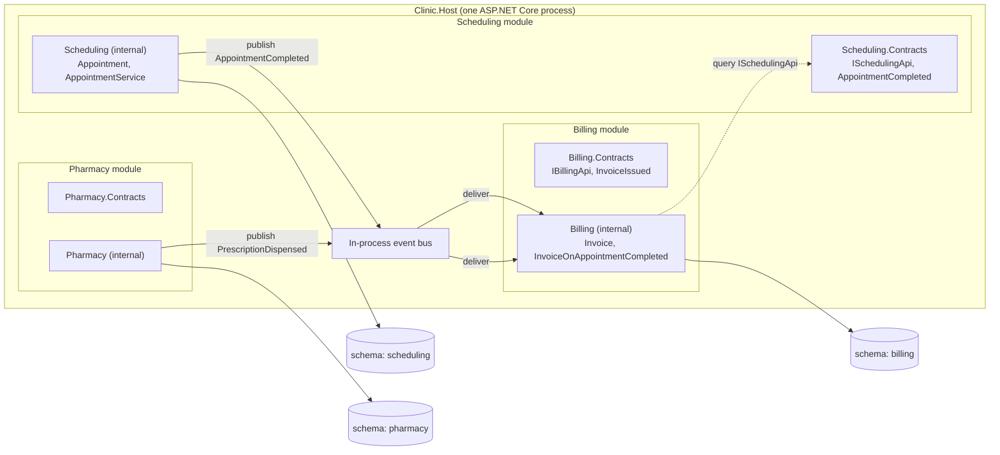
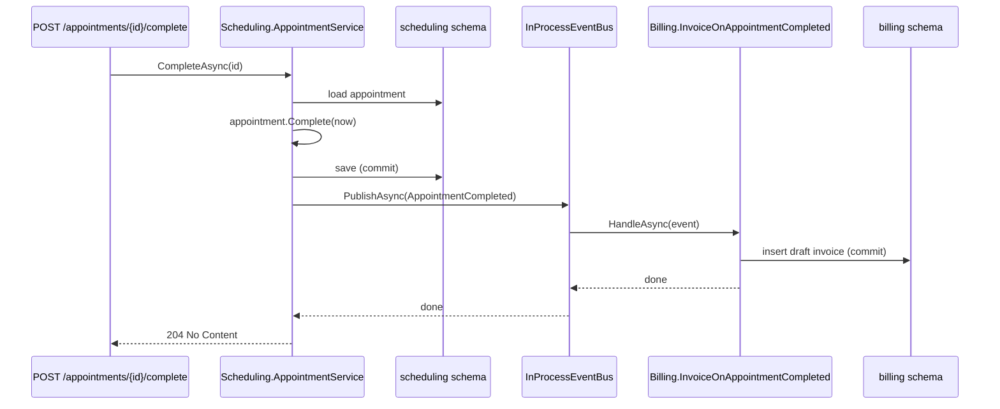

Most teams that try microservices too early end up with a distributed mess: ten services, one shared database, and a release train that nobody can stop. Most teams that stay on a plain monolith end up with one 400-table database that every class can touch. The modular monolith is the middle path: **one process to deploy, many modules inside, strict walls between them.** Domain-Driven Design tells you where to put the walls.

## Learning objectives

By the end of this lesson you will be able to:

1. Explain, in plain words, what a module is and why one module per bounded context is the right default.
2. Design a module's public surface (contracts, integration events) and keep everything else `internal`.
3. Forbid cross-module database access with PostgreSQL schemas, per-module connection roles and per-module `DbContext`s.
4. Wire modules into one ASP.NET Core host with `AddXxxModule()` extension methods and an in-process event bus.
5. Write module tests (one module, fakes for its neighbours) and architecture tests that fail the build when a boundary is crossed.
6. Judge when a module should become a separate service, and describe the migration path step by step.

## Prerequisites

- [Modular monolith architecture](#/lesson/m02-modular-monolith): the architectural style at a high level.
- [Bounded contexts and ubiquitous language](#/lesson/m08-bounded-contexts): a module *is* a bounded context in code.
- [Domain events](#/lesson/m08-domain-events): modules talk through events; you should know how an event is raised and dispatched.
- [Aggregates and aggregate roots](#/lesson/m08-aggregates): each module owns its own aggregates.

## Explain it like I'm a beginner

Picture a multi-speciality clinic in Pune. It has a reception desk, a billing counter, a pharmacy and the doctors' rooms. Each has its own filing cabinet. If the pharmacist wants to know whether a patient has finished their consultation, she does not walk into the doctor's room and read the doctor's notes. She looks at the token board, or the reception sends her a slip: "Patient 42, consultation complete, prescription attached."

The slip is small and standard. The pharmacy does not care how the doctor organises notes. The doctor can change the note format tomorrow and the pharmacy will not notice. **That is a module boundary.**

Now picture the opposite: one giant filing cabinet in the middle of the clinic, and every department reads and writes any folder they like. On day one it is fast. By year three, the pharmacist has stapled her stock counts into patient folders, billing relies on a column the doctors stopped filling, and nobody dares re-organise anything.

A modular monolith is the clinic with separate cabinets and standard slips, **but still one building**. Everyone walks to work at the same address (one deployable application), there is one electricity bill (one server, one database instance), but departments only talk through the slips (public APIs and events).

The DDD part is deciding where the cabinets go. Each **bounded context** (an area where words mean one consistent thing: "patient" in Billing means a payer; in Scheduling it means a person with a time slot) becomes one module.

## First-principles explanation

### What a module is

A module is a unit of code with three properties:

1. **It owns its data.** Only the module's own code reads or writes its tables. Call this *data ownership*.
2. **It exposes a small, deliberate public surface.** A few interfaces and some event types. Everything else is `internal`. Call this the *published language* of the module.
3. **It can be tested on its own.** You can start the module with fakes for its neighbours and run its behaviour end to end.

In .NET, the natural unit is a project (an assembly). A module is typically one or more projects: `Clinic.Scheduling` (the implementation, mostly `internal` types) and `Clinic.Scheduling.Contracts` (the public interfaces and event records that other modules may reference).

### Why one module per bounded context

You could split modules by technical layer (all repositories together, all services together). That gives you the layered monolith from [Layered architecture](#/lesson/m02-layered), where a single feature change touches every folder.

You could split by database table. That gives you one module per noun, with constant chatter between them.

Splitting by bounded context works because a bounded context is, by definition, the area where a change in the business tends to stay. When the pharmacy changes how it tracks batch expiry, that change stays inside Pharmacy. The module boundary is also a **team boundary** and an **ownership boundary**: the Pharmacy module has one owner who can say yes or no to changes.

A useful heuristic: if two "modules" change together in more than half of your pull requests, they are one module. If a module has no public API consumers, it may be two modules glued together.

### The three rules that make it work

**Rule 1: No cross-module database access.** This is the rule teams break first and regret most. The moment Billing writes `JOIN scheduling.appointments`, the two modules are coupled at the schema level and neither can change its tables alone. In PostgreSQL, give each module its own schema (`scheduling.*`, `billing.*`, `pharmacy.*`) and its own login role that has privileges only on its own schema. Then a cross-module query fails at runtime, not in a code review six months later.

**Rule 2: Communicate only through the public surface.** Two forms:
- *Synchronous queries* through a contract interface, for example `ISchedulingApi.GetAppointmentAsync(id)`. Use these when the caller needs the answer right now.
- *Asynchronous integration events*, for example `AppointmentCompleted`. Use these when the caller only needs to react later, and must not fail if the other module is slow.

**Rule 3: Enforce the rules with tooling, not goodwill.** `internal` visibility, separate projects without references between implementations, architecture tests, and database roles. If the compiler and the test suite do not stop a violation, somebody will make one on a Friday evening.

### Transactions across modules

Inside a module, one HTTP request usually maps to one database transaction touching one aggregate (see [Transaction boundaries](#/lesson/m08-transaction-boundaries)). Across modules there is **no shared transaction**, even though the modules share a PostgreSQL instance. This is deliberate. If you let `BillingDbContext` and `SchedulingDbContext` join one transaction today, you can never split them into services later.

So when Scheduling completes an appointment and Billing must raise an invoice, Scheduling commits its own transaction, then publishes `AppointmentCompleted`, and Billing handles it in its own transaction. If the process crashes between the two, the event is lost, unless you store the event in the same transaction as the appointment and relay it afterwards. That is the [transactional outbox](#/lesson/m12-outbox). In a modular monolith the outbox table lives in the publishing module's schema and a background relay dispatches to in-process handlers. Start with a simple in-process bus; add the outbox the first time you need the guarantee.

### What you gain and what you pay

| You gain | You pay |
|---|---|
| One deployment, one log stream, one place to debug | Discipline: boundaries are a convention plus tests, not a network |
| Refactor across modules in one pull request | Cross-module changes still need two owners to agree |
| In-process calls: microseconds, not milliseconds; no retries, no serialisation | One runtime: a memory leak in Pharmacy takes down Billing |
| One database instance to back up and secure | Schema-per-module and role-per-module setup is extra work up front |
| Modules can be extracted to services later, one at a time | You must resist every "just this one JOIN" |

Rough sizing: a team of 5–15 engineers with 4–8 bounded contexts is the sweet spot. Below that, a well-organised plain monolith is fine. Above roughly 30 engineers with modules that scale very differently (say, 50 requests per second on Billing and 5,000 on Scheduling), extracting one or two services starts paying for itself.

### When it is unnecessary

- A three-person team and a product with one bounded context. Folders by feature inside one project are enough. See [Vertical Slice Architecture in practice](#/lesson/m08-vertical-slice).
- A system that is pure CRUD over one data model (an internal admin tool). Module walls add ceremony with no change pressure to justify them.
- You already have independent teams in different time zones that need independent release cadences. Then modules in one process will frustrate them, and services are the honest answer.

## Visual explanation

### Module map



How to read it: everything sits inside one process box (`Clinic.Host`). Each module has a thin *Contracts* box that others may reference and a fat *internal* box that nobody else may reference. The only arrows between modules go through the bus (solid, events) or through a Contracts interface (dotted, synchronous query). The three database cylinders are three PostgreSQL schemas in one instance, and each has exactly one arrow into it.

### Completing an appointment



The important detail is the two separate commits. Scheduling commits before publishing. Billing commits in its own handler. There is no transaction that spans both schemas. If Billing's handler throws, the appointment is still complete, and the failure must be handled by Billing (retry, dead-letter, alert), not by rolling back Scheduling. In the simple in-process version shown here the bus awaits handlers, so the HTTP request would see the failure; with an outbox and a background relay, it would not.

## Step-by-step example

We will build a slice of the clinic system: Scheduling completes appointments, Billing reacts by creating draft invoices.

### Step 1 — find the bounded contexts

Listen to how the clinic staff talk. Reception talks about *appointments, slots, doctors, no-shows*. The billing counter talks about *invoices, line items, GST, payments, dues*. The pharmacy talks about *prescriptions, batches, expiry, stock*. Three vocabularies, three contexts: **Scheduling**, **Billing**, **Pharmacy**. The word "patient" appears in all three but means something slightly different in each, which is normal. Each module keeps its own minimal `PatientId` and only the fields it needs.

### Step 2 — decide the public surface of each module

Ask: what does anyone *outside* Scheduling need to know? Billing needs to know when an appointment is completed and which doctor saw the patient (fees differ by doctor grade). Pharmacy needs to know when a prescription is written. Nobody outside Scheduling needs the slot table, the no-show counter or the reminder schedule.

So `Scheduling.Contracts` contains one interface (`ISchedulingApi`, a query) and two event records (`AppointmentCompleted`, `PrescriptionWritten`). That is the whole published language.

### Step 3 — project layout

```text
src/
  Clinic.Host/                      ASP.NET Core entry point; references every module's registration
  Clinic.SharedKernel/              IIntegrationEvent, IModuleEventBus, Money, PatientId
  Modules/Scheduling/
    Clinic.Scheduling.Contracts/    public: ISchedulingApi, AppointmentCompleted
    Clinic.Scheduling/              internal: Appointment, AppointmentService, SchedulingDbContext
  Modules/Billing/
    Clinic.Billing.Contracts/
    Clinic.Billing/
  Modules/Pharmacy/
    ...
tests/
  Clinic.Scheduling.Tests/          module tests with fakes
  Clinic.Architecture.Tests/        boundary rules
```

Project reference rules: `Clinic.Billing` may reference `Clinic.Scheduling.Contracts` but **never** `Clinic.Scheduling`. `Clinic.Host` references all implementation projects, because it must register them, but contains no business code. The compiler now enforces most of the boundary: Billing cannot even see `Appointment`, because it is `internal` to another assembly.

### Step 4 — database per module, in one instance

```sql
CREATE SCHEMA scheduling;
CREATE SCHEMA billing;

CREATE ROLE scheduling_app LOGIN PASSWORD '...';
CREATE ROLE billing_app LOGIN PASSWORD '...';

GRANT USAGE, CREATE ON SCHEMA scheduling TO scheduling_app;
GRANT USAGE, CREATE ON SCHEMA billing TO billing_app;
-- Deliberately no grants across schemas.
```

Each module's connection string uses its own role. If a developer writes `SELECT * FROM scheduling.appointments` from Billing code, PostgreSQL answers `permission denied for schema scheduling`. The rule is now enforced by the database, which is cheaper than any code review.

With EF Core, each module has its own `DbContext` with `modelBuilder.HasDefaultSchema("billing")` and its own migrations history table. The Host runs each module's migrations at start-up, in module order.

### Step 5 — wire it in the host

Each module exposes one extension method, `AddSchedulingModule(services, configuration)`. The host calls them in a row. This keeps the host ignorant of module internals and makes it trivial to leave a module out (for a test host, or when a module is later extracted).

The next section shows the code.

## Production-style C# implementation

The shared kernel holds only what every module genuinely needs: the event marker interface, the bus abstraction and a couple of value types. Keep it tiny. A fat shared kernel is a monolith in disguise.

```csharp file=SharedKernel/IntegrationEvents.cs
namespace Clinic.SharedKernel;

/// <summary>Marker for events that cross a module boundary. Keep payloads flat and stable:
/// other modules deserialise them, so renaming a property is a breaking change.</summary>
public interface IIntegrationEvent
{
    Guid EventId { get; }
    DateTimeOffset OccurredAt { get; }
}

public interface IIntegrationEventHandler<in TEvent> where TEvent : IIntegrationEvent
{
    Task HandleAsync(TEvent evt, CancellationToken ct);
}

public interface IModuleEventBus
{
    Task PublishAsync<TEvent>(TEvent evt, CancellationToken ct) where TEvent : IIntegrationEvent;
}
```

```csharp file=SharedKernel/InProcessEventBus.cs
using Microsoft.Extensions.DependencyInjection;
using Microsoft.Extensions.Logging;

namespace Clinic.SharedKernel;

/// <summary>Delivers events to every registered handler in the same process. Each handler runs in its
/// own DI scope so that a scoped DbContext in Billing never leaks into Scheduling's request scope.</summary>
public sealed class InProcessEventBus(IServiceScopeFactory scopes, ILogger<InProcessEventBus> logger) : IModuleEventBus
{
    public async Task PublishAsync<TEvent>(TEvent evt, CancellationToken ct) where TEvent : IIntegrationEvent
    {
        using var scope = scopes.CreateScope();
        var handlers = scope.ServiceProvider.GetServices<IIntegrationEventHandler<TEvent>>().ToList();
        logger.LogInformation("Publishing {Event} {EventId} to {Count} handler(s)", typeof(TEvent).Name, evt.EventId, handlers.Count);

        foreach (var handler in handlers)
        {
            try { await handler.HandleAsync(evt, ct); }
            catch (Exception ex)
            {
                // One module's failure must not hide the event from the others.
                logger.LogError(ex, "Handler {Handler} failed for {Event} {EventId}", handler.GetType().Name, typeof(TEvent).Name, evt.EventId);
            }
        }
    }
}
```

Scheduling's contracts project is the only part of Scheduling that other modules may reference.

```csharp file=Scheduling.Contracts/ISchedulingApi.cs
using Clinic.SharedKernel;

namespace Clinic.Scheduling.Contracts;

public sealed record AppointmentSummary(Guid AppointmentId, Guid PatientId, string DoctorCode, DateTimeOffset StartsAt, bool IsCompleted);

/// <summary>Synchronous read API. Other modules call this when they need an answer now.</summary>
public interface ISchedulingApi
{
    Task<AppointmentSummary?> GetAppointmentAsync(Guid appointmentId, CancellationToken ct);
}

public sealed record AppointmentCompleted(Guid EventId, DateTimeOffset OccurredAt, Guid AppointmentId, Guid PatientId, string DoctorCode, int DurationMinutes)
    : IIntegrationEvent;
```

The implementation project. Note that `Appointment` and `AppointmentService` are `internal`. Only `SchedulingModule` (registration) is public.

```csharp file=Scheduling/Appointment.cs
namespace Clinic.Scheduling.Internal;

internal sealed class Appointment
{
    public Guid Id { get; }
    public Guid PatientId { get; }
    public string DoctorCode { get; }
    public DateTimeOffset StartsAt { get; }
    public DateTimeOffset? CompletedAt { get; private set; }

    public Appointment(Guid id, Guid patientId, string doctorCode, DateTimeOffset startsAt)
    {
        if (string.IsNullOrWhiteSpace(doctorCode)) throw new ArgumentException("Doctor code is required.", nameof(doctorCode));
        Id = id; PatientId = patientId; DoctorCode = doctorCode; StartsAt = startsAt;
    }

    public int Complete(DateTimeOffset now)
    {
        if (CompletedAt is not null) throw new InvalidOperationException("Appointment is already completed.");
        if (now < StartsAt) throw new InvalidOperationException("Cannot complete an appointment before it starts.");
        CompletedAt = now;
        return (int)Math.Max(1, Math.Round((now - StartsAt).TotalMinutes));
    }
}

internal interface IAppointmentStore
{
    Task<Appointment?> FindAsync(Guid id, CancellationToken ct);
    Task SaveAsync(Appointment appointment, CancellationToken ct);
}

/// <summary>In-memory store used in this lesson. Production uses SchedulingDbContext with HasDefaultSchema("scheduling").</summary>
internal sealed class InMemoryAppointmentStore : IAppointmentStore
{
    private readonly Dictionary<Guid, Appointment> _items = new();
    public Task<Appointment?> FindAsync(Guid id, CancellationToken ct) => Task.FromResult(_items.GetValueOrDefault(id));
    public Task SaveAsync(Appointment a, CancellationToken ct) { _items[a.Id] = a; return Task.CompletedTask; }
}
```

```csharp file=Scheduling/AppointmentService.cs
using Clinic.Scheduling.Contracts;
using Clinic.SharedKernel;

namespace Clinic.Scheduling.Internal;

internal sealed class AppointmentService(IAppointmentStore store, IModuleEventBus bus, TimeProvider clock) : ISchedulingApi
{
    public async Task<AppointmentSummary?> GetAppointmentAsync(Guid appointmentId, CancellationToken ct)
    {
        var a = await store.FindAsync(appointmentId, ct);
        return a is null ? null : new AppointmentSummary(a.Id, a.PatientId, a.DoctorCode, a.StartsAt, a.CompletedAt is not null);
    }

    public async Task<Guid> BookAsync(Guid patientId, string doctorCode, DateTimeOffset startsAt, CancellationToken ct)
    {
        var a = new Appointment(Guid.NewGuid(), patientId, doctorCode, startsAt);
        await store.SaveAsync(a, ct);
        return a.Id;
    }

    public async Task CompleteAsync(Guid appointmentId, CancellationToken ct)
    {
        var a = await store.FindAsync(appointmentId, ct) ?? throw new KeyNotFoundException($"Appointment {appointmentId} not found.");
        var now = clock.GetUtcNow();
        var minutes = a.Complete(now);
        await store.SaveAsync(a, ct);                 // commit Scheduling's transaction first
        await bus.PublishAsync(new AppointmentCompleted(Guid.NewGuid(), now, a.Id, a.PatientId, a.DoctorCode, minutes), ct);
    }
}
```

```csharp file=Scheduling/SchedulingModule.cs
using Clinic.Scheduling.Contracts;
using Clinic.Scheduling.Internal;
using Microsoft.Extensions.DependencyInjection;

namespace Clinic.Scheduling;

/// <summary>The only public type in the implementation assembly. The host calls it; nobody else does.</summary>
public static class SchedulingModule
{
    public static IServiceCollection AddSchedulingModule(this IServiceCollection services)
    {
        services.AddSingleton<IAppointmentStore, InMemoryAppointmentStore>();
        services.AddScoped<AppointmentService>();
        services.AddScoped<ISchedulingApi>(sp => sp.GetRequiredService<AppointmentService>());
        return services;
    }
}
```

Billing reacts to the event. It references `Clinic.Scheduling.Contracts` and `Clinic.SharedKernel` only.

```csharp file=Billing/Invoicing.cs
using Clinic.Scheduling.Contracts;
using Clinic.SharedKernel;
using Microsoft.Extensions.DependencyInjection;
using Microsoft.Extensions.Logging;

namespace Clinic.Billing.Internal;

internal sealed record Invoice(Guid Id, Guid PatientId, Guid AppointmentId, decimal AmountInr, string Status);

internal interface IInvoiceStore
{
    Task AddAsync(Invoice invoice, CancellationToken ct);
    Task<bool> ExistsForAppointmentAsync(Guid appointmentId, CancellationToken ct);
    IReadOnlyCollection<Invoice> All();
}

internal sealed class InMemoryInvoiceStore : IInvoiceStore
{
    private readonly List<Invoice> _items = new();
    public Task AddAsync(Invoice invoice, CancellationToken ct) { lock (_items) _items.Add(invoice); return Task.CompletedTask; }
    public Task<bool> ExistsForAppointmentAsync(Guid appointmentId, CancellationToken ct) { lock (_items) return Task.FromResult(_items.Any(i => i.AppointmentId == appointmentId)); }
    public IReadOnlyCollection<Invoice> All() { lock (_items) return _items.ToList(); }
}

/// <summary>Billing's own rule: consultation fee by doctor grade. Scheduling knows nothing about fees.</summary>
internal static class FeeSchedule
{
    public static decimal For(string doctorCode) => doctorCode.StartsWith("SR", StringComparison.OrdinalIgnoreCase) ? 1200m : 700m;
}

internal sealed class InvoiceOnAppointmentCompleted(IInvoiceStore invoices, ILogger<InvoiceOnAppointmentCompleted> logger)
    : IIntegrationEventHandler<AppointmentCompleted>
{
    public async Task HandleAsync(AppointmentCompleted evt, CancellationToken ct)
    {
        // Idempotent: the same event may be delivered twice after a retry.
        if (await invoices.ExistsForAppointmentAsync(evt.AppointmentId, ct)) return;
        var invoice = new Invoice(Guid.NewGuid(), evt.PatientId, evt.AppointmentId, FeeSchedule.For(evt.DoctorCode), "Draft");
        await invoices.AddAsync(invoice, ct);
        logger.LogInformation("Draft invoice {InvoiceId} of INR {Amount} created for appointment {AppointmentId}", invoice.Id, invoice.AmountInr, evt.AppointmentId);
    }
}

public static class BillingModule
{
    public static IServiceCollection AddBillingModule(this IServiceCollection services)
    {
        services.AddSingleton<IInvoiceStore, InMemoryInvoiceStore>();
        services.AddScoped<IIntegrationEventHandler<AppointmentCompleted>, InvoiceOnAppointmentCompleted>();
        return services;
    }

    /// <summary>Public read used by the host endpoint. In production this is an IBillingApi in Billing.Contracts.</summary>
    public static IReadOnlyCollection<object> ListInvoices(IServiceProvider sp) =>
        sp.GetRequiredService<IInvoiceStore>().All().Select(i => (object)new { i.Id, i.PatientId, i.AppointmentId, i.AmountInr, i.Status }).ToList();
}
```

The architecture rule, written with plain reflection so it runs with no extra packages. It scans an assembly and reports every type in module A that references a type in module B's `Internal` namespace.

```csharp file=Architecture/ModuleBoundaryRules.cs
using System.Reflection;

namespace Clinic.Architecture;

public static class ModuleBoundaryRules
{
    /// <summary>Returns human-readable violations of the rule
    /// "a type in {root}.{ModuleA}.* must not reference a type in {root}.{ModuleB}.Internal.*".</summary>
    public static IReadOnlyList<string> FindViolations(IEnumerable<Type> types, string rootNamespace)
    {
        var violations = new List<string>();
        foreach (var type in types)
        {
            var module = ModuleOf(type, rootNamespace);
            if (module is null) continue;
            foreach (var referenced in ReferencedTypes(type))
            {
                var otherModule = ModuleOf(referenced, rootNamespace);
                if (otherModule is null || otherModule == module) continue;
                if (IsInternalNamespace(referenced, rootNamespace))
                    violations.Add($"{type.FullName} references {referenced.FullName} (module {module} -> {otherModule} internals)");
            }
        }
        return violations.Distinct().ToList();
    }

    private static string? ModuleOf(Type t, string root)
    {
        var ns = t.Namespace;
        if (ns is null || !ns.StartsWith(root + ".", StringComparison.Ordinal)) return null;
        var rest = ns[(root.Length + 1)..];
        var dot = rest.IndexOf('.');
        return dot < 0 ? rest : rest[..dot];
    }

    private static bool IsInternalNamespace(Type t, string root)
    {
        var ns = t.Namespace ?? "";
        var parts = ns.Split('.');
        return parts.Length >= 3 && parts.Skip(2).Contains("Internal");
    }

    private static IEnumerable<Type> ReferencedTypes(Type type)
    {
        const BindingFlags all = BindingFlags.Public | BindingFlags.NonPublic | BindingFlags.Instance | BindingFlags.Static | BindingFlags.DeclaredOnly;
        var raw = new List<Type>();
        if (type.BaseType is not null) raw.Add(type.BaseType);
        raw.AddRange(type.GetInterfaces());
        raw.AddRange(type.GetFields(all).Select(f => f.FieldType));
        raw.AddRange(type.GetProperties(all).Select(p => p.PropertyType));
        foreach (var c in type.GetConstructors(all)) raw.AddRange(c.GetParameters().Select(p => p.ParameterType));
        foreach (var m in type.GetMethods(all))
        {
            raw.Add(m.ReturnType);
            raw.AddRange(m.GetParameters().Select(p => p.ParameterType));
        }
        return raw.SelectMany(Unwrap);
    }

    private static IEnumerable<Type> Unwrap(Type t)
    {
        if (t.IsByRef || t.IsArray || t.IsPointer) { foreach (var x in Unwrap(t.GetElementType()!)) yield return x; yield break; }
        if (t.IsGenericType) { foreach (var arg in t.GetGenericArguments()) foreach (var x in Unwrap(arg)) yield return x; }
        yield return t.IsGenericType ? t.GetGenericTypeDefinition() : t;
    }
}
```

Finally the host. It knows the modules by their registration methods and nothing else.

```csharp file=Program.cs
using Clinic.Billing.Internal;
using Clinic.Scheduling;
using Clinic.Scheduling.Internal;
using Clinic.SharedKernel;

var builder = WebApplication.CreateBuilder(args);

builder.Services.AddSingleton(TimeProvider.System);
builder.Services.AddSingleton<IModuleEventBus, InProcessEventBus>();
builder.Services.AddSchedulingModule();
builder.Services.AddBillingModule();

var app = builder.Build();

app.MapPost("/appointments", async (BookRequest req, AppointmentService scheduling, CancellationToken ct) =>
    Results.Created($"/appointments/{await scheduling.BookAsync(req.PatientId, req.DoctorCode, req.StartsAt, ct)}", null));

app.MapPost("/appointments/{id:guid}/complete", async (Guid id, AppointmentService scheduling, CancellationToken ct) =>
{
    try { await scheduling.CompleteAsync(id, ct); return Results.NoContent(); }
    catch (KeyNotFoundException) { return Results.NotFound(); }
    catch (InvalidOperationException ex) { return Results.Problem(ex.Message, statusCode: StatusCodes.Status409Conflict); }
});

app.MapGet("/invoices", (IServiceProvider sp) => Results.Ok(BillingModule.ListInvoices(sp)));

app.Run();

public sealed record BookRequest(Guid PatientId, string DoctorCode, DateTimeOffset StartsAt);
```

In this single-project lesson build the host can see `AppointmentService` because `internal` is per assembly and everything compiles together. In the real multi-project layout, the host would instead expose endpoints through a public `ISchedulingApi` or a `MapSchedulingEndpoints(app)` method that the module itself owns. That is the preferred shape: **each module owns its endpoints too.**

:::callout type=tip title="Module registration order matters less than you think"
Because modules only depend on each other's contracts and events, `AddBillingModule()` before `AddSchedulingModule()` works fine. If registration order starts to matter, a module has a hidden dependency on another module's internals. Treat that as a smell.
:::

## Bad design vs good design

**Bad**: a `Clinic.Web` project with folders `Controllers`, `Services`, `Repositories`, `Models`, one `ClinicDbContext` with 180 entities, and a `BillingService` that does this:

```csharp
// BillingService.cs — reaches straight into Scheduling's tables
var completed = await _db.Appointments
    .Where(a => a.CompletedAt != null && a.InvoiceId == null)
    .Include(a => a.Doctor)
    .ToListAsync();
foreach (var a in completed) { _db.Invoices.Add(new Invoice { ... }); a.InvoiceId = ...; }
await _db.SaveChangesAsync();
```

What goes wrong:

- `Appointment` has grown an `InvoiceId` column that belongs to Billing. Scheduling cannot rename or partition its table without checking Billing's code.
- The fee calculation needs `Doctor.Grade`, so `Doctor` has become a shared entity edited by two teams.
- A Billing bug that sets `CompletedAt = null` corrupts Scheduling's data, and the Scheduling team gets the support ticket.
- You cannot test Billing without seeding appointments and doctors.

**Good**: the implementation above. Scheduling publishes `AppointmentCompleted` with exactly the fields Billing needs. Billing keeps its own `FeeSchedule` and its own `invoices` table, with `appointment_id` stored as a plain `uuid` (no foreign key into another schema; the reference is logical). Billing can be tested with a hand-written `AppointmentCompleted` and no Scheduling code at all.

**Where good design goes too far**: if Billing needs ten fields from Scheduling for every invoice, and they change often, you have likely drawn the boundary in the wrong place. Do not pass a 40-field event around to avoid a JOIN; reconsider the split instead. And for a true read-only report that spans every module (the MD's monthly dashboard), it is acceptable to build a separate **reporting** read model fed by events, or even a reporting role with `SELECT` on all schemas, as long as no module's *write* path depends on it.

:::callout type=tradeoff title="Shared kernel: smaller is safer"
Everything in `Clinic.SharedKernel` is a change that touches every module. Allowed: `IIntegrationEvent`, the bus interface, `Money`, strongly-typed ids. Not allowed: `Patient`, `Doctor`, any entity, any `DbContext`, anything with behaviour that one module might want to change.
:::

## Practical playground

Run this to see the event flow end to end. Then make `InvoiceOnAppointmentCompleted` idempotent (publish the same event twice and expect one invoice).

:::playground type=csharp title="Two modules, one process, one event"
```csharp file=Program.cs
using System;
using System.Collections.Generic;
using System.Linq;
using System.Threading;
using System.Threading.Tasks;

public interface IIntegrationEvent { Guid EventId { get; } }
public interface IHandler<in T> where T : IIntegrationEvent { Task HandleAsync(T evt, CancellationToken ct); }

public sealed class Bus
{
    private readonly Dictionary<Type, List<object>> _handlers = new();
    public void Subscribe<T>(IHandler<T> h) where T : IIntegrationEvent
    {
        if (!_handlers.TryGetValue(typeof(T), out var list)) _handlers[typeof(T)] = list = new List<object>();
        list.Add(h);
    }
    public async Task PublishAsync<T>(T evt, CancellationToken ct) where T : IIntegrationEvent
    {
        if (!_handlers.TryGetValue(typeof(T), out var list)) return;
        foreach (var h in list.Cast<IHandler<T>>()) await h.HandleAsync(evt, ct);
    }
}

// ---- Scheduling module (would be its own assembly) ----
public sealed record AppointmentCompleted(Guid EventId, Guid AppointmentId, string DoctorCode) : IIntegrationEvent;

// ---- Billing module ----
public sealed class InvoiceOnAppointmentCompleted : IHandler<AppointmentCompleted>
{
    public List<(Guid AppointmentId, decimal Amount)> Invoices { get; } = new();
    public Task HandleAsync(AppointmentCompleted evt, CancellationToken ct)
    {
        // TODO: skip if an invoice for evt.AppointmentId already exists
        Invoices.Add((evt.AppointmentId, evt.DoctorCode.StartsWith("SR") ? 1200m : 700m));
        return Task.CompletedTask;
    }
}

public static class Program
{
    public static async Task Main()
    {
        var bus = new Bus();
        var billing = new InvoiceOnAppointmentCompleted();
        bus.Subscribe(billing);

        var evt = new AppointmentCompleted(Guid.NewGuid(), Guid.NewGuid(), "SR-07");
        await bus.PublishAsync(evt, CancellationToken.None);
        await bus.PublishAsync(evt, CancellationToken.None);   // redelivery after a retry

        Console.WriteLine($"Invoices created: {billing.Invoices.Count} (expected 1)");
        foreach (var i in billing.Invoices) Console.WriteLine($"  {i.AppointmentId} -> INR {i.Amount}");
    }
}
```
:::

## Exercises

:::exercise id=m08-ddd-modular-monolith-ex1 difficulty=beginner kind=code title="Implement the in-process event bus"
Implement `InProcessEventBus` so that modules can subscribe handlers for an event type and publish events to all of them.
::requirements
- `Subscribe<T>(IIntegrationEventHandler<T> handler)` registers a handler for `T`.
- `PublishAsync<T>(T evt, CancellationToken ct)` calls every handler registered for exactly `T`, in subscription order, and awaits each.
- Publishing an event type with no handlers completes without throwing.
::acceptance
- Two handlers subscribed for `AppointmentCompleted` both receive the event.
- A handler for `PrescriptionWritten` is not called when `AppointmentCompleted` is published.
- Publishing with zero subscribers returns normally.
::hint
You need to remember handlers per event type. What is a good key for that lookup?
::hint
`Dictionary<Type, List<object>>` works: the key is `typeof(T)`, the values are handler objects stored as `object` because each `T` gives a different interface type.
::hint
In `PublishAsync`, look up `typeof(T)`, cast each stored object back to `IIntegrationEventHandler<T>`, and `await` `HandleAsync` one by one.
::hint
```csharp
if (!_handlers.TryGetValue(typeof(T), out var list)) return;
foreach (var h in list.Cast<IIntegrationEventHandler<T>>()) await h.HandleAsync(evt, ct);
```
::starter
```csharp file=InProcessEventBus.cs
using System;
using System.Collections.Generic;
using System.Linq;
using System.Threading;
using System.Threading.Tasks;

public interface IIntegrationEvent { Guid EventId { get; } }
public interface IIntegrationEventHandler<in T> where T : IIntegrationEvent { Task HandleAsync(T evt, CancellationToken ct); }

public sealed record AppointmentCompleted(Guid EventId, Guid AppointmentId) : IIntegrationEvent;
public sealed record PrescriptionWritten(Guid EventId, Guid AppointmentId) : IIntegrationEvent;

public sealed class InProcessEventBus
{
    public void Subscribe<T>(IIntegrationEventHandler<T> handler) where T : IIntegrationEvent
        => throw new NotImplementedException();

    public Task PublishAsync<T>(T evt, CancellationToken ct) where T : IIntegrationEvent
        => throw new NotImplementedException();
}
```
::tests
```csharp file=InProcessEventBusTests.cs
using System;
using System.Collections.Generic;
using System.Threading;
using System.Threading.Tasks;
using Xunit;

public class InProcessEventBusTests
{
    private sealed class Recorder<T> : IIntegrationEventHandler<T> where T : IIntegrationEvent
    {
        public List<T> Received { get; } = new();
        public Task HandleAsync(T evt, CancellationToken ct) { Received.Add(evt); return Task.CompletedTask; }
    }

    [Fact]
    public async Task All_handlers_for_the_type_receive_the_event()
    {
        var bus = new InProcessEventBus();
        var a = new Recorder<AppointmentCompleted>();
        var b = new Recorder<AppointmentCompleted>();
        bus.Subscribe(a); bus.Subscribe(b);
        var evt = new AppointmentCompleted(Guid.NewGuid(), Guid.NewGuid());
        await bus.PublishAsync(evt, CancellationToken.None);
        Assert.Single(a.Received); Assert.Single(b.Received);
        Assert.Equal(evt.EventId, a.Received[0].EventId);
    }

    [Fact]
    public async Task Handlers_for_other_types_are_not_called()
    {
        var bus = new InProcessEventBus();
        var rx = new Recorder<PrescriptionWritten>();
        bus.Subscribe(rx);
        await bus.PublishAsync(new AppointmentCompleted(Guid.NewGuid(), Guid.NewGuid()), CancellationToken.None);
        Assert.Empty(rx.Received);
    }

    [Fact]
    public async Task Publishing_without_subscribers_does_not_throw()
    {
        var bus = new InProcessEventBus();
        await bus.PublishAsync(new AppointmentCompleted(Guid.NewGuid(), Guid.NewGuid()), CancellationToken.None);
    }
}
```
::solution
Store handlers per event type, cast back on publish.

```csharp file=InProcessEventBus.cs
using System;
using System.Collections.Generic;
using System.Linq;
using System.Threading;
using System.Threading.Tasks;

public interface IIntegrationEvent { Guid EventId { get; } }
public interface IIntegrationEventHandler<in T> where T : IIntegrationEvent { Task HandleAsync(T evt, CancellationToken ct); }

public sealed record AppointmentCompleted(Guid EventId, Guid AppointmentId) : IIntegrationEvent;
public sealed record PrescriptionWritten(Guid EventId, Guid AppointmentId) : IIntegrationEvent;

public sealed class InProcessEventBus
{
    private readonly Dictionary<Type, List<object>> _handlers = new();

    public void Subscribe<T>(IIntegrationEventHandler<T> handler) where T : IIntegrationEvent
    {
        if (!_handlers.TryGetValue(typeof(T), out var list)) _handlers[typeof(T)] = list = new List<object>();
        list.Add(handler);
    }

    public async Task PublishAsync<T>(T evt, CancellationToken ct) where T : IIntegrationEvent
    {
        if (!_handlers.TryGetValue(typeof(T), out var list)) return;
        foreach (var h in list.Cast<IIntegrationEventHandler<T>>()) await h.HandleAsync(evt, ct);
    }
}
```

In production you would resolve handlers from DI (`GetServices<IIntegrationEventHandler<T>>()`) inside a fresh scope rather than keeping a list, and you would decide a policy for a failing handler: stop, or log and continue.
::mistakes
- Keying the dictionary by `evt.GetType()` at publish time but `typeof(T)` at subscribe time. They differ when `T` is an interface or base type.
- Running handlers with `Task.WhenAll` and then wondering why two handlers share one scoped `DbContext`.
::extensions
Add `PublishAsync` overloads that also deliver to handlers of base event types, and decide whether that is a feature or a coupling risk.
:::

:::exercise id=m08-ddd-modular-monolith-ex2 difficulty=beginner kind=written title="Draw the module boundaries for a school ERP"
A school management product has these features: student admissions, fee collection with receipts, class timetables, attendance, exam marks and report cards, library lending, and SMS notifications to parents. Propose the modules, the public surface of each, and which events flow between them.
::acceptance
- 4–7 modules, each named in the language the school staff use.
- Each module lists at most 3 public queries and at most 4 integration events.
- At least one case where the same word (for example "student") means different things in two modules is called out.
- Notifications is handled either as a generic supporting module or as infrastructure, with a reason.
::hint
Start from vocabularies, not tables. Who talks about "defaulters"? Who talks about "sections"?
::hint
Fee collection and admissions both say "student", but Fees cares about a payer and dues; Admissions cares about documents and a seat.
::hint
Events are things the school would announce on a notice board: "Student admitted", "Fee paid", "Exam results published". Queries are things one department phones another to ask.
::solution
One reasonable split:

- **Admissions**: owns the applicant and enrolment. Events: `StudentAdmitted`, `StudentWithdrawn`. Query: `GetEnrolment(studentId)`.
- **Fees**: owns fee structures, dues, receipts. Reacts to `StudentAdmitted` to open a ledger. Events: `FeePaid`, `FeeOverdue`. Query: `GetDues(studentId)`.
- **Academics** (timetable, attendance, exams, report cards): one module unless the exam process has its own team; "section" and "period" live here. Events: `ResultsPublished`, `AttendanceMarkedAbsent`.
- **Library**: owns books and loans; reacts to `StudentWithdrawn` to block lending. Events: `BookOverdue`.
- **Notifications**: a generic supporting module. It subscribes to `FeeOverdue`, `AttendanceMarkedAbsent`, `ResultsPublished` and sends SMS. It owns templates and delivery logs, and nothing about students except a phone number it reads through `Admissions.GetGuardianContact`.

"Student" in Fees is a payer with a ledger; in Library it is a borrower with a loan limit; in Academics it is a roll number in a section. Each module stores its own small `StudentId` plus the fields it needs, and does not share a `Student` entity.
::mistakes
- One `Student` table shared by every module, "to avoid duplication". That is the single filing cabinet.
- Making Notifications call every other module synchronously to compose messages; it should receive events with the data it needs.
:::

:::exercise id=m08-ddd-modular-monolith-ex3 difficulty=intermediate kind=code title="Architecture test: no reaching into another module's internals"
Implement `ModuleBoundaryRules.FindViolations`, which inspects a set of types and reports every case where a type in one module references a type in a *different* module's `Internal` namespace. Namespaces follow `{root}.{Module}.{...}`; anything under `{root}.{Module}.Internal` is private to that module.
::requirements
- Inspect base type, implemented interfaces, fields, properties, constructor parameters, method parameters and return types (declared on the type itself).
- Unwrap generic arguments (`List<Appointment>` references `Appointment`) and arrays.
- Return one message per offending (type, referenced type) pair. The exact wording is free, but it must contain both type names.
::acceptance
- A Billing type with a field of type `Demo.Scheduling.Internal.Appointment` is reported.
- A Billing type that only uses `Demo.Scheduling.Contracts.ISchedulingApi` is not reported.
- A Scheduling type that uses its own `Internal` types is not reported.
- A Billing type with a `List<Demo.Scheduling.Internal.Appointment>` property is reported.
::hint
First write a helper that, given a `Type`, returns its module name (the namespace segment after the root). Return `null` for types outside the root, such as `System.String`.
::hint
Collect "referenced types" with reflection: `GetFields`, `GetProperties`, `GetMethods`, `GetConstructors`, using `BindingFlags.DeclaredOnly | Public | NonPublic | Instance | Static`.
::hint
For each referenced type, unwrap: if `IsArray` take `GetElementType()`; if `IsGenericType` recurse into `GetGenericArguments()`.
::hint
A violation is: `ModuleOf(referenced) != ModuleOf(type)` and the referenced type's namespace contains the segment `Internal` after the module name.
::hint
```csharp
var parts = ns.Split('.');            // ["Demo","Scheduling","Internal"]
var isInternal = parts.Length >= 3 && parts.Skip(2).Contains("Internal");
```
::starter
```csharp file=ModuleBoundaryRules.cs
using System;
using System.Collections.Generic;
using System.Linq;
using System.Reflection;

public static class ModuleBoundaryRules
{
    public static IReadOnlyList<string> FindViolations(IEnumerable<Type> types, string rootNamespace)
        => throw new NotImplementedException();
}
```
::tests
```csharp file=ModuleBoundaryRulesTests.cs
using System;
using System.Collections.Generic;
using Xunit;

namespace Demo.Scheduling.Internal
{
    public sealed class Appointment { public Guid Id; }
    public sealed class AppointmentService { public Appointment? Find(Guid id) => null; }
}
namespace Demo.Scheduling.Contracts
{
    public interface ISchedulingApi { Guid? FindAppointment(Guid id); }
}
namespace Demo.Billing.Internal
{
    public sealed class BadInvoiceService { public Demo.Scheduling.Internal.Appointment? Last; }
    public sealed class WorseInvoiceService { public List<Demo.Scheduling.Internal.Appointment> Pending { get; } = new(); }
    public sealed class GoodInvoiceService { private readonly Demo.Scheduling.Contracts.ISchedulingApi _api; public GoodInvoiceService(Demo.Scheduling.Contracts.ISchedulingApi api) => _api = api; }
}

public class ModuleBoundaryRulesTests
{
    [Fact]
    public void Field_of_other_modules_internal_type_is_a_violation()
    {
        var v = ModuleBoundaryRules.FindViolations(new[] { typeof(Demo.Billing.Internal.BadInvoiceService) }, "Demo");
        Assert.Single(v);
        Assert.Contains("BadInvoiceService", v[0]);
        Assert.Contains("Appointment", v[0]);
    }

    [Fact]
    public void Generic_argument_is_unwrapped()
    {
        var v = ModuleBoundaryRules.FindViolations(new[] { typeof(Demo.Billing.Internal.WorseInvoiceService) }, "Demo");
        Assert.NotEmpty(v);
        Assert.Contains(v, m => m.Contains("Appointment"));
    }

    [Fact]
    public void Using_contracts_is_allowed()
    {
        var v = ModuleBoundaryRules.FindViolations(new[] { typeof(Demo.Billing.Internal.GoodInvoiceService) }, "Demo");
        Assert.Empty(v);
    }

    [Fact]
    public void Own_internals_are_allowed()
    {
        var v = ModuleBoundaryRules.FindViolations(new[] { typeof(Demo.Scheduling.Internal.AppointmentService) }, "Demo");
        Assert.Empty(v);
    }
}
```
::solution
```csharp file=ModuleBoundaryRules.cs
using System;
using System.Collections.Generic;
using System.Linq;
using System.Reflection;

public static class ModuleBoundaryRules
{
    public static IReadOnlyList<string> FindViolations(IEnumerable<Type> types, string rootNamespace)
    {
        var violations = new List<string>();
        foreach (var type in types)
        {
            var module = ModuleOf(type, rootNamespace);
            if (module is null) continue;
            foreach (var referenced in ReferencedTypes(type))
            {
                var other = ModuleOf(referenced, rootNamespace);
                if (other is null || other == module) continue;
                if (IsInternal(referenced))
                    violations.Add($"{type.FullName} references {referenced.FullName} ({module} -> {other} internals)");
            }
        }
        return violations.Distinct().ToList();
    }

    private static string? ModuleOf(Type t, string root)
    {
        var ns = t.Namespace;
        if (ns is null || !ns.StartsWith(root + ".", StringComparison.Ordinal)) return null;
        var rest = ns[(root.Length + 1)..];
        var dot = rest.IndexOf('.');
        return dot < 0 ? rest : rest[..dot];
    }

    private static bool IsInternal(Type t)
    {
        var parts = (t.Namespace ?? "").Split('.');
        return parts.Length >= 3 && parts.Skip(2).Contains("Internal");
    }

    private static IEnumerable<Type> ReferencedTypes(Type type)
    {
        const BindingFlags all = BindingFlags.Public | BindingFlags.NonPublic | BindingFlags.Instance | BindingFlags.Static | BindingFlags.DeclaredOnly;
        var raw = new List<Type>();
        if (type.BaseType is not null) raw.Add(type.BaseType);
        raw.AddRange(type.GetInterfaces());
        raw.AddRange(type.GetFields(all).Select(f => f.FieldType));
        raw.AddRange(type.GetProperties(all).Select(p => p.PropertyType));
        foreach (var c in type.GetConstructors(all)) raw.AddRange(c.GetParameters().Select(p => p.ParameterType));
        foreach (var m in type.GetMethods(all)) { raw.Add(m.ReturnType); raw.AddRange(m.GetParameters().Select(p => p.ParameterType)); }
        return raw.SelectMany(Unwrap);
    }

    private static IEnumerable<Type> Unwrap(Type t)
    {
        if (t.IsByRef || t.IsArray || t.IsPointer) { foreach (var x in Unwrap(t.GetElementType()!)) yield return x; yield break; }
        if (t.IsGenericType) foreach (var arg in t.GetGenericArguments()) foreach (var x in Unwrap(arg)) yield return x;
        yield return t;
    }
}
```

In a real test project you would feed `typeof(BillingModule).Assembly.GetTypes()` and assert the list is empty. Libraries such as NetArchTest or ArchUnitNET do the same job with a fluent API; the home-made version shows there is no magic.
::mistakes
- Forgetting `DeclaredOnly`, which makes every class "reference" `System.Object`'s members and slows the scan.
- Treating any reference to another module as a violation. References to `Contracts` are the whole point; only `Internal` is forbidden.
::extensions
Add a second rule: no type in `Clinic.SharedKernel` may reference any module at all.
:::

:::exercise id=m08-ddd-modular-monolith-ex4 difficulty=intermediate kind=design title="Remove the cross-schema JOIN"
Billing's monthly statement needs, for each invoice, the doctor's display name and the appointment date. Today it runs `SELECT ... FROM billing.invoices i JOIN scheduling.appointments a ON ... JOIN scheduling.doctors d ON ...`. Redesign so Billing never reads Scheduling's tables, and state the consistency trade-off of your design.
::acceptance
- No query from Billing touches the `scheduling` schema.
- The statement query stays a single-schema query (no N+1 calls to `ISchedulingApi` inside a loop).
- The design says what happens when a doctor is renamed after invoices exist.
::hint
There are two tools: a synchronous query (`ISchedulingApi`) and copying data via events. Which one keeps the statement query single-schema?
::hint
Billing can keep its own small copy of "doctor display name" and "appointment date" in its own schema, written when the invoice is created.
::hint
`AppointmentCompleted` can carry `DoctorDisplayName` and `StartsAt`. Billing stores them on the invoice row. For renames, Scheduling publishes `DoctorRenamed`, and Billing decides whether to update history or not.
::solution
Enrich the event: `AppointmentCompleted(…, DoctorCode, DoctorDisplayName, StartsAt)`. Billing's handler stores `doctor_display_name` and `appointment_date` as columns on `billing.invoices`. The monthly statement is now `SELECT … FROM billing.invoices WHERE …`, single-schema, no JOIN across the wall and no per-row API calls.

Trade-off: the invoice carries a **snapshot** of the doctor's name as it was when the invoice was created. That is usually what accountants want: a legal document should not change retroactively. If the business wants current names, Billing subscribes to `DoctorRenamed` and updates its copy; this is eventually consistent, with a lag of the event-processing time (milliseconds in-process, seconds with an outbox relay).

If you instead called `ISchedulingApi.GetAppointmentAsync` per row, 10,000 invoices would mean 10,000 in-process calls, cheap today but a disaster the day Scheduling becomes a service over HTTP.
::alternatives
A dedicated **Reporting** module with its own schema that subscribes to events from every module and builds wide, denormalised tables. Best when many cross-module reports exist. More moving parts, so only do it when the second or third report appears.
::mistakes
- Granting `billing_app` read access on `scheduling` "temporarily". Temporary grants become permanent.
- Making Scheduling expose an `IQueryable<Appointment>` through its contract. That is the JOIN with extra steps.
:::

:::exercise id=m08-ddd-modular-monolith-ex5 difficulty=advanced kind=hld title="Extract the Billing module into its own service"
The clinic chain has grown to 60 branches. Billing now runs heavy GST reconciliation jobs at month end that slow down appointment booking for everyone. Design the extraction of the Billing module into a separately deployed service without a big-bang rewrite. Start from the graph below (one process, one database) and produce the target architecture plus the ordered steps to get there.
::requirements
- The modular monolith keeps serving Scheduling and Pharmacy.
- Billing runs as its own deployable with its own database (or at least its own schema that only it can reach).
- `AppointmentCompleted` must still reach Billing reliably.
- No step requires both systems to be deployed at the same instant.
::acceptance
- Target graph has the monolith, a Billing service, a message broker (queue or stream), and separate database nodes or a clearly separated schema.
- Steps include: outbox in Scheduling, consumer in Billing, dual-run or shadow period, cut-over of the HTTP endpoints, removal of in-process Billing.
- The answer names what breaks (latency, consistency, failure modes) after extraction.
::hint
The module already talks to the rest of the system only through events and `Contracts`. What is the one thing that changes when it leaves the process?
::hint
In-process delivery becomes network delivery, so you need the outbox pattern on the publisher and an idempotent consumer on Billing.
::hint
Keep `billing` schema where it is at first; just move the *code*. Move the data (`pg_dump` of one schema) as a later, separate step.
::hint
Order: 1) outbox + relay publishing to a broker while in-process handlers still run; 2) deploy Billing service consuming from the broker in shadow mode (writes to a shadow table, compare); 3) switch the API gateway route `/invoices` to the service; 4) remove `AddBillingModule()` from the host; 5) migrate schema to its own instance.
::starter
```json
{
  "nodes": [
    { "id": "web", "type": "client", "label": "Branch front desks (60)", "props": { "rps": 150 } },
    { "id": "lb", "type": "load-balancer", "label": "Reverse proxy" },
    { "id": "app", "type": "app-server", "label": "Clinic.Host (Scheduling + Billing + Pharmacy)", "props": { "instances": 2 } },
    { "id": "db", "type": "database", "label": "PostgreSQL 17 (schemas: scheduling, billing, pharmacy)" }
  ],
  "edges": [
    { "from": "web", "to": "lb", "kind": "sync" },
    { "from": "lb", "to": "app", "kind": "sync" },
    { "from": "app", "to": "db", "kind": "sync", "label": "SQL" }
  ]
}
```
::solution
Target architecture:

```json
{
  "nodes": [
    { "id": "web", "type": "client", "label": "Branch front desks (60)", "props": { "rps": 150 } },
    { "id": "gw", "type": "api-gateway", "label": "Gateway (routes /invoices to Billing)" },
    { "id": "app", "type": "app-server", "label": "Clinic.Host (Scheduling + Pharmacy)", "props": { "instances": 2 } },
    { "id": "bill", "type": "app-server", "label": "Billing service", "props": { "instances": 2 } },
    { "id": "relay", "type": "worker", "label": "Outbox relay (BackgroundService)" },
    { "id": "mq", "type": "queue", "label": "RabbitMQ: clinic.events" },
    { "id": "db", "type": "database", "label": "PostgreSQL (scheduling, pharmacy, outbox)" },
    { "id": "bdb", "type": "database", "label": "PostgreSQL (billing)" },
    { "id": "jobs", "type": "scheduler", "label": "Month-end GST jobs" }
  ],
  "edges": [
    { "from": "web", "to": "gw", "kind": "sync" },
    { "from": "gw", "to": "app", "kind": "sync", "label": "/appointments, /pharmacy" },
    { "from": "gw", "to": "bill", "kind": "sync", "label": "/invoices" },
    { "from": "app", "to": "db", "kind": "sync", "label": "SQL + outbox insert (same tx)" },
    { "from": "relay", "to": "db", "kind": "sync", "label": "poll outbox" },
    { "from": "relay", "to": "mq", "kind": "async", "label": "publish AppointmentCompleted" },
    { "from": "mq", "to": "bill", "kind": "async", "label": "consume (idempotent)" },
    { "from": "bill", "to": "bdb", "kind": "sync", "label": "SQL" },
    { "from": "jobs", "to": "bill", "kind": "async" }
  ]
}
```

Steps, each independently deployable:

1. **Outbox in Scheduling.** `CompleteAsync` writes the appointment and an `outbox` row in one transaction. A `BackgroundService` relay publishes rows to the broker and marks them sent. In-process Billing handlers keep running, so nothing changes for users yet.
2. **Billing service in shadow mode.** Deploy `Billing.Service` consuming `clinic.events`. It writes to `billing_shadow.invoices`. A nightly job compares shadow and live invoice counts and totals. Run for two to four weeks.
3. **Cut over reads and writes.** Point the gateway route `/invoices` at the service. The service now writes to the real `billing` schema (same instance). The in-process handler is disabled by a feature flag first, then removed.
4. **Remove the module from the host.** Delete `AddBillingModule()` and the project reference. Architecture tests already guarantee nothing else referenced Billing internals, so this is a one-line change.
5. **Move the data.** `pg_dump --schema=billing` into a new instance during a maintenance window, update the service's connection string. Now the month-end jobs cannot slow down booking: different CPU, different disk, different connection pool.

What gets worse: an in-process call of microseconds becomes a broker hop of milliseconds plus retries. "Invoice appears immediately after completion" becomes "within a second or two". Failure modes multiply: broker down (outbox keeps buffering, good), consumer crash mid-handler (idempotency key on `appointment_id` saves you), duplicate delivery (same). You now need two deploy pipelines, two sets of dashboards, and contract versioning for `AppointmentCompleted`. That is the price, and at 60 branches with a noisy month-end job it is probably worth paying for Billing alone; Pharmacy and Scheduling should stay together until they show the same pressure.
::mistakes
- Extracting the code but keeping a shared `ClinicDbContext` with Billing entities inside the monolith. The data coupling stays and you now have a distributed monolith.
- Skipping the outbox because "RabbitMQ is reliable". The broker is reliable; the gap between your commit and your publish is not.
:::

## Automated testing

Three layers of tests, with a different purpose each.

**1. Domain tests inside a module.** Pure object tests. `Appointment.Complete` before `StartsAt` throws; completing twice throws; the duration is at least one minute.

```csharp
[Fact]
public void Cannot_complete_before_start()
{
    var a = new Appointment(Guid.NewGuid(), Guid.NewGuid(), "SR-01", DateTimeOffset.Parse("2026-11-03T10:00Z"));
    Assert.Throws<InvalidOperationException>(() => a.Complete(DateTimeOffset.Parse("2026-11-03T09:30Z")));
}
```

**2. Module tests.** Spin up *one* module through its own `AddXxxModule()` with fakes for the bus and for neighbours' contracts, then exercise a whole use case. This is the test that proves the module is independently testable, which is the whole point of the architecture.

```csharp
[Fact]
public async Task Completing_an_appointment_publishes_AppointmentCompleted()
{
    var services = new ServiceCollection();
    var fakeBus = new RecordingBus();
    services.AddSingleton<IModuleEventBus>(fakeBus);
    services.AddSingleton<TimeProvider>(new FixedTimeProvider(DateTimeOffset.Parse("2026-11-03T10:40Z")));
    services.AddSchedulingModule();
    using var sp = services.BuildServiceProvider();
    using var scope = sp.CreateScope();
    var svc = scope.ServiceProvider.GetRequiredService<AppointmentService>();

    var id = await svc.BookAsync(Guid.NewGuid(), "SR-01", DateTimeOffset.Parse("2026-11-03T10:00Z"), default);
    await svc.CompleteAsync(id, default);

    var evt = Assert.Single(fakeBus.Published.OfType<AppointmentCompleted>());
    Assert.Equal(40, evt.DurationMinutes);
}
```

For Billing, the module test is even simpler: register `AddBillingModule()`, resolve `IIntegrationEventHandler<AppointmentCompleted>`, hand it an event, and assert one invoice with the right fee. Billing's tests never reference a Scheduling implementation type, and the compiler would stop them if they tried (`InternalsVisibleTo` is granted only to the module's own test project).

**3. Architecture tests.** One test that scans every module assembly with `ModuleBoundaryRules.FindViolations` and asserts an empty list, plus one that asserts the shared kernel references no module. These run in a few hundred milliseconds and fail the build, which is exactly where you want to learn about a boundary violation.

```csharp
[Fact]
public void No_module_reaches_into_another_modules_internals()
{
    var types = new[] { typeof(SchedulingModule).Assembly, typeof(BillingModule).Assembly }.SelectMany(a => a.GetTypes());
    var violations = ModuleBoundaryRules.FindViolations(types, "Clinic");
    Assert.True(violations.Count == 0, string.Join(Environment.NewLine, violations));
}
```

Add a fourth, cheaper check in CI: a script that greps each module's `.csproj` and fails if a `ProjectReference` points at another module's implementation project rather than its `.Contracts` project.

## Real-world application

- **Hospital and clinic chains** typically separate Scheduling, Billing, Pharmacy, Laboratory and Patient Records, because each is regulated and audited differently and each has its own vendor integrations.
- **Ride-hailing platforms** split naturally into Riders, Drivers (onboarding, documents, ratings), Trips (matching, live state), Pricing (fares, surge) and Payouts. Each context has its own ubiquitous language (a "trip" is a route and an ETA in Trips, a fare breakdown in Pricing, a line on a weekly statement in Payouts). Starting as a modular monolith lets one small team ship, and lets the Payouts module move to a separate service when the finance and audit teams demand isolated access.
- **E-commerce platforms** commonly begin with Catalogue, Ordering, Payments, Inventory and Shipping as modules in one process. The capstone of this module, [Project: Order management domain](#/lesson/m08-order-management-project), builds exactly that.
- **.NET itself**: ASP.NET Core's `Add*()` and `Map*()` extension method convention (`AddAuthentication`, `MapHealthChecks`) is the same module registration idea applied by the framework team. Your modules should feel like framework features to the host.

## Interview questions

:::interview
::q beginner
What is a modular monolith, and how is it different from a plain monolith?
::a
Both are one deployable process. A plain monolith has no enforced internal structure: any class can call any other and read any table. A modular monolith splits the code into modules with explicit boundaries: each module owns its data (its own schema or tables), exposes a small public API (contracts and events), keeps everything else `internal`, and can be tested alone. The boundaries are enforced by project references, visibility, database roles and architecture tests.
::q beginner
Why should modules not share database tables?
::a
Because shared tables are the strongest form of coupling. If two modules read the same table, neither can change its columns, indexes or partitioning without coordinating with the other, and a bug in one module corrupts the other's data. Separate schemas with separate roles let each module evolve its storage alone, and make extraction into a service possible later. The cost is that cross-module reads must go through an API or a copied read model.
::q intermediate
How do you decide module boundaries?
::a
Use bounded contexts from DDD: group code by the vocabulary the business uses. Where the same word means different things ("patient" to Billing versus Scheduling), you have found a boundary. Validate with change history: if two candidate modules change together in most pull requests, merge them; if a module has no consumers of its public API, question whether it is really separate. Team ownership should line up with modules.
::q intermediate
How do two modules communicate, and how do you choose between the options?
::a
Synchronously, through an interface in the other module's `Contracts` project, when you need an answer now (for example, "is this appointment completed?"). Asynchronously, through integration events on an in-process bus, when you only need to react ("create a draft invoice when an appointment completes"). Prefer events for anything that changes state in the other module, because they keep transactions separate and make later extraction easy. Keep event payloads flat and small, and make handlers idempotent.
::q advanced
A module publishes an event after committing its transaction. The process crashes between commit and publish. What happens and how do you fix it?
::a
The state change is saved but the event is lost, so Billing never creates the invoice. Fix with the transactional outbox: write the event to an `outbox` table in the same transaction as the business change, and have a background relay read the table and dispatch (in-process or to a broker), marking rows as sent. Consumers must be idempotent because the relay may deliver twice after its own crash. In a modular monolith you can defer the outbox until the first case where losing an event has a real cost, but design the bus abstraction so adding it later does not touch module code.
::q advanced
When would you extract a module into a separate service, and what changes when you do?
::a
Extract when a module has a different scaling profile (heavy batch jobs slowing interactive traffic), a different release cadence or team, different security or compliance requirements, or a different technology need. What changes: in-process calls become network calls with latency, timeouts and retries; the event bus needs a broker plus an outbox and idempotent consumers; you need separate deployment pipelines, monitoring and contract versioning; and cross-module reads must already be API-based or they break. If the module was built with real boundaries, the extraction is mostly infrastructure work and can be done incrementally with a shadow period.
:::

## Summary and revision

**Key takeaways**

- One deployable, many modules. Each module is one bounded context, owns its data and exposes a tiny public surface.
- Three rules: no cross-module database access, communicate only through contracts and events, enforce with tooling (project references, `internal`, database roles, architecture tests).
- No transaction spans two modules. Commit, then publish. Add the outbox when losing an event would hurt.
- Module tests prove independence: one module, fakes for neighbours. Architecture tests catch boundary violations at build time.
- A well-built module can be extracted into a service in steps: outbox, shadow consumer, route cut-over, remove, move data.
- For a tiny team or a single bounded context, skip the walls and use feature folders.

**Terminology**: module, bounded context, published language, contracts project, integration event, in-process bus, shared kernel, schema-per-module, outbox, architecture test, module test.

:::flashcards
Q: What is the one-line definition of a module in a modular monolith?
A: A unit of code that owns its data, exposes a small public API (contracts and events), keeps everything else internal, and can be tested alone.
Q: How do you stop Billing from querying Scheduling's tables in PostgreSQL?
A: Separate schemas (scheduling, billing) and a login role per module with privileges only on its own schema.
Q: Which two ways may modules communicate?
A: Synchronous queries through a Contracts interface, and asynchronous integration events through a bus.
Q: Why is there no transaction across two modules?
A: Because a shared transaction couples their storage and makes later extraction into services impossible; each module commits alone and publishes afterwards.
Q: What problem does the transactional outbox solve in a modular monolith?
A: A crash between committing a module's transaction and publishing its event, which would lose the event.
Q: What belongs in the shared kernel?
A: Only tiny, stable things every module needs: the event marker interface, the bus abstraction, value types like Money and typed ids. Never entities or DbContexts.
Q: What does an architecture test check?
A: That no type in one module references another module's Internal namespace (and that the shared kernel references no module), failing the build on violations.
Q: Name the five steps to extract a module into a service.
A: Outbox and relay to a broker; deploy the service in shadow mode; cut over the routes; remove the in-process module; move its schema to its own database.
Q: When is a modular monolith overkill?
A: A small team with one bounded context or a pure CRUD tool; use feature folders inside one project instead.
:::

## Knowledge check

:::quiz pass=70
::q single
Billing needs the doctor's display name on every invoice. Which design keeps the module boundary intact and the statement query single-schema?
- [ ] Billing joins `scheduling.doctors` in its SQL.
- [x] `AppointmentCompleted` carries the display name and Billing stores a copy on its invoice row.
- [ ] Billing calls `ISchedulingApi` once per invoice row inside the statement loop.
- [ ] Move `Doctor` into the shared kernel so both modules use one entity.
> Copying the small piece of data via the event keeps Billing's queries in its own schema, avoids N+1 API calls, and gives Billing a legally sensible snapshot. Entities never belong in the shared kernel.
::q single
A new developer adds a project reference from `Clinic.Billing` to `Clinic.Scheduling` (the implementation project) to reuse a helper. What is the most reliable way to catch this?
- [ ] A comment in the README asking people not to do that.
- [x] An architecture test or CI script that fails the build on references to another module's implementation or `Internal` namespace.
- [ ] Code review by the architect.
- [ ] Renaming the helper so it is harder to find.
> Boundaries that depend on goodwill erode. Tests and build scripts do not forget on a Friday evening.
::q multi
Which items belong in `Clinic.SharedKernel`? (Select all that apply.)
- [x] `IIntegrationEvent` marker interface
- [ ] `Patient` entity
- [x] `Money` value type
- [ ] `ClinicDbContext`
- [x] `IModuleEventBus`
> The shared kernel holds only tiny, stable abstractions and value types. Entities and DbContexts belong to exactly one module.
::q single
Scheduling commits the appointment, then the process crashes before `PublishAsync` runs. What is the consequence, and the standard fix?
- [ ] The appointment is rolled back automatically; nothing to fix.
- [x] The event is lost and Billing never invoices; fix with a transactional outbox and a relay.
- [ ] PostgreSQL retries the publish.
- [ ] Wrap both modules in one distributed transaction.
> Commit-then-publish has a gap. The outbox writes the event in the same transaction and a relay dispatches it later. A distributed transaction across modules defeats the architecture.
::q single
Two candidate modules, Attendance and Timetable, change together in 80 % of pull requests. What does that suggest?
- [x] They are probably one bounded context and should be one module.
- [ ] They need a shared database schema.
- [ ] One should become a microservice immediately.
- [ ] Add more integration events between them.
> High co-change is the clearest signal of a wrongly placed boundary. Merge them, or re-draw the line.
::q single
Which situation most justifies extracting a module into a separate service?
- [ ] The module has 20 classes.
- [ ] A developer prefers a different folder structure.
- [x] The module runs heavy month-end batch jobs that slow interactive traffic for all other modules.
- [ ] The module's tests take 40 seconds.
> Different scaling or resource profiles, release cadence, team or compliance needs justify the cost of a network boundary. Size alone does not.
::q single
What is the right lifetime and scope behaviour for the in-process event bus's handlers?
- [ ] Resolve handlers from the publisher's request scope so they share its DbContext.
- [x] Create a fresh DI scope per publish so each module's scoped services (its own DbContext) stay separate.
- [ ] Register all handlers as singletons holding a DbContext.
- [ ] Run all handlers in parallel on the thread pool without scopes.
> Sharing the publisher's scope leaks one module's unit of work into another's. A fresh scope keeps transactions and lifetimes independent.
:::

## Completion criteria

You have finished this lesson when you can:

- [ ] Score at least 70 % on the knowledge check.
- [ ] Complete exercises 1 and 3; the downloaded projects' `dotnet test` should pass.
- [ ] Complete exercise 2 or 4 and compare your answer with the solution.
- [ ] Sketch, from memory, the five-step extraction of a module into a service, and name what gets worse after extraction.
- [ ] Explain in under two minutes why "no cross-module database access" is the rule that matters most.
