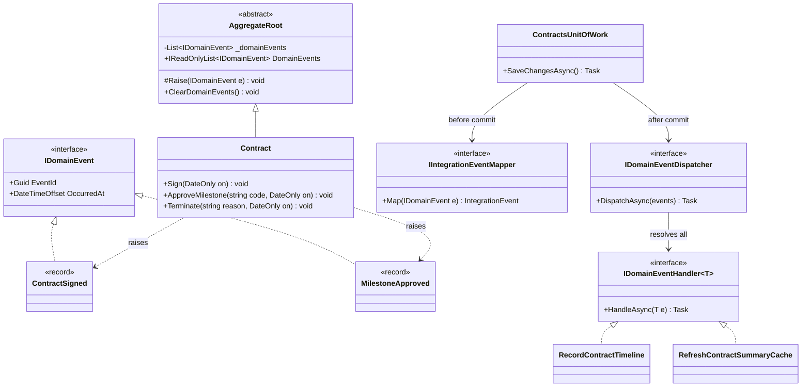
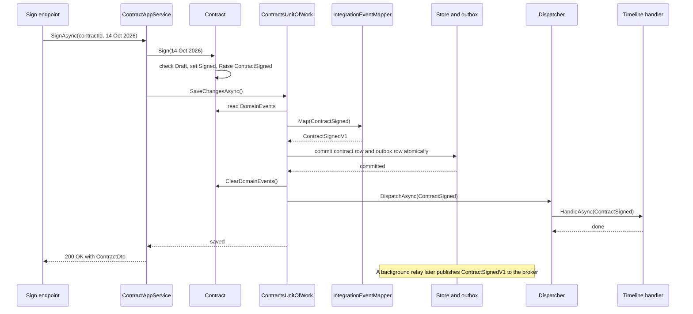

On a freelance marketplace (think of a platform like Upwork or Fiverr), when a client and a freelancer sign a ₹4,20,000 contract to build a mobile app, a surprising amount has to happen. The client's project budget is committed. The freelancer needs the signed copy. The contract dashboard should show it as "live". The payments system must open an escrow ledger so milestone money can be held and released. If the `Contract.Sign()` method did all of that, it would need a budget service, an email client, a cache and an HTTP client to finance. The aggregate would stop being a small, testable guardian of its own rules.

**Domain events** solve this. The aggregate does its one job (check the rules, change its state) and then records a fact: `ContractSigned`. Other parts of the system react to that fact. This lesson shows how to raise events inside aggregates, collect them when you save, dispatch them after the commit, write handlers, and decide which events become **integration events** that leave your process.

## Learning objectives

By the end of this lesson you will be able to:

1. Explain what a domain event is and name events correctly (past tense, business language).
2. Raise events inside an aggregate without the aggregate knowing who listens.
3. Collect events in a unit of work and dispatch them after the database commit.
4. Implement an in-process dispatcher and handlers in ASP.NET Core with DI.
5. Distinguish domain events from integration events, and publish integration events safely through a transactional outbox.
6. Reason about failure modes: handler crashes, lost side effects, event loops, ordering.
7. Decide when events are overkill and a direct method call is clearer.

## Prerequisites

- [Aggregates and aggregate roots](#/lesson/m08-aggregates): events are raised by aggregate roots.
- [Repositories and domain services](#/lesson/m08-repositories-domain-services): the unit of work that saves aggregates is where events are collected.
- [Observer](#/lesson/m06-observer): domain events are a structured, decoupled form of Observer.
- [Dependency injection](#/lesson/m03-dependency-injection): handlers are resolved from the container.

## Explain it like I'm a beginner

Think of a hospital ward. When a nurse gives a patient medicine, she does not personally phone the pharmacy, the billing office and the doctor. She writes one line in the patient's chart: "10:15 — 500 mg paracetamol given". That line is a **fact about the past**. The pharmacy reads the chart and reorders stock. Billing reads it and adds a charge. The doctor reads it on the next round. The nurse does not even need to know who reads the chart.

A domain event is that line in the chart. When something important happens inside your business objects (a contract is signed, a milestone is approved, an order is cancelled), the object writes a small, unchangeable note: `ContractSigned { contract C-2291, freelancer V-77, ₹4,20,000, 14 Oct 2026 }`. Other code "reads the chart" and reacts.

Two details matter, and the analogy covers both:

1. **The note is written only if the action really happened.** If the medicine was not given, nothing goes in the chart. In code: we only tell others about the event **after the database has saved** the change. Announcing "contract signed" and then failing to save would send the freelancer a contract that does not exist.
2. **Some notes stay inside the ward, others are sent to other hospitals.** Internal notes can use ward shorthand and change whenever the ward likes. A discharge summary sent to another hospital uses an agreed, stable format. In code, internal notes are **domain events**; messages sent to other systems are **integration events**.

## First-principles explanation

### What a domain event is

A domain event is **an immutable record of something that happened in the domain that domain experts care about**. Three properties follow:

- **Past tense, business language.** `ContractSigned`, `MilestoneApproved`, `PurchaseOrderApproved`. Not `ContractUpdated` (too vague) or `SendEmailToFreelancer` (a command, not a fact).
- **Immutable.** A fact about the past cannot change. In C#, a `record` with init-only properties.
- **Self-contained enough.** It carries the ids and the key values handlers usually need (contract id, freelancer id, value, date), so most handlers do not have to reload the aggregate. It should not carry the whole aggregate object, which would leak internals and tempt handlers to modify it.

### Why it exists: decoupling side effects from rules

Without events, either the aggregate does too much, or the application service grows a long tail of "and then also...":

```csharp
contract.Sign(today);
await budgets.CommitAsync(contract.ProjectId, contract.Value);   // and then also
await mailer.SendSignedCopyAsync(contract);                     // and then also
cache.Remove($"contract-summary:{contract.Id}");               // and then also
await finance.OpenLedgerAsync(contract);                       // and then also
```

Every new reaction edits this method. It is the same "conditional sprawl" Strategy fixed, but in time instead of in branches. With events, the application service calls `contract.Sign(today)` and saves. Each reaction is a separate handler class, added without touching the signing code (the open/closed principle applied to workflows).

### How it works: raise, collect, dispatch

There are three steps, and the design choice in each matters.

**1. Raise inside the aggregate.** The aggregate root keeps a private list of pending events. Behaviour methods add to it *after* the rules pass and the state has changed:

```csharp
public void Sign(DateOnly signedOn)
{
    if (Status != ContractStatus.Draft) throw new DomainException("Only a draft contract can be signed.");
    Status = ContractStatus.Signed;
    SignedOn = signedOn;
    Raise(new ContractSigned(Id, Number, FreelancerId, Value, signedOn));
}
```

The aggregate does not call anybody. It has no dispatcher, no `IServiceProvider`, no static `DomainEvents.Raise(...)`. A static raiser (an older, popular approach) makes the aggregate depend on global state and makes tests interfere with each other. Recording events on the aggregate keeps it pure.

**2. Collect in the unit of work.** When the application service calls `SaveChangesAsync`, the unit of work looks at every aggregate loaded or added in this request and gathers their pending events. With EF Core, you can do this in an overridden `SaveChangesAsync` by reading `ChangeTracker.Entries<AggregateRoot>()`.

**3. Dispatch.** The big decision is *when*:

| When | How it behaves | Good for | Danger |
|---|---|---|---|
| **Before commit, same transaction** | Handlers run inside the transaction. If a handler fails, everything rolls back | Changes that must be atomic with the aggregate *and* live in the same database (writing an outbox row, updating a denormalised column) | Handlers that do I/O (email, HTTP) cannot be rolled back. The transaction gets long. Handlers can modify other aggregates and quietly break "one aggregate per transaction" |
| **After commit, in process** | Handlers run once the data is safely saved | Best-effort reactions: cache invalidation, updating a read model, in-app notifications | If the process crashes between commit and dispatch, the reaction is lost. A failing handler cannot undo the commit |
| **After commit, via outbox** | Events are written to an outbox table in the same transaction, and a background relay delivers them later | Anything that **must** eventually happen: other systems, emails with legal weight, cross-module workflows | More moving parts. Delivery is at-least-once, so consumers must be idempotent |

The design used in this lesson combines the safe parts:

- During `SaveChangesAsync`, events that other systems care about are **mapped to integration events and written to the outbox in the same transaction** as the aggregate change.
- After the commit, the same domain events are **dispatched to in-process handlers** for best-effort work.

So a crash can lose a cache invalidation (harmless, the cache has a TTL) but never the "contract signed" message to finance.

### Domain events vs integration events

| | Domain event | Integration event |
|---|---|---|
| Audience | Code in the same bounded context and process | Other services, modules or companies |
| Shape | Domain types (`ContractId`, `Money`), can change freely | Primitives and documented schema, versioned (`ContractSignedV1`) |
| Delivery | In memory, same process | Message broker or webhook, via outbox |
| Guarantees | Whatever the dispatcher gives (often best effort post-commit) | At-least-once, with idempotent consumers |
| Change cost | Rename in one commit | Needs a compatibility plan (add fields, keep old versions) |

Never publish domain events directly to a broker. The moment another team consumes `ContractSigned`, you cannot rename a property without breaking them. Map deliberately: most domain events never leave the context. The ones that do get a stable public twin.

### What happens without it

You see three symptoms. Application services become long scripts of side effects. Aggregates sprout service dependencies (`contract.Sign(mailer, budgets)`). Or, worst, side effects happen before the commit: the freelancer receives a signed contract, the save fails on a concurrency conflict, and now the email is out and the database says "draft".

### When it is useful

- One business action has **several independent reactions**, owned by different people.
- Reactions are **optional or best-effort** (the action should succeed even if the cache update fails).
- **Other systems** must learn about changes reliably.
- You want an **audit trail** of business facts.

### When it is unnecessary

- There is exactly one reaction, it is part of the same use case, and it must succeed for the use case to succeed. A direct call in the application service is clearer and easier to debug.
- Small CRUD modules. An event per field change is noise.
- When you are tempted to use events to **avoid deciding where logic belongs**. Events that trigger events that trigger events across five handlers make behaviour invisible. If you cannot draw the chain on a whiteboard, simplify it.

### Trade-offs

| You gain | You pay |
|---|---|
| Aggregates stay pure and testable | Behaviour is spread across handlers; harder to follow a use case end to end |
| New reactions without editing existing code | Ordering and failure semantics must be designed, not assumed |
| A natural audit trail and integration point | Integration events need versioning and idempotent consumers |
| Side effects happen only after a successful commit | Post-commit in-process handlers can be lost on a crash |

## Visual explanation

### Class diagram



How to read it: `Contract` inherits the event list from `AggregateRoot` and only ever *adds* to it through `Raise`. It has no arrow to any handler or dispatcher, which is the decoupling we want. The `ContractsUnitOfWork` is where events leave the aggregate. Before committing, it asks the `IIntegrationEventMapper` which events are public and stores those in the outbox. After committing, it hands all events to the `IDomainEventDispatcher`, which resolves every registered `IDomainEventHandler<T>` for each event type. Adding a new reaction means adding one handler class and one DI registration.

### Sequence diagram



Follow the order carefully. The aggregate raises the event as part of `Sign`, but nobody hears it yet. The unit of work maps the public part to `ContractSignedV1` and writes it to the outbox **in the same commit** as the contract row, so either both exist or neither does. Only after the commit does the dispatcher call in-process handlers. Events are cleared before dispatch so a retry of `SaveChangesAsync` will not publish them twice. The note at the bottom shows the outbox relay, covered fully in the [Transactional outbox lesson](#/lesson/m12-outbox).

## Step-by-step example

### Step 1: side effects in the application service

```csharp
public async Task SignAsync(Guid id, DateOnly on)
{
    var c = await repo.GetAsync(id);
    c.Sign(on);
    await mailer.SendAsync(c.FreelancerId, "Contract signed");   // happens before save
    cache.Remove($"contract-summary:{id}");
    await uow.SaveChangesAsync();                            // may throw a concurrency conflict
}
```

If `SaveChangesAsync` throws, the freelancer already has an email about a contract that is still a draft in the database.

### Step 2: raise an event instead

Change `Contract.Sign` to `Raise(new ContractSigned(...))`. The application service shrinks to "load, sign, save".

### Step 3: collect and dispatch after commit

The unit of work gathers events from tracked aggregates, commits, clears, then dispatches. The mailer and cache calls move into handlers.

### Step 4: separate what must not be lost

Ask of every reaction: "If this silently did not happen, would anyone be harmed?" Cache invalidation: no (the cache expires in 5 minutes). Telling payments to open an escrow ledger: yes. The second one becomes an integration event written to the outbox inside the transaction.

### Step 5: version the public contract

`ContractSignedV1` uses primitives (`Guid`, `decimal`, `string` currency code, `DateOnly`) and is documented for the finance team. The internal `ContractSigned` can change tomorrow without telling anyone.

## Production-style C# implementation

```text
Contracts.Api/
  Program.cs
  Domain/
    DomainPrimitives.cs        (DomainException, IDomainEvent, AggregateRoot)
    ContractEvents.cs
    Contract.cs
  Application/
    EventAbstractions.cs       (IDomainEventHandler, IDomainEventDispatcher, IIntegrationEventMapper, IUnitOfWork)
    ContractAppService.cs
    Handlers.cs
  Infrastructure/
    ContractStore.cs           (in-memory store, outbox, repository, tracker)
    DomainEventDispatcher.cs
    ContractsUnitOfWork.cs
    IntegrationEvents.cs
```

```csharp file=Domain/DomainPrimitives.cs
namespace Contracts.Domain;

public sealed class DomainException : Exception
{
    public DomainException(string message) : base(message) { }
}

/// <summary>A fact that happened in the domain. Immutable, past tense.</summary>
public interface IDomainEvent
{
    Guid EventId { get; }
    DateTimeOffset OccurredAt { get; }
}

public abstract record DomainEvent : IDomainEvent
{
    public Guid EventId { get; init; } = Guid.NewGuid();
    public DateTimeOffset OccurredAt { get; init; } = DateTimeOffset.UtcNow;
}

public abstract class AggregateRoot
{
    private readonly List<IDomainEvent> _domainEvents = new();

    public Guid Id { get; protected set; }
    public IReadOnlyList<IDomainEvent> DomainEvents => _domainEvents;

    protected void Raise(IDomainEvent domainEvent) => _domainEvents.Add(domainEvent);

    public void ClearDomainEvents() => _domainEvents.Clear();
}
```

```csharp file=Domain/ContractEvents.cs
namespace Contracts.Domain;

public sealed record ContractSigned(Guid ContractId, string ContractNumber, Guid FreelancerId, decimal Value, DateOnly SignedOn) : DomainEvent;

public sealed record MilestoneApproved(Guid ContractId, string MilestoneCode, decimal Amount, DateOnly ApprovedOn) : DomainEvent;

public sealed record ContractCompleted(Guid ContractId, DateOnly CompletedOn) : DomainEvent;

public sealed record ContractTerminated(Guid ContractId, string Reason, DateOnly TerminatedOn) : DomainEvent;
```

```csharp file=Domain/Contract.cs
namespace Contracts.Domain;

public enum ContractStatus { Draft, Signed, Completed, Terminated }

public sealed class Milestone
{
    internal Milestone(string code, decimal value) { Code = code; Value = value; }
    public string Code { get; }
    public decimal Value { get; }
    public bool Approved { get; private set; }
    internal void Approve() => Approved = true;
}

public sealed class Contract : AggregateRoot
{
    private readonly List<Milestone> _milestones = new();

    private Contract() { }

    public Contract(Guid id, string number, Guid freelancerId, IEnumerable<(string Code, decimal Value)> milestones)
    {
        if (string.IsNullOrWhiteSpace(number)) throw new DomainException("Contract number is required.");
        Id = id;
        Number = number;
        FreelancerId = freelancerId;
        foreach (var (code, value) in milestones)
        {
            if (value <= 0) throw new DomainException($"Milestone {code} must have a positive value.");
            if (_milestones.Any(m => m.Code == code)) throw new DomainException($"Duplicate milestone {code}.");
            _milestones.Add(new Milestone(code, value));
        }
        if (_milestones.Count == 0) throw new DomainException("A contract needs at least one milestone.");
        Status = ContractStatus.Draft;
    }

    public string Number { get; private set; } = "";
    public Guid FreelancerId { get; private set; }
    public ContractStatus Status { get; private set; }
    public DateOnly? SignedOn { get; private set; }
    public IReadOnlyList<Milestone> Milestones => _milestones;
    public decimal Value => _milestones.Sum(m => m.Value);

    public void Sign(DateOnly signedOn)
    {
        if (Status != ContractStatus.Draft) throw new DomainException("Only a draft contract can be signed.");
        Status = ContractStatus.Signed;
        SignedOn = signedOn;
        Raise(new ContractSigned(Id, Number, FreelancerId, Value, signedOn));
    }

    public void ApproveMilestone(string code, DateOnly approvedOn)
    {
        if (Status != ContractStatus.Signed) throw new DomainException("Milestones can only be approved on a signed contract.");
        var milestone = _milestones.SingleOrDefault(m => m.Code == code)
                        ?? throw new DomainException($"Unknown milestone {code}.");
        if (milestone.Approved) throw new DomainException($"Milestone {code} is already approved.");
        if (SignedOn is { } s && approvedOn < s) throw new DomainException("Cannot approve before the signing date.");

        milestone.Approve();
        Raise(new MilestoneApproved(Id, code, milestone.Value, approvedOn));

        if (_milestones.All(m => m.Approved))
        {
            Status = ContractStatus.Completed;
            Raise(new ContractCompleted(Id, approvedOn));
        }
    }

    public void Terminate(string reason, DateOnly terminatedOn)
    {
        if (Status != ContractStatus.Signed) throw new DomainException("Only a signed, incomplete contract can be terminated.");
        if (string.IsNullOrWhiteSpace(reason)) throw new DomainException("A termination reason is required.");
        Status = ContractStatus.Terminated;
        Raise(new ContractTerminated(Id, reason, terminatedOn));
    }
}
```

```csharp file=Application/EventAbstractions.cs
using Contracts.Domain;

namespace Contracts.Application;

/// <summary>In-process reaction to a domain event. Runs after the commit; must be idempotent and best effort.</summary>
public interface IDomainEventHandler<in TEvent> where TEvent : IDomainEvent
{
    Task HandleAsync(TEvent domainEvent, CancellationToken ct);
}

public interface IDomainEventDispatcher
{
    Task DispatchAsync(IReadOnlyList<IDomainEvent> events, CancellationToken ct);
}

/// <summary>A public, versioned message for other systems. Primitives only.</summary>
public abstract record IntegrationEvent(Guid EventId, DateTimeOffset OccurredAt)
{
    public abstract string Type { get; }
}

/// <summary>Decides which domain events leave the bounded context, and in what public shape.</summary>
public interface IIntegrationEventMapper
{
    IntegrationEvent? Map(IDomainEvent domainEvent);
}

public interface IContractRepository
{
    Task<Contract?> GetAsync(Guid id, CancellationToken ct = default);
    void Add(Contract contract);
}

public interface IUnitOfWork
{
    Task SaveChangesAsync(CancellationToken ct = default);
}
```

```csharp file=Application/ContractAppService.cs
using Contracts.Domain;

namespace Contracts.Application;

public sealed record ContractDto(Guid Id, string Number, string Status, decimal Value);

public sealed class ContractAppService(IContractRepository contracts, IUnitOfWork unitOfWork)
{
    public async Task<ContractDto?> SignAsync(Guid contractId, DateOnly signedOn, CancellationToken ct = default)
    {
        var contract = await contracts.GetAsync(contractId, ct);
        if (contract is null) return null;
        contract.Sign(signedOn);                 // raises ContractSigned, tells nobody yet
        await unitOfWork.SaveChangesAsync(ct);   // outbox + commit, then in-process dispatch
        return ToDto(contract);
    }

    public async Task<ContractDto?> ApproveAsync(Guid contractId, string milestoneCode, DateOnly on, CancellationToken ct = default)
    {
        var contract = await contracts.GetAsync(contractId, ct);
        if (contract is null) return null;
        contract.ApproveMilestone(milestoneCode, on);
        await unitOfWork.SaveChangesAsync(ct);
        return ToDto(contract);
    }

    private static ContractDto ToDto(Contract c) => new(c.Id, c.Number, c.Status.ToString(), c.Value);
}
```

```csharp file=Application/Handlers.cs
using Contracts.Domain;
using Microsoft.Extensions.Caching.Memory;

namespace Contracts.Application;

public sealed record TimelineEntry(Guid ContractId, string Text, DateTimeOffset At);

public interface IContractTimeline
{
    Task AppendAsync(TimelineEntry entry, CancellationToken ct);
}

/// <summary>Updates a read model. Idempotent per event id, so a redelivery does not duplicate entries.</summary>
public sealed class RecordContractTimeline(IContractTimeline timeline) :
    IDomainEventHandler<ContractSigned>,
    IDomainEventHandler<MilestoneApproved>
{
    public Task HandleAsync(ContractSigned e, CancellationToken ct) =>
        timeline.AppendAsync(new TimelineEntry(e.ContractId, $"Signed on {e.SignedOn:dd MMM yyyy} for {e.Value:N0}", e.OccurredAt), ct);

    public Task HandleAsync(MilestoneApproved e, CancellationToken ct) =>
        timeline.AppendAsync(new TimelineEntry(e.ContractId, $"Milestone {e.MilestoneCode} approved ({e.Amount:N0})", e.OccurredAt), ct);
}

/// <summary>Best effort: if this is lost, the cache entry simply expires.</summary>
public sealed class RefreshContractSummaryCache(IMemoryCache cache) :
    IDomainEventHandler<ContractSigned>,
    IDomainEventHandler<ContractCompleted>
{
    public Task HandleAsync(ContractSigned e, CancellationToken ct) { cache.Remove($"contract-summary:{e.ContractId}"); return Task.CompletedTask; }
    public Task HandleAsync(ContractCompleted e, CancellationToken ct) { cache.Remove($"contract-summary:{e.ContractId}"); return Task.CompletedTask; }
}
```

```csharp file=Infrastructure/IntegrationEvents.cs
using Contracts.Application;
using Contracts.Domain;

namespace Contracts.Infrastructure;

// Public contracts for the payments and freelancer-app teams. Change only by adding fields or a V2.
public sealed record ContractSignedV1(Guid EventId, DateTimeOffset OccurredAt, Guid ContractId, string ContractNumber,
    Guid FreelancerId, decimal Value, string Currency, DateOnly SignedOn) : IntegrationEvent(EventId, OccurredAt)
{
    public override string Type => "contracts.contract-signed.v1";
}

public sealed record MilestoneApprovedV1(Guid EventId, DateTimeOffset OccurredAt, Guid ContractId, string MilestoneCode,
    decimal Amount, string Currency, DateOnly ApprovedOn) : IntegrationEvent(EventId, OccurredAt)
{
    public override string Type => "contracts.milestone-approved.v1";
}

public sealed class ContractIntegrationEventMapper : IIntegrationEventMapper
{
    public IntegrationEvent? Map(IDomainEvent domainEvent) => domainEvent switch
    {
        ContractSigned e => new ContractSignedV1(e.EventId, e.OccurredAt, e.ContractId, e.ContractNumber, e.FreelancerId, e.Value, "INR", e.SignedOn),
        MilestoneApproved e => new MilestoneApprovedV1(e.EventId, e.OccurredAt, e.ContractId, e.MilestoneCode, e.Amount, "INR", e.ApprovedOn),
        _ => null,   // ContractCompleted and ContractTerminated stay inside this context for now
    };
}
```

```csharp file=Infrastructure/ContractStore.cs
using System.Text.Json;
using Contracts.Application;
using Contracts.Domain;

namespace Contracts.Infrastructure;

public sealed record OutboxMessage(Guid Id, string Type, string Payload, DateTimeOffset OccurredAt);

/// <summary>Stands in for PostgreSQL: a contracts table and an outbox table, committed together under one lock.</summary>
public sealed class InMemoryContractStore
{
    private readonly object _gate = new();
    private readonly Dictionary<Guid, Contract> _contracts = new();
    private readonly List<OutboxMessage> _outbox = new();

    public Contract? Find(Guid id) { lock (_gate) return _contracts.GetValueOrDefault(id); }

    public IReadOnlyList<OutboxMessage> Outbox { get { lock (_gate) return _outbox.ToList(); } }

    public void Commit(IEnumerable<Contract> changed, IEnumerable<IntegrationEvent> outgoing)
    {
        lock (_gate)   // one atomic step: rows and outbox messages together
        {
            foreach (var c in changed) _contracts[c.Id] = c;
            foreach (var e in outgoing)
                _outbox.Add(new OutboxMessage(e.EventId, e.Type, JsonSerializer.Serialize(e, e.GetType()), e.OccurredAt));
        }
    }
}

/// <summary>Scoped: remembers which aggregates this request loaded or added.</summary>
public sealed class AggregateTracker
{
    private readonly List<Contract> _tracked = new();
    public IReadOnlyList<Contract> Tracked => _tracked;
    public void Track(Contract c) { if (!_tracked.Contains(c)) _tracked.Add(c); }
}

public sealed class InMemoryContractRepository(InMemoryContractStore store, AggregateTracker tracker) : IContractRepository
{
    public Task<Contract?> GetAsync(Guid id, CancellationToken ct = default)
    {
        var c = tracker.Tracked.FirstOrDefault(t => t.Id == id) ?? store.Find(id);
        if (c is not null) tracker.Track(c);
        return Task.FromResult(c);
    }

    public void Add(Contract contract) => tracker.Track(contract);
}

public sealed class InMemoryContractTimeline : IContractTimeline
{
    private readonly List<TimelineEntry> _entries = new();
    public IReadOnlyList<TimelineEntry> Entries { get { lock (_entries) return _entries.ToList(); } }
    public Task AppendAsync(TimelineEntry entry, CancellationToken ct) { lock (_entries) _entries.Add(entry); return Task.CompletedTask; }
}
```

```csharp file=Infrastructure/DomainEventDispatcher.cs
using System.Collections.Concurrent;
using Contracts.Application;
using Contracts.Domain;
using Microsoft.Extensions.DependencyInjection;
using Microsoft.Extensions.Logging;

namespace Contracts.Infrastructure;

/// <summary>
/// Resolves every IDomainEventHandler for the event's runtime type. A cached generic invoker avoids
/// reflection on every call (the same technique MediatR-style libraries use).
/// </summary>
public sealed class ServiceProviderDomainEventDispatcher(IServiceProvider services, ILogger<ServiceProviderDomainEventDispatcher> logger)
    : IDomainEventDispatcher
{
    private static readonly ConcurrentDictionary<Type, Invoker> Invokers = new();

    public async Task DispatchAsync(IReadOnlyList<IDomainEvent> events, CancellationToken ct)
    {
        foreach (var e in events)
        {
            var invoker = Invokers.GetOrAdd(e.GetType(),
                t => (Invoker)Activator.CreateInstance(typeof(Invoker<>).MakeGenericType(t))!);
            await invoker.InvokeAsync(e, services, logger, ct);
        }
    }

    private abstract class Invoker
    {
        public abstract Task InvokeAsync(IDomainEvent e, IServiceProvider sp, ILogger log, CancellationToken ct);
    }

    private sealed class Invoker<TEvent> : Invoker where TEvent : IDomainEvent
    {
        public override async Task InvokeAsync(IDomainEvent e, IServiceProvider sp, ILogger log, CancellationToken ct)
        {
            foreach (var handler in sp.GetServices<IDomainEventHandler<TEvent>>())
            {
                try
                {
                    await handler.HandleAsync((TEvent)e, ct);
                }
                catch (Exception ex)
                {
                    // Post-commit: the business change is already saved. Log and continue with the other handlers.
                    log.LogError(ex, "Handler {Handler} failed for {Event} {EventId}", handler.GetType().Name, typeof(TEvent).Name, e.EventId);
                }
            }
        }
    }
}
```

```csharp file=Infrastructure/ContractsUnitOfWork.cs
using Contracts.Application;
using Contracts.Domain;

namespace Contracts.Infrastructure;

public sealed class ContractsUnitOfWork(
    InMemoryContractStore store,
    AggregateTracker tracker,
    IIntegrationEventMapper mapper,
    IDomainEventDispatcher dispatcher) : IUnitOfWork
{
    private const int MaxRounds = 3;

    public async Task SaveChangesAsync(CancellationToken ct = default)
    {
        for (var round = 1; ; round++)
        {
            var events = tracker.Tracked.SelectMany(a => a.DomainEvents).ToList();
            if (round > 1 && events.Count == 0) return;
            if (round > MaxRounds) throw new InvalidOperationException("Domain events keep raising new events. Check for a handler loop.");

            // 1. Public facts go to the outbox in the SAME commit as the aggregate rows.
            var outgoing = events.Select(mapper.Map).OfType<IntegrationEvent>().ToList();
            store.Commit(tracker.Tracked, outgoing);

            // 2. Clear before dispatch, so a retry cannot publish the same events twice.
            foreach (var a in tracker.Tracked) a.ClearDomainEvents();

            // 3. Best-effort in-process reactions after the data is safe.
            await dispatcher.DispatchAsync(events, ct);
        }
    }
}
```

```csharp file=Program.cs
using Contracts.Application;
using Contracts.Domain;
using Contracts.Infrastructure;

var builder = WebApplication.CreateBuilder(args);

builder.Services.AddMemoryCache();
builder.Services.AddSingleton<InMemoryContractStore>();
builder.Services.AddSingleton<InMemoryContractTimeline>();
builder.Services.AddSingleton<IContractTimeline>(sp => sp.GetRequiredService<InMemoryContractTimeline>());

builder.Services.AddScoped<AggregateTracker>();
builder.Services.AddScoped<IContractRepository, InMemoryContractRepository>();
builder.Services.AddScoped<IUnitOfWork, ContractsUnitOfWork>();
builder.Services.AddSingleton<IIntegrationEventMapper, ContractIntegrationEventMapper>();
builder.Services.AddScoped<IDomainEventDispatcher, ServiceProviderDomainEventDispatcher>();
builder.Services.AddScoped<ContractAppService>();

// One registration per (handler, event) pair. A class handling two events is registered twice.
builder.Services.AddScoped<IDomainEventHandler<ContractSigned>, RecordContractTimeline>();
builder.Services.AddScoped<IDomainEventHandler<MilestoneApproved>, RecordContractTimeline>();
builder.Services.AddScoped<IDomainEventHandler<ContractSigned>, RefreshContractSummaryCache>();
builder.Services.AddScoped<IDomainEventHandler<ContractCompleted>, RefreshContractSummaryCache>();

var app = builder.Build();

app.MapPost("/contracts/{id:guid}/sign", async (Guid id, DateOnly signedOn, ContractAppService service, CancellationToken ct) =>
{
    try
    {
        var dto = await service.SignAsync(id, signedOn, ct);
        return dto is null ? Results.NotFound() : Results.Ok(dto);
    }
    catch (DomainException ex)
    {
        return Results.Problem(ex.Message, statusCode: StatusCodes.Status409Conflict);
    }
});

app.MapGet("/outbox", (InMemoryContractStore store) => store.Outbox);

app.Run();
```

### The EF Core version of "collect events"

With EF Core, collection usually happens in the `DbContext` itself. This snippet is not compiled here because EF Core is not available to the checker:

```csharp
public override async Task<int> SaveChangesAsync(CancellationToken ct = default)
{
    var aggregates = ChangeTracker.Entries<AggregateRoot>().Select(e => e.Entity).Where(a => a.DomainEvents.Count > 0).ToList();
    var events = aggregates.SelectMany(a => a.DomainEvents).ToList();

    foreach (var integration in events.Select(_mapper.Map).OfType<IntegrationEvent>())
        OutboxMessages.Add(OutboxMessage.From(integration));      // same transaction as the aggregate rows

    var result = await base.SaveChangesAsync(ct);                 // one PostgreSQL transaction
    aggregates.ForEach(a => a.ClearDomainEvents());
    await _dispatcher.DispatchAsync(events, ct);                  // after commit
    return result;
}
```

An alternative is an EF Core `SaveChangesInterceptor`, which keeps the `DbContext` clean. Either way, the outbox rows are part of the same `SaveChanges` call, so PostgreSQL commits them atomically with the contract.

:::callout type=warning title="Do not dispatch from inside the aggregate"
A static `DomainEvents.Raise(e)` that immediately calls handlers (popular around 2010) runs handlers *before* the save, inside the domain method, using global state. Tests interfere with each other, and side effects happen even when the save later fails. Record events on the aggregate and dispatch from the unit of work.
:::

## Bad design vs good design

### Bad: the aggregate calls services

```csharp
public void Sign(DateOnly on, IMailer mailer, IBudgetService budgets)
{
    Status = ContractStatus.Signed;
    mailer.Send(FreelancerId, "Signed!");            // I/O inside the domain, before commit
    budgets.Commit(ProjectId, Value).Wait();     // blocking call, cross-aggregate change
}
```

Problems: the domain depends on infrastructure; the test for "a draft contract can be signed" now needs a fake mailer and a fake budget service; the email goes out even if the save fails; `.Wait()` can deadlock or exhaust the thread pool; and the method changes another aggregate in the same transaction.

### Bad: publishing domain events straight to the broker

```csharp
await bus.PublishAsync(contractSignedDomainEvent);   // other teams now depend on your internal record
```

Rename `Value` to `ContractValue` next month and the finance consumer breaks at 2 a.m. And because the publish happens outside your database transaction, a failed commit still sends the message (or a crash after commit loses it).

### Good

The aggregate raises facts. The unit of work writes mapped integration events to the outbox in the same transaction, commits, clears, and dispatches domain events to idempotent in-process handlers. Public events are versioned primitives.

### Is the improvement worth it?

For signing a contract with five reactions owned by three teams: clearly. For "update a freelancer's phone number" with no reactions: no. Do not add events speculatively. Add the first event when the first genuine second reaction appears.

## Practical playground

The playground has a tiny contract aggregate, an in-memory unit of work and a dispatcher. Run it to see the order of "commit" and "handle" lines. Then try: make `Sign` throw for a contract that is already signed and confirm that no handler runs.

:::playground type=csharp title="Raise, commit, then dispatch"
```csharp file=Program.cs
using System;
using System.Collections.Generic;
using System.Linq;

public interface IDomainEvent { }
public sealed record ContractSigned(Guid ContractId, decimal Value) : IDomainEvent;
public sealed record MilestoneApproved(Guid ContractId, string Code) : IDomainEvent;

public abstract class AggregateRoot
{
    private readonly List<IDomainEvent> _events = new();
    public IReadOnlyList<IDomainEvent> DomainEvents => _events;
    protected void Raise(IDomainEvent e) => _events.Add(e);
    public void ClearDomainEvents() => _events.Clear();
}

public sealed class Contract : AggregateRoot
{
    public Contract(Guid id, decimal value) { Id = id; Value = value; }
    public Guid Id { get; }
    public decimal Value { get; }
    public bool Signed { get; private set; }

    public void Sign()
    {
        if (Signed) throw new InvalidOperationException("Already signed.");
        Signed = true;
        Raise(new ContractSigned(Id, Value));
    }

    public void Approve(string code)
    {
        if (!Signed) throw new InvalidOperationException("Sign first.");
        Raise(new MilestoneApproved(Id, code));
    }
}

public sealed class Dispatcher
{
    private readonly Dictionary<Type, List<Action<IDomainEvent>>> _handlers = new();
    public void On<T>(Action<T> handler) where T : IDomainEvent
    {
        if (!_handlers.TryGetValue(typeof(T), out var list)) _handlers[typeof(T)] = list = new();
        list.Add(e => handler((T)e));
    }
    public void Dispatch(IDomainEvent e)
    {
        if (_handlers.TryGetValue(e.GetType(), out var list)) foreach (var h in list) h(e);
    }
}

public sealed class UnitOfWork
{
    private readonly List<AggregateRoot> _tracked = new();
    private readonly Dispatcher _dispatcher;
    public UnitOfWork(Dispatcher dispatcher) => _dispatcher = dispatcher;
    public void Track(AggregateRoot a) => _tracked.Add(a);

    public void SaveChanges()
    {
        var events = _tracked.SelectMany(a => a.DomainEvents).ToList();
        Console.WriteLine($"commit: {_tracked.Count} aggregate(s), {events.Count} event(s) collected");
        foreach (var a in _tracked) a.ClearDomainEvents();
        foreach (var e in events) _dispatcher.Dispatch(e);
    }
}

public static class Program
{
    public static void Main()
    {
        var dispatcher = new Dispatcher();
        dispatcher.On<ContractSigned>(e => Console.WriteLine($"handle: email freelancer about contract worth {e.Value:N0}"));
        dispatcher.On<ContractSigned>(e => Console.WriteLine("handle: invalidate dashboard cache"));
        dispatcher.On<MilestoneApproved>(e => Console.WriteLine($"handle: timeline entry for milestone {e.Code}"));

        var contract = new Contract(Guid.NewGuid(), 420_000m);
        var uow = new UnitOfWork(dispatcher);
        uow.Track(contract);

        contract.Sign();
        contract.Approve("M1-DESIGN");
        Console.WriteLine("before save: nothing handled yet");
        uow.SaveChanges();
    }
}
```
:::

## Exercises

:::exercise id=m08-domain-events-ex1 difficulty=beginner kind=code title="Raise events from a purchase-order aggregate"
Implement event recording in `AggregateRoot` and raise the right events from `PurchaseOrder`. The aggregate must not know who listens.
::requirements
- `AggregateRoot.Raise` appends to a private list. `DomainEvents` exposes it read-only. `ClearDomainEvents` empties it.
- `Submit()` moves Draft to Submitted and raises `PurchaseOrderSubmitted(PoId, Total)`. A PO with no lines cannot be submitted.
- `Approve(approverId)` moves Submitted to Approved and raises `PurchaseOrderApproved(PoId, ApproverId, Total)`.
- `Cancel(reason)` is allowed from Draft or Submitted and raises `PurchaseOrderCancelled(PoId, Reason)`.
- An operation that is rejected throws `InvalidOperationException` and raises **no** event.
::acceptance
- Events appear in the order the operations ran.
- A rejected operation leaves `DomainEvents` unchanged.
- `DomainEvents` cannot be cast to `List<IDomainEvent>` and modified from outside (return a read-only wrapper).
::hint
Raise the event as the *last* line of each method, after all checks and state changes.
::hint
`_events.AsReadOnly()` returns a `ReadOnlyCollection<T>`, which cannot be cast back to `List<T>`.
::hint
Write each method as: guard clauses, then state change, then `Raise(...)`.
::hint
```csharp
public void Submit()
{
    if (Status != PoStatus.Draft) throw new InvalidOperationException("Only a draft PO can be submitted.");
    if (_lines.Count == 0) throw new InvalidOperationException("Add at least one line.");
    Status = PoStatus.Submitted;
    Raise(new PurchaseOrderSubmitted(Id, Total));
}
```
::starter
```csharp file=PurchaseOrderEvents.cs
using System;
using System.Collections.Generic;
using System.Linq;

public interface IDomainEvent { }
public sealed record PurchaseOrderSubmitted(Guid PoId, decimal Total) : IDomainEvent;
public sealed record PurchaseOrderApproved(Guid PoId, Guid ApproverId, decimal Total) : IDomainEvent;
public sealed record PurchaseOrderCancelled(Guid PoId, string Reason) : IDomainEvent;

public abstract class AggregateRoot
{
    public IReadOnlyList<IDomainEvent> DomainEvents => throw new NotImplementedException();
    protected void Raise(IDomainEvent e) => throw new NotImplementedException();
    public void ClearDomainEvents() => throw new NotImplementedException();
}

public enum PoStatus { Draft, Submitted, Approved, Cancelled }

public sealed class PurchaseOrder : AggregateRoot
{
    private readonly List<(string Sku, decimal Qty, decimal Price)> _lines = new();
    public PurchaseOrder(Guid id) { Id = id; }
    public Guid Id { get; }
    public PoStatus Status { get; private set; } = PoStatus.Draft;
    public decimal Total => _lines.Sum(l => l.Qty * l.Price);

    public void AddLine(string sku, decimal qty, decimal price)
    {
        if (Status != PoStatus.Draft) throw new InvalidOperationException("Only draft POs can be edited.");
        _lines.Add((sku, qty, price));
    }

    public void Submit() => throw new NotImplementedException();
    public void Approve(Guid approverId) => throw new NotImplementedException();
    public void Cancel(string reason) => throw new NotImplementedException();
}
```
::tests
```csharp file=PurchaseOrderEventsTests.cs
using System;
using System.Collections.Generic;
using System.Linq;
using Xunit;

public class PurchaseOrderEventsTests
{
    private static PurchaseOrder WithLine()
    {
        var po = new PurchaseOrder(Guid.NewGuid());
        po.AddLine("CEM", 100, 380m);
        return po;
    }

    [Fact]
    public void Submit_raises_event_with_total()
    {
        var po = WithLine();
        po.Submit();
        var e = Assert.IsType<PurchaseOrderSubmitted>(Assert.Single(po.DomainEvents));
        Assert.Equal(38000m, e.Total);
        Assert.Equal(po.Id, e.PoId);
    }

    [Fact]
    public void Events_in_operation_order()
    {
        var po = WithLine();
        var approver = Guid.NewGuid();
        po.Submit();
        po.Approve(approver);
        Assert.Collection(po.DomainEvents,
            e => Assert.IsType<PurchaseOrderSubmitted>(e),
            e => Assert.Equal(approver, Assert.IsType<PurchaseOrderApproved>(e).ApproverId));
    }

    [Fact]
    public void Empty_po_cannot_be_submitted_and_raises_nothing()
    {
        var po = new PurchaseOrder(Guid.NewGuid());
        Assert.Throws<InvalidOperationException>(() => po.Submit());
        Assert.Empty(po.DomainEvents);
        Assert.Equal(PoStatus.Draft, po.Status);
    }

    [Fact]
    public void Approve_draft_is_rejected_without_event()
    {
        var po = WithLine();
        Assert.Throws<InvalidOperationException>(() => po.Approve(Guid.NewGuid()));
        Assert.Empty(po.DomainEvents);
    }

    [Fact]
    public void Cancel_from_submitted()
    {
        var po = WithLine();
        po.Submit();
        po.Cancel("Vendor withdrew quote");
        Assert.Equal(PoStatus.Cancelled, po.Status);
        Assert.Equal("Vendor withdrew quote", Assert.IsType<PurchaseOrderCancelled>(po.DomainEvents.Last()).Reason);
    }

    [Fact]
    public void Cancel_approved_is_rejected()
    {
        var po = WithLine();
        po.Submit();
        po.Approve(Guid.NewGuid());
        po.ClearDomainEvents();
        Assert.Throws<InvalidOperationException>(() => po.Cancel("too late"));
        Assert.Empty(po.DomainEvents);
    }

    [Fact]
    public void Events_cannot_be_modified_from_outside()
    {
        var po = WithLine();
        po.Submit();
        Assert.False(po.DomainEvents is List<IDomainEvent>);
    }

    [Fact]
    public void Clear_empties_list()
    {
        var po = WithLine();
        po.Submit();
        po.ClearDomainEvents();
        Assert.Empty(po.DomainEvents);
    }
}
```
::solution
Each behaviour method follows the same shape: guards, state change, raise. Because `Raise` is the last line, a thrown guard leaves both state and events untouched.

```csharp file=PurchaseOrderEvents.cs
using System;
using System.Collections.Generic;
using System.Linq;

public interface IDomainEvent { }
public sealed record PurchaseOrderSubmitted(Guid PoId, decimal Total) : IDomainEvent;
public sealed record PurchaseOrderApproved(Guid PoId, Guid ApproverId, decimal Total) : IDomainEvent;
public sealed record PurchaseOrderCancelled(Guid PoId, string Reason) : IDomainEvent;

public abstract class AggregateRoot
{
    private readonly List<IDomainEvent> _events = new();
    public IReadOnlyList<IDomainEvent> DomainEvents => _events.AsReadOnly();
    protected void Raise(IDomainEvent e) => _events.Add(e ?? throw new ArgumentNullException(nameof(e)));
    public void ClearDomainEvents() => _events.Clear();
}

public enum PoStatus { Draft, Submitted, Approved, Cancelled }

public sealed class PurchaseOrder : AggregateRoot
{
    private readonly List<(string Sku, decimal Qty, decimal Price)> _lines = new();
    public PurchaseOrder(Guid id) { Id = id; }
    public Guid Id { get; }
    public PoStatus Status { get; private set; } = PoStatus.Draft;
    public decimal Total => _lines.Sum(l => l.Qty * l.Price);

    public void AddLine(string sku, decimal qty, decimal price)
    {
        if (Status != PoStatus.Draft) throw new InvalidOperationException("Only draft POs can be edited.");
        _lines.Add((sku, qty, price));
    }

    public void Submit()
    {
        if (Status != PoStatus.Draft) throw new InvalidOperationException("Only a draft PO can be submitted.");
        if (_lines.Count == 0) throw new InvalidOperationException("Add at least one line before submitting.");
        Status = PoStatus.Submitted;
        Raise(new PurchaseOrderSubmitted(Id, Total));
    }

    public void Approve(Guid approverId)
    {
        if (Status != PoStatus.Submitted) throw new InvalidOperationException("Only a submitted PO can be approved.");
        Status = PoStatus.Approved;
        Raise(new PurchaseOrderApproved(Id, approverId, Total));
    }

    public void Cancel(string reason)
    {
        if (Status is not (PoStatus.Draft or PoStatus.Submitted))
            throw new InvalidOperationException("Only draft or submitted POs can be cancelled.");
        if (string.IsNullOrWhiteSpace(reason)) throw new InvalidOperationException("A reason is required.");
        Status = PoStatus.Cancelled;
        Raise(new PurchaseOrderCancelled(Id, reason));
    }
}
```
::mistakes
- Raising the event at the top of the method, before the guards. A rejected call then leaves a phantom event.
- Exposing `List<IDomainEvent>` directly, so handlers or tests can add or remove events.
- Naming events as commands (`ApprovePurchaseOrder`) or vaguely (`PurchaseOrderChanged`).
::extensions
Add `ChangeVendor(newVendorId)` on a draft PO and decide whether it deserves an event at all. Who would listen?
:::

:::exercise id=m08-domain-events-ex2 difficulty=beginner kind=written title="Name the event, and decide if it leaves the context"
For each situation in an order-management system, write (a) a good domain event name with its key fields, and (b) whether it should also become an integration event, with a one-line reason.

1. A customer places an order for 3 items worth ₹4,850.
2. The warehouse team changes the internal bin location of a SKU.
3. A payment of ₹4,850 is captured via UPI.
4. A customer edits the delivery instructions ("leave with security") before dispatch.
5. An order is cancelled because payment failed three times.
6. A developer wants an event called `SendInvoiceEmail`.
::acceptance
- All names are past tense and in business language.
- Each event carries ids and the key values handlers need, not whole objects.
- Integration decisions are justified by "does another system or team need this fact?"
- Item 6 is identified as a command, not an event, and renamed or redesigned.
::hint
Read each name aloud after "We just learned that...". If it does not fit, it is not an event name.
::hint
Think about who outside the ordering context cares: payments, warehouse, notifications, analytics, finance.
::hint
An internal detail that no other team uses should not become a public contract you must version forever.
::solution
1. `OrderPlaced(OrderId, CustomerId, Lines[Sku, Qty, UnitPrice], Total, PlacedAt)`. **Integration: yes** (`OrderPlacedV1`), because payments and the warehouse react.
2. `BinLocationChanged(Sku, FromBin, ToBin)`. This is a warehouse-context event. **Integration: no**; no other context cares where a SKU sits inside the building.
3. `PaymentCaptured(PaymentId, OrderId, Amount, Method, ProviderReference)`. Raised in the payments context. **Integration: yes**, because ordering moves the order to "Paid" and finance reconciles it.
4. `DeliveryInstructionsChanged(OrderId, Instructions)`. **Integration: probably yes, but narrowly**: the delivery partner needs it before dispatch. If dispatch reads instructions on demand instead, keep it internal. This one depends on the integration style, and both answers are defensible with a reason.
5. `OrderCancelled(OrderId, Reason = PaymentFailed, CancelledAt)`. **Integration: yes**: the warehouse releases reserved stock and notifications tells the customer. Use a reason code, not free text, in the public version.
6. `SendInvoiceEmail` is a **command** (an instruction to do something), not a fact. The fact is probably `InvoiceIssued(InvoiceId, OrderId, Amount)`. A handler for that event decides to send the email.
::mistakes
- Using one generic `OrderUpdated` event with a "changed fields" bag. Handlers cannot tell what happened.
- Making every event an integration event "just in case", which creates dozens of public contracts.
- Putting the whole `Order` object in the event.
:::

:::exercise id=m08-domain-events-ex3 difficulty=intermediate kind=code title="An in-process dispatcher with isolated handler failures"
Implement `InProcessDispatcher`, which delivers events to subscribed handlers without DI. It must be predictable about order and failures.
::requirements
- `Subscribe<T>(handler)` registers a handler for event type `T`.
- `DispatchAsync(e)` calls handlers registered for the event's **runtime type**, in subscription order, then handlers registered for `IDomainEvent` itself (catch-all handlers such as an audit log).
- Every handler runs even if an earlier one throws. After all have run, if any failed, throw one `AggregateException` containing every failure.
- An event with no handlers is a no-op.
- `DispatchAllAsync(events)` dispatches events in order, continues past failures, and throws one `AggregateException` containing all failures at the end.
::acceptance
- All tests pass.
- Handlers for a different event type never run.
- The dispatcher does not use reflection to call methods.
::hint
Store handlers as `Func<IDomainEvent, CancellationToken, Task>` in a `Dictionary<Type, List<...>>`. Wrap the typed handler when subscribing.
::hint
The wrapper is `(e, ct) => handler.HandleAsync((T)e, ct)`. The cast is safe because you only call it for the matching type.
::hint
Build the list to run: specific handlers for `e.GetType()`, then catch-all handlers for `typeof(IDomainEvent)`.
::hint
```csharp
var failures = new List<Exception>();
foreach (var h in toRun)
{
    try { await h(e, ct); }
    catch (Exception ex) { failures.Add(ex); }
}
if (failures.Count > 0) throw new AggregateException(failures);
```
::starter
```csharp file=InProcessDispatcher.cs
using System;
using System.Collections.Generic;
using System.Linq;
using System.Threading;
using System.Threading.Tasks;

public interface IDomainEvent { }

public interface IDomainEventHandler<in T> where T : IDomainEvent
{
    Task HandleAsync(T e, CancellationToken ct);
}

public sealed class InProcessDispatcher
{
    public void Subscribe<T>(IDomainEventHandler<T> handler) where T : IDomainEvent => throw new NotImplementedException();

    public Task DispatchAsync(IDomainEvent e, CancellationToken ct = default) => throw new NotImplementedException();

    public Task DispatchAllAsync(IEnumerable<IDomainEvent> events, CancellationToken ct = default) => throw new NotImplementedException();
}
```
::tests
```csharp file=InProcessDispatcherTests.cs
using System;
using System.Collections.Generic;
using System.Linq;
using System.Threading;
using System.Threading.Tasks;
using Xunit;

public sealed record OrderPlaced(Guid OrderId) : IDomainEvent;
public sealed record OrderCancelled(Guid OrderId) : IDomainEvent;

public class InProcessDispatcherTests
{
    private sealed class Recorder<T> : IDomainEventHandler<T> where T : IDomainEvent
    {
        private readonly List<string> _log; private readonly string _name; private readonly bool _fail;
        public Recorder(List<string> log, string name, bool fail = false) { _log = log; _name = name; _fail = fail; }
        public Task HandleAsync(T e, CancellationToken ct)
        {
            _log.Add($"{_name}:{e.GetType().Name}");
            if (_fail) throw new InvalidOperationException(_name + " failed");
            return Task.CompletedTask;
        }
    }

    [Fact]
    public async Task Calls_matching_handlers_in_order()
    {
        var log = new List<string>();
        var d = new InProcessDispatcher();
        d.Subscribe(new Recorder<OrderPlaced>(log, "a"));
        d.Subscribe(new Recorder<OrderCancelled>(log, "x"));
        d.Subscribe(new Recorder<OrderPlaced>(log, "b"));
        await d.DispatchAsync(new OrderPlaced(Guid.NewGuid()));
        Assert.Equal(new[] { "a:OrderPlaced", "b:OrderPlaced" }, log);
    }

    [Fact]
    public async Task Catch_all_runs_after_specific()
    {
        var log = new List<string>();
        var d = new InProcessDispatcher();
        d.Subscribe(new Recorder<IDomainEvent>(log, "audit"));
        d.Subscribe(new Recorder<OrderPlaced>(log, "a"));
        await d.DispatchAsync(new OrderPlaced(Guid.NewGuid()));
        Assert.Equal(new[] { "a:OrderPlaced", "audit:OrderPlaced" }, log);
    }

    [Fact]
    public async Task No_handlers_is_a_noop()
    {
        await new InProcessDispatcher().DispatchAsync(new OrderPlaced(Guid.NewGuid()));
    }

    [Fact]
    public async Task Failure_does_not_stop_other_handlers()
    {
        var log = new List<string>();
        var d = new InProcessDispatcher();
        d.Subscribe(new Recorder<OrderPlaced>(log, "a", fail: true));
        d.Subscribe(new Recorder<OrderPlaced>(log, "b"));
        d.Subscribe(new Recorder<OrderPlaced>(log, "c", fail: true));
        var ex = await Assert.ThrowsAsync<AggregateException>(() => d.DispatchAsync(new OrderPlaced(Guid.NewGuid())));
        Assert.Equal(3, log.Count);
        Assert.Equal(2, ex.InnerExceptions.Count);
    }

    [Fact]
    public async Task DispatchAll_continues_past_failures()
    {
        var log = new List<string>();
        var d = new InProcessDispatcher();
        d.Subscribe(new Recorder<OrderPlaced>(log, "a", fail: true));
        d.Subscribe(new Recorder<OrderCancelled>(log, "x"));
        var events = new IDomainEvent[] { new OrderPlaced(Guid.NewGuid()), new OrderCancelled(Guid.NewGuid()) };
        var ex = await Assert.ThrowsAsync<AggregateException>(() => d.DispatchAllAsync(events));
        Assert.Equal(new[] { "a:OrderPlaced", "x:OrderCancelled" }, log);
        Assert.Single(ex.InnerExceptions);
    }

    [Fact]
    public async Task DispatchAll_without_failures_completes()
    {
        var log = new List<string>();
        var d = new InProcessDispatcher();
        d.Subscribe(new Recorder<OrderCancelled>(log, "x"));
        await d.DispatchAllAsync(new IDomainEvent[] { new OrderCancelled(Guid.NewGuid()), new OrderCancelled(Guid.NewGuid()) });
        Assert.Equal(2, log.Count);
    }
}
```
::solution
Typed handlers are wrapped once at subscription time into a uniform delegate. Dispatch builds a run list (specific, then catch-all) and collects failures instead of stopping.

```csharp file=InProcessDispatcher.cs
using System;
using System.Collections.Generic;
using System.Linq;
using System.Threading;
using System.Threading.Tasks;

public interface IDomainEvent { }

public interface IDomainEventHandler<in T> where T : IDomainEvent
{
    Task HandleAsync(T e, CancellationToken ct);
}

public sealed class InProcessDispatcher
{
    private readonly Dictionary<Type, List<Func<IDomainEvent, CancellationToken, Task>>> _handlers = new();

    public void Subscribe<T>(IDomainEventHandler<T> handler) where T : IDomainEvent
    {
        ArgumentNullException.ThrowIfNull(handler);
        if (!_handlers.TryGetValue(typeof(T), out var list))
            _handlers[typeof(T)] = list = new List<Func<IDomainEvent, CancellationToken, Task>>();
        list.Add((e, ct) => handler.HandleAsync((T)e, ct));
    }

    public async Task DispatchAsync(IDomainEvent e, CancellationToken ct = default)
    {
        var failures = await RunAsync(e, ct);
        if (failures.Count > 0) throw new AggregateException(failures);
    }

    public async Task DispatchAllAsync(IEnumerable<IDomainEvent> events, CancellationToken ct = default)
    {
        var failures = new List<Exception>();
        foreach (var e in events) failures.AddRange(await RunAsync(e, ct));
        if (failures.Count > 0) throw new AggregateException(failures);
    }

    private async Task<List<Exception>> RunAsync(IDomainEvent e, CancellationToken ct)
    {
        ArgumentNullException.ThrowIfNull(e);
        var toRun = new List<Func<IDomainEvent, CancellationToken, Task>>();
        if (_handlers.TryGetValue(e.GetType(), out var specific)) toRun.AddRange(specific);
        if (e.GetType() != typeof(IDomainEvent) && _handlers.TryGetValue(typeof(IDomainEvent), out var catchAll)) toRun.AddRange(catchAll);

        var failures = new List<Exception>();
        foreach (var h in toRun)
        {
            try { await h(e, ct); }
            catch (Exception ex) { failures.Add(ex); }
        }
        return failures;
    }
}
```

In the production dispatcher earlier in the lesson, DI plays the role of the dictionary, and failures are logged rather than thrown because dispatch happens after the commit. Throwing (as here) is useful when dispatch runs *before* commit, so a failure can roll the transaction back.
::alternatives
Run handlers for one event in parallel with `Task.WhenAll`. Faster for slow, independent handlers, but you lose ordering and handlers that share a scoped `DbContext` will break, because `DbContext` is not thread-safe. Sequential is the safer default.
::mistakes
- Stopping at the first failure, so one broken handler silently disables every handler registered after it.
- Using `e.GetType().BaseType` walks or reflection `Invoke` per call. Wrapping at subscribe time is simpler and faster.
- Swallowing failures with no log and no exception, which hides broken handlers for weeks.
:::

:::exercise id=m08-domain-events-ex4 difficulty=intermediate kind=design title="Design the event flow for order placement"
An order-management module must react to `OrderPlaced`: reserve stock (warehouse module, separate database schema), send an order confirmation SMS, update the "today's orders" dashboard counter, and tell the payments service (separate deployable) to create a UPI collect request.

Design the classes in the LLD designer: the aggregate and its events, the integration event(s) with versions, the mapper, the outbox message, and one handler per reaction. In each class's `responsibility`, say whether it runs **in-process after commit** or **via the outbox**, and why.
::acceptance
- `Order` raises `OrderPlaced` and holds no reference to any handler.
- The payment request and the stock reservation go through integration events in the outbox (they cross a deployable or module boundary and must not be lost).
- The dashboard counter is an in-process, post-commit, best-effort handler.
- The SMS decision is argued (outbox for reliability, or in-process if a lost SMS is acceptable).
- Integration events use primitives and carry a version in their name or type.
::hint
For each reaction ask: "If this silently did not happen, who would be harmed?"
::hint
The payments service is a separate process. It can only learn about the order through a message. Is a message sent after commit but outside the transaction safe?
::hint
The warehouse is in the same deployable but a different module. Treating it as an outbox consumer keeps the modules independent and lets them be split later.
::hint
You need: `Order`, `OrderPlaced`, `OrderPlacedV1`, `IIntegrationEventMapper`, `OutboxMessage`, `OutboxRelay`, and three or four handlers.
::starter
```json
{
  "classes": [
    { "id": "Order", "name": "Order", "kind": "class", "fields": ["-Guid Id", "-List~OrderLine~ _lines"], "methods": ["+void Place()"], "responsibility": "Aggregate root" },
    { "id": "OrderPlaced", "name": "OrderPlaced", "kind": "record", "fields": [], "methods": [], "responsibility": "TODO" }
  ],
  "relations": []
}
```
::solution
```json
{
  "classes": [
    { "id": "Order", "name": "Order", "kind": "class", "fields": ["-Guid Id", "-Guid CustomerId", "-List~OrderLine~ _lines", "-OrderStatus Status"], "methods": ["+void Place(DateTimeOffset at)", "+void Cancel(CancelReason reason)"], "responsibility": "Aggregate root. Raises OrderPlaced after checks pass. Knows no handlers" },
    { "id": "OrderPlaced", "name": "OrderPlaced", "kind": "record", "fields": ["+Guid OrderId", "+Guid CustomerId", "+IReadOnlyList~OrderLineSnapshot~ Lines", "+Money Total", "+DateTimeOffset PlacedAt"], "methods": [], "responsibility": "Domain event. Internal, uses domain types, free to change" },
    { "id": "OrderPlacedV1", "name": "OrderPlacedV1", "kind": "record", "fields": ["+Guid EventId", "+Guid OrderId", "+Guid CustomerId", "+decimal TotalAmount", "+string Currency", "+LineV1[] Lines", "+DateTimeOffset PlacedAt"], "methods": [], "responsibility": "Integration event. Primitives only, documented, versioned. Consumed by payments and warehouse" },
    { "id": "Mapper", "name": "OrderingIntegrationEventMapper", "kind": "class", "fields": [], "methods": ["+IntegrationEvent Map(IDomainEvent e)"], "responsibility": "Runs inside SaveChanges, before commit. Chooses which events leave the context" },
    { "id": "Outbox", "name": "OutboxMessage", "kind": "class", "fields": ["+Guid Id", "+string Type", "+string PayloadJson", "+DateTimeOffset OccurredAt", "+DateTimeOffset ProcessedAt"], "methods": [], "responsibility": "Row in the same PostgreSQL transaction as the order" },
    { "id": "Relay", "name": "OutboxRelay", "kind": "class", "fields": [], "methods": ["+Task ExecuteAsync(CancellationToken ct)"], "responsibility": "BackgroundService. Publishes unprocessed rows to the broker, marks them processed. At-least-once" },
    { "id": "Reserve", "name": "ReserveStockOnOrderPlaced", "kind": "class", "fields": [], "methods": ["+Task HandleAsync(OrderPlacedV1 e)"], "responsibility": "Warehouse module consumer via outbox. Idempotent on EventId (inbox table). Must not be lost" },
    { "id": "Pay", "name": "CreateUpiCollectRequest", "kind": "class", "fields": [], "methods": ["+Task HandleAsync(OrderPlacedV1 e)"], "responsibility": "Payments service consumer via broker. Separate deployable, so only a message can reach it. Idempotent" },
    { "id": "Sms", "name": "SendOrderConfirmationSms", "kind": "class", "fields": [], "methods": ["+Task HandleAsync(OrderPlacedV1 e)"], "responsibility": "Notification consumer via outbox: customers call support when the SMS is missing, so reliability is worth it" },
    { "id": "Dash", "name": "IncrementTodaysOrdersCounter", "kind": "class", "fields": [], "methods": ["+Task HandleAsync(OrderPlaced e)"], "responsibility": "In-process, after commit, best effort. Counter is rebuilt nightly from the orders table, so a lost increment is harmless" },
    { "id": "IHandler", "name": "IDomainEventHandler~T~", "kind": "interface", "fields": [], "methods": ["Task HandleAsync(T e, CancellationToken ct)"] }
  ],
  "relations": [
    { "from": "Order", "to": "OrderPlaced", "kind": "dependency", "label": "raises" },
    { "from": "Mapper", "to": "OrderPlaced", "kind": "dependency", "label": "reads" },
    { "from": "Mapper", "to": "OrderPlacedV1", "kind": "dependency", "label": "creates" },
    { "from": "Outbox", "to": "OrderPlacedV1", "kind": "association", "label": "serialised payload" },
    { "from": "Relay", "to": "Outbox", "kind": "dependency", "label": "polls" },
    { "from": "Reserve", "to": "OrderPlacedV1", "kind": "dependency", "label": "consumes" },
    { "from": "Pay", "to": "OrderPlacedV1", "kind": "dependency", "label": "consumes" },
    { "from": "Sms", "to": "OrderPlacedV1", "kind": "dependency", "label": "consumes" },
    { "from": "Dash", "to": "IHandler", "kind": "implements" }
  ]
}
```

**Reasoning.** Payments is a different process, so the only safe channel is an outbox-backed message: written atomically with the order, delivered at least once. Stock reservation crosses a module boundary and must not be lost, so it also consumes `OrderPlacedV1`; this keeps the warehouse module independent and makes it easy to extract later. The SMS goes through the outbox here because a missing confirmation generates support calls; a team with a cheap "resend confirmation" button might reasonably choose in-process best effort. The dashboard counter is the only in-process handler, because a lost increment is corrected by the nightly rebuild.
::mistakes
- Calling the payments API from an in-process post-commit handler. A crash after commit leaves an order with no payment request and no retry.
- Having the warehouse handler consume the internal `OrderPlaced` domain event, which couples two modules to one internal type.
- Forgetting idempotency on outbox consumers. At-least-once delivery means duplicates will arrive.
:::

:::exercise id=m08-domain-events-ex5 difficulty=advanced kind=code title="A unit of work that writes the outbox, commits, then dispatches"
Implement `UnitOfWork.SaveChangesAsync` with the exact ordering this lesson recommends, including follow-up events raised by handlers.
::requirements
- `Track(aggregate)` remembers an aggregate once (tracking the same instance twice has no effect).
- Each round: collect events from all tracked aggregates in tracking order; map them with `IIntegrationEventMapper` (drop `null`s); call `IDataStore.CommitAsync(integrationEvents)` once; clear events on all tracked aggregates; then dispatch each collected event, in order, through `IEventDispatcher`.
- The first round always commits, even with no events. Later rounds run only if handlers raised new events on tracked aggregates.
- If more than `MaxRounds` (3) rounds would be needed, throw `InvalidOperationException` before committing the extra round.
- If `CommitAsync` throws, nothing is dispatched and the events remain on the aggregates (so the caller can retry).
::acceptance
- All tests pass, including ordering checks between commit and dispatch.
- No event is dispatched before the commit that saved it.
- No event is dispatched twice.
::hint
Write the single-round version first: collect, map, commit, clear, dispatch. Then wrap it in a loop.
::hint
The loop condition: after dispatching, look again at the tracked aggregates. Handlers may have raised new events on them.
::hint
Do not clear the events until *after* `CommitAsync` has returned successfully. That is what makes a failed commit retryable.
::hint
```csharp
for (var round = 1; ; round++)
{
    var events = _tracked.SelectMany(a => a.DomainEvents).ToList();
    if (round > 1 && events.Count == 0) return;
    if (round > MaxRounds) throw new InvalidOperationException("...");
    // map, commit, clear, dispatch
}
```
::starter
```csharp file=UnitOfWork.cs
using System;
using System.Collections.Generic;
using System.Linq;
using System.Threading;
using System.Threading.Tasks;

public interface IDomainEvent { }
public sealed record ContractSigned(Guid ContractId) : IDomainEvent;
public sealed record MilestoneApproved(Guid ContractId, string Code) : IDomainEvent;

public abstract class AggregateRoot
{
    private readonly List<IDomainEvent> _events = new();
    public IReadOnlyList<IDomainEvent> DomainEvents => _events.AsReadOnly();
    protected void Raise(IDomainEvent e) => _events.Add(e);
    public void ClearDomainEvents() => _events.Clear();
}

public sealed class Contract : AggregateRoot
{
    public Contract(Guid id) { Id = id; }
    public Guid Id { get; }
    public void Sign() => Raise(new ContractSigned(Id));
    public void Approve(string code) => Raise(new MilestoneApproved(Id, code));
}

public interface IDataStore
{
    /// <summary>Commits all pending aggregate changes and the given outbox messages in one transaction.</summary>
    Task CommitAsync(IReadOnlyList<object> integrationEvents, CancellationToken ct);
}

public interface IIntegrationEventMapper
{
    object? Map(IDomainEvent e);
}

public interface IEventDispatcher
{
    Task DispatchAsync(IDomainEvent e, CancellationToken ct);
}

public sealed class UnitOfWork
{
    public const int MaxRounds = 3;

    public UnitOfWork(IDataStore store, IIntegrationEventMapper mapper, IEventDispatcher dispatcher) => throw new NotImplementedException();

    public void Track(AggregateRoot aggregate) => throw new NotImplementedException();

    public Task SaveChangesAsync(CancellationToken ct = default) => throw new NotImplementedException();
}
```
::tests
```csharp file=UnitOfWorkTests.cs
using System;
using System.Collections.Generic;
using System.Linq;
using System.Threading;
using System.Threading.Tasks;
using Xunit;

public class UnitOfWorkTests
{
    private sealed class Log { public List<string> Lines { get; } = new(); }

    private sealed class FakeStore : IDataStore
    {
        private readonly Log _log; public bool Fail; public int Commits;
        public List<IReadOnlyList<object>> Outboxes { get; } = new();
        public FakeStore(Log log) => _log = log;
        public Task CommitAsync(IReadOnlyList<object> integrationEvents, CancellationToken ct)
        {
            if (Fail) throw new InvalidOperationException("db down");
            Commits++;
            Outboxes.Add(integrationEvents);
            _log.Lines.Add($"commit{Commits}");
            return Task.CompletedTask;
        }
    }

    private sealed class SignedOnlyMapper : IIntegrationEventMapper
    {
        public object? Map(IDomainEvent e) => e is ContractSigned s ? $"ContractSignedV1:{s.ContractId}" : null;
    }

    private sealed class FakeDispatcher : IEventDispatcher
    {
        private readonly Log _log;
        public Func<IDomainEvent, Task>? OnDispatch;
        public FakeDispatcher(Log log) => _log = log;
        public async Task DispatchAsync(IDomainEvent e, CancellationToken ct)
        {
            _log.Lines.Add($"dispatch:{e.GetType().Name}");
            if (OnDispatch is not null) await OnDispatch(e);
        }
    }

    private static (UnitOfWork uow, FakeStore store, FakeDispatcher disp, Log log) Create()
    {
        var log = new Log();
        var store = new FakeStore(log);
        var disp = new FakeDispatcher(log);
        return (new UnitOfWork(store, new SignedOnlyMapper(), disp), store, disp, log);
    }

    [Fact]
    public async Task Commits_once_with_no_events()
    {
        var (uow, store, _, log) = Create();
        uow.Track(new Contract(Guid.NewGuid()));
        await uow.SaveChangesAsync();
        Assert.Equal(1, store.Commits);
        Assert.Equal(new[] { "commit1" }, log.Lines);
    }

    [Fact]
    public async Task Dispatches_after_commit_in_raise_order()
    {
        var (uow, _, _, log) = Create();
        var c = new Contract(Guid.NewGuid());
        uow.Track(c);
        c.Sign();
        c.Approve("M1");
        await uow.SaveChangesAsync();
        Assert.Equal(new[] { "commit1", "dispatch:ContractSigned", "dispatch:MilestoneApproved" }, log.Lines);
        Assert.Empty(c.DomainEvents);
    }

    [Fact]
    public async Task Only_mapped_events_reach_the_outbox()
    {
        var (uow, store, _, _) = Create();
        var c = new Contract(Guid.NewGuid());
        uow.Track(c);
        c.Sign();
        c.Approve("M1");
        await uow.SaveChangesAsync();
        Assert.Equal($"ContractSignedV1:{c.Id}", Assert.Single(store.Outboxes[0]));
    }

    [Fact]
    public async Task Failed_commit_dispatches_nothing_and_keeps_events()
    {
        var (uow, store, _, log) = Create();
        store.Fail = true;
        var c = new Contract(Guid.NewGuid());
        uow.Track(c);
        c.Sign();
        await Assert.ThrowsAsync<InvalidOperationException>(() => uow.SaveChangesAsync());
        Assert.Empty(log.Lines);
        Assert.Single(c.DomainEvents);
    }

    [Fact]
    public async Task Follow_up_events_get_their_own_commit()
    {
        var (uow, store, disp, log) = Create();
        var c = new Contract(Guid.NewGuid());
        uow.Track(c);
        disp.OnDispatch = e => { if (e is ContractSigned) c.Approve("KICKOFF"); return Task.CompletedTask; };
        c.Sign();
        await uow.SaveChangesAsync();
        Assert.Equal(new[] { "commit1", "dispatch:ContractSigned", "commit2", "dispatch:MilestoneApproved" }, log.Lines);
        Assert.Equal(2, store.Commits);
    }

    [Fact]
    public async Task Endless_loop_is_stopped()
    {
        var (uow, store, disp, _) = Create();
        var c = new Contract(Guid.NewGuid());
        uow.Track(c);
        disp.OnDispatch = e => { c.Approve("again"); return Task.CompletedTask; };
        c.Sign();
        await Assert.ThrowsAsync<InvalidOperationException>(() => uow.SaveChangesAsync());
        Assert.Equal(UnitOfWork.MaxRounds, store.Commits);
    }

    [Fact]
    public async Task Tracking_twice_does_not_duplicate_events()
    {
        var (uow, _, _, log) = Create();
        var c = new Contract(Guid.NewGuid());
        uow.Track(c);
        uow.Track(c);
        c.Sign();
        await uow.SaveChangesAsync();
        Assert.Single(log.Lines, l => l.StartsWith("dispatch"));
    }

    [Fact]
    public async Task Events_from_several_aggregates_in_tracking_order()
    {
        var (uow, _, _, log) = Create();
        var a = new Contract(Guid.NewGuid());
        var b = new Contract(Guid.NewGuid());
        uow.Track(a);
        uow.Track(b);
        b.Approve("B1");
        a.Sign();
        await uow.SaveChangesAsync();
        Assert.Equal(new[] { "commit1", "dispatch:ContractSigned", "dispatch:MilestoneApproved" }, log.Lines);
    }
}
```
::solution
Each round is "collect, map, commit, clear, dispatch". The loop picks up events that handlers raised on tracked aggregates and stops when there are none, or throws when the round limit is exceeded.

```csharp file=UnitOfWork.cs
using System;
using System.Collections.Generic;
using System.Linq;
using System.Threading;
using System.Threading.Tasks;

public interface IDomainEvent { }
public sealed record ContractSigned(Guid ContractId) : IDomainEvent;
public sealed record MilestoneApproved(Guid ContractId, string Code) : IDomainEvent;

public abstract class AggregateRoot
{
    private readonly List<IDomainEvent> _events = new();
    public IReadOnlyList<IDomainEvent> DomainEvents => _events.AsReadOnly();
    protected void Raise(IDomainEvent e) => _events.Add(e);
    public void ClearDomainEvents() => _events.Clear();
}

public sealed class Contract : AggregateRoot
{
    public Contract(Guid id) { Id = id; }
    public Guid Id { get; }
    public void Sign() => Raise(new ContractSigned(Id));
    public void Approve(string code) => Raise(new MilestoneApproved(Id, code));
}

public interface IDataStore
{
    /// <summary>Commits all pending aggregate changes and the given outbox messages in one transaction.</summary>
    Task CommitAsync(IReadOnlyList<object> integrationEvents, CancellationToken ct);
}

public interface IIntegrationEventMapper
{
    object? Map(IDomainEvent e);
}

public interface IEventDispatcher
{
    Task DispatchAsync(IDomainEvent e, CancellationToken ct);
}

public sealed class UnitOfWork
{
    public const int MaxRounds = 3;

    private readonly IDataStore _store;
    private readonly IIntegrationEventMapper _mapper;
    private readonly IEventDispatcher _dispatcher;
    private readonly List<AggregateRoot> _tracked = new();

    public UnitOfWork(IDataStore store, IIntegrationEventMapper mapper, IEventDispatcher dispatcher)
    {
        _store = store; _mapper = mapper; _dispatcher = dispatcher;
    }

    public void Track(AggregateRoot aggregate)
    {
        ArgumentNullException.ThrowIfNull(aggregate);
        if (!_tracked.Any(t => ReferenceEquals(t, aggregate))) _tracked.Add(aggregate);
    }

    public async Task SaveChangesAsync(CancellationToken ct = default)
    {
        for (var round = 1; ; round++)
        {
            var events = _tracked.SelectMany(a => a.DomainEvents).ToList();
            if (round > 1 && events.Count == 0) return;
            if (round > MaxRounds)
                throw new InvalidOperationException($"Events still pending after {MaxRounds} rounds. A handler is probably raising events in a loop.");

            var outgoing = events.Select(_mapper.Map).Where(m => m is not null).Select(m => m!).ToList();
            await _store.CommitAsync(outgoing, ct);          // throws: nothing cleared, nothing dispatched

            foreach (var a in _tracked) a.ClearDomainEvents();
            foreach (var e in events) await _dispatcher.DispatchAsync(e, ct);
        }
    }
}
```

Why a round limit? A handler that reacts to `MilestoneApproved` by approving another milestone, whose handler approves another, is a real bug pattern. Without a limit it becomes an infinite loop holding a request thread. Three rounds covers legitimate follow-ups (sign, then auto-approve mobilisation) while failing fast on loops.
::alternatives
Many teams forbid handlers from changing tracked aggregates at all: post-commit handlers that need to change an aggregate must do it in a **new** scope with its own unit of work, or through the outbox. That removes the loop entirely and makes "one aggregate per transaction" explicit. The trade-off is more plumbing per handler.
::mistakes
- Clearing events before the commit, so a failed commit loses them and a retry saves the aggregate without its events.
- Dispatching inside the commit callback or before it, which reintroduces "side effects for data that was never saved".
- Collecting events once before the loop, so follow-up events raised by handlers are never saved or dispatched.
:::

## Automated testing

**Aggregate tests assert on events**, not on handlers. This is the biggest testing win of domain events: the "contract signing" test does not need a mailer.

```csharp
[Fact]
public void Approving_last_milestone_completes_contract()
{
    var c = new Contract(Guid.NewGuid(), "C-2291", Guid.NewGuid(), new[] { ("M1", 100m), ("M2", 200m) });
    c.Sign(new DateOnly(2026, 10, 14));
    c.ApproveMilestone("M1", new DateOnly(2026, 11, 30));
    c.ClearDomainEvents();

    c.ApproveMilestone("M2", new DateOnly(2027, 1, 31));

    Assert.Collection(c.DomainEvents,
        e => Assert.Equal("M2", Assert.IsType<MilestoneApproved>(e).MilestoneCode),
        e => Assert.IsType<ContractCompleted>(e));
}
```

**Handler tests** construct the event directly and assert on the handler's effect, with a fake for its dependency (`InMemoryContractTimeline`). Test idempotency too: handle the same event twice and assert one timeline entry if the handler promises idempotency.

**Unit-of-work tests** (exercise 5) pin down ordering: commit before dispatch, no dispatch after a failed commit, outbox contents match the mapper.

**Mapper tests** protect the public contract. A snapshot test that serialises `ContractSignedV1` and compares it with a checked-in JSON file catches an accidental rename before the finance team does.

**Wiring test**: build the real `ServiceCollection` and assert that `GetServices<IDomainEventHandler<ContractSigned>>()` returns the two expected handlers. Forgotten registrations are the most common domain-event bug in ASP.NET Core.

## Real-world application

- **Freelance marketplaces and agency project tools** use `ContractSigned`, `ContractExtended` and `MilestoneApproved` to drive budget commitments, escrow ledgers and dashboards without coupling those modules.
- **E-commerce order management** uses `OrderPlaced` as the hub of fulfilment: payment, reservation, notifications and analytics all react.
- **Microsoft's eShop reference application** (ordering service) raises domain events inside aggregates and dispatches them from the `DbContext`, and separately publishes integration events through an outbox-style event log. It is a good public example of the domain/integration split.
- **Banking and UPI systems** publish integration events such as "payment settled" to many consumers; consumers deduplicate by event id because delivery is at-least-once.
- **Audit requirements** in government procurement are often met by persisting selected domain events as an append-only log. Full [event sourcing](#/lesson/m08-event-sourcing) goes further and makes events the source of truth.

## Interview questions

:::interview
::q beginner
What is a domain event and how should it be named?
::a
An immutable record of something that happened in the domain that domain experts care about. Name it in the past tense using business language, such as `ContractSigned` or `OrderCancelled`. It carries ids and key values, not whole objects. If a name reads like an instruction (`SendEmail`), it is a command, not an event.
::q beginner
Why raise events inside the aggregate instead of calling the email service directly?
::a
It keeps the aggregate free of infrastructure and side effects, so it stays small and testable. The aggregate only decides that something happened; separate handlers decide what to do about it. New reactions can be added without touching the aggregate, and side effects can be delayed until after the data is safely committed.
::q intermediate
Should domain events be dispatched before or after `SaveChanges`? Defend your answer.
::a
It depends on the handler. Work that must be atomic with the aggregate and lives in the same database (writing outbox rows, updating a denormalised column) can run before commit, inside the transaction. Anything with external side effects must run after commit, otherwise a failed save still sends emails or calls APIs. My default: write integration events to the outbox before commit, in the same transaction, then dispatch domain events to best-effort in-process handlers after commit. Reliability comes from the outbox, not from in-process dispatch.
::q intermediate
What is the difference between a domain event and an integration event?
::a
A domain event is internal to a bounded context, uses domain types, is delivered in-process and can change freely. An integration event is a public contract for other services or modules, uses primitives, is versioned, is delivered through a broker (via an outbox) with at-least-once semantics, and changes only in backward-compatible ways. A mapper decides which domain events become integration events; most never do.
::q advanced
A post-commit handler that updates a project's committed budget fails 0.1 % of the time because of a transient database error. What do you do?
::a
First recognise that the budget update must not be lost, so a best-effort in-process handler is the wrong tool. Move it to an outbox-driven consumer: the `ContractSigned` fact is written to the outbox in the contract's transaction, and a consumer updates the budget in its own transaction, with retries and backoff, idempotent on the event id (an inbox table storing processed ids). Add a dead-letter path and an alert for messages that fail repeatedly, plus a reconciliation job that compares signed contracts with commitments. Merging budget and contract into one transaction is the other option, but it couples two aggregates and is usually the wrong trade.
::q advanced
How do you prevent event-handler chains from becoming unmaintainable?
::a
Limit depth (for example, the unit of work refuses more than three rounds), forbid in-process handlers from modifying other aggregates in the same transaction, and use an explicit process manager when a workflow has several steps and state, so the flow is visible in one class (see [Transaction boundaries](#/lesson/m08-transaction-boundaries)). Document event flows in a simple table (event, handlers, owner). Use correlation and causation ids on events so logs can reconstruct a chain. And prefer a direct call when a reaction is mandatory and part of the same use case.
:::

## Summary and revision

**Key takeaways**

- A domain event is an immutable, past-tense business fact raised by an aggregate after its rules pass.
- Aggregates **record** events. They never dispatch them and never know the handlers.
- The unit of work **collects** events from tracked aggregates when saving.
- Write **integration events to an outbox in the same transaction**, then **commit**, **clear**, and **dispatch** domain events to in-process handlers.
- In-process post-commit handlers are best effort and may be lost on a crash; anything that must happen goes through the outbox.
- Integration events are versioned public contracts with primitive types; consumers must be idempotent.
- Do not add events for single, mandatory reactions; a direct call is clearer.

**Terminology**: domain event, integration event, raise, dispatch, handler, unit of work, outbox, at-least-once delivery, idempotent consumer, causation id.

:::flashcards
Q: What tense and language should a domain event name use?
A: Past tense, business language: ContractSigned, MilestoneApproved, OrderCancelled.
Q: Who dispatches domain events?
A: The unit of work (or DbContext/interceptor) after collecting them from tracked aggregates. Never the aggregate itself.
Q: Why clear events only after a successful commit?
A: So a failed commit keeps them on the aggregate and a retry saves and dispatches them correctly.
Q: Why must integration events go through an outbox?
A: Writing them in the same transaction as the aggregate guarantees they exist if and only if the change was committed.
Q: Domain event vs integration event in one line?
A: Domain events are internal and free to change; integration events are versioned public contracts for other systems.
Q: What delivery guarantee does an outbox relay give, and what does it require from consumers?
A: At-least-once delivery; consumers must be idempotent, for example by recording processed event ids.
Q: What is lost if the process crashes between commit and in-process dispatch?
A: The in-process reactions. That is acceptable only for best-effort work like cache invalidation.
Q: When is a domain event overkill?
A: When there is one mandatory reaction that is part of the same use case; call it directly.
:::

## Knowledge check

:::quiz pass=70
::q single
`Contract.Sign()` raises `ContractSigned`, and a handler emails the freelancer. The handler runs before `SaveChangesAsync`, and the save fails with a concurrency conflict. What is the result?
- [ ] Nothing bad, the email is rolled back.
- [x] The freelancer received an email about a contract that the database still shows as draft.
- [ ] The save is retried automatically.
- [ ] The aggregate prevents the email.
> External side effects cannot be rolled back. That is why handlers with I/O run after commit, or via the outbox.
::q single
Which is the best name for a domain event?
- [ ] `UpdateMilestone`
- [ ] `MilestoneEvent`
- [x] `MilestoneApproved`
- [ ] `ApproveMilestoneCommand`
> Past tense, specific, business language.
::q single
Payments (a separate service) must open an escrow ledger whenever a contract is signed, and must never miss one. What is the right mechanism?
- [ ] An in-process post-commit handler calling the finance API.
- [ ] Publish the internal `ContractSigned` record to the broker directly after commit.
- [x] Map to a versioned `ContractSignedV1`, write it to the outbox in the same transaction, and let a relay publish it.
- [ ] Have `Contract.Sign()` call the finance API.
> Only the outbox ties the message's existence to the commit. Publishing the internal record also couples finance to your internal type.
::q multi
Which statements about in-process, post-commit handlers are true? (Select all that apply.)
- [x] They can be lost if the process crashes after the commit.
- [x] A handler failure cannot roll back the already-committed change.
- [ ] They guarantee exactly-once execution.
- [x] They suit best-effort work such as cache invalidation.
> Exactly-once is not available. Use the outbox plus idempotent consumers for anything that must happen.
::q single
Why does the unit of work clear domain events from aggregates before dispatching them?
- [ ] To free memory.
- [x] So that if `SaveChangesAsync` is called again (for example by a handler or a retry), the same events are not saved and dispatched twice.
- [ ] Because handlers cannot read events that are still on the aggregate.
- [ ] Clearing is optional and has no effect.
> Clearing after commit but before dispatch makes each event belong to exactly one commit.
::q single
Your team wants to rename `ContractSigned.Value` to `ContractValue`. Ten other services consume contract-signed messages. What should have been true for this to be a safe, local change?
- [ ] Consumers should read the domain event through reflection.
- [x] Other services should consume a separate, versioned integration event produced by a mapper, not the domain event itself.
- [ ] The field should never be renamed.
- [ ] Every service should share the same domain assembly.
> The mapper is the seam that lets internal models evolve while the public contract stays stable.
::q single
A handler for `MilestoneApproved` approves the next milestone, whose event triggers the same handler again. The unit of work loops forever. What is the best structural fix?
- [ ] Increase the thread pool size.
- [ ] Catch the exception and ignore it.
- [x] Cap the number of dispatch rounds and move multi-step workflows into an explicit process manager or separate transactions.
- [ ] Dispatch events in parallel.
> A round limit fails fast; an explicit process manager makes the workflow visible instead of hiding it in handler chains.
:::

## Completion criteria

You have finished this lesson when you can:

- [ ] Score at least 70 % on the knowledge check.
- [ ] Complete exercises 1 and 3 with all tests passing.
- [ ] Complete exercise 5 and explain why events are cleared after the commit but before dispatch.
- [ ] Draw the raise, collect, outbox, commit, dispatch sequence from memory.
- [ ] Decide, for any reaction, whether it belongs in-process or behind the outbox, and justify it.
