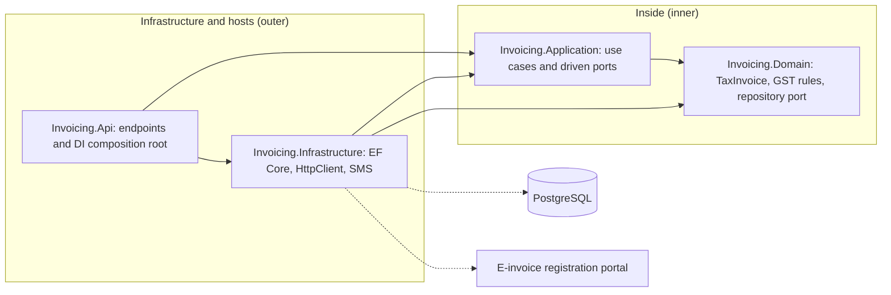
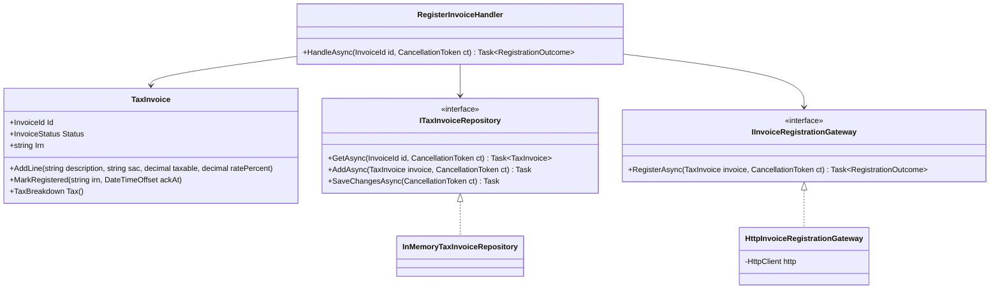
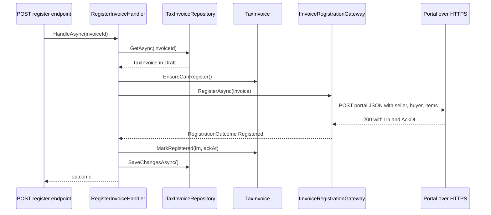

Every business application has two kinds of code. One kind knows the **business**: how GST is split between the centre and the state, when an invoice can be cancelled, what makes a bill valid. The other kind knows **machinery**: how to talk to PostgreSQL, how to call a government portal over HTTPS, how to send an SMS. This lesson is about keeping those two apart, and about the one rule that does it: **dependencies point inward, towards the business.**

The running example is GST e-invoicing for a digital-marketing agency in Pune that bills its clients for website builds and social-media campaigns. Each tax invoice must be registered with a government e-invoice registration portal, which returns a unique Invoice Reference Number (IRN). The tax rules are stable for years. The portal's API, the database and the SMS vendor change much more often. We want the rules to survive those changes untouched.

## Learning objectives

By the end of this lesson you will be able to:

1. State the dependency rule and explain why it points towards the domain.
2. Tell domain code from infrastructure code, and place a given class in the right layer.
3. Define ports (interfaces) that the domain or application layer owns, named in business language, and implement them as adapters in infrastructure.
4. Keep EF Core, `HttpClient`, `DateTime.Now` and configuration out of domain classes, while still persisting them with EF Core.
5. Translate an external API's data model at the boundary (an anti-corruption adapter) so its quirks never leak inward.
6. Choose the right test double (dummy, stub, spy, mock, fake) and write it by hand.
7. Enforce the dependency rule automatically with a test.

## Prerequisites

- [Dependency Inversion Principle](#/lesson/m04-dip): high-level policy should not depend on low-level detail.
- [Hexagonal architecture](#/lesson/m02-hexagonal): the original ports-and-adapters picture.
- [Repositories and domain services](#/lesson/m08-repositories-domain-services): a repository is the most common port.
- [Testable object design](#/lesson/m07-testable-design): seams, fakes and clocks.

## Explain it like I'm a beginner

Think of a ceiling fan and the wall socket.

The fan's job is to turn and move air. It doesn't care whether the electricity comes from a coal plant, a solar panel on the roof, or the society's diesel generator during a power cut. It only needs a socket of the right shape, giving 230 volts.

Now imagine a fan wired directly into the coal plant. To move it to a solar-powered house, you would have to rewire the fan itself. To test it in the shop, you'd need a coal plant. That's absurd, yet it's exactly what happens when business code calls `new NpgsqlConnection(...)` or `HttpClient` directly.

The fix in software is the same as in your house:

- The **fan** is your **domain**: the business rules.
- The **socket shape** is an **interface** that the domain defines: "I need something that can store an invoice" (a **port**).
- The **power sources** are **infrastructure**: PostgreSQL, the government portal, an SMS gateway. Each one gets a plug made to fit the socket (an **adapter**).
- A **test** is like a shop bench with a small battery pack: a simple fake power source, so you can check the fan turns without any power plant.

Who decides the socket shape? **The fan maker**, not the power company. In software this means the interface belongs to the domain and is written in business words (`IInvoiceRegistry.RegisterAsync(invoice)`), not in database words (`ExecuteSql(...)`).

## First-principles explanation

### What "domain" and "infrastructure" mean

| Domain (inside) | Infrastructure (outside) |
|---|---|
| Rules that a business expert would recognise | Code that only a developer would recognise |
| "Intra-state supply splits tax into CGST and SGST" | "Use `jsonb` for line items" |
| "A registered invoice cannot be edited, only cancelled within 24 hours" | "Retry the portal call 3 times with jitter" |
| Entities, value objects, domain services, domain events | EF Core `DbContext`, Npgsql, `HttpClient`, SMTP, blob storage, message brokers |
| Changes when the business or law changes | Changes when vendors, versions or hosting change |

Between them sits the **application layer**: use cases such as "register this invoice", which load domain objects through ports, call domain methods, and save. It orchestrates but holds no business rules of its own (see [Application services](#/lesson/m08-application-services)).

### The dependency rule

> Source code dependencies point only inward. Nothing in an inner circle may know anything about an outer circle.

Concretely, for a .NET solution:

- `Invoicing.Domain` references **nothing** except the BCL.
- `Invoicing.Application` references `Domain`.
- `Invoicing.Infrastructure` references `Application` and `Domain` (to implement their interfaces), plus EF Core, Npgsql, `HttpClient` and so on.
- `Invoicing.Api` (the web host) references everything, because it is the **composition root**: the one place where interfaces are wired to implementations in DI.

At runtime, control flows outward (the domain's use case ends up calling PostgreSQL). At compile time, dependencies point inward. Interfaces are what make the two directions different. That is the Dependency Inversion Principle applied to a whole architecture.

### Ports and adapters

A **port** is an interface on the boundary of the inside. An **adapter** is a class outside that implements a port (or calls into one).

There are two kinds:

- **Driven (secondary) ports**: things the application *needs* from the outside world. `ITaxInvoiceRepository`, `IInvoiceRegistrationGateway`, `INotificationSender`. Infrastructure implements them.
- **Driving (primary) ports**: ways the outside world *uses* the application. Use-case handlers like `RegisterInvoiceHandler`. Adapters such as an HTTP endpoint, a gRPC service or a message consumer call them.

### Who owns the interface?

This is the part people get wrong. If the interface lives in the infrastructure project, the domain must reference infrastructure to use it, and the arrow points the wrong way. **The consumer owns the interface.**

- A port used by domain logic itself (for example, a domain service that needs exchange rates) lives in **Domain**.
- A port used only by use cases (repositories, external gateways, email) usually lives in **Application**. Many teams put repository interfaces in Domain, next to the aggregate they store. Both are inside, so both obey the rule.

The interface is also **shaped by the consumer's needs**, in its language. Compare:

```csharp
// Shaped by the database: leaks infrastructure into the inside
public interface IInvoiceStore
{
    Task<DataTable> QueryAsync(string sql, params object[] args);
    Task<int> ExecuteAsync(string sql, params object[] args);
}

// Shaped by the domain: says what is needed, not how
public interface ITaxInvoiceRepository
{
    Task<TaxInvoice?> GetAsync(InvoiceId id, CancellationToken ct);
    Task AddAsync(TaxInvoice invoice, CancellationToken ct);
    Task SaveChangesAsync(CancellationToken ct);
}
```

### Why it exists — the problem

Without the rule, three things happen over a few years:

1. **Rules become untestable.** Testing "inter-state invoices use IGST" requires a running database, a portal sandbox and an SMS account. Tests take minutes, so people stop writing them.
2. **Vendor changes ripple into business code.** The portal moves from v1.03 to v1.04 of its JSON schema. Because the domain uses the portal's DTOs directly, 40 files change, including the tax calculation.
3. **Frameworks dictate the model.** EF Core needs a parameterless constructor and public setters (it doesn't, actually, but people believe it does), so the entity loses its guard clauses. Now any code can set `Status = "Registered"` without an IRN.

### How it works internally

There is no runtime magic. Three ordinary language features do all the work:

1. **Interfaces** declared in an inner project.
2. **Classes** in an outer project that implement them.
3. **Constructor injection** through the DI container, configured in `Program.cs`. When ASP.NET Core builds `RegisterInvoiceHandler`, it sees a constructor parameter of type `IInvoiceRegistrationGateway`, looks up the registration, and passes in `HttpInvoiceRegistrationGateway`. In a test you call the constructor yourself and pass a fake.

Project references enforce the rule at compile time: if `Domain.csproj` doesn't reference EF Core, no domain class *can* use it. In a single-project app you lose that guarantee, so you add an architecture test instead (exercise 5).

### What about EF Core?

EF Core is infrastructure. The domain must not reference `Microsoft.EntityFrameworkCore`: no `[Key]`, `[Column]` or `DbSet<T>` in domain classes. Yet EF Core can still persist rich domain objects:

- Mapping lives in `IEntityTypeConfiguration<T>` classes in Infrastructure (the Fluent API).
- EF Core can use private constructors and private setters, and can map private backing fields (`HasField`, `UsePropertyAccessMode`).
- Value objects map as owned types or complex types (`ComplexProperty`, available since EF Core 8).
- Strongly typed ids map with value converters.

The price is a little more mapping code. In exchange, the domain stays clean and EF Core can be upgraded (or replaced by Dapper for hot paths) without touching rules.

### When it is useful

- The business rules are valuable and change on a different schedule from the technology.
- You call external systems with unstable APIs (government portals, payment gateways, partner APIs).
- You want fast unit tests for rules, and confidence to upgrade frameworks.

### When it is unnecessary

- A thin CRUD app whose "logic" is just validation and saving. A port in front of every EF Core call adds ceremony and nothing else. Use EF Core directly in the endpoint or a simple service.
- Prototypes and spikes you will throw away.
- Wrapping things that are already abstractions and stable. `ILogger<T>` and `TimeProvider` are fine to use as they are. Wrapping `ILogger` in your own `IAppLogger` is usually wasted effort.

### Trade-offs it introduces

| You gain | You pay |
|---|---|
| Rules testable in milliseconds with fakes | More interfaces and classes |
| Vendors and frameworks swappable at the edge | Mapping between domain objects, EF entities and external DTOs |
| Compile-time enforcement through project references | More projects to navigate (or a test to enforce it in one project) |
| Clear ownership: business code vs plumbing | Risk of "interface for everything" with only one implementation and no tests |

## Visual explanation

### The dependency rule as a picture



Solid arrows are **compile-time references**. Every one of them points towards `Domain`, and `Domain` has no outgoing arrows at all. `Infrastructure` references the inner projects because it implements their interfaces. The `Api` project references Infrastructure only to register adapters in DI. Dotted arrows are **runtime calls** over the network. They exist only from Infrastructure. If you ever need to draw an arrow from `Domain` to `Infrastructure`, the design is wrong.

### Ports owned by the inside, adapters outside



`RegisterInvoiceHandler` (application) depends on two interfaces and the domain class. The two implementations at the bottom live in Infrastructure and point *up* at the interfaces they implement. The handler has no idea whether it is talking to PostgreSQL or a dictionary, or to the real portal or a stub.

### What happens when an invoice is registered



The handler never sees the portal's JSON. The gateway adapter builds the request from the domain object and translates the response into a `RegistrationOutcome`, a small type defined inside. If the portal answers with an error code, the adapter maps it to `Rejected` or `TransientFailure`, and the handler decides what to do in business terms. Notice also that the domain object guards its own state (`EnsureCanRegister`, `MarkRegistered`). The handler cannot mark an invoice registered without an IRN.

## Step-by-step example

### Step 1 — everything in one class

```csharp
public class InvoiceController(AppDbContext db, IConfiguration cfg) : ControllerBase
{
    [HttpPost("{id}/register")]
    public async Task<IActionResult> Register(Guid id)
    {
        var inv = await db.Invoices.Include(i => i.Lines).SingleAsync(i => i.Id == id);
        var sameState = inv.SupplierGstin[..2] == inv.BuyerGstin[..2];
        var tax = inv.Lines.Sum(l => l.Taxable * l.Rate / 100);          // business rule in a controller
        using var http = new HttpClient();                               // socket exhaustion risk
        http.DefaultRequestHeaders.Add("token", cfg["Irp:Token"]);
        var res = await http.PostAsJsonAsync(cfg["Irp:Url"], new { inv.Number, tax, sameState });
        var body = await res.Content.ReadFromJsonAsync<IrpResponse>();   // portal DTO in our code
        inv.Status = body!.Status == "ACT" ? "Registered" : "Failed";    // string status, no guard
        inv.Irn = body.Irn;
        inv.RegisteredOn = DateTime.Now;                                 // untestable clock
        await db.SaveChangesAsync();
        return Ok(body);                                                 // portal DTO leaks to our API
    }
}
```

To test the GST split here, you need a database, a configuration file and a live portal.

### Step 2 — move the rules into the domain

`TaxInvoice` gets `AddLine`, `Tax()` (with the CGST/SGST/IGST split) and `MarkRegistered(irn, ackAt)`. The time comes in as a parameter. Now the tax rule can be tested with `new TaxInvoice(...)` and nothing else.

### Step 3 — declare ports where they are needed

The use case needs "something that stores invoices" and "something that registers an invoice and tells me what happened". Write those as interfaces in the inner projects, in business words. Define the outcome type inside too: `RegistrationOutcome` with `Registered`, `Rejected` and `TransientFailure`.

### Step 4 — write adapters outside

`EfTaxInvoiceRepository` (or the in-memory one below) and `HttpInvoiceRegistrationGateway` live in Infrastructure. The gateway owns the portal's DTOs, its error codes and its authentication. Use `IHttpClientFactory` (`AddHttpClient`) instead of `new HttpClient()`.

### Step 5 — wire it in one place

`Program.cs` registers each port with its adapter. Tests construct the handler with fakes. The controller (or minimal API endpoint) becomes three lines.

## Production-style C# implementation

```text
Invoicing/                       (in a real solution: four projects)
  Domain/TaxInvoice.cs           -> Invoicing.Domain        (no package references)
  Domain/ITaxInvoiceRepository.cs
  Application/Ports.cs           -> Invoicing.Application   (references Domain)
  Application/RegisterInvoiceHandler.cs
  Infrastructure/InMemoryTaxInvoiceRepository.cs  -> Invoicing.Infrastructure
  Infrastructure/HttpInvoiceRegistrationGateway.cs
  Infrastructure/SmsNotificationSender.cs
Program.cs                       -> Invoicing.Api (composition root)
```

```csharp file=Invoicing/Domain/TaxInvoice.cs
namespace Invoicing.Domain;

public readonly record struct InvoiceId(Guid Value)
{
    public static InvoiceId New() => new(Guid.NewGuid());
    public override string ToString() => Value.ToString("N");
}

public enum InvoiceStatus { Draft, Registered, Cancelled }

public sealed class InvoiceRuleException(string message) : Exception(message);

public sealed record InvoiceLine(string Description, string Sac, decimal Taxable, decimal RatePercent)
{
    public decimal Tax => Math.Round(Taxable * RatePercent / 100m, 2, MidpointRounding.AwayFromZero);
}

public sealed record TaxBreakdown(decimal Taxable, decimal Cgst, decimal Sgst, decimal Igst)
{
    public decimal TotalTax => Cgst + Sgst + Igst;
    public decimal GrandTotal => Taxable + TotalTax;
}

/// <summary>A GST tax invoice. Knows nothing about databases, HTTP or the portal.</summary>
public sealed class TaxInvoice
{
    private static readonly decimal[] ValidRates = { 0m, 5m, 12m, 18m, 28m };
    private readonly List<InvoiceLine> _lines = new();

    public InvoiceId Id { get; }
    public string Number { get; }
    public DateOnly InvoiceDate { get; }
    public string SupplierGstin { get; }
    public string BuyerGstin { get; }
    public InvoiceStatus Status { get; private set; } = InvoiceStatus.Draft;
    public string? Irn { get; private set; }
    public DateTimeOffset? AcknowledgedAt { get; private set; }
    public IReadOnlyList<InvoiceLine> Lines => _lines;

    public TaxInvoice(InvoiceId id, string number, DateOnly invoiceDate, string supplierGstin, string buyerGstin)
    {
        if (string.IsNullOrWhiteSpace(number) || number.Length > 16)
            throw new InvoiceRuleException("Invoice number must be 1 to 16 characters.");
        Id = id; Number = number; InvoiceDate = invoiceDate;
        SupplierGstin = ValidateGstin(supplierGstin);
        BuyerGstin = ValidateGstin(buyerGstin);
    }

    /// <summary>Same state code (first two GSTIN digits) means CGST + SGST, otherwise IGST.</summary>
    public bool IsIntraState => SupplierGstin[..2] == BuyerGstin[..2];

    public void AddLine(string description, string sac, decimal taxable, decimal ratePercent)
    {
        if (Status != InvoiceStatus.Draft) throw new InvoiceRuleException("Only draft invoices can be edited.");
        if (taxable <= 0) throw new InvoiceRuleException("Taxable value must be positive.");
        if (!ValidRates.Contains(ratePercent)) throw new InvoiceRuleException($"GST rate {ratePercent} % is not a valid slab.");
        _lines.Add(new InvoiceLine(description, sac, taxable, ratePercent));
    }

    public TaxBreakdown Tax()
    {
        var taxable = _lines.Sum(l => l.Taxable);
        var tax = _lines.Sum(l => l.Tax);
        if (!IsIntraState) return new TaxBreakdown(taxable, 0m, 0m, tax);
        var half = Math.Round(tax / 2m, 2, MidpointRounding.AwayFromZero);
        return new TaxBreakdown(taxable, half, tax - half, 0m);   // SGST takes the rounding paisa
    }

    public void EnsureCanRegister()
    {
        if (Status != InvoiceStatus.Draft) throw new InvoiceRuleException($"Invoice is {Status}; it cannot be registered again.");
        if (_lines.Count == 0) throw new InvoiceRuleException("An invoice needs at least one line.");
    }

    public void MarkRegistered(string irn, DateTimeOffset acknowledgedAt)
    {
        EnsureCanRegister();
        if (string.IsNullOrWhiteSpace(irn) || irn.Length != 64)
            throw new InvoiceRuleException("An IRN is a 64-character hash.");
        Irn = irn; AcknowledgedAt = acknowledgedAt; Status = InvoiceStatus.Registered;
    }

    /// <summary>Business rule: a registered invoice can be cancelled only within 24 hours of acknowledgement.</summary>
    public void Cancel(DateTimeOffset now)
    {
        if (Status != InvoiceStatus.Registered) throw new InvoiceRuleException("Only registered invoices can be cancelled.");
        if (now - AcknowledgedAt!.Value > TimeSpan.FromHours(24))
            throw new InvoiceRuleException("The 24-hour cancellation window has passed. Issue a credit note instead.");
        Status = InvoiceStatus.Cancelled;
    }

    private static string ValidateGstin(string gstin)
    {
        if (gstin is null || gstin.Length != 15 || !char.IsDigit(gstin[0]) || !char.IsDigit(gstin[1]))
            throw new InvoiceRuleException($"'{gstin}' is not a valid 15-character GSTIN.");
        return gstin.ToUpperInvariant();
    }
}
```

Notice what is *not* here: no `[Key]`, no `DbSet`, no `HttpClient`, no `DateTime.Now`, no `IConfiguration`, no logging. Time arrives as a parameter (`Cancel(DateTimeOffset now)`), so the 24-hour rule is testable at any instant. The 24-hour window and the GST slabs reflect commonly published rules; verify against the current notifications before relying on them in production.

```csharp file=Invoicing/Domain/ITaxInvoiceRepository.cs
namespace Invoicing.Domain;

/// <summary>Port owned by the inside, named in domain terms. One implementation per storage technology.</summary>
public interface ITaxInvoiceRepository
{
    Task<TaxInvoice?> GetAsync(InvoiceId id, CancellationToken ct);
    Task AddAsync(TaxInvoice invoice, CancellationToken ct);
    Task SaveChangesAsync(CancellationToken ct);
}
```

```csharp file=Invoicing/Application/Ports.cs
using Invoicing.Domain;

namespace Invoicing.Application;

public enum RegistrationResult { Registered, Rejected, TransientFailure }

/// <summary>Our own type for the portal's answer. The portal's JSON never crosses this line.</summary>
public sealed record RegistrationOutcome(RegistrationResult Result, string? Irn = null, DateTimeOffset? AcknowledgedAt = null, string? Reason = null)
{
    public static RegistrationOutcome Ok(string irn, DateTimeOffset at) => new(RegistrationResult.Registered, irn, at);
    public static RegistrationOutcome Reject(string reason) => new(RegistrationResult.Rejected, Reason: reason);
    public static RegistrationOutcome Retry(string reason) => new(RegistrationResult.TransientFailure, Reason: reason);
}

/// <summary>Driven port: "register this invoice with the tax authority".</summary>
public interface IInvoiceRegistrationGateway
{
    Task<RegistrationOutcome> RegisterAsync(TaxInvoice invoice, CancellationToken ct);
}

/// <summary>Driven port: tell the buyer. Business wording, no SMS or email specifics.</summary>
public interface IBuyerNotifier
{
    Task InvoiceRegisteredAsync(TaxInvoice invoice, CancellationToken ct);
}
```

```csharp file=Invoicing/Application/RegisterInvoiceHandler.cs
using Invoicing.Domain;
using Microsoft.Extensions.Logging;

namespace Invoicing.Application;

/// <summary>Driving port (use case). Orchestrates; the rules stay in TaxInvoice.</summary>
public sealed class RegisterInvoiceHandler(
    ITaxInvoiceRepository invoices,
    IInvoiceRegistrationGateway gateway,
    IBuyerNotifier notifier,
    ILogger<RegisterInvoiceHandler> logger)
{
    public async Task<RegistrationOutcome> HandleAsync(InvoiceId id, CancellationToken ct)
    {
        var invoice = await invoices.GetAsync(id, ct)
                      ?? throw new KeyNotFoundException($"Invoice {id} not found.");
        invoice.EnsureCanRegister();

        var outcome = await gateway.RegisterAsync(invoice, ct);
        switch (outcome.Result)
        {
            case RegistrationResult.Registered:
                invoice.MarkRegistered(outcome.Irn!, outcome.AcknowledgedAt!.Value);
                await invoices.SaveChangesAsync(ct);
                await notifier.InvoiceRegisteredAsync(invoice, ct);
                break;
            case RegistrationResult.Rejected:
                logger.LogWarning("Invoice {Number} rejected by portal: {Reason}", invoice.Number, outcome.Reason);
                break;
            case RegistrationResult.TransientFailure:
                logger.LogInformation("Invoice {Number} registration will be retried: {Reason}", invoice.Number, outcome.Reason);
                break;
        }
        return outcome;
    }
}
```

`ILogger<T>` appears in the application layer. That is a pragmatic choice: it is already an abstraction from `Microsoft.Extensions.Logging.Abstractions`, it is stable, and `NullLogger<T>` makes it trivial in tests. Keep it out of the *domain* anyway; a domain object that needs to report something should raise a domain event or return a result.

```csharp file=Invoicing/Infrastructure/InMemoryTaxInvoiceRepository.cs
using System.Collections.Concurrent;
using Invoicing.Domain;

namespace Invoicing.Infrastructure;

/// <summary>Adapter for local development and tests. The production adapter uses EF Core and PostgreSQL.</summary>
public sealed class InMemoryTaxInvoiceRepository : ITaxInvoiceRepository
{
    private readonly ConcurrentDictionary<InvoiceId, TaxInvoice> _store = new();
    public Task<TaxInvoice?> GetAsync(InvoiceId id, CancellationToken ct) => Task.FromResult(_store.GetValueOrDefault(id));
    public Task AddAsync(TaxInvoice invoice, CancellationToken ct) { _store[invoice.Id] = invoice; return Task.CompletedTask; }
    public Task SaveChangesAsync(CancellationToken ct) => Task.CompletedTask;   // objects are already in memory
}
```

```csharp file=Invoicing/Infrastructure/HttpInvoiceRegistrationGateway.cs
using System.Net;
using System.Net.Http.Json;
using System.Text.Json.Serialization;
using Invoicing.Application;
using Invoicing.Domain;
using Microsoft.Extensions.Logging;

namespace Invoicing.Infrastructure;

/// <summary>Adapter and anti-corruption layer for the e-invoice portal.
/// Owns the portal's field names, codes and status values. Nothing here is visible to the inside.</summary>
public sealed class HttpInvoiceRegistrationGateway(HttpClient http, TimeProvider clock, ILogger<HttpInvoiceRegistrationGateway> logger)
    : IInvoiceRegistrationGateway
{
    // The portal's vocabulary, kept private to this adapter.
    private sealed record PortalItem(string PrdDesc, string HsnCd, decimal AssAmt, decimal GstRt);
    private sealed record PortalRequest(string DocNo, string DocDt, string SellerGstin, string BuyerGstin, IReadOnlyList<PortalItem> ItemList);
    private sealed record PortalResponse(
        [property: JsonPropertyName("Status")] string? Status,
        [property: JsonPropertyName("Irn")] string? Irn,
        [property: JsonPropertyName("AckDt")] DateTimeOffset? AckDt,
        [property: JsonPropertyName("ErrorCode")] string? ErrorCode,
        [property: JsonPropertyName("ErrorMessage")] string? ErrorMessage);

    public async Task<RegistrationOutcome> RegisterAsync(TaxInvoice invoice, CancellationToken ct)
    {
        var request = new PortalRequest(
            invoice.Number, invoice.InvoiceDate.ToString("dd/MM/yyyy"), invoice.SupplierGstin, invoice.BuyerGstin,
            invoice.Lines.Select(l => new PortalItem(l.Description, l.Sac, l.Taxable, l.RatePercent)).ToList());
        try
        {
            using var response = await http.PostAsJsonAsync("einvoice/generate", request, ct);
            if (response.StatusCode is HttpStatusCode.TooManyRequests or >= HttpStatusCode.InternalServerError)
                return RegistrationOutcome.Retry($"Portal returned {(int)response.StatusCode}.");

            var body = await response.Content.ReadFromJsonAsync<PortalResponse>(ct);
            if (response.IsSuccessStatusCode && body is { Status: "ACT", Irn: { } irn })
                return RegistrationOutcome.Ok(irn, body.AckDt ?? clock.GetUtcNow());

            return RegistrationOutcome.Reject($"{body?.ErrorCode ?? "unknown"}: {body?.ErrorMessage ?? "no details"}");
        }
        catch (HttpRequestException ex)
        {
            logger.LogWarning(ex, "Portal unreachable for invoice {Number}", invoice.Number);
            return RegistrationOutcome.Retry("Portal unreachable.");
        }
        catch (TaskCanceledException) when (!ct.IsCancellationRequested)
        {
            return RegistrationOutcome.Retry("Portal timed out.");
        }
    }
}
```

The portal's field names (`DocNo`, `AssAmt`, `GstRt`), its date format and its `"ACT"` status string are all private to this one file. The field names here are illustrative, not the official schema. If the portal changes them, this adapter and its tests change, and nothing else does. That is the **anti-corruption layer** idea from DDD at the smallest scale.

```csharp file=Invoicing/Infrastructure/SmsNotificationSender.cs
using Invoicing.Application;
using Invoicing.Domain;
using Microsoft.Extensions.Logging;

namespace Invoicing.Infrastructure;

/// <summary>Placeholder SMS adapter: a real one would call an SMS vendor's HTTP API.</summary>
public sealed class SmsNotificationSender(ILogger<SmsNotificationSender> logger) : IBuyerNotifier
{
    public Task InvoiceRegisteredAsync(TaxInvoice invoice, CancellationToken ct)
    {
        logger.LogInformation("SMS to buyer {Gstin}: invoice {Number} registered, IRN ends {Suffix}",
            invoice.BuyerGstin, invoice.Number, invoice.Irn![^6..]);
        return Task.CompletedTask;
    }
}
```

```csharp file=Program.cs
using Invoicing.Application;
using Invoicing.Domain;
using Invoicing.Infrastructure;

var builder = WebApplication.CreateBuilder(args);

// Composition root: the only place that knows which adapter plugs into which port.
builder.Services.AddSingleton(TimeProvider.System);
builder.Services.AddSingleton<ITaxInvoiceRepository, InMemoryTaxInvoiceRepository>();
builder.Services.AddSingleton<IBuyerNotifier, SmsNotificationSender>();
builder.Services.AddHttpClient<IInvoiceRegistrationGateway, HttpInvoiceRegistrationGateway>(client =>
{
    client.BaseAddress = new Uri(builder.Configuration["Irp:BaseUrl"] ?? "https://sandbox.example.invalid/");
    client.Timeout = TimeSpan.FromSeconds(10);
});
builder.Services.AddScoped<RegisterInvoiceHandler>();

var app = builder.Build();

app.MapPost("/invoices/{id:guid}/register", async (Guid id, RegisterInvoiceHandler handler, CancellationToken ct) =>
{
    try
    {
        var outcome = await handler.HandleAsync(new InvoiceId(id), ct);
        return outcome.Result switch
        {
            RegistrationResult.Registered => Results.Ok(new { outcome.Irn, outcome.AcknowledgedAt }),
            RegistrationResult.Rejected => Results.Problem(outcome.Reason, statusCode: 422),
            _ => Results.Problem("Registration is temporarily unavailable. It will be retried.", statusCode: 503)
        };
    }
    catch (KeyNotFoundException) { return Results.NotFound(); }
    catch (InvoiceRuleException ex) { return Results.Problem(ex.Message, statusCode: 409); }
});

app.Run();
```

### Mapping the domain with EF Core, from the outside

The production repository uses EF Core. All mapping lives in Infrastructure, so the domain stays free of attributes. This snippet needs the EF Core and Npgsql packages, so it is shown without being compiled here:

```csharp
// Invoicing.Infrastructure/Persistence/TaxInvoiceConfiguration.cs
internal sealed class TaxInvoiceConfiguration : IEntityTypeConfiguration<TaxInvoice>
{
    public void Configure(EntityTypeBuilder<TaxInvoice> b)
    {
        b.ToTable("tax_invoices");
        b.HasKey(i => i.Id);
        b.Property(i => i.Id).HasConversion(id => id.Value, v => new InvoiceId(v));
        b.Property(i => i.Number).HasMaxLength(16).IsRequired();
        b.Property(i => i.Status).HasConversion<string>().HasMaxLength(16);
        b.Property(i => i.Irn).HasMaxLength(64);
        b.HasIndex(i => new { i.SupplierGstin, i.Number }).IsUnique();
        b.OwnsMany(i => i.Lines, l =>                 // value objects stored in a child table
        {
            l.ToTable("tax_invoice_lines");
            l.WithOwner().HasForeignKey("invoice_id");
            l.Property(x => x.Taxable).HasPrecision(14, 2);
        });
        b.Navigation(i => i.Lines).HasField("_lines").UsePropertyAccessMode(PropertyAccessMode.Field);
    }
}

internal sealed class EfTaxInvoiceRepository(InvoicingDbContext db) : ITaxInvoiceRepository
{
    public Task<TaxInvoice?> GetAsync(InvoiceId id, CancellationToken ct) =>
        db.Invoices.SingleOrDefaultAsync(i => i.Id == id, ct);
    public async Task AddAsync(TaxInvoice invoice, CancellationToken ct) => await db.Invoices.AddAsync(invoice, ct);
    public Task SaveChangesAsync(CancellationToken ct) => db.SaveChangesAsync(ct);
}
```

EF Core needs a constructor it can call. It can bind constructor parameters to mapped properties, or use a private parameterless constructor that you add for it. A `private TaxInvoice() { }` is a small, honest concession: it doesn't weaken any rule, because nothing outside the class can call it.

## Bad design vs good design

**Bad: interfaces in the wrong place.** `IInvoiceRepository` lives in `Invoicing.Infrastructure` next to its implementation. The application project references Infrastructure to use it, which drags EF Core into the application. The arrow points outward, and the rule is broken even though "we use interfaces".

**Bad: ports shaped like the technology.** `IInvoiceGateway.PostJsonAsync(string path, object body)` is an `HttpClient` with a new name. The use case must still know URLs and JSON shapes. A port should say *what* the inside needs: `RegisterAsync(TaxInvoice)`.

**Bad: domain entities that are EF entities with attributes.** `[Table("tax_invoices")] public class TaxInvoice { [Key] public Guid Id { get; set; } public string Status { get; set; } ... }`. Anyone can write `invoice.Status = "Registered"` and skip the IRN check.

**Bad: abstraction for its own sake.** `IDateTimeWrapper`, `IGuidGenerator`, `IAppLogger`, `IJsonSerializer`, each with one implementation and no test that needs to replace it. .NET already gives you `TimeProvider` and `ILogger<T>`. Wrap something when a test or a second implementation actually needs it.

**Good:** the implementation above. Rules in `TaxInvoice`, ports in the inner projects in business words, adapters in Infrastructure that own all vendor details, and one composition root.

:::callout type=tip title="Pass values in, rather than injecting services into entities"
The domain needs "now" for the cancellation rule. Two clean options: pass `DateTimeOffset now` into the method (simplest, used here), or inject `TimeProvider` into a domain service. Avoid injecting services into entities via their constructor. Entities are created by EF Core and by tests, and neither wants to supply a service container.
:::

:::callout type=tradeoff title="One project or four?"
Separate projects make the compiler enforce the dependency rule. They also add build time and navigation overhead. A small team can keep one project with `Domain`, `Application` and `Infrastructure` folders, and enforce the rule with an architecture test (exercise 5). Choose by team size and how much the rule has been broken in the past, not by fashion.
:::

## Practical playground

The playground wires a domain object, two ports and two hand-written fakes, then runs the use case three times: success, rejection and timeout. Try adding a spy notifier that records calls, and print how many notifications were sent.

:::playground type=csharp title="Ports, adapters and fakes"
```csharp file=Program.cs
using System;
using System.Collections.Generic;
using System.Threading;
using System.Threading.Tasks;

// ----- Domain (inside) -----
public sealed class Invoice(string number, decimal taxable, decimal ratePercent)
{
    public string Number { get; } = number;
    public decimal Tax => Math.Round(taxable * ratePercent / 100m, 2);
    public string Status { get; private set; } = "Draft";
    public string? Irn { get; private set; }
    public void MarkRegistered(string irn)
    {
        if (Status != "Draft") throw new InvalidOperationException("Already registered");
        if (irn.Length != 64) throw new ArgumentException("IRN must be 64 characters");
        Status = "Registered"; Irn = irn;
    }
}

// ----- Ports (inside) -----
public enum Result { Registered, Rejected, Retry }
public sealed record Outcome(Result Result, string? Irn = null, string? Reason = null);
public interface IRegistrationGateway { Task<Outcome> RegisterAsync(Invoice invoice, CancellationToken ct); }
public interface INotifier { Task NotifyAsync(Invoice invoice, CancellationToken ct); }

// ----- Use case (inside) -----
public sealed class RegisterInvoice(IRegistrationGateway gateway, INotifier notifier)
{
    public async Task<Outcome> RunAsync(Invoice invoice, CancellationToken ct)
    {
        var outcome = await gateway.RegisterAsync(invoice, ct);
        if (outcome.Result == Result.Registered)
        {
            invoice.MarkRegistered(outcome.Irn!);
            await notifier.NotifyAsync(invoice, ct);
        }
        return outcome;
    }
}

// ----- Test doubles / adapters (outside) -----
public sealed class StubGateway(Outcome canned) : IRegistrationGateway
{
    public Task<Outcome> RegisterAsync(Invoice invoice, CancellationToken ct) => Task.FromResult(canned);
}
public sealed class ConsoleNotifier : INotifier
{
    public Task NotifyAsync(Invoice invoice, CancellationToken ct)
    {
        Console.WriteLine($"  notify buyer: {invoice.Number} registered");
        return Task.CompletedTask;
    }
}
// Challenge: write SpyNotifier that counts calls, and print the count at the end.

public static class Program
{
    public static async Task Main()
    {
        var irn = new string('a', 64);
        var cases = new (string Name, IRegistrationGateway Gateway)[]
        {
            ("success", new StubGateway(new Outcome(Result.Registered, irn))),
            ("rejected", new StubGateway(new Outcome(Result.Rejected, Reason: "2150 duplicate IRN"))),
            ("timeout", new StubGateway(new Outcome(Result.Retry, Reason: "portal timed out"))),
        };
        foreach (var (name, gateway) in cases)
        {
            var invoice = new Invoice("RC/26-27/0042", 1_00_000m, 18m);
            var outcome = await new RegisterInvoice(gateway, new ConsoleNotifier()).RunAsync(invoice, CancellationToken.None);
            Console.WriteLine($"{name}: {outcome.Result}, status {invoice.Status}, tax {invoice.Tax:N2} {outcome.Reason}");
        }
    }
}
```
:::

## Exercises

:::exercise id=m08-domain-vs-infra-ex1 difficulty=beginner kind=code title="Hand-write a fake repository and a stub gateway"
The use case `RegisterInvoiceHandler` is complete. To test it without a database or the portal, finish two test doubles: an in-memory **fake** repository and a configurable **stub** gateway that also records how often it was called (making it a spy too).
::requirements
- `FakeInvoiceRepository` stores invoices in a dictionary. `Get` returns `null` for unknown ids. `SaveCount` counts calls to `Save`.
- `StubGateway` returns the outcome passed to its constructor and increments `Calls` each time `Register` is called.
- Do not change `RegisterInvoiceHandler` or `Invoice`.
::acceptance
- A successful outcome leaves the invoice `Registered` with the IRN, and `SaveCount` is 1.
- A rejected outcome leaves it `Draft`, and `SaveCount` is 0.
- An already registered invoice never reaches the gateway (`Calls` stays 0).
::hint
A fake has real, simplified behaviour (a dictionary). A stub returns canned answers. A spy records what happened.
::hint
`Dictionary<Guid, Invoice>` is all the storage you need.
::hint
`Register` just does `Calls++` and returns the outcome it was given.
::hint
```csharp
public Invoice? Get(Guid id) => _items.TryGetValue(id, out var i) ? i : null;
public void Save(Invoice invoice) { _items[invoice.Id] = invoice; SaveCount++; }
```
::starter
```csharp file=Doubles.cs
using System;
using System.Collections.Generic;

public sealed class Invoice(Guid id, string number)
{
    public Guid Id { get; } = id;
    public string Number { get; } = number;
    public string Status { get; private set; } = "Draft";
    public string? Irn { get; private set; }
    public void EnsureCanRegister() { if (Status != "Draft") throw new InvalidOperationException("Already registered."); }
    public void MarkRegistered(string irn) { EnsureCanRegister(); Irn = irn; Status = "Registered"; }
}

public sealed record Outcome(bool Registered, string? Irn, string? Reason);

public interface IInvoiceRepository { Invoice? Get(Guid id); void Save(Invoice invoice); }
public interface IRegistrationGateway { Outcome Register(Invoice invoice); }

public sealed class RegisterInvoiceHandler(IInvoiceRepository repo, IRegistrationGateway gateway)
{
    public Outcome Handle(Guid id)
    {
        var invoice = repo.Get(id) ?? throw new KeyNotFoundException();
        invoice.EnsureCanRegister();
        var outcome = gateway.Register(invoice);
        if (outcome.Registered) { invoice.MarkRegistered(outcome.Irn!); repo.Save(invoice); }
        return outcome;
    }
}

public sealed class FakeInvoiceRepository : IInvoiceRepository
{
    public int SaveCount { get; private set; }
    public void Add(Invoice invoice) => throw new NotImplementedException();
    public Invoice? Get(Guid id) => throw new NotImplementedException();
    public void Save(Invoice invoice) => throw new NotImplementedException();
}

public sealed class StubGateway(Outcome outcome) : IRegistrationGateway
{
    public int Calls { get; private set; }
    public Outcome Register(Invoice invoice) => throw new NotImplementedException();
}
```
::tests
```csharp file=DoublesTests.cs
using System;
using Xunit;

public class DoublesTests
{
    private static readonly string Irn = new('f', 64);

    [Fact]
    public void Success_registers_and_saves_once()
    {
        var repo = new FakeInvoiceRepository();
        var inv = new Invoice(Guid.NewGuid(), "RC/0001");
        repo.Add(inv);
        var gw = new StubGateway(new Outcome(true, Irn, null));
        new RegisterInvoiceHandler(repo, gw).Handle(inv.Id);
        Assert.Equal("Registered", repo.Get(inv.Id)!.Status);
        Assert.Equal(Irn, repo.Get(inv.Id)!.Irn);
        Assert.Equal(1, repo.SaveCount);
        Assert.Equal(1, gw.Calls);
    }

    [Fact]
    public void Rejection_does_not_save()
    {
        var repo = new FakeInvoiceRepository();
        var inv = new Invoice(Guid.NewGuid(), "RC/0002");
        repo.Add(inv);
        var outcome = new RegisterInvoiceHandler(repo, new StubGateway(new Outcome(false, null, "duplicate"))).Handle(inv.Id);
        Assert.False(outcome.Registered);
        Assert.Equal("Draft", repo.Get(inv.Id)!.Status);
        Assert.Equal(0, repo.SaveCount);
    }

    [Fact]
    public void Already_registered_never_calls_gateway()
    {
        var repo = new FakeInvoiceRepository();
        var inv = new Invoice(Guid.NewGuid(), "RC/0003");
        inv.MarkRegistered(Irn);
        repo.Add(inv);
        var gw = new StubGateway(new Outcome(true, Irn, null));
        Assert.Throws<InvalidOperationException>(() => new RegisterInvoiceHandler(repo, gw).Handle(inv.Id));
        Assert.Equal(0, gw.Calls);
    }

    [Fact]
    public void Unknown_id_returns_null() => Assert.Null(new FakeInvoiceRepository().Get(Guid.NewGuid()));
}
```
::solution
```csharp file=Doubles.cs
using System;
using System.Collections.Generic;

public sealed class Invoice(Guid id, string number)
{
    public Guid Id { get; } = id;
    public string Number { get; } = number;
    public string Status { get; private set; } = "Draft";
    public string? Irn { get; private set; }
    public void EnsureCanRegister() { if (Status != "Draft") throw new InvalidOperationException("Already registered."); }
    public void MarkRegistered(string irn) { EnsureCanRegister(); Irn = irn; Status = "Registered"; }
}

public sealed record Outcome(bool Registered, string? Irn, string? Reason);

public interface IInvoiceRepository { Invoice? Get(Guid id); void Save(Invoice invoice); }
public interface IRegistrationGateway { Outcome Register(Invoice invoice); }

public sealed class RegisterInvoiceHandler(IInvoiceRepository repo, IRegistrationGateway gateway)
{
    public Outcome Handle(Guid id)
    {
        var invoice = repo.Get(id) ?? throw new KeyNotFoundException();
        invoice.EnsureCanRegister();
        var outcome = gateway.Register(invoice);
        if (outcome.Registered) { invoice.MarkRegistered(outcome.Irn!); repo.Save(invoice); }
        return outcome;
    }
}

/// <summary>Fake: working but simplified storage. Also a spy, via SaveCount.</summary>
public sealed class FakeInvoiceRepository : IInvoiceRepository
{
    private readonly Dictionary<Guid, Invoice> _items = new();
    public int SaveCount { get; private set; }
    public void Add(Invoice invoice) => _items[invoice.Id] = invoice;
    public Invoice? Get(Guid id) => _items.TryGetValue(id, out var i) ? i : null;
    public void Save(Invoice invoice) { _items[invoice.Id] = invoice; SaveCount++; }
}

/// <summary>Stub: canned answer. Also a spy, via Calls.</summary>
public sealed class StubGateway(Outcome outcome) : IRegistrationGateway
{
    public int Calls { get; private set; }
    public Outcome Register(Invoice invoice) { Calls++; return outcome; }
}
```

Twelve lines of test doubles replace a database, a portal sandbox and a mocking library. Because the ports are small and in business terms, the doubles are small too. That is a useful signal: **if a fake is hard to write, the port is probably too wide.**
::mistakes
- Making `Add` increment `SaveCount`, so the test cannot tell set-up from behaviour.
- Writing a stub that inspects the invoice and decides what to return. Keep stubs dumb; put logic in the code under test.
::extensions
Add a `ThrowingGateway` that throws `HttpRequestException`, and decide whether the handler or the adapter should turn that into a retry outcome. (Answer: the adapter, as in the production code.)
:::

:::exercise id=m08-domain-vs-infra-ex2 difficulty=beginner kind=code title="Take the system clock out of a domain rule"
This rule was written with `DateTime.Now` inside the domain: "an invoice can be registered only within 30 days of its invoice date, and never for a future date". Rewrite it as a pure domain function that receives today's date, so tests can check day 30, day 31 and future dates.
::requirements
- `RegistrationWindow.Check(DateOnly invoiceDate, DateOnly today)` returns a `WindowResult` with `IsOpen` and `DaysLeft`.
- Day 0 to day 30 after the invoice date: open. `DaysLeft = 30 - age`.
- Day 31 or later: closed, `DaysLeft = 0`.
- Invoice date after today: closed, `DaysLeft = 0`.
- No `DateTime.Now`, `DateTime.Today` or `TimeProvider` inside `RegistrationWindow`.
::acceptance
- Invoice 1 Oct, today 31 Oct: open, 0 days left.
- Invoice 1 Oct, today 1 Nov: closed.
- Invoice 21 Oct, today 20 Oct: closed.
- Same day: open, 30 days left.
::hint
The rule needs two dates. Who should supply "today"? The caller.
::hint
`today.DayNumber - invoiceDate.DayNumber` is the age in days.
::hint
Handle the future-date case first, then the window.
::hint
```csharp
var age = today.DayNumber - invoiceDate.DayNumber;
if (age < 0) return new WindowResult(false, 0);
```
::starter
```csharp file=RegistrationWindow.cs
using System;

public sealed record WindowResult(bool IsOpen, int DaysLeft);

public static class RegistrationWindow
{
    public const int MaxAgeDays = 30;

    // Old version, for reference:
    // public static bool IsOpen(DateTime invoiceDate) => (DateTime.Now - invoiceDate).TotalDays <= 30;

    public static WindowResult Check(DateOnly invoiceDate, DateOnly today) => throw new NotImplementedException();
}
```
::tests
```csharp file=RegistrationWindowTests.cs
using System;
using Xunit;

public class RegistrationWindowTests
{
    [Fact] public void Last_day_is_open() =>
        Assert.Equal(new WindowResult(true, 0), RegistrationWindow.Check(new(2026, 10, 1), new(2026, 10, 31)));

    [Fact] public void Day_31_is_closed() =>
        Assert.False(RegistrationWindow.Check(new(2026, 10, 1), new(2026, 11, 1)).IsOpen);

    [Fact] public void Future_invoice_is_closed() =>
        Assert.Equal(new WindowResult(false, 0), RegistrationWindow.Check(new(2026, 10, 21), new(2026, 10, 20)));

    [Fact] public void Same_day_has_30_days_left() =>
        Assert.Equal(new WindowResult(true, 30), RegistrationWindow.Check(new(2026, 10, 20), new(2026, 10, 20)));

    [Fact] public void Crosses_month_and_year() =>
        Assert.Equal(new WindowResult(true, 5), RegistrationWindow.Check(new(2026, 12, 15), new(2027, 1, 9)));
}
```
::solution
```csharp file=RegistrationWindow.cs
using System;

public sealed record WindowResult(bool IsOpen, int DaysLeft);

public static class RegistrationWindow
{
    public const int MaxAgeDays = 30;

    public static WindowResult Check(DateOnly invoiceDate, DateOnly today)
    {
        var age = today.DayNumber - invoiceDate.DayNumber;
        if (age < 0) return new WindowResult(false, 0);            // future-dated invoice
        if (age > MaxAgeDays) return new WindowResult(false, 0);   // window closed
        return new WindowResult(true, MaxAgeDays - age);
    }
}
```

The application layer supplies `today` from an injected `TimeProvider`, converted to the business time zone (India Standard Time for an Indian portal): `DateOnly.FromDateTime(TimeZoneInfo.ConvertTime(clock.GetUtcNow(), ist).DateTime)`. The domain stays pure, and the time-zone decision, which is an infrastructure-flavoured concern, sits in one place outside it.
::mistakes
- Using `DateTime.UtcNow` to compute "today" for an Indian invoice. Between midnight and 5:30 am IST, UTC is still on the previous day.
- Using `TimeSpan.TotalDays` on `DateTime` values with times, which gives 30.4 and off-by-one bugs.
::extensions
Make the window configurable per supplier category (some taxpayers may face a shorter window) by passing a `maxAgeDays` parameter, keeping the function pure.
:::

:::exercise id=m08-domain-vs-infra-ex3 difficulty=intermediate kind=design title="Ports and adapters for KYC-document uploads"
In a personal-loan app, applicants upload photos and PDFs of their KYC documents (PAN card, address proof, salary slips) for each loan application. Requirements:

- Files go to object storage (today Azure Blob Storage, possibly S3 or on-premises MinIO next year).
- Every file must be virus-scanned before anyone can download it.
- Images of PAN cards are sent to an OCR service, which extracts the PAN number, the name on the card and the date of birth.
- The rule "a loan application cannot be submitted until each required document type has at least one approved document" belongs to the domain.

Design the inside (domain, use cases, ports) and the outside (adapters). Use the LLD designer.
::acceptance
- The domain has no reference to blob storage, antivirus or OCR vendors.
- Each port is named in business language and has a small, focused contract.
- Adapters are listed for at least storage, scanning and OCR, each implementing one port.
- The "approved document per required type" rule lives in a domain class, not in a use case or adapter.
- There is a clear translation point for OCR output into a domain value object.
::hint
Start with the domain: what is a `KycDocument`, and what states does it pass through (uploaded, scanning, clean, infected, approved)?
::hint
`IFileStore` with `PutAsync(stream)` returning a `StorageKey` is fine. Avoid ports such as `IBlobContainerClient`.
::hint
Should the OCR port return the vendor's JSON, or a `PanDetails` value object?
::hint
Scanning is slow and asynchronous. Model it as a use case triggered by a message (`ScanDocumentHandler`), not as a blocking call inside upload.
::starter
```json
{
  "classes": [
    { "id": "KycDocument", "name": "KycDocument", "kind": "class", "fields": ["-DocumentId Id", "-DocumentStatus Status"], "methods": [], "responsibility": "Entity. TODO: states and rules" },
    { "id": "IFileStore", "name": "IFileStore", "kind": "interface", "fields": [], "methods": ["Task~StorageKey~ PutAsync(Stream content, string contentType)"], "responsibility": "Driven port" }
  ],
  "relations": []
}
```
::solution
```json
{
  "classes": [
    { "id": "KycDocument", "name": "KycDocument", "kind": "class",
      "fields": ["-DocumentId Id", "-RequiredDocType DocType", "-StorageKey Key", "-DocumentStatus Status", "-PanDetails? Pan"],
      "methods": ["+void MarkClean()", "+void MarkInfected()", "+void AttachPanDetails(PanDetails d)", "+void Approve(ReviewerId by)"],
      "responsibility": "Entity. Uploaded -> Clean or Infected -> Approved. Cannot approve unless Clean" },
    { "id": "PanDetails", "name": "PanDetails", "kind": "record", "fields": ["+string PanNumber", "+string NameOnCard", "+DateOnly DateOfBirth"], "methods": [], "responsibility": "Value object, validated on creation (PAN format AAAAA9999A)" },
    { "id": "AppDocs", "name": "ApplicationDocumentPolicy", "kind": "class", "fields": [], "methods": ["+bool CanSubmit(IEnumerable~RequiredDocType~ required, IEnumerable~KycDocument~ docs)"], "responsibility": "Domain service. Rule: every required type has >= 1 approved document" },
    { "id": "IFileStore", "name": "IFileStore", "kind": "interface", "fields": [], "methods": ["Task~StorageKey~ PutAsync(Stream content, string contentType, CancellationToken ct)", "Task~Stream~ OpenAsync(StorageKey key, CancellationToken ct)"], "responsibility": "Driven port (Application)" },
    { "id": "IMalwareScanner", "name": "IMalwareScanner", "kind": "interface", "fields": [], "methods": ["Task~ScanVerdict~ ScanAsync(StorageKey key, CancellationToken ct)"], "responsibility": "Driven port (Application)" },
    { "id": "IPanCardReader", "name": "IPanCardReader", "kind": "interface", "fields": [], "methods": ["Task~PanDetails?~ ReadAsync(StorageKey key, CancellationToken ct)"], "responsibility": "Driven port. Returns our value object, never vendor JSON" },
    { "id": "IDocRepo", "name": "IKycDocumentRepository", "kind": "interface", "fields": [], "methods": ["Task~KycDocument?~ GetAsync(DocumentId id, CancellationToken ct)", "Task AddAsync(KycDocument d, CancellationToken ct)"], "responsibility": "Driven port (Domain)" },
    { "id": "Upload", "name": "UploadDocumentHandler", "kind": "class", "fields": [], "methods": ["+Task~DocumentId~ HandleAsync(UploadDocument cmd)"], "responsibility": "Use case: store file, create document, enqueue scan" },
    { "id": "Scan", "name": "ScanDocumentHandler", "kind": "class", "fields": [], "methods": ["+Task HandleAsync(DocumentUploaded evt)"], "responsibility": "Use case triggered by message: scan, mark, OCR if PAN card" },
    { "id": "BlobStore", "name": "AzureBlobFileStore", "kind": "class", "fields": ["-BlobContainerClient container"], "methods": [], "responsibility": "Adapter (Infrastructure)" },
    { "id": "MinioStore", "name": "S3CompatibleFileStore", "kind": "class", "fields": [], "methods": [], "responsibility": "Adapter for S3 or MinIO, swapped in by configuration" },
    { "id": "Av", "name": "ClamAvScanner", "kind": "class", "fields": [], "methods": [], "responsibility": "Adapter" },
    { "id": "Ocr", "name": "OcrPanCardReader", "kind": "class", "fields": [], "methods": ["-PanDetails? Translate(VendorOcrResult r)"], "responsibility": "Adapter and anti-corruption layer for the OCR vendor" }
  ],
  "relations": [
    { "from": "KycDocument", "to": "PanDetails", "kind": "composition", "multiplicity": "0..1" },
    { "from": "AppDocs", "to": "KycDocument", "kind": "dependency" },
    { "from": "Upload", "to": "IFileStore", "kind": "dependency" },
    { "from": "Upload", "to": "IDocRepo", "kind": "dependency" },
    { "from": "Scan", "to": "IMalwareScanner", "kind": "dependency" },
    { "from": "Scan", "to": "IPanCardReader", "kind": "dependency" },
    { "from": "Scan", "to": "IDocRepo", "kind": "dependency" },
    { "from": "BlobStore", "to": "IFileStore", "kind": "implements" },
    { "from": "MinioStore", "to": "IFileStore", "kind": "implements" },
    { "from": "Av", "to": "IMalwareScanner", "kind": "implements" },
    { "from": "Ocr", "to": "IPanCardReader", "kind": "implements" }
  ]
}
```

Key decisions:

- **Domain:** `KycDocument` owns its state machine. `Approve` throws unless the status is `Clean`, so no adapter or use case can approve an infected file. The submission rule is a domain service because it looks across documents and required document types.
- **Ports are small and named for intent.** `IFileStore` has two methods, not the 40 of a blob SDK. Moving to S3 next year means one new adapter class and one changed line in `Program.cs`.
- **OCR translation happens in the adapter.** The vendor's response (confidence scores, bounding boxes) is reduced to `PanDetails`, or `null` when confidence is too low (a human reviewer then types it in). The domain never sees vendor types.
- **Scanning is asynchronous.** Upload stores the file and creates the document in `Uploaded` status, then a message triggers `ScanDocumentHandler`. Downloads of non-clean files are refused by the use case that serves files.
- **KYC files are sensitive personal data.** Encrypt them at rest, serve downloads through short-lived signed URLs to reviewers only, log every access, and apply a retention rule (delete or archive after the period the regulator requires). These are adapter and configuration concerns; the domain only knows a document's status.
::alternatives
If the storage provider offers built-in malware scanning, the scanner port may be implemented by an adapter that reads the provider's scan result instead of running a scanner, and the inside does not change at all. That is the payoff of a port named for intent.
::mistakes
- Passing `Azure.Storage.Blobs` types (or a URI with a SAS token) into the domain.
- One huge `IDocumentService` port covering storage, scanning and OCR. It can't be faked simply and changes for three reasons.
- Putting the "approved document per required type" rule in the upload use case.
:::

:::exercise id=m08-domain-vs-infra-ex4 difficulty=intermediate kind=code title="An anti-corruption adapter with a fake HTTP handler"
Finish `PortalGateway`, the adapter that calls the registration portal and translates its answer into our `RegistrationOutcome`. Test it with a fake `HttpMessageHandler`, so no network is needed.
::requirements
- POST to `generate` with a JSON body. The response mapping:
  - HTTP 200 with `{"Status":"ACT","Irn":"...","AckDt":"..."}` gives `Registered` with the IRN and acknowledgement time.
  - HTTP 200 or 400 with an `ErrorCode` gives `Rejected` with reason `"<code>: <message>"`.
  - HTTP 429 or any 5xx gives `TransientFailure`.
  - An `HttpRequestException` gives `TransientFailure`.
- The portal's response type must be private to the adapter.
::acceptance
- All four mappings above are covered by tests that pass.
- The request is sent as POST to the `generate` path.
- No portal-specific type is public.
::hint
`HttpClient` accepts a custom `HttpMessageHandler` in its constructor. Override `SendAsync` in a fake to return any response you like.
::hint
Check the status code before reading the body. A 503 page is usually HTML, not JSON.
::hint
`ReadFromJsonAsync<T>` from `System.Net.Http.Json` deserialises the body, case-insensitively by default with web defaults.
::hint
```csharp
if ((int)res.StatusCode == 429 || (int)res.StatusCode >= 500) return RegistrationOutcome.Retry(...);
var body = await res.Content.ReadFromJsonAsync<PortalResponse>(ct);
if (res.IsSuccessStatusCode && body?.Status == "ACT" && body.Irn is not null) return RegistrationOutcome.Ok(body.Irn, body.AckDt!.Value);
```
::starter
```csharp file=PortalGateway.cs
using System;
using System.Net;
using System.Net.Http;
using System.Net.Http.Json;
using System.Threading;
using System.Threading.Tasks;

public enum RegistrationResult { Registered, Rejected, TransientFailure }

public sealed record RegistrationOutcome(RegistrationResult Result, string? Irn = null, DateTimeOffset? AcknowledgedAt = null, string? Reason = null)
{
    public static RegistrationOutcome Ok(string irn, DateTimeOffset at) => new(RegistrationResult.Registered, irn, at);
    public static RegistrationOutcome Reject(string reason) => new(RegistrationResult.Rejected, Reason: reason);
    public static RegistrationOutcome Retry(string reason) => new(RegistrationResult.TransientFailure, Reason: reason);
}

public sealed record InvoiceToRegister(string Number, string SellerGstin, string BuyerGstin, decimal Taxable);

public sealed class PortalGateway(HttpClient http)
{
    private sealed record PortalResponse(string? Status, string? Irn, DateTimeOffset? AckDt, string? ErrorCode, string? ErrorMessage);

    public Task<RegistrationOutcome> RegisterAsync(InvoiceToRegister invoice, CancellationToken ct = default) =>
        throw new NotImplementedException();
}

/// <summary>Test double for HttpClient: returns whatever the test configures.</summary>
public sealed class FakeHandler(Func<HttpRequestMessage, HttpResponseMessage> respond) : HttpMessageHandler
{
    public HttpRequestMessage? LastRequest { get; private set; }
    protected override Task<HttpResponseMessage> SendAsync(HttpRequestMessage request, CancellationToken ct)
    {
        LastRequest = request;
        return Task.FromResult(respond(request));
    }
}
```
::tests
```csharp file=PortalGatewayTests.cs
using System;
using System.Net;
using System.Net.Http;
using System.Text;
using System.Threading.Tasks;
using Xunit;

public class PortalGatewayTests
{
    private static readonly InvoiceToRegister Inv = new("RC/0042", "06AAACR1234A1Z5", "27AAACB5678B1Z2", 100000m);

    private static (PortalGateway G, FakeHandler H) Gateway(HttpStatusCode code, string json)
    {
        var handler = new FakeHandler(_ => new HttpResponseMessage(code) { Content = new StringContent(json, Encoding.UTF8, "application/json") });
        return (new PortalGateway(new HttpClient(handler) { BaseAddress = new Uri("https://portal.test/") }), handler);
    }

    [Fact]
    public async Task Success_maps_to_registered()
    {
        var irn = new string('9', 64);
        var (g, h) = Gateway(HttpStatusCode.OK, $"{{\"Status\":\"ACT\",\"Irn\":\"{irn}\",\"AckDt\":\"2026-10-20T10:15:00+05:30\"}}");
        var o = await g.RegisterAsync(Inv);
        Assert.Equal(RegistrationResult.Registered, o.Result);
        Assert.Equal(irn, o.Irn);
        Assert.Equal(new DateTimeOffset(2026, 10, 20, 10, 15, 0, TimeSpan.FromHours(5.5)), o.AcknowledgedAt);
        Assert.Equal(HttpMethod.Post, h.LastRequest!.Method);
        Assert.EndsWith("/generate", h.LastRequest.RequestUri!.AbsolutePath);
    }

    [Fact]
    public async Task Business_error_maps_to_rejected()
    {
        var (g, _) = Gateway(HttpStatusCode.BadRequest, "{\"ErrorCode\":\"2150\",\"ErrorMessage\":\"Duplicate IRN\"}");
        var o = await g.RegisterAsync(Inv);
        Assert.Equal(RegistrationResult.Rejected, o.Result);
        Assert.Equal("2150: Duplicate IRN", o.Reason);
    }

    [Fact]
    public async Task Server_error_maps_to_transient()
    {
        var (g, _) = Gateway(HttpStatusCode.ServiceUnavailable, "<html>down</html>");
        Assert.Equal(RegistrationResult.TransientFailure, (await g.RegisterAsync(Inv)).Result);
    }

    [Fact]
    public async Task Throttling_maps_to_transient()
    {
        var (g, _) = Gateway((HttpStatusCode)429, "");
        Assert.Equal(RegistrationResult.TransientFailure, (await g.RegisterAsync(Inv)).Result);
    }

    [Fact]
    public async Task Network_error_maps_to_transient()
    {
        var handler = new FakeHandler(_ => throw new HttpRequestException("connection refused"));
        var g = new PortalGateway(new HttpClient(handler) { BaseAddress = new Uri("https://portal.test/") });
        Assert.Equal(RegistrationResult.TransientFailure, (await g.RegisterAsync(Inv)).Result);
    }
}
```
::solution
```csharp file=PortalGateway.cs
using System;
using System.Net;
using System.Net.Http;
using System.Net.Http.Json;
using System.Threading;
using System.Threading.Tasks;

public enum RegistrationResult { Registered, Rejected, TransientFailure }

public sealed record RegistrationOutcome(RegistrationResult Result, string? Irn = null, DateTimeOffset? AcknowledgedAt = null, string? Reason = null)
{
    public static RegistrationOutcome Ok(string irn, DateTimeOffset at) => new(RegistrationResult.Registered, irn, at);
    public static RegistrationOutcome Reject(string reason) => new(RegistrationResult.Rejected, Reason: reason);
    public static RegistrationOutcome Retry(string reason) => new(RegistrationResult.TransientFailure, Reason: reason);
}

public sealed record InvoiceToRegister(string Number, string SellerGstin, string BuyerGstin, decimal Taxable);

public sealed class PortalGateway(HttpClient http)
{
    private sealed record PortalRequest(string DocNo, string SellerGstin, string BuyerGstin, decimal AssAmt);
    private sealed record PortalResponse(string? Status, string? Irn, DateTimeOffset? AckDt, string? ErrorCode, string? ErrorMessage);

    public async Task<RegistrationOutcome> RegisterAsync(InvoiceToRegister invoice, CancellationToken ct = default)
    {
        var request = new PortalRequest(invoice.Number, invoice.SellerGstin, invoice.BuyerGstin, invoice.Taxable);
        HttpResponseMessage response;
        try
        {
            response = await http.PostAsJsonAsync("generate", request, ct);
        }
        catch (HttpRequestException ex)
        {
            return RegistrationOutcome.Retry($"Portal unreachable: {ex.Message}");
        }

        using (response)
        {
            var code = (int)response.StatusCode;
            if (code == 429 || code >= 500) return RegistrationOutcome.Retry($"Portal returned {code}.");

            PortalResponse? body;
            try { body = await response.Content.ReadFromJsonAsync<PortalResponse>(ct); }
            catch (System.Text.Json.JsonException) { return RegistrationOutcome.Reject($"Unreadable portal response ({code})."); }

            if (response.IsSuccessStatusCode && body is { Status: "ACT", Irn: { } irn, AckDt: { } ack })
                return RegistrationOutcome.Ok(irn, ack);

            return RegistrationOutcome.Reject($"{body?.ErrorCode ?? code.ToString()}: {body?.ErrorMessage ?? "no details"}");
        }
    }
}

/// <summary>Test double for HttpClient: returns whatever the test configures.</summary>
public sealed class FakeHandler(Func<HttpRequestMessage, HttpResponseMessage> respond) : HttpMessageHandler
{
    public HttpRequestMessage? LastRequest { get; private set; }
    protected override Task<HttpResponseMessage> SendAsync(HttpRequestMessage request, CancellationToken ct)
    {
        LastRequest = request;
        return Task.FromResult(respond(request));
    }
}
```

Why this is an anti-corruption layer: the portal's status strings, error codes, field names and HTTP semantics are translated into three outcomes the business understands. The use case can now say "retry transient failures up to 5 times over 30 minutes, then alert" without knowing what a 503 is.
::alternatives
For complex external APIs, split the adapter into a thin HTTP client (generated from the vendor's OpenAPI document) and a separate translator class. The translator can be unit-tested with plain objects.
::mistakes
- Reading the body as JSON before checking the status code. A 503 HTML page throws a `JsonException`.
- Returning `Rejected` for 5xx errors. The invoice is fine; the portal is not. Retrying is correct.
- Making `PortalResponse` public "so tests can build it". Tests should send JSON, the way the portal does.
:::

:::exercise id=m08-domain-vs-infra-ex5 difficulty=advanced kind=code title="Enforce the dependency rule with an architecture test"
Your team keeps everything in one project, with folders and namespaces `Shop.Domain`, `Shop.Application` and `Shop.Infrastructure`. Twice this year someone added an EF Core type or an infrastructure class to a domain entity. Write a reflection-based checker that lists every type in an inner namespace that uses a type from a forbidden namespace.
::requirements
- `DependencyRules.FindViolations(IEnumerable<Type> types, string innerNamespace, IReadOnlyList<string> forbiddenNamespaces)` returns sorted, distinct strings of the form `"<inner type full name> -> <used type full name>"`.
- Only types whose namespace equals `innerNamespace` or starts with `innerNamespace + "."` are checked.
- A used type is forbidden when its namespace equals a forbidden namespace or starts with it plus `"."`. So `Shop.Infrastructure` matches `Shop.Infrastructure.Sql` but not `Shop.InfrastructureTools`.
- Inspect: base type, implemented interfaces, fields (including private), properties, constructor parameters, method parameters and return types. Look inside generic arguments and arrays (`List<SqlThing>`, `SqlThing[]`).
- Ignore generic type parameters (`T`).
::acceptance
- A clean domain returns an empty list.
- A private field, a constructor parameter, a method return type, a base class and a generic argument of a forbidden type are each reported.
- The near-miss namespace `Shop.InfrastructureTools` is not reported.
::hint
`BindingFlags.Instance | Static | Public | NonPublic | DeclaredOnly` lets you see private members declared on the type itself.
::hint
Collect all "used" types into a list first, then expand each into itself plus its generic arguments and element types, recursively.
::hint
Skip `t.IsGenericParameter`. For `IsArray` or `IsByRef`, recurse into `GetElementType()`.
::hint
Use a `SortedSet<string>` with `StringComparer.Ordinal` to get distinct, sorted output.
::hint
```csharp
static bool InNamespace(string? ns, string root) => ns is not null && (ns == root || ns.StartsWith(root + ".", StringComparison.Ordinal));
```
::starter
```csharp file=DependencyRules.cs
using System;
using System.Collections.Generic;
using System.Linq;
using System.Reflection;

public static class DependencyRules
{
    public static IReadOnlyList<string> FindViolations(
        IEnumerable<Type> types, string innerNamespace, IReadOnlyList<string> forbiddenNamespaces) =>
        throw new NotImplementedException();
}
```
::tests
```csharp file=DependencyRulesTests.cs
using System;
using System.Collections.Generic;
using System.Linq;
using Xunit;

namespace Shop.Infrastructure { public class SqlConnectionThing { } public class EfEntityBase { } }
namespace Shop.InfrastructureTools { public class Helper { } }

namespace Clean.Shop.Domain
{
    public sealed class Order { private readonly List<string> _lines = new(); public decimal Total(IEnumerable<decimal> x) => x.Sum(); }
    public interface IOrderRepository { Order? Get(Guid id); }
}
namespace FieldCase.Shop.Domain { public class Order { private global::Shop.Infrastructure.SqlConnectionThing? _conn; } }
namespace CtorCase.Shop.Domain { public class Order { public Order(global::Shop.Infrastructure.SqlConnectionThing c) { } } }
namespace ReturnCase.Shop.Domain { public class Order { public global::Shop.Infrastructure.SqlConnectionThing? Open() => null; } }
namespace BaseCase.Shop.Domain { public class Order : global::Shop.Infrastructure.EfEntityBase { } }
namespace GenericCase.Shop.Domain { public class Order { public List<global::Shop.Infrastructure.SqlConnectionThing[]> Items { get; } = new(); } }
namespace NearMiss.Shop.Domain { public class Order { private global::Shop.InfrastructureTools.Helper? _h; } }
namespace GenericParam.Shop.Domain { public class Box<T> { public T? Value { get; set; } } }

public class DependencyRulesTests
{
    private static readonly Type[] All = typeof(DependencyRulesTests).Assembly.GetTypes();
    private static readonly string[] Forbidden = { "Shop.Infrastructure", "Microsoft.EntityFrameworkCore" };
    private static IReadOnlyList<string> Check(string inner) => DependencyRules.FindViolations(All, inner, Forbidden);

    [Fact] public void Clean_domain_has_no_violations() => Assert.Empty(Check("Clean.Shop.Domain"));
    [Fact] public void Generic_parameter_is_ignored() => Assert.Empty(Check("GenericParam.Shop.Domain"));
    [Fact] public void Near_miss_namespace_is_not_flagged() => Assert.Empty(Check("NearMiss.Shop.Domain"));

    [Fact] public void Private_field_is_flagged() =>
        Assert.Equal(new[] { "FieldCase.Shop.Domain.Order -> Shop.Infrastructure.SqlConnectionThing" }, Check("FieldCase.Shop.Domain").ToArray());

    [Fact] public void Constructor_parameter_is_flagged() =>
        Assert.Contains("CtorCase.Shop.Domain.Order -> Shop.Infrastructure.SqlConnectionThing", Check("CtorCase.Shop.Domain"));

    [Fact] public void Return_type_is_flagged() =>
        Assert.Contains("ReturnCase.Shop.Domain.Order -> Shop.Infrastructure.SqlConnectionThing", Check("ReturnCase.Shop.Domain"));

    [Fact] public void Base_class_is_flagged() =>
        Assert.Contains("BaseCase.Shop.Domain.Order -> Shop.Infrastructure.EfEntityBase", Check("BaseCase.Shop.Domain"));

    [Fact] public void Generic_argument_inside_array_is_flagged() =>
        Assert.Equal(new[] { "GenericCase.Shop.Domain.Order -> Shop.Infrastructure.SqlConnectionThing" }, Check("GenericCase.Shop.Domain").ToArray());
}
```
::solution
```csharp file=DependencyRules.cs
using System;
using System.Collections.Generic;
using System.Linq;
using System.Reflection;

public static class DependencyRules
{
    private const BindingFlags Declared =
        BindingFlags.Instance | BindingFlags.Static | BindingFlags.Public | BindingFlags.NonPublic | BindingFlags.DeclaredOnly;

    public static IReadOnlyList<string> FindViolations(
        IEnumerable<Type> types, string innerNamespace, IReadOnlyList<string> forbiddenNamespaces)
    {
        var violations = new SortedSet<string>(StringComparer.Ordinal);
        foreach (var type in types.Where(t => InNamespace(t.Namespace, innerNamespace)))
        {
            foreach (var used in DirectlyUsedTypes(type).SelectMany(Expand))
            {
                if (forbiddenNamespaces.Any(f => InNamespace(used.Namespace, f)))
                    violations.Add($"{type.FullName} -> {used.FullName ?? used.Name}");
            }
        }
        return violations.ToList();
    }

    private static IEnumerable<Type> DirectlyUsedTypes(Type t)
    {
        if (t.BaseType is not null) yield return t.BaseType;
        foreach (var i in t.GetInterfaces()) yield return i;
        foreach (var f in t.GetFields(Declared)) yield return f.FieldType;
        foreach (var p in t.GetProperties(Declared)) yield return p.PropertyType;
        foreach (var c in t.GetConstructors(Declared))
            foreach (var p in c.GetParameters()) yield return p.ParameterType;
        foreach (var m in t.GetMethods(Declared))
        {
            yield return m.ReturnType;
            foreach (var p in m.GetParameters()) yield return p.ParameterType;
        }
    }

    private static IEnumerable<Type> Expand(Type t)
    {
        if (t.IsGenericParameter) yield break;
        if (t.HasElementType)      // arrays, by-ref and pointers
        {
            foreach (var inner in Expand(t.GetElementType()!)) yield return inner;
            yield break;
        }
        yield return t;
        if (t.IsGenericType)
            foreach (var arg in t.GetGenericArguments())
                foreach (var inner in Expand(arg)) yield return inner;
    }

    private static bool InNamespace(string? ns, string root) =>
        ns is not null && (ns == root || ns.StartsWith(root + ".", StringComparison.Ordinal));
}
```

Run it in your test project against `typeof(Order).Assembly.GetTypes()` with `innerNamespace: "Shop.Domain"` and forbidden namespaces `Shop.Infrastructure`, `Microsoft.EntityFrameworkCore`, `Npgsql` and `System.Net.Http`, then assert the list is empty. A failure message listing `Order -> SqlConnectionThing` tells the developer exactly what to fix.
::alternatives
Libraries such as NetArchTest or ArchUnitNET offer a fluent API for the same checks, plus method-body analysis. Hand-rolled reflection is enough for member signatures. It cannot see types used only inside method bodies (`new SqlConnectionThing()` in a method); for that, use a library that reads IL, or split into projects so the compiler enforces it.
::mistakes
- Forgetting `NonPublic`, so private fields (the usual hiding place) are missed.
- Prefix matching without the trailing dot, which flags `Shop.InfrastructureTools`.
- Ignoring generic arguments, so `List<EfThing>` slips through.
:::

:::exercise id=m08-domain-vs-infra-ex6 difficulty=beginner kind=written title="Which layer does it belong in?"
Place each item in **Domain**, **Application**, **Infrastructure** or **Api (composition root)**, with a one-line reason:

1. The rule "inter-state supply uses IGST".
2. `ITaxInvoiceRepository`.
3. `EfTaxInvoiceRepository`.
4. `RegisterInvoiceHandler`.
5. The portal's response DTO with `AckDt` and `ErrorCode`.
6. `builder.Services.AddHttpClient<IInvoiceRegistrationGateway, HttpInvoiceRegistrationGateway>()`.
7. A retry policy for the portal (3 attempts, exponential backoff).
8. The rule "a registered invoice can be cancelled only within 24 hours".
9. `IEntityTypeConfiguration<TaxInvoice>`.
10. Converting "now" to India Standard Time to decide today's date.
::acceptance
- All ten placed, each with a reason.
- At least items 1, 3, 5, 6 and 9 placed correctly.
::hint
Ask: would a GST consultant recognise this? Then it is domain.
::hint
Ask: does it mention a vendor, a library or a protocol? Then it is infrastructure.
::hint
Wiring (which class plugs into which interface) happens in one place only.
::solution
1. **Domain**: a tax rule a consultant would recognise.
2. **Domain** (or Application): a port owned by the inside, named in domain terms.
3. **Infrastructure**: it uses EF Core.
4. **Application**: a use case that orchestrates ports and domain objects.
5. **Infrastructure**: the portal's vocabulary, private to its adapter.
6. **Api (composition root)**: wiring.
7. **Infrastructure**: a property of the HTTP adapter (configured with the resilience handler on the `HttpClient`). The *business* decision "give up after 30 minutes and alert finance" is an application concern.
8. **Domain**: a business rule about the invoice life cycle.
9. **Infrastructure**: EF Core mapping.
10. **Application**: it decides which business time zone applies and passes a `DateOnly` into the domain. The `TimeProvider` itself is supplied by the composition root.
::mistakes
- Putting the repository interface in Infrastructure "because it's about storage".
- Treating retries as domain logic.
:::

## Automated testing

Each layer gets the kind of test that suits it.

**Domain: plain unit tests, no doubles at all.** The GST split, the 24-hour cancellation window and the invoice state machine need only `new`:

```csharp
public class TaxInvoiceTests
{
    private static TaxInvoice Invoice(string buyerGstin) =>
        new(InvoiceId.New(), "RC/0042", new DateOnly(2026, 10, 20), "06AAACR1234A1Z5", buyerGstin);

    [Fact]
    public void Intra_state_splits_cgst_and_sgst()
    {
        var inv = Invoice("06AAACB5678B1Z2");                 // both Haryana (06)
        inv.AddLine("Website development", "998314", 1_00_000.25m, 18m);
        var tax = inv.Tax();
        Assert.Equal(9_000.03m, tax.Cgst);                    // 18,000.05 / 2, rounded up
        Assert.Equal(9_000.02m, tax.Sgst);                    // SGST takes the remaining paisa
        Assert.Equal(0m, tax.Igst);
    }

    [Fact]
    public void Cancellation_window_is_24_hours()
    {
        var inv = Invoice("27AAACB5678B1Z2");
        inv.AddLine("Social media campaign", "998361", 50_000m, 18m);
        var ack = new DateTimeOffset(2026, 10, 20, 10, 0, 0, TimeSpan.FromHours(5.5));
        inv.MarkRegistered(new string('a', 64), ack);
        Assert.Throws<InvoiceRuleException>(() => inv.Cancel(ack.AddHours(24).AddMinutes(1)));
    }
}
```

**Application: use-case tests with hand-written doubles.** Know the five kinds (Gerard Meszaros's names, popularised by Fowler):

| Double | What it does | Example here |
|---|---|---|
| Dummy | Fills a parameter, never used | `NullLogger<T>.Instance` |
| Stub | Returns canned answers | `StubGateway(Outcome.Ok(...))` |
| Spy | Records calls for later assertions | `SpyNotifier.Sent` list |
| Mock | Pre-programmed with expectations it verifies itself | Usually from a library such as Moq or NSubstitute |
| Fake | Working, simplified implementation | `InMemoryTaxInvoiceRepository` |

Prefer fakes and stubs, and assert on **state** (the invoice is registered) rather than on **interactions** (method X was called with Y), except where the interaction *is* the requirement, such as "notify the buyer exactly once".

**Infrastructure: adapter tests at the boundary.** Test the HTTP adapter with a fake `HttpMessageHandler` (exercise 4), and the EF Core repository against a real PostgreSQL in a container. An in-memory database provider would hide mapping and SQL differences, so don't rely on it for repository tests.

**Architecture tests.** One test that fails when a domain type uses an infrastructure type (exercise 5) protects the rule forever, at the cost of a few milliseconds.

## Real-world application

- **Payment integrations.** A system that accepts UPI, cards and net banking defines one `IPaymentGateway` port in business terms and writes an adapter per provider. Switching providers, or routing by success rate, doesn't touch order rules.
- **Government and partner portals.** E-invoicing, e-way bills, DigiLocker-style document APIs and bank KYC services change schemas and authentication schemes. An adapter per portal version, behind a stable port, isolates that churn.
- **Cloud portability.** A port such as `IFileStore` lets the same application run against Azure Blob Storage in the cloud and MinIO on-premises for a client that requires data to stay in their data centre.
- **ASP.NET Core itself** follows the same idea: `IDistributedCache` has adapters for Redis, SQL Server and memory. `ILogger` has providers for console, files and observability vendors. Your code depends on the abstraction, and `Program.cs` picks the adapter.

## Interview questions

:::interview
::q beginner
What is the dependency rule?
::a
Source-code dependencies point inward, towards the business rules. The domain depends on nothing outside itself. Application depends on domain. Infrastructure depends on both, because it implements their interfaces. The web host wires everything together. At runtime, calls still flow out to databases and APIs, through interfaces the inside owns.
::q beginner
What is the difference between a port and an adapter?
::a
A port is an interface at the boundary of the application, defined by the inside in its own terms, such as `ITaxInvoiceRepository`. An adapter is an outside class that implements a port with a specific technology, such as an EF Core repository or an HTTP client for a portal. Driving adapters (endpoints, message consumers) call into the application. Driven adapters are called by it.
::q intermediate
How do you keep EF Core out of the domain while still using it for persistence?
::a
Don't reference EF Core from the domain project. Put all mapping in `IEntityTypeConfiguration<T>` classes in Infrastructure using the Fluent API. Map private fields with `HasField` and field access mode, use value converters for strongly typed ids, owned or complex types for value objects, and give EF Core a private constructor if needed. The repository interface lives inside, and the EF-based implementation lives in Infrastructure.
::q intermediate
When is adding an interface a mistake?
::a
When it has one implementation, no test replaces it, and it mirrors a technology instead of a need: `IHttpWrapper`, `IDateTimeService` when `TimeProvider` exists, or a repository in front of a CRUD app where EF Core already is the abstraction. Interfaces earn their place at real boundaries: external systems, storage behind rich domain logic, and places where tests need a seam.
::q advanced
An external API you depend on has messy, frequently changing JSON and inconsistent error codes. How do you design the integration?
::a
Define a port in business terms with our own result type (for example `Registered`, `Rejected`, `TransientFailure`). Implement it with an adapter that owns the vendor DTOs privately and translates them: an anti-corruption layer. Classify errors there into retryable and not. Add resilience (timeouts, retries with jitter, circuit breaker) on the `HttpClient` through `IHttpClientFactory`. Contract-test the adapter with recorded responses and a fake `HttpMessageHandler`. Version the adapter when the vendor versions its API, so both can run during migration.
::q advanced
Your team uses one project and the domain keeps picking up infrastructure references. What do you do?
::a
Either split into projects (Domain with no package references), so the compiler enforces the rule, or keep one project and add an architecture test that fails the build when a type in the domain namespace uses a forbidden namespace. Then fix existing violations by introducing ports owned by the domain, and move the offending code into adapters. Add the rule to the code-review checklist and explain it in an ADR so new joiners understand why.
:::

## Summary and revision

**Key takeaways**

- Domain code knows the business. Infrastructure code knows technology. Keep them in separate places.
- The dependency rule: compile-time dependencies point inward. The domain references nothing outside the BCL.
- The inside owns its ports and names them in business terms. Infrastructure implements them as adapters.
- Translate external data models at the boundary (anti-corruption adapter). Vendor DTOs never cross into the inside.
- EF Core persists domain objects through mapping in Infrastructure. No attributes or `DbSet` in the domain.
- Pass time and other environment values in as parameters or via `TimeProvider`. Don't call `DateTime.Now` in domain code.
- Hand-written fakes and stubs are usually all you need. If a fake is hard to write, the port is too wide.
- Don't wrap stable abstractions or add interfaces with no second implementation and no test that needs them.

**Terminology**: dependency rule, dependency inversion, port, adapter, driving and driven ports, composition root, anti-corruption layer, persistence ignorance, test double, dummy, stub, spy, mock, fake.

:::flashcards
Q: State the dependency rule.
A: Source-code dependencies point inward, towards the domain. Inner layers know nothing about outer ones.
Q: Who owns a port (interface)?
A: The inside (domain or application), which uses it. Infrastructure implements it.
Q: What is a composition root?
A: The single place (Program.cs) where interfaces are wired to concrete implementations.
Q: What is an anti-corruption layer at its smallest?
A: An adapter that translates an external system's data and errors into the inside's own types.
Q: Fake vs stub?
A: A fake has working, simplified behaviour (in-memory repository). A stub returns canned answers.
Q: How does EF Core map a domain object without attributes in the domain?
A: Fluent API in IEntityTypeConfiguration classes in Infrastructure, with backing fields, converters and owned or complex types.
Q: Why not call DateTime.Now in the domain?
A: It makes rules untestable at chosen instants and hides time-zone decisions. Pass the time in or use TimeProvider.
Q: When is an interface unnecessary?
A: One implementation, no test needs to replace it, and it mirrors a technology instead of a business need.
:::

## Knowledge check

:::quiz pass=70
::q single
`IInvoiceRepository` lives in the Infrastructure project, and Application references Infrastructure to use it. What is wrong?
- [ ] Nothing, as long as an interface is used.
- [x] The dependency points outward, so Application now depends on EF Core and other infrastructure.
- [ ] Interfaces must always be in the Api project.
- [ ] Repositories should not have interfaces.
> The consumer owns the interface. Move it inward so that Infrastructure depends on Application, not the other way round.
::q single
Which port design best follows ports and adapters for registering an invoice with a government portal?
- [ ] `Task<HttpResponseMessage> PostAsync(string url, object body)`
- [x] `Task<RegistrationOutcome> RegisterAsync(TaxInvoice invoice, CancellationToken ct)`
- [ ] `Task<PortalResponseDto> CallPortalAsync(PortalRequestDto dto)`
- [ ] `Task<string> SendJsonAsync(string json)`
> The port speaks the inside's language and returns the inside's type. The others leak HTTP or vendor DTOs inward.
::q multi
Which belong in the domain? (Select all that apply.)
- [x] The rule that intra-state invoices split tax into CGST and SGST.
- [ ] A Fluent API mapping of `TaxInvoice` to the `tax_invoices` table.
- [x] The invoice state machine (Draft, Registered, Cancelled).
- [ ] The retry policy for portal calls.
> Mapping and retries are technology concerns and belong in Infrastructure.
::q single
A unit test for the 24-hour cancellation rule fails randomly near midnight. The domain method calls `DateTime.Now`. Best fix?
- [ ] Run the test only during office hours.
- [x] Pass the current time into `Cancel(now)` or inject `TimeProvider`, and use fixed times in tests.
- [ ] Wrap `DateTime.Now` in a static helper.
- [ ] Mark the test as flaky.
> Time is an input. Make it explicit so tests can choose any instant.
::q single
Which test double is an in-memory dictionary-backed repository?
- [ ] Dummy
- [ ] Stub
- [x] Fake
- [ ] Mock
> A fake has real but simplified behaviour. A stub only returns canned answers.
::q single
The portal returns HTTP 503 with an HTML page. What should the adapter return?
- [ ] `Rejected`, with the HTML as the reason.
- [x] `TransientFailure`, so the use case can retry later.
- [ ] Throw `JsonException` to the use case.
- [ ] `Registered`, and fix it later.
> A 5xx means the portal has a problem, not the invoice. Translate it into a retryable outcome at the boundary.
::q single
A small CRUD admin screen for "material units" has no business rules. Should it go through a repository port and a use-case handler?
- [ ] Yes, every data access must use a port.
- [x] Not necessarily. Using EF Core directly is fine where there are no rules to protect.
- [ ] Yes, otherwise it cannot be tested.
- [ ] No, it should use raw ADO.NET.
> Ports pay off around valuable domain logic and unstable externals. Ceremony around CRUD adds cost and no protection.
:::

## Completion criteria

You have finished this lesson when you can:

- [ ] Score at least 70 % on the knowledge check.
- [ ] Complete exercises 1 and 2, with `dotnet test` passing.
- [ ] Complete at least one of exercises 3, 4 and 5, and compare your work with the solution.
- [ ] Draw the dependency arrows of a four-project solution from memory and explain why none leave the domain.
- [ ] Name one interface in a codebase you know that should not exist, and one missing port that should.
