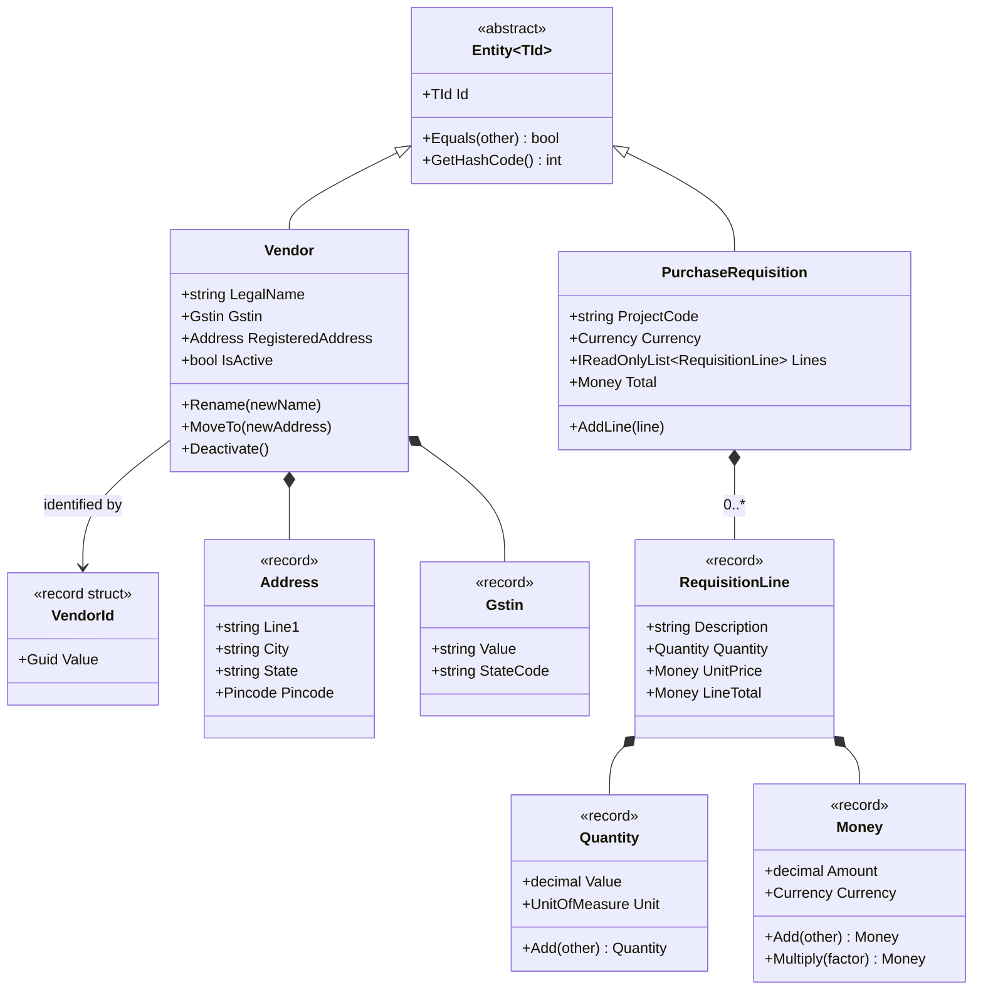
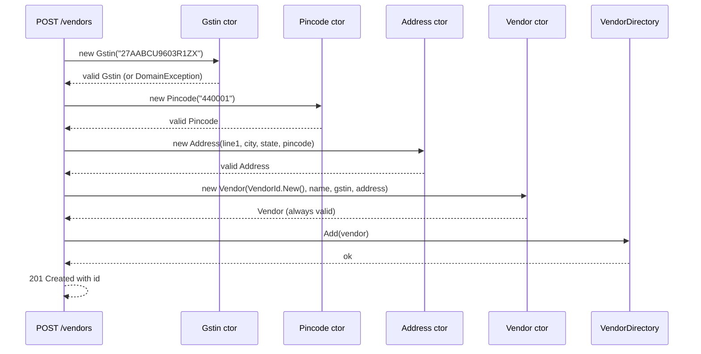

In [Module 7](#/lesson/m07-entities-values-services) you learned to sort the nouns in a model into entities, value objects and services. This lesson is where Domain-Driven Design (DDD) turns that sorting into a discipline. We go deeper on three questions: how an entity keeps its identity while everything else about it changes, how a value object protects itself so that it can never exist in an invalid state, and how both look in modern C# with records, strongly typed ids and validation in constructors.

The running example is procurement for an infrastructure consultancy: engineers raise a purchase requisition for cement, steel or survey equipment, a vendor is picked, and money changes hands. We stop at the point where [aggregates](#/lesson/m08-aggregates) begin; that is the next lesson.

## Learning objectives

By the end of this lesson you will be able to:

1. Explain the two tests that separate an entity from a value object (does it have a life story? is it interchangeable with a copy?) and apply them to a procurement model.
2. Implement a value object as a C# record that validates itself in the constructor, so an invalid `Money`, `Quantity`, `Pincode` or `Gstin` cannot be created.
3. Decide between `record class`, `readonly record struct` and a plain class for a given value object, and name the pitfall of each.
4. Implement an entity base class with identity-based equality and a strongly typed id, so a `VendorId` cannot be passed where a `RequisitionId` is expected.
5. Keep entity state changes behind intention-revealing methods instead of public setters.
6. Recognise "primitive obsession" (passing `decimal` and `string` around where a domain type belongs) and estimate when fixing it is worth the cost.
7. Test value objects and entities without any infrastructure.

## Prerequisites

- [Identifying entities, value objects and services](#/lesson/m07-entities-values-services): the three roles, introduced with a bank account.
- [Immutable objects](#/lesson/m07-immutability): records, `init`, `with` expressions.
- [Equality and identity](#/lesson/m07-equality-identity): `Equals`, `GetHashCode`, record equality.
- [Encapsulation and invariant protection](#/lesson/m07-encapsulation-invariants): guard clauses and private setters.

If those are fresh, this lesson will feel like the "production" version of them. If not, skim them first; the beginner section below recaps the essentials.

## Explain it like I'm a beginner

Imagine a site office in Nagpur ordering 40 tonnes of steel reinforcement bars. Three kinds of "thing" appear in that sentence.

**The vendor** supplying the steel is a company. Next year it may change its name, move its office, or get a new bank account. It is still the same vendor, with the same vendor code in your system, and the same history of late and on-time deliveries. Something that stays "the same one" while its details change is an **entity**. Its identity is not its name or address; it is an id that never changes.

**40 tonnes** is a measurement. If you cross out "40 tonnes" on the order and write "40 tonnes" again, nothing changed. Two quantities with the same number and unit are not "two similar quantities"; they are the same quantity. Something that is fully described by its content, and interchangeable with any copy that has the same content, is a **value object**. The same goes for `₹58,000.00`, for a six-digit pincode, and for a GST registration number.

**The order itself** is interesting. It has a number (PO-2026-0417), a status and a story: raised, approved, delivered, paid. It is an entity. But its lines ("40 tonnes of TMT bars at ₹58,000 per tonne") are closer to values: if you delete a line and add an identical one, nothing meaningful has changed.

Why does the distinction matter in code?

- Entities are compared by **id**. Two `Vendor` objects loaded in two different requests are "the same vendor" if the ids match, even if one copy is stale.
- Value objects are compared by **content**, and they never change after creation. If you want a different value, you make a new one. That is exactly how numbers work: you do not "change 5 into 6"; you compute a new number.
- Value objects **validate themselves once**, in the constructor. After that, every method that receives a `Pincode` knows it has six digits. No re-checking in ten places.

An analogy: a passport is an entity (the number stays, the photo and address pages change), while the date printed inside it is a value (any "14 March 2031" is the same as any other).

## First-principles explanation

### Why DDD cares so much about this split

DDD is about making the code speak the language of the business (the *ubiquitous language*) and about putting business rules where they cannot be bypassed. Entities and value objects are the two atoms of that model. Get them right and the larger structures ([aggregates](#/lesson/m08-aggregates), [domain services](#/lesson/m08-repositories-domain-services), [domain events](#/lesson/m08-domain-events)) fall into place. Get them wrong, and you end up with the *anemic domain model*: classes that are bags of public getters and setters, with every rule scattered across services and controllers ([see Anti-patterns](#/lesson/m06-anti-patterns)).

### Entity: identity first

An entity has three defining properties:

1. **A stable identity.** Chosen once, never changed. In a database that is usually a primary key; in code it should be a dedicated type (`VendorId`), not a bare `Guid` or `int`.
2. **A life cycle.** It is created, changes state through business operations ("approve", "deactivate", "move to new address") and may eventually be archived.
3. **Equality by identity.** Two instances with the same id are the same entity. Everything else may differ (one may be an older snapshot).

Where does the id come from? Three common options, each with a trade-off:

| Source of id | Pros | Cons |
|---|---|---|
| Database identity column (`int`/`bigint`) | Compact, familiar, fast indexes | Entity has no id until saved, so you cannot reference it or raise an event about it before the insert; leaks database concerns into the domain |
| Client-generated `Guid` (v4) | Id exists at `new`; safe to create across services | Random order hurts B-tree index locality under heavy inserts |
| Client-generated `Guid` v7 (`Guid.CreateVersion7()`, .NET 9+) | Id exists at `new`; time-ordered, so index inserts are mostly appends | 16 bytes versus 8; sortable ids leak creation time (fine for most back-office systems) |
| Business code (`PO-2026-0417`) | Meaningful to users | Sequence generation needs coordination; codes sometimes get "recycled" or renumbered, which breaks identity |

Our implementation uses `Guid.CreateVersion7()` wrapped in a `readonly record struct`. Human-readable codes like `PO-2026-0417` are then a *property* of the entity, not its identity.

### Value object: content first

A value object has four defining properties:

1. **Immutable.** No setters, no methods that change internal state. Operations return a new value (`money.Add(other)` returns a new `Money`).
2. **Equality by content.** `new Money(100, INR) == new Money(100, INR)` is `true`. C# records give you this for free, including `GetHashCode`.
3. **Self-validating.** The constructor rejects invalid input, so an instance that exists is always valid. This is the big payoff: it turns "validate everywhere" into "validate once".
4. **Side-effect-free behaviour.** `Quantity.Add`, `Money.Multiply`, `ContractPeriod.Overlaps` are pure functions. Easy to test, safe to share between threads, safe to cache.

Fowler's test for "is it a value?" is practical: *would it be a problem if two things with the same values were swapped?* For ₹500 notes, no. For two employees with the same name, yes.

### Primitive obsession and why it costs money

When a codebase passes `decimal amount` and `string currency` as two separate parameters, three bugs appear sooner or later:

- Someone adds an INR amount to a USD amount. Nothing stops it; the compiler sees two decimals.
- Someone passes arguments in the wrong order: `Transfer(toAccount, fromAccount)`. Two `Guid`s look the same to the compiler.
- The pincode check `Length == 6 && all digits` is copied into four places and one of them drifts (allows a leading zero, say).

A value object fixes all three with the type system. The cost is more types to maintain and some friction at the boundaries (JSON, SQL) where values must be unwrapped and re-wrapped. The rule of thumb: introduce a value object when a primitive carries a **rule** (format, range, unit) or when two primitives always travel together (amount + currency, value + unit, latitude + longitude). Do not wrap every `string`; a free-text "remarks" field is fine as a `string`.

### Records: what you get and what you have to add

C# records give value objects most of what they need:

- Value equality and `GetHashCode` generated from all fields.
- `ToString()` with all members.
- `with` expressions for non-destructive mutation.
- `init` properties and positional syntax.

What records do **not** give you, and you must add:

- **Validation.** A positional record `record Money(decimal Amount, string Currency)` happily accepts `-5` and `"rupees"`. You either write an explicit constructor (non-positional record) or redeclare a positional property with an initializer that validates (shown below).
- **Protection against `with`.** A `with` expression calls the copy constructor and then sets `init` properties, bypassing your validation. If you expose `init` setters, `money with { Amount = -1 }` compiles. Use get-only properties (no `init`) on value objects that have rules; offer explicit methods instead.
- **Collections compared by reference.** A record with a `List<T>` property compares the list by reference, not by contents. Either avoid collections in value objects or override `Equals`.

### `record class` or `readonly record struct`?

| | `sealed record` (class) | `readonly record struct` |
|---|---|---|
| Allocation | Heap, one object per value | Stack or inline in the owner; no GC pressure |
| `default` value | `null` (nullable reference types warn you) | A zeroed instance that **skipped your constructor**: `default(Money)` has `Amount = 0` and `Currency = null` |
| Size concerns | None | Copying large structs (more than ~16–24 bytes) on every pass can cost more than the allocation it saved |
| Best for | Composite values with several fields and rules (Money, Address) | Tiny wrappers such as `VendorId(Guid)` where `default` is clearly "no id" and cheapness matters |

This lesson uses `sealed record` classes for domain values and `readonly record struct` for ids. That is a sensible default, not a law. If a profiler shows allocation pressure from millions of `Money` objects per second, switch; most business systems never reach that point.

### Where validation should live

Validation in a value object's constructor is **domain validation**: rules that are true everywhere, forever ("a pincode has six digits", "money has at most two decimals"). It is not the only validation layer. Input validation at the API boundary (required fields, maximum lengths) still happens first and produces friendly 400 responses; see [Validation and business rules](#/lesson/m07-validation-rules). The two layers overlap on purpose. The API layer gives nice error messages; the domain layer guarantees that a bad value can never slip in through a different door (a background job, a CSV import, a test).

### Trade-offs and when a simpler design is enough

| You gain | You pay |
|---|---|
| Invalid states are impossible, so no scattered checks | More types; boundaries (JSON, EF Core, SQL) need converters |
| Compiler catches mixed-up arguments | Some ceremony for one-off values |
| Pure, easily tested behaviour on values | Equality semantics must be understood (`with`, collections) |
| Domain language in code (`Money`, `Gstin`) | Team must agree on where the type lives; shared "kernel" projects can become dumping grounds |

A CRUD admin screen that stores a vendor's phone number and never does anything with it does not need a `PhoneNumber` type. A pricing engine that multiplies, allocates and converts money absolutely does. Judge by how many rules and operations the value carries, not by ideology.

## Visual explanation

### Class diagram



How to read it: the two boxes at the top-left, `Vendor` and `PurchaseRequisition`, are entities. They inherit from a tiny `Entity<TId>` base that gives them identity-based equality. Every other box is a value object (marked `<<record>>`). The filled diamonds mean *composition*: an `Address` has no life of its own outside the `Vendor` that holds it. Notice that `Vendor` has **methods with business names** (`Rename`, `MoveTo`, `Deactivate`) and no setters, while value objects have **pure operations** that return new values (`Add`, `Multiply`). `PurchaseRequisition` holds its lines as value objects; replacing a line with an identical one changes nothing, which is exactly the value-object test.

### Sequence diagram



This is the "validate once at the door" idea as a timeline. Each value object checks its own rule the moment it is created. By the time the `Vendor` constructor runs, every argument is already known to be valid, so the entity only checks the rules that belong to *it* (for example, "legal name is required"). Nothing downstream (the directory, a repository, a report) ever re-checks a pincode. If any constructor throws a `DomainException`, the endpoint maps it to a `400 Bad Request`, and no half-built object exists anywhere.

## Step-by-step example

We will grow the procurement model in five steps.

### Step 1 — the primitive-obsessed version

```csharp
public class Vendor
{
    public Guid Id { get; set; }
    public string Name { get; set; }
    public string Gstin { get; set; }
    public string Pincode { get; set; }
    public bool Active { get; set; }
}

public class RequisitionLine
{
    public string Description { get; set; }
    public decimal Qty { get; set; }
    public string Unit { get; set; }
    public decimal UnitPrice { get; set; }
    public string Currency { get; set; }
}
```

Every property is public and settable. `Gstin` can be `"hello"`. `Qty` can be `-3`. Someone can write `line.UnitPrice = 58000; line.Currency = "USD";` for a vendor paid in rupees. Any rule about these values lives somewhere else, probably in a 300-line service, probably twice.

### Step 2 — find the values

Look for primitives that carry a rule or always travel together:

- `UnitPrice` + `Currency` → `Money`
- `Qty` + `Unit` → `Quantity`
- `Gstin` → `Gstin` (15 characters with a fixed pattern)
- `Pincode` → `Pincode` (6 digits, first digit 1–9)
- `Id` → `VendorId` (so it cannot be confused with a `RequisitionId`)

### Step 3 — make each value validate itself

```csharp
public sealed record Pincode
{
    public string Value { get; }

    public Pincode(string value)
    {
        if (value is null || value.Length != 6 || !value.All(char.IsAsciiDigit) || value[0] == '0')
            throw new DomainException($"'{value}' is not a valid Indian pincode.");
        Value = value;
    }
}
```

This is a non-positional record with an explicit constructor. The property is get-only (no `init`), so `with` cannot bypass the check. Equality and `GetHashCode` are still generated.

### Step 4 — give the entity identity and behaviour

```csharp
public sealed class Vendor : Entity<VendorId>
{
    public string LegalName { get; private set; }
    public Address RegisteredAddress { get; private set; }

    public void MoveTo(Address newAddress) => RegisteredAddress = newAddress;
}
```

Setters become private; changes happen through methods named after business actions. The base class supplies equality by `Id`.

### Step 5 — use the values at the boundary

The HTTP request still arrives as strings and decimals (JSON has no `Money` type). The endpoint converts primitives into value objects once, right at the door, and the rest of the code works with rich types. The full code follows.

## Production-style C# implementation

Project layout (one ASP.NET Core project; the domain folder has no reference to ASP.NET Core or any database library):

```text
Procurement.Api/
  Program.cs
  Domain/
    DomainException.cs
    Entity.cs
    Ids.cs
    Money.cs
    Quantity.cs
    Address.cs
    Gstin.cs
    Vendor.cs
    PurchaseRequisition.cs
  Infrastructure/
    VendorDirectory.cs
```

```csharp file=Domain/DomainException.cs
namespace Procurement.Domain;

/// <summary>Thrown when a business rule is violated. Mapped to HTTP 400 at the API boundary.</summary>
public sealed class DomainException(string message) : Exception(message);
```

```csharp file=Domain/Entity.cs
namespace Procurement.Domain;

/// <summary>Base class for entities: equality is by identity and concrete type, never by content.</summary>
public abstract class Entity<TId> : IEquatable<Entity<TId>> where TId : notnull
{
    public TId Id { get; }

    protected Entity(TId id)
    {
        if (id.Equals(default(TId))) throw new DomainException($"{GetType().Name} requires a non-default id.");
        Id = id;
    }

    public bool Equals(Entity<TId>? other) =>
        other is not null && GetType() == other.GetType() && Id.Equals(other.Id);

    public override bool Equals(object? obj) => Equals(obj as Entity<TId>);
    public override int GetHashCode() => HashCode.Combine(GetType(), Id);

    public static bool operator ==(Entity<TId>? left, Entity<TId>? right) => left is null ? right is null : left.Equals(right);
    public static bool operator !=(Entity<TId>? left, Entity<TId>? right) => !(left == right);
}
```

Why compare `GetType()` too? Without it, a `Vendor` and a `Contract` that happened to share a `Guid` would be "equal". With strongly typed ids that cannot happen anyway, but the check costs nothing and documents the intent.

```csharp file=Domain/Ids.cs
namespace Procurement.Domain;

/// <summary>Strongly typed ids. A VendorId can never be passed where a RequisitionId is expected.</summary>
public readonly record struct VendorId(Guid Value)
{
    public static VendorId New() => new(Guid.CreateVersion7());
    public override string ToString() => Value.ToString();
}

public readonly record struct RequisitionId(Guid Value)
{
    public static RequisitionId New() => new(Guid.CreateVersion7());
    public override string ToString() => Value.ToString();
}
```

`Guid.CreateVersion7()` (available since .NET 9) produces time-ordered ids, which keeps PostgreSQL B-tree inserts mostly sequential. For a back-office system this is a free win over random v4 ids.

```csharp file=Domain/Money.cs
namespace Procurement.Domain;

public sealed record Currency
{
    public string Code { get; }

    private Currency(string code) => Code = code;

    public static Currency Inr { get; } = new("INR");
    public static Currency Usd { get; } = new("USD");

    public static Currency FromCode(string code)
    {
        if (code is null || code.Length != 3 || !code.All(char.IsAsciiLetterUpper))
            throw new DomainException($"'{code}' is not an ISO 4217 currency code.");
        return new Currency(code);
    }

    public override string ToString() => Code;
}

/// <summary>An amount in one currency, with at most two decimal places. Immutable; arithmetic returns new values.</summary>
public sealed record Money
{
    public decimal Amount { get; }
    public Currency Currency { get; }

    public Money(decimal amount, Currency currency)
    {
        ArgumentNullException.ThrowIfNull(currency);
        if (amount < 0) throw new DomainException("Money cannot be negative.");
        if (decimal.Round(amount, 2) != amount) throw new DomainException("Money cannot have more than two decimal places.");
        Amount = amount;
        Currency = currency;
    }

    public static Money Zero(Currency currency) => new(0m, currency);
    public static Money Inr(decimal amount) => new(amount, Currency.Inr);

    public bool IsZero => Amount == 0m;

    public Money Add(Money other)
    {
        EnsureSameCurrency(other);
        return new Money(Amount + other.Amount, Currency);
    }

    public Money Subtract(Money other)
    {
        EnsureSameCurrency(other);
        if (other.Amount > Amount) throw new DomainException($"Cannot subtract {other} from {this}: result would be negative.");
        return new Money(Amount - other.Amount, Currency);
    }

    /// <summary>Multiplies and rounds to 2 decimals using banker's rounding (the default for financial totals here).</summary>
    public Money Multiply(decimal factor)
    {
        if (factor < 0) throw new DomainException("Cannot multiply money by a negative factor.");
        return new Money(decimal.Round(Amount * factor, 2, MidpointRounding.ToEven), Currency);
    }

    public static Money operator +(Money a, Money b) => a.Add(b);
    public static Money operator -(Money a, Money b) => a.Subtract(b);
    public static Money operator *(Money a, decimal factor) => a.Multiply(factor);

    public override string ToString() => $"{Currency} {Amount:N2}";

    private void EnsureSameCurrency(Money other)
    {
        if (other.Currency != Currency)
            throw new DomainException($"Currency mismatch: {Currency} vs {other.Currency}.");
    }
}
```

Three design choices worth noticing. First, `Currency` has a private constructor and named instances, so `Currency.Inr` is the normal way to get one, and `FromCode` is the controlled door for data coming from outside. Second, `Money` rejects negative amounts. That is a *domain decision* for this procurement system (credit notes are modelled separately); a general accounting library would allow negatives. Third, `Multiply` rounds. Rounding policy is a business rule and must live in one place; here it is banker's rounding to two decimals.

```csharp file=Domain/Quantity.cs
namespace Procurement.Domain;

public enum UnitOfMeasure { Nos, Metre, SquareMetre, CubicMetre, Kilogram, Tonne, Litre }

/// <summary>A positive measured amount with a unit. Adding quantities of different units is a domain error.</summary>
public sealed record Quantity
{
    public decimal Value { get; }
    public UnitOfMeasure Unit { get; }

    public Quantity(decimal value, UnitOfMeasure unit)
    {
        if (value <= 0) throw new DomainException("Quantity must be positive.");
        if (unit == UnitOfMeasure.Nos && value != decimal.Truncate(value))
            throw new DomainException("A count (Nos) must be a whole number.");
        if (!Enum.IsDefined(unit)) throw new DomainException($"Unknown unit {unit}.");
        Value = value;
        Unit = unit;
    }

    public Quantity Add(Quantity other)
    {
        if (other.Unit != Unit) throw new DomainException($"Cannot add {other.Unit} to {Unit}.");
        return new Quantity(Value + other.Value, Unit);
    }

    public Money Times(Money unitPrice) => unitPrice * Value;

    public override string ToString() => $"{Value:0.###} {Unit}";
}
```

```csharp file=Domain/Address.cs
namespace Procurement.Domain;

public sealed record Pincode
{
    public string Value { get; }

    public Pincode(string value)
    {
        if (value is null || value.Length != 6 || !value.All(char.IsAsciiDigit) || value[0] == '0')
            throw new DomainException($"'{value}' is not a valid Indian pincode.");
        Value = value;
    }

    public override string ToString() => Value;
}

public sealed record Address
{
    public string Line1 { get; }
    public string? Line2 { get; }
    public string City { get; }
    public string State { get; }
    public Pincode Pincode { get; }

    public Address(string line1, string? line2, string city, string state, Pincode pincode)
    {
        Line1 = Require(line1, nameof(line1));
        Line2 = string.IsNullOrWhiteSpace(line2) ? null : line2.Trim();
        City = Require(city, nameof(city));
        State = Require(state, nameof(state));
        Pincode = pincode ?? throw new DomainException("Pincode is required.");
    }

    private static string Require(string? value, string field) =>
        string.IsNullOrWhiteSpace(value) ? throw new DomainException($"{field} is required.") : value.Trim();
}
```

```csharp file=Domain/Gstin.cs
using System.Text.RegularExpressions;

namespace Procurement.Domain;

/// <summary>Indian GST registration number: 2-digit state code, 10-char PAN, entity code, 'Z', check character.
/// The format is validated here; the checksum algorithm is out of scope for this lesson.</summary>
public sealed partial record Gstin
{
    public string Value { get; }
    public string StateCode => Value[..2];
    public string Pan => Value[2..12];

    public Gstin(string value)
    {
        var normalised = value?.Trim().ToUpperInvariant() ?? "";
        if (!Pattern().IsMatch(normalised)) throw new DomainException($"'{value}' is not a valid GSTIN.");
        Value = normalised;
    }

    [GeneratedRegex("^[0-9]{2}[A-Z]{5}[0-9]{4}[A-Z][1-9A-Z]Z[0-9A-Z]$")]
    private static partial Regex Pattern();

    public override string ToString() => Value;
}
```

```csharp file=Domain/Vendor.cs
namespace Procurement.Domain;

/// <summary>A supplier. Identity is the VendorId; everything else can change over the vendor's life.</summary>
public sealed class Vendor : Entity<VendorId>
{
    public string LegalName { get; private set; }
    public Gstin Gstin { get; private set; }
    public Address RegisteredAddress { get; private set; }
    public bool IsActive { get; private set; }

    public Vendor(VendorId id, string legalName, Gstin gstin, Address registeredAddress) : base(id)
    {
        LegalName = RequireName(legalName);
        Gstin = gstin ?? throw new DomainException("GSTIN is required.");
        RegisteredAddress = registeredAddress ?? throw new DomainException("Registered address is required.");
        IsActive = true;
    }

    public void Rename(string newLegalName) => LegalName = RequireName(newLegalName);

    public void MoveTo(Address newAddress) =>
        RegisteredAddress = newAddress ?? throw new DomainException("Address is required.");

    public void ReplaceGstin(Gstin newGstin)
    {
        if (newGstin.StateCode != Gstin.StateCode)
            throw new DomainException("A GSTIN change must keep the same state of registration; register a new vendor for another state.");
        Gstin = newGstin;
    }

    public void Deactivate()
    {
        if (!IsActive) throw new DomainException("Vendor is already inactive.");
        IsActive = false;
    }

    private static string RequireName(string? name) =>
        string.IsNullOrWhiteSpace(name) || name.Trim().Length < 3
            ? throw new DomainException("Legal name must have at least 3 characters.")
            : name.Trim();
}
```

`ReplaceGstin` shows a rule that belongs to the *entity*, not the value: a single `Gstin` is valid on its own, but *changing* this vendor's GSTIN to one from another state is a vendor-level decision. That is the dividing line between value-object validation (always true for any instance) and entity rules (true for this entity's transitions).

```csharp file=Domain/PurchaseRequisition.cs
namespace Procurement.Domain;

/// <summary>A line is a value object: replacing it with an identical line changes nothing.</summary>
public sealed record RequisitionLine(string Description, Quantity Quantity, Money UnitPrice)
{
    // Redeclaring a positional property lets us validate and normalise it while keeping positional syntax.
    public string Description { get; } = string.IsNullOrWhiteSpace(Description)
        ? throw new DomainException("Line description is required.")
        : Description.Trim();

    public Money LineTotal => Quantity.Times(UnitPrice);
}

public sealed class PurchaseRequisition : Entity<RequisitionId>
{
    private readonly List<RequisitionLine> _lines = new();

    public string ProjectCode { get; }
    public Currency Currency { get; }
    public IReadOnlyList<RequisitionLine> Lines => _lines;
    public Money Total => _lines.Aggregate(Money.Zero(Currency), (sum, line) => sum + line.LineTotal);

    public PurchaseRequisition(RequisitionId id, string projectCode, Currency currency) : base(id)
    {
        ProjectCode = string.IsNullOrWhiteSpace(projectCode) ? throw new DomainException("Project code is required.") : projectCode.Trim();
        Currency = currency ?? throw new DomainException("Currency is required.");
    }

    public void AddLine(RequisitionLine line)
    {
        if (line.UnitPrice.Currency != Currency)
            throw new DomainException($"Line is priced in {line.UnitPrice.Currency}; this requisition is in {Currency}.");
        _lines.Add(line);
    }

    public void RemoveLine(RequisitionLine line)
    {
        // Value equality: any line with the same content is "that line".
        if (!_lines.Remove(line)) throw new DomainException("Line not found on this requisition.");
    }
}
```

`RemoveLine` relies on record equality. Because a line is a value, "remove the 40 t steel line at ₹58,000" is unambiguous without a line id. When lines need to be edited individually (change quantity on line 3, attach a comment to line 2), they have gained identity and should become child entities. That is a judgement call and it is covered in the [aggregates](#/lesson/m08-aggregates) lesson.

```csharp file=Infrastructure/VendorDirectory.cs
using System.Collections.Concurrent;
using Procurement.Domain;

namespace Procurement.Infrastructure;

/// <summary>In-memory stand-in for a repository. The real one (EF Core + PostgreSQL) appears in the repositories lesson.</summary>
public sealed class VendorDirectory
{
    private readonly ConcurrentDictionary<VendorId, Vendor> _vendors = new();

    public void Add(Vendor vendor)
    {
        if (!_vendors.TryAdd(vendor.Id, vendor)) throw new DomainException($"Vendor {vendor.Id} already exists.");
    }

    public Vendor? Find(VendorId id) => _vendors.GetValueOrDefault(id);

    public IReadOnlyCollection<Vendor> All() => _vendors.Values.ToList();
}
```

```csharp file=Program.cs
using Procurement.Domain;
using Procurement.Infrastructure;

var builder = WebApplication.CreateBuilder(args);
builder.Services.AddSingleton<VendorDirectory>();
var app = builder.Build();

// DTOs are primitives: JSON has no idea what a Gstin is. Conversion happens once, here.
app.MapPost("/vendors", (RegisterVendorRequest req, VendorDirectory directory) =>
{
    try
    {
        var address = new Address(req.Line1, req.Line2, req.City, req.State, new Pincode(req.Pincode));
        var vendor = new Vendor(VendorId.New(), req.LegalName, new Gstin(req.Gstin), address);
        directory.Add(vendor);
        return Results.Created($"/vendors/{vendor.Id}", VendorResponse.From(vendor));
    }
    catch (DomainException ex)
    {
        return Results.Problem(ex.Message, statusCode: StatusCodes.Status400BadRequest);
    }
});

app.MapGet("/vendors/{id:guid}", (Guid id, VendorDirectory directory) =>
    directory.Find(new VendorId(id)) is { } vendor ? Results.Ok(VendorResponse.From(vendor)) : Results.NotFound());

app.MapPost("/vendors/{id:guid}/deactivate", (Guid id, VendorDirectory directory) =>
{
    var vendor = directory.Find(new VendorId(id));
    if (vendor is null) return Results.NotFound();
    try { vendor.Deactivate(); return Results.NoContent(); }
    catch (DomainException ex) { return Results.Problem(ex.Message, statusCode: StatusCodes.Status409Conflict); }
});

app.Run();

public sealed record RegisterVendorRequest(string LegalName, string Gstin, string Line1, string? Line2, string City, string State, string Pincode);

public sealed record VendorResponse(Guid Id, string LegalName, string Gstin, string City, string Pincode, bool IsActive)
{
    public static VendorResponse From(Vendor v) =>
        new(v.Id.Value, v.LegalName, v.Gstin.Value, v.RegisteredAddress.City, v.RegisteredAddress.Pincode.Value, v.IsActive);
}
```

Notice the two different status codes. A malformed GSTIN is a *bad request* (400). Deactivating a vendor that is already inactive is a *conflict with the current state* (409). Both are `DomainException`s in the domain; the API layer decides how to present them. Many teams add a small exception hierarchy (`InvalidValueException`, `InvalidStateException`) to make that mapping automatic; see [Error handling and domain exceptions](#/lesson/m07-domain-exceptions).

:::callout type=tip title="Persisting value objects"
With EF Core you map a value object either as an *owned type* (its properties become columns on the owner's table: `registered_address_city`, `registered_address_pincode`) or, for single-value wrappers like `Gstin` and `VendorId`, with a `ValueConverter` that unwraps to `string`/`uuid` and re-wraps on load. The domain classes stay free of attributes. For `Money`, store `amount numeric(18,2)` and `currency char(3)` as two columns of an owned type; never store money as `double precision`.
:::

## Bad design vs good design

**Bad**: the Step 1 classes. Every field public, every rule elsewhere. Concrete problems we have seen in real procurement systems built this way:

- A report summed `UnitPrice * Qty` across lines in two currencies and printed "₹4,20,000" where ₹1,10,000 of it was actually USD 1,320.
- A CSV import stored pincodes as integers; leading zeros were impossible, and `110001` and `11001` were both accepted.
- `UpdateVendor(Guid vendorId, Guid contractId)` was called with the arguments swapped in one code path for eight months.

**Good**: the implementation above. Mixed currencies throw at the first `Add`. Pincodes are validated at the door. `VendorId` and `ContractId` are different types, so swapping them is a compile error.

**When the "bad" version is acceptable**: a throwaway internal tool with one user and no arithmetic on its fields. Rich types pay off in proportion to the number of rules and operations the values carry. If a value has no rule and no behaviour, leave it as a primitive and move on.

:::callout type=mistake title="Validation that only lives in the API layer"
Teams often put `[Required]`, `[RegularExpression]` or FluentValidation rules on the request DTO and call the domain "validated". Then a nightly import job, a message consumer or a unit test builds the entity directly and skips all of it. Domain validation in constructors is the only layer every code path must pass through. Keep both layers: DTO validation for friendly messages, constructor validation for guarantees.
:::

:::callout type=tradeoff title="Exceptions or Result for value-object construction?"
Constructors cannot return a `Result<T>`, so a value object that validates in its constructor must throw. That is fine for *programming errors* and for rare bad data. If bad input is routine (a public form where users mistype GSTINs all day), add a static `TryCreate(string, out Gstin?)` or `Result<Gstin> Create(string)` factory beside the constructor so callers can collect several errors at once without the cost and awkwardness of exceptions. See [Options pattern and Result pattern](#/lesson/m06-options-result).
:::

## Practical playground

The playground has the `Money`, `Quantity` and `Pincode` value objects wired to a small console demo. Run it, then try: add a `Litre` quantity to a `Tonne` quantity, create a pincode starting with `0`, and multiply money by a factor that produces a half-paisa. Watch which line throws and why.

:::playground type=csharp title="Value objects in action"
```csharp file=Program.cs
using System;
using System.Linq;

public sealed class DomainException : Exception { public DomainException(string m) : base(m) { } }

public sealed record Money
{
    public decimal Amount { get; }
    public string Currency { get; }
    public Money(decimal amount, string currency)
    {
        if (amount < 0) throw new DomainException("Money cannot be negative.");
        if (decimal.Round(amount, 2) != amount) throw new DomainException("Max two decimals.");
        Amount = amount; Currency = currency;
    }
    public static Money Inr(decimal a) => new(a, "INR");
    public Money Add(Money o) => o.Currency == Currency ? new(Amount + o.Amount, Currency) : throw new DomainException("Currency mismatch.");
    public Money Multiply(decimal f) => new(decimal.Round(Amount * f, 2, MidpointRounding.ToEven), Currency);
    public override string ToString() => $"{Currency} {Amount:N2}";
}

public enum Unit { Nos, Tonne, Litre }

public sealed record Quantity
{
    public decimal Value { get; }
    public Unit Unit { get; }
    public Quantity(decimal value, Unit unit)
    {
        if (value <= 0) throw new DomainException("Quantity must be positive.");
        if (unit == Unit.Nos && value != decimal.Truncate(value)) throw new DomainException("Nos must be whole.");
        Value = value; Unit = unit;
    }
    public Quantity Add(Quantity o) => o.Unit == Unit ? new(Value + o.Value, Unit) : throw new DomainException($"Cannot add {o.Unit} to {Unit}.");
    public override string ToString() => $"{Value:0.###} {Unit}";
}

public sealed record Pincode
{
    public string Value { get; }
    public Pincode(string v)
    {
        if (v is null || v.Length != 6 || !v.All(char.IsAsciiDigit) || v[0] == '0') throw new DomainException($"Bad pincode '{v}'.");
        Value = v;
    }
}

public static class Program
{
    public static void Main()
    {
        var steel = new Quantity(40m, Unit.Tonne);
        var rate = Money.Inr(58000m);
        Console.WriteLine($"{steel} x {rate} = {rate.Multiply(steel.Value)}");

        var a = Money.Inr(100m);
        var b = Money.Inr(100m);
        Console.WriteLine($"Value equality: {a == b}, same reference: {ReferenceEquals(a, b)}");

        Console.WriteLine(new Pincode("440001").Value);

        // TODO: uncomment one at a time and read the exception message.
        // Console.WriteLine(steel.Add(new Quantity(5m, Unit.Litre)));
        // Console.WriteLine(new Pincode("040001"));
        // Console.WriteLine(Money.Inr(10.01m).Multiply(0.5m));
    }
}
```
:::

## Exercises

:::exercise id=m08-entities-value-objects-ex1 difficulty=beginner kind=code title="Finish the Money value object"
Implement `Add`, `Subtract` and `Multiply` on `Money`. The constructor already rejects negative amounts and more than two decimals; your methods must build on that rather than repeat it.
::requirements
- `Add` and `Subtract` only work for the same currency. A mismatch throws `DomainException`.
- `Subtract` must not produce a negative result; throw `DomainException` instead.
- `Multiply` rounds to two decimals with banker's rounding (`MidpointRounding.ToEven`) and rejects negative factors with `DomainException`.
- Every method returns a **new** `Money`; the receiver is never changed.
::acceptance
- `Inr(100) + Inr(250.50)` equals `Inr(350.50)` (record equality).
- `Inr(100) + new Money(5, "USD")` throws `DomainException`.
- `Inr(100) - Inr(150)` throws `DomainException`.
- `Inr(1234.56) * 0.18m` (18 % GST) equals `Inr(222.22)`.
- `Inr(10) * -1` throws `DomainException`.
::hint
Each method creates a new `Money` and lets the constructor do the validating. You only add the rules the constructor cannot know about: currency match and negative factor.
::hint
Write one private helper `EnsureSameCurrency(Money other)` and call it from both `Add` and `Subtract`.
::hint
For `Subtract`, check `other.Amount > Amount` before building the result, so the message can say what went wrong instead of the generic "cannot be negative".
::hint
```csharp
public Money Multiply(decimal factor)
{
    if (factor < 0) throw new DomainException("Cannot multiply money by a negative factor.");
    return new Money(decimal.Round(Amount * factor, 2, MidpointRounding.ToEven), Currency);
}
```
::starter
```csharp file=Money.cs
using System;

public sealed class DomainException : Exception
{
    public DomainException(string message) : base(message) { }
}

public sealed record Money
{
    public decimal Amount { get; }
    public string Currency { get; }

    public Money(decimal amount, string currency)
    {
        if (string.IsNullOrWhiteSpace(currency) || currency.Length != 3)
            throw new DomainException("Currency must be a 3-letter code.");
        if (amount < 0) throw new DomainException("Money cannot be negative.");
        if (decimal.Round(amount, 2) != amount) throw new DomainException("Money cannot have more than two decimal places.");
        Amount = amount;
        Currency = currency.ToUpperInvariant();
    }

    public static Money Inr(decimal amount) => new(amount, "INR");

    public Money Add(Money other) => throw new NotImplementedException();
    public Money Subtract(Money other) => throw new NotImplementedException();
    public Money Multiply(decimal factor) => throw new NotImplementedException();

    public static Money operator +(Money a, Money b) => a.Add(b);
    public static Money operator -(Money a, Money b) => a.Subtract(b);
    public static Money operator *(Money a, decimal factor) => a.Multiply(factor);

    public override string ToString() => $"{Currency} {Amount:0.00}";
}
```
::tests
```csharp file=MoneyTests.cs
using Xunit;

public class MoneyTests
{
    [Fact]
    public void Adds_same_currency() =>
        Assert.Equal(Money.Inr(350.50m), Money.Inr(100m) + Money.Inr(250.50m));

    [Fact]
    public void Add_different_currency_throws() =>
        Assert.Throws<DomainException>(() => Money.Inr(100m) + new Money(5m, "USD"));

    [Fact]
    public void Subtracts_same_currency() =>
        Assert.Equal(Money.Inr(49.50m), Money.Inr(100m) - Money.Inr(50.50m));

    [Fact]
    public void Subtract_below_zero_throws() =>
        Assert.Throws<DomainException>(() => Money.Inr(100m) - Money.Inr(150m));

    [Fact]
    public void Multiply_rounds_to_two_decimals() =>
        Assert.Equal(Money.Inr(222.22m), Money.Inr(1234.56m) * 0.18m);

    [Fact]
    public void Multiply_uses_bankers_rounding() =>
        Assert.Equal(Money.Inr(5.00m), Money.Inr(10.01m) * 0.5m);

    [Fact]
    public void Multiply_negative_factor_throws() =>
        Assert.Throws<DomainException>(() => Money.Inr(10m) * -1m);

    [Fact]
    public void Operations_do_not_mutate_receiver()
    {
        var original = Money.Inr(100m);
        _ = original + Money.Inr(1m);
        _ = original * 3m;
        Assert.Equal(100m, original.Amount);
    }
}
```
::solution
Let the constructor do the heavy lifting; the methods add only the cross-value rules.

```csharp file=Money.cs
using System;

public sealed class DomainException : Exception
{
    public DomainException(string message) : base(message) { }
}

public sealed record Money
{
    public decimal Amount { get; }
    public string Currency { get; }

    public Money(decimal amount, string currency)
    {
        if (string.IsNullOrWhiteSpace(currency) || currency.Length != 3)
            throw new DomainException("Currency must be a 3-letter code.");
        if (amount < 0) throw new DomainException("Money cannot be negative.");
        if (decimal.Round(amount, 2) != amount) throw new DomainException("Money cannot have more than two decimal places.");
        Amount = amount;
        Currency = currency.ToUpperInvariant();
    }

    public static Money Inr(decimal amount) => new(amount, "INR");

    public Money Add(Money other)
    {
        EnsureSameCurrency(other);
        return new Money(Amount + other.Amount, Currency);
    }

    public Money Subtract(Money other)
    {
        EnsureSameCurrency(other);
        if (other.Amount > Amount)
            throw new DomainException($"Cannot subtract {other} from {this}: result would be negative.");
        return new Money(Amount - other.Amount, Currency);
    }

    public Money Multiply(decimal factor)
    {
        if (factor < 0) throw new DomainException("Cannot multiply money by a negative factor.");
        return new Money(decimal.Round(Amount * factor, 2, MidpointRounding.ToEven), Currency);
    }

    public static Money operator +(Money a, Money b) => a.Add(b);
    public static Money operator -(Money a, Money b) => a.Subtract(b);
    public static Money operator *(Money a, decimal factor) => a.Multiply(factor);

    public override string ToString() => $"{Currency} {Amount:0.00}";

    private void EnsureSameCurrency(Money other)
    {
        if (other.Currency != Currency)
            throw new DomainException($"Currency mismatch: {Currency} vs {other.Currency}.");
    }
}
```

Why `10.01 × 0.5 = 5.00` and not `5.01`? The exact product is `5.005`, a midpoint. Banker's rounding goes to the even neighbour (5.00). Over thousands of lines this avoids the upward drift that "round half up" produces. Which policy your business wants is a question for the finance team, but it must be decided once and encoded here.
::mistakes
- Re-validating "amount not negative" inside `Add`. The constructor already does it; duplicate checks drift apart over time.
- Using `double` anywhere. `0.1 + 0.2` is not `0.3` in binary floating point; money is always `decimal`.
- Rounding in the constructor instead of in `Multiply`. A constructor that silently rounds `10.005` to `10.00` hides bugs; rejecting it surfaces them.
::extensions
Add `Money Max(Money other)` and `IComparable<Money>` so lines can be sorted by price, making sure comparison across currencies throws.
:::

:::exercise id=m08-entities-value-objects-ex2 difficulty=beginner kind=code title="A self-validating Quantity"
Implement the `Quantity` value object for a bill of quantities: a positive number with a unit of measure.
::requirements
- Zero or negative values throw `DomainException`.
- A count (`UnitOfMeasure.Nos`) must be a whole number; `2.5 Nos` throws.
- `Add` requires the same unit; otherwise throw `DomainException`.
- `Add` returns a new `Quantity` and never changes the receiver.
::acceptance
- `new Quantity(0, Tonne)` and `new Quantity(-1, Metre)` throw.
- `new Quantity(2.5m, Nos)` throws; `new Quantity(2.5m, Tonne)` is fine.
- `new Quantity(40, Tonne).Add(new Quantity(2.5m, Tonne))` has `Value == 42.5m`.
- Adding `Tonne` to `Litre` throws.
- Two quantities with the same value and unit are equal (`==`).
::hint
All the rules about a *single* quantity belong in the constructor. The rule about *two* quantities (same unit) belongs in `Add`.
::hint
`value != decimal.Truncate(value)` is true exactly when the number has a fractional part.
::hint
Because `Add` constructs a new `Quantity`, positivity is checked again for free. You only need the unit check.
::hint
```csharp
public Quantity Add(Quantity other)
{
    if (other.Unit != Unit) throw new DomainException($"Cannot add {other.Unit} to {Unit}.");
    return new Quantity(Value + other.Value, Unit);
}
```
::starter
```csharp file=Quantity.cs
using System;

public sealed class DomainException : Exception
{
    public DomainException(string message) : base(message) { }
}

public enum UnitOfMeasure { Nos, Metre, SquareMetre, CubicMetre, Kilogram, Tonne, Litre }

public sealed record Quantity
{
    public decimal Value { get; }
    public UnitOfMeasure Unit { get; }

    public Quantity(decimal value, UnitOfMeasure unit)
    {
        // TODO: validate value and unit before assigning.
        Value = value;
        Unit = unit;
    }

    public Quantity Add(Quantity other) => throw new NotImplementedException();

    public override string ToString() => $"{Value:0.###} {Unit}";
}
```
::tests
```csharp file=QuantityTests.cs
using Xunit;

public class QuantityTests
{
    [Theory]
    [InlineData(0)]
    [InlineData(-1)]
    public void Non_positive_values_throw(decimal value) =>
        Assert.Throws<DomainException>(() => new Quantity(value, UnitOfMeasure.Tonne));

    [Fact]
    public void Fractional_count_throws() =>
        Assert.Throws<DomainException>(() => new Quantity(2.5m, UnitOfMeasure.Nos));

    [Fact]
    public void Fractional_weight_is_fine() =>
        Assert.Equal(2.5m, new Quantity(2.5m, UnitOfMeasure.Tonne).Value);

    [Fact]
    public void Adds_same_unit()
    {
        var sum = new Quantity(40m, UnitOfMeasure.Tonne).Add(new Quantity(2.5m, UnitOfMeasure.Tonne));
        Assert.Equal(42.5m, sum.Value);
        Assert.Equal(UnitOfMeasure.Tonne, sum.Unit);
    }

    [Fact]
    public void Add_different_unit_throws() =>
        Assert.Throws<DomainException>(() => new Quantity(1m, UnitOfMeasure.Tonne).Add(new Quantity(1m, UnitOfMeasure.Litre)));

    [Fact]
    public void Add_does_not_mutate_receiver()
    {
        var q = new Quantity(10m, UnitOfMeasure.Nos);
        _ = q.Add(new Quantity(5m, UnitOfMeasure.Nos));
        Assert.Equal(10m, q.Value);
    }

    [Fact]
    public void Equal_by_value() =>
        Assert.True(new Quantity(3m, UnitOfMeasure.Metre) == new Quantity(3m, UnitOfMeasure.Metre));
}
```
::solution
```csharp file=Quantity.cs
using System;

public sealed class DomainException : Exception
{
    public DomainException(string message) : base(message) { }
}

public enum UnitOfMeasure { Nos, Metre, SquareMetre, CubicMetre, Kilogram, Tonne, Litre }

public sealed record Quantity
{
    public decimal Value { get; }
    public UnitOfMeasure Unit { get; }

    public Quantity(decimal value, UnitOfMeasure unit)
    {
        if (value <= 0) throw new DomainException("Quantity must be positive.");
        if (!Enum.IsDefined(unit)) throw new DomainException($"Unknown unit {unit}.");
        if (unit == UnitOfMeasure.Nos && value != decimal.Truncate(value))
            throw new DomainException("A count (Nos) must be a whole number.");
        Value = value;
        Unit = unit;
    }

    public Quantity Add(Quantity other)
    {
        if (other.Unit != Unit) throw new DomainException($"Cannot add {other.Unit} to {Unit}.");
        return new Quantity(Value + other.Value, Unit);
    }

    public override string ToString() => $"{Value:0.###} {Unit}";
}
```

The `Enum.IsDefined` check matters because an enum is just an integer underneath: `(UnitOfMeasure)42` compiles and would otherwise slip through from a badly mapped database column.
::mistakes
- Allowing zero quantity "because the user might not know yet". A requisition line with nothing on it is not a line; model "unknown" explicitly if you really need it.
- Converting units inside `Add` (tonnes to kilograms). Conversion is a separate, explicit operation with its own rules; silent conversion hides mistakes.
::extensions
Add `Quantity ConvertTo(UnitOfMeasure target)` supporting `Kilogram <-> Tonne` and `Metre <-> ...` only where a conversion makes sense, throwing for `Tonne -> Litre`.
:::

:::exercise id=m08-entities-value-objects-ex3 difficulty=intermediate kind=design title="Model a works contract: what is an entity, what is a value?"
A contract-management module needs to model a **works contract** between the consultancy and a contractor. Analysts gave you these facts:

- A contract has a contract number (`CON-2026-031`), a contractor, a contract value with currency, a start and end date, and a list of payment milestones.
- Each milestone has a title, a percentage of the contract value, a planned date, and a status (Pending, Claimed, Certified, Paid). Engineers update milestones one by one over months.
- The contractor has a name, GSTIN and bank account (account number + IFSC). The same contractor appears on many contracts.
- Legal wants to know the number of days a contract runs and whether two contracts for the same contractor overlap in time.

Produce an LLD class model in the designer: decide for every concept whether it is an entity, a value object or an enum; give value objects their rules; give entities their behaviour methods. Record `kind` as `class`, `record` or `enum`.
::acceptance
- `WorksContract`, `Milestone` and `Contractor` are entities (`kind: class`) with strongly typed ids.
- `Money`, `ContractPeriod`, `Percentage`, `Gstin` and `BankAccount` are value objects (`kind: record`) with at least one stated rule each in `responsibility`.
- `MilestoneStatus` is an enum.
- `WorksContract` references `Contractor` **by id**, not by holding the object.
- `WorksContract` exposes behaviour (for example `AddMilestone`, `Reschedule`) and has no public setters listed.
- `ContractPeriod` carries `Days` and `Overlaps(other)`.
::hint
Apply the two tests from the lesson to each noun: does it have a life story (entity)? would swapping it for an identical copy be a problem (entity) or harmless (value)?
::hint
Milestones are "updated one by one over months". That is a life story. Lines that are never edited individually could be values; these cannot.
::hint
A contractor "appears on many contracts" and exists before and after any one contract. That is a separate entity, and holding a reference by id keeps the contract independent of the contractor's changes. (The aggregates lesson formalises this.)
::hint
Legal's two questions (days, overlap) are pure functions of start and end date. That is behaviour on a `ContractPeriod` value object, not on the contract.
::starter
```json
{
  "classes": [
    { "id": "WorksContract", "name": "WorksContract", "kind": "class", "fields": ["-ContractId Id", "-string Number"], "methods": [], "responsibility": "TODO" },
    { "id": "Money", "name": "Money", "kind": "record", "fields": ["+decimal Amount", "+Currency Currency"], "methods": ["+Money Add(Money other)"], "responsibility": "Amount in one currency; never negative; max 2 decimals" }
  ],
  "relations": []
}
```
::solution
```json
{
  "classes": [
    { "id": "WorksContract", "name": "WorksContract", "kind": "class",
      "fields": ["-ContractId Id", "-string Number", "-ContractorId ContractorId", "-Money ContractValue", "-ContractPeriod Period", "-List~Milestone~ _milestones"],
      "methods": ["+void AddMilestone(string title, Percentage share, DateOnly plannedOn)", "+void Reschedule(ContractPeriod newPeriod)", "+Milestone GetMilestone(MilestoneId id)", "+Percentage AllocatedShare()"],
      "responsibility": "Entity. Identity: ContractId. Rule: milestone shares must not exceed 100 %. References the contractor by id." },
    { "id": "Milestone", "name": "Milestone", "kind": "class",
      "fields": ["-MilestoneId Id", "-string Title", "-Percentage Share", "-DateOnly PlannedOn", "-MilestoneStatus Status"],
      "methods": ["+void Claim()", "+void Certify()", "+void MarkPaid()", "+Money AmountFor(Money contractValue)"],
      "responsibility": "Entity (child of the contract). Status moves Pending -> Claimed -> Certified -> Paid only in that order." },
    { "id": "Contractor", "name": "Contractor", "kind": "class",
      "fields": ["-ContractorId Id", "-string LegalName", "-Gstin Gstin", "-BankAccount BankAccount"],
      "methods": ["+void ChangeBankAccount(BankAccount account)", "+void Rename(string name)"],
      "responsibility": "Entity. Exists independently of any contract." },
    { "id": "ContractId", "name": "ContractId", "kind": "record", "fields": ["+Guid Value"], "methods": ["+ContractId New()"], "responsibility": "Strongly typed id (readonly record struct)" },
    { "id": "MilestoneId", "name": "MilestoneId", "kind": "record", "fields": ["+Guid Value"], "methods": [], "responsibility": "Strongly typed id" },
    { "id": "ContractorId", "name": "ContractorId", "kind": "record", "fields": ["+Guid Value"], "methods": [], "responsibility": "Strongly typed id" },
    { "id": "Money", "name": "Money", "kind": "record", "fields": ["+decimal Amount", "+Currency Currency"],
      "methods": ["+Money Add(Money other)", "+Money Multiply(decimal factor)"], "responsibility": "Value. Never negative; max 2 decimals; same-currency arithmetic only" },
    { "id": "ContractPeriod", "name": "ContractPeriod", "kind": "record", "fields": ["+DateOnly Start", "+DateOnly End"],
      "methods": ["+int Days", "+bool Overlaps(ContractPeriod other)", "+bool Contains(DateOnly date)"], "responsibility": "Value. End is on or after Start; Days is inclusive" },
    { "id": "Percentage", "name": "Percentage", "kind": "record", "fields": ["+decimal Value"],
      "methods": ["+Percentage Add(Percentage other)", "+Money Of(Money amount)"], "responsibility": "Value. Between 0 and 100 inclusive" },
    { "id": "Gstin", "name": "Gstin", "kind": "record", "fields": ["+string Value"], "methods": ["+string StateCode"], "responsibility": "Value. 15-character GST format" },
    { "id": "BankAccount", "name": "BankAccount", "kind": "record", "fields": ["+string AccountNumber", "+string Ifsc"], "methods": [], "responsibility": "Value. IFSC is 11 chars: 4 letters, '0', 6 alphanumerics; account number 9-18 digits" },
    { "id": "MilestoneStatus", "name": "MilestoneStatus", "kind": "enum", "fields": ["Pending", "Claimed", "Certified", "Paid"], "methods": [], "responsibility": "" }
  ],
  "relations": [
    { "from": "WorksContract", "to": "Milestone", "kind": "composition", "multiplicity": "1..*" },
    { "from": "WorksContract", "to": "ContractorId", "kind": "association", "label": "references by id" },
    { "from": "WorksContract", "to": "Money", "kind": "composition" },
    { "from": "WorksContract", "to": "ContractPeriod", "kind": "composition" },
    { "from": "Milestone", "to": "Percentage", "kind": "composition" },
    { "from": "Milestone", "to": "MilestoneStatus", "kind": "association" },
    { "from": "Contractor", "to": "Gstin", "kind": "composition" },
    { "from": "Contractor", "to": "BankAccount", "kind": "composition" }
  ]
}
```

Reasoning, concept by concept:

- **WorksContract** — entity. Has a number, a story (drafted, running, closed) and milestones that change. Holds `ContractorId`, not `Contractor`, so a contractor renaming itself does not require touching the contract, and the contract can be loaded without loading the contractor.
- **Milestone** — entity, but a *child* one: it has no meaning outside its contract, yet engineers update individual milestones, so each needs an id. (In the next lesson this becomes "an entity inside the WorksContract aggregate".)
- **Contractor** — entity, independent life. Its `BankAccount` is a value: if the contractor changes banks, the old account value is replaced by a new one, not edited.
- **ContractPeriod** — value with behaviour. `Days` and `Overlaps` are pure functions, so Legal's questions are answered by the value, and they are trivially unit-tested.
- **Percentage** — value with a range rule. It also owns `Of(Money)` so "20 % of ₹1.2 crore" is computed in one place with one rounding policy.
- **MilestoneStatus** — enum, because the set is closed and the transitions are the milestone's job, not the status's.
::alternatives
Some teams make `Milestone` a value object and replace the whole list on every edit. That works when milestones are set once at signing and never touched. The moment someone asks "who certified milestone 3 and when?", the milestone has a history, and history implies identity.
::mistakes
- Making `Contractor` a property of `WorksContract` (holding the object). It drags the contractor's whole state into every contract load and creates two sources of truth for the contractor's name.
- Modelling `Percentage` as `decimal`. Someone will pass `0.2` where `20` is expected, and a milestone will be worth ₹24,000 instead of ₹24,00,000.
:::

:::exercise id=m08-entities-value-objects-ex4 difficulty=intermediate kind=code title="ContractPeriod: a value object with behaviour"
Implement `ContractPeriod`, the date range of a contract, with inclusive day counting, containment, overlap and extension.
::requirements
- `End` must be on or after `Start`; otherwise throw `DomainException`.
- `Days` counts both ends: 1 April to 30 April is 30 days; a one-day contract is 1 day.
- `Contains(date)` is inclusive on both ends.
- `Overlaps(other)` is true when the two ranges share at least one day (touching at a single day counts).
- `ExtendBy(days)` returns a new period with the same start and a later end; zero or negative throws.
::acceptance
- `new ContractPeriod(2026-04-30, 2026-04-01)` throws.
- `Days` is 30 for April 2026 and 1 for a same-day period.
- April overlaps `[30 Apr, 15 May]` but not `[1 May, 15 May]`.
- `ExtendBy(15)` on April gives an end of 15 May; `ExtendBy(0)` throws.
- The original period is unchanged after `ExtendBy`.
::hint
`DateOnly.DayNumber` gives the number of days since 1 January 0001, so the difference of two day numbers is a day count.
::hint
Two inclusive ranges overlap when `Start <= other.End && other.Start <= End`. Draw two bars on paper and check the four cases.
::hint
`ExtendBy` is just `new ContractPeriod(Start, End.AddDays(days))`; the constructor cannot fail here, but the "positive days" rule is yours.
::hint
```csharp
public int Days => End.DayNumber - Start.DayNumber + 1;
public bool Overlaps(ContractPeriod other) => Start <= other.End && other.Start <= End;
```
::starter
```csharp file=ContractPeriod.cs
using System;

public sealed class DomainException : Exception
{
    public DomainException(string message) : base(message) { }
}

public sealed record ContractPeriod
{
    public DateOnly Start { get; }
    public DateOnly End { get; }

    public ContractPeriod(DateOnly start, DateOnly end)
    {
        // TODO: validate.
        Start = start;
        End = end;
    }

    public int Days => throw new NotImplementedException();
    public bool Contains(DateOnly date) => throw new NotImplementedException();
    public bool Overlaps(ContractPeriod other) => throw new NotImplementedException();
    public ContractPeriod ExtendBy(int days) => throw new NotImplementedException();

    public override string ToString() => $"{Start:yyyy-MM-dd} to {End:yyyy-MM-dd}";
}
```
::tests
```csharp file=ContractPeriodTests.cs
using System;
using Xunit;

public class ContractPeriodTests
{
    private static readonly ContractPeriod April = new(new DateOnly(2026, 4, 1), new DateOnly(2026, 4, 30));

    [Fact]
    public void End_before_start_throws() =>
        Assert.Throws<DomainException>(() => new ContractPeriod(new DateOnly(2026, 4, 30), new DateOnly(2026, 4, 1)));

    [Fact]
    public void Days_is_inclusive()
    {
        Assert.Equal(30, April.Days);
        Assert.Equal(1, new ContractPeriod(new DateOnly(2026, 1, 1), new DateOnly(2026, 1, 1)).Days);
    }

    [Fact]
    public void Contains_is_inclusive()
    {
        Assert.True(April.Contains(new DateOnly(2026, 4, 1)));
        Assert.True(April.Contains(new DateOnly(2026, 4, 30)));
        Assert.False(April.Contains(new DateOnly(2026, 5, 1)));
    }

    [Fact]
    public void Overlap_detected_when_touching()
    {
        var late = new ContractPeriod(new DateOnly(2026, 4, 30), new DateOnly(2026, 5, 15));
        Assert.True(April.Overlaps(late));
        Assert.True(late.Overlaps(April));
    }

    [Fact]
    public void No_overlap_when_disjoint() =>
        Assert.False(April.Overlaps(new ContractPeriod(new DateOnly(2026, 5, 1), new DateOnly(2026, 5, 15))));

    [Fact]
    public void Extend_returns_new_period()
    {
        var extended = April.ExtendBy(15);
        Assert.Equal(new DateOnly(2026, 5, 15), extended.End);
        Assert.Equal(new DateOnly(2026, 4, 1), extended.Start);
        Assert.Equal(new DateOnly(2026, 4, 30), April.End);
    }

    [Fact]
    public void Extend_by_zero_or_negative_throws()
    {
        Assert.Throws<DomainException>(() => April.ExtendBy(0));
        Assert.Throws<DomainException>(() => April.ExtendBy(-3));
    }

    [Fact]
    public void Equal_by_value() =>
        Assert.Equal(April, new ContractPeriod(new DateOnly(2026, 4, 1), new DateOnly(2026, 4, 30)));
}
```
::solution
```csharp file=ContractPeriod.cs
using System;

public sealed class DomainException : Exception
{
    public DomainException(string message) : base(message) { }
}

public sealed record ContractPeriod
{
    public DateOnly Start { get; }
    public DateOnly End { get; }

    public ContractPeriod(DateOnly start, DateOnly end)
    {
        if (end < start) throw new DomainException($"Contract end {end:yyyy-MM-dd} is before start {start:yyyy-MM-dd}.");
        Start = start;
        End = end;
    }

    public int Days => End.DayNumber - Start.DayNumber + 1;

    public bool Contains(DateOnly date) => date >= Start && date <= End;

    public bool Overlaps(ContractPeriod other) => Start <= other.End && other.Start <= End;

    public ContractPeriod ExtendBy(int days)
    {
        if (days <= 0) throw new DomainException("Extension must be at least one day.");
        return new ContractPeriod(Start, End.AddDays(days));
    }

    public override string ToString() => $"{Start:yyyy-MM-dd} to {End:yyyy-MM-dd}";
}
```

`DateOnly` (not `DateTime`) is the right type: a contract runs from a date to a date, with no time zone and no hour. Using `DateTime` here invites a whole class of off-by-one bugs around midnight and UTC conversion.
::mistakes
- `(End - Start).Days` with `DateTime`, which gives 29 for April. Inclusive ranges need the `+ 1`.
- Overlap written as `Start < other.End && other.Start < End`, which misses the touching case. Whether touching counts is a business question; here it does.
- Making `ExtendBy` mutate `End`. A value object never changes; the contract entity replaces its `Period` with the new value.
:::

:::exercise id=m08-entities-value-objects-ex5 difficulty=advanced kind=code title="Allocate money across milestones without losing a paisa"
A contract worth ₹100 is split across three equal milestones. `100 / 3 = 33.33…`, and three payments of ₹33.33 add up to ₹99.99. Finance will not accept a missing paisa. Implement `Money.Allocate(params int[] ratios)` so that the parts always add up to the original and the remainder is spread one paisa at a time, starting from the first part.
::requirements
- The sum of the returned parts equals the original amount exactly.
- Parts are distributed in proportion to `ratios` (integers), rounding down first, then handing the leftover paise to the first parts in order.
- All ratios must be non-negative and at least one must be positive; otherwise throw `DomainException`.
- Each part has the same currency as the original.
- Add `AllocateEvenly(int parts)` as a convenience that calls `Allocate` with `parts` ratios of 1.
::acceptance
- `Inr(100).Allocate(1, 1, 1)` returns `[33.34, 33.33, 33.33]`.
- `Inr(0.05).Allocate(3, 7)` returns `[0.02, 0.03]` (sum 0.05).
- `Inr(1000).Allocate(50, 30, 20)` returns `[500, 300, 200]`.
- `Inr(10).Allocate(0, 0)` and `Inr(10).Allocate(-1, 2)` throw `DomainException`.
- `Inr(100).AllocateEvenly(3)` equals `Inr(100).Allocate(1, 1, 1)`.
::hint
Work in whole paise (`long`), not in decimal rupees. `Amount * 100` is exact because `Money` guarantees at most two decimals.
::hint
Compute each part as `totalPaise * ratio / sumOfRatios` with integer division. Then `remainder = totalPaise - sum(parts)` is between 0 and `ratios.Length - 1`.
::hint
Walk the parts from index 0 and add one paisa to each until the remainder is used up.
::hint
Pseudocode:
```text
total = Amount * 100 (as long)
shares[i] = total * ratios[i] / sum          // integer division
remainder = total - sum(shares)
for i in 0..remainder-1: shares[i] += 1
return shares.Select(s => new Money(s / 100m, Currency))
```
::hint
```csharp
var total = (long)(Amount * 100);
var sum = ratios.Sum(r => (long)r);
var shares = ratios.Select(r => total * r / sum).ToArray();
var remainder = total - shares.Sum();
for (var i = 0; i < remainder; i++) shares[i]++;
```
::starter
```csharp file=Money.cs
using System;
using System.Linq;

public sealed class DomainException : Exception
{
    public DomainException(string message) : base(message) { }
}

public sealed record Money
{
    public decimal Amount { get; }
    public string Currency { get; }

    public Money(decimal amount, string currency)
    {
        if (string.IsNullOrWhiteSpace(currency) || currency.Length != 3)
            throw new DomainException("Currency must be a 3-letter code.");
        if (amount < 0) throw new DomainException("Money cannot be negative.");
        if (decimal.Round(amount, 2) != amount) throw new DomainException("Money cannot have more than two decimal places.");
        Amount = amount;
        Currency = currency.ToUpperInvariant();
    }

    public static Money Inr(decimal amount) => new(amount, "INR");

    public Money Add(Money other)
    {
        if (other.Currency != Currency) throw new DomainException("Currency mismatch.");
        return new Money(Amount + other.Amount, Currency);
    }

    public static Money operator +(Money a, Money b) => a.Add(b);

    /// <summary>Splits this amount in proportion to the ratios. The parts always sum to the original.</summary>
    public Money[] Allocate(params int[] ratios) => throw new NotImplementedException();

    public Money[] AllocateEvenly(int parts) => throw new NotImplementedException();

    public override string ToString() => $"{Currency} {Amount:0.00}";
}
```
::tests
```csharp file=AllocateTests.cs
using System.Linq;
using Xunit;

public class AllocateTests
{
    [Fact]
    public void Three_equal_parts_keep_every_paisa()
    {
        var parts = Money.Inr(100m).Allocate(1, 1, 1);
        Assert.Equal(new[] { 33.34m, 33.33m, 33.33m }, parts.Select(p => p.Amount).ToArray());
        Assert.Equal(Money.Inr(100m), parts.Aggregate((a, b) => a + b));
    }

    [Fact]
    public void Tiny_amount_with_uneven_ratios()
    {
        var parts = Money.Inr(0.05m).Allocate(3, 7);
        Assert.Equal(new[] { 0.02m, 0.03m }, parts.Select(p => p.Amount).ToArray());
    }

    [Fact]
    public void Exact_split_has_no_remainder()
    {
        var parts = Money.Inr(1000m).Allocate(50, 30, 20);
        Assert.Equal(new[] { 500m, 300m, 200m }, parts.Select(p => p.Amount).ToArray());
    }

    [Fact]
    public void Parts_keep_currency() =>
        Assert.All(new Money(99.99m, "USD").Allocate(2, 1), p => Assert.Equal("USD", p.Currency));

    [Fact]
    public void All_zero_ratios_throw() =>
        Assert.Throws<DomainException>(() => Money.Inr(10m).Allocate(0, 0));

    [Fact]
    public void Negative_ratio_throws() =>
        Assert.Throws<DomainException>(() => Money.Inr(10m).Allocate(-1, 2));

    [Fact]
    public void Evenly_matches_equal_ratios() =>
        Assert.Equal(Money.Inr(100m).Allocate(1, 1, 1), Money.Inr(100m).AllocateEvenly(3));

    [Theory]
    [InlineData(1)]
    [InlineData(7)]
    [InlineData(13)]
    public void Random_like_amounts_always_sum_back(int parts)
    {
        var original = Money.Inr(12345.67m);
        var allocated = original.AllocateEvenly(parts);
        Assert.Equal(parts, allocated.Length);
        Assert.Equal(original, allocated.Aggregate((a, b) => a + b));
    }
}
```
::solution
This is the classic "allocation" operation on a Money type. The trick is to do integer arithmetic in the smallest unit (paise) so that nothing is ever lost to rounding, then hand the leftover to the earliest parts.

```csharp file=Money.cs
using System;
using System.Linq;

public sealed class DomainException : Exception
{
    public DomainException(string message) : base(message) { }
}

public sealed record Money
{
    public decimal Amount { get; }
    public string Currency { get; }

    public Money(decimal amount, string currency)
    {
        if (string.IsNullOrWhiteSpace(currency) || currency.Length != 3)
            throw new DomainException("Currency must be a 3-letter code.");
        if (amount < 0) throw new DomainException("Money cannot be negative.");
        if (decimal.Round(amount, 2) != amount) throw new DomainException("Money cannot have more than two decimal places.");
        Amount = amount;
        Currency = currency.ToUpperInvariant();
    }

    public static Money Inr(decimal amount) => new(amount, "INR");

    public Money Add(Money other)
    {
        if (other.Currency != Currency) throw new DomainException("Currency mismatch.");
        return new Money(Amount + other.Amount, Currency);
    }

    public static Money operator +(Money a, Money b) => a.Add(b);

    public Money[] Allocate(params int[] ratios)
    {
        if (ratios is null || ratios.Length == 0) throw new DomainException("At least one ratio is required.");
        if (ratios.Any(r => r < 0)) throw new DomainException("Ratios cannot be negative.");
        var sum = ratios.Sum(r => (long)r);
        if (sum == 0) throw new DomainException("At least one ratio must be positive.");

        var totalPaise = (long)(Amount * 100m);
        var shares = ratios.Select(r => totalPaise * r / sum).ToArray();   // floor division
        var remainder = totalPaise - shares.Sum();
        for (var i = 0; i < remainder; i++) shares[i]++;

        return shares.Select(s => new Money(s / 100m, Currency)).ToArray();
    }

    public Money[] AllocateEvenly(int parts)
    {
        if (parts <= 0) throw new DomainException("Parts must be positive.");
        return Allocate(Enumerable.Repeat(1, parts).ToArray());
    }

    public override string ToString() => $"{Currency} {Amount:0.00}";
}
```

Why can the remainder never exceed `ratios.Length - 1`? Each share loses less than one paisa to floor division, so the total loss is less than the number of shares. Handing one paisa to each of the first `remainder` parts therefore never runs out of parts.

Where should this live? In `Money`, because it is a rule about money, independent of contracts. The `WorksContract` entity calls `ContractValue.Allocate(milestoneShares)` and never does arithmetic itself.
::alternatives
Give the remainder to the *last* part, or to the *largest* part. Any deterministic rule works as long as finance agrees and it is written once. Some systems take percentages as `decimal` and allocate with `Percentage.Of(Money)`; that still needs a final "distribute the remainder" step.
::mistakes
- Computing each part as `Math.Round(Amount * ratio / sum, 2)` independently. Parts no longer sum to the total, which is the whole problem.
- Using `double` for the intermediate. `100.0 * 1 / 3` has no exact representation; the integer-paise approach is exact.
- Forgetting the check that `Amount * 100` is a whole number. Here the constructor guarantees it; if you ever relax that rule, this method breaks silently.
:::

## Automated testing

Value objects are the easiest code you will ever test: no fakes, no setup, no infrastructure. Test three things for each:

**1. The constructor rejects every invalid input and accepts valid edge cases.**

```csharp
public class GstinTests
{
    [Theory]
    [InlineData("27AABCU9603R1ZX")]   // Maharashtra
    [InlineData("07AAACR5055K1Z5")]   // Delhi
    public void Accepts_valid_format(string value) => Assert.Equal(value, new Gstin(value).Value);

    [Theory]
    [InlineData("")]
    [InlineData("27AABCU9603R1Z")]     // 14 chars
    [InlineData("27aabcu9603r1zx!")]   // 16 chars
    [InlineData("27AABCU9603R1AX")]    // 14th char must be Z
    public void Rejects_invalid_format(string value) => Assert.Throws<DomainException>(() => new Gstin(value));

    [Fact]
    public void Normalises_case_and_whitespace() => Assert.Equal("27AABCU9603R1ZX", new Gstin(" 27aabcu9603r1zx ").Value);
}
```

**2. Equality is by content** (two separately constructed values are equal and share a hash code), and `with` cannot bypass validation (which, for get-only properties, is a compile-time fact you can note in a comment rather than a test).

**3. Operations are pure**: calling `Add` leaves the receiver unchanged (see the `Operations_do_not_mutate_receiver` test in exercise 1).

Entities need a different set:

- **Equality is by id**: two `Vendor` instances with the same `VendorId` and different names are equal; two with different ids and identical names are not.
- **Transitions enforce rules**: `Deactivate()` twice throws; `ReplaceGstin` with another state throws.
- **Constructors reject invalid state**: a `Vendor` with a two-character name throws.

```csharp
public class VendorTests
{
    private static Vendor NewVendor(VendorId id, string name = "Shree Steel Traders") =>
        new(id, name, new Gstin("27AABCU9603R1ZX"), new Address("Plot 4, MIDC", null, "Nagpur", "Maharashtra", new Pincode("440016")));

    [Fact]
    public void Same_id_means_same_vendor()
    {
        var id = VendorId.New();
        Assert.Equal(NewVendor(id, "Old Name"), NewVendor(id, "New Name"));
    }

    [Fact]
    public void Different_ids_are_different_vendors() =>
        Assert.NotEqual(NewVendor(VendorId.New()), NewVendor(VendorId.New()));

    [Fact]
    public void Cannot_deactivate_twice()
    {
        var v = NewVendor(VendorId.New());
        v.Deactivate();
        Assert.Throws<DomainException>(v.Deactivate);
    }
}
```

A useful habit: write the invalid-input tests first (`[Theory]` with `InlineData`). They document the rule in a form the business can read, and they fail loudly when someone "relaxes" the constructor later.

## Real-world application

- **Payments and billing systems** use a `Money` type almost universally; the allocation operation from exercise 5 is what splits a bill between payers or a tax between line items without losing a unit. Many open-source libraries (for example NodaMoney in .NET) implement exactly these rules.
- **Procurement and ERP software** models units of measure as values so that "40 t" and "40,000 kg" are compared correctly and "40 t + 5 L" is rejected. Mistakes here are expensive: a unit mix-up on a bulk order can mean a shipment that is 1,000× too small.
- **Government and compliance systems** in India validate GSTIN, PAN, IFSC and pincode formats at every entry point. A single `Gstin` type keeps that rule in one place, which matters when the format changes (as the GST system has done for some entity codes).
- **Strongly typed ids** are now common in ASP.NET Core codebases, often generated with source generators, specifically to stop the "swapped Guid arguments" bug. They also make logs and traces easier to read.
- **Time-ordered GUIDs** (`Guid.CreateVersion7`) were added to .NET 9 precisely because random GUID primary keys hurt index locality in PostgreSQL and SQL Server under heavy insert loads.

## Interview questions

:::interview
::q beginner
What is the difference between an entity and a value object? Give one example of each from an e-commerce or procurement system.
::a
An entity is defined by a stable identity and has a life cycle: an `Order` is still the same order after its status changes from Placed to Shipped. Two entities are equal only if their ids are equal. A value object is defined by its content and is immutable: `Money(500, INR)` is interchangeable with any other `Money(500, INR)`, and you never change one, you compute a new one. Examples: `Customer`, `Order`, `Vendor` are entities; `Money`, `Address`, `Quantity`, `DateRange` are values.
::q beginner
Why should a value object validate itself in its constructor?
::a
So that an instance that exists is always valid, which lets every method that receives it skip re-checking. It also closes every door at once: the API, a CSV import, a background job and a unit test all go through the same constructor. Validation only in the API layer is bypassed by any non-HTTP code path.
::q intermediate
C# records give value equality for free. What do they *not* give you for a DDD value object?
::a
Three things. Validation: a positional record accepts any values unless you add an explicit constructor or redeclare a property with a validating initializer. Protection from `with`: `with` copies and then sets `init` properties, bypassing constructor checks, so value objects with rules should expose get-only properties. Deep equality for collections: a record with a `List<T>` compares the list by reference, so either avoid collections in value objects or override `Equals`.
::q intermediate
When would you choose a `readonly record struct` over a `sealed record` for a value object, and what pitfall does the struct bring?
::a
Choose the struct for tiny, hot-path values such as strongly typed ids or a two-field coordinate where allocation pressure matters, and where `default` has a sensible "empty" meaning. The pitfall is that `default(T)` for a struct bypasses your constructor entirely, so a `default(Money)` has `Amount = 0` and `Currency = null`. Larger structs are also copied on every pass, which can cost more than the allocation saved. For composite domain values with rules, a `sealed record` class is the safer default.
::q advanced
A legacy procurement system passes `decimal amount, string currency` through 60 methods. Product wants multi-currency support next quarter. How would you introduce a `Money` type without a big-bang rewrite?
::a
Strangle it from the edges inward. First add `Money` with the rules and tests, plus implicit or explicit conversions to and from the primitive pair at the boundary (a `ToPrimitives()` and a `From(decimal, string)` factory). Then change the *storage* and *API DTO* mapping so values enter the system as `Money` once. Next, convert the deepest pure calculations (totals, tax) to take `Money`, keeping thin adapter overloads that accept the primitives and delegate. Each step compiles and ships. Track progress by counting the remaining `(decimal, string)` signatures; delete the adapters when the count reaches zero. The key is that the type's *rules* arrive on day one, even while the signatures migrate over weeks.
::q advanced
Where should the rule "a vendor's GSTIN can only be replaced by another GSTIN from the same state" live: in `Gstin`, in `Vendor`, or in a service? Why?
::a
In `Vendor`. The rule is not about any single `Gstin` value (both the old and the new GSTIN are individually valid), so it does not belong in the value object. It is not about several entities or external data either, so it does not need a domain service. It is a rule about *this entity's transition* from one state to another, which is exactly what entity methods are for: `vendor.ReplaceGstin(newGstin)` checks the state codes and throws a `DomainException` if they differ. Putting it in a service would leave the entity able to reach an invalid state through any other code path.
:::

## Summary and revision

**Key takeaways**

- Entities are identified by a stable id and compared by id; value objects are defined by content, immutable and compared by content.
- Validate value objects in their constructors so invalid instances cannot exist. Keep API-level validation too, for friendly messages.
- Use `sealed record` for composite values, `readonly record struct` for ids and tiny hot-path values; know that `default` skips your constructor for structs.
- Records do not validate, do not stop `with`, and compare collections by reference. Add those yourself when needed.
- Entity rules about transitions (`ReplaceGstin`, `Deactivate`) live in entity methods, not in setters and not in services.
- Fix primitive obsession where a primitive carries a rule or two primitives always travel together; leave rule-free strings alone.

**Terminology**: entity, value object, identity, strongly typed id, primitive obsession, self-validating, immutability, non-destructive mutation (`with`), owned type, value converter, banker's rounding, allocation.

:::flashcards
Q: What is the one-sentence test for "value object or entity"?
A: If swapping it for a copy with the same content changes nothing, it is a value object; if the thing has a life story that survives changes to its data, it is an entity.
Q: Why validate in the constructor rather than in a Validate() method?
A: Because an object that exists is then guaranteed valid; no caller can forget to call Validate(), and no code path (API, import, job, test) can bypass it.
Q: What does `with` do to a record's validation?
A: It copies the record and sets `init` properties directly, skipping the constructor. Use get-only properties on rule-carrying value objects.
Q: What is wrong with `default(Money)` when Money is a struct?
A: The constructor never ran, so Amount is 0 and Currency is null; a struct value object can exist in an invalid state.
Q: How do strongly typed ids help?
A: `VendorId` and `ContractId` are different types, so passing one where the other is expected is a compile error instead of a runtime data bug.
Q: Why is `Guid.CreateVersion7()` preferred over `Guid.NewGuid()` for primary keys?
A: Version 7 GUIDs are time-ordered, so B-tree index inserts are mostly appends instead of random page writes.
Q: Where does the rule "GSTIN can only change within the same state" live?
A: In the Vendor entity's ReplaceGstin method: it is a rule about the entity's transition, not about a single Gstin value.
Q: What is "primitive obsession"?
A: Using raw strings, decimals and Guids for concepts that carry rules (pincode, money, id), so the rules get duplicated and arguments get mixed up.
Q: How does Money.Allocate avoid losing paise?
A: Work in integer paise, floor-divide each share, then hand the leftover paise one by one to the first parts so the sum is exact.
:::

## Knowledge check

:::quiz pass=70
::q single
A `RequisitionLine` record holds description, quantity and unit price. Engineers never edit a line; they delete and re-add. A new requirement says "track who changed the quantity on each line and when". What changes?
- [ ] Nothing; add a `ChangedBy` property to the record.
- [x] The line now has a history, which means identity; it should become a child entity with its own id.
- [ ] Move the line into a separate database table.
- [ ] Make the line a struct for performance.
> History implies identity. A value object has no past; the moment you need to say "line 3 was changed", line 3 must be identifiable across changes.
::q single
Which of these is the strongest reason to validate a pincode in the `Pincode` constructor rather than only with a `[RegularExpression]` attribute on the API DTO?
- [ ] Attributes are slower.
- [x] A background import or a unit test can construct the domain object without going through the API, and the constructor is the only check every path shares.
- [ ] Constructors produce better error messages.
- [ ] Attributes do not work with records.
> Both layers are useful. The DTO attribute gives friendly 400s; the constructor gives a guarantee.
::q multi
You write `public sealed record Money(decimal Amount, string Currency);` Which problems does this positional record have as a DDD value object? (Select all that apply.)
- [x] It accepts negative amounts and any string as a currency.
- [x] `money with { Amount = -5 }` compiles and bypasses any check you add to the constructor.
- [ ] It does not implement value equality.
- [ ] It cannot be used as a dictionary key.
> Records provide value equality and a usable `GetHashCode`. What they lack is validation and protection against `with`, which both require you to write get-only properties and an explicit constructor (or a validating property redeclaration).
::q single
Two `Vendor` objects have the same `VendorId` but different `LegalName` values because one was loaded before a rename. What should `vendorA == vendorB` return?
- [x] `true`, because entities are compared by identity.
- [ ] `false`, because the names differ.
- [ ] It should throw because the data is inconsistent.
- [ ] It depends on which one was loaded first.
> Identity equality is the point of an entity. One copy being stale is a concurrency concern, handled elsewhere (see the aggregates lesson), not an equality concern.
::q single
`Inr(100).Allocate(1, 1, 1)` must return three parts. Which result is correct under the "remainder to the first parts" rule?
- [ ] `33.33, 33.33, 33.33`
- [x] `33.34, 33.33, 33.33`
- [ ] `33.33, 33.33, 33.34`
- [ ] `33.333, 33.333, 33.334`
> Floor division gives 3333 paise each (9999 total), leaving 1 paisa, which goes to the first part. Money has at most two decimals, so the last option is invalid.
::q single
Your team wants `Money` as a `readonly record struct` "for performance". What should you check first?
- [ ] Whether the struct can have methods.
- [x] Whether `default(Money)` (Amount 0, Currency null) can appear anywhere, and whether a profiler actually shows allocation pressure from Money.
- [ ] Whether structs support operator overloading.
- [ ] Whether structs can be serialised to JSON.
> Structs support methods, operators and serialisation. The real risks are an invalid default value that skipped the constructor, and optimising something that was never a bottleneck.
::q single
Which rule belongs in the `Vendor` entity rather than in a value object?
- [ ] A GSTIN has 15 characters.
- [ ] A pincode has six digits.
- [x] A vendor's GSTIN may only be replaced by one from the same state.
- [ ] Money cannot be negative.
> The first, second and fourth are facts about any instance of the value. The third is about a transition of a specific entity.
::q single
A free-text "remarks" field on a requisition has no format rule and no behaviour. What should its type be?
- [x] `string`
- [ ] A `Remarks` value object, for consistency.
- [ ] A `readonly record struct Remarks(string Value)`.
- [ ] An enum.
> Value objects earn their keep by carrying rules or behaviour. A rule-free string wrapped in a type is ceremony without benefit.
:::

## Completion criteria

You have finished this lesson when you can:

- [ ] Score at least 70 % on the knowledge check.
- [ ] Complete exercises 1 and 2; `dotnet test` on the downloaded project passes.
- [ ] Complete exercise 3 in the LLD designer and compare your entity/value decisions with the solution.
- [ ] Complete exercise 4 or 5 and explain where the rounding or remainder rule lives and why.
- [ ] Explain, in under two minutes, why validation in a value object's constructor is stronger than validation on a DTO, and when you would still keep both.
