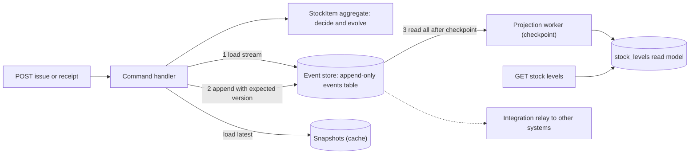
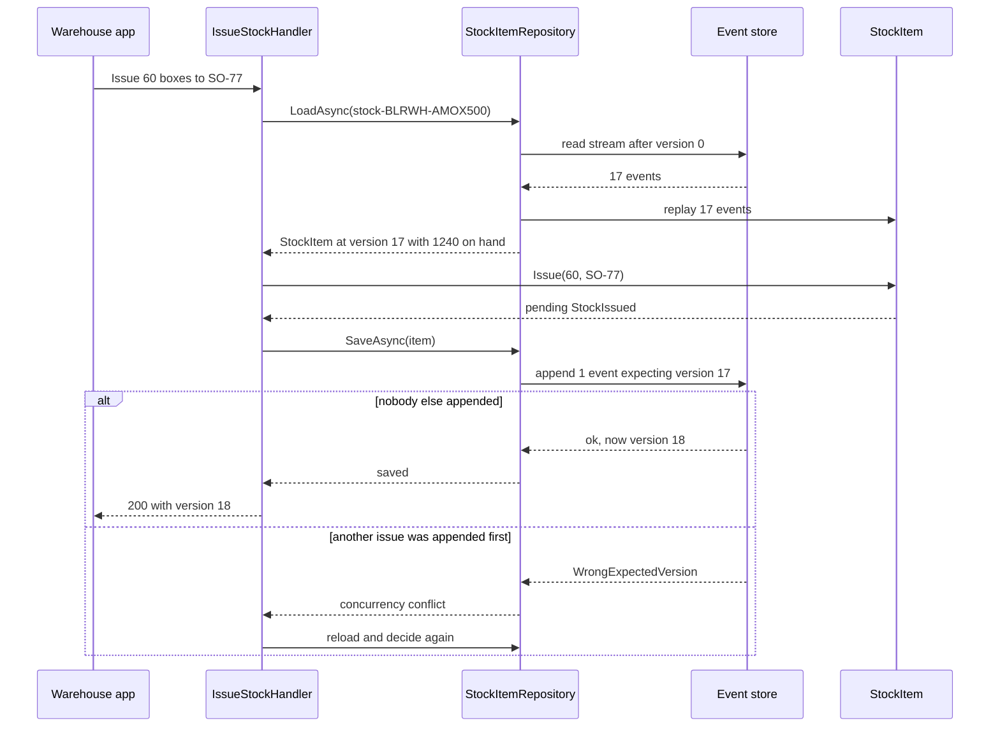
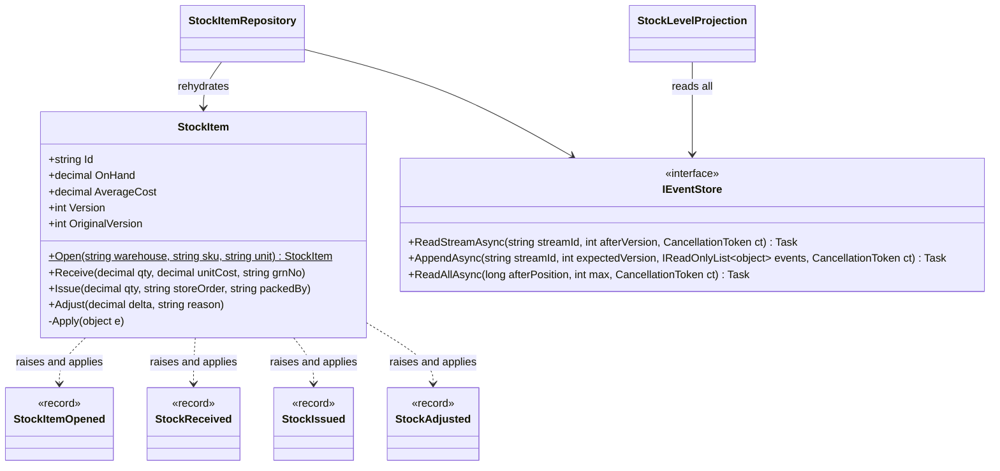

Most systems store **current state**: a row says "Amoxicillin 500 mg (box of 10 strips), Bengaluru warehouse, 1,240 boxes". When the warehouse sends 60 boxes to a branch pharmacy, the row is updated to 1,180 and the old value is gone. If a drug inspector asks "why did the count drop by 300 last Tuesday, and which stores got those boxes?", you hope someone wrote a log.

**Event sourcing** turns this around. You store **what happened**, as a sequence of facts: *opened*, *received 500 boxes at ₹385 under GRN 1041*, *issued 60 boxes to store order SO-77*, *adjusted −12 after physical count*. Current state is not stored at all (or only as a cache). It is computed by replaying the facts. The history is not a log next to the data. The history **is** the data.

This lesson builds an event-sourced stock ledger for a pharmacy chain's central warehouse in C#, with an event store, rehydration, projections, snapshots and event versioning. It ends with the most important part: when *not* to do this, because event sourcing is powerful and expensive in equal measure.

## Learning objectives

By the end of this lesson you will be able to:

1. Explain event sourcing, and how it differs from storing current state plus an audit log.
2. Model an aggregate as decisions (commands that produce events) and evolution (events that change state).
3. Implement an append-only event store with per-stream optimistic concurrency, in memory and as a PostgreSQL schema.
4. Rehydrate an aggregate from its stream, and speed it up with snapshots.
5. Build projections (read models) from the global event stream, with checkpoints and rebuilds.
6. Evolve event schemas safely: new optional fields, upcasters, new event types.
7. Weigh the costs (complexity, privacy, eventual consistency, tooling) and decide when not to use event sourcing.

## Prerequisites

- [Aggregates](#/lesson/m08-aggregates): an event stream usually belongs to one aggregate.
- [Domain events](#/lesson/m08-domain-events): event sourcing makes domain events the source of truth.
- [CQRS fundamentals](#/lesson/m08-cqrs-fundamentals): event-sourced systems almost always need read models.
- [Transactions and ACID](#/lesson/m09-transactions-acid): appending events relies on an atomic write with a uniqueness check.

## Explain it like I'm a beginner

Think of a **bank passbook**.

The passbook doesn't just show "Balance: ₹42,300". It lists every entry: salary credited ₹65,000, UPI payment ₹1,200, ATM withdrawal ₹5,000, interest credited ₹312. The balance in the last column is just the running total. If the bank's computer forgot the balance, you could work it out again by adding up the entries from the first page.

Three useful things follow:

- **Nothing is erased.** A wrong entry isn't rubbed out. The bank adds a *reversal* entry. You can always see what happened and when.
- **You can answer questions nobody planned for.** "How much did I spend on UPI in March?" The entries already hold the answer.
- **You can rewind.** "What was my balance on 15 August?" Add up the entries up to that date.

Event sourcing stores business data like a passbook:

- Each entry is an **event**: a fact in the past tense (`StockReceived`, `StockIssued`).
- The list of entries for one thing (one medicine at one warehouse) is an **event stream**.
- The book shelf holding all streams is the **event store**.
- Adding up the entries to get the balance is **rehydration** (or replaying).
- A printed summary sheet, "balance of every medicine at every warehouse", is a **projection**.
- Writing the balance on a bookmark every 50 pages, so you don't have to start from page 1 each time, is a **snapshot**.

## First-principles explanation

### What it is

> Event sourcing: capture every change to an application's state as an event object, and store these events in the order they were applied. The current state is derived from the events.

Two consequences define the style:

1. **The event log is append-only.** Events are never updated or deleted in normal operation. Corrections are new events (`StockAdjusted`, `IssueReversed`).
2. **State is a function of history.** `state = events.Aggregate(initial, apply)`. If the function changes (a bug fix in how average cost is computed), you can replay and get corrected state.

### Event sourcing versus "state plus audit log"

Many systems keep a current-state table *and* an audit table. That is not event sourcing:

| | State + audit log | Event sourcing |
|---|---|---|
| Source of truth | The state table | The events |
| Audit log | Written alongside, can drift or be forgotten | Cannot drift: it *is* the data |
| Meaning of entries | Often technical ("column qty changed from 1240 to 1180") | Business facts ("issued 60 boxes to SO-77") |
| New questions about the past | Only if the audit captured enough | Answerable by a new projection over existing events |
| Complexity | Low | High |

If all you need is "who changed what, when", an audit table (or a temporal table) is far cheaper. Event sourcing earns its cost when the **sequence of business facts** matters to the domain itself.

### How it works internally

**Writing (handling a command):**

1. Load the stream for the aggregate id (`stock-BLRWH-AMOX500`): read its events in version order.
2. Rehydrate: start from an empty aggregate and apply each event to update in-memory state.
3. Decide: call the command method (`Issue(60, "SO-77")`). It checks rules against the current state ("60 ≤ 1,240 on hand") and produces new events. It does *not* store anything.
4. Append the new events with an **expected version**: "append these if the stream is still at version 17". The store rejects the append if someone else appended in the meantime. That is optimistic concurrency, with the stream version playing the role of a row version.
5. Done. No `UPDATE` ever happens.

**Reading:**

- For a command, rehydrate one aggregate (fast: one stream, typically tens to hundreds of events).
- For queries and screens, **never** rehydrate thousands of aggregates. Use **projections**: subscribers that read the global event stream in order and maintain read-model tables (exactly the read models from [CQRS fundamentals](#/lesson/m08-cqrs-fundamentals)).

### The shape of an aggregate: decide and evolve

An event-sourced aggregate has two kinds of methods, and keeping them separate is the key discipline:

| Decide (command methods) | Evolve (apply methods) |
|---|---|
| `Issue(quantity, storeOrder)` | `Apply(StockIssued e)` |
| Validates rules against current state | Never validates: the event already happened |
| May throw or reject | Must never fail for a valid stored event |
| Produces events | Changes state fields |
| Runs only when handling a new command | Runs for every replay, forever |

Why must `Apply` never validate? Because the event is a fact that was accepted in the past. If you later tighten a rule ("issues above 500 boxes need approval"), replaying an old 600-box issue must still work. Rules belong in `Decide`. History is history.

### Streams, versions and positions

- **Stream id**: one per aggregate instance, for example `stock-{warehouse}-{sku}`.
- **Stream version**: 1, 2, 3... within a stream. Used for optimistic concurrency and for snapshots.
- **Global position**: a store-wide, increasing sequence across all streams. Projections use it as a checkpoint ("I have processed everything up to position 98,412").

### Projections

A projection is a function from events to a read model: `(readModel, event) → readModel`. Properties you need:

- **Ordered**: process events in global position order (at least per stream).
- **Idempotent**: store the checkpoint in the same transaction as the read-model update, or make each update safe to repeat.
- **Rebuildable**: you can delete the read model and replay from position 0. This is a superpower: a new report over three years of history is "write a projection, replay".
- **Eventually consistent** when asynchronous: a screen may lag the write by milliseconds or seconds.

### Snapshots

Rehydrating a stream of 200 events is quick (an estimate: well under a few milliseconds in memory once loaded). A stream of 200,000 events (a fast-moving medicine at a large warehouse over several years) is not. A **snapshot** stores the aggregate's state at some version. Loading becomes: read the latest snapshot, then only the events after it.

Snapshot rules of thumb:

- Add them only when a measured load time is a problem. Most aggregates never need them. A long stream is often a sign of a missing aggregate boundary: consider "closing the books" each financial year with a new stream that starts from an opening-balance event.
- Snapshots are a **cache**. You can delete them all and the system still works, just more slowly.
- Version the snapshot format. When the aggregate's state shape changes, old snapshots are discarded and rebuilt from events.

### Event versioning

Events are stored forever, but your code changes. Strategies, from most to least preferred:

1. **Add optional fields only.** New code handles the missing field with a default. Old events still deserialise. Most changes can be done this way.
2. **Upcasting.** When reading an old event, transform its JSON from version 1 to version 2 before deserialising (for example, add `storeOrder: "UNKNOWN"`). The stored bytes never change. Upcasters are small, pure and tested.
3. **New event type.** If the meaning changes, create `StockIssuedV2` (or better, a new name such as `StockTransferredToStore`) and keep handling the old one.
4. **Copy-and-transform the stream** (rewrite into a new store). A last resort, for large refactors, done as a migration with verification.

Never change the meaning of an existing event type's fields. `Quantity` that used to mean "boxes" must not start meaning "strips".

### Why it exists — what you get

- **Complete, trustworthy history** in business terms, for audit and dispute resolution. In a pharmacy chain, "which store orders received the 300 boxes from batch B-2291, and was any of it returned?" is the first question in a drug recall or an inspector's audit.
- **Temporal queries**: state as of any version or date.
- **New read models from old data**: build an "expiry write-off per store" report today over events from three years ago.
- **Natural integration**: events can be published to other systems (through an [outbox](#/lesson/m12-outbox)-like relay) without inventing a second change feed.
- **Debugging**: replay a stream to reproduce exactly how a bad state arose.

### What it costs

- **A new mental model** for the whole team. Most developers have years of CRUD habits.
- **Projections everywhere.** Every screen needs a read model, a projector, monitoring of lag, and a rebuild procedure.
- **Eventual consistency** on reads, with the read-your-writes problems from the CQRS lesson.
- **Versioning forever.** Every event type you ship is a contract with your future self.
- **Privacy and erasure.** "Never delete" collides with rights to erasure under data-protection law (for example India's DPDP Act 2023 or the EU's GDPR). Mitigations: keep personal data out of events (store a reference), or encrypt personal fields with a per-person key and delete the key ("crypto-shredding").
- **Fewer tools.** ORMs, reporting tools and ad-hoc SQL work naturally on state tables, less so on event streams.
- **Set-based rules are hard.** "SKU codes must be unique across the company" spans streams. You need a separate uniqueness table or a reservation process.

### When it is useful

- The domain thinks in events already: ledgers, inventories, bookings, claims, workflows with approvals, trading.
- Audit and history are core requirements, not nice-to-haves.
- You need to answer questions about the past that you can't foresee today.
- Many downstream consumers need a reliable change feed.

### When it is unnecessary (or harmful)

- CRUD-heavy domains: master data, user profiles, content pages.
- The audit requirement is "who changed which field when": use an audit table or temporal tables.
- A small team under delivery pressure, without experience in projections and versioning.
- Data with heavy erasure requirements and lots of personal information in every change.
- **The whole system.** Even when event sourcing fits, apply it to the one or two bounded contexts that need it (the stock ledger), not to everything (store master data, user accounts).

## Visual explanation

### The moving parts



The command side is on the left. The handler loads the latest snapshot (if any) and the events after it, rehydrates `StockItem`, asks it to decide, and appends the resulting events with an expected version. The event store is the only thing written by commands. On the right, a projection worker reads the global stream after its last checkpoint and updates the `stock_levels` table, which queries read. The dotted arrow shows that the same events can feed other systems (for example, finance or the store-replenishment service) through a relay. Snapshots are drawn as a cache: deleting them changes speed, not correctness.

### Handling a command



The handler never edits stored data. It replays history into memory, makes a decision, and appends a new fact. The `alt` block shows optimistic concurrency. If another packer issued the same medicine a moment earlier, the stream is at version 18, the append expecting 17 fails, and the handler reloads (now 1,180 on hand) and decides again. If the second decision is still valid, it succeeds. If not (not enough stock left), the user gets a clear rule violation. Retrying is safe because the handler re-runs the *decision*, not the old result.

One thing the version check does **not** protect against is the same command arriving twice. If the warehouse app times out and resends "issue 60 boxes to SO-77", the second request loads version 18, decides again and appends a second issue. Optimistic concurrency stops *lost updates*, not *duplicates*. Give each command an id (or use the store order number as a natural key), record it in the event metadata, and have the aggregate or handler ignore a command id it has already seen, as in [idempotent consumers](#/lesson/m12-idempotent-consumers).

### The aggregate's structure



The four event records are the aggregate's entire persistent vocabulary. `StockItem` both raises them (decide) and applies them (evolve). `OriginalVersion` is the version the aggregate had when loaded, which becomes the expected version for the append. The repository is the only class that touches the store for writes, and projections only read.

## Step-by-step example

### Step 1 — the state-based version

```csharp
public async Task Issue(string warehouse, string sku, decimal qty, string storeOrder)
{
    var row = await db.Stock.SingleAsync(s => s.Warehouse == warehouse && s.Sku == sku);
    if (row.OnHand < qty) throw new InvalidOperationException("Insufficient stock");
    row.OnHand -= qty;                                      // previous value is lost
    db.AuditLog.Add(new AuditRow("Stock", row.Id, $"OnHand {row.OnHand + qty} -> {row.OnHand}"));
    await db.SaveChangesAsync();
}
```

This is fine for many systems. But the audit row doesn't say *which store order* the boxes went to, and the weighted average cost after each receipt can't be recomputed if a past receipt's rate was wrong.

### Step 2 — name the facts

List what the warehouse stock register records: stock item opened for a warehouse; stock received (quantity, rate, GRN number); stock issued (quantity, store order, packer); stock adjusted after physical verification (difference, reason). Each becomes an immutable event record, named in the past tense.

### Step 3 — split decide from evolve

`Issue(qty, storeOrder, packedBy)` checks "qty > 0" and "qty ≤ on hand", then raises `StockIssued`. `Apply(StockIssued e)` subtracts the quantity. `Apply` contains no `if` that could reject the event.

### Step 4 — append with an expected version

The repository appends pending events with `expectedVersion = OriginalVersion`. In PostgreSQL, a unique constraint on `(stream_id, version)` makes concurrent appends safe: two writers both trying to insert version 18 means one gets a unique-violation error, translated to a concurrency conflict.

### Step 5 — project for reads

A worker reads all events after its checkpoint and maintains `stock_levels(warehouse, sku, on_hand, total_received, total_issued)`. The warehouse dashboard reads that table and never touches the event store.

### Step 6 — only when needed: snapshots and upcasters

When a stream's load time becomes noticeable, store a snapshot every 100 events. When `StockIssued` gains a required meaning (a store order became mandatory in version 2), register an upcaster that fills `"UNKNOWN"` for old events.

## Production-style C# implementation

```text
PharmacyStock.Api/
  Program.cs
  Stock/Events.cs
  Stock/StockItem.cs
  EventStore/EventSerializer.cs
  EventStore/InMemoryEventStore.cs
  EventStore/Snapshots.cs
  Stock/StockItemRepository.cs
  Stock/StockLevelProjection.cs
  Stock/StockCommands.cs
```

### Events

```csharp file=Stock/Events.cs
namespace PharmacyStock.Stock;

// Past tense, business language, immutable. These records are a contract with every future version of the code.
public sealed record StockItemOpened(string WarehouseCode, string SkuCode, string Unit);
public sealed record StockReceived(decimal Quantity, decimal UnitCost, string GrnNo);
/// <summary>Schema version 2: StoreOrder was added. Version 1 events are upcast with StoreOrder = "UNKNOWN".</summary>
public sealed record StockIssued(decimal Quantity, string StoreOrder, string PackedBy);
public sealed record StockAdjusted(decimal Delta, string Reason);
```

### The aggregate: decide and evolve

```csharp file=Stock/StockItem.cs
namespace PharmacyStock.Stock;

public sealed class StockRuleException(string message) : Exception(message);

public sealed record StockItemSnapshot(string Id, string WarehouseCode, string SkuCode, string Unit,
    decimal OnHand, decimal AverageCost, int Version, int SnapshotSchema = 1);

public sealed class StockItem
{
    private readonly List<object> _pending = new();

    public string Id { get; private set; } = "";
    public string WarehouseCode { get; private set; } = "";
    public string SkuCode { get; private set; } = "";
    public string Unit { get; private set; } = "";
    public decimal OnHand { get; private set; }
    public decimal AverageCost { get; private set; }
    /// <summary>Number of events applied, including pending ones.</summary>
    public int Version { get; private set; }
    /// <summary>The version that was loaded from the store: the expected version for the next append.</summary>
    public int OriginalVersion => Version - _pending.Count;
    public IReadOnlyList<object> PendingEvents => _pending;

    public static string StreamIdFor(string warehouse, string sku) =>
        $"stock-{warehouse.ToUpperInvariant()}-{sku.ToUpperInvariant()}";

    // ---------- Decide: validate against current state, then raise events ----------

    public static StockItem Open(string warehouseCode, string skuCode, string unit)
    {
        if (string.IsNullOrWhiteSpace(warehouseCode) || string.IsNullOrWhiteSpace(skuCode))
            throw new StockRuleException("Warehouse and SKU are required.");
        if (unit is not ("box" or "strip" or "bottle" or "tube" or "nos"))
            throw new StockRuleException($"Unit '{unit}' is not supported.");
        var item = new StockItem();
        item.Raise(new StockItemOpened(warehouseCode.ToUpperInvariant(), skuCode.ToUpperInvariant(), unit));
        return item;
    }

    public void Receive(decimal quantity, decimal unitCost, string grnNo)
    {
        EnsureOpened();
        if (quantity <= 0) throw new StockRuleException("Received quantity must be positive.");
        if (unitCost <= 0) throw new StockRuleException("Unit cost must be positive.");
        if (string.IsNullOrWhiteSpace(grnNo)) throw new StockRuleException("A goods receipt note number is required.");
        Raise(new StockReceived(quantity, unitCost, grnNo));
    }

    public void Issue(decimal quantity, string storeOrder, string packedBy)
    {
        EnsureOpened();
        if (quantity <= 0) throw new StockRuleException("Issued quantity must be positive.");
        if (string.IsNullOrWhiteSpace(storeOrder)) throw new StockRuleException("A store order is required.");
        if (quantity > OnHand) throw new StockRuleException($"Only {OnHand} {Unit} on hand; cannot issue {quantity}.");
        Raise(new StockIssued(quantity, storeOrder, packedBy));
    }

    public void Adjust(decimal delta, string reason)
    {
        EnsureOpened();
        if (delta == 0) throw new StockRuleException("An adjustment must change the quantity.");
        if (string.IsNullOrWhiteSpace(reason)) throw new StockRuleException("An adjustment needs a reason.");
        if (OnHand + delta < 0) throw new StockRuleException("Stock cannot become negative.");
        Raise(new StockAdjusted(delta, reason));
    }

    // ---------- Evolve: apply facts. No validation; history is history. ----------

    private void Apply(object e)
    {
        switch (e)
        {
            case StockItemOpened o:
                Id = StreamIdFor(o.WarehouseCode, o.SkuCode);
                WarehouseCode = o.WarehouseCode; SkuCode = o.SkuCode; Unit = o.Unit;
                break;
            case StockReceived r:
                var newOnHand = OnHand + r.Quantity;
                AverageCost = Math.Round((OnHand * AverageCost + r.Quantity * r.UnitCost) / newOnHand, 4);
                OnHand = newOnHand;
                break;
            case StockIssued i:
                OnHand -= i.Quantity;
                break;
            case StockAdjusted a:
                OnHand += a.Delta;
                break;
            default:
                throw new InvalidOperationException($"StockItem cannot apply {e.GetType().Name}.");
        }
        Version++;
    }

    private void Raise(object e) { Apply(e); _pending.Add(e); }

    private void EnsureOpened()
    {
        if (Version == 0) throw new StockRuleException("Stock item has not been opened.");
    }

    // ---------- Loading ----------

    public static StockItem Rehydrate(IEnumerable<object> history) => Replay(new StockItem(), history);

    public static StockItem FromSnapshot(StockItemSnapshot s, IEnumerable<object> eventsAfter) => Replay(new StockItem
    {
        Id = s.Id, WarehouseCode = s.WarehouseCode, SkuCode = s.SkuCode, Unit = s.Unit,
        OnHand = s.OnHand, AverageCost = s.AverageCost, Version = s.Version
    }, eventsAfter);

    /// <summary>Only committed state may be snapshotted, so the snapshot version always exists in the store.</summary>
    public StockItemSnapshot ToSnapshot() => _pending.Count == 0
        ? new(Id, WarehouseCode, SkuCode, Unit, OnHand, AverageCost, Version)
        : throw new InvalidOperationException("Save pending events before taking a snapshot.");

    public void MarkCommitted() => _pending.Clear();

    private static StockItem Replay(StockItem item, IEnumerable<object> events)
    {
        foreach (var e in events) item.Apply(e);
        return item;
    }
}
```

Weighted average cost is a good example of why `Apply` must be deterministic: it depends on the order of receipts and issues. Replaying the same events in the same order always gives the same cost. If a past receipt rate was wrong, the fix is a compensating fact (for example a `ReceiptRateCorrected` event), never an edit to the old event.

### Serialisation and versioning

```csharp file=EventStore/EventSerializer.cs
using System.Text.Json;
using System.Text.Json.Nodes;

namespace PharmacyStock.EventStore;

/// <summary>Maps event CLR types to stable names and schema versions, and upcasts old JSON on read.</summary>
public sealed class EventSerializer
{
    private static readonly JsonSerializerOptions Json = new(JsonSerializerDefaults.Web);
    private readonly Dictionary<string, (Type Type, int Version)> _byName = new();
    private readonly Dictionary<Type, (string Name, int Version)> _byType = new();
    private readonly Dictionary<(string Name, int FromVersion), Func<JsonObject, JsonObject>> _upcasters = new();

    public EventSerializer Register<T>(string name, int currentVersion = 1)
    {
        _byName[name] = (typeof(T), currentVersion);
        _byType[typeof(T)] = (name, currentVersion);
        return this;
    }

    /// <summary>Transforms JSON stored at <paramref name="fromVersion"/> into fromVersion + 1.</summary>
    public EventSerializer Upcast(string name, int fromVersion, Func<JsonObject, JsonObject> upcaster)
    {
        _upcasters[(name, fromVersion)] = upcaster;
        return this;
    }

    public (string Name, int SchemaVersion, string Data) Serialize(object e)
    {
        if (!_byType.TryGetValue(e.GetType(), out var meta))
            throw new InvalidOperationException($"Event type {e.GetType().Name} is not registered.");
        return (meta.Name, meta.Version, JsonSerializer.Serialize(e, e.GetType(), Json));
    }

    public object Deserialize(string name, int schemaVersion, string data)
    {
        if (!_byName.TryGetValue(name, out var meta))
            throw new InvalidOperationException($"Unknown event type '{name}'.");
        var node = JsonNode.Parse(data)?.AsObject() ?? throw new InvalidOperationException("Empty event payload.");
        for (var v = schemaVersion; v < meta.Version; v++)
        {
            if (!_upcasters.TryGetValue((name, v), out var up))
                throw new InvalidOperationException($"No upcaster for {name} v{v} to v{v + 1}.");
            node = up(node);
        }
        return node.Deserialize(meta.Type, Json) ?? throw new InvalidOperationException($"Could not read {name}.");
    }
}
```

Event names are stored as stable strings (`"StockIssued"`), not CLR type names, so renaming or moving a C# class never breaks history.

### The event store

```csharp file=EventStore/InMemoryEventStore.cs
namespace PharmacyStock.EventStore;

public sealed record StoredEvent(long Position, string StreamId, int Version, string Type, int SchemaVersion,
    string Data, DateTimeOffset RecordedAt);

public sealed class WrongExpectedVersionException(string streamId, int expected, int actual)
    : Exception($"Stream {streamId} is at version {actual}, expected {expected}.")
{
    public int Actual { get; } = actual;
}

public interface IEventStore
{
    Task<IReadOnlyList<StoredEvent>> ReadStreamAsync(string streamId, int afterVersion, CancellationToken ct);
    /// <summary>Appends atomically. Returns the new stream version.</summary>
    Task<int> AppendAsync(string streamId, int expectedVersion, IReadOnlyList<object> events, CancellationToken ct);
    Task<IReadOnlyList<StoredEvent>> ReadAllAsync(long afterPosition, int max, CancellationToken ct);
}

/// <summary>Development and test store. The PostgreSQL version is a single table with a unique (stream_id, version).</summary>
public sealed class InMemoryEventStore(EventSerializer serializer, TimeProvider clock) : IEventStore
{
    private readonly Lock _gate = new();
    private readonly List<StoredEvent> _all = new();
    private readonly Dictionary<string, List<StoredEvent>> _streams = new();

    public Task<IReadOnlyList<StoredEvent>> ReadStreamAsync(string streamId, int afterVersion, CancellationToken ct)
    {
        lock (_gate)
        {
            IReadOnlyList<StoredEvent> result = _streams.TryGetValue(streamId, out var s)
                ? s.Where(e => e.Version > afterVersion).ToList()
                : Array.Empty<StoredEvent>();
            return Task.FromResult(result);
        }
    }

    public Task<int> AppendAsync(string streamId, int expectedVersion, IReadOnlyList<object> events, CancellationToken ct)
    {
        if (events.Count == 0) return Task.FromResult(expectedVersion);
        lock (_gate)
        {
            var stream = _streams.TryGetValue(streamId, out var s) ? s : (_streams[streamId] = new List<StoredEvent>());
            var actual = stream.Count;
            if (actual != expectedVersion) throw new WrongExpectedVersionException(streamId, expectedVersion, actual);

            var now = clock.GetUtcNow();
            foreach (var e in events)
            {
                var (name, schema, data) = serializer.Serialize(e);
                var stored = new StoredEvent(_all.Count + 1, streamId, stream.Count + 1, name, schema, data, now);
                stream.Add(stored);
                _all.Add(stored);
            }
            return Task.FromResult(stream.Count);
        }
    }

    public Task<IReadOnlyList<StoredEvent>> ReadAllAsync(long afterPosition, int max, CancellationToken ct)
    {
        lock (_gate)
        {
            IReadOnlyList<StoredEvent> page = _all.Skip((int)Math.Min(afterPosition, _all.Count)).Take(max).ToList();
            return Task.FromResult(page);
        }
    }
}
```

### Snapshots and the repository

```csharp file=EventStore/Snapshots.cs
using System.Collections.Concurrent;
using PharmacyStock.Stock;

namespace PharmacyStock.EventStore;

public interface ISnapshotStore
{
    Task<StockItemSnapshot?> GetAsync(string streamId, CancellationToken ct);
    Task SaveAsync(StockItemSnapshot snapshot, CancellationToken ct);
}

/// <summary>A cache. Deleting every snapshot must not change behaviour, only speed.</summary>
public sealed class InMemorySnapshotStore : ISnapshotStore
{
    private readonly ConcurrentDictionary<string, StockItemSnapshot> _snapshots = new();
    public Task<StockItemSnapshot?> GetAsync(string streamId, CancellationToken ct) =>
        Task.FromResult(_snapshots.TryGetValue(streamId, out var s) ? s : null);
    public Task SaveAsync(StockItemSnapshot snapshot, CancellationToken ct)
    {
        _snapshots.AddOrUpdate(snapshot.Id, snapshot, (_, old) => snapshot.Version > old.Version ? snapshot : old);
        return Task.CompletedTask;
    }
}
```

```csharp file=Stock/StockItemRepository.cs
using PharmacyStock.EventStore;

namespace PharmacyStock.Stock;

public sealed class StockItemRepository(IEventStore store, ISnapshotStore snapshots, EventSerializer serializer)
{
    public const int SnapshotEvery = 100;
    private const int CurrentSnapshotSchema = 1;

    public async Task<StockItem?> LoadAsync(string streamId, CancellationToken ct)
    {
        var snapshot = await snapshots.GetAsync(streamId, ct);
        if (snapshot is { SnapshotSchema: not CurrentSnapshotSchema }) snapshot = null;   // old shape: ignore and replay

        var stored = await store.ReadStreamAsync(streamId, snapshot?.Version ?? 0, ct);
        if (snapshot is null && stored.Count == 0) return null;

        var events = stored.Select(e => serializer.Deserialize(e.Type, e.SchemaVersion, e.Data));
        return snapshot is null ? StockItem.Rehydrate(events) : StockItem.FromSnapshot(snapshot, events);
    }

    /// <summary>Loads the state as it was after a given version: "time travel" for audits.</summary>
    public async Task<StockItem?> LoadAsOfAsync(string streamId, int version, CancellationToken ct)
    {
        var stored = await store.ReadStreamAsync(streamId, 0, ct);
        var events = stored.Where(e => e.Version <= version).Select(e => serializer.Deserialize(e.Type, e.SchemaVersion, e.Data)).ToList();
        return events.Count == 0 ? null : StockItem.Rehydrate(events);
    }

    public async Task<int> SaveAsync(StockItem item, CancellationToken ct)
    {
        if (item.PendingEvents.Count == 0) return item.Version;
        var before = item.OriginalVersion;
        var newVersion = await store.AppendAsync(item.Id, before, item.PendingEvents, ct);
        item.MarkCommitted();
        if (newVersion / SnapshotEvery > before / SnapshotEvery)          // crossed a multiple of 100
            await snapshots.SaveAsync(item.ToSnapshot(), ct);             // best effort: a cache
        return newVersion;
    }
}
```

### A projection and its worker

```csharp file=Stock/StockLevelProjection.cs
using System.Collections.Concurrent;
using PharmacyStock.EventStore;

namespace PharmacyStock.Stock;

public sealed record StockLevelRow(string StreamId, string WarehouseCode, string SkuCode, string Unit,
    decimal OnHand, decimal TotalReceived, decimal TotalIssued, DateTimeOffset LastMovementAt);

/// <summary>Read model: one row per stock item. In production, a table updated with the checkpoint in one transaction.</summary>
public sealed class StockLevelProjection(EventSerializer serializer)
{
    private readonly ConcurrentDictionary<string, StockLevelRow> _rows = new();
    private long _checkpoint;

    public long Checkpoint => Interlocked.Read(ref _checkpoint);
    public IEnumerable<StockLevelRow> ForWarehouse(string warehouse) =>
        _rows.Values.Where(r => r.WarehouseCode == warehouse.ToUpperInvariant()).OrderBy(r => r.SkuCode);

    public void Apply(StoredEvent stored)
    {
        if (stored.Position <= Checkpoint) return;                 // already processed: idempotent
        var e = serializer.Deserialize(stored.Type, stored.SchemaVersion, stored.Data);
        _rows.AddOrUpdate(stored.StreamId,
            _ => e is StockItemOpened o
                ? new StockLevelRow(stored.StreamId, o.WarehouseCode, o.SkuCode, o.Unit, 0, 0, 0, stored.RecordedAt)
                : throw new InvalidOperationException($"First event of {stored.StreamId} must be StockItemOpened."),
            (_, row) => e switch
            {
                StockReceived r => row with { OnHand = row.OnHand + r.Quantity, TotalReceived = row.TotalReceived + r.Quantity, LastMovementAt = stored.RecordedAt },
                StockIssued i => row with { OnHand = row.OnHand - i.Quantity, TotalIssued = row.TotalIssued + i.Quantity, LastMovementAt = stored.RecordedAt },
                StockAdjusted a => row with { OnHand = row.OnHand + a.Delta, LastMovementAt = stored.RecordedAt },
                _ => row
            });
        Interlocked.Exchange(ref _checkpoint, stored.Position);
    }
}

/// <summary>Polls the global stream after the checkpoint. Production: LISTEN/NOTIFY or a subscription instead of a fixed delay.</summary>
public sealed class ProjectionWorker(IEventStore store, StockLevelProjection projection, ILogger<ProjectionWorker> logger) : BackgroundService
{
    protected override async Task ExecuteAsync(CancellationToken stoppingToken)
    {
        while (!stoppingToken.IsCancellationRequested)
        {
            try
            {
                var page = await store.ReadAllAsync(projection.Checkpoint, 500, stoppingToken);
                foreach (var e in page) projection.Apply(e);
                if (page.Count < 500) await Task.Delay(TimeSpan.FromMilliseconds(250), stoppingToken);
            }
            catch (OperationCanceledException) when (stoppingToken.IsCancellationRequested) { break; }
            catch (Exception ex)
            {
                logger.LogError(ex, "Projection failed at checkpoint {Checkpoint}; retrying", projection.Checkpoint);
                await Task.Delay(TimeSpan.FromSeconds(5), stoppingToken);
            }
        }
    }
}
```

### Command handlers with conflict retry

```csharp file=Stock/StockCommands.cs
using PharmacyStock.EventStore;

namespace PharmacyStock.Stock;

public sealed record ReceiveStock(string Warehouse, string Sku, decimal Quantity, decimal UnitCost, string GrnNo, string Unit = "box");
public sealed record IssueStock(string Warehouse, string Sku, decimal Quantity, string StoreOrder, string PackedBy);

public sealed class StockCommandHandler(StockItemRepository repository)
{
    private const int MaxAttempts = 3;

    public Task<int> HandleAsync(ReceiveStock c, CancellationToken ct) =>
        WithRetry(StockItem.StreamIdFor(c.Warehouse, c.Sku), allowCreate: true, c.Warehouse, c.Sku, c.Unit,
            item => item.Receive(c.Quantity, c.UnitCost, c.GrnNo), ct);

    public Task<int> HandleAsync(IssueStock c, CancellationToken ct) =>
        WithRetry(StockItem.StreamIdFor(c.Warehouse, c.Sku), allowCreate: false, c.Warehouse, c.Sku, "",
            item => item.Issue(c.Quantity, c.StoreOrder, c.PackedBy), ct);

    /// <summary>On a version conflict, reload and run the decision again against fresh state.</summary>
    private async Task<int> WithRetry(string streamId, bool allowCreate, string warehouse, string sku, string unit,
        Action<StockItem> decide, CancellationToken ct)
    {
        for (var attempt = 1; ; attempt++)
        {
            var item = await repository.LoadAsync(streamId, ct)
                       ?? (allowCreate ? StockItem.Open(warehouse, sku, unit)
                                       : throw new KeyNotFoundException($"No stock item {streamId}."));
            decide(item);
            try { return await repository.SaveAsync(item, ct); }
            catch (WrongExpectedVersionException) when (attempt < MaxAttempts) { /* someone else won the race; decide again */ }
        }
    }
}
```

```csharp file=Program.cs
using PharmacyStock.EventStore;
using PharmacyStock.Stock;

var builder = WebApplication.CreateBuilder(args);

builder.Services.AddSingleton(TimeProvider.System);
builder.Services.AddSingleton(_ => new EventSerializer()
    .Register<StockItemOpened>("StockItemOpened")
    .Register<StockReceived>("StockReceived")
    .Register<StockIssued>("StockIssued", currentVersion: 2)
    .Register<StockAdjusted>("StockAdjusted")
    .Upcast("StockIssued", fromVersion: 1, json => { json["storeOrder"] ??= "UNKNOWN"; return json; }));
builder.Services.AddSingleton<IEventStore, InMemoryEventStore>();
builder.Services.AddSingleton<ISnapshotStore, InMemorySnapshotStore>();
builder.Services.AddSingleton<StockItemRepository>();
builder.Services.AddSingleton<StockCommandHandler>();
builder.Services.AddSingleton<StockLevelProjection>();
builder.Services.AddHostedService<ProjectionWorker>();

var app = builder.Build();

app.MapPost("/stock/receipts", async (ReceiveStock cmd, StockCommandHandler h, CancellationToken ct) =>
{
    try { return Results.Ok(new { version = await h.HandleAsync(cmd, ct) }); }
    catch (StockRuleException ex) { return Results.Problem(ex.Message, statusCode: 422); }
});

app.MapPost("/stock/issues", async (IssueStock cmd, StockCommandHandler h, CancellationToken ct) =>
{
    try { return Results.Ok(new { version = await h.HandleAsync(cmd, ct) }); }
    catch (KeyNotFoundException) { return Results.NotFound(); }
    catch (StockRuleException ex) { return Results.Problem(ex.Message, statusCode: 422); }
    catch (WrongExpectedVersionException) { return Results.Problem("Too many concurrent changes. Try again.", statusCode: 409); }
});

// Query side: reads the projection, never the event store.
app.MapGet("/stock/{warehouse}", (string warehouse, StockLevelProjection p) => Results.Ok(p.ForWarehouse(warehouse)));

// Audit: the state as of any version, rebuilt from events.
app.MapGet("/stock/{warehouse}/{sku}/as-of/{version:int}", async (string warehouse, string sku, int version, StockItemRepository repo, CancellationToken ct) =>
    await repo.LoadAsOfAsync(StockItem.StreamIdFor(warehouse, sku), version, ct) is { } item
        ? Results.Ok(new { item.OnHand, item.AverageCost, item.Version })
        : Results.NotFound());

app.Run();
```

### The PostgreSQL event store

The in-memory store maps directly onto one table. This is the schema many teams start with (libraries such as Marten for .NET use a similar design on PostgreSQL):

```sql
CREATE TABLE events (
    position       bigint GENERATED ALWAYS AS IDENTITY PRIMARY KEY,
    stream_id      text        NOT NULL,
    version        int         NOT NULL,
    type           text        NOT NULL,
    schema_version int         NOT NULL DEFAULT 1,
    data           jsonb       NOT NULL,
    metadata       jsonb       NOT NULL DEFAULT '{}',   -- user, correlation id, causation id
    recorded_at    timestamptz NOT NULL DEFAULT now(),
    CONSTRAINT uq_stream_version UNIQUE (stream_id, version)
);

-- Append: one INSERT per event inside a transaction. If another writer inserted the same
-- (stream_id, version) first, PostgreSQL raises unique_violation (SQLSTATE 23505),
-- which the adapter translates into WrongExpectedVersionException.
INSERT INTO events (stream_id, version, type, schema_version, data)
VALUES ('stock-BLRWH-AMOX500', 18, 'StockIssued', 2,
        '{"quantity":60,"storeOrder":"SO-77","packedBy":"R. Yadav"}');

CREATE TABLE projection_checkpoints (name text PRIMARY KEY, position bigint NOT NULL);
```

:::callout type=warning title="Global position gaps in PostgreSQL"
Identity and sequence values are assigned when a row is inserted, not when its transaction commits. Transaction A can take position 101, transaction B position 102, and B can commit first. A projection that reads "after 100" sees 102, moves its checkpoint to 102, and then never sees 101. Mitigations include serialising appends (an advisory lock, which limits write throughput), only reading up to a "high-water mark" that is older than any in-flight transaction, or using a library that handles this for you. Test this case explicitly: it is the most common subtle bug in hand-built PostgreSQL event stores.
:::

## Bad design vs good design

**Bad: events as database diffs.** `StockRowUpdated { OldQty: 1240, NewQty: 1180 }`. This is a change-data-capture log, not domain events. It loses intent (issue? adjustment? reversal?) and makes projections reverse-engineer meaning.

**Bad: validation inside `Apply`.** `Apply(StockIssued e) { if (e.Quantity > OnHand) throw ...; }`. It works today. A year later a data fix or a new rule makes an old stream unloadable, and the stock item is frozen in production.

**Bad: queries that rehydrate everything.** The warehouse dashboard loads 2,000 stock items by replaying each stream. Page load grows with history. Read models exist for this.

**Bad: editing history.** A wrong receipt rate is "fixed" with `UPDATE events SET data = ...`. Projections are now inconsistent, any external consumer has the old value, and the audit trail is a lie. Append a correcting event instead.

**Bad: event sourcing the whole system.** Store master data, user accounts and the product catalogue all event-sourced "for consistency". The team spends its time writing projections for screens that a 20-line EF Core entity would serve.

**Good:** the implementation above. Business-named facts, decide and evolve kept separate, a deterministic `Apply`, optimistic concurrency on append, projections for every read, snapshots as an optional cache, versioned and upcast events, and event sourcing used only for the stock ledger.

:::callout type=tradeoff title="Event sourcing is a storage decision, not a messaging decision"
Event sourcing is about how *one service stores its own state*. Publishing integration events to other services is a separate concern. Exposing your internal event stream directly as a public contract couples other teams to your aggregate's internals. Publish deliberately designed integration events (often fewer and coarser) through a relay, as covered in [Transactional outbox](#/lesson/m12-outbox).
:::

## Practical playground

The playground has a minimal event-sourced stock item: a list of events, a `Decide` step and an `Evolve` step. It replays history, prints state after every event (time travel), and simulates a concurrency conflict. Try adding a `ReceiptReversed` event and see how the history and the average cost change.

:::playground type=csharp title="Replay, time travel and a conflict"
```csharp file=Program.cs
using System;
using System.Collections.Generic;
using System.Linq;

public abstract record Event;
public sealed record Received(decimal Qty, decimal Rate, string Grn) : Event;
public sealed record Issued(decimal Qty, string StoreOrder) : Event;
public sealed record Adjusted(decimal Delta, string Reason) : Event;

public sealed record State(decimal OnHand, decimal AvgCost, int Version)
{
    public static readonly State Empty = new(0, 0, 0);
}

public static class Stock
{
    // Evolve: never fails.
    public static State Apply(State s, Event e) => e switch
    {
        Received r => new State(s.OnHand + r.Qty, Math.Round((s.OnHand * s.AvgCost + r.Qty * r.Rate) / (s.OnHand + r.Qty), 2, MidpointRounding.AwayFromZero), s.Version + 1),
        Issued i => s with { OnHand = s.OnHand - i.Qty, Version = s.Version + 1 },
        Adjusted a => s with { OnHand = s.OnHand + a.Delta, Version = s.Version + 1 },
        _ => throw new InvalidOperationException()
    };

    // Decide: validates against current state.
    public static Event Issue(State s, decimal qty, string storeOrder) =>
        qty > s.OnHand ? throw new InvalidOperationException($"only {s.OnHand} on hand") : new Issued(qty, storeOrder);
}

public static class Program
{
    static readonly List<Event> Stream = new();

    static void Append(int expectedVersion, Event e)
    {
        if (Stream.Count != expectedVersion) throw new InvalidOperationException($"conflict: stream at {Stream.Count}, expected {expectedVersion}");
        Stream.Add(e);
    }

    public static void Main()
    {
        Append(0, new Received(500, 385m, "GRN-1041"));
        Append(1, new Received(300, 392m, "GRN-1057"));
        Append(2, new Issued(60, "SO-77"));
        Append(3, new Adjusted(-12, "Physical count, damaged boxes"));

        Console.WriteLine("Time travel:");
        var state = State.Empty;
        foreach (var e in Stream)
        {
            state = Stock.Apply(state, e);
            Console.WriteLine($"  v{state.Version}: {e.GetType().Name,-9} on hand {state.OnHand,5} avg {state.AvgCost:N2}");
        }

        // Two packers load version 4 at the same time.
        var loaded = Stream.Aggregate(State.Empty, Stock.Apply);
        var first = Stock.Issue(loaded, 400, "SO-80");
        var second = Stock.Issue(loaded, 400, "SO-81");
        Append(loaded.Version, first);
        try { Append(loaded.Version, second); }
        catch (InvalidOperationException ex)
        {
            Console.WriteLine($"Second issue: {ex.Message}. Reloading and deciding again...");
            var fresh = Stream.Aggregate(State.Empty, Stock.Apply);
            try { Append(fresh.Version, Stock.Issue(fresh, 400, "SO-81")); }
            catch (InvalidOperationException rule) { Console.WriteLine($"Rejected by rule: {rule.Message}"); }
        }
        // Challenge: add a ReceiptReversed(Grn) event. What should Apply do to the average cost?
    }
}
```
:::

## Exercises

:::exercise id=m08-event-sourcing-ex1 difficulty=beginner kind=code title="Rehydrate stock state from events"
Implement `Evolve` for a stock item: given the current state and one event, return the next state. Then `Rehydrate` folds a whole history.
::requirements
- `Received(qty, unitCost)`: on hand increases. Average cost becomes the weighted average `(onHand × avg + qty × unitCost) / (onHand + qty)`, rounded to 2 decimals with halves rounded away from zero (`MidpointRounding.AwayFromZero`).
- `Issued(qty)`: on hand decreases. Average cost is unchanged.
- `Adjusted(delta)`: on hand changes by `delta` (can be negative). Average cost is unchanged.
- Every event increments `Version` by 1.
- `Evolve` must not validate or throw for these three event types.
::acceptance
- Receive 500 at ₹385, then 300 at ₹392: on hand 800, average ₹387.63, version 2.
- Then issue 60 and adjust −12: on hand 728, average unchanged, version 4.
- An empty history gives the empty state.
- Replaying an issue larger than on hand still works (history is history) and gives a negative on-hand figure.
::hint
`Rehydrate` is a fold: start with `StockState.Empty` and apply each event in order. LINQ's `Aggregate` does exactly this.
::hint
Use a `switch` expression on the event type with `with` expressions for the records.
::hint
For the weighted average, compute the new on hand first, then the new average using the *old* on hand.
::hint
```csharp
Received r => s with { OnHand = s.OnHand + r.Quantity,
    AverageCost = Math.Round((s.OnHand * s.AverageCost + r.Quantity * r.UnitCost) / (s.OnHand + r.Quantity), 2, MidpointRounding.AwayFromZero),
    Version = s.Version + 1 },
```
::starter
```csharp file=StockState.cs
using System;
using System.Collections.Generic;
using System.Linq;

public abstract record StockEvent;
public sealed record Received(decimal Quantity, decimal UnitCost) : StockEvent;
public sealed record Issued(decimal Quantity, string StoreOrder) : StockEvent;
public sealed record Adjusted(decimal Delta, string Reason) : StockEvent;

public sealed record StockState(decimal OnHand, decimal AverageCost, int Version)
{
    public static readonly StockState Empty = new(0m, 0m, 0);
}

public static class StockEvolution
{
    public static StockState Evolve(StockState s, StockEvent e) => throw new NotImplementedException();
    public static StockState Rehydrate(IEnumerable<StockEvent> history) => throw new NotImplementedException();
}
```
::tests
```csharp file=StockStateTests.cs
using System;
using Xunit;

public class StockStateTests
{
    [Fact]
    public void Two_receipts_give_weighted_average()
    {
        var s = StockEvolution.Rehydrate(new StockEvent[] { new Received(500m, 385m), new Received(300m, 392m) });
        Assert.Equal(800m, s.OnHand);
        Assert.Equal(387.63m, s.AverageCost);
        Assert.Equal(2, s.Version);
    }

    [Fact]
    public void Issues_and_adjustments_keep_average()
    {
        var s = StockEvolution.Rehydrate(new StockEvent[]
        {
            new Received(500m, 385m), new Received(300m, 392m), new Issued(60m, "SO-77"), new Adjusted(-12m, "count")
        });
        Assert.Equal(728m, s.OnHand);
        Assert.Equal(387.63m, s.AverageCost);
        Assert.Equal(4, s.Version);
    }

    [Fact]
    public void Empty_history_is_empty_state() =>
        Assert.Equal(StockState.Empty, StockEvolution.Rehydrate(Array.Empty<StockEvent>()));

    [Fact]
    public void Evolve_never_validates()
    {
        var s = StockEvolution.Rehydrate(new StockEvent[] { new Received(10m, 100m), new Issued(15m, "SO-1") });
        Assert.Equal(-5m, s.OnHand);
    }
}
```
::solution
```csharp file=StockState.cs
using System;
using System.Collections.Generic;
using System.Linq;

public abstract record StockEvent;
public sealed record Received(decimal Quantity, decimal UnitCost) : StockEvent;
public sealed record Issued(decimal Quantity, string StoreOrder) : StockEvent;
public sealed record Adjusted(decimal Delta, string Reason) : StockEvent;

public sealed record StockState(decimal OnHand, decimal AverageCost, int Version)
{
    public static readonly StockState Empty = new(0m, 0m, 0);
}

public static class StockEvolution
{
    public static StockState Evolve(StockState s, StockEvent e) => e switch
    {
        Received r => s with
        {
            OnHand = s.OnHand + r.Quantity,
            AverageCost = Math.Round((s.OnHand * s.AverageCost + r.Quantity * r.UnitCost) / (s.OnHand + r.Quantity), 2, MidpointRounding.AwayFromZero),
            Version = s.Version + 1
        },
        Issued i => s with { OnHand = s.OnHand - i.Quantity, Version = s.Version + 1 },
        Adjusted a => s with { OnHand = s.OnHand + a.Delta, Version = s.Version + 1 },
        _ => throw new InvalidOperationException($"Unknown event {e.GetType().Name}")
    };

    public static StockState Rehydrate(IEnumerable<StockEvent> history) =>
        history.Aggregate(StockState.Empty, Evolve);
}
```

The arithmetic: (500 × 385 + 300 × 392) / 800 = (1,92,500 + 1,17,600) / 800 = 3,10,100 / 800 = 387.625. With `MidpointRounding.AwayFromZero` that becomes 387.63. With .NET's default, banker's rounding (`ToEven`), it would be 387.62.

That detail is the real lesson: **`Evolve` is replayed forever, so every arithmetic choice (rounding mode, precision) is part of the contract.** Changing the rounding mode later silently changes the average cost of every stock item on the next load.
::mistakes
- Updating on hand before computing the average, which uses the new quantity twice.
- Throwing in `Evolve` when on hand would go negative.
- Using `double` for money and quantities.
- Forgetting that the default rounding mode in .NET is banker's rounding (`ToEven`).
::extensions
Add `ReceiptReversed(quantity, unitCost)` and decide how it should affect the average cost. Write tests first.
:::

:::exercise id=m08-event-sourcing-ex2 difficulty=beginner kind=code title="Decide: turn a command into events"
In the functional style, a command handler is `Decide(state, command) → events`. Implement `Decide` for issuing stock to a store. It must not change state; it only returns the events that should be appended.
::requirements
- Quantity ≤ 0: throw `StockRuleException("Quantity must be positive.")`.
- Missing store order: throw `StockRuleException("Store order is required.")`.
- Quantity greater than on hand: throw `StockRuleException` mentioning the on-hand figure.
- Issuing more than 500 units at once returns **two** events: `Issued` and `LargeIssueFlagged(quantity, storeOrder)` for review. Otherwise, only `Issued`.
- The input state is never modified (records make this easy).
::acceptance
- 60 from 728 gives exactly one `Issued(60, "SO-77")`.
- 600 from 728 gives `Issued` then `LargeIssueFlagged`.
- 800 from 728 throws, and the message contains "728".
- An empty store order throws.
::hint
`Decide` only reads `state`. It returns a list; appending is someone else's job.
::hint
Check rules in order: quantity, store order, availability.
::hint
Build a `List<StockEvent>` and add the flag event conditionally.
::starter
```csharp file=Decide.cs
using System;
using System.Collections.Generic;

public sealed class StockRuleException(string message) : Exception(message);

public abstract record StockEvent;
public sealed record Issued(decimal Quantity, string StoreOrder) : StockEvent;
public sealed record LargeIssueFlagged(decimal Quantity, string StoreOrder) : StockEvent;

public sealed record StockState(decimal OnHand, int Version);
public sealed record IssueStock(decimal Quantity, string StoreOrder);

public static class StockDecider
{
    public const decimal LargeIssueThreshold = 500m;
    public static IReadOnlyList<StockEvent> Decide(StockState state, IssueStock command) => throw new NotImplementedException();
}
```
::tests
```csharp file=DecideTests.cs
using System;
using Xunit;

public class DecideTests
{
    private static readonly StockState State = new(728m, 4);

    [Fact]
    public void Normal_issue_gives_one_event() =>
        Assert.Equal(new StockEvent[] { new Issued(60m, "SO-77") }, StockDecider.Decide(State, new IssueStock(60m, "SO-77")));

    [Fact]
    public void Large_issue_is_flagged()
    {
        var events = StockDecider.Decide(State, new IssueStock(600m, "SO-80"));
        Assert.Equal(2, events.Count);
        Assert.IsType<Issued>(events[0]);
        Assert.Equal(new LargeIssueFlagged(600m, "SO-80"), events[1]);
    }

    [Fact]
    public void Insufficient_stock_is_rejected()
    {
        var ex = Assert.Throws<StockRuleException>(() => StockDecider.Decide(State, new IssueStock(800m, "SO-81")));
        Assert.Contains("728", ex.Message);
    }

    [Fact]
    public void Store_order_is_required() =>
        Assert.Throws<StockRuleException>(() => StockDecider.Decide(State, new IssueStock(10m, " ")));

    [Fact]
    public void Zero_quantity_is_rejected() =>
        Assert.Throws<StockRuleException>(() => StockDecider.Decide(State, new IssueStock(0m, "SO-1")));
}
```
::solution
```csharp file=Decide.cs
using System;
using System.Collections.Generic;

public sealed class StockRuleException(string message) : Exception(message);

public abstract record StockEvent;
public sealed record Issued(decimal Quantity, string StoreOrder) : StockEvent;
public sealed record LargeIssueFlagged(decimal Quantity, string StoreOrder) : StockEvent;

public sealed record StockState(decimal OnHand, int Version);
public sealed record IssueStock(decimal Quantity, string StoreOrder);

public static class StockDecider
{
    public const decimal LargeIssueThreshold = 500m;

    public static IReadOnlyList<StockEvent> Decide(StockState state, IssueStock command)
    {
        if (command.Quantity <= 0) throw new StockRuleException("Quantity must be positive.");
        if (string.IsNullOrWhiteSpace(command.StoreOrder)) throw new StockRuleException("Store order is required.");
        if (command.Quantity > state.OnHand)
            throw new StockRuleException($"Only {state.OnHand} on hand; cannot issue {command.Quantity}.");

        var events = new List<StockEvent> { new Issued(command.Quantity, command.StoreOrder) };
        if (command.Quantity > LargeIssueThreshold)
            events.Add(new LargeIssueFlagged(command.Quantity, command.StoreOrder));
        return events;
    }
}
```

`Decide` and `Evolve` together are the whole aggregate. Tests become "given these past events, when this command, then these new events", which reads like a business specification:

```text
Given  Received 500, Received 300, Issued 60, Adjusted -12
When   IssueStock 600 for SO-80
Then   Issued 600 SO-80, LargeIssueFlagged 600 SO-80
```
::mistakes
- Mutating the state inside `Decide` "to save a step".
- Putting the large-issue check in `Evolve`, which would raise flags again on every replay.
- Using the event list to hold side effects such as "send an email". Emails are triggered by reactions to the stored event, not inside the decision.
:::

:::exercise id=m08-event-sourcing-ex3 difficulty=intermediate kind=code title="An append-only store with optimistic concurrency"
Implement an in-memory event store with three operations: append with an expected version, read one stream, and read all events in global order. It must be safe under concurrent use.
::requirements
- `Append(streamId, expectedVersion, events)`: if the stream's current version (its event count) differs from `expectedVersion`, throw `ConcurrencyException` and append nothing. Otherwise append all events atomically and return the new version. A new stream has version 0.
- Each stored event gets a stream version (1, 2, 3...) and a global position (1, 2, 3... across all streams).
- `ReadStream(streamId, afterVersion)` returns events with `Version > afterVersion` in order. Unknown streams return an empty list.
- `ReadAll(afterPosition, max)` returns up to `max` events with `Position > afterPosition` in position order.
- Appending an empty list returns the current version without changes.
::acceptance
- Two appends at expected version 0 to the same stream: the second throws.
- Positions are unique and gap-free after 100 concurrent appends to different streams.
- `ReadStream(id, 2)` on a 5-event stream returns versions 3, 4, 5.
- A failed append leaves no partial events.
::hint
A single lock around all state is the simplest correct solution for an in-memory store.
::hint
Keep two structures: a list of all events (global order) and a dictionary from stream id to that stream's events.
::hint
Check the version before adding anything, so a failure leaves nothing behind.
::hint
```csharp
lock (_gate)
{
    var stream = _streams.TryGetValue(id, out var s) ? s : (_streams[id] = new List<Stored>());
    if (stream.Count != expectedVersion) throw new ConcurrencyException(...);
    foreach (var e in events) { var st = new Stored(_all.Count + 1, id, stream.Count + 1, e); stream.Add(st); _all.Add(st); }
    return stream.Count;
}
```
::starter
```csharp file=EventStore.cs
using System;
using System.Collections.Generic;
using System.Linq;
using System.Threading;

public sealed class ConcurrencyException(string message) : Exception(message);

public sealed record Stored(long Position, string StreamId, int Version, object Data);

public sealed class EventStore
{
    public int Append(string streamId, int expectedVersion, IReadOnlyList<object> events) => throw new NotImplementedException();
    public IReadOnlyList<Stored> ReadStream(string streamId, int afterVersion = 0) => throw new NotImplementedException();
    public IReadOnlyList<Stored> ReadAll(long afterPosition, int max) => throw new NotImplementedException();
}
```
::tests
```csharp file=EventStoreTests.cs
using System;
using System.Linq;
using System.Threading.Tasks;
using Xunit;

public class EventStoreTests
{
    [Fact]
    public void Second_writer_at_same_version_conflicts()
    {
        var store = new EventStore();
        Assert.Equal(1, store.Append("stock-A", 0, new object[] { "opened" }));
        Assert.Throws<ConcurrencyException>(() => store.Append("stock-A", 0, new object[] { "opened again" }));
        Assert.Single(store.ReadStream("stock-A"));
    }

    [Fact]
    public void Failed_append_writes_nothing()
    {
        var store = new EventStore();
        store.Append("s", 0, new object[] { 1, 2 });
        Assert.Throws<ConcurrencyException>(() => store.Append("s", 1, new object[] { 3, 4 }));
        Assert.Equal(2, store.ReadAll(0, 100).Count);
    }

    [Fact]
    public void Read_stream_after_version()
    {
        var store = new EventStore();
        store.Append("s", 0, new object[] { "a", "b", "c", "d", "e" });
        Assert.Equal(new[] { 3, 4, 5 }, store.ReadStream("s", 2).Select(e => e.Version).ToArray());
        Assert.Empty(store.ReadStream("unknown"));
    }

    [Fact]
    public void Global_positions_interleave_streams()
    {
        var store = new EventStore();
        store.Append("a", 0, new object[] { "a1" });
        store.Append("b", 0, new object[] { "b1" });
        store.Append("a", 1, new object[] { "a2" });
        var all = store.ReadAll(0, 10);
        Assert.Equal(new object[] { "a1", "b1", "a2" }, all.Select(e => e.Data).ToArray());
        Assert.Equal(new long[] { 2, 3 }, store.ReadAll(1, 10).Select(e => e.Position).ToArray());
        Assert.Single(store.ReadAll(0, 1));
    }

    [Fact]
    public async Task Concurrent_appends_get_unique_contiguous_positions()
    {
        var store = new EventStore();
        await Task.WhenAll(Enumerable.Range(0, 100).Select(i => Task.Run(() => store.Append($"stream-{i}", 0, new object[] { i }))));
        var positions = store.ReadAll(0, 1000).Select(e => e.Position).ToArray();
        Assert.Equal(Enumerable.Range(1, 100).Select(i => (long)i).ToArray(), positions);
    }

    [Fact]
    public void Empty_append_is_a_no_op()
    {
        var store = new EventStore();
        store.Append("s", 0, new object[] { "x" });
        Assert.Equal(1, store.Append("s", 1, Array.Empty<object>()));
    }
}
```
::solution
```csharp file=EventStore.cs
using System;
using System.Collections.Generic;
using System.Linq;
using System.Threading;

public sealed class ConcurrencyException(string message) : Exception(message);

public sealed record Stored(long Position, string StreamId, int Version, object Data);

public sealed class EventStore
{
    private readonly Lock _gate = new();
    private readonly List<Stored> _all = new();
    private readonly Dictionary<string, List<Stored>> _streams = new();

    public int Append(string streamId, int expectedVersion, IReadOnlyList<object> events)
    {
        lock (_gate)
        {
            _streams.TryGetValue(streamId, out var stream);
            var current = stream?.Count ?? 0;
            if (current != expectedVersion)
                throw new ConcurrencyException($"{streamId} is at version {current}, expected {expectedVersion}.");
            if (events.Count == 0) return current;

            if (stream is null) _streams[streamId] = stream = new List<Stored>();
            foreach (var e in events)
            {
                var stored = new Stored(_all.Count + 1, streamId, stream.Count + 1, e);
                stream.Add(stored);
                _all.Add(stored);
            }
            return stream.Count;
        }
    }

    public IReadOnlyList<Stored> ReadStream(string streamId, int afterVersion = 0)
    {
        lock (_gate)
            return _streams.TryGetValue(streamId, out var s) ? s.Where(e => e.Version > afterVersion).ToList() : new List<Stored>();
    }

    public IReadOnlyList<Stored> ReadAll(long afterPosition, int max)
    {
        lock (_gate)
            return _all.Skip((int)Math.Min(afterPosition, _all.Count)).Take(max).ToList();
    }
}
```

Because positions are assigned under the same lock as the version check, they are gap-free and in commit order, which avoids the PostgreSQL visibility problem described in the warning callout. That is exactly the property a real store must provide, by some means, for projections to be reliable. Note the lock also makes this store a throughput bottleneck: fine for tests, not for production.
::alternatives
A lock per stream allows parallel appends to different streams, but then global positions need a separate atomic counter (`Interlocked.Increment`), and the order of `_all` must be reconciled with commit order. That complexity is why most teams use a database or a dedicated event store for production.
::mistakes
- Checking the version, releasing the lock, then appending: a classic check-then-act race.
- Appending some events before discovering a conflict, leaving a half-written batch.
- Returning the live internal list from `ReadStream`, so callers can mutate history.
:::

:::exercise id=m08-event-sourcing-ex4 difficulty=intermediate kind=design title="Design an event-sourced metro travel wallet"
A city metro operator runs a prepaid travel wallet linked to a QR ticket in its app. Users top up by UPI, the fare is deducted when they tap out at the exit gate, gates retry when the network is flaky (so the same tap can arrive twice), disputes can reverse a deduction, and frequent riders get a discount after 30 trips from the same station in a month. Regulators require that any balance can be explained transaction by transaction for 8 years.

Design the event-sourced model: streams, events, aggregate decisions, projections and snapshot policy. Use the LLD designer.
::acceptance
- One aggregate per wallet, with its stream id format stated.
- At least six past-tense events with their key fields.
- Decide methods with their rules (balance cannot go negative except a stated grace, duplicate gate taps are idempotent, reversal only for an existing deduction).
- At least three projections (user statement, station revenue, dispute queue) with how each is fed.
- A snapshot or "closing the books" policy for 8 years of history.
- Personal data handling stated.
::hint
What makes a gate tap a duplicate? A unique transaction id from the gate. Where do you remember the ids you have seen?
::hint
A wallet with 4 trips a day for 8 years has about 11,700 events (4 × 365 × 8). Is that a problem? How would a monthly `StatementClosed` event help?
::hint
Keep phone numbers and names out of events where possible. Reference a `CustomerId` and store personal data elsewhere.
::hint
The frequent-rider discount depends on a count of trips per station per month. That count is state inside the wallet, rebuilt from events.
::starter
```json
{
  "classes": [
    { "id": "Wallet", "name": "Wallet", "kind": "class", "fields": ["-WalletId Id", "-Money Balance", "-int Version"], "methods": ["+void TopUp(Money amount, string upiRef)"], "responsibility": "Event-sourced aggregate. TODO" },
    { "id": "ToppedUp", "name": "WalletToppedUp", "kind": "record", "fields": ["+Money Amount", "+string UpiRef"], "methods": [], "responsibility": "Event" }
  ],
  "relations": [ { "from": "Wallet", "to": "ToppedUp", "kind": "dependency", "label": "raises" } ]
}
```
::solution
```json
{
  "classes": [
    { "id": "Wallet", "name": "Wallet", "kind": "class",
      "fields": ["-WalletId Id", "-CustomerId Customer", "-Money Balance", "-HashSet~string~ recentGateTxnIds", "-Dictionary~StationId,int~ tripsThisMonth", "-YearMonth currentMonth", "-int Version"],
      "methods": ["+void TopUp(Money amount, string upiRef)", "+void ChargeFare(StationId from, StationId to, string gateTxnId, Money fare, DateTimeOffset at)", "+void ReverseCharge(string gateTxnId, string disputeRef)", "+void CloseStatement(YearMonth month)"],
      "responsibility": "Aggregate. Stream id wallet-{walletId}. Rules: balance >= -grace (Rs 50, so a rider is never stuck inside the gates); duplicate gateTxnId ignored; reversal only for an existing, unreversed charge; 31st+ trip from a station in a month gets the frequent-rider discount" },
    { "id": "Opened", "name": "WalletOpened", "kind": "record", "fields": ["+WalletId Id", "+CustomerId Customer", "+DateTimeOffset At"], "methods": [], "responsibility": "Event" },
    { "id": "ToppedUp", "name": "WalletToppedUp", "kind": "record", "fields": ["+Money Amount", "+string UpiRef"], "methods": [], "responsibility": "Event; UpiRef makes top-ups idempotent" },
    { "id": "Charged", "name": "FareCharged", "kind": "record", "fields": ["+StationId From", "+StationId To", "+string GateTxnId", "+Money Fare", "+Money Discount", "+DateTimeOffset TappedOutAt"], "methods": [], "responsibility": "Event" },
    { "id": "Dup", "name": "DuplicateTapIgnored", "kind": "record", "fields": ["+StationId Station", "+string GateTxnId"], "methods": [], "responsibility": "Event (optional): records the retry for gate reconciliation" },
    { "id": "Reversed", "name": "FareChargeReversed", "kind": "record", "fields": ["+string GateTxnId", "+Money Amount", "+string DisputeRef"], "methods": [], "responsibility": "Event" },
    { "id": "Low", "name": "BalanceFellBelowThreshold", "kind": "record", "fields": ["+Money Balance"], "methods": [], "responsibility": "Event; triggers an SMS through a reactor" },
    { "id": "Closed", "name": "StatementClosed", "kind": "record", "fields": ["+YearMonth Month", "+Money ClosingBalance", "+int Trips"], "methods": [], "responsibility": "Event; resets monthly counters and is a natural snapshot point" },
    { "id": "Statement", "name": "WalletStatementProjection", "kind": "class", "fields": [], "methods": ["+void Apply(StoredEvent e)"], "responsibility": "Read model: one row per transaction for the app and regulators" },
    { "id": "StationRev", "name": "StationRevenueProjection", "kind": "class", "fields": [], "methods": ["+void Apply(StoredEvent e)"], "responsibility": "Read model: revenue per station per day, net of reversals" },
    { "id": "Disputes", "name": "DisputeQueueProjection", "kind": "class", "fields": [], "methods": ["+void Apply(StoredEvent e)"], "responsibility": "Read model: open disputes joined from the dispute context's events" },
    { "id": "Snap", "name": "WalletSnapshot", "kind": "record", "fields": ["+Money Balance", "+YearMonth Month", "+int Version", "+int Schema"], "methods": [], "responsibility": "Taken at each StatementClosed; a cache only" }
  ],
  "relations": [
    { "from": "Wallet", "to": "Opened", "kind": "dependency", "label": "raises" },
    { "from": "Wallet", "to": "ToppedUp", "kind": "dependency", "label": "raises" },
    { "from": "Wallet", "to": "Charged", "kind": "dependency", "label": "raises" },
    { "from": "Wallet", "to": "Reversed", "kind": "dependency", "label": "raises" },
    { "from": "Wallet", "to": "Low", "kind": "dependency", "label": "raises" },
    { "from": "Wallet", "to": "Closed", "kind": "dependency", "label": "raises" },
    { "from": "Statement", "to": "Charged", "kind": "dependency", "label": "projects" },
    { "from": "StationRev", "to": "Charged", "kind": "dependency", "label": "projects" },
    { "from": "StationRev", "to": "Reversed", "kind": "dependency", "label": "projects" },
    { "from": "Wallet", "to": "Snap", "kind": "dependency", "label": "snapshot at close" }
  ]
}
```

Design notes:

- **Stream per wallet** (`wallet-{id}`), because the balance rule needs all of one wallet's movements and nothing else.
- **Idempotency** for gate retries: the wallet keeps the set of gate transaction ids for the current month in its state (rebuilt from events). A duplicate is ignored, optionally recorded as `DuplicateTapIgnored` for gate reconciliation. Top-ups are idempotent on `UpiRef` the same way.
- **Closing the books:** `StatementClosed` each month resets counters and is the snapshot point. Load = latest snapshot + at most one month of events (an estimate of about 120 events at 4 trips a day). The full stream is kept for the 8-year retention requirement and replayed only for audits.
- **Projections:** the statement projection is what users and regulators see. Station revenue nets out reversals. The dispute queue joins events from a separate disputes context.
- **Personal data:** events carry `CustomerId` and `WalletId` only. Name and phone number live in a customer table that can be erased or anonymised. If a phone number must be in an event, encrypt it with a per-customer key that can be destroyed (crypto-shredding).
::alternatives
A ledger table with immutable rows (`wallet_transactions`) plus a balance column updated in the same transaction gives most of the audit benefit with far less machinery. It is a strong alternative if the team is new to event sourcing; the explanation requirement is met by the ledger itself.
::mistakes
- One stream per station, which makes the balance rule span thousands of streams.
- Putting the rider's phone number in every `FareCharged` event, making erasure impossible.
- Rehydrating 8 years of events on every tap.
:::

:::exercise id=m08-event-sourcing-ex5 difficulty=advanced kind=code title="Load with a snapshot and upcast old events"
Write the loader that rebuilds a stock item from an optional snapshot plus raw stored events, upcasting old JSON schemas on the way. This is the part of an event-sourced system that must keep working for years.
::requirements
- `StockLoader.Load(Snapshot? snapshot, IEnumerable<RawEvent> events)` returns a `StockState(OnHand, Version)`.
- Start from the snapshot if present; skip events with `Version <= snapshot.Version`.
- Events must be contiguous: the next applied event's version must be exactly the current version + 1. Otherwise throw `InvalidOperationException` (a gap means lost data or a bad snapshot).
- Event types and current schema versions: `Received` (current 2), `Issued` (current 2).
  - `Received` v1 JSON had `{"qty": n}`. v2 is `{"quantity": n}`.
  - `Issued` v1 had `{"quantity": n}`. v2 is `{"quantity": n, "storeOrder": "..."}`; upcast v1 with `"storeOrder": "UNKNOWN"`.
- Unknown event types throw `InvalidOperationException`.
- Use `System.Text.Json.Nodes` for upcasting. Do not change the input.
::acceptance
- Without a snapshot, v1 and v2 events mixed in one stream replay correctly.
- With a snapshot at version 3, events 1–3 are skipped and 4–5 applied.
- A gap (version 3 then 5) throws.
- An unknown type throws.
::hint
Think of it as a pipeline per event: skip, check contiguity, upcast to current, deserialise, apply.
::hint
Write each upcaster as `Func<JsonObject, JsonObject>` keyed by `(type, fromVersion)`, and loop `while (version < current)`.
::hint
Renaming a field in JSON: `node["quantity"] = node["qty"]!.DeepClone(); node.Remove("qty");`. Parse a fresh `JsonNode` per event so the input string is never shared.
::hint
After upcasting, read values with `node["quantity"]!.GetValue<decimal>()`.
::hint
```csharp
var node = JsonNode.Parse(raw.Json)!.AsObject();
for (var v = raw.SchemaVersion; v < Current[raw.Type]; v++) node = Upcasters[(raw.Type, v)](node);
```
::starter
```csharp file=StockLoader.cs
using System;
using System.Collections.Generic;
using System.Linq;
using System.Text.Json.Nodes;

public sealed record RawEvent(int Version, string Type, int SchemaVersion, string Json);
public sealed record Snapshot(decimal OnHand, int Version);
public sealed record StockState(decimal OnHand, int Version);

public static class StockLoader
{
    public static StockState Load(Snapshot? snapshot, IEnumerable<RawEvent> events) => throw new NotImplementedException();
}
```
::tests
```csharp file=StockLoaderTests.cs
using System;
using Xunit;

public class StockLoaderTests
{
    private static readonly RawEvent[] Mixed =
    {
        new(1, "Received", 1, "{\"qty\": 500}"),
        new(2, "Issued", 1, "{\"quantity\": 60}"),
        new(3, "Received", 2, "{\"quantity\": 300}"),
        new(4, "Issued", 2, "{\"quantity\": 40, \"storeOrder\": \"SO-77\"}"),
        new(5, "Issued", 2, "{\"quantity\": 100, \"storeOrder\": \"SO-80\"}"),
    };

    [Fact]
    public void Replays_mixed_schema_versions() =>
        Assert.Equal(new StockState(600m, 5), StockLoader.Load(null, Mixed));

    [Fact]
    public void Starts_from_snapshot_and_skips_covered_events() =>
        Assert.Equal(new StockState(600m, 5), StockLoader.Load(new Snapshot(740m, 3), Mixed));

    [Fact]
    public void Snapshot_only_when_no_newer_events() =>
        Assert.Equal(new StockState(600m, 5), StockLoader.Load(new Snapshot(600m, 5), Mixed));

    [Fact]
    public void Gap_in_versions_throws() =>
        Assert.Throws<InvalidOperationException>(() => StockLoader.Load(null, new[] { Mixed[0], Mixed[1], Mixed[3] }));

    [Fact]
    public void Gap_after_snapshot_throws() =>
        Assert.Throws<InvalidOperationException>(() => StockLoader.Load(new Snapshot(800m, 1), new[] { Mixed[2] }));

    [Fact]
    public void Unknown_type_throws() =>
        Assert.Throws<InvalidOperationException>(() => StockLoader.Load(null, new[] { new RawEvent(1, "Teleported", 1, "{}") }));
}
```
::solution
```csharp file=StockLoader.cs
using System;
using System.Collections.Generic;
using System.Linq;
using System.Text.Json.Nodes;

public sealed record RawEvent(int Version, string Type, int SchemaVersion, string Json);
public sealed record Snapshot(decimal OnHand, int Version);
public sealed record StockState(decimal OnHand, int Version);

public static class StockLoader
{
    private static readonly Dictionary<string, int> Current = new() { ["Received"] = 2, ["Issued"] = 2 };

    private static readonly Dictionary<(string Type, int From), Func<JsonObject, JsonObject>> Upcasters = new()
    {
        [("Received", 1)] = n => { n["quantity"] = n["qty"]!.DeepClone(); n.Remove("qty"); return n; },
        [("Issued", 1)] = n => { n["storeOrder"] ??= "UNKNOWN"; return n; },
    };

    public static StockState Load(Snapshot? snapshot, IEnumerable<RawEvent> events)
    {
        var state = snapshot is null ? new StockState(0m, 0) : new StockState(snapshot.OnHand, snapshot.Version);

        foreach (var raw in events.OrderBy(e => e.Version))
        {
            if (raw.Version <= state.Version) continue;                       // covered by the snapshot
            if (raw.Version != state.Version + 1)
                throw new InvalidOperationException($"Gap in stream: expected version {state.Version + 1}, found {raw.Version}.");

            var node = Upcast(raw);
            var quantity = node["quantity"]!.GetValue<decimal>();
            state = raw.Type switch
            {
                "Received" => new StockState(state.OnHand + quantity, raw.Version),
                "Issued" => new StockState(state.OnHand - quantity, raw.Version),
                _ => throw new InvalidOperationException($"Unknown event type '{raw.Type}'.")
            };
        }
        return state;
    }

    private static JsonObject Upcast(RawEvent raw)
    {
        if (!Current.TryGetValue(raw.Type, out var current))
            throw new InvalidOperationException($"Unknown event type '{raw.Type}'.");
        var node = JsonNode.Parse(raw.Json)?.AsObject() ?? throw new InvalidOperationException("Empty payload.");
        for (var v = raw.SchemaVersion; v < current; v++)
        {
            if (!Upcasters.TryGetValue((raw.Type, v), out var up))
                throw new InvalidOperationException($"No upcaster for {raw.Type} v{v}.");
            node = up(node);
        }
        return node;
    }
}
```

Three properties make this loader trustworthy:

1. **Upcasters are pure and chained.** A v1 event goes through v1→v2, then v2→v3 when v3 arrives. Each upcaster is tested once, with a stored example of the old JSON.
2. **The snapshot is checked, not trusted.** If the first event after the snapshot doesn't continue its version, the loader refuses to produce a state. In production, the fallback is to ignore the snapshot and replay from version 1.
3. **Stored bytes never change.** Upcasting happens on read, so a bug in an upcaster is fixed by deploying new code, not by migrating data.
::alternatives
Instead of upcasting on every read, a one-off migration can rewrite old events into a new store at the current schema (copy-and-transform). It simplifies read code but is risky and must be verified by replaying both stores and comparing state. Most teams prefer upcasting until the number of upcasters becomes a burden.
::mistakes
- Mutating a shared `JsonNode` between events, or upcasting the stored JSON in place.
- Trusting the snapshot without a contiguity check, so a lost event silently disappears.
- Deserialising v1 JSON straight into the v2 record, which silently sets `Quantity` to 0 for renamed fields.
:::

:::exercise id=m08-event-sourcing-ex6 difficulty=intermediate kind=written title="Should this system be event-sourced?"
For each system, decide: event sourcing, a state table with an append-only history table, or plain CRUD. Give two reasons each.

1. A product catalogue (SKU codes, pack sizes, HSN codes) edited by two admins a few times a week.
2. A pharmacy warehouse's stock ledger, where auditors and drug inspectors regularly reconcile issues against store orders and supplier invoices, batch by batch.
3. An employee profile service (name, phone, bank account), subject to data-protection erasure requests.
4. A health-insurance claims system where each claim moves through submission, review, partial approval, appeal and settlement over months, and disputes often ask "what did the reviewer see when they decided?"
5. A real-time dashboard of delivery-van GPS positions updated every 5 seconds.
::acceptance
- A decision and two reasons for each of the five.
- At least one answer explicitly mentions personal data and erasure.
- At least one answer explicitly prefers the simpler option even though event sourcing would "work".
::hint
Ask what the business actually asks about the past.
::hint
High-frequency telemetry is a time series, not a business event stream.
::hint
"What did the reviewer see when they decided?" is a temporal query.
::solution
1. **Plain CRUD.** Few changes, no business questions about the sequence of edits. If needed, an audit table records who changed what.
2. **Event sourcing (or at least an immutable ledger).** The domain already thinks in movements (receipts, issues, adjustments). Auditors need the exact sequence, with store orders and batches (a drug recall starts from it), and new reconciliation reports over old data are a recurring need.
3. **CRUD with a history table, no event sourcing.** Erasure requests conflict with immutable events full of personal data. A current-state row can be anonymised. If history is needed, keep it in a separate table that can also be anonymised.
4. **Event sourcing.** Long-running workflow, temporal questions ("state as of the decision"), and many reports over the sequence of steps. Rebuilding the reviewer's view at the moment of decision is a natural replay up to that event.
5. **Neither: a time-series store or a table with retention.** Positions every 5 seconds are telemetry. A fleet of 400 vans produces about 6.9 million rows a day (400 × 17,280 five-second intervals). Keep the latest position in a table or cache, and raw points in a time-partitioned table with a retention policy. Business events such as `VanArrivedAtStore` can be derived from it if needed.
::mistakes
- Choosing event sourcing for every system because "audit is always useful".
- Treating telemetry as domain events.
:::

## Automated testing

Event-sourced code is unusually pleasant to test, because behaviour is pure functions over data.

**1. Given-when-then for aggregates.** Given past events, when a command runs, then expect new events (or a rule violation). No database, no mocks:

```csharp
public class StockItemSpecs
{
    private static StockItem Given(params object[] history) => StockItem.Rehydrate(history);

    [Fact]
    public void Issue_within_stock_raises_stock_issued()
    {
        var item = Given(new StockItemOpened("BLRWH", "AMOX500", "box"),
                         new StockReceived(500m, 385m, "GRN-1041"));
        item.Issue(60m, "SO-77", "R. Yadav");
        Assert.Equal(new object[] { new StockIssued(60m, "SO-77", "R. Yadav") }, item.PendingEvents);
    }

    [Fact]
    public void Issue_beyond_stock_is_rejected_and_raises_nothing()
    {
        var item = Given(new StockItemOpened("BLRWH", "AMOX500", "box"), new StockReceived(50m, 385m, "GRN-1"));
        Assert.Throws<StockRuleException>(() => item.Issue(60m, "SO-77", "R. Yadav"));
        Assert.Empty(item.PendingEvents);
    }
}
```

**2. Replay determinism.** Rehydrate the same history twice and compare. Then serialise every event type, deserialise it, and replay again; the state must match. This catches non-deterministic `Apply` code and serialisation gaps.

**3. Upcaster tests with stored samples.** Keep a folder of real JSON payloads for every historical schema version (`StockIssued.v1.json`). Each test upcasts the sample to the current version and asserts the result. Never delete a sample while events of that version exist in production.

**4. Event store contract tests.** One test suite, run against both the in-memory store and the PostgreSQL store: expected-version conflicts, atomic multi-event appends, ordering, reading after a version, and the commit-order visibility case from the warning callout.

**5. Projection tests.** Feed events, assert rows. Include duplicates (replaying the same position), and a full rebuild: delete the read model, replay from position 0, compare with the incrementally built version.

**6. Snapshot equivalence.** Load an aggregate with and without its snapshot; the states must be identical. Run this in CI on sample streams.

## Real-world application

- **Financial ledgers and wallets** are the classic fit. Accounting has worked this way for centuries: journal entries are never erased, only reversed.
- **Inventory and warehouse systems** often model stock as movements (receipts, issues, transfers, adjustments). Even systems that are not formally event-sourced keep an immutable movement ledger, which is the same idea in table form.
- **Claims and case management** (insurance claims, chargeback disputes, grievance redressal workflows) benefit from temporal questions about who knew what, when.
- **Version control.** Git stores history as an append-only chain of commits, and a working tree is a projection of it. Developers already use an event-sourced system daily.
- **.NET tooling.** Marten (on PostgreSQL), EventStoreDB (now KurrentDB) and Azure Cosmos DB's change feed are common building blocks. Choose based on your existing operations skills. A PostgreSQL-based store lets a team that already runs PostgreSQL avoid a new database.

## Interview questions

:::interview
::q beginner
What is event sourcing?
::a
Storing every change to state as an immutable, business-named event in an append-only stream, and deriving current state by replaying the events. The events are the source of truth. Current state, read models and snapshots are all derived and can be rebuilt.
::q beginner
How is event sourcing different from keeping an audit log?
::a
With an audit log, the state table is the source of truth and the log is a side record that can drift or miss information. With event sourcing, the events *are* the data: state is computed from them, so the history is complete by construction and expressed in business terms, and you can build new views over past data.
::q intermediate
How do you handle concurrent commands on the same aggregate?
::a
Optimistic concurrency on the stream: load the aggregate (version N), decide, and append the new events with expected version N. The store rejects the append if the stream has moved on (unique constraint on stream id and version in PostgreSQL). The handler then reloads and re-runs the decision against fresh state, a bounded number of times, and reports a conflict if it keeps losing.
::q intermediate
What are snapshots and when do you need them?
::a
A snapshot stores an aggregate's state at a version, so loading reads the snapshot plus later events instead of the whole stream. Add them only when measured load times demand it. They are a cache: they can be deleted and rebuilt, and should carry their own schema version. Long streams are often better fixed by modelling a periodic closing event that starts a new stream or acts as the snapshot point.
::q advanced
How do you evolve event schemas over years?
::a
Prefer additive changes with defaults. When a change isn't additive, use upcasters that transform old JSON to the current schema on read, chained version by version and tested with stored samples. For changes in meaning, introduce a new event type and keep handling the old one. Store stable event names rather than CLR type names. Never change the meaning of an existing field, and never edit stored events. As a last resort, copy and transform the stream into a new store, verified by comparing replayed state.
::q advanced
What are the biggest risks of adopting event sourcing, and how do you mitigate them?
::a
Complexity and team unfamiliarity: limit it to the bounded context that needs it and keep the rest CRUD. Projection bugs and lag: idempotent projectors, checkpoints stored with read-model updates, lag monitoring, and tested rebuilds. Versioning: upcasters and stored samples. Privacy: keep personal data out of events or crypto-shred it. Store pitfalls such as PostgreSQL sequence gaps causing projections to skip events: use a proven library or a high-water-mark reader, and contract-test the store. Set-based uniqueness rules: separate reservation tables.
:::

## Summary and revision

**Key takeaways**

- Event sourcing stores business facts in append-only streams. Current state is derived by replaying them.
- An aggregate has two halves: **decide** (validate a command, produce events) and **evolve** (apply events, never fail).
- Appends use optimistic concurrency on the stream version. On conflict, reload and decide again.
- Reads go through projections, which must be ordered, idempotent, checkpointed and rebuildable.
- Snapshots are an optional cache. Measure before adding them, and consider periodic closing events instead.
- Events are contracts forever: add fields, upcast old schemas on read, never edit history.
- The costs are real: complexity, eventual consistency, versioning, privacy, tooling. Use event sourcing where the history of facts is part of the business, and keep everything else simple.

**Terminology**: event, event stream, event store, append-only, rehydration, decide, evolve, expected version, global position, projection, checkpoint, snapshot, upcasting, crypto-shredding, closing the books.

:::flashcards
Q: What is the source of truth in an event-sourced system?
A: The append-only stream of events. State, read models and snapshots are derived.
Q: What are the two halves of an event-sourced aggregate?
A: Decide (validate a command and produce events) and evolve (apply events to state, never failing).
Q: Why must Apply never validate?
A: Stored events are past facts. Validation there can make old streams unloadable when rules change.
Q: How is concurrency handled on append?
A: Append with an expected stream version. If the stream has moved on, reject, reload and decide again.
Q: What is a snapshot?
A: Cached aggregate state at a version, so loading reads it plus later events. Deletable without loss.
Q: What is upcasting?
A: Transforming an old event's stored JSON to the current schema when reading, without changing stored data.
Q: How do you correct a wrong past event?
A: Append a compensating or correcting event. Never edit or delete stored events.
Q: How do you reconcile event sourcing with erasure rights?
A: Keep personal data out of events (reference ids), or encrypt it per person and delete the key (crypto-shredding).
:::

## Knowledge check

:::quiz pass=70
::q single
A receipt from last month had the wrong rate. What is the correct fix in an event-sourced stock ledger?
- [ ] Update the stored event's JSON with the right rate.
- [ ] Delete the event and append a new one.
- [x] Append a correcting event (for example `ReceiptRateCorrected`) and let projections reflect it.
- [ ] Change `Apply` to ignore that GRN number.
> History is append-only. Corrections are new facts, which keeps the audit trail honest and projections consistent.
::q single
`Apply(StockIssued e)` throws when the quantity exceeds on hand. A year later, a stream fails to load in production. Why?
- [ ] The event store is corrupted.
- [x] Validation belongs in decide. Applying a past fact must never fail, or old streams can become unloadable.
- [ ] Snapshots were not enabled.
- [ ] The projection is lagging.
> Decide validates new commands. Evolve applies facts that have already been accepted.
::q multi
Which are properties a reliable projection needs? (Select all that apply.)
- [x] It processes events in order and stores a checkpoint.
- [x] Reprocessing the same event does not change the result.
- [x] It can be rebuilt from position zero.
- [ ] It validates business rules before updating rows.
> Projections translate facts into read models. Rules were already enforced on the write side.
::q single
Two packers issue the same medicine from the same stock item at the same moment. Both loaded version 17. What should happen?
- [ ] Both appends succeed and the stock may go negative.
- [x] The second append fails the expected-version check, and its handler reloads and decides again.
- [ ] The event store merges both events automatically.
- [ ] The projection rejects the second event.
> Optimistic concurrency on the stream protects the aggregate's rules under concurrency.
::q single
`StockIssued` gains a required `StoreOrder` field. Millions of old events lack it. What is the usual first choice?
- [ ] Run an `UPDATE` on all old events.
- [x] Register an upcaster that adds a default store order when reading v1 events.
- [ ] Delete the old events and re-import from the legacy system.
- [ ] Make every reader catch `NullReferenceException`.
> Upcasting on read changes no stored data and is easy to test with stored samples.
::q single
Which system is the weakest fit for event sourcing?
- [ ] A wallet ledger with strict audit requirements.
- [ ] A long-running claims workflow with temporal queries.
- [x] A product-catalogue CRUD screen edited a few times a week.
- [ ] A stock ledger reconciled against store orders and batches.
> CRUD with no business questions about history gains nothing from event sourcing and pays all its costs.
::q single
A PostgreSQL event store uses an identity column for global position. A projection occasionally misses events. What is the likely cause?
- [ ] JSONB cannot store decimals.
- [x] Positions are assigned at insert, not commit, so a later position can become visible before an earlier one and the reader skips it.
- [ ] The unique constraint on (stream_id, version) is wrong.
- [ ] Snapshots are out of date.
> Read only up to a safe high-water mark, serialise appends, or use a library that handles commit-order visibility.
:::

## Completion criteria

You have finished this lesson when you can:

- [ ] Score at least 70 % on the knowledge check.
- [ ] Complete exercises 1 and 2, with `dotnet test` passing.
- [ ] Complete at least one of exercises 3, 4 and 5, and compare with the solution.
- [ ] Explain decide versus evolve, and why `Apply` must never fail, in under two minutes.
- [ ] Name one system you know where event sourcing would help and one where it would hurt, with reasons.
