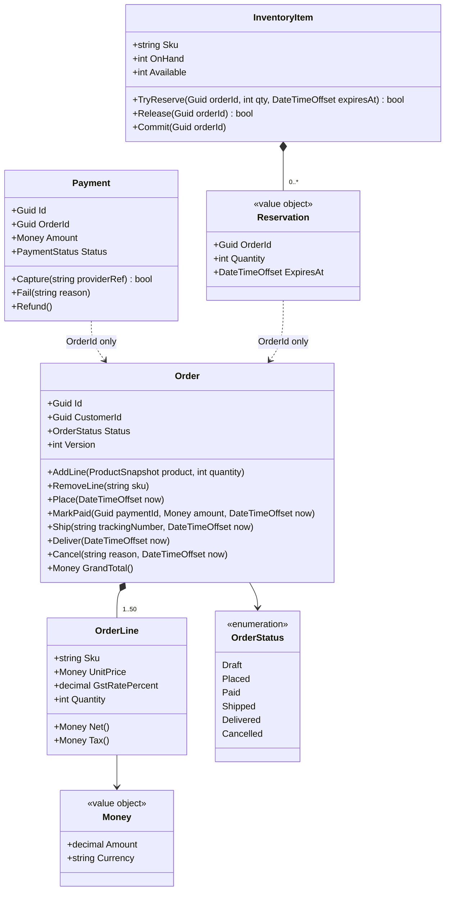
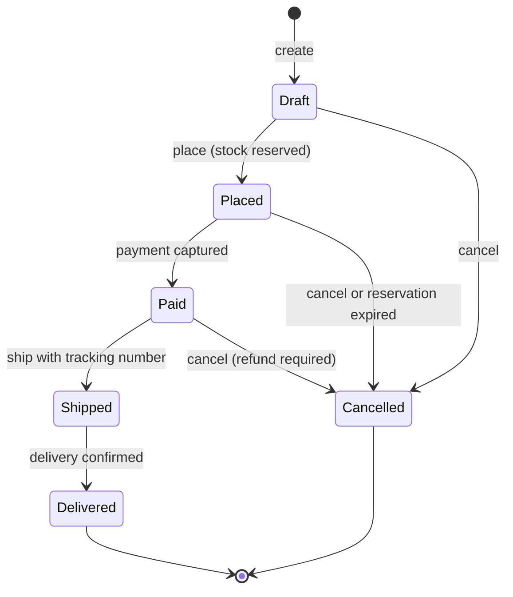
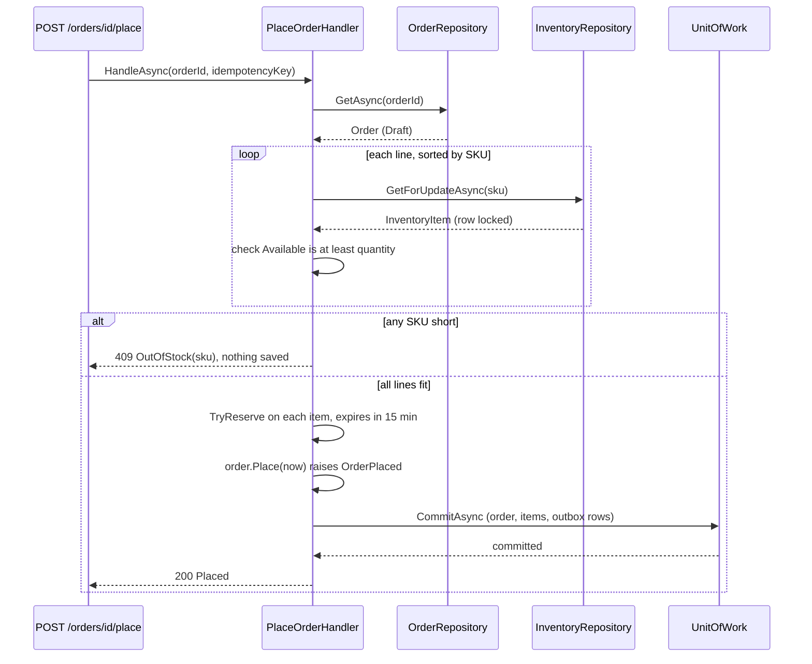
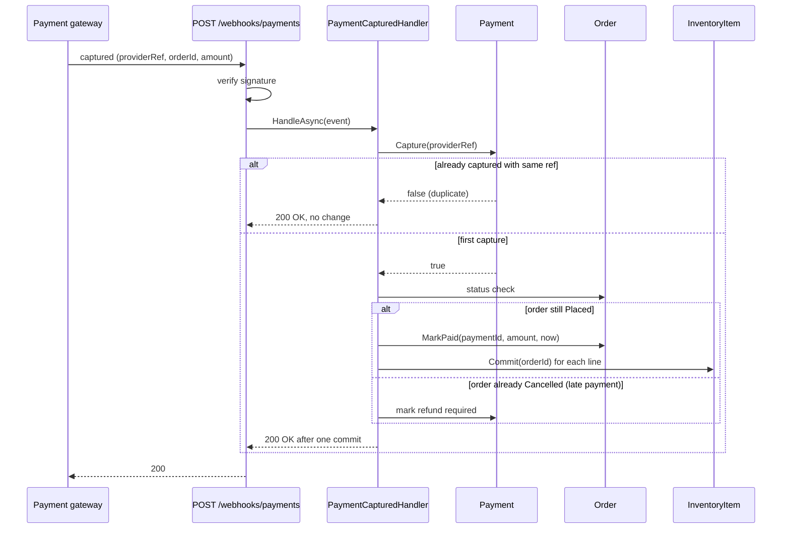
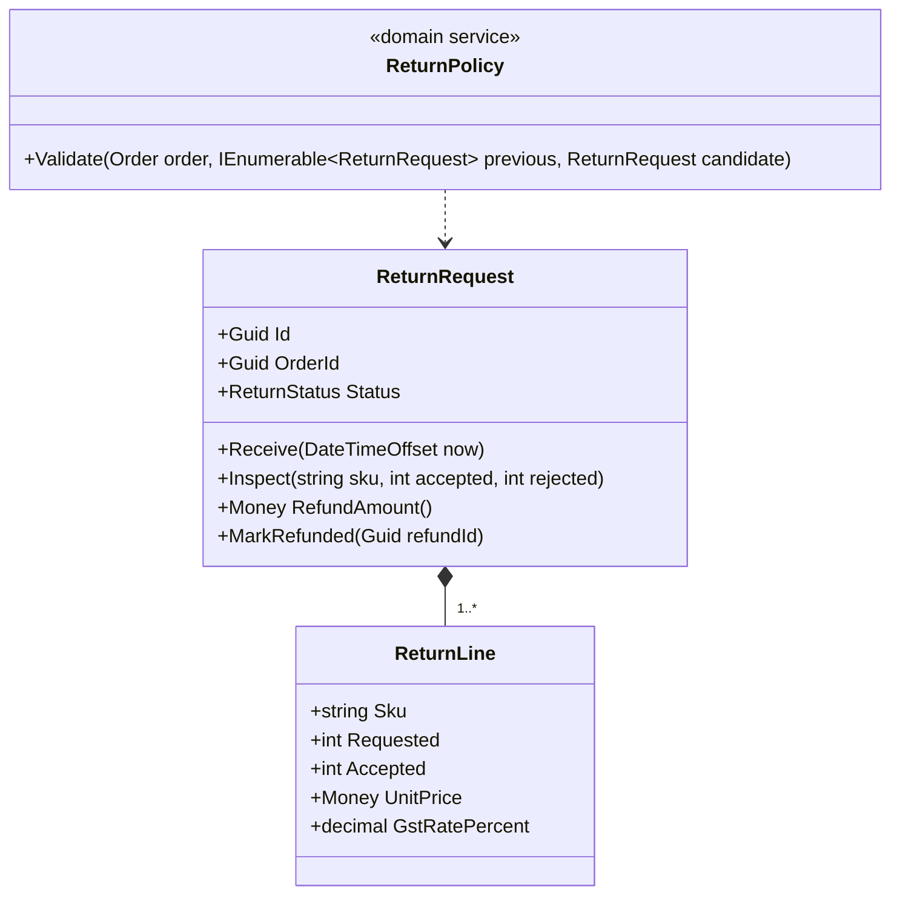

Module 8 gave you the tools one at a time: [entities and value objects](#/lesson/m08-entities-value-objects), [aggregates](#/lesson/m08-aggregates), [domain events](#/lesson/m08-domain-events), [application services](#/lesson/m08-application-services) and [transaction boundaries](#/lesson/m08-transaction-boundaries). This project makes you use all of them on one domain that every developer meets sooner or later: **taking an order and getting paid for it without selling stock you do not have**.

The scenario is a mid-sized Indian B2B wholesale app that supplies kirana (neighbourhood grocery) shops with atta bags, cooking-oil tins, biscuit cartons and detergent through a web portal and a mobile app. On a normal day it takes about 3,000 orders; on the morning a Diwali restocking offer opens it can take 12,000, mostly in the first two hours. Every order is paid by UPI or card through a payment gateway, and stock is shared between the portal and a call centre. Overselling is expensive here: a delivery van that leaves the Gurugram warehouse 40 cartons short of what the shopkeeper expected costs a second trip and, often, the customer.

## Learning objectives

By the end of this project you will be able to:

1. Turn a page of business rules into **aggregates** (order, inventory item, payment) with invariants that the code enforces, not comments.
2. Model the **order lifecycle** as an explicit state machine with a transition table, and reject illegal transitions with a clear domain error.
3. Choose **transaction boundaries**: what must be saved together in one database transaction, what can be eventually consistent, and why.
4. Reserve inventory **all-or-nothing** with an expiry, and release it when payment never arrives.
5. Make the two risky entry points, "place order" and "payment webhook", **idempotent** (safe to repeat).
6. Draw the class, sequence and state diagrams that explain the design to a reviewer.
7. Write unit tests for the domain and application layers using hand-rolled fakes, with no database.

## Prerequisites

- [Aggregates and aggregate roots](#/lesson/m08-aggregates): you will design three of them.
- [Domain events](#/lesson/m08-domain-events): `OrderPlaced`, `OrderPaid` and `OrderCancelled` drive side effects.
- [Transaction boundaries](#/lesson/m08-transaction-boundaries): the central design question of this project.
- [Application services](#/lesson/m08-application-services): use-case handlers orchestrate aggregates.
- [Repositories and domain services](#/lesson/m08-repositories-domain-services): persistence stays behind interfaces.

Helpful but optional: [State](#/lesson/m06-state) and [idempotency](#/lesson/m10-idempotency).

## Project brief

### The business in plain words

Think of a small shop counter with a notebook. A customer says what they want. The shopkeeper writes it down (a **draft order**). When the customer says "yes, that's it", the shopkeeper puts the items aside in a basket with the customer's name on it (an **inventory reservation**) and asks for money. If the customer pays, the basket goes to the delivery boy. If the customer walks off and does not come back in 15 minutes, the items go back on the shelf. That is the whole domain. The software version only adds scale, concurrency and failures.

### Functional requirements

1. **Products**: a catalogue of products with SKU, name, unit price (in ₹, excluding GST), GST rate and an active flag. Inactive products cannot be added to new orders.
2. **Customers**: registered shops with a GSTIN. A blocked customer cannot place orders.
3. **Orders**:
   - A customer builds a **draft** with up to 50 lines, each with quantity 1–100. Adding a SKU that is already on the order increases that line's quantity.
   - Prices are **snapshotted** when the line is added. A later catalogue price change does not change a draft's lines (the customer saw that price).
   - **Placing** an order reserves stock for every line, or for none (all-or-nothing). It requires at least one line.
   - A placed order has **15 minutes** to be paid. After that its reservation expires and the order is cancelled automatically.
   - A paid order can be **shipped** with a tracking number, then **delivered**.
   - An order can be **cancelled** while Draft, Placed or Paid. Cancelling a paid order requires a refund. Shipped and delivered orders cannot be cancelled (returns are a separate flow, see exercise 5).
4. **Payments**: one payment attempt per placed order at a time. The gateway confirms by webhook. The captured amount must equal the order's grand total. Webhooks may arrive twice, late or out of order.
5. **Inventory**: per SKU we track `on_hand` (physically in the warehouse) and reservations. `available = on_hand − active reservations`. Available stock must never go below zero.

### Non-functional requirements

- **Correctness over speed** for stock and money. No overselling, no double charge, no lost payment.
- Peak of 12,000 orders in about two hours: 12,000 ÷ 7,200 s ≈ **1.7 orders/s** on average, perhaps **10 orders/s** in the worst minute (estimate). This is small. A single PostgreSQL instance handles it easily; the hard part is contention on hot SKUs, not throughput.
- p95 under 300 ms for "place order" (estimate target, excluding the gateway).
- Every state change is auditable: who, when, from which state to which.

### Scope boundaries

In scope: the domain model, application handlers, a minimal API, in-memory persistence for tests, and the PostgreSQL schema. Out of scope: the UI, the real payment gateway SDK, shipping integrations and GST e-invoicing. Name those as integration points but do not build them.

## Deliverables

Each deliverable is listed with what "good" looks like. Keep the documents short; a reviewer should finish each in under 10 minutes.

| # | Deliverable | What good looks like |
|---|---|---|
| 1 | Domain glossary (ubiquitous language) | 15–25 terms (draft, place, reservation, capture, refund…) with one-line definitions that match the class and method names exactly. |
| 2 | Rules catalogue | Every rule from the brief numbered (R1, R2…), each mapped to the class and method that enforces it and the test that proves it. |
| 3 | Class diagram | Three aggregates with their roots, value objects and the ids that link them. No object references across aggregates. |
| 4 | State diagram | Order lifecycle with every legal transition and the trigger for each. Payment lifecycle as a second, smaller diagram. |
| 5 | Sequence diagrams | "Place order" and "payment webhook", including the unhappy paths (out of stock, duplicate webhook, late payment). |
| 6 | Transaction-boundary note | A table of use cases and what each one saves in one transaction, plus what is eventually consistent and why that is acceptable. |
| 7 | Implementation | Domain + application + minimal API that compiles, with no infrastructure types in the domain project. |
| 8 | Tests | Domain unit tests for every rule in the catalogue, application tests with fakes, and one concurrency test for the last unit of stock. |
| 9 | PostgreSQL schema | Tables, constraints (`CHECK`, `UNIQUE`, foreign keys) that back the most important invariants a second time. |
| 10 | Short design review | One page: three decisions you made, the alternative for each, and when you would switch. |

## Milestones

Plan for about four focused evenings, or one long weekend.

| Milestone | Goal | Exit check |
|---|---|---|
| M1 — Language and rules (1 h) | Glossary and numbered rules catalogue | A non-developer can read the rules and agree they match the business |
| M2 — Value objects and the order aggregate (2 h) | `Money`, `OrderLine`, `Order` with the state machine | Exercises 1 and 2 pass; illegal transitions throw `DomainException` |
| M3 — Inventory and payment aggregates (2 h) | Reservations with expiry; payment capture that tolerates duplicates | Exercise 3 passes; duplicate capture returns "already done" |
| M4 — Application layer and transactions (3 h) | `PlaceOrderHandler`, `PaymentCapturedHandler`, expiry job, outbox | Exercise 6 passes, including the 100-parallel-requests test |
| M5 — Schema and review (2 h) | DDL with constraints, design review page | Exercise 4 query returns the right numbers; review answers "why" for every boundary |

:::callout type=tip title="Work outside in on paper, inside out in code"
Draw the diagrams first (outside in), because they expose missing rules cheaply. Then code from the innermost value object outwards (inside out), because each layer's tests can then use the real layer below it.
:::

## Reference architecture

This section is a worked reference. Try your own design first, then compare.

### Identifying the aggregates

Ask one question for each rule: **which data must be consistent at the very moment this rule is checked?**

- "An order has at most 50 lines" and "a line's quantity is 1–100" only need the order's own data. They belong inside the **Order** aggregate.
- "Available stock never goes below zero" needs the stock count and every reservation for one SKU. That is the **InventoryItem** aggregate, one per SKU. It is *not* part of the order: 300 orders can reserve the same SKU, and making each order lock the stock row would serialise the whole shop.
- "A payment is captured at most once" needs only the payment's own state. That is the **Payment** aggregate.
- Products and customers are reference data for this context. The order copies what it needs (a price snapshot) and refers to the customer by id.

Aggregates refer to each other **by id only** (`CustomerId`, `OrderId`, `Sku`). This keeps each one small enough to load, lock and save on its own.

### Class diagram



How to read it: the filled diamonds are **composition**: an order owns its lines and an inventory item owns its reservations; they are created, changed and deleted only through their root. The dotted arrows from `Payment` and `Reservation` to `Order` are labelled "OrderId only" on purpose. They are references by id, not object references, so loading a payment never loads an order. `Money` and `Reservation` are value objects: no identity of their own, compared by value, never changed after creation.

### Order lifecycle



There are six states and eight legal moves. Everything not drawn is illegal, and the code must say so: `Shipped → Cancelled` throws, `Draft → Paid` throws, `Paid → Paid` throws. Two details matter. First, the edge `Placed → Cancelled` has two triggers: a person cancels, or the expiry job finds the 15-minute reservation has lapsed. Both use the same `Cancel` method with a different reason, so there is one code path to test. Second, `Paid → Cancelled` is legal but raises an event that says a refund is required. The order does not call the gateway itself; it records the fact and lets a handler do the slow, failure-prone work.

The transition table, written as data, is the single source of truth:

| From | Allowed next states |
|---|---|
| Draft | Placed, Cancelled |
| Placed | Paid, Cancelled |
| Paid | Shipped, Cancelled |
| Shipped | Delivered |
| Delivered | (terminal) |
| Cancelled | (terminal) |

Try the table before you build the aggregate. The playground drives one order through a happy path and then attempts an illegal move:

:::playground type=csharp title="Order lifecycle"
```csharp file=Program.cs
using System;
using System.Collections.Generic;
using System.Linq;

public enum OrderStatus { Draft, Placed, Paid, Shipped, Delivered, Cancelled }

public sealed class Order
{
    private static readonly Dictionary<OrderStatus, OrderStatus[]> Table = new()
    {
        [OrderStatus.Draft] = new[] { OrderStatus.Placed, OrderStatus.Cancelled },
        [OrderStatus.Placed] = new[] { OrderStatus.Paid, OrderStatus.Cancelled },
        [OrderStatus.Paid] = new[] { OrderStatus.Shipped, OrderStatus.Cancelled },
        [OrderStatus.Shipped] = new[] { OrderStatus.Delivered },
        [OrderStatus.Delivered] = Array.Empty<OrderStatus>(),
        [OrderStatus.Cancelled] = Array.Empty<OrderStatus>(),
    };

    public OrderStatus Status { get; private set; } = OrderStatus.Draft;
    public List<string> Audit { get; } = new();

    public void MoveTo(OrderStatus next)
    {
        if (!Table[Status].Contains(next))
            throw new InvalidOperationException($"Illegal: {Status} -> {next}. Allowed: {string.Join(", ", Table[Status])}");
        Audit.Add($"{Status} -> {next}");
        Status = next;
    }
}

public static class Program
{
    public static void Main()
    {
        var order = new Order();
        foreach (var step in new[] { OrderStatus.Placed, OrderStatus.Paid, OrderStatus.Shipped })
            order.MoveTo(step);
        Console.WriteLine(string.Join(" | ", order.Audit));
        try { order.MoveTo(OrderStatus.Cancelled); }
        catch (InvalidOperationException ex) { Console.WriteLine(ex.Message); }
        // Try: add a Returned state reachable only from Delivered.
    }
}
```
:::

### Placing an order



Read it top to bottom. The handler loads the draft, then loads each inventory row **with a row lock** (`SELECT … FOR UPDATE` in PostgreSQL), in SKU order. Sorting matters: if order A locks atta then oil while order B locks oil then atta, they can deadlock. Sorting by SKU makes every transaction take locks in the same order, so a deadlock cannot form. The handler checks *every* line before reserving *any*. If one is short, it returns without saving, and the transaction rollback releases the locks. If all fit, the reservations, the order's new status and the `OrderPlaced` event (as an outbox row) are saved in **one transaction**.

### Payment webhook



The gateway retries webhooks until it gets a 2xx, so the same event can arrive several times. `Payment.Capture` returns `false` for a repeat with the same provider reference, and the handler stops there: the second delivery changes nothing and still answers 200, so the gateway stops retrying. The interesting branch is the **late payment**: the customer paid at minute 16, but the expiry job cancelled the order at minute 15 and returned the stock. The money is real, so we must not lose it, but the stock may already be sold to someone else. The safe default is to record a refund and tell the customer. An alternative is to try to re-reserve and revive the order, which is friendlier but needs a new legal transition (`Cancelled → Paid`) and more tests. Write down which one you chose and why in the design review.

### Transaction boundaries

The textbook rule is "change one aggregate per transaction". This project bends it once, deliberately.

| Use case | Saved together in one transaction | Eventually consistent (after commit) |
|---|---|---|
| Add line to draft | Order | — |
| Place order | Order + all its InventoryItems + outbox row | Confirmation email, analytics |
| Payment captured | Payment + Order + InventoryItems (commit) + outbox row | Invoice generation, warehouse pick list |
| Reservation expiry | Order + InventoryItems (release) + outbox row | "Your order lapsed" email |
| Cancel paid order | Order + InventoryItems + outbox row | Refund call to gateway, refund email |

Why not split "place order" into two transactions (save the order, then reserve stock from an event)? Because then there is a window in which an order says "Placed" with no stock behind it, and the customer could pay for goods that a parallel order is about to take. In a **modular monolith with one database**, a single short transaction across a few rows is cheap and removes that window entirely. The cost is coupling: the order and inventory tables must live in the same database. If inventory later moves to its own service, this becomes a saga with a "pending" state (see [Capstone B](#/lesson/m20-capstone-b)). Write that trigger in your review: "we split when inventory needs its own database".

What stays out of the transaction: anything that calls the outside world. The gateway, email and the warehouse system are reached through the **outbox** (a table of pending messages written in the same transaction and sent afterwards by a background worker; see [the outbox lesson](#/lesson/m12-outbox)). A slow SMTP server can then never hold a stock row lock.

### Production-style C# implementation

The reference solution uses four folders in one project to keep this lesson compact. In your real solution, make `Domain` and `Application` separate class-library projects so the compiler stops the domain referencing infrastructure.

```text
OrderMgmt/
  Domain/        Money, Order, OrderLine, InventoryItem, Payment, events, DomainException
  Application/   repository interfaces, PlaceOrderHandler, PaymentCapturedHandler, ExpireReservationsHandler
  Infrastructure/ in-memory repositories and unit of work (PostgreSQL versions in your project)
  Program.cs     minimal API and DI wiring
```

```csharp file=Domain/Money.cs
namespace OrderMgmt.Domain;

public sealed class DomainException(string message) : Exception(message);

/// <summary>An amount in one currency, always rounded to paise (2 decimal places).</summary>
public readonly record struct Money
{
    public decimal Amount { get; }
    public string Currency { get; }

    public Money(decimal amount, string currency)
    {
        if (string.IsNullOrWhiteSpace(currency) || currency.Length != 3)
            throw new DomainException("Currency must be a 3-letter ISO code.");
        Amount = decimal.Round(amount, 2, MidpointRounding.AwayFromZero);
        Currency = currency.ToUpperInvariant();
    }

    public static Money Inr(decimal amount) => new(amount, "INR");
    public static Money Zero(string currency) => new(0m, currency);

    public static Money operator +(Money a, Money b) { EnsureSameCurrency(a, b); return new(a.Amount + b.Amount, a.Currency); }
    public static Money operator -(Money a, Money b) { EnsureSameCurrency(a, b); return new(a.Amount - b.Amount, a.Currency); }
    public Money Times(int quantity) => new(Amount * quantity, Currency);
    public Money PercentOf(decimal percent) => new(Amount * percent / 100m, Currency);

    private static void EnsureSameCurrency(Money a, Money b)
    {
        if (a.Currency != b.Currency) throw new DomainException($"Cannot combine {a.Currency} and {b.Currency}.");
    }

    public override string ToString() => $"{Currency} {Amount:0.00}";
}
```

```csharp file=Domain/OrderStatus.cs
namespace OrderMgmt.Domain;

public enum OrderStatus { Draft, Placed, Paid, Shipped, Delivered, Cancelled }

/// <summary>The order lifecycle as data. One table, one place to change, easy to test.</summary>
public static class OrderStateMachine
{
    private static readonly Dictionary<OrderStatus, OrderStatus[]> Allowed = new()
    {
        [OrderStatus.Draft] = [OrderStatus.Placed, OrderStatus.Cancelled],
        [OrderStatus.Placed] = [OrderStatus.Paid, OrderStatus.Cancelled],
        [OrderStatus.Paid] = [OrderStatus.Shipped, OrderStatus.Cancelled],
        [OrderStatus.Shipped] = [OrderStatus.Delivered],
        [OrderStatus.Delivered] = [],
        [OrderStatus.Cancelled] = [],
    };

    public static bool CanTransition(OrderStatus from, OrderStatus to) => Allowed[from].Contains(to);
    public static IReadOnlyList<OrderStatus> Next(OrderStatus from) => Allowed[from];
}
```

```csharp file=Domain/Events.cs
namespace OrderMgmt.Domain;

public interface IDomainEvent { DateTimeOffset OccurredAt { get; } }

public sealed record OrderPlaced(Guid OrderId, Guid CustomerId, Money GrandTotal, DateTimeOffset OccurredAt) : IDomainEvent;
public sealed record OrderPaid(Guid OrderId, Guid PaymentId, Money Amount, DateTimeOffset OccurredAt) : IDomainEvent;
public sealed record OrderShipped(Guid OrderId, string TrackingNumber, DateTimeOffset OccurredAt) : IDomainEvent;
public sealed record OrderCancelled(Guid OrderId, string Reason, bool RefundRequired, DateTimeOffset OccurredAt) : IDomainEvent;
public sealed record OrderStatusChanged(Guid OrderId, OrderStatus From, OrderStatus To, DateTimeOffset OccurredAt) : IDomainEvent;
```

```csharp file=Domain/Order.cs
namespace OrderMgmt.Domain;

/// <summary>What the order copies from the catalogue at the moment a line is added.</summary>
public sealed record ProductSnapshot(string Sku, string Name, Money UnitPrice, decimal GstRatePercent, bool IsActive);

public sealed class OrderLine
{
    internal OrderLine(ProductSnapshot p, int quantity)
    {
        Sku = p.Sku; Name = p.Name; UnitPrice = p.UnitPrice; GstRatePercent = p.GstRatePercent; Quantity = quantity;
    }
    public string Sku { get; }
    public string Name { get; }
    public Money UnitPrice { get; }
    public decimal GstRatePercent { get; }
    public int Quantity { get; private set; }
    public Money Net() => UnitPrice.Times(Quantity);
    public Money Tax() => Net().PercentOf(GstRatePercent);   // GST computed and rounded per line
    internal void SetQuantity(int quantity) => Quantity = quantity;
}

public sealed class Order
{
    public const int MaxLines = 50;
    public const int MaxQuantityPerLine = 100;

    private readonly List<OrderLine> _lines = [];
    private readonly List<IDomainEvent> _events = [];

    private Order(Guid id, Guid customerId, string currency, DateTimeOffset createdAt)
    {
        Id = id; CustomerId = customerId; Currency = currency; CreatedAt = createdAt; Status = OrderStatus.Draft;
    }

    public Guid Id { get; }
    public Guid CustomerId { get; }
    public string Currency { get; }
    public DateTimeOffset CreatedAt { get; }
    public DateTimeOffset? PlacedAt { get; private set; }
    public Guid? PaymentId { get; private set; }
    public string? TrackingNumber { get; private set; }
    public OrderStatus Status { get; private set; }
    public int Version { get; private set; }
    public IReadOnlyList<OrderLine> Lines => _lines;
    public IReadOnlyList<IDomainEvent> Events => _events;

    public static Order Create(Guid id, Guid customerId, DateTimeOffset now, string currency = "INR")
    {
        if (customerId == Guid.Empty) throw new DomainException("Customer is required.");
        return new Order(id, customerId, currency, now);
    }

    public void AddLine(ProductSnapshot product, int quantity)
    {
        EnsureStatus(OrderStatus.Draft, "add lines");
        if (!product.IsActive) throw new DomainException($"Product {product.Sku} is not available for sale.");
        if (product.UnitPrice.Currency != Currency) throw new DomainException("Product currency does not match the order.");
        if (quantity < 1) throw new DomainException("Quantity must be at least 1.");

        var existing = _lines.FirstOrDefault(l => l.Sku == product.Sku);
        var newQuantity = (existing?.Quantity ?? 0) + quantity;
        if (newQuantity > MaxQuantityPerLine) throw new DomainException($"At most {MaxQuantityPerLine} units of {product.Sku} per order.");
        if (existing is not null) { existing.SetQuantity(newQuantity); return; }
        if (_lines.Count >= MaxLines) throw new DomainException($"An order can have at most {MaxLines} lines.");
        _lines.Add(new OrderLine(product, quantity));
    }

    public void RemoveLine(string sku)
    {
        EnsureStatus(OrderStatus.Draft, "remove lines");
        if (_lines.RemoveAll(l => l.Sku == sku) == 0) throw new DomainException($"No line for {sku}.");
    }

    public Money Subtotal() => _lines.Aggregate(Money.Zero(Currency), (sum, l) => sum + l.Net());
    public Money TaxTotal() => _lines.Aggregate(Money.Zero(Currency), (sum, l) => sum + l.Tax());
    public Money GrandTotal() => Subtotal() + TaxTotal();

    /// <summary>Caller (the application service) must have reserved stock in the same transaction.</summary>
    public void Place(DateTimeOffset now)
    {
        if (_lines.Count == 0) throw new DomainException("Cannot place an empty order.");
        TransitionTo(OrderStatus.Placed, now);
        PlacedAt = now;
        _events.Add(new OrderPlaced(Id, CustomerId, GrandTotal(), now));
    }

    public void MarkPaid(Guid paymentId, Money amount, DateTimeOffset now)
    {
        if (amount != GrandTotal()) throw new DomainException($"Paid {amount} but order total is {GrandTotal()}.");
        TransitionTo(OrderStatus.Paid, now);
        PaymentId = paymentId;
        _events.Add(new OrderPaid(Id, paymentId, amount, now));
    }

    public void Ship(string trackingNumber, DateTimeOffset now)
    {
        if (string.IsNullOrWhiteSpace(trackingNumber)) throw new DomainException("Tracking number is required.");
        TransitionTo(OrderStatus.Shipped, now);
        TrackingNumber = trackingNumber;
        _events.Add(new OrderShipped(Id, trackingNumber, now));
    }

    public void Deliver(DateTimeOffset now) => TransitionTo(OrderStatus.Delivered, now);

    public void Cancel(string reason, DateTimeOffset now)
    {
        var wasPaid = Status == OrderStatus.Paid;
        TransitionTo(OrderStatus.Cancelled, now);
        _events.Add(new OrderCancelled(Id, reason, RefundRequired: wasPaid, now));
    }

    public void ClearEvents() => _events.Clear();

    private void TransitionTo(OrderStatus next, DateTimeOffset now)
    {
        if (!OrderStateMachine.CanTransition(Status, next))
            throw new DomainException($"Order {Id} cannot move from {Status} to {next}.");
        _events.Add(new OrderStatusChanged(Id, Status, next, now));   // audit trail
        Status = next;
        Version++;
    }

    private void EnsureStatus(OrderStatus required, string action)
    {
        if (Status != required) throw new DomainException($"Cannot {action} when the order is {Status}.");
    }
}
```

```csharp file=Domain/InventoryItem.cs
namespace OrderMgmt.Domain;

public sealed record Reservation(Guid OrderId, int Quantity, DateTimeOffset ExpiresAt);

/// <summary>Stock for one SKU. Invariant: Available is never negative.</summary>
public sealed class InventoryItem(string sku, int onHand)
{
    private readonly Dictionary<Guid, Reservation> _reservations = [];

    public string Sku { get; } = sku;
    public int OnHand { get; private set; } = onHand >= 0 ? onHand : throw new DomainException("On-hand cannot be negative.");
    public int Reserved => _reservations.Values.Sum(r => r.Quantity);
    public int Available => OnHand - Reserved;
    public int Version { get; private set; }
    public IReadOnlyCollection<Reservation> Reservations => _reservations.Values;

    public bool TryReserve(Guid orderId, int quantity, DateTimeOffset expiresAt)
    {
        if (quantity < 1) throw new DomainException("Reservation quantity must be at least 1.");
        if (_reservations.TryGetValue(orderId, out var existing))
            return existing.Quantity == quantity
                ? true                                    // repeat of the same request: idempotent
                : throw new DomainException($"Order {orderId} already holds {existing.Quantity} of {Sku}.");
        if (Available < quantity) return false;
        _reservations[orderId] = new Reservation(orderId, quantity, expiresAt);
        Version++;
        return true;
    }

    public bool Release(Guid orderId)
    {
        if (!_reservations.Remove(orderId)) return false;
        Version++;
        return true;
    }

    /// <summary>Payment captured: the reserved units leave the warehouse's sellable stock for good.</summary>
    public void Commit(Guid orderId)
    {
        if (!_reservations.Remove(orderId, out var r)) throw new DomainException($"No reservation of {Sku} for order {orderId}.");
        OnHand -= r.Quantity;
        Version++;
    }

    public void Restock(int quantity)
    {
        if (quantity < 1) throw new DomainException("Restock quantity must be at least 1.");
        OnHand += quantity;
        Version++;
    }

    public IReadOnlyList<Guid> ExpiredOrderIds(DateTimeOffset now) =>
        _reservations.Values.Where(r => r.ExpiresAt <= now).Select(r => r.OrderId).ToList();
}
```

```csharp file=Domain/Payment.cs
namespace OrderMgmt.Domain;

public enum PaymentStatus { Pending, Captured, Failed, RefundRequired, Refunded }

public sealed class Payment
{
    private Payment(Guid id, Guid orderId, Money amount) { Id = id; OrderId = orderId; Amount = amount; Status = PaymentStatus.Pending; }

    public Guid Id { get; }
    public Guid OrderId { get; }
    public Money Amount { get; }
    public PaymentStatus Status { get; private set; }
    public string? ProviderRef { get; private set; }
    public string? FailureReason { get; private set; }

    public static Payment Initiate(Guid id, Guid orderId, Money amount) =>
        amount.Amount > 0 ? new Payment(id, orderId, amount) : throw new DomainException("Payment amount must be positive.");

    /// <summary>Returns false when this exact capture was already applied (duplicate webhook).</summary>
    public bool Capture(string providerRef)
    {
        if (Status is PaymentStatus.Captured or PaymentStatus.RefundRequired or PaymentStatus.Refunded)
            return ProviderRef == providerRef
                ? false
                : throw new DomainException($"Payment {Id} already captured with a different reference.");
        if (Status == PaymentStatus.Failed) throw new DomainException($"Payment {Id} has failed and cannot be captured.");
        Status = PaymentStatus.Captured;
        ProviderRef = providerRef;
        return true;
    }

    public void Fail(string reason)
    {
        if (Status != PaymentStatus.Pending) throw new DomainException($"Cannot fail a payment that is {Status}.");
        Status = PaymentStatus.Failed;
        FailureReason = reason;
    }

    public void RequireRefund()
    {
        if (Status != PaymentStatus.Captured) throw new DomainException("Only a captured payment can be refunded.");
        Status = PaymentStatus.RefundRequired;
    }

    public void MarkRefunded()
    {
        if (Status != PaymentStatus.RefundRequired) throw new DomainException("Refund was not requested.");
        Status = PaymentStatus.Refunded;
    }
}
```

The application layer holds the use cases. Notice that the handlers contain **no business rules of their own**: they load aggregates, call domain methods in the right order and commit. If you find an `if (order.Lines.Count > 50)` in a handler, it has leaked out of the domain.

```csharp file=Application/Ports.cs
using OrderMgmt.Domain;

namespace OrderMgmt.Application;

public interface IOrderRepository
{
    Task<Order?> GetAsync(Guid id, CancellationToken ct);
    void Add(Order order);
}

public interface IInventoryRepository
{
    /// <summary>In PostgreSQL: SELECT ... FOR UPDATE, so concurrent placements on the same SKU queue up.</summary>
    Task<InventoryItem?> GetForUpdateAsync(string sku, CancellationToken ct);
    Task<IReadOnlyList<InventoryItem>> WithExpiredReservationsAsync(DateTimeOffset now, CancellationToken ct);
}

public interface IPaymentRepository
{
    Task<Payment?> GetByOrderAsync(Guid orderId, CancellationToken ct);
    void Add(Payment payment);
}

/// <summary>Saves every tracked aggregate and appends their domain events to the outbox, in ONE transaction.</summary>
public interface IUnitOfWork
{
    Task CommitAsync(CancellationToken ct);
}

public enum PlaceOutcome { Placed, AlreadyPlaced, NotFound, OutOfStock, Invalid }
public sealed record PlaceOrderResult(PlaceOutcome Outcome, string? Detail = null);
```

```csharp file=Application/PlaceOrderHandler.cs
using OrderMgmt.Domain;

namespace OrderMgmt.Application;

public sealed class PlaceOrderHandler(IOrderRepository orders, IInventoryRepository inventory, IUnitOfWork uow, TimeProvider clock)
{
    public static readonly TimeSpan ReservationTtl = TimeSpan.FromMinutes(15);

    public async Task<PlaceOrderResult> HandleAsync(Guid orderId, CancellationToken ct)
    {
        var order = await orders.GetAsync(orderId, ct);
        if (order is null) return new(PlaceOutcome.NotFound);
        if (order.Status == OrderStatus.Placed) return new(PlaceOutcome.AlreadyPlaced);   // safe retry
        if (order.Status != OrderStatus.Draft) return new(PlaceOutcome.Invalid, $"Order is {order.Status}.");
        if (order.Lines.Count == 0) return new(PlaceOutcome.Invalid, "Order has no lines.");

        // Lock rows in a fixed order (by SKU) so two placements can never deadlock.
        var lines = order.Lines.OrderBy(l => l.Sku, StringComparer.Ordinal).ToList();
        var items = new List<(OrderLine Line, InventoryItem Item)>();
        foreach (var line in lines)
        {
            var item = await inventory.GetForUpdateAsync(line.Sku, ct);
            if (item is null || item.Available < line.Quantity)
                return new(PlaceOutcome.OutOfStock, line.Sku);   // nothing changed yet: check all before reserving any
            items.Add((line, item));
        }

        var now = clock.GetUtcNow();
        foreach (var (line, item) in items)
            if (!item.TryReserve(order.Id, line.Quantity, now + ReservationTtl))
                throw new InvalidOperationException("Stock changed while rows were locked. This is a locking bug.");

        order.Place(now);
        await uow.CommitAsync(ct);
        return new(PlaceOutcome.Placed);
    }
}
```

```csharp file=Application/PaymentCapturedHandler.cs
using OrderMgmt.Domain;

namespace OrderMgmt.Application;

public sealed record PaymentCaptured(Guid OrderId, string ProviderRef, decimal Amount, string Currency);
public enum CaptureOutcome { Applied, Duplicate, LatePaymentRefund, UnknownOrder }

public sealed class PaymentCapturedHandler(IOrderRepository orders, IPaymentRepository payments,
    IInventoryRepository inventory, IUnitOfWork uow, TimeProvider clock)
{
    public async Task<CaptureOutcome> HandleAsync(PaymentCaptured e, CancellationToken ct)
    {
        var payment = await payments.GetByOrderAsync(e.OrderId, ct);
        var order = await orders.GetAsync(e.OrderId, ct);
        if (payment is null || order is null) return CaptureOutcome.UnknownOrder;

        if (!payment.Capture(e.ProviderRef)) return CaptureOutcome.Duplicate;   // second delivery of the same webhook

        var now = clock.GetUtcNow();
        if (order.Status != OrderStatus.Placed)
        {
            payment.RequireRefund();   // e.g. reservation expired at minute 15, money arrived at minute 16
            await uow.CommitAsync(ct);
            return CaptureOutcome.LatePaymentRefund;
        }

        order.MarkPaid(payment.Id, new Money(e.Amount, e.Currency), now);
        foreach (var line in order.Lines.OrderBy(l => l.Sku, StringComparer.Ordinal))
        {
            var item = await inventory.GetForUpdateAsync(line.Sku, ct)
                       ?? throw new InvalidOperationException($"Inventory row for {line.Sku} disappeared.");
            item.Commit(order.Id);
        }
        await uow.CommitAsync(ct);
        return CaptureOutcome.Applied;
    }
}
```

```csharp file=Application/ExpireReservationsHandler.cs
using OrderMgmt.Domain;

namespace OrderMgmt.Application;

/// <summary>Runs every minute from a BackgroundService. Cancels lapsed orders and returns their stock.</summary>
public sealed class ExpireReservationsHandler(IOrderRepository orders, IInventoryRepository inventory, IUnitOfWork uow, TimeProvider clock)
{
    public async Task<int> HandleAsync(CancellationToken ct)
    {
        var now = clock.GetUtcNow();
        var items = await inventory.WithExpiredReservationsAsync(now, ct);
        var orderIds = items.SelectMany(i => i.ExpiredOrderIds(now)).Distinct().ToList();
        var cancelled = 0;
        foreach (var id in orderIds)
        {
            var order = await orders.GetAsync(id, ct);
            if (order is { Status: OrderStatus.Placed })
            {
                order.Cancel("Payment not received within 15 minutes", now);
                cancelled++;
            }
            foreach (var item in items) item.Release(id);
        }
        await uow.CommitAsync(ct);
        return cancelled;
    }
}
```

```csharp file=Infrastructure/InMemoryStore.cs
using OrderMgmt.Application;
using OrderMgmt.Domain;

namespace OrderMgmt.Infrastructure;

/// <summary>Test and demo persistence. The PostgreSQL version wraps a transaction and uses FOR UPDATE.</summary>
public sealed class InMemoryStore : IOrderRepository, IInventoryRepository, IPaymentRepository, IUnitOfWork
{
    private readonly Dictionary<Guid, Order> _orders = [];
    private readonly Dictionary<string, InventoryItem> _items = [];
    private readonly Dictionary<Guid, Payment> _paymentsByOrder = [];
    public List<IDomainEvent> Outbox { get; } = [];

    public Task<Order?> GetAsync(Guid id, CancellationToken ct) => Task.FromResult(_orders.GetValueOrDefault(id));
    public void Add(Order order) => _orders[order.Id] = order;
    public void AddItem(InventoryItem item) => _items[item.Sku] = item;
    public Task<InventoryItem?> GetForUpdateAsync(string sku, CancellationToken ct) => Task.FromResult(_items.GetValueOrDefault(sku));
    public Task<IReadOnlyList<InventoryItem>> WithExpiredReservationsAsync(DateTimeOffset now, CancellationToken ct) =>
        Task.FromResult<IReadOnlyList<InventoryItem>>(_items.Values.Where(i => i.ExpiredOrderIds(now).Count > 0).ToList());
    public Task<Payment?> GetByOrderAsync(Guid orderId, CancellationToken ct) => Task.FromResult(_paymentsByOrder.GetValueOrDefault(orderId));
    public void Add(Payment payment) => _paymentsByOrder[payment.OrderId] = payment;

    public Task CommitAsync(CancellationToken ct)
    {
        foreach (var o in _orders.Values) { Outbox.AddRange(o.Events); o.ClearEvents(); }
        return Task.CompletedTask;
    }
}
```

```csharp file=Program.cs
using OrderMgmt.Application;
using OrderMgmt.Domain;
using OrderMgmt.Infrastructure;

var builder = WebApplication.CreateBuilder(args);

var store = new InMemoryStore();
store.AddItem(new InventoryItem("ATTA-10KG", 400));
store.AddItem(new InventoryItem("OIL-SUN-15L", 120));
builder.Services.AddSingleton(store);
builder.Services.AddSingleton<IOrderRepository>(store);
builder.Services.AddSingleton<IInventoryRepository>(store);
builder.Services.AddSingleton<IPaymentRepository>(store);
builder.Services.AddSingleton<IUnitOfWork>(store);
builder.Services.AddSingleton(TimeProvider.System);
builder.Services.AddTransient<PlaceOrderHandler>();
builder.Services.AddTransient<PaymentCapturedHandler>();

var app = builder.Build();

app.MapPost("/orders/{id:guid}/place", async (Guid id, PlaceOrderHandler handler, CancellationToken ct) =>
{
    var result = await handler.HandleAsync(id, ct);
    return result.Outcome switch
    {
        PlaceOutcome.Placed or PlaceOutcome.AlreadyPlaced => Results.Ok(result),
        PlaceOutcome.NotFound => Results.NotFound(),
        PlaceOutcome.OutOfStock => Results.Conflict(result),
        _ => Results.UnprocessableEntity(result),
    };
});

app.MapPost("/webhooks/payments", async (PaymentCaptured body, PaymentCapturedHandler handler, CancellationToken ct) =>
{
    // Signature verification of the gateway's HMAC header goes here, before any parsing is trusted.
    var outcome = await handler.HandleAsync(body, ct);
    return outcome == CaptureOutcome.UnknownOrder ? Results.NotFound() : Results.Ok(new { outcome });
});

app.Run();
```

`DomainException` thrown from a handler should map to HTTP 422 through an exception handler (`app.UseExceptionHandler` with `IExceptionHandler`); the minimal API above leaves it out to stay short.

The webhook needs one more production rule: any non-2xx answer makes the gateway retry, often for hours. A `DomainException` from `MarkPaid` (for example, the captured amount does not match the grand total) will fail the same way on every retry, so catching it, marking the payment for manual review, committing, and answering 200 is better than returning an error the gateway will keep resending. Log it with the order id and provider reference so finance can reconcile it the same day.

### PostgreSQL schema: the invariants, a second time

The domain enforces the rules; the database backs the critical ones up, so a bug or a hand-written SQL fix cannot break them silently.

```sql
CREATE TABLE inventory_item (
  sku       text PRIMARY KEY,
  on_hand   int  NOT NULL CHECK (on_hand >= 0),
  version   int  NOT NULL DEFAULT 0
);

CREATE TABLE orders (
  id           uuid PRIMARY KEY,
  customer_id  uuid NOT NULL REFERENCES customer(id),
  status       text NOT NULL CHECK (status IN ('Draft','Placed','Paid','Shipped','Delivered','Cancelled')),
  currency     char(3) NOT NULL DEFAULT 'INR',
  placed_at    timestamptz,
  version      int  NOT NULL DEFAULT 0
);

CREATE TABLE order_line (
  order_id     uuid NOT NULL REFERENCES orders(id) ON DELETE CASCADE,
  sku          text NOT NULL,
  unit_price   numeric(12,2) NOT NULL CHECK (unit_price >= 0),
  gst_rate     numeric(5,2)  NOT NULL,
  quantity     int NOT NULL CHECK (quantity BETWEEN 1 AND 100),
  PRIMARY KEY (order_id, sku)
);

CREATE TABLE reservation (
  order_id    uuid NOT NULL REFERENCES orders(id),
  sku         text NOT NULL REFERENCES inventory_item(sku),
  quantity    int  NOT NULL CHECK (quantity > 0),
  expires_at  timestamptz NOT NULL,
  PRIMARY KEY (order_id, sku)          -- one reservation per order per SKU: idempotent retries
);
CREATE INDEX ix_reservation_expiry ON reservation (expires_at);

CREATE TABLE payment (
  id            uuid PRIMARY KEY,
  order_id      uuid NOT NULL REFERENCES orders(id),
  amount        numeric(12,2) NOT NULL CHECK (amount > 0),
  status        text NOT NULL,
  provider_ref  text UNIQUE            -- a gateway reference can be captured once
);
CREATE UNIQUE INDEX ux_payment_one_live_per_order ON payment (order_id)
  WHERE status IN ('Pending','Captured');
```

The partial unique index says "at most one live payment per order" directly in the database. `PRIMARY KEY (order_id, sku)` on `reservation` makes a retried reservation collide instead of double-reserving. The `version` columns support optimistic concurrency checks (`UPDATE … WHERE id = $1 AND version = $2`) for edits to drafts, where contention is rare; stock rows use pessimistic `FOR UPDATE` because contention on a hot SKU is common at peak.

## Evaluation rubric

Score each row 0–3. A pass is 24 of 36 with no zero in rows 1–4.

| # | Criterion | 0 — missing | 1 — weak | 2 — solid | 3 — excellent |
|---|---|---|---|---|---|
| 1 | Invariants in the domain | Rules live in controllers | Some rules in the domain, some in handlers | All brief rules enforced by aggregates | Plus a rules catalogue mapping each rule to code and test |
| 2 | State machine | Status is a settable string | Enum with scattered `if`s | Transition table, illegal moves throw | Plus audit event on every transition and a test per edge |
| 3 | Transaction boundaries | Not discussed | One big transaction everywhere | Table of use cases with justified boundaries | Plus the trigger that would make you split them |
| 4 | No overselling | Possible under concurrency | Check-then-act without locks | Row locks or conditional update, all-or-nothing | Plus a passing parallel test and DB `CHECK` backup |
| 5 | Idempotency | Retries duplicate work | Place is idempotent only | Place and webhook are idempotent | Plus conflict detection for a reused key with a different payload |
| 6 | Money | `double`, or totals recomputed inconsistently | `decimal` but rounding undefined | `Money` value object, per-line rounding rule stated | Plus currency mismatch guarded and tested |
| 7 | Aggregate design | One giant aggregate | References by object across aggregates | Three small aggregates linked by id | Plus written reasoning about why inventory is not inside order |
| 8 | Diagrams | None | Diagrams disagree with code | Class, state and two sequences that match code | Plus unhappy paths drawn |
| 9 | Tests | None | Happy path only | Every rule tested, fakes for ports | Plus concurrency and time (TimeProvider) tests |
| 10 | Layering | Domain references infrastructure | Mixed folders | Domain has zero framework dependencies | Separate projects enforce it at compile time |
| 11 | Schema | No constraints | PK/FK only | `CHECK`, `UNIQUE`, partial index back key rules | Plus migration notes and index rationale |
| 12 | Design review | Absent | Lists choices without alternatives | Three decisions with alternatives | Plus "when we would switch" for each |

## Exercises

:::exercise id=m08-order-management-project-ex1 difficulty=beginner kind=code title="Milestone 2: the order transition table"
Implement the order lifecycle as data. `CanTransition` answers whether a move is legal, `NextStates` lists the legal next states, and `IsTerminal` says whether a state has no way out.
::requirements
- Legal moves: Draft → Placed or Cancelled; Placed → Paid or Cancelled; Paid → Shipped or Cancelled; Shipped → Delivered.
- Delivered and Cancelled are terminal.
- A state never transitions to itself.
::acceptance
- `CanTransition(Draft, Placed)` is true; `CanTransition(Draft, Paid)` is false.
- `CanTransition(Shipped, Cancelled)` is false.
- `NextStates(Placed)` contains exactly Paid and Cancelled.
- `IsTerminal(Delivered)` and `IsTerminal(Cancelled)` are true; `IsTerminal(Paid)` is false.
::hint
The rules are a lookup from one state to a small set of states. Which collection type is a lookup?
::hint
A `Dictionary<OrderStatus, OrderStatus[]>` holds the whole table in six lines.
::hint
`CanTransition` is `table[from].Contains(to)`; `IsTerminal` is "the array is empty".
::hint
```csharp
private static readonly Dictionary<OrderStatus, OrderStatus[]> Table = new()
{
    [OrderStatus.Draft] = new[] { OrderStatus.Placed, OrderStatus.Cancelled },
    // ...
};
```
::starter
```csharp file=OrderTransitions.cs
using System;
using System.Collections.Generic;

public enum OrderStatus { Draft, Placed, Paid, Shipped, Delivered, Cancelled }

public static class OrderTransitions
{
    public static bool CanTransition(OrderStatus from, OrderStatus to) => throw new NotImplementedException();
    public static IReadOnlyCollection<OrderStatus> NextStates(OrderStatus from) => throw new NotImplementedException();
    public static bool IsTerminal(OrderStatus status) => throw new NotImplementedException();
}
```
::tests
```csharp file=OrderTransitionsTests.cs
using System.Linq;
using Xunit;

public class OrderTransitionsTests
{
    [Fact] public void Draft_can_be_placed() => Assert.True(OrderTransitions.CanTransition(OrderStatus.Draft, OrderStatus.Placed));
    [Fact] public void Draft_cannot_jump_to_paid() => Assert.False(OrderTransitions.CanTransition(OrderStatus.Draft, OrderStatus.Paid));
    [Fact] public void Paid_can_be_cancelled() => Assert.True(OrderTransitions.CanTransition(OrderStatus.Paid, OrderStatus.Cancelled));
    [Fact] public void Shipped_cannot_be_cancelled() => Assert.False(OrderTransitions.CanTransition(OrderStatus.Shipped, OrderStatus.Cancelled));
    [Fact] public void No_self_transition() => Assert.False(OrderTransitions.CanTransition(OrderStatus.Placed, OrderStatus.Placed));

    [Fact]
    public void Placed_next_states() =>
        Assert.Equal(new[] { OrderStatus.Paid, OrderStatus.Cancelled }, OrderTransitions.NextStates(OrderStatus.Placed).OrderBy(s => s).ToArray());

    [Fact]
    public void Terminal_states()
    {
        Assert.True(OrderTransitions.IsTerminal(OrderStatus.Delivered));
        Assert.True(OrderTransitions.IsTerminal(OrderStatus.Cancelled));
        Assert.False(OrderTransitions.IsTerminal(OrderStatus.Paid));
    }
}
```
::solution
The table is the design. Everything else is a one-line query over it.

```csharp file=OrderTransitions.cs
using System;
using System.Collections.Generic;
using System.Linq;

public enum OrderStatus { Draft, Placed, Paid, Shipped, Delivered, Cancelled }

public static class OrderTransitions
{
    private static readonly Dictionary<OrderStatus, OrderStatus[]> Table = new()
    {
        [OrderStatus.Draft] = new[] { OrderStatus.Placed, OrderStatus.Cancelled },
        [OrderStatus.Placed] = new[] { OrderStatus.Paid, OrderStatus.Cancelled },
        [OrderStatus.Paid] = new[] { OrderStatus.Shipped, OrderStatus.Cancelled },
        [OrderStatus.Shipped] = new[] { OrderStatus.Delivered },
        [OrderStatus.Delivered] = Array.Empty<OrderStatus>(),
        [OrderStatus.Cancelled] = Array.Empty<OrderStatus>(),
    };

    public static bool CanTransition(OrderStatus from, OrderStatus to) => Table[from].Contains(to);
    public static IReadOnlyCollection<OrderStatus> NextStates(OrderStatus from) => Table[from];
    public static bool IsTerminal(OrderStatus status) => Table[status].Length == 0;
}
```

Because the table is data, you can also render it: a test can generate the Mermaid state diagram from `Table` and fail if the checked-in diagram differs, which keeps documentation honest.
::alternatives
The State pattern (one class per state with `Place()`, `Pay()` methods) is better when each state has substantial *behaviour*, not just allowed moves. For six states with simple rules, a table is clearer. A workflow engine is overkill here.
::mistakes
- Writing `switch` statements in each method (`Place`, `Pay`…) so the rules are spread over six places.
- Allowing `Shipped → Cancelled` because "support sometimes needs it". That is a return, a different flow.
- Forgetting terminal states in the dictionary, so `Table[Delivered]` throws `KeyNotFoundException`.
::extensions
Add a `Returned` state reachable only from `Delivered` within 7 days, and write the test that uses an injected `TimeProvider`.
:::

:::exercise id=m08-order-management-project-ex2 difficulty=beginner kind=code title="Milestone 2: line totals with discount and GST"
Implement `OrderPricing.Calculate`. Each line has a unit price, quantity, discount percent and GST rate. Compute the summary for the whole order.
::requirements
- Line net = unit price × quantity × (1 − discount/100), rounded to 2 decimals, half away from zero.
- Line tax = line net × GST rate / 100, rounded to 2 decimals per line, half away from zero.
- Totals are the sums of the rounded line values. Gross = net + tax.
- Quantity below 1, or a discount outside 0–100, throws `ArgumentOutOfRangeException`.
::acceptance
- 2 × ₹499.00 at 18 % GST gives net 998.00, tax 179.64, gross 1177.64.
- Adding 3 × ₹33.33 at 5 % gives line tax 5.00 (4.9995 rounds up), order gross 1282.63.
- 1 × ₹1,000 with 10 % discount at 18 % gives net 900.00, tax 162.00.
- Quantity 0 throws.
::hint
Money needs `decimal`, never `double`. Which rounding mode does the brief ask for?
::hint
`Math.Round(x, 2, MidpointRounding.AwayFromZero)`. The default (`ToEven`) would round 4.9995 differently in some cases.
::hint
Compute per line first, round, then sum. Rounding only the total gives different answers on invoices with many lines.
::hint
```csharp
var net = R(l.UnitPrice * l.Quantity * (100m - l.DiscountPercent) / 100m);
var tax = R(net * l.GstRatePercent / 100m);
```
::starter
```csharp file=OrderPricing.cs
using System;
using System.Collections.Generic;

public sealed record PricedLine(string Sku, decimal UnitPrice, int Quantity, decimal DiscountPercent, decimal GstRatePercent);
public sealed record PriceSummary(decimal Net, decimal Tax, decimal Gross);

public static class OrderPricing
{
    public static PriceSummary Calculate(IEnumerable<PricedLine> lines) => throw new NotImplementedException();
}
```
::tests
```csharp file=OrderPricingTests.cs
using System;
using Xunit;

public class OrderPricingTests
{
    [Fact]
    public void Single_line_with_gst()
    {
        var s = OrderPricing.Calculate(new[] { new PricedLine("DETERGENT-5KG", 499.00m, 2, 0m, 18m) });
        Assert.Equal(998.00m, s.Net);
        Assert.Equal(179.64m, s.Tax);
        Assert.Equal(1177.64m, s.Gross);
    }

    [Fact]
    public void Per_line_rounding()
    {
        var s = OrderPricing.Calculate(new[]
        {
            new PricedLine("DETERGENT-5KG", 499.00m, 2, 0m, 18m),
            new PricedLine("RICE-1KG", 33.33m, 3, 0m, 5m),
        });
        Assert.Equal(1097.99m, s.Net);
        Assert.Equal(184.64m, s.Tax);
        Assert.Equal(1282.63m, s.Gross);
    }

    [Fact]
    public void Discount_before_tax()
    {
        var s = OrderPricing.Calculate(new[] { new PricedLine("SHAMPOO-CTN", 1000m, 1, 10m, 18m) });
        Assert.Equal(900.00m, s.Net);
        Assert.Equal(162.00m, s.Tax);
    }

    [Fact]
    public void Zero_quantity_throws() =>
        Assert.Throws<ArgumentOutOfRangeException>(() => OrderPricing.Calculate(new[] { new PricedLine("X", 10m, 0, 0m, 18m) }));

    [Fact]
    public void Discount_over_100_throws() =>
        Assert.Throws<ArgumentOutOfRangeException>(() => OrderPricing.Calculate(new[] { new PricedLine("X", 10m, 1, 120m, 18m) }));
}
```
::solution
```csharp file=OrderPricing.cs
using System;
using System.Collections.Generic;

public sealed record PricedLine(string Sku, decimal UnitPrice, int Quantity, decimal DiscountPercent, decimal GstRatePercent);
public sealed record PriceSummary(decimal Net, decimal Tax, decimal Gross);

public static class OrderPricing
{
    private static decimal R(decimal x) => Math.Round(x, 2, MidpointRounding.AwayFromZero);

    public static PriceSummary Calculate(IEnumerable<PricedLine> lines)
    {
        decimal net = 0m, tax = 0m;
        foreach (var l in lines)
        {
            if (l.Quantity < 1) throw new ArgumentOutOfRangeException(nameof(lines), $"{l.Sku}: quantity must be at least 1.");
            if (l.DiscountPercent is < 0m or > 100m) throw new ArgumentOutOfRangeException(nameof(lines), $"{l.Sku}: discount must be 0-100.");
            var lineNet = R(l.UnitPrice * l.Quantity * (100m - l.DiscountPercent) / 100m);
            var lineTax = R(lineNet * l.GstRatePercent / 100m);
            net += lineNet;
            tax += lineTax;
        }
        return new PriceSummary(net, tax, net + tax);
    }
}
```

The rounding rule is a business decision, not a technical detail. Write it in the rules catalogue (for example "R7: GST is computed and rounded per line") so the finance team can confirm it matches how invoices are printed.
::mistakes
- Using `double`: `0.1 + 0.2` is not `0.3`, and paise go missing.
- Rounding only the order total, so the sum of printed line taxes differs from the printed total tax.
- Applying the discount after tax.
::extensions
Add an order-level coupon that is split across lines in proportion to their net value, with the last line absorbing the rounding remainder so the parts add up exactly.
:::

:::exercise id=m08-order-management-project-ex3 difficulty=intermediate kind=code title="Milestone 3: inventory reservations with expiry"
Implement the `InventoryItem` aggregate for one SKU.
::requirements
- `new InventoryItem(sku, onHand)`; negative on-hand throws `ArgumentOutOfRangeException`.
- `Available` = on-hand minus the sum of active reservations.
- `TryReserve(orderId, quantity, expiresAt)`: quantity below 1 throws `ArgumentOutOfRangeException`. If the order already holds a reservation with the same quantity, return `true` and change nothing. A different quantity throws `InvalidOperationException`. If not enough is available, return `false`.
- `Release(orderId)` removes the reservation and returns `true`, or returns `false` if there was none.
- `Commit(orderId)` turns a reservation into a real deduction from on-hand. Unknown order throws `InvalidOperationException`.
- `ReleaseExpired(now)` removes every reservation whose expiry is at or before `now` and returns their order ids.
::acceptance
- 10 on hand, reserve 7 then reserve 4 for another order: second returns false, available stays 3.
- Repeating the first reservation returns true and available stays 3.
- Commit of a 7-unit reservation leaves on-hand 3 and available 3.
- Expired reservations are released; unexpired ones stay.
::hint
Store reservations in a `Dictionary<Guid, Reservation>` keyed by order id. That one choice gives you idempotency for free.
::hint
`Available` is computed, not stored: `OnHand - _reservations.Values.Sum(r => r.Quantity)`. A stored counter can drift.
::hint
For `ReleaseExpired`, collect matching ids into a list first, then remove them. Removing while enumerating a dictionary throws.
::hint
`Commit` is "remove the reservation, then subtract its quantity from on-hand". Available does not change on commit. Why?
::starter
```csharp file=InventoryItem.cs
using System;
using System.Collections.Generic;

public sealed record Reservation(Guid OrderId, int Quantity, DateTimeOffset ExpiresAt);

public sealed class InventoryItem
{
    public InventoryItem(string sku, int onHand) => throw new NotImplementedException();
    public string Sku { get; } = "";
    public int OnHand => throw new NotImplementedException();
    public int Available => throw new NotImplementedException();
    public bool TryReserve(Guid orderId, int quantity, DateTimeOffset expiresAt) => throw new NotImplementedException();
    public bool Release(Guid orderId) => throw new NotImplementedException();
    public void Commit(Guid orderId) => throw new NotImplementedException();
    public IReadOnlyList<Guid> ReleaseExpired(DateTimeOffset now) => throw new NotImplementedException();
}
```
::tests
```csharp file=InventoryItemTests.cs
using System;
using Xunit;

public class InventoryItemTests
{
    private static readonly DateTimeOffset T0 = new(2026, 11, 2, 10, 0, 0, TimeSpan.FromHours(5.5));
    private static readonly Guid A = Guid.NewGuid(), B = Guid.NewGuid();

    [Fact]
    public void Insufficient_stock_returns_false_and_changes_nothing()
    {
        var item = new InventoryItem("ATTA", 10);
        Assert.True(item.TryReserve(A, 7, T0.AddMinutes(15)));
        Assert.False(item.TryReserve(B, 4, T0.AddMinutes(15)));
        Assert.Equal(3, item.Available);
    }

    [Fact]
    public void Same_reservation_twice_is_idempotent()
    {
        var item = new InventoryItem("ATTA", 10);
        item.TryReserve(A, 7, T0.AddMinutes(15));
        Assert.True(item.TryReserve(A, 7, T0.AddMinutes(15)));
        Assert.Equal(3, item.Available);
    }

    [Fact]
    public void Same_order_different_quantity_throws()
    {
        var item = new InventoryItem("ATTA", 10);
        item.TryReserve(A, 7, T0.AddMinutes(15));
        Assert.Throws<InvalidOperationException>(() => item.TryReserve(A, 2, T0.AddMinutes(15)));
    }

    [Fact]
    public void Commit_deducts_on_hand()
    {
        var item = new InventoryItem("ATTA", 10);
        item.TryReserve(A, 7, T0.AddMinutes(15));
        item.Commit(A);
        Assert.Equal(3, item.OnHand);
        Assert.Equal(3, item.Available);
        Assert.Throws<InvalidOperationException>(() => item.Commit(A));
    }

    [Fact]
    public void Release_returns_stock()
    {
        var item = new InventoryItem("ATTA", 10);
        item.TryReserve(A, 7, T0.AddMinutes(15));
        Assert.True(item.Release(A));
        Assert.False(item.Release(A));
        Assert.Equal(10, item.Available);
    }

    [Fact]
    public void Expired_reservations_are_released()
    {
        var item = new InventoryItem("ATTA", 10);
        item.TryReserve(A, 3, T0.AddMinutes(15));
        item.TryReserve(B, 4, T0.AddMinutes(30));
        var expired = item.ReleaseExpired(T0.AddMinutes(15));
        Assert.Equal(A, Assert.Single(expired));
        Assert.Equal(6, item.Available);
    }

    [Fact]
    public void Bad_inputs_throw()
    {
        Assert.Throws<ArgumentOutOfRangeException>(() => new InventoryItem("ATTA", -1));
        Assert.Throws<ArgumentOutOfRangeException>(() => new InventoryItem("ATTA", 5).TryReserve(A, 0, T0));
    }
}
```
::solution
```csharp file=InventoryItem.cs
using System;
using System.Collections.Generic;
using System.Linq;

public sealed record Reservation(Guid OrderId, int Quantity, DateTimeOffset ExpiresAt);

public sealed class InventoryItem
{
    private readonly Dictionary<Guid, Reservation> _reservations = new();

    public InventoryItem(string sku, int onHand)
    {
        if (onHand < 0) throw new ArgumentOutOfRangeException(nameof(onHand));
        Sku = sku;
        OnHand = onHand;
    }

    public string Sku { get; }
    public int OnHand { get; private set; }
    public int Available => OnHand - _reservations.Values.Sum(r => r.Quantity);

    public bool TryReserve(Guid orderId, int quantity, DateTimeOffset expiresAt)
    {
        if (quantity < 1) throw new ArgumentOutOfRangeException(nameof(quantity));
        if (_reservations.TryGetValue(orderId, out var existing))
        {
            if (existing.Quantity == quantity) return true;
            throw new InvalidOperationException($"Order {orderId} already holds {existing.Quantity} of {Sku}.");
        }
        if (Available < quantity) return false;
        _reservations[orderId] = new Reservation(orderId, quantity, expiresAt);
        return true;
    }

    public bool Release(Guid orderId) => _reservations.Remove(orderId);

    public void Commit(Guid orderId)
    {
        if (!_reservations.Remove(orderId, out var r))
            throw new InvalidOperationException($"No reservation of {Sku} for {orderId}.");
        OnHand -= r.Quantity;
    }

    public IReadOnlyList<Guid> ReleaseExpired(DateTimeOffset now)
    {
        var expired = _reservations.Values.Where(r => r.ExpiresAt <= now).Select(r => r.OrderId).ToList();
        foreach (var id in expired) _reservations.Remove(id);
        return expired;
    }
}
```

Available does not change on commit because the units were already "not available" while reserved; commit only moves them from "reserved" to "gone". The invariant `Available >= 0` holds after every method, which is the test of a well-designed aggregate.
::alternatives
Storing a `reserved` counter column instead of reservation rows is faster to read but loses *who* holds the stock and *when* it expires, which you need for expiry and support questions. Many systems keep both: rows as the truth and a counter maintained in the same transaction.
::mistakes
- Treating a repeated reservation as a new one, so a client retry reserves twice.
- Making `Commit` subtract from on-hand without removing the reservation, so stock is counted twice.
- Comparing expiry with `<` instead of `<=`, leaving a reservation alive at exactly minute 15.
::extensions
Add `Restock(quantity)` and `Adjust(newOnHand, reason)` for stock counts, where an adjustment below the reserved total must be refused.
:::

:::exercise id=m08-order-management-project-ex4 difficulty=intermediate kind=sql ordered=true title="Milestone 5: available stock at a point in time"
Using the schema below, return for every SKU its `on_hand`, the units held by **unexpired** reservations at `2026-11-02 10:00:00+05:30` (`reserved`), and `available = on_hand − reserved`. Include SKUs with no reservations (reserved 0). Order by `sku`.
::setup
```sql
CREATE TABLE inventory_item (
  sku     text PRIMARY KEY,
  on_hand int  NOT NULL CHECK (on_hand >= 0)
);
CREATE TABLE reservation (
  order_id   int  NOT NULL,
  sku        text NOT NULL REFERENCES inventory_item(sku),
  quantity   int  NOT NULL CHECK (quantity > 0),
  expires_at timestamptz NOT NULL,
  PRIMARY KEY (order_id, sku)
);
INSERT INTO inventory_item VALUES
  ('ATTA-10KG', 400),
  ('BISCUIT-CTN', 60),
  ('DETERGENT-1KG', 25),
  ('OIL-SUN-15L', 120);
INSERT INTO reservation VALUES
  (101, 'ATTA-10KG', 50, '2026-11-02 10:05:00+05:30'),
  (102, 'ATTA-10KG', 30, '2026-11-02 09:59:00+05:30'),
  (103, 'ATTA-10KG', 20, '2026-11-02 10:00:00+05:30'),
  (101, 'OIL-SUN-15L', 40, '2026-11-02 10:05:00+05:30'),
  (104, 'OIL-SUN-15L', 15, '2026-11-02 10:14:00+05:30'),
  (105, 'BISCUIT-CTN', 10, '2026-11-02 08:00:00+05:30');
```
::check
```sql
SELECT i.sku,
       i.on_hand,
       COALESCE(SUM(r.quantity), 0) AS reserved,
       i.on_hand - COALESCE(SUM(r.quantity), 0) AS available
FROM inventory_item i
LEFT JOIN reservation r
       ON r.sku = i.sku
      AND r.expires_at > TIMESTAMPTZ '2026-11-02 10:00:00+05:30'
GROUP BY i.sku, i.on_hand
ORDER BY i.sku;
```
::acceptance
- ATTA-10KG: reserved 50, available 350 (order 102 expired, order 103 expires exactly at 10:00 so it is no longer active).
- BISCUIT-CTN: reserved 0, available 60.
- DETERGENT-1KG appears with reserved 0.
- OIL-SUN-15L: reserved 55, available 65.
::hint
Start from `inventory_item`, not `reservation`, so SKUs without reservations still appear.
::hint
A `LEFT JOIN` keeps every inventory row. Where must the expiry condition go so it does not turn the join back into an inner join?
::hint
Put `r.expires_at > ...` in the `ON` clause, not the `WHERE` clause. Then use `COALESCE(SUM(r.quantity), 0)`.
::hint
The domain rule says a reservation expiring *at* `now` is expired (`ExpiresAt <= now`), so active means `expires_at > now`.
::solution
```sql
SELECT i.sku,
       i.on_hand,
       COALESCE(SUM(r.quantity), 0) AS reserved,
       i.on_hand - COALESCE(SUM(r.quantity), 0) AS available
FROM inventory_item i
LEFT JOIN reservation r
       ON r.sku = i.sku
      AND r.expires_at > TIMESTAMPTZ '2026-11-02 10:00:00+05:30'
GROUP BY i.sku, i.on_hand
ORDER BY i.sku;
```

The SQL and the C# must agree on the boundary (`<=` means expired). If they disagree, the expiry job and the availability page will show different numbers for one minute in every fifteen, a bug that is very hard to reproduce. In production you would also index `reservation (sku, expires_at)` so this query stays fast as the table grows.
::mistakes
- Filtering expiry in `WHERE`, which drops DETERGENT-1KG and BISCUIT-CTN from the result.
- Using `>=`, which counts order 103 as still active.
- Forgetting `COALESCE`, so `available` is `NULL` for SKUs without reservations.
:::

:::exercise id=m08-order-management-project-ex5 difficulty=intermediate kind=design title="Extend the model: returns and partial refunds"
The business adds returns: within 7 days of delivery a customer can return some units of some lines (for example 10 of 40 atta bags arrived torn). Returned units go back to stock after inspection, and the customer is refunded for the accepted units only, including their GST.

Design the change. Produce a class diagram and a state diagram for the new concept, and decide where it lives.
::acceptance
- A new aggregate (not new states on Order) with its own lifecycle.
- Clear rule for how much can be returned per line (never more than was delivered minus already returned).
- Refund amount computed from the order's snapshotted prices, not today's catalogue.
- Stock goes back only after inspection accepts the units.
::hint
Can one order have several returns over the 7 days? What does that say about putting return data inside the Order aggregate?
::hint
A `ReturnRequest` aggregate referencing `OrderId`, with lines that reference the order's SKUs and quantities.
::hint
Lifecycle: Requested → Received → Inspected (with accepted and rejected quantities) → Refunded, or Requested → Rejected.
::hint
The "never more than delivered minus already returned" rule spans several returns. Who checks it: the new aggregate, a domain service, or a database constraint?
::solution


`ReturnRequest` is its own aggregate because an order can have several returns and each has its own lifecycle (`Requested → Received → Inspected → Refunded`, or `Rejected`). Putting returns inside `Order` would make the order aggregate grow without bound and lock the order for every inspection.

The cross-return rule ("total returned per SKU ≤ delivered") needs data from the order and from previous returns, so a **domain service** `ReturnPolicy` checks it when a return is requested. Back it with a serialisable check or a per-order advisory lock in PostgreSQL, because two return requests could be submitted at once. Return lines copy `UnitPrice` and `GstRatePercent` from the order line, so the refund is `accepted × unit price` plus GST at the original rate. When inspection completes, a `ReturnInspected` event triggers a handler that calls `InventoryItem.Restock(accepted)` in its own transaction; a short delay in stock reappearing is acceptable.
::alternatives
For a very small shop, a `returned_quantity` column on `order_line` plus a manual refund is enough. Move to a separate aggregate once returns need inspection, partial acceptance or audit.
::mistakes
- Adding `Returned` and `PartiallyReturned` to the order state machine, which mixes two lifecycles.
- Refunding at the current catalogue price.
- Restocking on request instead of after inspection.
:::

:::exercise id=m08-order-management-project-ex6 difficulty=advanced kind=code title="Milestone 4: all-or-nothing placement with idempotency keys"
Implement `OrderPlacementService`, a self-contained, thread-safe model of the "place order" use case.
::requirements
- Constructed with initial stock per SKU.
- `Place(request)` reserves **every** line or **none**. On success it returns `Placed` with a new order id. If any SKU is short (or unknown) it returns `OutOfStock` with that SKU, and stock is unchanged.
- Requests carry an `IdempotencyKey`. A repeat with the same key and the same payload returns the **same** result (same order id) without reserving again.
- A repeat with the same key but a **different** payload (another customer, or different SKUs or quantities) returns `Conflict` and changes nothing.
- Payloads are equal when the customer matches and the lines are the same after merging duplicate SKUs (order of lines does not matter).
- Must be safe under parallel calls.
::acceptance
- Stock A=5, B=2. Placing A×3, B×1 succeeds; available becomes A=2, B=1.
- Then placing A×1, B×5 returns OutOfStock for B, and A stays 2.
- Retrying the first request returns the same order id and stock is unchanged.
- Same key with a different payload returns Conflict.
- 100 parallel requests (different keys) for 1 unit each of a SKU with 10 in stock: exactly 10 succeed.
::hint
There are two pieces of state: stock per SKU and results per idempotency key. Both must change together.
::hint
A single `lock` around the whole method is correct and simple. At about 10 placements per second, contention is not your problem. Correctness is.
::hint
Normalise the payload for comparison: group lines by SKU, sum quantities, sort by SKU, and turn it into a string together with the customer id.
::hint
Inside the lock: (1) look up the key, (2) if found, compare payloads and return the stored result or Conflict, (3) check every line, (4) reserve every line, (5) store the result under the key.
::hint
```csharp
private static string Fingerprint(PlaceRequest r) =>
    r.CustomerId + "|" + string.Join(",", r.Lines.GroupBy(l => l.Sku).OrderBy(g => g.Key, StringComparer.Ordinal)
        .Select(g => g.Key + ":" + g.Sum(l => l.Quantity)));
```
::starter
```csharp file=OrderPlacementService.cs
using System;
using System.Collections.Generic;

public sealed record PlaceLine(string Sku, int Quantity);
public sealed record PlaceRequest(string IdempotencyKey, Guid CustomerId, IReadOnlyList<PlaceLine> Lines);
public enum PlaceOutcome { Placed, OutOfStock, Conflict }
public sealed record PlaceResult(PlaceOutcome Outcome, Guid? OrderId, string? FailedSku);

public sealed class OrderPlacementService
{
    public OrderPlacementService(IDictionary<string, int> initialStock) => throw new NotImplementedException();
    public int Available(string sku) => throw new NotImplementedException();
    public PlaceResult Place(PlaceRequest request) => throw new NotImplementedException();
}
```
::tests
```csharp file=OrderPlacementServiceTests.cs
using System;
using System.Collections.Generic;
using System.Linq;
using System.Threading.Tasks;
using Xunit;

public class OrderPlacementServiceTests
{
    private static readonly Guid Cust = Guid.NewGuid();
    private static OrderPlacementService Svc() => new(new Dictionary<string, int> { ["A"] = 5, ["B"] = 2 });
    private static PlaceRequest Req(string key, params PlaceLine[] lines) => new(key, Cust, lines);

    [Fact]
    public void Places_and_reserves_every_line()
    {
        var s = Svc();
        var r = s.Place(Req("k1", new PlaceLine("A", 3), new PlaceLine("B", 1)));
        Assert.Equal(PlaceOutcome.Placed, r.Outcome);
        Assert.NotNull(r.OrderId);
        Assert.Equal(2, s.Available("A"));
        Assert.Equal(1, s.Available("B"));
    }

    [Fact]
    public void Short_line_reserves_nothing()
    {
        var s = Svc();
        var r = s.Place(Req("k1", new PlaceLine("A", 1), new PlaceLine("B", 5)));
        Assert.Equal(PlaceOutcome.OutOfStock, r.Outcome);
        Assert.Equal("B", r.FailedSku);
        Assert.Equal(5, s.Available("A"));
    }

    [Fact]
    public void Unknown_sku_is_out_of_stock()
    {
        var r = Svc().Place(Req("k1", new PlaceLine("ZZZ", 1)));
        Assert.Equal(PlaceOutcome.OutOfStock, r.Outcome);
    }

    [Fact]
    public void Retry_returns_same_result_without_reserving_again()
    {
        var s = Svc();
        var first = s.Place(Req("k1", new PlaceLine("A", 3)));
        var again = s.Place(Req("k1", new PlaceLine("A", 1), new PlaceLine("A", 2)));   // same payload after merging
        Assert.Equal(first.OrderId, again.OrderId);
        Assert.Equal(2, s.Available("A"));
    }

    [Fact]
    public void Same_key_different_payload_conflicts()
    {
        var s = Svc();
        s.Place(Req("k1", new PlaceLine("A", 3)));
        var r = s.Place(Req("k1", new PlaceLine("A", 4)));
        Assert.Equal(PlaceOutcome.Conflict, r.Outcome);
        Assert.Equal(2, s.Available("A"));
    }

    [Fact]
    public void Parallel_requests_never_oversell()
    {
        var s = new OrderPlacementService(new Dictionary<string, int> { ["HOT"] = 10 });
        var results = new PlaceResult[100];
        Parallel.For(0, 100, i => results[i] = s.Place(new PlaceRequest("key-" + i, Guid.NewGuid(), new[] { new PlaceLine("HOT", 1) })));
        Assert.Equal(10, results.Count(r => r.Outcome == PlaceOutcome.Placed));
        Assert.Equal(0, s.Available("HOT"));
    }
}
```
::solution
```csharp file=OrderPlacementService.cs
using System;
using System.Collections.Generic;
using System.Linq;

public sealed record PlaceLine(string Sku, int Quantity);
public sealed record PlaceRequest(string IdempotencyKey, Guid CustomerId, IReadOnlyList<PlaceLine> Lines);
public enum PlaceOutcome { Placed, OutOfStock, Conflict }
public sealed record PlaceResult(PlaceOutcome Outcome, Guid? OrderId, string? FailedSku);

public sealed class OrderPlacementService
{
    private readonly object _gate = new();
    private readonly Dictionary<string, int> _available;
    private readonly Dictionary<string, (string Fingerprint, PlaceResult Result)> _byKey = new();

    public OrderPlacementService(IDictionary<string, int> initialStock) =>
        _available = new Dictionary<string, int>(initialStock, StringComparer.Ordinal);

    public int Available(string sku)
    {
        lock (_gate) return _available.GetValueOrDefault(sku);
    }

    public PlaceResult Place(PlaceRequest request)
    {
        var merged = request.Lines.GroupBy(l => l.Sku)
            .Select(g => new PlaceLine(g.Key, g.Sum(l => l.Quantity)))
            .OrderBy(l => l.Sku, StringComparer.Ordinal)
            .ToList();
        var fingerprint = request.CustomerId + "|" + string.Join(",", merged.Select(l => l.Sku + ":" + l.Quantity));

        lock (_gate)
        {
            if (_byKey.TryGetValue(request.IdempotencyKey, out var seen))
                return seen.Fingerprint == fingerprint ? seen.Result : new PlaceResult(PlaceOutcome.Conflict, null, null);

            PlaceResult result;
            var short_ = merged.FirstOrDefault(l => _available.GetValueOrDefault(l.Sku) < l.Quantity);
            if (short_ is not null)
                result = new PlaceResult(PlaceOutcome.OutOfStock, null, short_.Sku);
            else
            {
                foreach (var l in merged) _available[l.Sku] -= l.Quantity;
                result = new PlaceResult(PlaceOutcome.Placed, Guid.NewGuid(), null);
            }
            _byKey[request.IdempotencyKey] = (fingerprint, result);
            return result;
        }
    }
}
```

How it maps to production: the `lock` becomes a PostgreSQL transaction with `SELECT … FOR UPDATE` on the inventory rows (sorted by SKU) and an `INSERT` into an `idempotency_key` table whose primary key is the key. If two requests with the same key race, the second `INSERT` waits on the first's uncommitted row and then fails with a unique violation, and the handler re-reads the stored response. The fingerprint is usually a SHA-256 hash of the normalised request body. Storing the `OutOfStock` result too means a client retry gets a consistent answer; some APIs prefer not to store failures so the client can retry after a restock. Pick one and document it.
::alternatives
A lock per SKU (`ConcurrentDictionary<string, object>`) allows more parallelism but must be taken in sorted order to avoid deadlocks, and still needs a separate guard for the key table. Use it only if measurement shows the single lock is the bottleneck.
::mistakes
- Reserving line by line and returning early on a short line, leaving the earlier lines reserved.
- Checking the idempotency key outside the lock, so two parallel retries both reserve.
- Comparing payloads with record equality on `IReadOnlyList`, which compares list references, not contents.
::extensions
Add expiry: keys older than 24 hours are forgotten (inject `TimeProvider`), and placed orders not confirmed within 15 minutes release their stock.
:::

## Summary and revision

**What you built**

- Three small aggregates (Order, InventoryItem, Payment) linked by id, each protecting its own invariants.
- An order lifecycle written as a transition table, with an audit event on every move.
- A "place order" use case that locks stock rows in SKU order, checks every line, then reserves all of them and saves the order in **one** short transaction.
- A payment webhook handler that is safe to receive twice and handles the late-payment race by recording a refund.
- A schema whose `CHECK`, `UNIQUE` and partial indexes back up the most important rules.

**Key decisions to remember**

- One aggregate per transaction is a default, not a law. Bend it when the invariant must hold immediately and the aggregates share a database, and write down when you would stop bending it.
- External calls (gateway, email, warehouse) never happen inside a database transaction. Use the outbox.
- Idempotency needs both a key and a payload fingerprint; the key alone cannot detect a client bug that reuses keys.
- Money is a value object with a stated rounding rule. The rule belongs to finance, not to the developer.

**Terminology**: aggregate root, invariant, value object, price snapshot, reservation, idempotency key, fingerprint, outbox, pessimistic lock (`FOR UPDATE`), optimistic concurrency (version column), compensating action (refund).

:::flashcards
Q: Why is InventoryItem a separate aggregate from Order?
A: Hundreds of orders reserve the same SKU. If stock lived inside each order, the no-oversell rule could not be checked, and if orders contained stock rows they would all lock the same data.
Q: What does "place order" save in one transaction?
A: The order's new status, the reservations on every inventory item, and the OrderPlaced outbox row.
Q: Why lock inventory rows in SKU order?
A: So every transaction acquires locks in the same order, which makes deadlocks between two placements impossible.
Q: Why check every line before reserving any?
A: To guarantee all-or-nothing: an early return after partial reservations would leave stock held for an order that failed.
Q: What should a duplicate payment webhook do?
A: Detect the repeat (same provider reference), change nothing, and still return 200 so the gateway stops retrying.
Q: A payment arrives after the order expired. Safe default?
A: Keep the money record, mark the payment refund-required, and notify the customer; do not silently revive the order without re-checking stock.
Q: Why snapshot the unit price on the order line?
A: The customer agreed to that price; later catalogue changes must not change an existing order or its refund amount.
Q: What two things does an idempotency check compare?
A: The key, and a fingerprint of the normalised payload, so a reused key with a different request is rejected as a conflict.
:::

## Knowledge check

:::quiz pass=70
::q single
Two shopkeepers place orders at the same moment for the last 40 bags of atta. Each order's handler reads `available = 40`, then reserves. What prevents both from succeeding?
- [ ] Domain events.
- [x] Locking the inventory row (or a conditional update) inside the transaction, so the second placement sees 0 after the first commits.
- [ ] Caching availability in Redis.
- [ ] Validating quantity in the controller.
> Without a lock or a conditional `UPDATE … WHERE on_hand - reserved >= 40`, both transactions can read 40 and both reserve. Events and caches do not serialise access.
::q single
Which change is the clearest sign that business rules have leaked out of the domain?
- [ ] The handler sorts lines by SKU before locking.
- [x] The handler checks `order.Lines.Count > 50` before calling `AddLine`.
- [ ] The repository uses `FOR UPDATE`.
- [ ] The endpoint maps `OutOfStock` to HTTP 409.
> Line limits are an order invariant and belong inside `Order.AddLine`. Sorting for lock order and HTTP mapping are application and API concerns.
::q multi
Which belong in the same transaction as `order.Place()` in this design? (Select all that apply.)
- [x] The reservations on each inventory item.
- [x] The `OrderPlaced` row in the outbox table.
- [ ] Sending the confirmation email.
- [ ] Calling the payment gateway to create a payment intent.
> Stock and the order status must agree immediately; the outbox row must exist if and only if the order was placed. Email and gateway calls are slow external I/O and run after commit.
::q single
The gateway sends the same "captured" webhook three times. What should the third delivery return?
- [ ] 409 Conflict, because the payment is already captured.
- [x] 200 OK with no state change.
- [ ] 500, so the gateway stops.
- [ ] 202 and capture again.
> Any non-2xx makes the gateway retry. A duplicate is a success that has already been applied.
::q single
A client sends `Idempotency-Key: abc` for a 3-unit order, then (due to a bug) sends `abc` again for a 7-unit order. What should happen?
- [ ] Return the first result silently.
- [ ] Place the 7-unit order.
- [x] Reject with a conflict, because the payload fingerprint differs.
- [ ] Merge both orders.
> Returning the old result would hide the client's bug and ship the wrong quantity. Comparing a payload fingerprint detects key reuse.
::q single
Inventory moves to its own service with its own database next year. What happens to "place order"?
- [ ] Nothing, the transaction still works.
- [ ] Use a distributed two-phase commit between the two databases by default.
- [x] It becomes a saga: the order waits in a pending state while inventory reserves, with compensation on failure.
- [ ] Remove reservations and check stock at shipping time.
> One local transaction cannot span two databases. A saga with an explicit pending state and compensating actions is the usual replacement; 2PC is rarely worth its availability cost.
::q single
Why does `Order.Cancel` raise an event with `RefundRequired = true` instead of calling the gateway?
- [x] So the slow, failure-prone refund happens outside the transaction and can be retried independently.
- [ ] Because aggregates may not have methods.
- [ ] Because refunds are illegal for paid orders.
- [ ] To make the code shorter.
> Aggregates decide and record. Handlers triggered by the event do I/O with retries.
:::

### Interview questions

:::interview
::q beginner
What is an aggregate, and what are the aggregates in an order management system?
::a
An aggregate is a cluster of objects that must be consistent together, changed only through one entry point (the root). Here: **Order** (with its lines), **InventoryItem** (stock and reservations for one SKU) and **Payment**. They reference each other by id so each can be loaded, locked and saved on its own.
::q beginner
Why use `decimal` and a Money value object for prices?
::a
`decimal` is base-10, so ₹0.10 + ₹0.20 is exactly ₹0.30; `double` cannot represent many decimal fractions. A `Money` value object also carries the currency, applies one rounding rule everywhere, and refuses to add rupees to dollars.
::q intermediate
How do you stop two orders from reserving the last unit of stock?
::a
Serialise access to the stock row inside a transaction: `SELECT … FOR UPDATE` (pessimistic), or a conditional `UPDATE inventory SET reserved = reserved + $q WHERE sku = $s AND on_hand - reserved >= $q` and check the affected row count (atomic conditional update), or optimistic concurrency with a version column and retry. Lock multiple SKUs in a fixed order to avoid deadlocks. Back it with `CHECK (on_hand >= 0)`.
::q intermediate
How do you make a payment webhook handler idempotent?
::a
Record the provider's event or payment reference with a unique constraint. On receipt, try to apply the capture; if the reference has already been applied, return 200 without changes. Do the state change and the "processed" record in one transaction. Verify the webhook signature first, and handle out-of-order events (a "failed" arriving after "captured") by checking the current state rather than blindly overwriting it.
::q advanced
"One aggregate per transaction" is a well-known rule. When would you break it, and what would make you stop?
::a
Break it when an invariant spanning two aggregates must hold immediately, the aggregates live in the same database, and the transaction stays short (a handful of rows, no external I/O). Placing an order and reserving stock is a good example: splitting it opens a window where a placed order has no stock. Stop when the aggregates move to different databases or services, when contention on the shared rows becomes measurable, or when different teams need to deploy them independently. Then replace the transaction with a saga and an explicit pending state.
::q advanced
A payment is captured after the order's reservation expired and the stock was sold. Walk through your handling.
::a
The money is real, so first record the capture (never drop it). The order is Cancelled, so `MarkPaid` would be an illegal transition. Options: (1) mark the payment refund-required, trigger an automatic refund through the outbox, and notify the customer; (2) try to re-reserve stock and, if available, revive the order through an explicit `Cancelled → Paid` transition with its own rule and audit. Option 1 is simpler and safe by default. Reduce how often it happens by expiring reservations a little later than the payment page's own timeout (for example a 15-minute payment window and 17-minute reservation), and track the late-payment rate as a metric.
:::

## Completion criteria

You have finished this project when you can:

- [ ] Show a rules catalogue in which every rule maps to a class, a method and a passing test.
- [ ] Pass exercises 1, 2, 3 and 6 with `dotnet test`, including the parallel test.
- [ ] Return the right rows for exercise 4 in the SQL playground.
- [ ] Present the class, state and two sequence diagrams and explain every arrow in under five minutes.
- [ ] Defend your transaction boundaries, and name the event that would make you change them.
- [ ] Score at least 70 % on the knowledge check and 24/36 on the rubric with no zero in rows 1–4.
