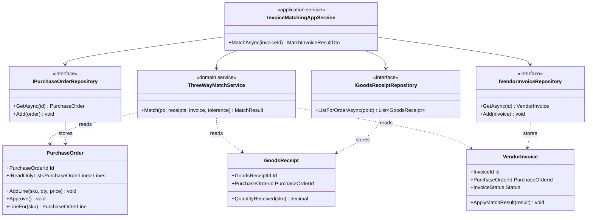
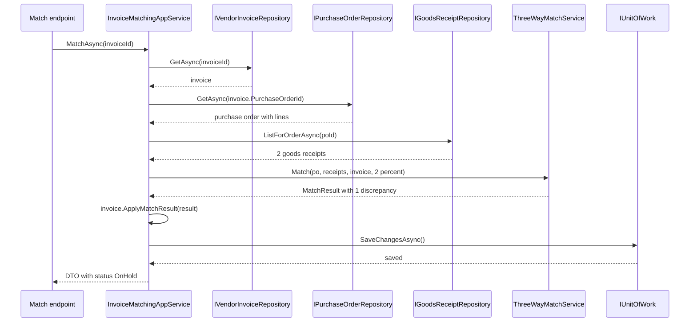

In the [aggregates lesson](#/lesson/m08-aggregates) you drew boundaries around clusters of objects that must change together. Two practical questions follow immediately. First, *how do you get an aggregate back after you saved it yesterday?* Second, *where does a rule go when it needs two or three aggregates at once and belongs to none of them?* The answers are the **repository** and the **domain service**. They are small ideas, but getting them wrong is how most "DDD" codebases slide back into a tangle of database calls and anaemic entities.

Our running example is accounts-payable for a chain of hospitals. The central pharmacy of one hospital raises a **purchase order** (PO) for 500 boxes of nitrile surgical gloves, the hospital store records a **goods receipt note** (GRN) when the delivery van arrives, and the vendor later sends an **invoice**. Before anyone pays, finance runs the classic **three-way match**: what was ordered, what was received and what was billed must agree, within a small price tolerance.

## Learning objectives

By the end of this lesson you will be able to:

1. Explain what a repository is in DDD terms and why there is one per aggregate, not one per table.
2. Design repository interfaces that speak the domain's language and return whole aggregates.
3. Keep the domain model persistence-ignorant, and know which small compromises (private constructors, backing fields) are acceptable.
4. Recognise logic that belongs in a domain service: stateless, named in the ubiquitous language, spanning several entities or aggregates.
5. Tell a domain service apart from an application service and from an infrastructure service.
6. Implement both in ASP.NET Core with in-memory fakes, and test the domain service with no database at all.
7. Spot the classic failure modes: generic repositories, `IQueryable` leaks, and "service-itis" that drains logic out of entities.

## Prerequisites

- [Aggregates and aggregate roots](#/lesson/m08-aggregates): a repository loads and saves exactly one aggregate type.
- [Entities and value objects in DDD](#/lesson/m08-entities-value-objects): ids, value equality and immutability are used throughout.
- [Repository and Unit of Work, including their limitations](#/lesson/m06-repository-uow): the pattern-catalogue view of repositories. This lesson adds the DDD view.
- [Dependency Inversion Principle](#/lesson/m04-dip): the domain owns the repository interface and infrastructure implements it.

## Explain it like I'm a beginner

Think of a big public library. You walk up to the counter and say "I'd like book 978-81-203-4007-7". The librarian goes away and comes back with the whole book: every page, the cover, the stamps inside. You never see the shelves, the basement store, or the inter-library van. Whether the book was on shelf 4 or fetched from another city is not your problem. When you return it, you hand it over the counter and the librarian puts it back wherever it lives.

That counter is a **repository**. For each kind of thing your business cares about as a whole (a purchase order, an invoice, a supplier contract), there is one counter that hands you the whole thing and takes it back. Your business code says "give me PO 4471" and "here is a new invoice, keep it". It does not say "run this SQL join on three tables".

Now imagine a question that no single book can answer: "Do these three documents agree with each other?" A PO says 500 boxes of gloves at ₹380 each. The goods receipt says 480 boxes arrived. The invoice bills 500 boxes at ₹385. Which object should decide whether the invoice can be paid? Not the PO: it does not know about receipts. Not the invoice: it does not know what was ordered. Not the receipt either. This is a job for a separate, named piece of business logic, the way a library has an "inter-library loan desk" that is neither a book nor a shelf. In DDD that is a **domain service**: a stateless operation, named in business words ("three-way match"), that takes several domain objects and applies a rule across them.

Two rules of thumb:

- **Repository**: "fetch and keep whole things", one per aggregate, no business rules inside.
- **Domain service**: "a business rule that needs several things", stateless, no storage concerns inside.

## First-principles explanation

### The problem repositories solve

An aggregate is a cluster of objects with one root. A purchase order has lines. In a relational database it is two tables (`purchase_orders` and `purchase_order_lines`), maybe more. Without a repository, every piece of code that needs a PO writes its own query: one handler forgets to load the lines, another loads them but not the status, a third loads lines from a different PO by mistake. Worse, code starts to update lines directly (`UPDATE purchase_order_lines SET qty = ...`) and skips the root's invariant check that the PO total must not exceed its budget.

A repository fixes this by making the aggregate the *unit of retrieval*. Evans describes it as an object that gives "the illusion of an in-memory collection of all objects of that type". You ask the collection for one by id, you add new ones, you remove old ones. The repository promises that what comes back is a complete, valid aggregate, and that what you hand back is stored as a whole.

### One repository per aggregate, not per table

This is the most important rule, and the one most often broken:

| Concept | Gets a repository? | Why |
|---|---|---|
| `PurchaseOrder` (root) | Yes | It is the consistency boundary |
| `PurchaseOrderLine` (child entity) | **No** | Lines only change through the PO root. A line repository would let code bypass the root |
| `GoodsReceipt` (root) | Yes | Separate aggregate, changes on its own schedule |
| `VendorInvoice` (root) | Yes | Separate aggregate |
| `Money`, `Quantity` (value objects) | No | Values are stored as part of their owner |

If you find yourself wanting `IPurchaseOrderLineRepository`, either the line is really its own aggregate (rare), or you are writing a *report*. Reports are better served by a read-side query (see [CQRS fundamentals](#/lesson/m08-cqrs-fundamentals)) that returns flat DTOs and never pretends to be the domain.

### What a good repository interface looks like

A repository interface belongs to the **domain** (it is a "separated interface": defined in the domain, implemented in infrastructure). It uses domain types and domain words:

```csharp
public interface IPurchaseOrderRepository
{
    Task<PurchaseOrder?> GetAsync(PurchaseOrderId id, CancellationToken ct = default);
    Task<IReadOnlyList<PurchaseOrder>> ListAwaitingApprovalAsync(string hospitalCode, CancellationToken ct = default);
    void Add(PurchaseOrder order);
}
```

Notice what is *not* there:

- No `Update` method. In the collection metaphor you change the object you got back, and a unit of work (EF Core's `DbContext.SaveChangesAsync`) notices. Some teams prefer an explicit `UpdateAsync` because their storage (Dapper, a document database) does not track changes. Both are fine. Be consistent.
- No `IQueryable<PurchaseOrder>`. Returning `IQueryable` lets every caller compose arbitrary database queries, which spreads persistence knowledge everywhere and makes the repository impossible to fake honestly.
- No `GetByVendorAndStatusAndDateRangeAndHospital...`. When the list of finder methods explodes, that is a sign the callers are doing *queries for screens*, which belong to the read side, or that a [Specification](#/lesson/m06-specification) would express the selection better.

Finder methods should be named after business questions: `ListAwaitingApprovalAsync`, `FindOpenForVendorAsync`. A useful test: could the hospital's purchase manager understand the method name?

### Persistence ignorance

**Persistence ignorance** means the domain classes do not know how, or whether, they are stored. `PurchaseOrder` has no `[Table]` attribute, no `DbContext` field, no `Save()` method, and does not reference `Microsoft.EntityFrameworkCore`. The benefits are concrete:

1. **Fast tests.** You can test the PO's rules with `new PurchaseOrder(...)` in microseconds. No database container.
2. **Freedom to change storage.** Moving invoices from PostgreSQL tables to a JSONB document column is an infrastructure change only.
3. **Readable domain code.** Business rules are not interleaved with mapping concerns.

Total ignorance is a myth with mainstream ORMs. EF Core 10 copes very well with encapsulated models, but you will usually accept a few small compromises:

| Compromise | Why EF Core wants it | Cost |
|---|---|---|
| A private parameterless constructor | Materialising objects from rows | Tiny. Mark it `private` so domain code cannot use it |
| Collections backed by a private `List<T>` field | EF can be told to use the field (`UsePropertyAccessMode(PropertyAccessMode.Field)`) | None, it is good encapsulation anyway |
| Strongly typed ids need a value converter | Mapping `PurchaseOrderId` to `uuid` | Configuration in infrastructure, not in the domain |
| A concurrency token (`Version`) property | Optimistic concurrency | It is a real domain concern too (see [Transaction boundaries](#/lesson/m08-transaction-boundaries)) |

The rule: compromises may *shape* the domain class slightly, but the dependency arrow never points from domain to infrastructure.

### The problem domain services solve

Some business operations do not belong to any one entity. Evans gives three signals that you have found one:

1. The operation is a significant business concept that is **not a natural responsibility** of an entity or value object.
2. Its interface is defined in terms of **other domain objects**.
3. It is **stateless**: the service holds no data between calls. Every input arrives as a parameter, and the output depends only on those inputs (plus perhaps injected read-only policies).

The three-way match is a textbook case. It needs a `PurchaseOrder`, one or more `GoodsReceipt`s and a `VendorInvoice`. Putting it on `VendorInvoice.Match(po, receipts)` is tempting but makes the invoice aggregate depend on the internals of two others, and every change to receiving rules then edits the invoice class. A `ThreeWayMatchService` with one method, `Match(po, receipts, invoice, tolerance)`, keeps each aggregate focused and gives the rule a name that finance people actually use.

Other real examples:

- **Budget transfer between two cost heads** of a hospital (say from "consumables" to "equipment repairs": debit one, credit the other, enforce "a transfer may not take a head below its committed amount").
- **Late-delivery penalty** for a delayed equipment installation (say, a CT scanner), combining the supplier contract's penalty clause, the agreed installation date and any approved extensions.
- **Vendor selection** from three quotations using a weighted score (price 70 %, delivery 20 %, past rating 10 %).
- **Currency conversion** using an exchange-rate policy.

### Domain service vs application service vs infrastructure service

The word "service" is overloaded, so be precise:

| Kind | Lives in | Knows about | Example |
|---|---|---|---|
| **Domain service** | Domain layer | Entities, value objects, domain interfaces only | `ThreeWayMatchService.Match(...)` |
| **Application service** | Application layer | Repositories, unit of work, authorization, DTOs | `InvoiceMatchingAppService.MatchAsync(invoiceId)`: loads, calls the domain service, saves |
| **Infrastructure service** | Infrastructure layer | Databases, HTTP, files, queues | `SmtpEmailSender`, `GstPortalClient` |

A quick test for a domain service: **if you deleted every repository and the database, would this code still make sense and still be testable?** A domain service passes; an application service does not. The [Application services lesson](#/lesson/m08-application-services) goes deeper into the orchestration side.

Can a domain service call a repository? Purists say no: give it everything it needs as parameters. In practice, some rules need to *look something up* that is too big to pass in ("is there an existing invoice from this vendor with the same number in the last 90 days?"). The clean compromise is a narrow, domain-owned interface (a port) such as `IInvoiceHistory`, injected into the domain service. It is still testable with a fake, and it still says nothing about SQL. Exercise 5 builds exactly that.

### When it is unnecessary

- **Simple CRUD screens.** A master-data screen for units of measure has no invariants worth an aggregate. A thin data-access class or EF Core directly is honest and cheaper.
- **Repositories over EF Core for a small app.** `DbContext` *is* already a unit of work and `DbSet<T>` is already a repository. Wrapping them adds value when you want domain-shaped finders, persistence ignorance in tests and a strict "only roots" rule. It adds little when the app is a 5-table admin tool.
- **A domain service for one-line logic** that clearly belongs to an entity. `invoice.IsOverdue(today)` should stay on the invoice.

### Trade-offs

| You gain | You pay |
|---|---|
| One way to load and store each aggregate, so invariants cannot be bypassed | Another layer of interfaces and classes |
| Domain tests run without a database | Hand-written fakes must behave like the real thing (identity, not found, duplicates) |
| Business rules that span aggregates get a name and a home | Risk of "service-itis": every rule becomes a service and entities go anaemic |
| Storage can change behind the interface | Complex reporting queries do not fit and need a separate read path |

## Visual explanation

### Class diagram



How to read it: there are three aggregates (`PurchaseOrder`, `GoodsReceipt`, `VendorInvoice`) and exactly three repository interfaces, one per root. There is no repository for lines. `ThreeWayMatchService` only has dotted "reads" arrows to the aggregates: it depends on domain objects and nothing else, so it can be tested with plain `new`. The `InvoiceMatchingAppService` is the only class that touches repositories; it fetches the three aggregates, hands them to the domain service, and saves the result. Domain logic is on the left half of the picture, orchestration on the right.

### Sequence diagram



The flow shows the division of labour. The application service does all the I/O: three reads, one save. The domain service does a pure calculation in the middle and returns a value (`MatchResult`), not a database command. The invoice aggregate then changes *its own* state through `ApplyMatchResult`, so its invariant ("only a received invoice can be matched") stays inside it. If the match logic changes (say tolerance moves from 2 % to 1.5 % for medical equipment), only the domain service and its tests change.

## Step-by-step example

### Step 1: the "smart controller"

A first version often looks like this. Read it and count the responsibilities.

```csharp
app.MapPost("/invoices/{id:guid}/match", async (Guid id, NpgsqlConnection db) =>
{
    var inv = await db.QuerySingleAsync<InvoiceRow>("select * from invoices where id = @id", new { id });
    var poLines = await db.QueryAsync<PoLineRow>("select * from po_lines where po_id = @p", new { p = inv.PoId });
    var grn = await db.QueryAsync<GrnLineRow>("select sku, sum(qty) qty from grn_lines where po_id = @p group by sku", new { p = inv.PoId });
    var invLines = await db.QueryAsync<InvLineRow>("select * from invoice_lines where invoice_id = @id", new { id });
    var problems = new List<string>();
    foreach (var l in invLines)
    {
        var po = poLines.FirstOrDefault(p => p.Sku == l.Sku);
        if (po is null) { problems.Add($"{l.Sku} not on PO"); continue; }
        if (l.UnitPrice > po.UnitPrice * 1.02m) problems.Add($"{l.Sku} price");
        var rec = grn.FirstOrDefault(g => g.Sku == l.Sku)?.Qty ?? 0;
        if (l.Qty > rec) problems.Add($"{l.Sku} qty");
    }
    await db.ExecuteAsync("update invoices set status = @s where id = @id",
        new { s = problems.Count == 0 ? "Matched" : "OnHold", id });
    return Results.Ok(problems);
});
```

It works. It also mixes four jobs: HTTP, SQL, a business rule, and a state change that ignores whatever rules the invoice should enforce (can a *paid* invoice be re-matched? This code does not care). The 2 % tolerance is a magic number. Testing the rule needs a database.

### Step 2: name the aggregates and give each a repository

Identify the roots (`PurchaseOrder`, `GoodsReceipt`, `VendorInvoice`) and write one interface each, in the domain project, using domain types. The SQL moves into infrastructure classes that implement them.

### Step 3: move the rule into a domain service

The loop becomes `ThreeWayMatchService.Match(...)`, which returns a `MatchResult` value listing discrepancies. The tolerance becomes a parameter, configured once through the options pattern.

### Step 4: let the aggregate change itself

Instead of `update invoices set status`, the invoice gets `ApplyMatchResult(MatchResult r)`, which checks its own state and moves to `Matched` or `OnHold`.

### Step 5: a thin application service and endpoint

The endpoint calls `InvoiceMatchingAppService.MatchAsync(id)`. The service loads, calls the domain service, lets the invoice update itself, saves, and maps to a DTO. That is the full implementation below.

## Production-style C# implementation

```text
Procurement.Api/
  Program.cs
  Domain/
    Shared.cs                  (DomainException, ids, AggregateRoot)
    PurchaseOrder.cs
    GoodsReceipt.cs
    VendorInvoice.cs
    Matching/ThreeWayMatchService.cs
    Repositories.cs            (repository interfaces + IUnitOfWork)
  Application/
    InvoiceMatchingAppService.cs
  Infrastructure/
    InMemoryProcurementStore.cs
```

In a larger solution `Domain`, `Application` and `Infrastructure` would be separate projects so the compiler enforces the dependency rule (see [Clean Architecture in ASP.NET Core](#/lesson/m08-clean-architecture-aspnet)). Folders are enough to show the idea.

```csharp file=Domain/Shared.cs
namespace Procurement.Domain;

public sealed class DomainException : Exception
{
    public DomainException(string message) : base(message) { }
}

public readonly record struct PurchaseOrderId(Guid Value)
{
    public static PurchaseOrderId New() => new(Guid.NewGuid());
}

public readonly record struct GoodsReceiptId(Guid Value)
{
    public static GoodsReceiptId New() => new(Guid.NewGuid());
}

public readonly record struct InvoiceId(Guid Value)
{
    public static InvoiceId New() => new(Guid.NewGuid());
}

public readonly record struct VendorId(Guid Value)
{
    public static VendorId New() => new(Guid.NewGuid());
}

/// <summary>Marker base for aggregate roots. Repositories accept only types derived from it.</summary>
public abstract class AggregateRoot<TId> where TId : struct
{
    public TId Id { get; protected set; }
}
```

```csharp file=Domain/PurchaseOrder.cs
namespace Procurement.Domain;

public enum PurchaseOrderStatus { Draft, Approved, Closed }

public sealed record PurchaseOrderLine(string Sku, decimal Quantity, decimal UnitPrice)
{
    public decimal Total => Quantity * UnitPrice;
}

public sealed class PurchaseOrder : AggregateRoot<PurchaseOrderId>
{
    private readonly List<PurchaseOrderLine> _lines = new();

    private PurchaseOrder() { }  // for the ORM only; domain code uses the public constructor

    public PurchaseOrder(PurchaseOrderId id, VendorId vendorId, string hospitalCode)
    {
        if (string.IsNullOrWhiteSpace(hospitalCode)) throw new DomainException("Hospital code is required.");
        Id = id;
        VendorId = vendorId;
        HospitalCode = hospitalCode;
        Status = PurchaseOrderStatus.Draft;
    }

    public VendorId VendorId { get; private set; }
    public string HospitalCode { get; private set; } = "";
    public PurchaseOrderStatus Status { get; private set; }
    public IReadOnlyList<PurchaseOrderLine> Lines => _lines;
    public decimal Total => _lines.Sum(l => l.Total);

    public void AddLine(string sku, decimal quantity, decimal unitPrice)
    {
        if (Status != PurchaseOrderStatus.Draft) throw new DomainException("Lines can only be added to a draft PO.");
        if (quantity <= 0) throw new DomainException("Quantity must be positive.");
        if (unitPrice <= 0) throw new DomainException("Unit price must be positive.");
        if (_lines.Any(l => l.Sku == sku)) throw new DomainException($"{sku} is already on this PO.");
        _lines.Add(new PurchaseOrderLine(sku, quantity, unitPrice));
    }

    public void Approve()
    {
        if (Status != PurchaseOrderStatus.Draft) throw new DomainException("Only a draft PO can be approved.");
        if (_lines.Count == 0) throw new DomainException("An empty PO cannot be approved.");
        Status = PurchaseOrderStatus.Approved;
    }

    public PurchaseOrderLine? LineFor(string sku) => _lines.FirstOrDefault(l => l.Sku == sku);
}
```

```csharp file=Domain/GoodsReceipt.cs
namespace Procurement.Domain;

public sealed record ReceiptLine(string Sku, decimal Quantity);

/// <summary>A goods receipt note (GRN): what physically arrived at the hospital store against one PO.</summary>
public sealed class GoodsReceipt : AggregateRoot<GoodsReceiptId>
{
    private readonly List<ReceiptLine> _lines = new();

    private GoodsReceipt() { }

    public GoodsReceipt(GoodsReceiptId id, PurchaseOrderId purchaseOrderId, DateOnly receivedOn, IEnumerable<ReceiptLine> lines)
    {
        Id = id;
        PurchaseOrderId = purchaseOrderId;
        ReceivedOn = receivedOn;
        foreach (var l in lines)
        {
            if (l.Quantity <= 0) throw new DomainException("Received quantity must be positive.");
            _lines.Add(l);
        }
        if (_lines.Count == 0) throw new DomainException("A goods receipt needs at least one line.");
    }

    public PurchaseOrderId PurchaseOrderId { get; private set; }
    public DateOnly ReceivedOn { get; private set; }
    public IReadOnlyList<ReceiptLine> Lines => _lines;

    public decimal QuantityReceived(string sku) => _lines.Where(l => l.Sku == sku).Sum(l => l.Quantity);
}
```

```csharp file=Domain/VendorInvoice.cs
using Procurement.Domain.Matching;

namespace Procurement.Domain;

public enum InvoiceStatus { Received, Matched, OnHold, Paid }

public sealed record InvoiceLine(string Sku, decimal Quantity, decimal UnitPrice);

public sealed class VendorInvoice : AggregateRoot<InvoiceId>
{
    private readonly List<InvoiceLine> _lines = new();
    private readonly List<string> _holdReasons = new();

    private VendorInvoice() { }

    public VendorInvoice(InvoiceId id, VendorId vendorId, PurchaseOrderId purchaseOrderId, string invoiceNumber, IEnumerable<InvoiceLine> lines)
    {
        if (string.IsNullOrWhiteSpace(invoiceNumber)) throw new DomainException("Invoice number is required.");
        Id = id;
        VendorId = vendorId;
        PurchaseOrderId = purchaseOrderId;
        InvoiceNumber = invoiceNumber.Trim();
        _lines.AddRange(lines);
        if (_lines.Count == 0) throw new DomainException("An invoice needs at least one line.");
        Status = InvoiceStatus.Received;
    }

    public VendorId VendorId { get; private set; }
    public PurchaseOrderId PurchaseOrderId { get; private set; }
    public string InvoiceNumber { get; private set; } = "";
    public InvoiceStatus Status { get; private set; }
    public IReadOnlyList<InvoiceLine> Lines => _lines;
    public IReadOnlyList<string> HoldReasons => _holdReasons;

    /// <summary>The invoice decides what a match result means for its own state.</summary>
    public void ApplyMatchResult(MatchResult result)
    {
        if (Status is InvoiceStatus.Paid) throw new DomainException("A paid invoice cannot be re-matched.");
        _holdReasons.Clear();
        if (result.IsMatched)
        {
            Status = InvoiceStatus.Matched;
            return;
        }
        Status = InvoiceStatus.OnHold;
        _holdReasons.AddRange(result.Discrepancies.Select(d => $"{d.Sku}: {d.Kind} ({d.Detail})"));
    }
}
```

```csharp file=Domain/Matching/ThreeWayMatchService.cs
namespace Procurement.Domain.Matching;

public enum DiscrepancyKind { WrongPurchaseOrder, NotOnOrder, QuantityNotReceived, PriceAboveOrder }

public sealed record Discrepancy(string Sku, DiscrepancyKind Kind, string Detail);

public sealed record MatchResult(IReadOnlyList<Discrepancy> Discrepancies)
{
    public bool IsMatched => Discrepancies.Count == 0;
}

/// <summary>Price tolerance as a value object: 2 means an invoiced price may be up to 2 % above the PO price.</summary>
public readonly record struct PriceTolerance
{
    public PriceTolerance(decimal percent)
    {
        if (percent < 0 || percent > 20) throw new DomainException("Price tolerance must be between 0 and 20 percent.");
        Percent = percent;
    }
    public decimal Percent { get; }
    public decimal MaxAllowed(decimal orderedPrice) => orderedPrice * (1 + Percent / 100m);
}

/// <summary>
/// Domain service: compares what was ordered, received and billed. Stateless and free of I/O,
/// so it is registered as a singleton and tested with plain objects.
/// </summary>
public sealed class ThreeWayMatchService
{
    public MatchResult Match(PurchaseOrder order, IReadOnlyList<GoodsReceipt> receipts, VendorInvoice invoice, PriceTolerance tolerance)
    {
        ArgumentNullException.ThrowIfNull(order);
        ArgumentNullException.ThrowIfNull(receipts);
        ArgumentNullException.ThrowIfNull(invoice);

        if (invoice.PurchaseOrderId != order.Id)
            return new MatchResult(new[] { new Discrepancy("*", DiscrepancyKind.WrongPurchaseOrder, "Invoice refers to a different PO") });
        if (receipts.Any(r => r.PurchaseOrderId != order.Id))
            throw new ArgumentException("All receipts must belong to the purchase order being matched.", nameof(receipts));

        var problems = new List<Discrepancy>();
        foreach (var group in invoice.Lines.GroupBy(l => l.Sku))
        {
            var sku = group.Key;
            var ordered = order.LineFor(sku);
            if (ordered is null)
            {
                problems.Add(new Discrepancy(sku, DiscrepancyKind.NotOnOrder, "Item is not on the PO"));
                continue;
            }

            var billedQty = group.Sum(l => l.Quantity);
            var receivedQty = receipts.Sum(r => r.QuantityReceived(sku));
            if (billedQty > receivedQty)
                problems.Add(new Discrepancy(sku, DiscrepancyKind.QuantityNotReceived, $"billed {billedQty}, received {receivedQty}"));

            var highestBilledPrice = group.Max(l => l.UnitPrice);
            if (highestBilledPrice > tolerance.MaxAllowed(ordered.UnitPrice))
                problems.Add(new Discrepancy(sku, DiscrepancyKind.PriceAboveOrder, $"billed {highestBilledPrice}, ordered {ordered.UnitPrice}"));
        }
        return new MatchResult(problems);
    }
}
```

```csharp file=Domain/Repositories.cs
namespace Procurement.Domain;

// Repository interfaces live in the domain and speak its language.
// Implementations live in infrastructure. One interface per aggregate root.

public interface IPurchaseOrderRepository
{
    Task<PurchaseOrder?> GetAsync(PurchaseOrderId id, CancellationToken ct = default);
    Task<IReadOnlyList<PurchaseOrder>> ListAwaitingApprovalAsync(string hospitalCode, CancellationToken ct = default);
    void Add(PurchaseOrder order);
}

public interface IGoodsReceiptRepository
{
    Task<IReadOnlyList<GoodsReceipt>> ListForOrderAsync(PurchaseOrderId orderId, CancellationToken ct = default);
    void Add(GoodsReceipt receipt);
}

public interface IVendorInvoiceRepository
{
    Task<VendorInvoice?> GetAsync(InvoiceId id, CancellationToken ct = default);
    void Add(VendorInvoice invoice);
}

/// <summary>Commits every change made to loaded or added aggregates in this request.</summary>
public interface IUnitOfWork
{
    Task SaveChangesAsync(CancellationToken ct = default);
}
```

```csharp file=Application/InvoiceMatchingAppService.cs
using Microsoft.Extensions.Options;
using Procurement.Domain;
using Procurement.Domain.Matching;

namespace Procurement.Application;

public sealed class MatchingOptions
{
    public decimal PriceTolerancePercent { get; set; } = 2m;
}

public sealed record MatchInvoiceResultDto(Guid InvoiceId, string Status, IReadOnlyList<string> HoldReasons);

/// <summary>Application service: loads aggregates, calls the domain service, saves. No business rules here.</summary>
public sealed class InvoiceMatchingAppService(
    IVendorInvoiceRepository invoices,
    IPurchaseOrderRepository orders,
    IGoodsReceiptRepository receipts,
    ThreeWayMatchService matcher,
    IUnitOfWork unitOfWork,
    IOptions<MatchingOptions> options)
{
    private readonly PriceTolerance _tolerance = new(options.Value.PriceTolerancePercent);

    public async Task<MatchInvoiceResultDto?> MatchAsync(InvoiceId invoiceId, CancellationToken ct = default)
    {
        var invoice = await invoices.GetAsync(invoiceId, ct);
        if (invoice is null) return null;

        var order = await orders.GetAsync(invoice.PurchaseOrderId, ct)
                    ?? throw new DomainException("The invoice refers to a PO that does not exist.");
        var grns = await receipts.ListForOrderAsync(order.Id, ct);

        var result = matcher.Match(order, grns, invoice, _tolerance);
        invoice.ApplyMatchResult(result);

        await unitOfWork.SaveChangesAsync(ct);
        return new MatchInvoiceResultDto(invoice.Id.Value, invoice.Status.ToString(), invoice.HoldReasons);
    }
}
```

```csharp file=Infrastructure/InMemoryProcurementStore.cs
using System.Collections.Concurrent;
using Procurement.Domain;

namespace Procurement.Infrastructure;

/// <summary>Stands in for PostgreSQL in this sample. A real implementation would use EF Core or Dapper.</summary>
public sealed class InMemoryProcurementStore
{
    public ConcurrentDictionary<PurchaseOrderId, PurchaseOrder> Orders { get; } = new();
    public ConcurrentDictionary<GoodsReceiptId, GoodsReceipt> Receipts { get; } = new();
    public ConcurrentDictionary<InvoiceId, VendorInvoice> Invoices { get; } = new();
    public int Commits;
}

public sealed class InMemoryPurchaseOrderRepository(InMemoryProcurementStore store) : IPurchaseOrderRepository
{
    public Task<PurchaseOrder?> GetAsync(PurchaseOrderId id, CancellationToken ct = default) =>
        Task.FromResult(store.Orders.TryGetValue(id, out var po) ? po : null);

    public Task<IReadOnlyList<PurchaseOrder>> ListAwaitingApprovalAsync(string hospitalCode, CancellationToken ct = default) =>
        Task.FromResult<IReadOnlyList<PurchaseOrder>>(store.Orders.Values
            .Where(p => p.HospitalCode == hospitalCode && p.Status == PurchaseOrderStatus.Draft && p.Lines.Count > 0)
            .ToList());

    public void Add(PurchaseOrder order)
    {
        if (!store.Orders.TryAdd(order.Id, order)) throw new InvalidOperationException($"PO {order.Id.Value} already exists.");
    }
}

public sealed class InMemoryGoodsReceiptRepository(InMemoryProcurementStore store) : IGoodsReceiptRepository
{
    public Task<IReadOnlyList<GoodsReceipt>> ListForOrderAsync(PurchaseOrderId orderId, CancellationToken ct = default) =>
        Task.FromResult<IReadOnlyList<GoodsReceipt>>(store.Receipts.Values
            .Where(r => r.PurchaseOrderId == orderId)
            .OrderBy(r => r.ReceivedOn)
            .ToList());

    public void Add(GoodsReceipt receipt)
    {
        if (!store.Receipts.TryAdd(receipt.Id, receipt)) throw new InvalidOperationException("Receipt already exists.");
    }
}

public sealed class InMemoryVendorInvoiceRepository(InMemoryProcurementStore store) : IVendorInvoiceRepository
{
    public Task<VendorInvoice?> GetAsync(InvoiceId id, CancellationToken ct = default) =>
        Task.FromResult(store.Invoices.TryGetValue(id, out var inv) ? inv : null);

    public void Add(VendorInvoice invoice)
    {
        if (!store.Invoices.TryAdd(invoice.Id, invoice)) throw new InvalidOperationException("Invoice already exists.");
    }
}

/// <summary>In memory, objects are already "saved" when changed; we only count commits for tests.</summary>
public sealed class InMemoryUnitOfWork(InMemoryProcurementStore store) : IUnitOfWork
{
    public Task SaveChangesAsync(CancellationToken ct = default)
    {
        Interlocked.Increment(ref store.Commits);
        return Task.CompletedTask;
    }
}
```

```csharp file=Program.cs
using Procurement.Application;
using Procurement.Domain;
using Procurement.Domain.Matching;
using Procurement.Infrastructure;

var builder = WebApplication.CreateBuilder(args);

builder.Services.Configure<MatchingOptions>(builder.Configuration.GetSection("Matching"));

// Infrastructure: swap these four lines for EF Core implementations in production.
builder.Services.AddSingleton<InMemoryProcurementStore>();
builder.Services.AddScoped<IPurchaseOrderRepository, InMemoryPurchaseOrderRepository>();
builder.Services.AddScoped<IGoodsReceiptRepository, InMemoryGoodsReceiptRepository>();
builder.Services.AddScoped<IVendorInvoiceRepository, InMemoryVendorInvoiceRepository>();
builder.Services.AddScoped<IUnitOfWork, InMemoryUnitOfWork>();

// Domain service: stateless, so a singleton is safe.
builder.Services.AddSingleton<ThreeWayMatchService>();

// Application service: scoped, because it holds scoped repositories.
builder.Services.AddScoped<InvoiceMatchingAppService>();

var app = builder.Build();

app.MapPost("/invoices/{id:guid}/match", async (Guid id, InvoiceMatchingAppService service, CancellationToken ct) =>
{
    try
    {
        var result = await service.MatchAsync(new InvoiceId(id), ct);
        return result is null ? Results.NotFound() : Results.Ok(result);
    }
    catch (DomainException ex)
    {
        return Results.Problem(ex.Message, statusCode: StatusCodes.Status409Conflict);
    }
});

app.Run();
```

### What the EF Core version of a repository looks like

The compiled sample uses in-memory dictionaries because the checker has no EF Core. In production the PO repository is a few lines on top of a `DbContext`, and the mapping lives entirely in infrastructure:

```csharp
// Infrastructure/EfPurchaseOrderRepository.cs (not compiled here)
public sealed class EfPurchaseOrderRepository(ProcurementDbContext db) : IPurchaseOrderRepository
{
    public Task<PurchaseOrder?> GetAsync(PurchaseOrderId id, CancellationToken ct = default) =>
        db.PurchaseOrders.Include(p => p.Lines).SingleOrDefaultAsync(p => p.Id == id, ct);

    public async Task<IReadOnlyList<PurchaseOrder>> ListAwaitingApprovalAsync(string hospitalCode, CancellationToken ct = default) =>
        await db.PurchaseOrders.Include(p => p.Lines)
            .Where(p => p.HospitalCode == hospitalCode && p.Status == PurchaseOrderStatus.Draft)
            .ToListAsync(ct);

    public void Add(PurchaseOrder order) => db.PurchaseOrders.Add(order);
}

// Infrastructure/PurchaseOrderConfiguration.cs
public sealed class PurchaseOrderConfiguration : IEntityTypeConfiguration<PurchaseOrder>
{
    public void Configure(EntityTypeBuilder<PurchaseOrder> b)
    {
        b.ToTable("purchase_orders");
        b.Property(p => p.Id).HasConversion(id => id.Value, v => new PurchaseOrderId(v));
        b.OwnsMany(p => p.Lines, l =>
        {
            l.ToTable("purchase_order_lines");
            l.WithOwner().HasForeignKey("purchase_order_id");
            l.Property(x => x.Sku).HasMaxLength(40);
        });
        b.Navigation(p => p.Lines).UsePropertyAccessMode(PropertyAccessMode.Field);
    }
}
```

`OwnsMany` tells EF Core that lines have no life outside their PO, which matches the aggregate boundary: there is no `DbSet<PurchaseOrderLine>`, so nobody can query or update lines on their own. The `ProcurementDbContext` implements `IUnitOfWork` by forwarding to `SaveChangesAsync`.

:::callout type=tradeoff title="Should you wrap EF Core at all?"
`DbContext` is already a Unit of Work, and `DbSet<T>` already behaves like a repository. Wrapping them earns its keep when (1) you want only aggregate roots to be loadable, (2) you want finder methods named after business questions, and (3) you want application-service tests with simple in-memory fakes. For a small CRUD module, inject the `DbContext` directly and skip the ceremony. Many teams mix both: repositories for the rich core, `DbContext` for supporting admin screens.
:::

## Bad design vs good design

### Bad: the generic repository with `IQueryable`

```csharp
public interface IRepository<T> where T : class
{
    IQueryable<T> Query();
    Task<T?> GetByIdAsync(object id);
    void Add(T entity);
    void Update(T entity);
    void Delete(T entity);
}

// Somewhere in a handler:
var lines = repo<PurchaseOrderLine>().Query().Where(l => l.PoId == poId);   // bypasses the root
foreach (var l in lines) l.Quantity += 10;                                   // invariant never checked
```

Problems:

- `IRepository<PurchaseOrderLine>` exists, so code can change lines without asking the PO, skipping the budget check.
- `IQueryable` leaks the ORM. A handler can now write `.Include(...)`, `.AsNoTracking()` or a query EF cannot translate, and a unit test with an in-memory list will behave differently from PostgreSQL.
- `Delete(T)` on every type invites hard deletes of things the business wants cancelled, not erased.
- The interface says nothing about the domain. It is a thin, leaky copy of `DbSet<T>`.

### Good: specific, intention-revealing repositories

The design above: one interface per root, domain types in signatures, finders named for business questions, no line repository, no `IQueryable`. If the same plumbing repeats across implementations, put it in an infrastructure base class (`EfRepository<T>`) that the specific repositories inherit, but keep the *interfaces* specific.

### Bad: the anaemic model plus a "service" for everything

```csharp
public class InvoiceService
{
    public void Approve(Invoice i) { if (i.Status == "Matched") i.Status = "Approved"; }
    public void Hold(Invoice i, string r) { i.Status = "OnHold"; i.Reason = r; }
    public decimal Total(Invoice i) => i.Lines.Sum(l => l.Qty * l.Price);
}
```

None of these needs anything beyond the invoice. They are entity behaviour pretending to be services, and the invoice is reduced to a bag of public setters. Move them onto `VendorInvoice` and keep services for logic that genuinely spans objects.

### Is the improvement worth it?

For the accounts-payable core of a procurement platform, yes: three-way match rules change with every audit, and the domain service gives them one tested home. For a "units of measure" master-data screen, no: use EF Core directly.

## Practical playground

The playground has the three aggregates and a half-written `ThreeWayMatchService`. Run it to see the output, then finish the price-tolerance check and run it again.

:::playground type=csharp title="Three-way match in memory"
```csharp file=Program.cs
using System;
using System.Collections.Generic;
using System.Linq;

public sealed record PoLine(string Sku, decimal Quantity, decimal UnitPrice);
public sealed record ReceiptLine(string Sku, decimal Quantity);
public sealed record InvoiceLine(string Sku, decimal Quantity, decimal UnitPrice);

public sealed class PurchaseOrder
{
    public PurchaseOrder(Guid id, IEnumerable<PoLine> lines) { Id = id; Lines = lines.ToList(); }
    public Guid Id { get; }
    public IReadOnlyList<PoLine> Lines { get; }
}

public sealed class GoodsReceipt
{
    public GoodsReceipt(Guid poId, IEnumerable<ReceiptLine> lines) { PurchaseOrderId = poId; Lines = lines.ToList(); }
    public Guid PurchaseOrderId { get; }
    public IReadOnlyList<ReceiptLine> Lines { get; }
}

public sealed class VendorInvoice
{
    public VendorInvoice(Guid poId, IEnumerable<InvoiceLine> lines) { PurchaseOrderId = poId; Lines = lines.ToList(); }
    public Guid PurchaseOrderId { get; }
    public IReadOnlyList<InvoiceLine> Lines { get; }
}

public sealed class InMemoryRepository<TKey, T> where TKey : notnull
{
    private readonly Dictionary<TKey, T> _items = new();
    public void Add(TKey key, T item) => _items.Add(key, item);
    public T? Get(TKey key) => _items.TryGetValue(key, out var v) ? v : default;
}

public sealed class ThreeWayMatchService
{
    public IReadOnlyList<string> Match(PurchaseOrder po, IReadOnlyList<GoodsReceipt> grns, VendorInvoice inv, decimal tolerancePercent)
    {
        var problems = new List<string>();
        foreach (var line in inv.Lines)
        {
            var ordered = po.Lines.FirstOrDefault(l => l.Sku == line.Sku);
            if (ordered is null) { problems.Add($"{line.Sku}: not on PO"); continue; }
            var received = grns.SelectMany(g => g.Lines).Where(l => l.Sku == line.Sku).Sum(l => l.Quantity);
            if (line.Quantity > received) problems.Add($"{line.Sku}: billed {line.Quantity}, received {received}");
            // TODO: flag a price more than tolerancePercent above the ordered price.
        }
        return problems;
    }
}

public static class Program
{
    public static void Main()
    {
        var poId = Guid.NewGuid();
        var orders = new InMemoryRepository<Guid, PurchaseOrder>();
        orders.Add(poId, new PurchaseOrder(poId, new[] { new PoLine("GLOVES-NITRILE-M", 500, 380m), new PoLine("MONITOR-5P", 2, 61000m) }));

        var grns = new List<GoodsReceipt>
        {
            new GoodsReceipt(poId, new[] { new ReceiptLine("GLOVES-NITRILE-M", 300) }),
            new GoodsReceipt(poId, new[] { new ReceiptLine("GLOVES-NITRILE-M", 180), new ReceiptLine("MONITOR-5P", 2) }),
        };
        var invoice = new VendorInvoice(poId, new[] { new InvoiceLine("GLOVES-NITRILE-M", 500, 385m), new InvoiceLine("MONITOR-5P", 2, 63500m) });

        var po = orders.Get(poId)!;
        var problems = new ThreeWayMatchService().Match(po, grns, invoice, tolerancePercent: 2m);
        Console.WriteLine(problems.Count == 0 ? "Matched" : "On hold:");
        foreach (var p in problems) Console.WriteLine("  " + p);
    }
}
```
:::

Expected after your change: the gloves are flagged for quantity (500 billed, 480 received) but not for price (₹385 is within 2 % of ₹380, the limit is ₹387.60). The patient monitors are flagged for price (₹63,500 is above ₹62,220).

## Exercises

:::exercise id=m08-repositories-domain-services-ex1 difficulty=beginner kind=code title="An in-memory repository that behaves like a collection"
Implement `InMemoryVendorInvoiceRepository` so application-service tests can use it instead of PostgreSQL. It must behave like the real repository on the points that matter to callers: identity, not-found and duplicates.
::requirements
- `GetAsync` returns the *same instance* that was added (an identity map), or `null` when the id is unknown.
- `Add` throws `InvalidOperationException` when an invoice with the same id already exists.
- `ListByVendorAsync` returns only that vendor's invoices, ordered by `InvoiceDate`, then by `InvoiceNumber`.
- `Remove` deletes an existing invoice and throws `InvalidOperationException` for an unknown one.
::acceptance
- All tests pass.
- No LINQ provider or `IQueryable` appears in the interface.
- The returned list cannot be cast back and modified to change the repository's contents.
::hint
A `Dictionary<Guid, VendorInvoice>` is enough. What does `Dictionary.Add` do with a duplicate key, and is that the exception you want?
::hint
Use `TryAdd` and throw your own `InvalidOperationException` with a clear message.
::hint
For the list, filter with `Where`, sort with `OrderBy(...).ThenBy(...)`, and finish with `.ToList()` so callers get a copy, not a live view.
::hint
```csharp
public Task<VendorInvoice?> GetAsync(Guid id, CancellationToken ct = default) =>
    Task.FromResult(_items.TryGetValue(id, out var inv) ? inv : null);
```
::starter
```csharp file=InvoiceRepository.cs
using System;
using System.Collections.Generic;
using System.Linq;
using System.Threading;
using System.Threading.Tasks;

public sealed class VendorInvoice
{
    public VendorInvoice(Guid id, Guid vendorId, string invoiceNumber, DateOnly invoiceDate, decimal amount)
    {
        Id = id; VendorId = vendorId; InvoiceNumber = invoiceNumber; InvoiceDate = invoiceDate; Amount = amount;
    }
    public Guid Id { get; }
    public Guid VendorId { get; }
    public string InvoiceNumber { get; }
    public DateOnly InvoiceDate { get; }
    public decimal Amount { get; private set; }
    public void Correct(decimal amount) => Amount = amount;
}

public interface IVendorInvoiceRepository
{
    Task<VendorInvoice?> GetAsync(Guid id, CancellationToken ct = default);
    Task<IReadOnlyList<VendorInvoice>> ListByVendorAsync(Guid vendorId, CancellationToken ct = default);
    void Add(VendorInvoice invoice);
    void Remove(VendorInvoice invoice);
}

public sealed class InMemoryVendorInvoiceRepository : IVendorInvoiceRepository
{
    public Task<VendorInvoice?> GetAsync(Guid id, CancellationToken ct = default) => throw new NotImplementedException();
    public Task<IReadOnlyList<VendorInvoice>> ListByVendorAsync(Guid vendorId, CancellationToken ct = default) => throw new NotImplementedException();
    public void Add(VendorInvoice invoice) => throw new NotImplementedException();
    public void Remove(VendorInvoice invoice) => throw new NotImplementedException();
}
```
::tests
```csharp file=InvoiceRepositoryTests.cs
using System;
using System.Collections.Generic;
using System.Threading.Tasks;
using Xunit;

public class InvoiceRepositoryTests
{
    private static readonly Guid VendorA = Guid.NewGuid();
    private static readonly Guid VendorB = Guid.NewGuid();

    private static VendorInvoice Inv(Guid vendor, string no, int day, decimal amount = 1000m) =>
        new VendorInvoice(Guid.NewGuid(), vendor, no, new DateOnly(2026, 4, day), amount);

    [Fact]
    public async Task Get_returns_same_instance()
    {
        var repo = new InMemoryVendorInvoiceRepository();
        var inv = Inv(VendorA, "INV-1", 1);
        repo.Add(inv);
        Assert.Same(inv, await repo.GetAsync(inv.Id));
    }

    [Fact]
    public async Task Get_unknown_returns_null()
    {
        var repo = new InMemoryVendorInvoiceRepository();
        Assert.Null(await repo.GetAsync(Guid.NewGuid()));
    }

    [Fact]
    public void Add_duplicate_id_throws()
    {
        var repo = new InMemoryVendorInvoiceRepository();
        var inv = Inv(VendorA, "INV-1", 1);
        repo.Add(inv);
        Assert.Throws<InvalidOperationException>(() => repo.Add(inv));
    }

    [Fact]
    public async Task List_by_vendor_filters_and_sorts()
    {
        var repo = new InMemoryVendorInvoiceRepository();
        repo.Add(Inv(VendorA, "INV-9", 5));
        repo.Add(Inv(VendorB, "X-1", 1));
        repo.Add(Inv(VendorA, "INV-2", 3));
        repo.Add(Inv(VendorA, "INV-1", 5));
        var list = await repo.ListByVendorAsync(VendorA);
        Assert.Equal(new[] { "INV-2", "INV-1", "INV-9" }, list.Select(i => i.InvoiceNumber));
    }

    [Fact]
    public async Task Returned_list_is_a_copy()
    {
        var repo = new InMemoryVendorInvoiceRepository();
        repo.Add(Inv(VendorA, "INV-1", 1));
        var list = await repo.ListByVendorAsync(VendorA);
        if (list is List<VendorInvoice> mutable) mutable.Clear();
        Assert.Single(await repo.ListByVendorAsync(VendorA));
    }

    [Fact]
    public async Task Remove_existing_and_unknown()
    {
        var repo = new InMemoryVendorInvoiceRepository();
        var inv = Inv(VendorA, "INV-1", 1);
        repo.Add(inv);
        repo.Remove(inv);
        Assert.Null(await repo.GetAsync(inv.Id));
        Assert.Throws<InvalidOperationException>(() => repo.Remove(inv));
    }

    [Fact]
    public async Task Changes_to_loaded_aggregate_are_visible()
    {
        var repo = new InMemoryVendorInvoiceRepository();
        var inv = Inv(VendorA, "INV-1", 1);
        repo.Add(inv);
        (await repo.GetAsync(inv.Id))!.Correct(1500m);
        Assert.Equal(1500m, (await repo.GetAsync(inv.Id))!.Amount);
    }
}
```
::solution
A dictionary keyed by id is an identity map: one id, one instance. `TryAdd` and `Remove` return booleans, so we can raise our own clear exceptions. The list is built with `ToList()`, so callers get a snapshot.

```csharp file=InvoiceRepository.cs
using System;
using System.Collections.Generic;
using System.Linq;
using System.Threading;
using System.Threading.Tasks;

public sealed class VendorInvoice
{
    public VendorInvoice(Guid id, Guid vendorId, string invoiceNumber, DateOnly invoiceDate, decimal amount)
    {
        Id = id; VendorId = vendorId; InvoiceNumber = invoiceNumber; InvoiceDate = invoiceDate; Amount = amount;
    }
    public Guid Id { get; }
    public Guid VendorId { get; }
    public string InvoiceNumber { get; }
    public DateOnly InvoiceDate { get; }
    public decimal Amount { get; private set; }
    public void Correct(decimal amount) => Amount = amount;
}

public interface IVendorInvoiceRepository
{
    Task<VendorInvoice?> GetAsync(Guid id, CancellationToken ct = default);
    Task<IReadOnlyList<VendorInvoice>> ListByVendorAsync(Guid vendorId, CancellationToken ct = default);
    void Add(VendorInvoice invoice);
    void Remove(VendorInvoice invoice);
}

public sealed class InMemoryVendorInvoiceRepository : IVendorInvoiceRepository
{
    private readonly Dictionary<Guid, VendorInvoice> _items = new();

    public Task<VendorInvoice?> GetAsync(Guid id, CancellationToken ct = default) =>
        Task.FromResult(_items.TryGetValue(id, out var inv) ? inv : null);

    public Task<IReadOnlyList<VendorInvoice>> ListByVendorAsync(Guid vendorId, CancellationToken ct = default) =>
        Task.FromResult<IReadOnlyList<VendorInvoice>>(_items.Values
            .Where(i => i.VendorId == vendorId)
            .OrderBy(i => i.InvoiceDate)
            .ThenBy(i => i.InvoiceNumber, StringComparer.Ordinal)
            .ToList());

    public void Add(VendorInvoice invoice)
    {
        ArgumentNullException.ThrowIfNull(invoice);
        if (!_items.TryAdd(invoice.Id, invoice))
            throw new InvalidOperationException($"Invoice {invoice.Id} already exists.");
    }

    public void Remove(VendorInvoice invoice)
    {
        ArgumentNullException.ThrowIfNull(invoice);
        if (!_items.Remove(invoice.Id))
            throw new InvalidOperationException($"Invoice {invoice.Id} does not exist.");
    }
}
```

Why care about "same instance"? Application code often loads an aggregate, changes it and saves. If the fake returned a fresh copy each time, tests would pass while hiding bugs where code changes one copy and saves another. EF Core's change tracker also returns the same instance within one `DbContext`, so the fake matches production behaviour.
::alternatives
A fake that deep-copies on `Add` and `Get` (for example via JSON serialisation) catches a different class of bug: code that forgets to call `SaveChangesAsync`. Some teams use one copying fake per aggregate for exactly that reason. It is more work; choose it when "forgot to save" bugs have bitten you.
::mistakes
- Using `Dictionary.Add`, which throws `ArgumentException`, not the documented `InvalidOperationException`.
- Returning `_items.Values.Where(...)` without `ToList()`: callers get a lazy view that changes under them.
- Making the fake thread-unsafe *and* registering it as a singleton in an integration test host. Use `ConcurrentDictionary` if a fake is shared across requests.
::extensions
Add `Task<bool> ExistsWithNumberAsync(Guid vendorId, string invoiceNumber)` and decide whether it belongs on this repository or on a dedicated read-side query.
:::

:::exercise id=m08-repositories-domain-services-ex2 difficulty=beginner kind=written title="Entity method, domain service, application service, or infrastructure?"
For each piece of logic in a hospital's supplier-contract system, say where it belongs and give a one-line reason.

1. "A contract cannot be signed unless all its mandatory clauses are accepted."
2. "Calculate the late-delivery penalty for a delayed equipment installation: 0.05 % of contract value per day of delay, capped at 10 %, minus any approved extension." The contract, the installation milestone and the extension approvals are three different aggregates.
3. "Load contract C-2291, call sign, save, and return a `ContractDto`."
4. "Send the signed contract PDF to the vendor by email."
5. "Pick the winning bid from three vendor quotations using weights: price 70 %, delivery time 20 %, vendor rating 10 %."
6. "Convert a USD bid amount to INR using the RBI reference rate for the bid date."
::acceptance
- Item 1 is an entity/aggregate method, items 2 and 5 are domain services, item 3 is an application service, item 4 is infrastructure (behind an interface).
- Item 6 is argued sensibly: a domain service that depends on a domain-owned `IExchangeRateProvider` port, with the HTTP client in infrastructure.
- Each answer cites one of the signals: does it need one object or several, is it stateless, does it do I/O.
::hint
Ask first: does this rule need data from more than one aggregate?
::hint
Then ask: does this code perform I/O (database, email, HTTP)? Domain code never does I/O directly.
::hint
For item 6, split it: the *rule* ("use the reference rate on the bid date, rounded to 2 decimals") versus *fetching* the rate.
::solution
1. **Aggregate method** `Contract.Sign()`. The rule only needs the contract's own clauses, which are inside its boundary. Putting it in a service would make `Contract` anaemic.
2. **Domain service** `LateDeliveryPenaltyCalculator.Calculate(contract, milestone, extensions)`. It spans three aggregates, is stateless, and is a named business concept that the purchase team discusses.
3. **Application service**. It is orchestration: load, delegate, save, map. No rule lives here.
4. **Infrastructure service** behind an application-level interface such as `IContractDocumentSender`. Usually triggered by a `ContractSigned` domain event handler (see [Domain events](#/lesson/m08-domain-events)).
5. **Domain service** `BidEvaluationService`. Several bid aggregates, a weighted policy, stateless. The weights could be an injected value object so the purchase committee can configure them.
6. **Domain service with a port**: `CurrencyConversionService` depends on `IExchangeRateProvider` (declared in the domain). The implementation that calls an external rate feed lives in infrastructure. The conversion rule (which date, how to round) stays testable with a fake provider that returns ₹83.12.
::mistakes
- Calling item 3 a domain service because it has "service" in its name.
- Putting item 2 on `Contract`, which then has to load milestones and extension approvals, growing the aggregate.
- Letting the domain service call `HttpClient` directly for item 6.
:::

:::exercise id=m08-repositories-domain-services-ex3 difficulty=intermediate kind=code title="Implement the three-way match domain service"
Implement `ThreeWayMatchService.Match`. It compares a PO, its goods receipts and a vendor invoice, and returns every discrepancy. It must be stateless and do no I/O.
::requirements
- If the invoice refers to a different PO, return exactly one discrepancy of kind `WrongPurchaseOrder` (sku `"*"`) and stop.
- If any receipt belongs to a different PO, throw `ArgumentException` (this is a caller bug, not a business outcome).
- Group invoice lines by SKU. For each SKU, in order of first appearance on the invoice:
  - Not on the PO → `NotOnOrder` (and skip the other checks for that SKU).
  - Total billed quantity greater than total received across all receipts → `QuantityNotReceived`.
  - Highest billed unit price greater than the ordered price × (1 + tolerance % / 100) → `PriceAboveOrder`.
::acceptance
- A perfect match returns `IsMatched == true`.
- A price of ₹101.50 against ₹100 with 2 % tolerance matches. ₹103 does not.
- Receipts of 6 and 4 cover an invoice for 10.
- The same service instance gives independent results on consecutive calls.
::hint
The service needs no fields. Everything comes in as parameters.
::hint
`invoice.Lines.GroupBy(l => l.Sku)` keeps first-appearance order in LINQ to Objects.
::hint
Received quantity is `receipts.SelectMany(r => r.Lines).Where(l => l.Sku == sku).Sum(l => l.Quantity)`.
::hint
```csharp
var maxAllowed = ordered.UnitPrice * (1 + tolerancePercent / 100m);
if (group.Max(l => l.UnitPrice) > maxAllowed) problems.Add(...);
```
::starter
```csharp file=ThreeWayMatch.cs
using System;
using System.Collections.Generic;
using System.Linq;

public sealed record PoLine(string Sku, decimal Quantity, decimal UnitPrice);
public sealed record ReceiptLine(string Sku, decimal Quantity);
public sealed record InvoiceLine(string Sku, decimal Quantity, decimal UnitPrice);

public sealed class PurchaseOrder
{
    public PurchaseOrder(Guid id, IEnumerable<PoLine> lines) { Id = id; Lines = lines.ToList(); }
    public Guid Id { get; }
    public IReadOnlyList<PoLine> Lines { get; }
}

public sealed class GoodsReceipt
{
    public GoodsReceipt(Guid purchaseOrderId, IEnumerable<ReceiptLine> lines) { PurchaseOrderId = purchaseOrderId; Lines = lines.ToList(); }
    public Guid PurchaseOrderId { get; }
    public IReadOnlyList<ReceiptLine> Lines { get; }
}

public sealed class VendorInvoice
{
    public VendorInvoice(Guid purchaseOrderId, IEnumerable<InvoiceLine> lines) { PurchaseOrderId = purchaseOrderId; Lines = lines.ToList(); }
    public Guid PurchaseOrderId { get; }
    public IReadOnlyList<InvoiceLine> Lines { get; }
}

public enum DiscrepancyKind { WrongPurchaseOrder, NotOnOrder, QuantityNotReceived, PriceAboveOrder }
public sealed record Discrepancy(string Sku, DiscrepancyKind Kind);
public sealed record MatchResult(IReadOnlyList<Discrepancy> Discrepancies)
{
    public bool IsMatched => Discrepancies.Count == 0;
}

public sealed class ThreeWayMatchService
{
    public MatchResult Match(PurchaseOrder order, IReadOnlyList<GoodsReceipt> receipts, VendorInvoice invoice, decimal tolerancePercent)
        => throw new NotImplementedException();
}
```
::tests
```csharp file=ThreeWayMatchTests.cs
using System;
using System.Linq;
using Xunit;

public class ThreeWayMatchTests
{
    private static readonly Guid PoId = Guid.NewGuid();
    private static PurchaseOrder Po() => new PurchaseOrder(PoId, new[] { new PoLine("GLOVES", 10, 100m), new PoLine("MONITOR", 2, 60000m) });
    private static GoodsReceipt Grn(params ReceiptLine[] lines) => new GoodsReceipt(PoId, lines);
    private static VendorInvoice Inv(params InvoiceLine[] lines) => new VendorInvoice(PoId, lines);
    private readonly ThreeWayMatchService _svc = new ThreeWayMatchService();

    [Fact]
    public void Perfect_match()
    {
        var r = _svc.Match(Po(), new[] { Grn(new ReceiptLine("GLOVES", 10)) }, Inv(new InvoiceLine("GLOVES", 10, 100m)), 2m);
        Assert.True(r.IsMatched);
    }

    [Fact]
    public void Price_within_tolerance_matches()
    {
        var r = _svc.Match(Po(), new[] { Grn(new ReceiptLine("GLOVES", 10)) }, Inv(new InvoiceLine("GLOVES", 10, 101.50m)), 2m);
        Assert.True(r.IsMatched);
    }

    [Fact]
    public void Price_above_tolerance_is_flagged()
    {
        var r = _svc.Match(Po(), new[] { Grn(new ReceiptLine("GLOVES", 10)) }, Inv(new InvoiceLine("GLOVES", 10, 103m)), 2m);
        var d = Assert.Single(r.Discrepancies);
        Assert.Equal(DiscrepancyKind.PriceAboveOrder, d.Kind);
        Assert.Equal("GLOVES", d.Sku);
    }

    [Fact]
    public void Receipts_are_summed()
    {
        var r = _svc.Match(Po(), new[] { Grn(new ReceiptLine("GLOVES", 6)), Grn(new ReceiptLine("GLOVES", 4)) }, Inv(new InvoiceLine("GLOVES", 10, 100m)), 0m);
        Assert.True(r.IsMatched);
    }

    [Fact]
    public void Billed_more_than_received()
    {
        var r = _svc.Match(Po(), new[] { Grn(new ReceiptLine("GLOVES", 6)), Grn(new ReceiptLine("GLOVES", 3)) }, Inv(new InvoiceLine("GLOVES", 10, 100m)), 2m);
        Assert.Equal(DiscrepancyKind.QuantityNotReceived, Assert.Single(r.Discrepancies).Kind);
    }

    [Fact]
    public void Split_invoice_lines_are_grouped()
    {
        var r = _svc.Match(Po(), new[] { Grn(new ReceiptLine("GLOVES", 10)) },
            Inv(new InvoiceLine("GLOVES", 5, 100m), new InvoiceLine("GLOVES", 6, 100m)), 2m);
        Assert.Equal(DiscrepancyKind.QuantityNotReceived, Assert.Single(r.Discrepancies).Kind);
    }

    [Fact]
    public void Item_not_on_order_skips_other_checks()
    {
        var r = _svc.Match(Po(), new[] { Grn(new ReceiptLine("GLOVES", 10)) },
            Inv(new InvoiceLine("SYRINGE", 5, 999m), new InvoiceLine("GLOVES", 10, 100m)), 2m);
        var d = Assert.Single(r.Discrepancies);
        Assert.Equal(DiscrepancyKind.NotOnOrder, d.Kind);
        Assert.Equal("SYRINGE", d.Sku);
    }

    [Fact]
    public void Multiple_problems_in_invoice_order()
    {
        var r = _svc.Match(Po(), new[] { Grn(new ReceiptLine("GLOVES", 4), new ReceiptLine("MONITOR", 2)) },
            Inv(new InvoiceLine("MONITOR", 2, 64000m), new InvoiceLine("GLOVES", 10, 100m)), 2m);
        Assert.Equal(new[] { "MONITOR", "GLOVES" }, r.Discrepancies.Select(d => d.Sku));
        Assert.Equal(new[] { DiscrepancyKind.PriceAboveOrder, DiscrepancyKind.QuantityNotReceived }, r.Discrepancies.Select(d => d.Kind));
    }

    [Fact]
    public void Wrong_po_returns_single_discrepancy()
    {
        var r = _svc.Match(Po(), new[] { Grn(new ReceiptLine("GLOVES", 10)) },
            new VendorInvoice(Guid.NewGuid(), new[] { new InvoiceLine("GLOVES", 10, 100m) }), 2m);
        var d = Assert.Single(r.Discrepancies);
        Assert.Equal(DiscrepancyKind.WrongPurchaseOrder, d.Kind);
        Assert.Equal("*", d.Sku);
    }

    [Fact]
    public void Receipt_for_other_po_is_a_caller_bug()
    {
        var foreign = new GoodsReceipt(Guid.NewGuid(), new[] { new ReceiptLine("GLOVES", 10) });
        Assert.Throws<ArgumentException>(() => _svc.Match(Po(), new[] { foreign }, Inv(new InvoiceLine("GLOVES", 10, 100m)), 2m));
    }

    [Fact]
    public void Service_is_stateless()
    {
        var bad = _svc.Match(Po(), new[] { Grn(new ReceiptLine("GLOVES", 1)) }, Inv(new InvoiceLine("GLOVES", 10, 100m)), 2m);
        var good = _svc.Match(Po(), new[] { Grn(new ReceiptLine("GLOVES", 10)) }, Inv(new InvoiceLine("GLOVES", 10, 100m)), 2m);
        Assert.False(bad.IsMatched);
        Assert.True(good.IsMatched);
    }
}
```
::solution
The service is a pure function over its inputs. Grouping by SKU handles vendors who split one item across several invoice lines.

```csharp file=ThreeWayMatch.cs
using System;
using System.Collections.Generic;
using System.Linq;

public sealed record PoLine(string Sku, decimal Quantity, decimal UnitPrice);
public sealed record ReceiptLine(string Sku, decimal Quantity);
public sealed record InvoiceLine(string Sku, decimal Quantity, decimal UnitPrice);

public sealed class PurchaseOrder
{
    public PurchaseOrder(Guid id, IEnumerable<PoLine> lines) { Id = id; Lines = lines.ToList(); }
    public Guid Id { get; }
    public IReadOnlyList<PoLine> Lines { get; }
}

public sealed class GoodsReceipt
{
    public GoodsReceipt(Guid purchaseOrderId, IEnumerable<ReceiptLine> lines) { PurchaseOrderId = purchaseOrderId; Lines = lines.ToList(); }
    public Guid PurchaseOrderId { get; }
    public IReadOnlyList<ReceiptLine> Lines { get; }
}

public sealed class VendorInvoice
{
    public VendorInvoice(Guid purchaseOrderId, IEnumerable<InvoiceLine> lines) { PurchaseOrderId = purchaseOrderId; Lines = lines.ToList(); }
    public Guid PurchaseOrderId { get; }
    public IReadOnlyList<InvoiceLine> Lines { get; }
}

public enum DiscrepancyKind { WrongPurchaseOrder, NotOnOrder, QuantityNotReceived, PriceAboveOrder }
public sealed record Discrepancy(string Sku, DiscrepancyKind Kind);
public sealed record MatchResult(IReadOnlyList<Discrepancy> Discrepancies)
{
    public bool IsMatched => Discrepancies.Count == 0;
}

public sealed class ThreeWayMatchService
{
    public MatchResult Match(PurchaseOrder order, IReadOnlyList<GoodsReceipt> receipts, VendorInvoice invoice, decimal tolerancePercent)
    {
        ArgumentNullException.ThrowIfNull(order);
        ArgumentNullException.ThrowIfNull(receipts);
        ArgumentNullException.ThrowIfNull(invoice);

        if (invoice.PurchaseOrderId != order.Id)
            return new MatchResult(new[] { new Discrepancy("*", DiscrepancyKind.WrongPurchaseOrder) });
        if (receipts.Any(r => r.PurchaseOrderId != order.Id))
            throw new ArgumentException("Every receipt must belong to the order being matched.", nameof(receipts));

        var received = receipts.SelectMany(r => r.Lines)
                               .GroupBy(l => l.Sku)
                               .ToDictionary(g => g.Key, g => g.Sum(l => l.Quantity));
        var problems = new List<Discrepancy>();

        foreach (var group in invoice.Lines.GroupBy(l => l.Sku))
        {
            var ordered = order.Lines.FirstOrDefault(l => l.Sku == group.Key);
            if (ordered is null)
            {
                problems.Add(new Discrepancy(group.Key, DiscrepancyKind.NotOnOrder));
                continue;
            }

            var billed = group.Sum(l => l.Quantity);
            if (billed > received.GetValueOrDefault(group.Key))
                problems.Add(new Discrepancy(group.Key, DiscrepancyKind.QuantityNotReceived));

            var maxAllowed = ordered.UnitPrice * (1 + tolerancePercent / 100m);
            if (group.Max(l => l.UnitPrice) > maxAllowed)
                problems.Add(new Discrepancy(group.Key, DiscrepancyKind.PriceAboveOrder));
        }
        return new MatchResult(problems);
    }
}
```

Notice what the service does *not* do: it does not change the invoice's status. It returns a value, and the invoice aggregate decides what that value means for itself (`ApplyMatchResult`). This keeps the invoice's own rules (a paid invoice cannot be re-matched) inside the invoice.
::alternatives
Each check could be a small rule object (`IMatchRule`) and the service runs a list of them, which is Strategy plus Composite. Worth it once there are 6 or more rules, or when rules differ by vendor category (for example a quantity tolerance for bulk liquids such as hand sanitiser or liquid oxygen, measured by volume or weight).
::mistakes
- Checking per invoice *line* instead of per SKU: a vendor who bills 5 + 6 boxes on two lines escapes the quantity check.
- Using `double` for prices. Money is `decimal`.
- Making the service mutate the invoice. Then it is no longer a pure, reusable calculation.
- Comparing with `>=` instead of `>` at the tolerance boundary. ₹102.00 against ₹100 with 2 % is allowed.
::extensions
Add a quantity tolerance for bulk liquids (accept up to 0.5 % more billed than received for SKUs whose unit is "litre") without adding an `if` for each SKU.
:::

:::exercise id=m08-repositories-domain-services-ex4 difficulty=intermediate kind=design title="Replace a generic repository with aggregate repositories"
A hospital's supplier-contract module (equipment purchases with delivery, installation and training milestones) has a single `IRepository<T>` with `IQueryable<T> Query()`, `Add`, `Update`, `Delete`, used for `Contract`, `ContractClause`, `Milestone`, `Vendor` and `VendorBill`. Handlers query clauses and milestones directly and update them without going through the contract.

Design the replacement in the LLD designer. Decide which types are aggregate roots, give each root a repository interface with intention-revealing methods, and add one domain service for "calculate the amount payable on a vendor bill" (it needs the contract's warranty holdback percentage, the accepted milestone values and previous bills). Mark repositories as `interface`, aggregate roots as `class` with "Aggregate root" in `responsibility`.
::acceptance
- `ContractClause` and `Milestone` are inside the `Contract` aggregate and have no repositories.
- `Contract`, `Vendor` and `VendorBill` each have exactly one repository interface; no `IQueryable` anywhere.
- Every finder is named after a business question (for example `ListActiveForVendorAsync`).
- A stateless domain service computes the payable amount from parameters, with no repository dependency.
- Relations show dependencies from repositories to their aggregate and from the domain service to the objects it reads.
::hint
For each type, ask: can it change on its own, or only as part of something else? Clauses are never edited without the contract.
::hint
Vendor bills arrive one per milestone and each has its own approval workflow, so they change independently of the contract.
::hint
The payable calculation: gross accepted value minus the warranty holdback minus amounts already paid on earlier bills. What does it need as inputs?
::hint
Give the service a signature such as `Money CalculatePayable(Contract contract, VendorBill current, IReadOnlyList~VendorBill~ previous)`.
::starter
```json
{
  "classes": [
    { "id": "IRepository", "name": "IRepository~T~", "kind": "interface", "fields": [], "methods": ["IQueryable~T~ Query()", "void Add(T e)", "void Update(T e)", "void Delete(T e)"], "responsibility": "TODO: replace me" },
    { "id": "Contract", "name": "Contract", "kind": "class", "fields": ["-ContractId Id", "-VendorId VendorId", "-decimal HoldbackPercent"], "methods": [], "responsibility": "TODO" },
    { "id": "ContractClause", "name": "ContractClause", "kind": "class", "fields": ["-string Code", "-bool Accepted"], "methods": [], "responsibility": "TODO" },
    { "id": "Milestone", "name": "Milestone", "kind": "class", "fields": ["-string Name", "-Money Value"], "methods": [], "responsibility": "TODO" },
    { "id": "Vendor", "name": "Vendor", "kind": "class", "fields": ["-VendorId Id", "-string Gstin"], "methods": [], "responsibility": "TODO" },
    { "id": "VendorBill", "name": "VendorBill", "kind": "class", "fields": ["-BillId Id", "-ContractId ContractId"], "methods": [], "responsibility": "TODO" }
  ],
  "relations": []
}
```
::solution
```json
{
  "classes": [
    { "id": "Contract", "name": "Contract", "kind": "class",
      "fields": ["-ContractId Id", "-VendorId VendorId", "-decimal HoldbackPercent", "-ContractStatus Status", "-List~ContractClause~ _clauses", "-List~Milestone~ _milestones"],
      "methods": ["+void AcceptClause(string code)", "+void Sign(DateOnly on)", "+void AcceptMilestone(string name, Money value)", "+Money AcceptedValueTo(DateOnly date)"],
      "responsibility": "Aggregate root. Invariants: cannot sign with unaccepted mandatory clauses; milestone values sum to contract value" },
    { "id": "ContractClause", "name": "ContractClause", "kind": "class", "fields": ["+string Code", "+bool Mandatory", "+bool Accepted"], "methods": [], "responsibility": "Child entity of Contract" },
    { "id": "Milestone", "name": "Milestone", "kind": "class", "fields": ["+string Name", "+Money Value", "+Money Accepted"], "methods": [], "responsibility": "Child entity of Contract" },
    { "id": "Vendor", "name": "Vendor", "kind": "class", "fields": ["-VendorId Id", "-string Gstin", "-bool Blacklisted"], "methods": ["+void Blacklist(string reason)"], "responsibility": "Aggregate root" },
    { "id": "VendorBill", "name": "VendorBill", "kind": "class",
      "fields": ["-BillId Id", "-ContractId ContractId", "-int Sequence", "-Money GrossAccepted", "-Money AmountPaid", "-BillStatus Status"],
      "methods": ["+void Approve(Money payable)", "+void MarkPaid(Money amount)"],
      "responsibility": "Aggregate root. References Contract by id" },
    { "id": "IContractRepository", "name": "IContractRepository", "kind": "interface", "fields": [],
      "methods": ["Task~Contract~ GetAsync(ContractId id)", "Task~IReadOnlyList~Contract~~ ListActiveForVendorAsync(VendorId id)", "void Add(Contract c)"] },
    { "id": "IVendorRepository", "name": "IVendorRepository", "kind": "interface", "fields": [],
      "methods": ["Task~Vendor~ GetAsync(VendorId id)", "Task~Vendor~ FindByGstinAsync(string gstin)", "void Add(Vendor v)"] },
    { "id": "IVendorBillRepository", "name": "IVendorBillRepository", "kind": "interface", "fields": [],
      "methods": ["Task~VendorBill~ GetAsync(BillId id)", "Task~IReadOnlyList~VendorBill~~ ListPreviousAsync(ContractId id, int beforeSequence)", "void Add(VendorBill p)"] },
    { "id": "PayableCalculator", "name": "PayableAmountCalculator", "kind": "class", "fields": [],
      "methods": ["+Money CalculatePayable(Contract contract, VendorBill current, IReadOnlyList~VendorBill~ previous)"],
      "responsibility": "Domain service. Stateless. payable = gross accepted to date - warranty holdback - paid on previous bills" }
  ],
  "relations": [
    { "from": "Contract", "to": "ContractClause", "kind": "composition", "multiplicity": "1..*" },
    { "from": "Contract", "to": "Milestone", "kind": "composition", "multiplicity": "1..*" },
    { "from": "Contract", "to": "Vendor", "kind": "association", "label": "by id" },
    { "from": "VendorBill", "to": "Contract", "kind": "association", "label": "by id" },
    { "from": "IContractRepository", "to": "Contract", "kind": "dependency", "label": "stores" },
    { "from": "IVendorRepository", "to": "Vendor", "kind": "dependency", "label": "stores" },
    { "from": "IVendorBillRepository", "to": "VendorBill", "kind": "dependency", "label": "stores" },
    { "from": "PayableCalculator", "to": "Contract", "kind": "dependency", "label": "reads" },
    { "from": "PayableCalculator", "to": "VendorBill", "kind": "dependency", "label": "reads" }
  ]
}
```

**Reasoning.** Clauses and milestones only change as part of the contract (accepting a clause can make the contract signable, accepting a milestone must keep totals consistent), so they are composition children with no repositories. Vendors and bills have their own life cycles and are referenced by id. The calculator receives everything it needs; the application service uses `IVendorBillRepository.ListPreviousAsync` to fetch earlier bills and passes them in. With a handful of bills per contract (even a 5-year maintenance contract billed monthly has 60), passing a list is cheap. If it grew to thousands, the service could instead receive a single precomputed "amount paid to date" value.
::mistakes
- Keeping an `IMilestoneRepository` "for the installation-progress dashboard". Dashboards read from a query model, not from domain repositories.
- Putting `VendorBill` inside `Contract`: every bill approval would then lock and version the whole contract.
- Injecting `IVendorBillRepository` into the calculator, which couples a pure calculation to data access.
:::

:::exercise id=m08-repositories-domain-services-ex5 difficulty=advanced kind=code title="A duplicate-invoice domain service with a domain-owned port"
Vendors sometimes send the same invoice twice: once by email and once by courier, with the number written as `INV/0042` and `inv-42`. Paying both is a real and expensive failure. Build `DuplicateInvoiceChecker`, a domain service that classifies a new invoice as `Unique`, `ExactDuplicate` or `SuspectedDuplicate`.

The history is too large to pass in as a parameter, so the service depends on a narrow port, `IInvoiceHistory`, declared in the domain.
::requirements
- `Normalize(number)`: keep letters and digits only, uppercase them, and remove leading zeros from every run of digits. `"INV/0042"` and `"inv-42"` both become `"INV42"`. `"0007"` becomes `"7"`. A run of only zeros becomes `"0"`.
- Ask the history for the same vendor's invoices dated from 90 days before to 90 days after the candidate's date (inclusive).
- `ExactDuplicate`: same normalised number **and** same amount. Return the matched invoice id.
- `SuspectedDuplicate`: same normalised number with a different amount, **or** a different number with the same amount on the same date. Return the matched invoice id.
- `Unique` otherwise, with a `null` id. An exact match wins over a suspected one.
- Ignore any history row for a different vendor, even if the port returns one.
::acceptance
- All tests pass, including the date window passed to the port.
- The service holds no mutable state.
- No database or HTTP type appears in the domain service or its port.
::hint
Split the job: a pure `Normalize` function, one call to the port, then classification over the returned list.
::hint
For normalisation, walk the characters, build digit runs separately, and trim leading zeros from each run when it ends.
::hint
Classify with two passes: first look for an exact match, then for a suspected one. That makes "exact wins" automatic.
::hint
```csharp
var from = candidate.InvoiceDate.AddDays(-90);
var to = candidate.InvoiceDate.AddDays(90);
var rows = (await history.FindByVendorAsync(candidate.VendorId, from, to, ct)).Where(r => r.VendorId == candidate.VendorId).ToList();
```
::hint
```csharp
static string FlushDigits(StringBuilder digits) { var s = digits.ToString().TrimStart('0'); digits.Clear(); return s.Length == 0 ? "0" : s; }
```
::starter
```csharp file=DuplicateInvoiceChecker.cs
using System;
using System.Collections.Generic;
using System.Linq;
using System.Text;
using System.Threading;
using System.Threading.Tasks;

public sealed record InvoiceCandidate(Guid VendorId, string InvoiceNumber, DateOnly InvoiceDate, decimal Amount);
public sealed record ExistingInvoice(Guid Id, Guid VendorId, string InvoiceNumber, DateOnly InvoiceDate, decimal Amount);

/// <summary>Domain-owned port. Infrastructure implements it with a SQL query.</summary>
public interface IInvoiceHistory
{
    Task<IReadOnlyList<ExistingInvoice>> FindByVendorAsync(Guid vendorId, DateOnly from, DateOnly to, CancellationToken ct);
}

public enum DuplicateVerdict { Unique, ExactDuplicate, SuspectedDuplicate }
public sealed record DuplicateCheckResult(DuplicateVerdict Verdict, Guid? MatchedInvoiceId);

public sealed class DuplicateInvoiceChecker
{
    private readonly IInvoiceHistory _history;
    public DuplicateInvoiceChecker(IInvoiceHistory history) => _history = history;

    public static string Normalize(string invoiceNumber) => throw new NotImplementedException();

    public Task<DuplicateCheckResult> CheckAsync(InvoiceCandidate candidate, CancellationToken ct = default) =>
        throw new NotImplementedException();
}
```
::tests
```csharp file=DuplicateInvoiceCheckerTests.cs
using System;
using System.Collections.Generic;
using System.Linq;
using System.Threading;
using System.Threading.Tasks;
using Xunit;

public class DuplicateInvoiceCheckerTests
{
    private sealed class FakeHistory : IInvoiceHistory
    {
        public List<ExistingInvoice> Rows { get; } = new();
        public (Guid Vendor, DateOnly From, DateOnly To)? LastQuery;
        public Task<IReadOnlyList<ExistingInvoice>> FindByVendorAsync(Guid vendorId, DateOnly from, DateOnly to, CancellationToken ct)
        {
            LastQuery = (vendorId, from, to);
            return Task.FromResult<IReadOnlyList<ExistingInvoice>>(Rows.ToList());
        }
    }

    private static readonly Guid Vendor = Guid.NewGuid();
    private static readonly DateOnly Day = new DateOnly(2026, 6, 15);

    [Theory]
    [InlineData("INV/0042", "INV42")]
    [InlineData("inv-42", "INV42")]
    [InlineData("0007", "7")]
    [InlineData("A-000-B", "A0B")]
    [InlineData("GST 24-25/0101", "GST24250101")]
    public void Normalizes(string raw, string expected) => Assert.Equal(expected, DuplicateInvoiceChecker.Normalize(raw));

    [Fact]
    public async Task Unique_when_history_empty()
    {
        var h = new FakeHistory();
        var r = await new DuplicateInvoiceChecker(h).CheckAsync(new InvoiceCandidate(Vendor, "INV-1", Day, 5000m));
        Assert.Equal(DuplicateVerdict.Unique, r.Verdict);
        Assert.Null(r.MatchedInvoiceId);
    }

    [Fact]
    public async Task Queries_plus_minus_90_days()
    {
        var h = new FakeHistory();
        await new DuplicateInvoiceChecker(h).CheckAsync(new InvoiceCandidate(Vendor, "INV-1", Day, 5000m));
        Assert.Equal((Vendor, Day.AddDays(-90), Day.AddDays(90)), h.LastQuery!.Value);
    }

    [Fact]
    public async Task Exact_duplicate_with_different_formatting()
    {
        var h = new FakeHistory();
        var id = Guid.NewGuid();
        h.Rows.Add(new ExistingInvoice(id, Vendor, "INV/0042", Day.AddDays(-3), 118000m));
        var r = await new DuplicateInvoiceChecker(h).CheckAsync(new InvoiceCandidate(Vendor, "inv-42", Day, 118000m));
        Assert.Equal(DuplicateVerdict.ExactDuplicate, r.Verdict);
        Assert.Equal(id, r.MatchedInvoiceId);
    }

    [Fact]
    public async Task Same_number_different_amount_is_suspected()
    {
        var h = new FakeHistory();
        h.Rows.Add(new ExistingInvoice(Guid.NewGuid(), Vendor, "INV42", Day, 100000m));
        var r = await new DuplicateInvoiceChecker(h).CheckAsync(new InvoiceCandidate(Vendor, "INV-0042", Day, 118000m));
        Assert.Equal(DuplicateVerdict.SuspectedDuplicate, r.Verdict);
    }

    [Fact]
    public async Task Same_amount_same_date_different_number_is_suspected()
    {
        var h = new FakeHistory();
        h.Rows.Add(new ExistingInvoice(Guid.NewGuid(), Vendor, "INV-41", Day, 118000m));
        var r = await new DuplicateInvoiceChecker(h).CheckAsync(new InvoiceCandidate(Vendor, "INV-43", Day, 118000m));
        Assert.Equal(DuplicateVerdict.SuspectedDuplicate, r.Verdict);
    }

    [Fact]
    public async Task Same_amount_other_date_is_unique()
    {
        var h = new FakeHistory();
        h.Rows.Add(new ExistingInvoice(Guid.NewGuid(), Vendor, "INV-41", Day.AddDays(-1), 118000m));
        var r = await new DuplicateInvoiceChecker(h).CheckAsync(new InvoiceCandidate(Vendor, "INV-43", Day, 118000m));
        Assert.Equal(DuplicateVerdict.Unique, r.Verdict);
    }

    [Fact]
    public async Task Exact_wins_over_suspected()
    {
        var h = new FakeHistory();
        var exactId = Guid.NewGuid();
        h.Rows.Add(new ExistingInvoice(Guid.NewGuid(), Vendor, "INV-9", Day, 5000m));
        h.Rows.Add(new ExistingInvoice(exactId, Vendor, "INV-0010", Day.AddDays(-10), 5000m));
        var r = await new DuplicateInvoiceChecker(h).CheckAsync(new InvoiceCandidate(Vendor, "INV-10", Day, 5000m));
        Assert.Equal(DuplicateVerdict.ExactDuplicate, r.Verdict);
        Assert.Equal(exactId, r.MatchedInvoiceId);
    }

    [Fact]
    public async Task Other_vendor_rows_are_ignored()
    {
        var h = new FakeHistory();
        h.Rows.Add(new ExistingInvoice(Guid.NewGuid(), Guid.NewGuid(), "INV-10", Day, 5000m));
        var r = await new DuplicateInvoiceChecker(h).CheckAsync(new InvoiceCandidate(Vendor, "INV-10", Day, 5000m));
        Assert.Equal(DuplicateVerdict.Unique, r.Verdict);
    }
}
```
::solution
The service has one dependency, the port, and no other state. Normalisation is a pure static function that is easy to test on its own.

```csharp file=DuplicateInvoiceChecker.cs
using System;
using System.Collections.Generic;
using System.Linq;
using System.Text;
using System.Threading;
using System.Threading.Tasks;

public sealed record InvoiceCandidate(Guid VendorId, string InvoiceNumber, DateOnly InvoiceDate, decimal Amount);
public sealed record ExistingInvoice(Guid Id, Guid VendorId, string InvoiceNumber, DateOnly InvoiceDate, decimal Amount);

/// <summary>Domain-owned port. Infrastructure implements it with a SQL query.</summary>
public interface IInvoiceHistory
{
    Task<IReadOnlyList<ExistingInvoice>> FindByVendorAsync(Guid vendorId, DateOnly from, DateOnly to, CancellationToken ct);
}

public enum DuplicateVerdict { Unique, ExactDuplicate, SuspectedDuplicate }
public sealed record DuplicateCheckResult(DuplicateVerdict Verdict, Guid? MatchedInvoiceId);

public sealed class DuplicateInvoiceChecker
{
    private const int WindowDays = 90;
    private readonly IInvoiceHistory _history;
    public DuplicateInvoiceChecker(IInvoiceHistory history) => _history = history;

    public static string Normalize(string invoiceNumber)
    {
        ArgumentNullException.ThrowIfNull(invoiceNumber);
        var result = new StringBuilder();
        var digits = new StringBuilder();
        foreach (var ch in invoiceNumber)
        {
            if (char.IsDigit(ch)) { digits.Append(ch); continue; }
            if (!char.IsLetter(ch)) continue;          // separators end nothing: "24-25" stays one logical number
            if (digits.Length > 0) result.Append(FlushDigits(digits));
            result.Append(char.ToUpperInvariant(ch));
        }
        if (digits.Length > 0) result.Append(FlushDigits(digits));
        return result.ToString();
    }

    private static string FlushDigits(StringBuilder digits)
    {
        var s = digits.ToString().TrimStart('0');
        digits.Clear();
        return s.Length == 0 ? "0" : s;
    }

    public async Task<DuplicateCheckResult> CheckAsync(InvoiceCandidate candidate, CancellationToken ct = default)
    {
        ArgumentNullException.ThrowIfNull(candidate);
        var from = candidate.InvoiceDate.AddDays(-WindowDays);
        var to = candidate.InvoiceDate.AddDays(WindowDays);
        var rows = (await _history.FindByVendorAsync(candidate.VendorId, from, to, ct))
                   .Where(r => r.VendorId == candidate.VendorId)
                   .ToList();

        var number = Normalize(candidate.InvoiceNumber);

        var exact = rows.FirstOrDefault(r => Normalize(r.InvoiceNumber) == number && r.Amount == candidate.Amount);
        if (exact is not null) return new DuplicateCheckResult(DuplicateVerdict.ExactDuplicate, exact.Id);

        var suspected = rows.FirstOrDefault(r =>
            Normalize(r.InvoiceNumber) == number ||
            (r.Amount == candidate.Amount && r.InvoiceDate == candidate.InvoiceDate));
        if (suspected is not null) return new DuplicateCheckResult(DuplicateVerdict.SuspectedDuplicate, suspected.Id);

        return new DuplicateCheckResult(DuplicateVerdict.Unique, null);
    }
}
```

Note one subtlety in `Normalize`: separators are dropped *without* ending a digit run, so `"24-25/0101"` becomes `"24250101"`. That is a deliberate, tested choice. Ask finance which interpretation matches how their vendors write numbers, then encode it in a test.

**Why a port and not a repository?** `IInvoiceHistory` returns a flat read model (`ExistingInvoice`), not full `VendorInvoice` aggregates, and it asks one business question. In infrastructure it is a single indexed SQL query on `(vendor_id, invoice_date)`. Loading every aggregate for 180 days of a busy vendor's invoices would be slow and pointless.
::alternatives
Enforce exact duplicates in the database too: a unique index on `(vendor_id, normalized_number, amount)` catches the race where two clerks enter the same invoice at the same second. The domain service then gives a friendly message, and the index is the safety net.
::mistakes
- Stripping *all* zeros instead of leading zeros of each digit run (`"INV-1010"` would become `"INV11"`).
- Trusting the port to filter by vendor. Defence in depth is cheap here.
- Querying the history inside a loop, once per candidate rule.
- Returning `SuspectedDuplicate` before checking for an exact match.
::extensions
Add a configurable window (from options) and a rule for "same amount within ±1 % and within 7 days", and decide whether that is still a domain concern or a fraud-analytics job that belongs elsewhere.
:::

## Automated testing

**Domain service tests** are the cheapest tests in the system. Build aggregates with `new`, call the service, assert on the returned value:

```csharp
[Fact]
public void Monitor_over_tolerance_is_put_on_hold()
{
    var po = new PurchaseOrder(PurchaseOrderId.New(), VendorId.New(), "HSP-BLR-01");
    po.AddLine("MONITOR-5P", 2, 61000m);
    var grn = new GoodsReceipt(GoodsReceiptId.New(), po.Id, new DateOnly(2026, 5, 2), new[] { new ReceiptLine("MONITOR-5P", 2) });
    var inv = new VendorInvoice(InvoiceId.New(), po.VendorId, po.Id, "SI/2026/118", new[] { new InvoiceLine("MONITOR-5P", 2, 63500m) });

    var result = new ThreeWayMatchService().Match(po, new[] { grn }, inv, new PriceTolerance(2m));

    Assert.Equal(DiscrepancyKind.PriceAboveOrder, Assert.Single(result.Discrepancies).Kind);
}
```

**Application service tests** use the in-memory repositories and assert on outcomes: the invoice's new status, and that the unit of work committed exactly once.

```csharp
[Fact]
public async Task Match_puts_invoice_on_hold_and_commits_once()
{
    var store = new InMemoryProcurementStore();
    // arrange: add a PO, a GRN and an invoice to the store through the repositories...
    var svc = new InvoiceMatchingAppService(
        new InMemoryVendorInvoiceRepository(store), new InMemoryPurchaseOrderRepository(store),
        new InMemoryGoodsReceiptRepository(store), new ThreeWayMatchService(),
        new InMemoryUnitOfWork(store), Options.Create(new MatchingOptions { PriceTolerancePercent = 2m }));

    var dto = await svc.MatchAsync(invoiceId);

    Assert.Equal("OnHold", dto!.Status);
    Assert.Equal(1, store.Commits);
}
```

**Repository integration tests** run the EF Core repository against a real PostgreSQL 17 (for example in a Testcontainers-managed container in CI) and check the things a fake cannot: that `GetAsync` loads lines (`Include` was not forgotten), that the value converters round-trip ids, and that `ListAwaitingApprovalAsync` translates to SQL rather than throwing a client-evaluation error. Keep these few (one test class per repository) and keep the many fast tests at the domain level.

**Contract tests for fakes**: write one abstract test class (`VendorInvoiceRepositoryContract`) with the behaviour every implementation must show (identity, not-found, duplicates) and run it against both the in-memory fake and the EF implementation. This is how you keep fakes honest.

## Real-world application

- **ERP-style procurement** systems (for example SAP-like or Oracle-like accounts payable modules) have run three-way and two-way matching for decades; modelling it as a named domain service mirrors how finance teams talk about it.
- **Subscription and SaaS billing**: proration when a customer changes plan mid-month, and credit-note calculation after an outage, are classic domain services that read the subscription, the plan catalogue and previous invoices.
- **GST compliance**: matching purchase invoices against a supplier's filed returns is a matching domain service with a port to the returns data.
- **E-commerce order management**: `IOrderRepository` per order aggregate, and a `ShippingCostCalculator` domain service that combines the order, a rate card and a warehouse.
- **ASP.NET Core and EF Core** themselves encourage this shape: `DbSet<T>` per aggregate root, owned types for children, and the Microsoft eShop reference application uses per-aggregate repository interfaces in its ordering domain.

## Interview questions

:::interview
::q beginner
What is a repository in DDD, and how is it different from a DAO?
::a
A repository gives the illusion of an in-memory collection of one aggregate type: get by id, add, remove, and a few finders named after business questions. It returns and stores whole aggregates through their root. A DAO (data access object) is usually table-shaped: one per table, with CRUD for rows, and it happily exposes child rows on their own. The practical difference is that a repository protects aggregate boundaries; a DAO does not know they exist.
::q beginner
What is a domain service? Give an example.
::a
A stateless operation that expresses a business concept which does not naturally belong to a single entity or value object, usually because it needs several of them. Example: the three-way match of a purchase order, its goods receipts and a vendor invoice. It lives in the domain layer, depends only on domain types (and perhaps domain-owned ports), does no direct I/O, and is named in the ubiquitous language.
::q intermediate
Why is a generic `IRepository<T>` with `IQueryable<T>` often considered an anti-pattern in DDD?
::a
Three reasons. It allows repositories for non-root entities, so code can bypass invariants. `IQueryable` leaks the ORM into callers, who then depend on what EF Core can translate, and in-memory tests behave differently from PostgreSQL. And it says nothing about the domain: finders are ad-hoc LINQ scattered across handlers rather than named business questions. A generic *base class* in infrastructure to share plumbing is fine; generic *interfaces* exposed to the domain are the problem.
::q intermediate
How do you decide between putting logic on an entity and putting it in a domain service?
::a
Default to the entity. Move logic to a domain service only when it needs state from more than one aggregate, or when putting it on one entity would force that entity to know about the internals of others. Watch for the opposite failure: if most of your services take one entity and change its fields, the model is anaemic and the logic should move back. A useful check: "Could a domain expert tell me which object is responsible?" If the answer is "none of them, it's the matching process", it is a service.
::q advanced
Your domain service needs to check "has this vendor sent an invoice with this number before?" The history is millions of rows. How do you design it without breaking persistence ignorance?
::a
Declare a narrow port in the domain, such as `IInvoiceHistory.FindByVendorAsync(vendorId, from, to)`, returning a small read model rather than aggregates. The domain service depends on the port and does the classification logic; infrastructure implements the port with an indexed SQL query on `(vendor_id, invoice_date)` or a normalised-number column. Test the service with a fake port. Back it with a unique index for the exact-duplicate case to close the race between two concurrent submissions. Avoid passing millions of rows into the service and avoid letting it call a `DbContext` directly.
::q advanced
When would you *not* use repositories over EF Core?
::a
When the module is simple CRUD with no real invariants, when the team is small and EF Core's `DbContext` already gives unit of work and change tracking, or for read-heavy screens and reports where projections straight to DTOs are faster and simpler. The cost of repositories is extra interfaces, fakes to maintain and a temptation to add finder after finder. Many systems use repositories only for the rich core domain and `DbContext` or Dapper queries elsewhere, and that mix is a reasonable, deliberate choice.
:::

## Summary and revision

**Key takeaways**

- One repository per **aggregate root**. Never one per table, never one for a child entity.
- Repository interfaces live in the domain, use domain types and business-question names, and do not expose `IQueryable`.
- **Persistence ignorance**: domain classes do not reference the ORM. Small, private compromises (parameterless constructors, backing fields) are acceptable.
- **Domain services** are stateless, named in the ubiquitous language, and hold logic that spans several domain objects. They return values; aggregates change themselves.
- Application services orchestrate (load, call, save). Infrastructure services do I/O. Do not confuse the three.
- When a domain service needs to look something up, give it a narrow domain-owned port, not a `DbContext`.
- For simple CRUD, skip the ceremony.

**Terminology**: repository, aggregate root, persistence ignorance, separated interface, identity map, domain service, application service, infrastructure service, port, anaemic domain model.

:::flashcards
Q: How many repositories should an aggregate have?
A: Exactly one, for its root. Child entities are loaded and saved through the root's repository.
Q: Where is a repository interface declared, and where is it implemented?
A: Declared in the domain layer (separated interface); implemented in infrastructure.
Q: Why avoid returning IQueryable from a repository?
A: It leaks ORM behaviour to callers, spreads query logic everywhere and makes honest fakes impossible.
Q: Three signals that logic belongs in a domain service?
A: It is a business concept not owned by one entity, its inputs are other domain objects, and it is stateless.
Q: Domain service vs application service in one line?
A: Domain service applies a business rule over domain objects; application service loads, calls the domain, saves and maps to DTOs.
Q: What does persistence ignorance allow?
A: Fast domain tests without a database, storage changes behind interfaces, and business code free of mapping concerns.
Q: What is service-itis?
A: Moving entity behaviour into services until entities are anaemic data bags with public setters.
Q: How can a domain service look up large data without breaking persistence ignorance?
A: Depend on a narrow domain-owned port (for example IInvoiceHistory) implemented in infrastructure.
:::

## Knowledge check

:::quiz pass=70
::q single
A handler needs to change the quantity on one line of a purchase order. A colleague proposes adding `IPurchaseOrderLineRepository`. What is the best response?
- [ ] Good idea, it avoids loading the whole PO.
- [x] Load the PO through `IPurchaseOrderRepository` and call a method on the root, so its invariants are checked.
- [ ] Use raw SQL for performance.
- [ ] Add the repository but mark it internal.
> Lines are inside the PO aggregate. A line repository lets code change them without the root's checks (budget cap, draft-only edits).
::q single
Which of these is a domain service?
- [ ] `SmtpInvoiceMailer.SendAsync(invoice)`
- [ ] `InvoiceAppService.ApproveAsync(invoiceId)` that loads, approves and saves
- [x] `HoldbackCalculator.Calculate(contract, bill, previousBills)`
- [ ] `VendorInvoice.MarkPaid()`
> The holdback calculator spans several aggregates, is stateless and has no I/O. The mailer is infrastructure, the app service is orchestration, and `MarkPaid` belongs on the entity.
::q multi
Which are acceptable compromises to persistence ignorance when using EF Core? (Select all that apply.)
- [x] A private parameterless constructor on the aggregate.
- [x] A private backing field for a collection, configured for field access.
- [ ] `[Table]` and `[Column]` attributes on every domain property.
- [ ] A `DbContext` field inside the aggregate so it can save itself.
> Private constructors and backing fields shape the class slightly but add no dependency on EF Core. Attributes and a `DbContext` field make the domain depend on infrastructure.
::q single
Your `IContractRepository` now has 14 finder methods, most used by a single report screen each. What does this suggest?
- [ ] Add more finders, it is normal.
- [ ] Return `IQueryable<Contract>` so screens can query freely.
- [x] The screens need a read-side query model returning DTOs, not domain repositories.
- [ ] Split the contract aggregate into 14 aggregates.
> Repositories serve commands that change aggregates. Screens and reports are better served by dedicated queries projected straight to DTOs (CQRS-style).
::q single
A three-way match service sets `invoice.Status = OnHold` directly through a public setter. What is the main design problem?
- [ ] Domain services cannot read aggregates.
- [x] The invoice's own rules (for example, a paid invoice cannot be re-matched) are bypassed. The service should return a result and the invoice should change itself.
- [ ] It should use a repository instead.
- [ ] Nothing, this is the normal pattern.
> Services compute; aggregates guard their own state transitions.
::q single
Where should the `ThreeWayMatchService` be registered in ASP.NET Core DI, and why?
- [x] Singleton, because it is stateless and has no scoped dependencies.
- [ ] Scoped, because all domain classes must be scoped.
- [ ] Transient, because services must never be shared.
- [ ] It must not be registered; always call `new`.
> A stateless service with no dependencies can be safely shared. If it depended on a scoped port (for example one backed by a `DbContext`), it would need to be scoped to avoid a captive dependency.
::q single
For a 6-table admin module that edits units of measure and material categories with no real business rules, what is the most sensible persistence approach?
- [ ] Full DDD with repositories, domain services and aggregates.
- [x] Use EF Core's `DbContext` directly, or a thin data-access class.
- [ ] A generic repository with `IQueryable` for flexibility.
- [ ] Stored procedures for everything.
> Repositories pay off when they protect invariants. Without invariants, they are ceremony.
:::

## Completion criteria

You have finished this lesson when you can:

- [ ] Score at least 70 % on the knowledge check.
- [ ] Complete exercises 1 and 3 with all tests passing.
- [ ] Complete exercise 4 or 5 and compare with the reference solution.
- [ ] Explain in two minutes why there is no repository for purchase-order lines.
- [ ] Classify any piece of logic as entity method, domain service, application service or infrastructure, and justify it.
