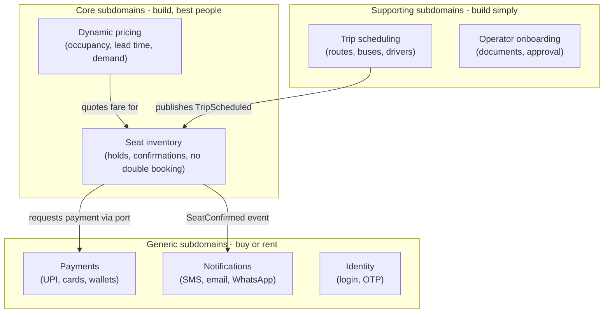
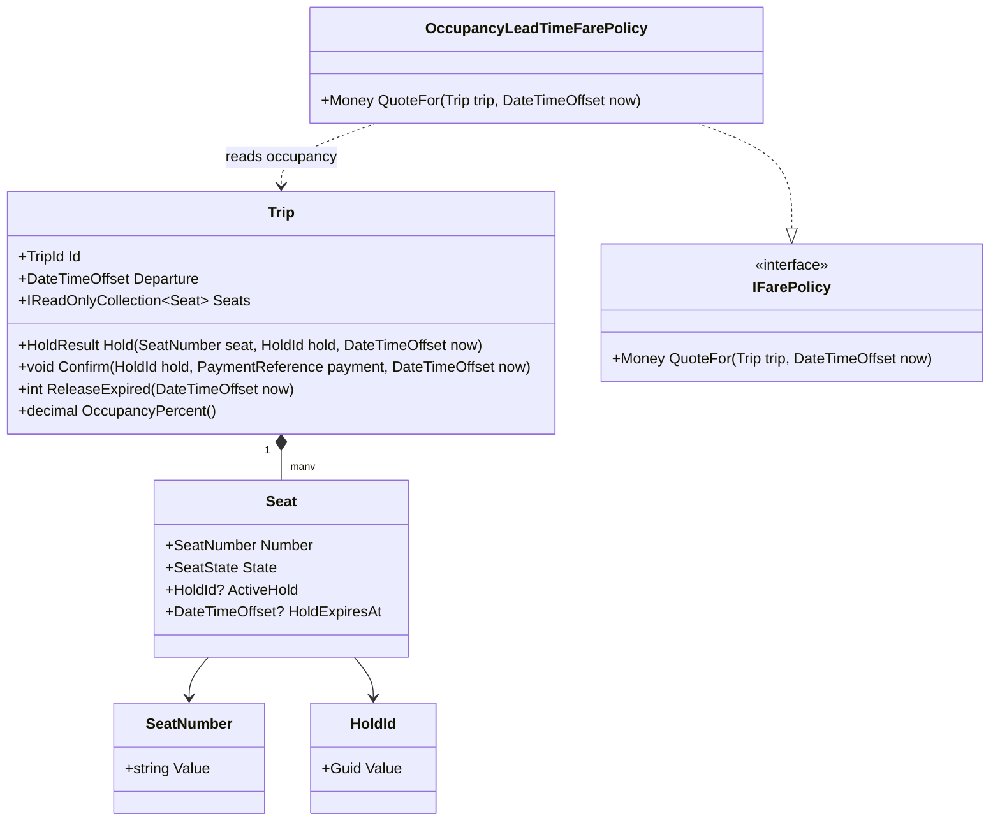
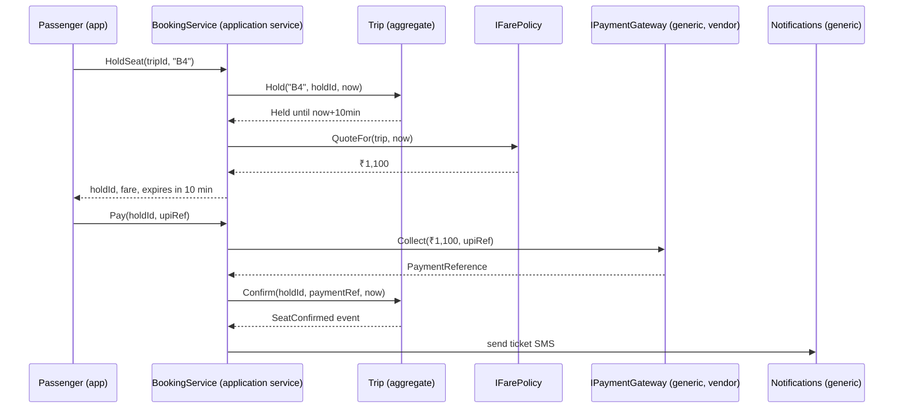

Domain-Driven Design has two halves. The **tactical** half is the toolbox you have met in earlier lessons: entities, value objects, aggregates, repositories, domain events. The **strategic** half is about *where to point the toolbox*: which parts of a business deserve a rich model, which deserve a spreadsheet-grade CRUD screen, and which you should not build at all. Teams that learn only the tactical half tend to build beautiful aggregates for the login page and a 2,000-line stored procedure for the pricing engine. This lesson is about not doing that.

## Learning objectives

By the end of this lesson you will be able to:

1. Classify the subdomains of a business as core, supporting or generic, and say what each classification implies for build-versus-buy and for design effort.
2. Explain the difference between a subdomain (problem space) and a bounded context (solution space) and why they do not always line up.
3. Run a basic event storming session: the sticky-note colours, the three phases and how the output turns into aggregates and contexts.
4. Apply a *different* implementation style to each subdomain in one ASP.NET Core application: a rich aggregate for the core, a transaction script for supporting work, a thin port to a bought service for generic work.
5. Use a short checklist to decide when DDD is overkill and what to use instead.
6. Describe the tactical pattern set in one breath and say which pieces are optional.

## Prerequisites

- [Bounded contexts and ubiquitous language](#/lesson/m08-bounded-contexts): we build on context maps.
- [Aggregates and aggregate roots](#/lesson/m08-aggregates) and [Entities and value objects in DDD](#/lesson/m08-entities-value-objects): the core-domain example is an aggregate.
- [Domain modeling](#/lesson/m07-domain-modeling): the vocabulary of models and rules.

Useful afterwards: [Identifying overengineering and underengineering](#/lesson/m04-over-under-engineering).

## Explain it like I'm a beginner

Imagine you run an intercity bus company: 120 buses between Delhi, Jaipur, Chandigarh and Lucknow, 9,000 tickets a day. You have one budget for software and one small team. Where do you spend them?

List what the business does:

- **Selling seats**: which seat, at what price, with a 10-minute hold while the passenger pays, no double booking on a busy Friday night. Get this wrong and you lose money and trust *every day*.
- **Pricing**: a Friday 6 pm Delhi–Jaipur seat sells for ₹1,100; the same seat on Tuesday at 2 pm sells for ₹650. Good pricing is where profit comes from.
- **Scheduling trips** and assigning buses and drivers: important, but every bus company does roughly the same thing.
- **Operator onboarding**: forms, documents, approval. Necessary, boring.
- **Taking payments**: UPI, cards, wallets. Hard to do well, and a dozen companies will do it for you for a fee.
- **Sending SMS and email**: same story.
- **Login and passwords**: same story.

The DDD word for each of these is a **subdomain**: a slice of the problem the business has to solve. Strategic design sorts them into three piles:

- **Core**: the things that make *this* company different and profitable. Seat selling and pricing. You build these yourself, with your best people, and you model them carefully.
- **Supporting**: things you must do, specific to your business, but not where you win. Trip scheduling, operator onboarding. Build simply, or configure a tool.
- **Generic**: things every company needs that are the same for everyone. Payments, SMS, identity. Buy, rent or use open source. Do not design aggregates for them.

The analogy is a restaurant. The *recipes and the chef* are core. The *table booking system* is supporting: you need one, it should work, nobody chooses your restaurant for it. The *card machine* is generic: you rent it. A restaurant that spends its budget building a custom card machine while buying frozen curries has its priorities backwards. So does a software team that builds a custom identity server and writes pricing as a stored procedure.

**Tactical DDD** is the set of coding patterns (entity, value object, aggregate, repository, domain event) that you use where the model is rich. **Strategic DDD** is deciding *where* that is. The second decision comes first.

## First-principles explanation

### Problem space and solution space

A **domain** is the whole business problem. A **subdomain** is a part of it, defined by what the business *does*: pricing, scheduling, payments. Subdomains exist whether or not you write software; the bus company had them when tickets were paper.

A **bounded context** is a solution-space concept: a boundary around a model in your software (see the [previous lesson](#/lesson/m08-bounded-contexts)). In a well-shaped system, one context serves one subdomain. In practice you will see mismatches: a legacy ERP is one context covering three subdomains; a core subdomain may be split into two contexts because two teams work on it. Keep the two words distinct in your head: subdomain = problem, context = solution.

### The three kinds of subdomain

**Core subdomain.** The part where the business competes. Two tests: (1) if a competitor copied this exactly, would it hurt? (2) does the business *change its mind* about this often, because it is learning and experimenting? For the bus company, seat inventory with holds and dynamic pricing pass both tests. Core subdomains are small; a company rarely has more than two or three. They justify the full tactical toolkit, the most senior developers, the most tests, and the slowest, most deliberate schema changes.

**Supporting subdomain.** Necessary, specific to the business, but not a differentiator. There is usually no off-the-shelf product because the need is too particular, yet the logic is simple. Trip scheduling (which bus, which driver, which route, which days) is an example: it has rules, but they are stable and mostly CRUD with validation. Build it simply. A transaction script per use case, a few validation rules, a table per concept. Junior developers can own it. Over-modelling here is a classic waste.

**Generic subdomain.** Needed by everyone, solved by everyone, the same way. Payments, authentication, email/SMS, PDF generation, accounting ledgers. Buy a product or use a well-maintained library, and wrap it in a thin port so you can swap vendors. The design effort you spend here is in the *integration*, not the model. Note the trap: a generic subdomain can be *complex* (payments are very complex) without being *core*. Complexity is not what makes something core; differentiation is.

| | Core | Supporting | Generic |
|---|---|---|---|
| Competitive advantage? | Yes | No | No |
| Specific to us? | Yes | Yes | No |
| Build or buy? | Build, in-house, best people | Build simply, or configure | Buy or open source |
| Modelling style | Rich domain model, aggregates, events | Transaction script / CRUD with validation | Thin adapter behind a port |
| Rate of change | High, experimental | Low | Vendor-driven |
| Test depth | Deep unit tests on invariants | Mostly integration tests | Contract tests on the adapter |

Classification is a *business* judgement, so make it with business people in the room, and revisit it yearly. Yesterday's core becomes today's generic (search was core for early web companies; now it is a managed service). And a supporting subdomain can become core if the strategy changes: if the bus company decides to win on "most reliable schedules", scheduling moves to core.

### Why classify at all

Because effort is finite and the cost of a wrong allocation compounds. Three concrete consequences of classification:

1. **Staffing.** Senior modellers on the core; a product owner with deep business knowledge attached to it.
2. **Architecture.** The core gets a bounded context with strong boundaries and an ACL against everything else, so experiments there do not leak out and vendor churn does not leak in.
3. **Backlog shape.** A generic subdomain's backlog should be "integrate, monitor, upgrade", not "add features". If you find yourself adding features to your in-house email sender, something is wrong.

### Event storming: finding subdomains and aggregates fast

Event storming (Alberto Brandolini) is a workshop format for discovering a domain in hours instead of months. Everyone who knows the business stands at a long paper wall with sticky notes. The colours are a convention:

- **Orange**: domain events, written in past tense ("Seat held", "Payment confirmed", "Trip cancelled"). These come first and in rough time order.
- **Blue**: commands, the actions that cause events ("Hold seat", "Confirm payment").
- **Small yellow**: the actor who issues the command (passenger, operator, scheduler job).
- **Pink/red**: hotspots: disagreements, unknowns, "we have never decided this". These are gold; they show where the model is unclear.
- **Lilac/purple**: policies: "whenever X happens, then Y" ("whenever a hold expires, the seat is released").
- **Green**: read models: what the actor needs to see to decide ("seat map with prices").
- **Large yellow**: aggregates, added late: the thing that receives the command and emits the event.

Three phases, in order:

1. **Big picture.** Only orange stickies. Everyone writes events in parallel, then the group sorts them on a timeline. Pivotal events (where the business changes mode, "Payment confirmed" is one) become vertical lines. Clusters of events between pivots are usually subdomains or contexts. Half a day for a mid-size business.
2. **Process modelling.** Add commands, actors, policies and read models around each event. You now have the flow: actor sees a read model, issues a command, an aggregate emits an event, a policy reacts. Hotspots multiply here.
3. **Software design.** Group commands and events by the thing that must stay consistent. Each group is a candidate aggregate. Draw boundaries where language changes: that is a candidate bounded context.

The output is not a design document. It is a shared understanding plus a wall of stickies that maps almost directly to code: events become `record` types, commands become methods on aggregates, policies become event handlers, read models become queries. Our implementation below uses the names we would have got from such a session.

### The tactical toolkit, in one paragraph

**Entities** have identity and a lifecycle. **Value objects** are defined by their attributes and are immutable. An **aggregate** is a cluster of entities and value objects with one **root** that enforces invariants; you load and save it as a unit. A **repository** gives collection-like access to aggregates. A **domain service** holds logic that belongs to no single aggregate. A **domain event** records that something happened. A **factory** encapsulates complex creation. An **application service** orchestrates a use case: load aggregate, call method, save, publish. Of these, only entity, value object and aggregate are essential to the *modelling* idea; the rest are plumbing choices that you include when they earn their keep.

### When DDD is overkill

Be honest about this. DDD's tactical patterns add classes, indirection and ceremony. They pay off when the *domain logic* is complex and changes often. They cost you when it is not. Signs you should not use a rich domain model:

- **The application is mostly CRUD.** Forms in, rows out, a few validation rules. An admin panel, a master-data screen, a survey tool. Use a transaction script or a thin service with validation; map DTOs straight to tables.
- **The logic is computational, not conceptual.** Report generation, ETL pipelines, image processing. These have algorithms, not business invariants; functions and pipelines beat aggregates.
- **The team is one to three people and the domain expert is you.** The communication benefits of ubiquitous language and context maps do not materialise when there is nobody to communicate with. Keep code simple and refactor towards a model if the domain grows.
- **Nobody can name an invariant.** If the only rules are "required field" and "must be positive", there is nothing for an aggregate to protect.
- **The system is a throwaway or a proof of concept.** Model later if it survives.

What to use instead: **Transaction Script** (one method per use case that does the work in order), **Active Record** (entity classes that know how to save themselves; EF Core entities with simple services get close), or **Table Module** style CRUD endpoints. None of these are "bad"; they are the right tool for low-complexity domains, and Martin Fowler's own guidance is that Domain Model wins only when logic is complex enough to make a transaction script tangled.

:::callout type=tradeoff title="Mix styles inside one application"
The classification is per subdomain, so the implementation style is too. In the implementation below, `Trip` is a rich aggregate (core), `OperatorProfileService` is a transaction script (supporting), and `IPaymentGateway` is a one-method port over a vendor (generic). All three live in one ASP.NET Core process. Nobody is forced to write an aggregate for an address book.
:::

## Visual explanation

### Subdomain map for the bus company



How to read it: the three bands are the three classifications, and the arrows are the main dependencies between subdomains. Notice the direction: core depends on generic *through ports* (the arrow to Payments is an interface the core owns), and supporting feeds core with facts (`TripScheduled`). Nothing in the generic band knows anything about seats. If you had to rewrite the whole company's software with half the budget, you would rewrite the top band and rent the bottom one.

### The core aggregate



`Trip` is the aggregate root: every change to a seat goes through it, so the invariant "a seat is never held or sold twice" is enforced in one place. `Seat` is an entity inside the aggregate (it has identity within the trip, but no life outside it). `SeatNumber` and `HoldId` are value objects. `IFarePolicy` is a domain service: pricing needs the whole trip's occupancy and the current time, which is not any one seat's business. All of this is core, so it gets the full treatment.

### Sequence: a passenger buys a seat



The application service is thin: it loads the trip, calls one aggregate method, calls the payment port, calls another aggregate method, saves. All rules (can this seat be held, has the hold expired, is the payment reference already used) live in `Trip`. The payment gateway and notifications are behind interfaces because they are generic: tomorrow's vendor change does not touch the booking flow.

## Step-by-step example

### Step 1 — list subdomains with the business

In a two-hour session with the operations head and the finance head, we listed: seat selling, pricing, scheduling, operator onboarding, payments, notifications, identity, GST invoicing, customer support tickets, driver attendance. We asked the two core questions for each. Seat selling and pricing were the only ones where both executives said "this is why people choose us and we change it monthly".

### Step 2 — classify and decide build/buy

Core: seat inventory, pricing. Supporting: scheduling, onboarding, driver attendance. Generic: payments (vendor), notifications (vendor), identity (managed service), GST invoicing (library + portal adapter), support tickets (SaaS). The team of six now knows that four of them work on two subdomains.

### Step 3 — event storm the core

Big picture produced about 40 orange stickies. Pivotal events: *Trip scheduled*, *Seat held*, *Payment confirmed*, *Trip departed*. Between *Seat held* and *Payment confirmed* lived the hottest hotspot: "what happens if payment arrives after the hold expired and someone else holds the seat?" Nobody had decided. The decision (refund automatically, offer the next available seat) became a policy sticky and later a test.

### Step 4 — map stickies to code

- Events → `SeatHeld`, `SeatConfirmed`, `HoldExpired` records.
- Commands → `Trip.Hold`, `Trip.Confirm`, `Trip.ReleaseExpired` methods.
- Policy "when a hold expires, release the seat" → a scheduled job calling `ReleaseExpired`.
- Read model "seat map with fares" → a query that joins seats and the fare policy's quote, outside the aggregate.
- Aggregate boundary → `Trip` owns its seats; a hold never spans trips.

### Step 5 — implement the supporting and generic parts differently

`OperatorProfileService` is a transaction script: validate, upsert, done. `IPaymentGateway` is an interface with one method and a fake. No aggregates, no events, no repositories for them. The next section shows all three styles side by side.

## Production-style C# implementation

```text
BusGo.Api/
  Program.cs
  Core/Booking/ValueObjects.cs
  Core/Booking/Trip.cs
  Core/Booking/Events.cs
  Core/Booking/FarePolicy.cs
  Core/Booking/BookingService.cs
  Supporting/Operators/OperatorProfileService.cs
  Generic/Payments/IPaymentGateway.cs
```

### Core: value objects

```csharp file=Core/Booking/ValueObjects.cs
namespace BusGo.Core.Booking;

public readonly record struct TripId(Guid Value);
public readonly record struct HoldId(Guid Value);
public readonly record struct PaymentReference(string Value);

public readonly record struct SeatNumber
{
    public string Value { get; }
    public SeatNumber(string value)
    {
        if (string.IsNullOrWhiteSpace(value) || value.Length > 4) throw new ArgumentException("Seat number must be 1-4 characters.", nameof(value));
        Value = value.ToUpperInvariant();
    }
    public override string ToString() => Value;
}

public readonly record struct Money(decimal Amount, string Currency)
{
    public static Money Inr(decimal amount) => new(Math.Round(amount, 2, MidpointRounding.ToEven), "INR");
    public Money Times(decimal factor) => new(Math.Round(Amount * factor, 2, MidpointRounding.ToEven), Currency);
    public override string ToString() => $"{Currency} {Amount:0.00}";
}

public enum SeatState { Available, Held, Confirmed }

public enum HoldOutcome { Held, SeatUnavailable, SeatNotFound }

public sealed record HoldResult(HoldOutcome Outcome, DateTimeOffset? ExpiresAt);
```

### Core: domain events

```csharp file=Core/Booking/Events.cs
namespace BusGo.Core.Booking;

/// <summary>Names come straight from the event-storming wall: past tense, business words.</summary>
public abstract record BookingEvent(TripId TripId, DateTimeOffset OccurredAt);
public sealed record SeatHeld(TripId TripId, SeatNumber Seat, HoldId Hold, DateTimeOffset ExpiresAt, DateTimeOffset OccurredAt) : BookingEvent(TripId, OccurredAt);
public sealed record SeatConfirmed(TripId TripId, SeatNumber Seat, HoldId Hold, PaymentReference Payment, DateTimeOffset OccurredAt) : BookingEvent(TripId, OccurredAt);
public sealed record HoldExpired(TripId TripId, SeatNumber Seat, HoldId Hold, DateTimeOffset OccurredAt) : BookingEvent(TripId, OccurredAt);
```

### Core: the aggregate

```csharp file=Core/Booking/Trip.cs
namespace BusGo.Core.Booking;

public sealed class Seat
{
    public SeatNumber Number { get; }
    public SeatState State { get; private set; } = SeatState.Available;
    public HoldId? ActiveHold { get; private set; }
    public DateTimeOffset? HoldExpiresAt { get; private set; }
    public PaymentReference? Payment { get; private set; }

    internal Seat(SeatNumber number) => Number = number;

    internal bool IsFreeAt(DateTimeOffset now) =>
        State == SeatState.Available || (State == SeatState.Held && HoldExpiresAt is { } exp && exp <= now);

    internal void Hold(HoldId hold, DateTimeOffset expiresAt)
    {
        State = SeatState.Held;
        ActiveHold = hold;
        HoldExpiresAt = expiresAt;
    }

    internal void Confirm(PaymentReference payment)
    {
        State = SeatState.Confirmed;
        Payment = payment;
        HoldExpiresAt = null;
    }

    internal void Release()
    {
        State = SeatState.Available;
        ActiveHold = null;
        HoldExpiresAt = null;
    }
}

/// <summary>Core-domain aggregate root. Invariant: a seat is never held or sold to two passengers at once.</summary>
public sealed class Trip
{
    public static readonly TimeSpan HoldDuration = TimeSpan.FromMinutes(10);

    private readonly Dictionary<SeatNumber, Seat> _seats;
    private readonly HashSet<PaymentReference> _usedPayments = new();
    private readonly List<BookingEvent> _events = new();

    public TripId Id { get; }
    public string Route { get; }
    public DateTimeOffset Departure { get; }
    public Money BaseFare { get; }
    public IReadOnlyCollection<Seat> Seats => _seats.Values;
    public IReadOnlyList<BookingEvent> PendingEvents => _events;

    public Trip(TripId id, string route, DateTimeOffset departure, Money baseFare, IEnumerable<SeatNumber> seatNumbers)
    {
        ArgumentException.ThrowIfNullOrWhiteSpace(route);
        Id = id;
        Route = route;
        Departure = departure;
        BaseFare = baseFare;
        _seats = seatNumbers.Distinct().ToDictionary(n => n, n => new Seat(n));
        if (_seats.Count == 0) throw new ArgumentException("A trip needs at least one seat.", nameof(seatNumbers));
    }

    public HoldResult Hold(SeatNumber seatNumber, HoldId hold, DateTimeOffset now)
    {
        if (now >= Departure) throw new InvalidOperationException("Trip has already departed.");
        if (!_seats.TryGetValue(seatNumber, out var seat)) return new HoldResult(HoldOutcome.SeatNotFound, null);
        if (!seat.IsFreeAt(now)) return new HoldResult(HoldOutcome.SeatUnavailable, null);

        if (seat.State == SeatState.Held && seat.ActiveHold is { } stale)
            _events.Add(new HoldExpired(Id, seat.Number, stale, now));

        var expiresAt = now + HoldDuration;
        seat.Hold(hold, expiresAt);
        _events.Add(new SeatHeld(Id, seat.Number, hold, expiresAt, now));
        return new HoldResult(HoldOutcome.Held, expiresAt);
    }

    public void Confirm(HoldId hold, PaymentReference payment, DateTimeOffset now)
    {
        var seat = _seats.Values.FirstOrDefault(s => s.ActiveHold == hold && s.State == SeatState.Held)
                   ?? throw new InvalidOperationException("Hold not found or already used.");
        if (seat.HoldExpiresAt is { } exp && exp <= now) throw new InvalidOperationException("Hold has expired.");
        if (!_usedPayments.Add(payment)) throw new InvalidOperationException("Payment reference already used.");

        seat.Confirm(payment);
        _events.Add(new SeatConfirmed(Id, seat.Number, hold, payment, now));
    }

    /// <summary>Policy from the storming wall: when a hold expires, the seat is released. Returns how many were released.</summary>
    public int ReleaseExpired(DateTimeOffset now)
    {
        var released = 0;
        foreach (var seat in _seats.Values.Where(s => s.State == SeatState.Held && s.HoldExpiresAt <= now).ToList())
        {
            _events.Add(new HoldExpired(Id, seat.Number, seat.ActiveHold!.Value, now));
            seat.Release();
            released++;
        }
        return released;
    }

    public decimal OccupancyPercent()
    {
        var taken = _seats.Values.Count(s => s.State != SeatState.Available);
        return Math.Round(100m * taken / _seats.Count, 1);
    }

    public void ClearEvents() => _events.Clear();
}
```

Three points about this aggregate. First, `Seat`'s mutators are `internal`, so nothing outside the assembly can bypass the root. Second, time is passed in, never read from `DateTime.Now`, so expiry is testable to the second. Third, the aggregate records events but does not publish them; that is the application service's job after a successful save, which keeps the aggregate free of infrastructure (see [Domain events](#/lesson/m08-domain-events)).

### Core: the pricing domain service

```csharp file=Core/Booking/FarePolicy.cs
namespace BusGo.Core.Booking;

public interface IFarePolicy
{
    Money QuoteFor(Trip trip, DateTimeOffset now);
}

/// <summary>Core-domain logic that the business changes monthly. Numbers here are the current rule card, not constants of nature.</summary>
public sealed class OccupancyLeadTimeFarePolicy : IFarePolicy
{
    public Money QuoteFor(Trip trip, DateTimeOffset now)
    {
        var occupancy = trip.OccupancyPercent();
        var daysOut = (trip.Departure - now).TotalDays;

        var occupancyFactor = occupancy switch
        {
            >= 90m => 1.40m,
            >= 70m => 1.20m,
            >= 40m => 1.00m,
            _ => 0.90m,
        };
        var leadTimeFactor = daysOut switch
        {
            < 1 => 1.25m,
            < 3 => 1.10m,
            < 14 => 1.00m,
            _ => 0.95m,
        };
        return trip.BaseFare.Times(occupancyFactor * leadTimeFactor);
    }
}
```

### Core: the application service

```csharp file=Core/Booking/BookingService.cs
using BusGo.Generic.Payments;

namespace BusGo.Core.Booking;

public interface ITripRepository
{
    Trip? Find(TripId id);
    void Save(Trip trip);
}

public sealed class InMemoryTripRepository : ITripRepository
{
    private readonly Dictionary<TripId, Trip> _trips = new();
    public Trip? Find(TripId id) => _trips.GetValueOrDefault(id);
    public void Save(Trip trip) => _trips[trip.Id] = trip;
}

public interface IBookingEventPublisher
{
    Task PublishAsync(IReadOnlyList<BookingEvent> events, CancellationToken ct);
}

public sealed record HoldQuote(HoldId Hold, Money Fare, DateTimeOffset ExpiresAt);

public sealed class BookingService(ITripRepository trips, IFarePolicy fares, IPaymentGateway payments, IBookingEventPublisher publisher, TimeProvider clock)
{
    public async Task<HoldQuote?> HoldSeatAsync(TripId tripId, SeatNumber seat, CancellationToken ct)
    {
        var trip = trips.Find(tripId) ?? throw new KeyNotFoundException("Trip not found.");
        var now = clock.GetUtcNow();
        var hold = new HoldId(Guid.NewGuid());

        var result = trip.Hold(seat, hold, now);
        if (result.Outcome != HoldOutcome.Held) return null;

        var fare = fares.QuoteFor(trip, now);
        trips.Save(trip);
        await publisher.PublishAsync(trip.PendingEvents, ct);
        trip.ClearEvents();
        return new HoldQuote(hold, fare, result.ExpiresAt!.Value);
    }

    public async Task ConfirmAsync(TripId tripId, HoldId hold, Money fare, string payerUpiId, CancellationToken ct)
    {
        var trip = trips.Find(tripId) ?? throw new KeyNotFoundException("Trip not found.");

        // Generic subdomain behind a port: we do not model payments, we ask a vendor.
        var paymentRef = await payments.CollectAsync(fare, payerUpiId, ct);

        trip.Confirm(hold, paymentRef, clock.GetUtcNow());
        trips.Save(trip);
        await publisher.PublishAsync(trip.PendingEvents, ct);
        trip.ClearEvents();
    }
}
```

### Supporting: a transaction script

```csharp file=Supporting/Operators/OperatorProfileService.cs
namespace BusGo.Supporting.Operators;

public sealed class OperatorProfile
{
    public Guid Id { get; set; }
    public string LegalName { get; set; } = "";
    public string Gstin { get; set; } = "";
    public string ContactPhone { get; set; } = "";
    public bool Approved { get; set; }
}

public interface IOperatorProfileStore
{
    OperatorProfile? Get(Guid id);
    void Upsert(OperatorProfile profile);
}

public sealed class InMemoryOperatorProfileStore : IOperatorProfileStore
{
    private readonly Dictionary<Guid, OperatorProfile> _rows = new();
    public OperatorProfile? Get(Guid id) => _rows.GetValueOrDefault(id);
    public void Upsert(OperatorProfile profile) => _rows[profile.Id] = profile;
}

/// <summary>Supporting subdomain: plain transaction script. Validate, write, done. No aggregate, no events, on purpose.</summary>
public sealed class OperatorProfileService(IOperatorProfileStore store)
{
    public Guid Register(string legalName, string gstin, string contactPhone)
    {
        if (string.IsNullOrWhiteSpace(legalName)) throw new ArgumentException("Legal name is required.");
        if (gstin.Length != 15) throw new ArgumentException("GSTIN must be 15 characters.");
        if (contactPhone.Length != 10 || !contactPhone.All(char.IsDigit)) throw new ArgumentException("Phone must be 10 digits.");

        var profile = new OperatorProfile { Id = Guid.NewGuid(), LegalName = legalName.Trim(), Gstin = gstin.ToUpperInvariant(), ContactPhone = contactPhone };
        store.Upsert(profile);
        return profile.Id;
    }

    public void Approve(Guid id)
    {
        var profile = store.Get(id) ?? throw new KeyNotFoundException("Operator not found.");
        profile.Approved = true;
        store.Upsert(profile);
    }
}
```

This is deliberately "un-DDD": public setters, no value objects, no events. For a form with three fields and one approval flag, that is the right amount of design. If onboarding later grows real rules (document verification states, expiry, re-approval), refactor towards a small aggregate then.

### Generic: a port over a vendor

```csharp file=Generic/Payments/IPaymentGateway.cs
using BusGo.Core.Booking;

namespace BusGo.Generic.Payments;

/// <summary>Generic subdomain. The interface is owned by us; the implementation is a vendor SDK we do not model.</summary>
public interface IPaymentGateway
{
    Task<PaymentReference> CollectAsync(Money amount, string payerUpiId, CancellationToken ct);
}

public sealed class FakePaymentGateway : IPaymentGateway
{
    public Task<PaymentReference> CollectAsync(Money amount, string payerUpiId, CancellationToken ct) =>
        Task.FromResult(new PaymentReference($"UPI-{Guid.NewGuid():N}"));
}
```

### Composition root

```csharp file=Program.cs
using BusGo.Core.Booking;
using BusGo.Generic.Payments;
using BusGo.Supporting.Operators;

var builder = WebApplication.CreateBuilder(args);

builder.Services.AddSingleton(TimeProvider.System);

// Core
builder.Services.AddSingleton<ITripRepository, InMemoryTripRepository>();
builder.Services.AddSingleton<IFarePolicy, OccupancyLeadTimeFarePolicy>();
builder.Services.AddSingleton<IBookingEventPublisher, LoggingEventPublisher>();
builder.Services.AddSingleton<BookingService>();

// Supporting
builder.Services.AddSingleton<IOperatorProfileStore, InMemoryOperatorProfileStore>();
builder.Services.AddSingleton<OperatorProfileService>();

// Generic: vendor behind a port
builder.Services.AddSingleton<IPaymentGateway, FakePaymentGateway>();

var app = builder.Build();

app.MapPost("/trips/{tripId:guid}/holds", async (Guid tripId, string seat, BookingService booking, CancellationToken ct) =>
{
    var quote = await booking.HoldSeatAsync(new TripId(tripId), new SeatNumber(seat), ct);
    return quote is null ? Results.Conflict("Seat unavailable.") : Results.Ok(quote);
});

app.MapPost("/operators", (string legalName, string gstin, string phone, OperatorProfileService operators) =>
    Results.Ok(new { id = operators.Register(legalName, gstin, phone) }));

app.Run();

public sealed class LoggingEventPublisher(ILogger<LoggingEventPublisher> log) : IBookingEventPublisher
{
    public Task PublishAsync(IReadOnlyList<BookingEvent> events, CancellationToken ct)
    {
        foreach (var e in events) log.LogInformation("Domain event {Event}", e);
        return Task.CompletedTask;
    }
}
```

## Bad design vs good design

**Bad: uniform ceremony.** Every table gets an aggregate, a repository interface, a repository implementation, a domain service, a command, a command handler and three DTOs. `OperatorProfile` has a `ChangeContactPhone` method that raises an `OperatorContactPhoneChanged` event nobody consumes. The team ships 40 % slower and the core pricing logic is still a `switch` in a controller because "we ran out of time".

**Good: effort follows classification.** Two rich aggregates where the money is. Transaction scripts for the forms. Vendors behind one-method ports. The budget saved on ceremony buys a second month of pricing experiments.

**Bad: uniform simplicity.** The opposite failure. Everything is a transaction script, including seat selling. Holds are a `held_until` column updated by a controller; the "no double booking" rule is a comment. On Diwali eve two passengers get seat B4 because two requests passed the same `if` within 30 ms. The fix is a `SELECT ... FOR UPDATE` bolted on in a hurry, and the next bug is in the refund flow nobody modelled.

**Good: the core gets invariants in one place.** `Trip.Hold` is the only path to holding a seat, it is unit-tested with a controllable clock, and the persistence layer wraps the aggregate save in optimistic concurrency (see [Transaction boundaries and aggregate consistency](#/lesson/m08-transaction-boundaries)).

:::callout type=mistake title="Confusing 'complex' with 'core'"
Payments are enormously complex: retries, reconciliation, chargebacks, regulatory rules. They are still generic for a bus company, because that complexity is the same for everyone and a vendor has already solved it. Core is about *differentiation*, not difficulty. Spend your complexity budget on what makes you different.
:::

## Practical playground

The starter builds a 40-seat Delhi–Jaipur trip, holds seats, lets one hold expire, and prints fares as occupancy changes. Change the fare rule card and the hold duration and watch the quotes move. Then try to double-book seat A1 and see where the aggregate stops you.

:::playground type=csharp title="Core aggregate with a changeable fare policy"
```csharp file=Program.cs
using System;
using System.Collections.Generic;
using System.Linq;

public readonly record struct HoldId(Guid Value);
public enum SeatState { Available, Held, Confirmed }

public sealed class Seat
{
    public string Number { get; }
    public SeatState State { get; internal set; } = SeatState.Available;
    public HoldId? Hold { get; internal set; }
    public DateTimeOffset? HoldExpiresAt { get; internal set; }
    public Seat(string number) => Number = number;
}

public sealed class Trip
{
    public static TimeSpan HoldDuration = TimeSpan.FromMinutes(10);
    private readonly Dictionary<string, Seat> _seats;
    public DateTimeOffset Departure { get; }
    public decimal BaseFare { get; }
    public IReadOnlyCollection<Seat> Seats => _seats.Values;

    public Trip(DateTimeOffset departure, decimal baseFare, int seatCount)
    {
        Departure = departure; BaseFare = baseFare;
        _seats = Enumerable.Range(1, seatCount).Select(i => new Seat($"{(char)('A' + (i - 1) / 4)}{(i - 1) % 4 + 1}")).ToDictionary(s => s.Number);
    }

    public bool Hold(string seatNo, HoldId hold, DateTimeOffset now)
    {
        var seat = _seats[seatNo];
        var free = seat.State == SeatState.Available || (seat.State == SeatState.Held && seat.HoldExpiresAt <= now);
        if (!free) return false;
        seat.State = SeatState.Held; seat.Hold = hold; seat.HoldExpiresAt = now + HoldDuration;
        return true;
    }

    public void Confirm(HoldId hold, DateTimeOffset now)
    {
        var seat = _seats.Values.First(s => s.Hold == hold && s.State == SeatState.Held);
        if (seat.HoldExpiresAt <= now) throw new InvalidOperationException("Hold expired");
        seat.State = SeatState.Confirmed; seat.HoldExpiresAt = null;
    }

    public decimal OccupancyPercent() => Math.Round(100m * _seats.Values.Count(s => s.State != SeatState.Available) / _seats.Count, 1);
}

public static class FarePolicy
{
    // The rule card. Try changing these and re-running.
    public static decimal Quote(Trip trip, DateTimeOffset now)
    {
        var occ = trip.OccupancyPercent();
        var days = (trip.Departure - now).TotalDays;
        var f1 = occ >= 90 ? 1.4m : occ >= 70 ? 1.2m : occ >= 40 ? 1.0m : 0.9m;
        var f2 = days < 1 ? 1.25m : days < 3 ? 1.1m : days < 14 ? 1.0m : 0.95m;
        return Math.Round(trip.BaseFare * f1 * f2, 2);
    }
}

public static class Program
{
    public static void Main()
    {
        var now = new DateTimeOffset(2026, 10, 30, 18, 0, 0, TimeSpan.FromHours(5.5));
        var trip = new Trip(now.AddDays(2), 800m, 40);
        Console.WriteLine($"Empty bus, 2 days out: ₹{FarePolicy.Quote(trip, now)}");

        var holds = new List<HoldId>();
        foreach (var seat in trip.Seats.Take(30)) { var h = new HoldId(Guid.NewGuid()); trip.Hold(seat.Number, h, now); holds.Add(h); }
        foreach (var h in holds.Take(29)) trip.Confirm(h, now.AddMinutes(5));
        Console.WriteLine($"After 29 confirmed + 1 held ({trip.OccupancyPercent()} %): ₹{FarePolicy.Quote(trip, now.AddMinutes(5))}");

        var later = now.AddMinutes(11);                       // the 30th hold has expired by now
        Console.WriteLine($"Re-hold expired seat H2 at +11 min: {trip.Hold("H2", new HoldId(Guid.NewGuid()), later)}");
        Console.WriteLine($"Double-book confirmed seat A1: {trip.Hold("A1", new HoldId(Guid.NewGuid()), later)}");
    }
}
```
:::

## Exercises

:::exercise id=m08-strategic-tactical-ex1 difficulty=beginner kind=written title="Classify the subdomains of a food-delivery company"
A food-delivery company (restaurants, riders, customers) lists these activities: restaurant menu management, order placement, rider dispatch and routing, delivery-time prediction, surge pricing for delivery fees, payments and refunds, customer login, push notifications, restaurant payouts and GST invoicing, customer support chat, promotional coupons. Classify each as core, supporting or generic, and justify each in one sentence. Then name the one classification you are least sure about and say what question you would ask the business to settle it.
::acceptance
- Every activity has exactly one classification and a one-sentence justification based on differentiation and specificity, not difficulty.
- At least two activities are classified as generic with a buy/rent recommendation.
- The least-certain classification is named with a concrete question for the business.
- Build/buy and modelling-style implications are stated for at least one activity in each category.
::hint
Ask the two core questions for each item: would a competitor copying this exactly hurt us, and do we change our minds about it often?
::hint
Payments, login and notifications are complex but identical for every company. Which category is that?
::hint
Dispatch and delivery-time prediction are where a delivery company lives or dies. Coupons might be core (growth) or supporting (a config table), depending on strategy.
::solution
**Core**: rider dispatch and routing (the whole promise is "food arrives hot and fast"; competitors with better dispatch win); delivery-time prediction (the number customers see and judge you by, changed weekly as models improve); surge pricing for delivery fees (balances rider supply against demand, directly drives margin). Rich models, best people, deep tests, in-house.

**Supporting**: restaurant menu management (specific to us, but CRUD with a few rules such as availability windows); order placement (important, but mostly validation and orchestration; the hard parts are in dispatch and pricing); restaurant payouts and GST invoicing (specific rules, but stable and rule-table driven; a transaction script plus a GST library and portal adapter); promotional coupons (a rules table with validation; becomes core only if growth-hacking via coupons is the strategy).

**Generic**: payments and refunds (vendor gateway behind a port), customer login (managed identity provider), push notifications (vendor), customer support chat (SaaS).

**Least sure**: order placement. The question: "When an order fails or is slow, is it usually the placement flow or the dispatch flow, and which do we change more often?" If the business is experimenting with placement (group orders, scheduled orders, cart-level recommendations), it moves toward core; if not, it stays supporting with a thin orchestrating service.

**Implications**: dispatch gets an aggregate per delivery with a state machine and its own context; menus get CRUD endpoints with validation; payments get an `IPaymentGateway` interface and a fake for tests, and nobody writes a `Payment` aggregate.
::mistakes
- Classifying payments as core because "money is critical". Critical is not the same as differentiating.
- Classifying everything as core because the business says every feature matters. Push back: if everything is core, nothing gets the extra attention.
- Treating the classification as permanent. Revisit when the strategy changes.
:::

:::exercise id=m08-strategic-tactical-ex2 difficulty=beginner kind=code title="Implement hold expiry in the Trip aggregate"
Implement `Trip.Hold`, `Trip.Confirm` and `Trip.ReleaseExpired` so that a seat can be held for 10 minutes, a hold can be confirmed only while it is live, and expired holds are released and reusable.
::requirements
- `Hold` returns `false` for a seat that is confirmed or has a live hold; it returns `true` and re-holds a seat whose hold has expired.
- `Confirm` throws `InvalidOperationException` if the hold is unknown or expired.
- `ReleaseExpired(now)` returns the number of seats it released and makes them `Available`.
- All time comes from the `now` parameter.
::acceptance
- Holding A1 twice at the same instant: first `true`, second `false`.
- A hold made at 10:00 can be confirmed at 10:09:59 but not at 10:10:00.
- After `ReleaseExpired` at 10:11, a seat held at 10:00 is `Available` and the method returns 1.
::hint
Define "free" as: `Available`, or `Held` with `HoldExpiresAt <= now`. Everything else follows.
::hint
`Confirm` must find the seat by hold id and check the state is still `Held`; a confirmed seat's hold id must not be confirmable twice.
::hint
`ReleaseExpired` iterates seats where `State == Held && HoldExpiresAt <= now`; copy the list first (`.ToList()`) if you mutate while iterating.
::hint
```csharp
public bool Hold(string seatNo, Guid holdId, DateTimeOffset now)
{
    if (!_seats.TryGetValue(seatNo, out var seat)) return false;
    var free = seat.State == SeatState.Available || (seat.State == SeatState.Held && seat.HoldExpiresAt <= now);
    if (!free) return false;
    seat.State = SeatState.Held; seat.HoldId = holdId; seat.HoldExpiresAt = now + HoldDuration;
    return true;
}
```
::starter
```csharp file=Trip.cs
using System;
using System.Collections.Generic;
using System.Linq;

public enum SeatState { Available, Held, Confirmed }

public sealed class Seat
{
    public string Number { get; }
    public SeatState State { get; internal set; } = SeatState.Available;
    public Guid? HoldId { get; internal set; }
    public DateTimeOffset? HoldExpiresAt { get; internal set; }
    public Seat(string number) => Number = number;
}

public sealed class Trip
{
    public static readonly TimeSpan HoldDuration = TimeSpan.FromMinutes(10);
    private readonly Dictionary<string, Seat> _seats;

    public Trip(IEnumerable<string> seatNumbers) =>
        _seats = seatNumbers.ToDictionary(n => n, n => new Seat(n));

    public Seat GetSeat(string number) => _seats[number];

    public bool Hold(string seatNumber, Guid holdId, DateTimeOffset now) => throw new NotImplementedException();

    public void Confirm(Guid holdId, DateTimeOffset now) => throw new NotImplementedException();

    public int ReleaseExpired(DateTimeOffset now) => throw new NotImplementedException();
}
```
::tests
```csharp file=TripTests.cs
using System;
using Xunit;

public class TripTests
{
    private static readonly DateTimeOffset T0 = new(2026, 10, 30, 10, 0, 0, TimeSpan.Zero);
    private static Trip NewTrip() => new(new[] { "A1", "A2", "B1" });

    [Fact]
    public void Same_seat_cannot_be_held_twice_at_once()
    {
        var trip = NewTrip();
        Assert.True(trip.Hold("A1", Guid.NewGuid(), T0));
        Assert.False(trip.Hold("A1", Guid.NewGuid(), T0.AddSeconds(5)));
    }

    [Fact]
    public void Expired_hold_can_be_rehold()
    {
        var trip = NewTrip();
        trip.Hold("A1", Guid.NewGuid(), T0);
        Assert.True(trip.Hold("A1", Guid.NewGuid(), T0.AddMinutes(10)));
    }

    [Fact]
    public void Confirm_within_window_succeeds_and_blocks_seat()
    {
        var trip = NewTrip();
        var hold = Guid.NewGuid();
        trip.Hold("A2", hold, T0);
        trip.Confirm(hold, T0.AddMinutes(9).AddSeconds(59));
        Assert.Equal(SeatState.Confirmed, trip.GetSeat("A2").State);
        Assert.False(trip.Hold("A2", Guid.NewGuid(), T0.AddDays(1)));
    }

    [Fact]
    public void Confirm_after_expiry_throws()
    {
        var trip = NewTrip();
        var hold = Guid.NewGuid();
        trip.Hold("A2", hold, T0);
        Assert.Throws<InvalidOperationException>(() => trip.Confirm(hold, T0.AddMinutes(10)));
    }

    [Fact]
    public void Unknown_hold_throws()
    {
        var trip = NewTrip();
        Assert.Throws<InvalidOperationException>(() => trip.Confirm(Guid.NewGuid(), T0));
    }

    [Fact]
    public void ReleaseExpired_frees_only_expired_holds()
    {
        var trip = NewTrip();
        trip.Hold("A1", Guid.NewGuid(), T0);
        trip.Hold("B1", Guid.NewGuid(), T0.AddMinutes(5));
        var released = trip.ReleaseExpired(T0.AddMinutes(11));
        Assert.Equal(1, released);
        Assert.Equal(SeatState.Available, trip.GetSeat("A1").State);
        Assert.Equal(SeatState.Held, trip.GetSeat("B1").State);
    }
}
```
::solution
```csharp file=Trip.cs
using System;
using System.Collections.Generic;
using System.Linq;

public enum SeatState { Available, Held, Confirmed }

public sealed class Seat
{
    public string Number { get; }
    public SeatState State { get; internal set; } = SeatState.Available;
    public Guid? HoldId { get; internal set; }
    public DateTimeOffset? HoldExpiresAt { get; internal set; }
    public Seat(string number) => Number = number;
}

public sealed class Trip
{
    public static readonly TimeSpan HoldDuration = TimeSpan.FromMinutes(10);
    private readonly Dictionary<string, Seat> _seats;

    public Trip(IEnumerable<string> seatNumbers) =>
        _seats = seatNumbers.ToDictionary(n => n, n => new Seat(n));

    public Seat GetSeat(string number) => _seats[number];

    public bool Hold(string seatNumber, Guid holdId, DateTimeOffset now)
    {
        if (!_seats.TryGetValue(seatNumber, out var seat)) return false;
        var free = seat.State == SeatState.Available
                   || (seat.State == SeatState.Held && seat.HoldExpiresAt is { } exp && exp <= now);
        if (!free) return false;

        seat.State = SeatState.Held;
        seat.HoldId = holdId;
        seat.HoldExpiresAt = now + HoldDuration;
        return true;
    }

    public void Confirm(Guid holdId, DateTimeOffset now)
    {
        var seat = _seats.Values.FirstOrDefault(s => s.HoldId == holdId && s.State == SeatState.Held)
                   ?? throw new InvalidOperationException("Hold not found or already used.");
        if (seat.HoldExpiresAt is { } exp && exp <= now) throw new InvalidOperationException("Hold has expired.");

        seat.State = SeatState.Confirmed;
        seat.HoldExpiresAt = null;
    }

    public int ReleaseExpired(DateTimeOffset now)
    {
        var expired = _seats.Values.Where(s => s.State == SeatState.Held && s.HoldExpiresAt <= now).ToList();
        foreach (var seat in expired)
        {
            seat.State = SeatState.Available;
            seat.HoldId = null;
            seat.HoldExpiresAt = null;
        }
        return expired.Count;
    }
}
```

The whole "no double booking" rule is four lines inside `Hold`. That is the payoff of a core aggregate: the rule has one home, and a test with a fake clock proves it to the second.
::mistakes
- Comparing with `<` instead of `<=` for expiry, so a hold made at 10:00 is still confirmable at exactly 10:10:00. Decide the boundary and test it.
- Letting `Confirm` match a seat whose `HoldId` equals the id but whose state is already `Confirmed`, which makes a double payment confirm twice.
- Reading `DateTimeOffset.UtcNow` inside the aggregate. The tests could not pin time, and the behaviour would differ by machine.
:::

:::exercise id=m08-strategic-tactical-ex3 difficulty=intermediate kind=design title="Turn an event-storming wall into aggregates"
After a storming session for the bus company's *trip operations* area, the wall shows these events in order: `TripScheduled`, `BusAssigned`, `DriverAssigned`, `DriverAttendanceMarked`, `TripDepartureDelayed`, `TripDeparted`, `PassengerBoarded`, `TripArrived`, `TripCancelled`. Commands and policies: `ScheduleTrip`, `AssignBus`, `AssignDriver`, `MarkAttendance`, `DelayDeparture`, `Depart`, `Board`, `Arrive`, `Cancel`; policy "when a driver is marked absent within 2 hours of departure, delay departure and alert dispatch"; policy "when a trip is cancelled, release all seats and refund". Hotspot: "can a bus be assigned to two overlapping trips?" Group these into aggregates with clear boundaries and produce the class model in the LLD designer.
::requirements
- Each command belongs to exactly one aggregate.
- The overlapping-bus hotspot is resolved with a stated consistency decision.
- Policies are modelled as event handlers outside the aggregates.
- Seats remain in the Booking aggregate from this lesson; cancellation crosses that boundary via an event.
::acceptance
- Two or more aggregates with roots, each listing its commands as methods and the events it raises.
- `Bus` overlap rule is handled either inside a `BusRoster`/`BusSchedule` aggregate or by a stated uniqueness constraint, with the trade-off explained.
- The two policies appear as handler classes depending on event records, not as methods on aggregates.
- No aggregate holds a reference to another aggregate object; only ids.
::hint
Which events must be consistent together? "A trip departs" and "a passenger boards" refer to the same trip; "a bus is assigned" refers to a bus *and* a trip.
::hint
The overlap rule is about a *bus's* calendar, not a trip. That suggests an aggregate whose root is the bus's schedule, not the trip.
::hint
Policies ("when X then Y") become subscribers: `DriverAbsentPolicy : IHandle<DriverAttendanceMarked>`.
::hint
Cross-aggregate reactions (cancel → release seats) are eventually consistent: the policy loads the Booking `Trip` and calls its method; it does not reach into seats from here.
::starter
```json
{
  "classes": [
    { "id": "TripScheduled", "name": "TripScheduled", "kind": "record", "fields": ["+Guid TripId", "+string Route", "+DateTimeOffset Departure"], "methods": [], "responsibility": "Event from the wall" },
    { "id": "BusAssigned", "name": "BusAssigned", "kind": "record", "fields": ["+Guid TripId", "+Guid BusId"], "methods": [], "responsibility": "Event from the wall" },
    { "id": "DriverAttendanceMarked", "name": "DriverAttendanceMarked", "kind": "record", "fields": ["+Guid TripId", "+Guid DriverId", "+bool Present"], "methods": [], "responsibility": "Event from the wall" },
    { "id": "TripCancelled", "name": "TripCancelled", "kind": "record", "fields": ["+Guid TripId", "+string Reason"], "methods": [], "responsibility": "Event from the wall" }
  ],
  "relations": []
}
```
::solution
```json
{
  "classes": [
    { "id": "TripOperation", "name": "TripOperation", "kind": "class",
      "fields": ["+TripId Id", "+string Route", "+DateTimeOffset ScheduledDeparture", "+DateTimeOffset? ActualDeparture", "+BusId? Bus", "+DriverId? Driver", "+TripStatus Status", "-List~PassengerId~ _boarded"],
      "methods": ["+TripOperation Schedule(route, departure)$", "+void AssignBus(BusId bus)", "+void AssignDriver(DriverId driver)", "+void DelayDeparture(TimeSpan by, string reason)", "+void Depart(DateTimeOffset now)", "+void Board(PassengerId p, TicketId t)", "+void Arrive(DateTimeOffset now)", "+void Cancel(string reason)"],
      "responsibility": "Aggregate root for one trip's operation. Raises TripScheduled, BusAssigned, DriverAssigned, TripDepartureDelayed, TripDeparted, PassengerBoarded, TripArrived, TripCancelled" },
    { "id": "BusSchedule", "name": "BusSchedule", "kind": "class",
      "fields": ["+BusId Id", "-List~Assignment~ _assignments"],
      "methods": ["+void Reserve(TripId trip, DateTimeOffset from, DateTimeOffset to)", "+void Release(TripId trip)"],
      "responsibility": "Aggregate root per bus. Invariant: no two assignments overlap (resolves the hotspot). Raises BusReserved / BusReleased" },
    { "id": "Assignment", "name": "Assignment", "kind": "record", "fields": ["+TripId Trip", "+DateTimeOffset From", "+DateTimeOffset To"], "methods": ["+bool Overlaps(Assignment other)"], "responsibility": "Value object inside BusSchedule" },
    { "id": "DriverAttendance", "name": "DriverAttendance", "kind": "class",
      "fields": ["+DriverId Id", "-Dictionary~TripId,bool~ _marks"],
      "methods": ["+void Mark(TripId trip, bool present, DateTimeOffset at)"],
      "responsibility": "Small aggregate per driver. Raises DriverAttendanceMarked" },
    { "id": "DriverAttendanceMarked", "name": "DriverAttendanceMarked", "kind": "record", "fields": ["+TripId TripId", "+DriverId DriverId", "+bool Present", "+DateTimeOffset At"], "methods": [], "responsibility": "Event" },
    { "id": "TripCancelled", "name": "TripCancelled", "kind": "record", "fields": ["+TripId TripId", "+string Reason"], "methods": [], "responsibility": "Event" },
    { "id": "DriverAbsentPolicy", "name": "DriverAbsentPolicy", "kind": "class",
      "fields": ["-ITripOperationRepository trips", "-IDispatchAlerts alerts"],
      "methods": ["+Task Handle(DriverAttendanceMarked e)"],
      "responsibility": "Policy: absent within 2 h of departure → trip.DelayDeparture + alert dispatch" },
    { "id": "CancellationPolicy", "name": "TripCancelledPolicy", "kind": "class",
      "fields": ["-IBookingTripRepository bookings", "-IRefundRequests refunds"],
      "methods": ["+Task Handle(TripCancelled e)"],
      "responsibility": "Policy: release all seats in the Booking aggregate and request refunds (eventually consistent)" },
    { "id": "BusAssignedPolicy", "name": "BusAssignedPolicy", "kind": "class",
      "fields": ["-IBusScheduleRepository buses"],
      "methods": ["+Task Handle(BusAssigned e)"],
      "responsibility": "Policy: reserve the bus window; on overlap, raise BusAssignmentRejected so dispatch re-assigns" }
  ],
  "relations": [
    { "from": "BusSchedule", "to": "Assignment", "kind": "composition", "multiplicity": "0..*" },
    { "from": "DriverAttendance", "to": "DriverAttendanceMarked", "kind": "dependency", "label": "raises" },
    { "from": "TripOperation", "to": "TripCancelled", "kind": "dependency", "label": "raises" },
    { "from": "DriverAbsentPolicy", "to": "DriverAttendanceMarked", "kind": "dependency", "label": "handles" },
    { "from": "DriverAbsentPolicy", "to": "TripOperation", "kind": "dependency", "label": "DelayDeparture by id" },
    { "from": "CancellationPolicy", "to": "TripCancelled", "kind": "dependency", "label": "handles" },
    { "from": "BusAssignedPolicy", "to": "BusSchedule", "kind": "dependency", "label": "Reserve by id" }
  ]
}
```

**The hotspot decision.** Overlap is an invariant across *trips*, so it cannot live in `TripOperation` without loading every other trip. Two honest options: (a) a `BusSchedule` aggregate per bus that owns the bus's calendar and rejects overlapping reservations, with `AssignBus` on the trip becoming provisional until `BusReserved` arrives (eventually consistent, but the rule has one home); (b) skip the aggregate and enforce it with a PostgreSQL exclusion constraint on `(bus_id, tstzrange(from, to))`, which is immediate and simpler but puts a domain rule in the database. For a 120-bus fleet, (b) is perfectly reasonable; the model above shows (a) so the rule is visible in the domain, and notes that (b) is the simpler alternative.

**Why three aggregates, not one.** `TripOperation`, `BusSchedule` and `DriverAttendance` change for different reasons and are touched by different people at different times (a dispatcher at 6 am, a driver at the depot, a bus manager weekly). Putting them in one aggregate would make the depot attendance app contend with dispatch for the same row.
::mistakes
- Making `Trip` hold a `Bus` object and a `Driver` object. Aggregates reference each other by id only.
- Implementing "when cancelled, release seats" as a method on `TripOperation` that reaches into the Booking aggregate. That is a policy: separate class, triggered by the event.
- Modelling driver attendance as fields on the trip, so the attendance app must load and lock the whole trip to tick a box.
:::

:::exercise id=m08-strategic-tactical-ex4 difficulty=intermediate kind=code title="Implement the fare policy from a rule card"
Implement `OccupancyLeadTimeFarePolicy.Quote` from this rule card. Occupancy factor: 90 % or more → 1.40; 70 % or more → 1.20; 40 % or more → 1.00; otherwise 0.90. Lead-time factor by days until departure: under 1 day → 1.25; under 3 days → 1.10; under 14 days → 1.00; otherwise 0.95. Fare = base × occupancy factor × lead-time factor, rounded to 2 decimals with banker's rounding. Also implement `FloorFarePolicy`, a decorator that never quotes below a minimum.
::requirements
- Boundaries are inclusive on the lower edge for occupancy (exactly 70 % is the 1.20 band) and exclusive on the upper edge for days (exactly 1.0 day is the "under 3 days" band).
- `FloorFarePolicy` wraps any `IFarePolicy` and returns `Math.Max(inner, floor)`.
::acceptance
- Base ₹800, 0 % occupancy, 20 days out → ₹684.00 (0.90 × 0.95).
- Base ₹800, 75 % occupancy, 0.5 days out → ₹1,200.00 (1.20 × 1.25).
- Base ₹800, 90 % occupancy, 2 days out → ₹1,232.00 (1.40 × 1.10).
- Floor of ₹700 turns ₹684.00 into ₹700.00 and leaves ₹1,200.00 alone.
::hint
Two `switch` expressions with relational patterns (`>= 90m => 1.40m`) read almost exactly like the rule card.
::hint
Compute `days = (departure - now).TotalDays` as a `double`; compare with `< 1`, `< 3`, `< 14`.
::hint
Round once, at the end: `Math.Round(baseFare * f1 * f2, 2, MidpointRounding.ToEven)`.
::hint
The decorator is three lines: store `inner` and `floor`, return `Math.Max(inner.Quote(...), floor)`.
::starter
```csharp file=FarePolicy.cs
using System;

public sealed record TripSnapshot(decimal BaseFare, decimal OccupancyPercent, DateTimeOffset Departure);

public interface IFarePolicy
{
    decimal Quote(TripSnapshot trip, DateTimeOffset now);
}

public sealed class OccupancyLeadTimeFarePolicy : IFarePolicy
{
    public decimal Quote(TripSnapshot trip, DateTimeOffset now) => throw new NotImplementedException();
}

public sealed class FloorFarePolicy : IFarePolicy
{
    private readonly IFarePolicy _inner;
    private readonly decimal _floor;
    public FloorFarePolicy(IFarePolicy inner, decimal floor)
    {
        _inner = inner;
        _floor = floor;
    }
    public decimal Quote(TripSnapshot trip, DateTimeOffset now) => throw new NotImplementedException();
}
```
::tests
```csharp file=FarePolicyTests.cs
using System;
using Xunit;

public class FarePolicyTests
{
    private static readonly DateTimeOffset Now = new(2026, 11, 1, 12, 0, 0, TimeSpan.Zero);
    private static TripSnapshot Trip(decimal occupancy, double daysOut) => new(800m, occupancy, Now.AddDays(daysOut));

    [Theory]
    [InlineData(0, 20, 684.00)]
    [InlineData(75, 0.5, 1200.00)]
    [InlineData(90, 2, 1232.00)]
    [InlineData(70, 1.0, 1056.00)]
    [InlineData(40, 14, 760.00)]
    public void Quotes_follow_rule_card(decimal occupancy, double daysOut, decimal expected)
    {
        var fare = new OccupancyLeadTimeFarePolicy().Quote(Trip(occupancy, daysOut), Now);
        Assert.Equal(expected, fare);
    }

    [Fact]
    public void Floor_raises_low_quotes_only()
    {
        var policy = new FloorFarePolicy(new OccupancyLeadTimeFarePolicy(), 700m);
        Assert.Equal(700.00m, policy.Quote(Trip(0, 20), Now));
        Assert.Equal(1200.00m, policy.Quote(Trip(75, 0.5), Now));
    }
}
```
::solution
```csharp file=FarePolicy.cs
using System;

public sealed record TripSnapshot(decimal BaseFare, decimal OccupancyPercent, DateTimeOffset Departure);

public interface IFarePolicy
{
    decimal Quote(TripSnapshot trip, DateTimeOffset now);
}

public sealed class OccupancyLeadTimeFarePolicy : IFarePolicy
{
    public decimal Quote(TripSnapshot trip, DateTimeOffset now)
    {
        var occupancyFactor = trip.OccupancyPercent switch
        {
            >= 90m => 1.40m,
            >= 70m => 1.20m,
            >= 40m => 1.00m,
            _ => 0.90m,
        };
        var days = (trip.Departure - now).TotalDays;
        var leadTimeFactor = days switch
        {
            < 1 => 1.25m,
            < 3 => 1.10m,
            < 14 => 1.00m,
            _ => 0.95m,
        };
        return Math.Round(trip.BaseFare * occupancyFactor * leadTimeFactor, 2, MidpointRounding.ToEven);
    }
}

public sealed class FloorFarePolicy : IFarePolicy
{
    private readonly IFarePolicy _inner;
    private readonly decimal _floor;
    public FloorFarePolicy(IFarePolicy inner, decimal floor)
    {
        _inner = inner;
        _floor = floor;
    }
    public decimal Quote(TripSnapshot trip, DateTimeOffset now) => Math.Max(_inner.Quote(trip, now), _floor);
}
```

Why is this core-domain code and not a lookup table? Because the business changes the *shape* of the rule (adding a day-of-week factor, a route-specific cap) every few months, not just the numbers. A table handles numbers; code handles shape. When the shape stabilises, move the numbers to configuration and keep the shape in code.
::alternatives
If the business wants to edit bands without a deployment, load the band thresholds and factors from an options class and keep the `switch` shape. If they want to invent new *kinds* of factor, that is a rules engine conversation, and it is expensive; make sure they really need it.
::mistakes
- Rounding each factor separately, which accumulates error (0.9 × 0.95 × 800 rounded at each step can differ by a paisa).
- Using `double` for money.
- Boundary mistakes: `> 90` instead of `>= 90`. Write the boundary tests first.
:::

:::exercise id=m08-strategic-tactical-ex5 difficulty=advanced kind=written title="Is DDD overkill here? Decide for three systems"
For each system, decide whether to use a rich domain model (tactical DDD), a transaction-script/CRUD approach, or a mix, and justify with the checklist from this lesson. (A) A 12-screen internal tool for a consultancy to record employee timesheets and generate monthly client bills; 2 developers; rules: hours per day cap, project budgets, a few approval states. (B) A claims back office for a health insurer: cashless and reimbursement claims, exclusion and waiting-period rules by policy and date, monthly settlement reconciliation with network hospitals, disputes; 8 developers; rules change with every regulator circular. (C) A data pipeline that ingests fitness-watch GPS and heart-rate streams, computes distance, pace and training load per workout, and produces weekly PDF reports; 3 developers; mostly numerical.
::acceptance
- A clear verdict per system with at least three checklist criteria applied to each.
- For any "mix" verdict, the subdomains that get a rich model are named, and the ones that stay simple are named.
- One concrete risk of the chosen approach per system, and how you would detect the need to change course.
- The answer distinguishes complexity of computation from complexity of business rules.
::hint
Count the invariants someone can name out loud. Zero or two is one answer; twenty is another.
::hint
"Rules change with every government circular" is the single strongest signal in the lesson for one of the three.
::hint
GPS smoothing and training-load formulas are hard mathematics, not business invariants. Which paragraph of the lesson covers that?
::hint
For the mixed case, apply the core/supporting/generic split before choosing the style for each part.
::solution
**(A) Timesheets and billing: transaction script / CRUD, with one small exception.** Two developers, the domain expert is the office manager, the rules are a handful of validations and three approval states. A rich model would double the class count for no gain. Use EF Core entities with simple services, validation at the edges, and a state enum with a transition check. The exception: *monthly client billing* has arithmetic that must be right (rates by role, overtime, budget caps). Put that in one well-tested pure class (`InvoiceCalculator`), which is a domain model in miniature without the ceremony. Risk: approval rules multiply (partial approvals, re-opening months). Detect it when the `switch` on status grows past five cases or when two developers disagree about what "approved" means; then extract a `Timesheet` aggregate.

**(B) Health-insurance claims back office: rich domain model for the core, mixed elsewhere.** Eight developers, a domain with real invariants ("a claim is adjudicated exactly once", "an exclusion applies only if the policy wording and the circular in force on the admission date say so"), and the strongest signal of all: rules change with every regulator circular, so the model must absorb change safely. Core: claim adjudication and exclusion rules (an aggregate per claim with versioned rule sets as value objects), and settlement reconciliation with hospitals (an aggregate per month per hospital with a state machine: Draft → Submitted → Disputed → Settled). Supporting: dispute case management (simple states, mostly CRUD with attachments). Generic: the hospital-network gateway integration (conformist behind an ACL), PDF statements, identity. Risk: over-modelling disputes because they sit next to the core; detect it if the dispute aggregate has methods nobody calls. Also run an event storming session early; the hotspots around "which circular applied to a patient admitted at 23:59 on the day a new one took effect" will surface immediately.

**(C) Fitness analytics pipeline: no DDD; functions and a pipeline.** The complexity is computational (GPS noise smoothing, distance integration, heart-rate zones, training-load formulas), not conceptual. There are almost no business invariants, and the "entities" are files and numbers. Build it as a pipeline of pure functions with strong typing for units (a `Distance` struct in metres so kilometres and miles are never added by accident), a job runner, and thorough numerical tests against known recorded workouts. Three developers do not need ubiquitous language workshops. Risk: the *reporting* side grows business rules (which metrics each subscription tier sees, coach sign-off, revisions). Detect it when the PDF generator starts carrying `if plan == ...` branches; then carve out a small `CoachReport` aggregate for approvals while the maths stays functional.

The common thread: judge by invariants and rate of rule change, not by how hard the code is. (C) is the hardest code of the three and the weakest case for DDD.
::mistakes
- Choosing DDD for (C) because the domain sounds impressive. Numerical complexity is not domain complexity.
- Choosing CRUD for (B) to "keep it simple", then discovering the exemption rules in six stored procedures that nobody dares change when the next circular arrives.
- Making the decision once. Each answer names the signal to watch for; that is part of the decision.
:::

## Automated testing

Different subdomains deserve different test shapes.

**Core: deep unit tests on invariants with a controllable clock.** The `Trip` aggregate is tested exhaustively in memory, including boundaries (expiry at exactly 10 minutes) and the hotspot scenario from the storming wall (payment arrives after expiry):

```csharp
public class TripInvariantTests
{
    private static readonly DateTimeOffset T0 = new(2026, 10, 30, 10, 0, 0, TimeSpan.Zero);

    private static Trip NewTrip() => new(new TripId(Guid.NewGuid()), "DEL-JAI", T0.AddDays(1), Money.Inr(800m),
        new[] { new SeatNumber("A1"), new SeatNumber("A2") });

    [Fact]
    public void Payment_after_expiry_is_rejected_and_seat_can_go_to_someone_else()
    {
        var trip = NewTrip();
        var first = new HoldId(Guid.NewGuid());
        trip.Hold(new SeatNumber("A1"), first, T0);

        var second = new HoldId(Guid.NewGuid());
        var result = trip.Hold(new SeatNumber("A1"), second, T0.AddMinutes(10));   // first hold just expired
        Assert.Equal(HoldOutcome.Held, result.Outcome);

        Assert.Throws<InvalidOperationException>(() => trip.Confirm(first, new PaymentReference("UPI-1"), T0.AddMinutes(10)));
        trip.Confirm(second, new PaymentReference("UPI-2"), T0.AddMinutes(12));
        Assert.Contains(trip.PendingEvents, e => e is HoldExpired h && h.Hold == first);
    }

    [Fact]
    public void Same_payment_reference_cannot_confirm_two_seats()
    {
        var trip = NewTrip();
        var h1 = new HoldId(Guid.NewGuid());
        var h2 = new HoldId(Guid.NewGuid());
        trip.Hold(new SeatNumber("A1"), h1, T0);
        trip.Hold(new SeatNumber("A2"), h2, T0);
        trip.Confirm(h1, new PaymentReference("UPI-9"), T0);
        Assert.Throws<InvalidOperationException>(() => trip.Confirm(h2, new PaymentReference("UPI-9"), T0));
    }
}
```

**Core: the pricing policy as a table-driven test.** The rule card becomes `[InlineData]` rows (exercise 4), and the business can read the test as documentation.

**Application service: fakes for ports.** `BookingService` is tested with an in-memory repository, a `FakePaymentGateway` that records calls, and a capturing publisher. The test asserts the *sequence*: payment collected before confirm, events published after save.

**Supporting: a few integration tests.** `OperatorProfileService` gets three tests (valid registration, bad GSTIN, approve). Do not write thirty.

**Generic: contract tests on the adapter only.** For the real payment gateway, test that your adapter maps the vendor's response codes to your `PaymentReference` or exception correctly, against recorded responses. Never test the vendor's business logic.

## Real-world application

- **E-commerce**: for a marketplace, search ranking and recommendation are core; catalogue management is supporting; payments, shipping-label generation and tax calculation are generic (bought from specialists). Early marketplaces often built all of it; mature ones buy the bottom layer.
- **Banking**: for a lending company, credit decisioning and collections strategy are core; KYC document capture is supporting; the ledger is generic (and extremely complex). Teams that build a custom ledger instead of a custom credit model have usually got it backwards.
- **Clinic and hospital platforms**: for a chain of clinics, appointment scheduling across doctors, rooms and insurance pre-authorisation rules is core; lab-report storage is supporting; identity, SMS reminders and the payment gateway are generic. The core changes with every new insurer tie-up and every clinic opening, which is exactly when a rich, tested model earns its cost.
- **ASP.NET Core itself** follows the same logic: it offers Identity, caching, logging and health checks as generic building blocks so your team can spend its time on the domain. Using `AddAuthentication().AddJwtBearer()` instead of writing a token validator *is* strategic design.
- **Event storming in practice**: teams use it to kick off a new product area, to onboard a new team onto a legacy system (storm the current behaviour, hotspots show the undocumented rules), and before a monolith split (clusters on the timeline suggest where the seams are).

## Interview questions

:::interview
::q beginner
What is the difference between strategic and tactical DDD?
::a
Strategic DDD decides *where* to invest modelling effort: it classifies subdomains as core, supporting or generic, draws bounded contexts and maps the relationships between them. Tactical DDD is the set of coding patterns (entities, value objects, aggregates, repositories, domain events, application services) used to build a rich model where strategic design says one is worth it. Strategic comes first; applying tactical patterns uniformly everywhere is a common and costly mistake.
::q beginner
Define core, supporting and generic subdomains with one example each.
::a
A core subdomain is where the business differentiates and competes, for example dynamic pricing for a bus operator; you build it in-house with your best people. A supporting subdomain is specific to the business but not a differentiator, for example trip scheduling; build it simply. A generic subdomain is needed by everyone and solved the same way everywhere, for example payments or login; buy or rent it behind a thin port. The test is differentiation and rate of change, not difficulty.
::q intermediate
What is event storming and what does its output map to in code?
::a
Event storming is a workshop where business and technical people place sticky notes on a timeline: domain events (orange, past tense) first, then commands, actors, policies, read models and finally aggregates. It runs in three phases: big picture, process modelling, software design. Clusters of events between pivotal events suggest bounded contexts; groups of commands and events that must stay consistent suggest aggregates. In code, events become immutable records, commands become aggregate methods, policies become event handlers, read models become queries, and hotspots become the first tests you write.
::q intermediate
How can one ASP.NET Core application use different design styles for different parts without becoming inconsistent?
::a
Organise by subdomain or bounded context (folders or projects), and let each choose its style explicitly: a rich aggregate with a repository and domain events for the core, transaction-script services with validation for supporting areas, one-method ports with vendor adapters for generic areas. Consistency comes from the *rule* ("style follows classification") and from shared infrastructure (DI, logging, error handling), not from forcing every folder to have the same seven file types. Document the classification in an ADR so new developers know why the operator module has public setters and the booking module does not.
::q advanced
A product owner insists every module should "use DDD properly" with aggregates and events. How do you respond, and what would you measure?
::a
I would agree on the goal (changeable, correct software) and separate it from the means. Tactical patterns cost class count, indirection and onboarding time; they pay off only where invariants are many and rules change often. I would propose classifying subdomains together, applying the full toolkit to the one or two core areas, and keeping the rest deliberately simple, with a written rule for when a supporting area graduates (for example, when it gains more than three named invariants or two teams disagree on a term). Measures: lead time for changes in the core versus elsewhere, defect rate per module, and the number of "rule lives in two places" bugs. If a simple module starts producing those bugs, promote it; if an aggregate has methods nobody calls, demote it.
::q advanced
Your core subdomain today is route optimisation. A cloud vendor releases a routing API that matches your quality at a tenth of the cost. What changes, strategically and in code?
::a
Strategically, the subdomain has shifted from core to generic: it no longer differentiates, because everyone can buy it. The right move is to stop investing in the in-house model, wrap the vendor behind the port your core already depends on (an `IRoutePlanner` interface owned by you), run both in shadow mode to compare, then switch. The modelling effort moves to whatever still differentiates (perhaps dispatch policy or rider incentives), which may need to be promoted to core with a proper aggregate. In code, the clean boundary around the old core is what makes this cheap: if routing was a rich model behind an interface, the swap is an adapter; if it was tangled through the dispatch flow, it is a rewrite. That is the long-term payoff of strategic boundaries: they let you change your mind about what is core.
:::

## Summary and revision

**Key takeaways**

- Strategic DDD decides where effort goes; tactical DDD is how you build where effort goes. Do strategy first.
- Core subdomains differentiate and change often: build in-house with rich models. Supporting subdomains are specific but simple: build plainly. Generic subdomains are the same for everyone: buy behind a port.
- Complexity is not the same as core. Payments are complex and generic.
- Event storming finds events, commands, policies, hotspots and aggregates in hours; its output maps almost directly to code.
- One application can and should mix styles: aggregate for the core, transaction script for forms, adapter for vendors.
- DDD is overkill for CRUD apps, computational pipelines, tiny teams and domains with no nameable invariants. Use transaction scripts and refactor towards a model if the domain grows.
- Revisit classifications: yesterday's core becomes tomorrow's generic.

**Terminology**: domain, subdomain, core/supporting/generic, problem space vs solution space, event storming, pivotal event, hotspot, policy, read model, transaction script, active record, domain model.

:::flashcards
Q: Subdomain vs bounded context?
A: A subdomain is a part of the business problem; a bounded context is a boundary around a model in the solution. Ideally one-to-one, often not.
Q: Two questions that identify a core subdomain?
A: Would a competitor copying it exactly hurt us? Do we change our minds about it often because we are learning?
Q: What do you do with a generic subdomain?
A: Buy or rent it, put a thin interface you own in front of it, and test only the adapter.
Q: Is a complex subdomain automatically core?
A: No. Payments are complex and generic. Core is about differentiation, not difficulty.
Q: Event storming sticky colours?
A: Orange events, blue commands, small yellow actors, pink hotspots, lilac policies, green read models, large yellow aggregates.
Q: Three phases of event storming?
A: Big picture (events on a timeline), process modelling (commands, policies, read models), software design (aggregates and boundaries).
Q: Name three signs DDD is overkill.
A: Mostly CRUD; computational rather than conceptual complexity; a team of 1-3 with no nameable invariants.
Q: What is a transaction script?
A: One procedure per use case that does the work in order; the right style for simple supporting subdomains.
Q: What does a policy sticky become in code?
A: An event handler: "when X happened, do Y", living outside the aggregates.
:::

## Knowledge check

:::quiz pass=70
::q single
A bus company's team spends three sprints building a custom OTP login service and models pricing as a `switch` in a controller. Which strategic mistake is this?
- [ ] Too few bounded contexts.
- [x] Effort is inverted: a generic subdomain got in-house investment while the core subdomain got no model.
- [ ] They should have used microservices.
- [ ] Pricing should be in the database.
> Login is generic (rent it); pricing is core (model it). Strategic design is about allocating effort to differentiation.
::q single
Which is the best single test for whether a subdomain is core?
- [ ] It has the most lines of code.
- [ ] It is the hardest to implement.
- [x] A competitor copying it exactly would hurt the business, and the business changes it often as it learns.
- [ ] It touches the most database tables.
> Core is about competitive differentiation and experimentation, not size or difficulty.
::q multi
Which outputs of an event storming session map directly to code? (Select all that apply.)
- [x] Orange events become immutable record types.
- [x] Blue commands become methods on aggregates.
- [x] Lilac policies become event handlers.
- [ ] Pink hotspots become configuration flags.
- [x] Green read models become queries.
> Hotspots are unresolved questions; they become decisions and tests, not flags.
::q single
A 2-person team is building a 10-screen internal tool for recording asset inventory with "required field" validation and one approval flag. Which approach fits?
- [ ] Aggregates, repositories and domain events for every entity.
- [x] Transaction scripts or simple CRUD services with validation; refactor toward a model only if real invariants appear.
- [ ] Event sourcing.
- [ ] A microservice per screen.
> No nameable invariants, tiny team, CRUD shape: DDD's tactical patterns would be pure overhead.
::q single
In the lesson's implementation, why does `BookingService` call `IPaymentGateway` instead of a `Payment` aggregate?
- [ ] Aggregates cannot be asynchronous.
- [x] Payments are a generic subdomain; the company does not model them, it asks a vendor through a port it owns.
- [ ] Payment is too simple to need a class.
- [ ] The gateway is faster.
> The interface is owned by the core; the implementation is a vendor adapter. No modelling effort is spent on a solved problem.
::q single
The rule "a bus cannot be assigned to two overlapping trips" spans many trips. Which is a sound way to enforce it?
- [ ] Load all trips into the `Trip` aggregate before assigning.
- [x] Either a `BusSchedule` aggregate per bus that owns the bus's calendar, or a database exclusion constraint on the time range, with the trade-off stated.
- [ ] A comment in the code asking dispatchers to be careful.
- [ ] A nightly job that emails conflicts.
> Cross-aggregate invariants need a home that can see all the data: a dedicated aggregate or a database constraint.
::q single
A supporting subdomain's module has grown: two teams now argue about what "approved" means, and the status `switch` has nine cases. What should happen?
- [ ] Nothing; supporting subdomains never change category.
- [x] Promote it: run a short event storming session, extract an aggregate with explicit states and invariants, and possibly give it its own bounded context.
- [ ] Rewrite it as a stored procedure.
- [ ] Add more cases to the switch.
> Classifications are revisited. Diverging vocabulary and growing rule count are the signals to invest in a model.
:::

## Completion criteria

You have finished this lesson when you can:

- [ ] Score at least 70 % on the knowledge check.
- [ ] Complete exercises 2 and 4; your downloaded projects' `dotnet test` should pass.
- [ ] Complete exercise 1 or 5 in writing and compare with the solution.
- [ ] Classify the subdomains of a system you have worked on, out loud, in under three minutes, and name which one would get an aggregate and which would get a transaction script.
