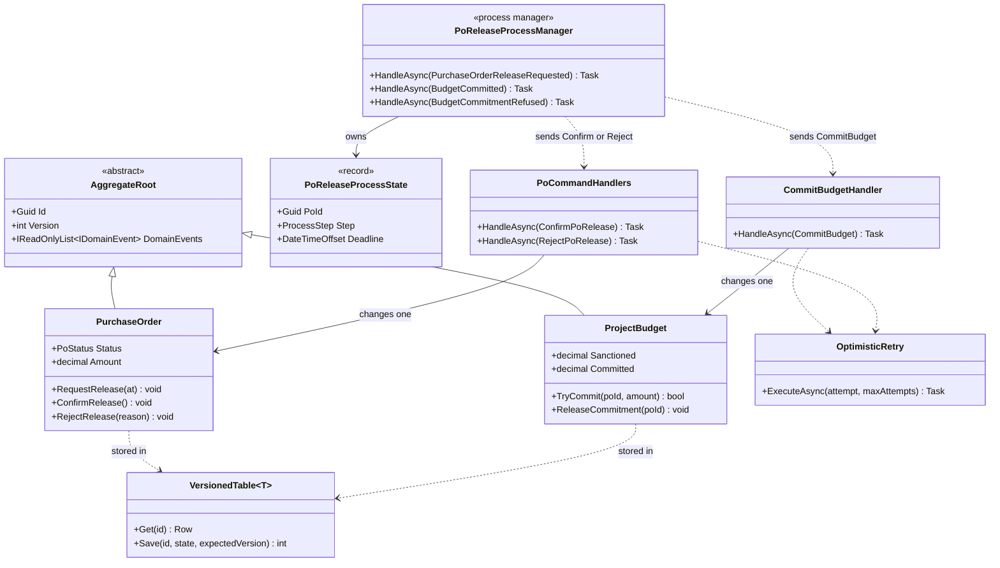
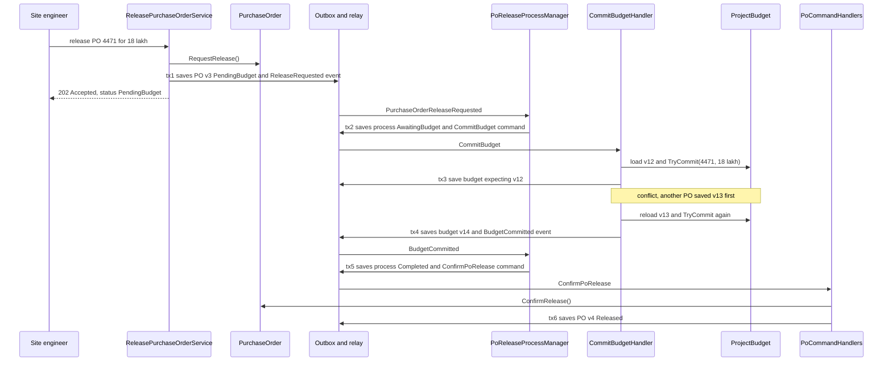

A purchase order (PO) for ₹18 lakh of reinforcement steel is ready to go to the vendor. Before it is released, the project's budget must have room for it. The tempting design is one database transaction that marks the PO as released **and** adds ₹18 lakh to the project's committed budget. It works on day one. Six months later the project has 400 open POs, ten site engineers release POs at the same time every Monday morning, and every one of those transactions fights over the same budget row. Users see "someone else changed this record, please try again". Worse, a developer "fixes" it by loading the budget without a version check, and two POs both squeeze into the last ₹20 lakh of headroom.

This lesson is about **where to draw transaction lines** in a domain model. The rule of thumb is short: **one aggregate per transaction**. The skill is in what you do with everything else: eventual consistency between aggregates, an explicit **process manager** to coordinate multi-step workflows, and **optimistic concurrency** to keep each aggregate honest when many users touch it at once.

## Learning objectives

By the end of this lesson you will be able to:

1. Explain why a transaction should normally change only one aggregate, and what goes wrong when it changes several.
2. Separate rules that need **immediate** consistency (inside one aggregate) from rules that can be **eventually** consistent (across aggregates).
3. Design an eventually consistent workflow with domain events, an outbox and idempotent handlers.
4. Implement a **process manager** inside a modular monolith to coordinate a multi-step business process, with timeouts and compensation.
5. Implement **optimistic concurrency** with a version number, detect conflicts, and retry safely.
6. Recognise the cases where breaking the rule (two aggregates, one transaction) is the pragmatic choice.

## Prerequisites

- [Aggregates and aggregate roots](#/lesson/m08-aggregates): what a consistency boundary is.
- [Domain events](#/lesson/m08-domain-events): how aggregates tell the rest of the system what happened.
- [Application services](#/lesson/m08-application-services): the use case is where the transaction starts and ends.
- [Transactions and ACID](#/lesson/m09-transactions-acid) and [Deadlocks, optimistic and pessimistic locking](#/lesson/m09-locking): the database mechanics underneath.

## Explain it like I'm a beginner

Think of a bank branch with two separate counters: one for **fixed deposits** and one for **savings accounts**. You want to break a fixed deposit and move the money into savings. In a tiny branch with one clerk, she does both in one go: tear up the FD slip, write the savings entry, done. That is "one transaction across two things".

Now picture a busy branch with 50 customers. If every FD-to-savings transfer needed *both* counters frozen at the same time, the queues would be terrible: the savings counter would sit idle waiting for the FD counter and vice versa. So the bank does something smarter. The FD counter closes the FD and gives you a **voucher** ("₹2,00,000 to be credited to savings account 4471"). The voucher goes into a tray. A few seconds later, the savings counter picks it up and credits your account. For those few seconds, the books are "in transit". Nobody is harmed, because the voucher cannot be lost and will definitely be processed.

That is the whole lesson in one picture:

- Each counter guards **its own** records, completely, every time. That is **one aggregate per transaction**.
- The voucher is a **domain event** written safely so it cannot be lost (an **outbox**).
- "A few seconds in transit" is **eventual consistency**.
- If a transfer needs several steps (check limits, debit, credit, notify, and undo if something fails), a **supervisor** with a checklist tracks each case. That is a **process manager**.
- And if two clerks try to update the same savings account at the same instant, the ledger has a **page number**; whoever writes on an out-of-date page has to re-read and redo. That is **optimistic concurrency** with a **version number**.

## First-principles explanation

### Why "one aggregate per transaction"

An aggregate is defined as the boundary inside which rules must be true *after every operation* (its invariants). By construction, nothing outside it needs to be updated in the same instant for the aggregate to be valid. So a transaction that changes two aggregates is buying a guarantee that, by your own design, you said you did not need. And it is not free:

1. **Contention.** A transaction holds row locks until it commits. If every PO release also updates the project budget row, every release on that project is serialised through one row. With 10 concurrent releases and roughly 50 ms each (an estimate for a typical web request doing a few queries), the last one waits about half a second, and under PostgreSQL's default `READ COMMITTED` with version checks, several fail with conflicts and must retry.
2. **Deadlocks.** Transaction A updates PO 1 then budget X; transaction B updates budget X then PO 2 then PO 1 (via some other use case). Lock ordering across aggregates is hard to control, and PostgreSQL will abort one of them.
3. **Coupling.** The PO and the budget can no longer be stored separately, scaled separately, or extracted into separate modules or services. The transaction has welded them together.
4. **Bigger failure blast radius.** A bug in the budget code now rolls back PO releases.

Vernon's rule from *Effective Aggregate Design* is precisely this: modify one aggregate instance per transaction, and use eventual consistency outside the boundary.

### Immediate vs eventual consistency: ask the business

Not every rule that *sounds* atomic is. For each cross-aggregate rule, ask the domain expert: **"If this rule were violated for a few seconds and then corrected automatically, would anyone be harmed?"**

| Rule | Boundary | Why |
|---|---|---|
| "PO line total must equal sum of lines" | Inside `PurchaseOrder` | Same aggregate. Always immediate |
| "Committed budget must never exceed sanctioned budget" | Inside `ProjectBudget` | Budget owns its commitments. Immediate within the budget |
| "A PO is released only if budget was committed for it" | Across `PurchaseOrder` and `ProjectBudget` | A few seconds in "pending budget" status is fine. Eventual |
| "When a contract is signed, its value appears in the project commitment" | Across `Contract` and `ProjectBudget` | The dashboard can lag by seconds. Eventual |
| "Seat 14C cannot be sold twice" | Inside `Flight` (or `SeatMap`) | Selling twice is real harm. Keep the seats in one aggregate |

Notice the trick in the third row. The rule "never release a PO without budget" is enforced **without** a shared transaction: the PO goes into an intermediate state (`PendingBudget`) and only becomes `Released` after the budget aggregate has *itself* committed the money. The budget's own invariant (never over-commit) is enforced immediately inside the budget. The *combination* is eventually consistent, but it is never wrong in a harmful way: a PO can be "pending" while budget is being checked, never "released without budget".

This intermediate-state technique is the most important design move in the lesson. It turns "I need both in one transaction" into "I need a status that honestly says *in progress*".

### How eventual consistency works mechanically

1. The application service changes **one** aggregate (PO: `RequestRelease`) and saves it. In the same database transaction, the domain event `PurchaseOrderReleaseRequested` is written to an **outbox** table.
2. A relay (a `BackgroundService`) reads the outbox and delivers the message to handlers. Delivery is **at-least-once**: after a crash, a message may be delivered again.
3. A handler changes the **next** aggregate (budget: `TryCommit`) in **its own** transaction, again writing its events to the outbox.
4. Handlers are **idempotent**: delivering the same message twice has the same effect as once. The budget remembers which PO ids it has committed for, so a duplicate `CommitBudget` is a no-op.

See [Transactional outbox](#/lesson/m12-outbox) and [Idempotent consumers](#/lesson/m12-idempotent-consumers) for the infrastructure in depth.

### Process managers: making the workflow visible

With two steps, a chain of event handlers is fine. With five steps, timeouts and compensation, a chain of handlers becomes a workflow that nobody can see: "PO release requested" triggers "commit budget", whose event triggers "confirm PO", unless it was refused, in which case... and what if the budget never answers?

A **process manager** (Hohpe and Woolf's name; often called an orchestrated saga) is an object with its **own persisted state** that:

- **reacts to events** (`PurchaseOrderReleaseRequested`, `BudgetCommitted`, `BudgetCommitmentRefused`),
- **decides the next step** based on its state,
- **sends commands** (`CommitBudget`, `ConfirmPoRelease`, `RejectPoRelease`),
- **handles timeouts** ("no budget answer in 2 hours: reject and alert"),
- **compensates** when a step must be undone ("budget was committed after we timed out: release it").

It does not contain business rules of the aggregates. It contains the **rules of the process**: order of steps, deadlines, what to do on failure. Its state is saved in its own transaction (it is effectively a small aggregate of its own), and the commands it sends are written to the outbox in that same transaction.

**Inside a monolith?** Yes, and it is a good idea. A modular monolith with separate modules for purchasing and budgeting benefits from the same structure as microservices, minus the network: the process manager and handlers run in-process, the "bus" is an outbox table plus an in-process relay, and everything shares one PostgreSQL database (but separate schemas or tables per module). You get independent transactions, clear workflow code, and an easy path to split modules later. See [Domain-driven modular monoliths](#/lesson/m08-ddd-modular-monolith) and [Sagas](#/lesson/m12-sagas).

Choreography vs orchestration:

| | Choreography (handlers react to each other's events) | Orchestration (process manager) |
|---|---|---|
| Visibility | Flow is spread across handlers | Flow is in one class |
| Coupling | Each handler knows only events | Process manager knows all participants' commands |
| Timeouts, compensation | Awkward | Natural |
| Best for | 2 or 3 independent reactions | Multi-step processes with failure paths |

### Optimistic concurrency: protecting one aggregate

Even with one aggregate per transaction, two transactions can change the **same** aggregate. Two buyers commit two POs against the same project budget at the same moment. Both read "₹20 lakh available". Both add ₹15 lakh. Without protection, the second write overwrites the first ("lost update"), or both are kept and the budget is over-committed by ₹10 lakh.

**Optimistic concurrency** (Fowler's Optimistic Offline Lock) assumes conflicts are rare and checks for them at save time:

1. Each aggregate row has a **version** number.
2. Loading reads the version (say 7).
3. Saving runs `UPDATE ... SET ..., version = 8 WHERE id = @id AND version = 7`.
4. If **0 rows** were updated, someone else saved first: a **concurrency conflict**.
5. The application **reloads** the aggregate (now version 8, with the other commitment), **re-applies** the command, and tries again. The second attempt sees only ₹5 lakh available and refuses the ₹15 lakh commitment, correctly.

```sql
-- PostgreSQL 17: optimistic update of a budget row
UPDATE project_budgets
SET    committed = @committed, commitments = @commitments, version = version + 1
WHERE  id = @id AND version = @expected_version;
-- 0 rows affected  =>  concurrency conflict, reload and retry
```

EF Core does this for you when a property is marked as a concurrency token (`IsConcurrencyToken()`, or PostgreSQL's system column `xmin` via the Npgsql provider) and throws `DbUpdateConcurrencyException`.

**Pessimistic locking** (`SELECT ... FOR UPDATE`) is the alternative: lock the row on read so others wait. It avoids retries but holds locks for the whole use case and is a bad fit for anything with user think-time. Use it for short, very hot rows where conflicts would otherwise be frequent, or for queue-like "claim the next job" patterns (`FOR UPDATE SKIP LOCKED`).

**Retry rules**: retry only **conflicts**, not business refusals; **reload** before each attempt (never re-save stale state); cap the attempts (3 to 5); add a little random delay (jitter) so retrying writers do not collide again in lockstep; and never retry a block that contains external side effects.

### When breaking the rule is right

The rule is a default, not a law. Changing two aggregates in one transaction is reasonable when:

- **Both live in the same database, contention is genuinely low**, and the business really cannot tolerate an intermediate state. Example: creating a new customer and their first account in one registration step, both brand new, so nobody else can contend.
- **The user expects immediate feedback**, and an intermediate state would be confusing and the volume is tiny (an internal admin tool used by three people).
- **The cost of eventual-consistency plumbing outweighs the risk** in a small system. An outbox, relay, idempotent handlers and a process manager are real code to own.

If you break the rule, do it knowingly, write down why (an [ADR](#/lesson/m02-adr)), and keep the transaction short.

### Trade-offs

| You gain | You pay |
|---|---|
| Low contention and no cross-aggregate deadlocks | Intermediate states the UI must show ("pending budget") |
| Aggregates can be stored, scaled and extracted independently | Outbox, relay and idempotent handlers to build and operate |
| Failures are contained to one step | Workflows need explicit timeout and compensation design |
| Clear, testable workflow code in a process manager | One more stateful object to persist and monitor |
| Correctness under concurrency via versions | Retries; occasional user-visible "please retry" on very hot aggregates |

## Visual explanation

### Class diagram



How to read it: there are two aggregates, `PurchaseOrder` and `ProjectBudget`, each with a `Version`. No class changes both. Each handler changes exactly one aggregate ("changes one"), wrapped in `OptimisticRetry` for conflicts. The `PoReleaseProcessManager` owns its own small state record and never touches the aggregates directly: it only **sends commands** (dotted arrows) that the handlers execute. All state, including the process state, is stored in versioned tables, so every save is a compare-and-swap on the version.

### Sequence diagram



Every `tx` box changes exactly one thing: the PO, the process state, or the budget. Between them, messages travel through the outbox, so nothing is lost if the process restarts. The note shows optimistic concurrency at work: the first budget save fails because another PO committed money in between; the handler reloads version 13, re-runs `TryCommit` against the up-to-date numbers, and succeeds. The user gets an immediate, honest answer ("pending budget") instead of waiting on, or failing because of, the budget row. In a monolith all of this typically completes in well under a second; the UI can poll or receive a push notification.

## Step-by-step example

### Step 1: the one-big-transaction version

```csharp
public async Task ReleaseAsync(Guid poId)
{
    await using var tx = await db.Database.BeginTransactionAsync();
    var po = await db.PurchaseOrders.FindAsync(poId);
    var budget = await db.Budgets.FindAsync(po!.ProjectId);
    if (budget!.Committed + po.Amount > budget.Sanctioned) throw new DomainException("No budget");
    budget.Committed += po.Amount;
    po.Status = PoStatus.Released;
    await db.SaveChangesAsync();
    await tx.CommitAsync();
}
```

Two aggregates, one transaction, and no version check on the budget. Under concurrency, two releases can both pass the `if` and over-commit.

### Step 2: add a version and see the conflicts

Mark `Version` as a concurrency token. Over-commitment stops, but Monday-morning releases now fail with conflicts on the hot budget row, and the error rolls back the PO change too.

### Step 3: split the transaction with an intermediate state

`PurchaseOrder.RequestRelease()` moves the PO to `PendingBudget` and raises `PurchaseOrderReleaseRequested`. That is one transaction on the PO only.

### Step 4: let the budget react in its own transaction

`CommitBudgetHandler` loads the budget, calls `TryCommit`, saves with the version check, and retries on conflict. Only budget-to-budget conflicts remain, and a retry resolves them in milliseconds.

### Step 5: make the workflow explicit

A process manager tracks each release (`AwaitingBudget` → `Completed` or `Rejected`), sends the follow-up commands, and handles the "budget never answered" timeout. Now the flow can be read, tested and monitored in one place.

## Production-style C# implementation

```text
Procurement.Api/
  Program.cs
  Domain/
    Primitives.cs              (DomainException, ConcurrencyException, AggregateRoot, IDomainEvent)
    PurchaseOrder.cs
    ProjectBudget.cs
  Application/
    Messages.cs                (commands)
    Ports.cs
    ReleasePurchaseOrderService.cs
    Handlers.cs                (CommitBudgetHandler, PoCommandHandlers)
    PoReleaseProcessManager.cs
    OptimisticRetry.cs
  Infrastructure/
    VersionedTable.cs
    InMemoryDatabase.cs        (tables + outbox commit, repositories, process store)
    MessagePump.cs             (in-process relay as a BackgroundService)
```

```csharp file=Domain/Primitives.cs
namespace Procurement.Domain;

public sealed class DomainException : Exception
{
    public DomainException(string message) : base(message) { }
}

public sealed class ConcurrencyException : Exception
{
    public ConcurrencyException(string what, Guid id, int expected, int actual)
        : base($"{what} {id}: expected version {expected} but found {actual}.")
    {
        ExpectedVersion = expected;
        ActualVersion = actual;
    }
    public int ExpectedVersion { get; }
    public int ActualVersion { get; }
}

public interface IDomainEvent { }

public abstract class AggregateRoot
{
    private readonly List<IDomainEvent> _events = new();

    public Guid Id { get; protected init; }

    /// <summary>The version this instance was loaded at. 0 means "new, never saved".</summary>
    public int Version { get; protected init; }

    public IReadOnlyList<IDomainEvent> DomainEvents => _events;
    protected void Raise(IDomainEvent e) => _events.Add(e);
    public void ClearDomainEvents() => _events.Clear();
}
```

```csharp file=Domain/PurchaseOrder.cs
namespace Procurement.Domain;

public enum PoStatus { Draft, PendingBudget, Released, Rejected }

public sealed record PurchaseOrderState(Guid Id, Guid ProjectId, string Number, decimal Amount, PoStatus Status, string? RejectionReason);

public sealed record PurchaseOrderReleaseRequested(Guid PoId, Guid ProjectId, decimal Amount, DateTimeOffset RequestedAt) : IDomainEvent;
public sealed record PurchaseOrderReleased(Guid PoId) : IDomainEvent;
public sealed record PurchaseOrderReleaseRejected(Guid PoId, string Reason) : IDomainEvent;

public sealed class PurchaseOrder : AggregateRoot
{
    private PurchaseOrder(PurchaseOrderState s, int version)
    {
        Id = s.Id; Version = version; ProjectId = s.ProjectId; Number = s.Number;
        Amount = s.Amount; Status = s.Status; RejectionReason = s.RejectionReason;
    }

    public Guid ProjectId { get; }
    public string Number { get; }
    public decimal Amount { get; }
    public PoStatus Status { get; private set; }
    public string? RejectionReason { get; private set; }

    public static PurchaseOrder Draft(Guid id, Guid projectId, string number, decimal amount)
    {
        if (amount <= 0) throw new DomainException("PO amount must be positive.");
        return new PurchaseOrder(new PurchaseOrderState(id, projectId, number, amount, PoStatus.Draft, null), version: 0);
    }

    public static PurchaseOrder FromState(PurchaseOrderState state, int version) => new(state, version);

    public PurchaseOrderState ToState() => new(Id, ProjectId, Number, Amount, Status, RejectionReason);

    /// <summary>Step 1 of the release process. Only the PO changes; the budget reacts later.</summary>
    public void RequestRelease(DateTimeOffset at)
    {
        if (Status != PoStatus.Draft) throw new DomainException($"A PO in status {Status} cannot be released.");
        Status = PoStatus.PendingBudget;
        Raise(new PurchaseOrderReleaseRequested(Id, ProjectId, Amount, at));
    }

    /// <summary>Idempotent: confirming an already released PO does nothing.</summary>
    public void ConfirmRelease()
    {
        if (Status == PoStatus.Released) return;
        if (Status != PoStatus.PendingBudget) throw new DomainException($"A PO in status {Status} cannot be confirmed.");
        Status = PoStatus.Released;
        Raise(new PurchaseOrderReleased(Id));
    }

    public void RejectRelease(string reason)
    {
        if (Status == PoStatus.Rejected) return;
        if (Status != PoStatus.PendingBudget) throw new DomainException($"A PO in status {Status} cannot be rejected.");
        Status = PoStatus.Rejected;
        RejectionReason = reason;
        Raise(new PurchaseOrderReleaseRejected(Id, reason));
    }
}
```

```csharp file=Domain/ProjectBudget.cs
namespace Procurement.Domain;

public sealed record ProjectBudgetState(Guid Id, string ProjectCode, decimal Sanctioned, IReadOnlyDictionary<Guid, decimal> Commitments);

public sealed record BudgetCommitted(Guid BudgetId, Guid PoId, decimal Amount) : IDomainEvent;
public sealed record BudgetCommitmentRefused(Guid BudgetId, Guid PoId, string Reason) : IDomainEvent;
public sealed record BudgetCommitmentReleased(Guid BudgetId, Guid PoId, decimal Amount) : IDomainEvent;

/// <summary>Aggregate root. Invariant: committed never exceeds sanctioned. Remembers commitments per PO for idempotency.</summary>
public sealed class ProjectBudget : AggregateRoot
{
    private readonly Dictionary<Guid, decimal> _commitments;

    private ProjectBudget(ProjectBudgetState s, int version)
    {
        Id = s.Id; Version = version; ProjectCode = s.ProjectCode; Sanctioned = s.Sanctioned;
        _commitments = new Dictionary<Guid, decimal>(s.Commitments);
    }

    public string ProjectCode { get; }
    public decimal Sanctioned { get; }
    public decimal Committed => _commitments.Values.Sum();
    public decimal Available => Sanctioned - Committed;

    public static ProjectBudget Open(Guid id, string projectCode, decimal sanctioned)
    {
        if (sanctioned <= 0) throw new DomainException("Sanctioned budget must be positive.");
        return new ProjectBudget(new ProjectBudgetState(id, projectCode, sanctioned, new Dictionary<Guid, decimal>()), version: 0);
    }

    public static ProjectBudget FromState(ProjectBudgetState s, int version) => new(s, version);

    public ProjectBudgetState ToState() => new(Id, ProjectCode, Sanctioned, new Dictionary<Guid, decimal>(_commitments));

    public bool TryCommit(Guid poId, decimal amount)
    {
        if (amount <= 0) throw new DomainException("Commitment must be positive.");
        if (_commitments.ContainsKey(poId)) return true;   // duplicate message: already done, no new event

        if (amount > Available)
        {
            Raise(new BudgetCommitmentRefused(Id, poId, $"Requested {amount:N0}, available {Available:N0}."));
            return false;
        }
        _commitments[poId] = amount;
        Raise(new BudgetCommitted(Id, poId, amount));
        return true;
    }

    /// <summary>Compensation: undo a commitment, for example after the PO process timed out.</summary>
    public void ReleaseCommitment(Guid poId)
    {
        if (!_commitments.Remove(poId, out var amount)) return;
        Raise(new BudgetCommitmentReleased(Id, poId, amount));
    }
}
```

```csharp file=Application/Messages.cs
namespace Procurement.Application;

// Commands: instructions, each handled by exactly one handler that changes exactly one aggregate.
public sealed record CommitBudget(Guid ProjectId, Guid PoId, decimal Amount);
public sealed record ReleaseBudgetCommitment(Guid ProjectId, Guid PoId);
public sealed record ConfirmPoRelease(Guid PoId);
public sealed record RejectPoRelease(Guid PoId, string Reason);
```

```csharp file=Application/Ports.cs
using Procurement.Domain;

namespace Procurement.Application;

/// <summary>Saving an aggregate also stores its pending events in the outbox, in the same transaction.</summary>
public interface IPurchaseOrderRepository
{
    Task<PurchaseOrder?> GetAsync(Guid id, CancellationToken ct = default);
    Task SaveAsync(PurchaseOrder po, CancellationToken ct = default);
}

public interface IProjectBudgetRepository
{
    Task<ProjectBudget?> GetAsync(Guid id, CancellationToken ct = default);
    Task SaveAsync(ProjectBudget budget, CancellationToken ct = default);
}

public enum ProcessStep { AwaitingBudget, Completed, Rejected, TimedOut }

public sealed record PoReleaseProcessState(Guid PoId, Guid ProjectId, decimal Amount, ProcessStep Step, DateTimeOffset Deadline);

public interface IProcessStore
{
    Task<(PoReleaseProcessState State, int Version)?> GetAsync(Guid poId, CancellationToken ct = default);

    /// <summary>Saves the process state and enqueues the commands atomically. Throws ConcurrencyException on a stale version.</summary>
    Task SaveAsync(PoReleaseProcessState state, int expectedVersion, IReadOnlyList<object> commands, CancellationToken ct = default);

    Task<IReadOnlyList<(PoReleaseProcessState State, int Version)>> ListOverdueAsync(DateTimeOffset now, CancellationToken ct = default);
}
```

```csharp file=Application/OptimisticRetry.cs
using Procurement.Domain;

namespace Procurement.Application;

public static class OptimisticRetry
{
    /// <summary>
    /// Runs <paramref name="attempt"/> until it succeeds or the attempts run out. Only concurrency conflicts are
    /// retried. Each attempt must reload the aggregate, so it never re-saves stale state.
    /// </summary>
    public static async Task ExecuteAsync(Func<Task> attempt, int maxAttempts = 4, CancellationToken ct = default)
    {
        for (var i = 1; ; i++)
        {
            try
            {
                await attempt();
                return;
            }
            catch (ConcurrencyException) when (i < maxAttempts)
            {
                // Small random back-off (jitter) so competing writers do not collide again in lockstep.
                await Task.Delay(TimeSpan.FromMilliseconds(Random.Shared.Next(5, 25 * i)), ct);
            }
        }
    }
}
```

```csharp file=Application/ReleasePurchaseOrderService.cs
using Procurement.Domain;

namespace Procurement.Application;

public sealed record PoStatusDto(Guid Id, string Number, string Status, string? Reason);

/// <summary>Use case: request release. Changes ONE aggregate (the PO). The rest happens through events.</summary>
public sealed class ReleasePurchaseOrderService(IPurchaseOrderRepository orders, TimeProvider clock)
{
    public async Task<PoStatusDto?> RequestReleaseAsync(Guid poId, CancellationToken ct = default)
    {
        var po = await orders.GetAsync(poId, ct);
        if (po is null) return null;
        po.RequestRelease(clock.GetUtcNow());
        await orders.SaveAsync(po, ct);       // PO row + PurchaseOrderReleaseRequested in one commit
        return ToDto(po);
    }

    public async Task<PoStatusDto?> GetAsync(Guid poId, CancellationToken ct = default)
    {
        var po = await orders.GetAsync(poId, ct);
        return po is null ? null : ToDto(po);
    }

    private static PoStatusDto ToDto(PurchaseOrder po) => new(po.Id, po.Number, po.Status.ToString(), po.RejectionReason);
}
```

```csharp file=Application/Handlers.cs
using Procurement.Domain;

namespace Procurement.Application;

/// <summary>Changes only the budget. Idempotent because the budget remembers commitments by PO id.</summary>
public sealed class CommitBudgetHandler(IProjectBudgetRepository budgets)
{
    public Task HandleAsync(CommitBudget cmd, CancellationToken ct) =>
        OptimisticRetry.ExecuteAsync(async () =>
        {
            var budget = await budgets.GetAsync(cmd.ProjectId, ct) ?? throw new DomainException($"No budget for project {cmd.ProjectId}.");
            budget.TryCommit(cmd.PoId, cmd.Amount);
            await budgets.SaveAsync(budget, ct);
        }, ct: ct);

    public Task HandleAsync(ReleaseBudgetCommitment cmd, CancellationToken ct) =>
        OptimisticRetry.ExecuteAsync(async () =>
        {
            var budget = await budgets.GetAsync(cmd.ProjectId, ct);
            if (budget is null) return;
            budget.ReleaseCommitment(cmd.PoId);
            await budgets.SaveAsync(budget, ct);
        }, ct: ct);
}

/// <summary>Changes only the PO. Confirm and reject are idempotent on the aggregate.</summary>
public sealed class PoCommandHandlers(IPurchaseOrderRepository orders)
{
    public Task HandleAsync(ConfirmPoRelease cmd, CancellationToken ct) =>
        OptimisticRetry.ExecuteAsync(async () =>
        {
            var po = await orders.GetAsync(cmd.PoId, ct) ?? throw new DomainException($"PO {cmd.PoId} not found.");
            po.ConfirmRelease();
            await orders.SaveAsync(po, ct);
        }, ct: ct);

    public Task HandleAsync(RejectPoRelease cmd, CancellationToken ct) =>
        OptimisticRetry.ExecuteAsync(async () =>
        {
            var po = await orders.GetAsync(cmd.PoId, ct) ?? throw new DomainException($"PO {cmd.PoId} not found.");
            po.RejectRelease(cmd.Reason);
            await orders.SaveAsync(po, ct);
        }, ct: ct);
}
```

```csharp file=Application/PoReleaseProcessManager.cs
using Procurement.Domain;

namespace Procurement.Application;

/// <summary>
/// Process manager for "release a PO". Holds the rules of the PROCESS (order of steps, deadline,
/// compensation), not the rules of the aggregates. Each reaction is one transaction on its own state,
/// with the commands it sends stored atomically alongside.
/// </summary>
public sealed class PoReleaseProcessManager(IProcessStore store, TimeProvider clock)
{
    public static readonly TimeSpan BudgetTimeout = TimeSpan.FromHours(2);

    public async Task HandleAsync(PurchaseOrderReleaseRequested e, CancellationToken ct)
    {
        if (await store.GetAsync(e.PoId, ct) is not null) return;   // duplicate delivery

        var state = new PoReleaseProcessState(e.PoId, e.ProjectId, e.Amount, ProcessStep.AwaitingBudget, e.RequestedAt + BudgetTimeout);
        try
        {
            await store.SaveAsync(state, expectedVersion: 0, new object[] { new CommitBudget(e.ProjectId, e.PoId, e.Amount) }, ct);
        }
        catch (ConcurrencyException)
        {
            // Another delivery of the same event started the process first. Nothing to do.
        }
    }

    public async Task HandleAsync(BudgetCommitted e, CancellationToken ct)
    {
        if (await store.GetAsync(e.PoId, ct) is not { } row) return;
        var (state, version) = row;
        switch (state.Step)
        {
            case ProcessStep.AwaitingBudget:
                await store.SaveAsync(state with { Step = ProcessStep.Completed }, version, new object[] { new ConfirmPoRelease(e.PoId) }, ct);
                break;
            case ProcessStep.TimedOut:
                // Compensation: the money arrived after we gave up. Give it back.
                await store.SaveAsync(state, version, new object[] { new ReleaseBudgetCommitment(state.ProjectId, e.PoId) }, ct);
                break;
            default:
                break;   // Completed or Rejected: duplicate, ignore
        }
    }

    public async Task HandleAsync(BudgetCommitmentRefused e, CancellationToken ct)
    {
        if (await store.GetAsync(e.PoId, ct) is not { } row || row.State.Step != ProcessStep.AwaitingBudget) return;
        await store.SaveAsync(row.State with { Step = ProcessStep.Rejected }, row.Version, new object[] { new RejectPoRelease(e.PoId, e.Reason) }, ct);
    }

    /// <summary>Called periodically (for example every minute) to enforce deadlines.</summary>
    public async Task CheckTimeoutsAsync(CancellationToken ct)
    {
        var now = clock.GetUtcNow();
        foreach (var (state, version) in await store.ListOverdueAsync(now, ct))
        {
            try
            {
                await store.SaveAsync(state with { Step = ProcessStep.TimedOut }, version,
                    new object[] { new RejectPoRelease(state.PoId, "Budget check timed out.") }, ct);
            }
            catch (ConcurrencyException)
            {
                // The budget answer arrived at the same moment. The next tick sees the new step.
            }
        }
    }
}
```

```csharp file=Infrastructure/VersionedTable.cs
using Procurement.Domain;

namespace Procurement.Infrastructure;

/// <summary>An in-memory table with optimistic concurrency: every save is a compare-and-swap on the version.</summary>
public sealed class VersionedTable<TState> where TState : class
{
    private readonly object _gate = new();
    private readonly Dictionary<Guid, (TState State, int Version)> _rows = new();
    private readonly string _name;

    public VersionedTable(string name) => _name = name;

    public (TState State, int Version)? Get(Guid id)
    {
        lock (_gate) return _rows.TryGetValue(id, out var row) ? row : null;
    }

    public IReadOnlyList<(TState State, int Version)> All()
    {
        lock (_gate) return _rows.Values.ToList();
    }

    /// <summary>expectedVersion 0 means "insert". Returns the new version.</summary>
    public int Save(Guid id, TState state, int expectedVersion)
    {
        lock (_gate)
        {
            var actual = _rows.TryGetValue(id, out var row) ? row.Version : 0;
            if (actual != expectedVersion) throw new ConcurrencyException(_name, id, expectedVersion, actual);
            _rows[id] = (state, actual + 1);
            return actual + 1;
        }
    }
}
```

```csharp file=Infrastructure/InMemoryDatabase.cs
using System.Threading.Channels;
using Procurement.Application;
using Procurement.Domain;

namespace Procurement.Infrastructure;

/// <summary>
/// Stands in for PostgreSQL with an outbox table. Commit() writes one row and its outgoing messages under one lock,
/// the in-memory equivalent of "UPDATE the aggregate + INSERT into outbox" in one transaction.
/// </summary>
public sealed class InMemoryDatabase
{
    private readonly object _tx = new();
    private readonly Channel<object> _outbox = Channel.CreateUnbounded<object>();

    public VersionedTable<PurchaseOrderState> PurchaseOrders { get; } = new("PurchaseOrder");
    public VersionedTable<ProjectBudgetState> Budgets { get; } = new("ProjectBudget");
    public VersionedTable<PoReleaseProcessState> Processes { get; } = new("PoReleaseProcess");

    public ChannelReader<object> Outbox => _outbox.Reader;

    public void Commit(Action write, IEnumerable<object> outgoing)
    {
        lock (_tx)
        {
            write();                                            // throws ConcurrencyException: nothing enqueued
            foreach (var m in outgoing) _outbox.Writer.TryWrite(m);
        }
    }
}

public sealed class PurchaseOrderRepository(InMemoryDatabase db) : IPurchaseOrderRepository
{
    public Task<PurchaseOrder?> GetAsync(Guid id, CancellationToken ct = default) =>
        Task.FromResult(db.PurchaseOrders.Get(id) is { } row ? PurchaseOrder.FromState(row.State, row.Version) : null);

    public Task SaveAsync(PurchaseOrder po, CancellationToken ct = default)
    {
        var events = po.DomainEvents.ToList();
        db.Commit(() => db.PurchaseOrders.Save(po.Id, po.ToState(), po.Version), events);
        po.ClearDomainEvents();
        return Task.CompletedTask;
    }
}

public sealed class ProjectBudgetRepository(InMemoryDatabase db) : IProjectBudgetRepository
{
    public Task<ProjectBudget?> GetAsync(Guid id, CancellationToken ct = default) =>
        Task.FromResult(db.Budgets.Get(id) is { } row ? ProjectBudget.FromState(row.State, row.Version) : null);

    public Task SaveAsync(ProjectBudget budget, CancellationToken ct = default)
    {
        var events = budget.DomainEvents.ToList();
        db.Commit(() => db.Budgets.Save(budget.Id, budget.ToState(), budget.Version), events);
        budget.ClearDomainEvents();
        return Task.CompletedTask;
    }
}

public sealed class InMemoryProcessStore(InMemoryDatabase db) : IProcessStore
{
    public Task<(PoReleaseProcessState State, int Version)?> GetAsync(Guid poId, CancellationToken ct = default) =>
        Task.FromResult(db.Processes.Get(poId));

    public Task SaveAsync(PoReleaseProcessState state, int expectedVersion, IReadOnlyList<object> commands, CancellationToken ct = default)
    {
        db.Commit(() => db.Processes.Save(state.PoId, state, expectedVersion), commands);
        return Task.CompletedTask;
    }

    public Task<IReadOnlyList<(PoReleaseProcessState State, int Version)>> ListOverdueAsync(DateTimeOffset now, CancellationToken ct = default) =>
        Task.FromResult<IReadOnlyList<(PoReleaseProcessState State, int Version)>>(db.Processes.All()
            .Where(r => r.State.Step == ProcessStep.AwaitingBudget && r.State.Deadline <= now)
            .ToList());
}
```

```csharp file=Infrastructure/MessagePump.cs
using Microsoft.Extensions.DependencyInjection;
using Microsoft.Extensions.Hosting;
using Microsoft.Extensions.Logging;
using Procurement.Application;
using Procurement.Domain;

namespace Procurement.Infrastructure;

/// <summary>
/// The in-process relay of a modular monolith: reads the outbox and routes each message to its handler
/// in a fresh DI scope. In production the outbox is a PostgreSQL table polled (or LISTEN/NOTIFY-triggered)
/// by this service, and messages are marked processed only after the handler succeeds.
/// </summary>
public sealed class MessagePump(InMemoryDatabase db, IServiceScopeFactory scopes, ILogger<MessagePump> logger) : BackgroundService
{
    protected override async Task ExecuteAsync(CancellationToken stoppingToken)
    {
        await foreach (var message in db.Outbox.ReadAllAsync(stoppingToken))
        {
            await using var scope = scopes.CreateAsyncScope();
            var sp = scope.ServiceProvider;
            try
            {
                var pm = sp.GetRequiredService<PoReleaseProcessManager>();
                var budget = sp.GetRequiredService<CommitBudgetHandler>();
                var po = sp.GetRequiredService<PoCommandHandlers>();
                await (message switch
                {
                    PurchaseOrderReleaseRequested m => pm.HandleAsync(m, stoppingToken),
                    BudgetCommitted m => pm.HandleAsync(m, stoppingToken),
                    BudgetCommitmentRefused m => pm.HandleAsync(m, stoppingToken),
                    CommitBudget m => budget.HandleAsync(m, stoppingToken),
                    ReleaseBudgetCommitment m => budget.HandleAsync(m, stoppingToken),
                    ConfirmPoRelease m => po.HandleAsync(m, stoppingToken),
                    RejectPoRelease m => po.HandleAsync(m, stoppingToken),
                    _ => Task.CompletedTask,   // events nobody handles, such as PurchaseOrderReleased
                });
            }
            catch (Exception ex) when (ex is not OperationCanceledException)
            {
                // A real relay leaves the row unprocessed for a retry with back-off, then dead-letters it.
                logger.LogError(ex, "Handling {Message} failed", message.GetType().Name);
            }
        }
    }
}

/// <summary>Enforces process deadlines once a minute.</summary>
public sealed class ProcessTimeoutWorker(IServiceScopeFactory scopes) : BackgroundService
{
    protected override async Task ExecuteAsync(CancellationToken stoppingToken)
    {
        using var timer = new PeriodicTimer(TimeSpan.FromMinutes(1));
        while (await timer.WaitForNextTickAsync(stoppingToken))
        {
            await using var scope = scopes.CreateAsyncScope();
            await scope.ServiceProvider.GetRequiredService<PoReleaseProcessManager>().CheckTimeoutsAsync(stoppingToken);
        }
    }
}
```

```csharp file=Program.cs
using Procurement.Application;
using Procurement.Domain;
using Procurement.Infrastructure;

var builder = WebApplication.CreateBuilder(args);

builder.Services.AddSingleton(TimeProvider.System);
builder.Services.AddSingleton<InMemoryDatabase>();
builder.Services.AddScoped<IPurchaseOrderRepository, PurchaseOrderRepository>();
builder.Services.AddScoped<IProjectBudgetRepository, ProjectBudgetRepository>();
builder.Services.AddScoped<IProcessStore, InMemoryProcessStore>();

builder.Services.AddScoped<ReleasePurchaseOrderService>();
builder.Services.AddScoped<CommitBudgetHandler>();
builder.Services.AddScoped<PoCommandHandlers>();
builder.Services.AddScoped<PoReleaseProcessManager>();

builder.Services.AddHostedService<MessagePump>();
builder.Services.AddHostedService<ProcessTimeoutWorker>();

var app = builder.Build();

app.MapPost("/budgets", async (OpenBudgetRequest req, IProjectBudgetRepository budgets, CancellationToken ct) =>
{
    var budget = ProjectBudget.Open(Guid.NewGuid(), req.ProjectCode, req.Sanctioned);
    await budgets.SaveAsync(budget, ct);
    return Results.Created($"/budgets/{budget.Id}", new { budget.Id });
});

app.MapPost("/purchase-orders", async (DraftPoRequest req, IPurchaseOrderRepository orders, CancellationToken ct) =>
{
    var po = PurchaseOrder.Draft(Guid.NewGuid(), req.BudgetId, req.Number, req.Amount);
    await orders.SaveAsync(po, ct);
    return Results.Created($"/purchase-orders/{po.Id}", new { po.Id });
});

app.MapPost("/purchase-orders/{id:guid}/release", async (Guid id, ReleasePurchaseOrderService service, CancellationToken ct) =>
{
    try
    {
        var dto = await service.RequestReleaseAsync(id, ct);
        return dto is null ? Results.NotFound() : Results.Accepted($"/purchase-orders/{id}", dto);
    }
    catch (DomainException ex) { return Results.Problem(ex.Message, statusCode: StatusCodes.Status409Conflict); }
    catch (ConcurrencyException) { return Results.Problem("The PO was changed by someone else. Reload and try again.", statusCode: StatusCodes.Status409Conflict); }
});

app.MapGet("/purchase-orders/{id:guid}", async (Guid id, ReleasePurchaseOrderService service, CancellationToken ct) =>
    await service.GetAsync(id, ct) is { } dto ? Results.Ok(dto) : Results.NotFound());

app.Run();

public sealed record OpenBudgetRequest(string ProjectCode, decimal Sanctioned);
public sealed record DraftPoRequest(Guid BudgetId, string Number, decimal Amount);
```

Some points about this design:

- **Every save is one aggregate (or one process state) plus its outgoing messages.** There is no code path that writes two aggregates together.
- **The release endpoint returns `202 Accepted`** with status `PendingBudget`. The API is honest that the work continues. The UI polls `GET /purchase-orders/{id}` or receives a push.
- **The user's request does not retry on conflict.** A conflict on the PO itself means another person edited the same PO, and they should see the new state before deciding. Background handlers **do** retry, because no human is waiting and the command is still valid against fresh state.
- **Idempotency is built into the aggregates** (`TryCommit` remembers PO ids, `ConfirmRelease` is a no-op when already released) and into the process manager (duplicate events are ignored by step), so at-least-once delivery is safe.

:::callout type=tradeoff title="Hot aggregates: when retries are not enough"
If one budget receives hundreds of commitments per second, optimistic retries will thrash. Options: split the aggregate (one budget per cost head or per month, each with its own row), use a pessimistic `SELECT ... FOR UPDATE` for the short commit step, or process commitments for one budget sequentially through a single consumer (partition the queue by budget id). Measure first; for typical project procurement volumes (tens of POs per project per day), plain optimistic concurrency is more than enough.
:::

## Bad design vs good design

### Bad: the god transaction

```csharp
await using var tx = await db.Database.BeginTransactionAsync(IsolationLevel.Serializable);
var po = await db.PurchaseOrders.FindAsync(id);
var budget = await db.Budgets.FindAsync(po.ProjectId);
var vendor = await db.Vendors.FindAsync(po.VendorId);
budget.Committed += po.Amount;
vendor.OpenOrderValue += po.Amount;
po.Status = PoStatus.Released;
await emailSender.SendAsync(vendor.Email, "PO released");   // inside the transaction
await db.SaveChangesAsync();
await tx.CommitAsync();
```

Three aggregates, `SERIALIZABLE` isolation (more serialisation failures under load), an email inside the transaction (sent even if the commit then fails), and every PO release now contends with every other release on the same budget *and* the same vendor.

### Bad: no version check

```csharp
var budget = await budgets.GetAsync(projectId);   // reads Available = 20 lakh
budget.TryCommit(poId, 15_00_000m);
await budgets.SaveWithoutVersionCheckAsync(budget); // last writer wins
```

Two concurrent calls both commit ₹15 lakh against ₹20 lakh of headroom. The invariant "never over-commit" holds in memory for each call and fails in the database.

### Good

One aggregate per transaction, intermediate states, events through an outbox, idempotent handlers, a process manager for the workflow, and a version check on every save with a bounded retry in background handlers.

### Is the improvement worth it?

For a procurement platform with dozens of concurrent users per project and an audit requirement, yes. For a 3-user internal tool, one transaction across two aggregates with a version check may be the sensible, simpler choice. Write the decision down.

## Practical playground

The playground simulates ten POs racing to commit against one project budget of ₹1 crore, each for ₹15 lakh, with optimistic concurrency and retries. Run it: exactly six should succeed (₹90 lakh), four should be refused, and the budget should never go over. Then remove the version check in `Save` and run it again to watch the invariant break.

:::playground type=csharp title="Ten POs, one budget, optimistic concurrency"
```csharp file=Program.cs
using System;
using System.Collections.Generic;
using System.Linq;
using System.Threading;
using System.Threading.Tasks;

public sealed class ConcurrencyException : Exception { }

public sealed record BudgetRow(decimal Sanctioned, decimal Committed, int Version);

public sealed class BudgetTable
{
    private readonly object _gate = new();
    private BudgetRow _row = new(10_000_000m, 0m, 1);

    public BudgetRow Load() { lock (_gate) return _row; }

    public void Save(decimal newCommitted, int expectedVersion)
    {
        lock (_gate)
        {
            if (_row.Version != expectedVersion) throw new ConcurrencyException();   // remove this line to see lost updates
            _row = _row with { Committed = newCommitted, Version = _row.Version + 1 };
        }
    }
}

public static class Program
{
    public static async Task Main()
    {
        var table = new BudgetTable();
        int committed = 0, refused = 0, retries = 0;

        async Task CommitAsync(int poNumber)
        {
            for (var attempt = 1; attempt <= 25; attempt++)
            {
                var row = table.Load();
                await Task.Delay(Random.Shared.Next(1, 5));                    // simulate work between read and write
                if (row.Committed + 1_500_000m > row.Sanctioned) { Interlocked.Increment(ref refused); return; }
                try { table.Save(row.Committed + 1_500_000m, row.Version); Interlocked.Increment(ref committed); return; }
                catch (ConcurrencyException) { Interlocked.Increment(ref retries); }
            }
            Console.WriteLine($"PO {poNumber}: gave up after 25 attempts");
        }

        await Task.WhenAll(Enumerable.Range(1, 10).Select(CommitAsync));
        var final = table.Load();
        Console.WriteLine($"committed POs: {committed}, refused: {refused}, conflict retries: {retries}");
        Console.WriteLine($"budget committed {final.Committed:N0} of {final.Sanctioned:N0} (version {final.Version})");
        Console.WriteLine(final.Committed <= final.Sanctioned ? "invariant holds" : "INVARIANT BROKEN");
    }
}
```
:::

## Exercises

:::exercise id=m08-transaction-boundaries-ex1 difficulty=beginner kind=code title="A versioned store with optimistic concurrency"
Implement `VersionedStore<T>`, the compare-and-swap store every aggregate repository in this lesson relies on.
::requirements
- `Get(id)` returns the state and version, or `null` for an unknown id.
- `Save(id, state, expectedVersion)` returns the new version. `expectedVersion == 0` means "insert a new row".
- If the current version (0 for a missing row) differs from `expectedVersion`, throw `ConcurrencyException` with `Expected` and `Actual` set, and change nothing.
- Thread-safe: under parallel saves with the same expected version, exactly one succeeds.
::acceptance
- All tests pass, including the parallel test.
- A failed save never changes the stored state.
::hint
The check and the write must happen as one indivisible step. What C# construct gives you that?
::hint
A `lock` around "read current version, compare, write" is enough for an in-memory store.
::hint
```csharp
lock (_gate)
{
    var actual = _rows.TryGetValue(id, out var row) ? row.Version : 0;
    if (actual != expectedVersion) throw new ConcurrencyException(expectedVersion, actual);
    _rows[id] = (state, actual + 1);
    return actual + 1;
}
```
::starter
```csharp file=VersionedStore.cs
using System;
using System.Collections.Generic;

public sealed class ConcurrencyException : Exception
{
    public ConcurrencyException(int expected, int actual) : base($"Expected version {expected}, found {actual}.")
    { Expected = expected; Actual = actual; }
    public int Expected { get; }
    public int Actual { get; }
}

public sealed class VersionedStore<T> where T : class
{
    public (T State, int Version)? Get(Guid id) => throw new NotImplementedException();

    public int Save(Guid id, T state, int expectedVersion) => throw new NotImplementedException();
}
```
::tests
```csharp file=VersionedStoreTests.cs
using System;
using System.Linq;
using System.Threading;
using System.Threading.Tasks;
using Xunit;

public sealed record Budget(decimal Committed);

public class VersionedStoreTests
{
    private static readonly Guid Id = Guid.NewGuid();

    [Fact]
    public void Insert_then_update()
    {
        var s = new VersionedStore<Budget>();
        Assert.Equal(1, s.Save(Id, new Budget(0m), 0));
        Assert.Equal(2, s.Save(Id, new Budget(15m), 1));
        Assert.Equal((new Budget(15m), 2), s.Get(Id)!.Value);
    }

    [Fact]
    public void Unknown_id_returns_null()
    {
        Assert.Null(new VersionedStore<Budget>().Get(Guid.NewGuid()));
    }

    [Fact]
    public void Stale_save_throws_and_changes_nothing()
    {
        var s = new VersionedStore<Budget>();
        s.Save(Id, new Budget(0m), 0);
        s.Save(Id, new Budget(10m), 1);
        var ex = Assert.Throws<ConcurrencyException>(() => s.Save(Id, new Budget(99m), 1));
        Assert.Equal(1, ex.Expected);
        Assert.Equal(2, ex.Actual);
        Assert.Equal(new Budget(10m), s.Get(Id)!.Value.State);
    }

    [Fact]
    public void Insert_over_existing_row_conflicts()
    {
        var s = new VersionedStore<Budget>();
        s.Save(Id, new Budget(0m), 0);
        Assert.Throws<ConcurrencyException>(() => s.Save(Id, new Budget(1m), 0));
    }

    [Fact]
    public void Update_of_missing_row_conflicts_with_actual_zero()
    {
        var ex = Assert.Throws<ConcurrencyException>(() => new VersionedStore<Budget>().Save(Guid.NewGuid(), new Budget(1m), 3));
        Assert.Equal(0, ex.Actual);
    }

    [Fact]
    public void Two_readers_one_winner()
    {
        var s = new VersionedStore<Budget>();
        s.Save(Id, new Budget(0m), 0);
        var a = s.Get(Id)!.Value;
        var b = s.Get(Id)!.Value;
        s.Save(Id, new Budget(a.State.Committed + 15m), a.Version);
        Assert.Throws<ConcurrencyException>(() => s.Save(Id, new Budget(b.State.Committed + 15m), b.Version));
        Assert.Equal(15m, s.Get(Id)!.Value.State.Committed);
    }

    [Fact]
    public async Task Parallel_saves_exactly_one_wins()
    {
        var s = new VersionedStore<Budget>();
        s.Save(Id, new Budget(0m), 0);
        var wins = 0;
        await Task.WhenAll(Enumerable.Range(0, 50).Select(i => Task.Run(() =>
        {
            try { s.Save(Id, new Budget(i), 1); Interlocked.Increment(ref wins); }
            catch (ConcurrencyException) { }
        })));
        Assert.Equal(1, wins);
        Assert.Equal(2, s.Get(Id)!.Value.Version);
    }
}
```
::solution
```csharp file=VersionedStore.cs
using System;
using System.Collections.Generic;

public sealed class ConcurrencyException : Exception
{
    public ConcurrencyException(int expected, int actual) : base($"Expected version {expected}, found {actual}.")
    { Expected = expected; Actual = actual; }
    public int Expected { get; }
    public int Actual { get; }
}

public sealed class VersionedStore<T> where T : class
{
    private readonly object _gate = new();
    private readonly Dictionary<Guid, (T State, int Version)> _rows = new();

    public (T State, int Version)? Get(Guid id)
    {
        lock (_gate) return _rows.TryGetValue(id, out var row) ? row : null;
    }

    public int Save(Guid id, T state, int expectedVersion)
    {
        ArgumentNullException.ThrowIfNull(state);
        lock (_gate)
        {
            var actual = _rows.TryGetValue(id, out var row) ? row.Version : 0;
            if (actual != expectedVersion) throw new ConcurrencyException(expectedVersion, actual);
            _rows[id] = (state, actual + 1);
            return actual + 1;
        }
    }
}
```

This is exactly what `UPDATE ... WHERE id = @id AND version = @expected` does in PostgreSQL: the row lock taken by the `UPDATE` makes "compare and write" atomic, and "0 rows affected" is the conflict signal. In-memory, `lock` plays the role of the row lock. Storing immutable records as state matters too: a caller holding a loaded state cannot mutate what is stored.
::mistakes
- Checking the version outside the lock and writing inside it: two threads can both pass the check.
- Treating "row missing" as version 1 instead of 0, which breaks the insert rule.
- Storing mutable objects, so a caller can change stored state without calling `Save`.
:::

:::exercise id=m08-transaction-boundaries-ex2 difficulty=beginner kind=written title="Immediate or eventual?"
An infrastructure contract-management system has these rules. For each, say whether it must be enforced **immediately inside one aggregate** or can be **eventually consistent across aggregates**, name the aggregate(s), and justify it in one or two sentences. Where you choose eventual, describe the intermediate state the user sees.

1. "The sum of a contract's milestone values must equal the contract value."
2. "A running-account bill cannot be paid if the contract has been terminated."
3. "The project dashboard's 'total committed' figure includes every signed contract."
4. "A vendor cannot be awarded more than 3 active contracts in the same district."
5. "A measurement-book entry cannot be edited after the bill that includes it is certified."
6. "A cancelled purchase order's budget commitment is released."
::acceptance
- Items 1 and 5 are identified as needing one aggregate (with a sensible choice of aggregate for item 5).
- Items 3 and 6 are eventual, with a brief description of the lag and how it is corrected.
- Item 2 is argued with an intermediate state or a check-at-payment approach and an acknowledgement of the race.
- Item 4 is discussed as a cross-aggregate rule, with options (an aggregate for vendor awards per district, or a check plus compensation) and their trade-offs.
::hint
Ask the "would anyone be harmed by a few seconds of inconsistency?" question for each one.
::hint
For item 5, think about whether the measurement-book entry and the bill can be one aggregate, or whether the entry needs to know a fact about the bill.
::hint
For item 4, a rule over a *set* of aggregates is only enforceable immediately if that set becomes an aggregate of its own.
::solution
1. **Immediate, inside `Contract`.** Milestones are children of the contract and the rule is a classic invariant. Splitting them would require a transaction across aggregates for every edit.
2. **Eventual with a guard at the point of payment.** Bills and contracts are separate aggregates. When a contract is terminated, `ContractTerminated` triggers a handler that puts its unpaid bills `OnHold`. The payment use case also checks a contract-status snapshot right before paying. The remaining race (termination at the same second as payment) is tiny; finance recovers through the termination settlement, which is needed anyway.
3. **Eventual.** The dashboard is a read model updated by `ContractSigned` events. A lag of a few seconds is harmless. A nightly reconciliation job rebuilds the figure to correct any missed update.
4. **Cross-aggregate set rule.** Options: (a) model `VendorDistrictAwards` as its own small aggregate keyed by (vendor, district) that must "admit" each award, so the limit is enforced immediately, with contention only per vendor-district pair (low); or (b) check at award time and compensate via a review queue if a concurrent award slips through. For a regulatory limit, (a) is safer and cheap.
5. **Immediate, but via a fact the entry can check.** Simplest: make measurement entries part of the `Bill` aggregate once they are included in it, so `Bill.Certify()` freezes them in the same aggregate. Alternative: the entry holds `IncludedInBillId` and a `Locked` flag set by a `BillCertified` handler, accepting a small window. If audit requires zero edits after certification, choose the first.
6. **Eventual.** `PurchaseOrderCancelled` → `ReleaseBudgetCommitment` command, handled idempotently by `ProjectBudget`. For a few seconds the budget shows the money as committed, which is conservative (it can only block a new PO, not over-commit).
::mistakes
- Saying "immediate" for everything because it feels safer, without weighing contention and coupling.
- Choosing eventual consistency without describing what the user sees in the meantime.
:::

:::exercise id=m08-transaction-boundaries-ex3 difficulty=intermediate kind=code title="Reload-and-retry on concurrency conflicts"
Implement `ConflictRetryExecutor`. It applies a change to a budget, saves it with the loaded version, and retries on `ConcurrencyException` by **reloading** and **re-applying**. Business refusals are never retried.
::requirements
- Each attempt: `LoadAsync`, apply `change(state)`, `SaveAsync(id, newState, loadedVersion)`.
- A `DomainException` from `change` returns `CommandOutcome(Succeeded: false, Attempts: n, Error: message)` immediately. No save, no retry.
- A `ConcurrencyException` from `SaveAsync` causes a new attempt, up to `maxAttempts`. On the last attempt, rethrow it.
- Success returns `CommandOutcome(true, attempts, null)`.
::acceptance
- All tests pass.
- After a conflict, the change is applied to the freshly loaded state, so a concurrent writer's update is preserved.
- A refusal on the second attempt (because the concurrent writer used up the budget) is reported as a refusal, not as a conflict.
::hint
A `for` loop over attempt numbers with `try/catch` inside is the simplest structure.
::hint
Use an exception filter: `catch (ConcurrencyException) when (attempt < _maxAttempts)`. On the last attempt the exception escapes on its own.
::hint
Catch `DomainException` around the `change(...)` call only, not around the save.
::hint
```csharp
for (var attempt = 1; ; attempt++)
{
    var (state, version) = await _store.LoadAsync(id, ct);
    BudgetState next;
    try { next = change(state); }
    catch (DomainException ex) { return new CommandOutcome(false, attempt, ex.Message); }
    try { await _store.SaveAsync(id, next, version, ct); return new CommandOutcome(true, attempt, null); }
    catch (ConcurrencyException) when (attempt < _maxAttempts) { }
}
```
::starter
```csharp file=ConflictRetry.cs
using System;
using System.Threading;
using System.Threading.Tasks;

public sealed class ConcurrencyException : Exception { public ConcurrencyException() : base("Version conflict.") { } }
public sealed class DomainException : Exception { public DomainException(string m) : base(m) { } }

public sealed record BudgetState(decimal Sanctioned, decimal Committed);

public static class BudgetRules
{
    public static BudgetState Commit(BudgetState s, decimal amount) =>
        s.Committed + amount > s.Sanctioned
            ? throw new DomainException($"Insufficient budget: available {s.Sanctioned - s.Committed:N0}.")
            : s with { Committed = s.Committed + amount };
}

public interface IBudgetStore
{
    Task<(BudgetState State, int Version)> LoadAsync(Guid id, CancellationToken ct);
    Task SaveAsync(Guid id, BudgetState state, int expectedVersion, CancellationToken ct);
}

public sealed record CommandOutcome(bool Succeeded, int Attempts, string? Error);

public sealed class ConflictRetryExecutor
{
    public ConflictRetryExecutor(IBudgetStore store, int maxAttempts = 3) => throw new NotImplementedException();

    public Task<CommandOutcome> ExecuteAsync(Guid budgetId, Func<BudgetState, BudgetState> change, CancellationToken ct = default) =>
        throw new NotImplementedException();
}
```
::tests
```csharp file=ConflictRetryTests.cs
using System;
using System.Collections.Generic;
using System.Threading;
using System.Threading.Tasks;
using Xunit;

public class ConflictRetryTests
{
    /// <summary>On each of the first N saves, a "concurrent writer" commits ConcurrentAmount first, then our save conflicts.</summary>
    private sealed class RacyStore : IBudgetStore
    {
        public BudgetState State = new BudgetState(100m, 0m);
        public int Version = 1;
        public int ConflictsToInject;
        public decimal ConcurrentAmount = 10m;
        public int Loads, Saves;
        public List<int> LoadedVersions { get; } = new();

        public Task<(BudgetState State, int Version)> LoadAsync(Guid id, CancellationToken ct)
        {
            Loads++; LoadedVersions.Add(Version);
            return Task.FromResult((State, Version));
        }

        public Task SaveAsync(Guid id, BudgetState state, int expectedVersion, CancellationToken ct)
        {
            if (ConflictsToInject > 0)
            {
                ConflictsToInject--;
                State = State with { Committed = State.Committed + ConcurrentAmount };
                Version++;
            }
            if (expectedVersion != Version) throw new ConcurrencyException();
            Saves++;
            State = state;
            Version++;
            return Task.CompletedTask;
        }
    }

    private static readonly Guid Id = Guid.NewGuid();

    [Fact]
    public async Task Succeeds_first_time()
    {
        var store = new RacyStore();
        var r = await new ConflictRetryExecutor(store).ExecuteAsync(Id, s => BudgetRules.Commit(s, 30m));
        Assert.Equal(new CommandOutcome(true, 1, null), r);
        Assert.Equal(30m, store.State.Committed);
    }

    [Fact]
    public async Task Retries_and_preserves_concurrent_update()
    {
        var store = new RacyStore { ConflictsToInject = 2 };
        var r = await new ConflictRetryExecutor(store).ExecuteAsync(Id, s => BudgetRules.Commit(s, 30m));
        Assert.True(r.Succeeded);
        Assert.Equal(3, r.Attempts);
        Assert.Equal(50m, store.State.Committed);   // 10 + 10 from the other writer, 30 from us
        Assert.Equal(new[] { 1, 2, 3 }, store.LoadedVersions);
    }

    [Fact]
    public async Task Gives_up_after_max_attempts()
    {
        var store = new RacyStore { ConflictsToInject = 5, ConcurrentAmount = 1m };
        await Assert.ThrowsAsync<ConcurrencyException>(() => new ConflictRetryExecutor(store, maxAttempts: 3).ExecuteAsync(Id, s => BudgetRules.Commit(s, 30m)));
        Assert.Equal(3, store.Loads);
        Assert.Equal(0, store.Saves);
    }

    [Fact]
    public async Task Refusal_is_not_retried()
    {
        var store = new RacyStore { State = new BudgetState(100m, 90m) };
        var r = await new ConflictRetryExecutor(store).ExecuteAsync(Id, s => BudgetRules.Commit(s, 30m));
        Assert.False(r.Succeeded);
        Assert.Equal(1, r.Attempts);
        Assert.Contains("Insufficient", r.Error);
        Assert.Equal(1, store.Loads);
        Assert.Equal(0, store.Saves);
    }

    [Fact]
    public async Task Refusal_after_conflict_reports_refusal()
    {
        var store = new RacyStore { State = new BudgetState(100m, 50m), ConflictsToInject = 1, ConcurrentAmount = 40m };
        var r = await new ConflictRetryExecutor(store).ExecuteAsync(Id, s => BudgetRules.Commit(s, 30m));
        Assert.False(r.Succeeded);
        Assert.Equal(2, r.Attempts);
        Assert.Equal(90m, store.State.Committed);   // only the concurrent writer's 40 landed
    }
}
```
::solution
```csharp file=ConflictRetry.cs
using System;
using System.Threading;
using System.Threading.Tasks;

public sealed class ConcurrencyException : Exception { public ConcurrencyException() : base("Version conflict.") { } }
public sealed class DomainException : Exception { public DomainException(string m) : base(m) { } }

public sealed record BudgetState(decimal Sanctioned, decimal Committed);

public static class BudgetRules
{
    public static BudgetState Commit(BudgetState s, decimal amount) =>
        s.Committed + amount > s.Sanctioned
            ? throw new DomainException($"Insufficient budget: available {s.Sanctioned - s.Committed:N0}.")
            : s with { Committed = s.Committed + amount };
}

public interface IBudgetStore
{
    Task<(BudgetState State, int Version)> LoadAsync(Guid id, CancellationToken ct);
    Task SaveAsync(Guid id, BudgetState state, int expectedVersion, CancellationToken ct);
}

public sealed record CommandOutcome(bool Succeeded, int Attempts, string? Error);

public sealed class ConflictRetryExecutor
{
    private readonly IBudgetStore _store;
    private readonly int _maxAttempts;

    public ConflictRetryExecutor(IBudgetStore store, int maxAttempts = 3)
    {
        if (maxAttempts < 1) throw new ArgumentOutOfRangeException(nameof(maxAttempts));
        _store = store; _maxAttempts = maxAttempts;
    }

    public async Task<CommandOutcome> ExecuteAsync(Guid budgetId, Func<BudgetState, BudgetState> change, CancellationToken ct = default)
    {
        for (var attempt = 1; ; attempt++)
        {
            var (state, version) = await _store.LoadAsync(budgetId, ct);   // always fresh

            BudgetState next;
            try { next = change(state); }
            catch (DomainException ex) { return new CommandOutcome(false, attempt, ex.Message); }   // a "no" is final

            try
            {
                await _store.SaveAsync(budgetId, next, version, ct);
                return new CommandOutcome(true, attempt, null);
            }
            catch (ConcurrencyException) when (attempt < _maxAttempts)
            {
                // someone saved first: loop, reload, re-apply
            }
        }
    }
}
```

The key line is the first one inside the loop: every attempt reloads. A retry that re-saves the *old* computed state with a new version number would overwrite the concurrent writer's commitment, which is exactly the lost update optimistic concurrency exists to prevent. The `Refusal_after_conflict_reports_refusal` test shows why the change must be re-applied rather than re-saved: on the second attempt the budget no longer has room, and the correct outcome is a refusal.
::alternatives
In EF Core, catch `DbUpdateConcurrencyException`, call `entry.ReloadAsync()` (or clear the change tracker and reload), re-run the domain method and save again. Some teams put this loop in a decorator around command handlers so every background handler gets it for free, as in exercise 5 of the [application services lesson](#/lesson/m08-application-services).
::mistakes
- Retrying `DomainException`: a business "no" will not become "yes" by trying again.
- Retrying forever. A hot aggregate needs a redesign, not infinite retries.
- Retrying a user's interactive request silently when the conflict came from another person editing the same record; show them the new state instead.
:::

:::exercise id=m08-transaction-boundaries-ex4 difficulty=intermediate kind=design title="Break up the order-placement god transaction"
An order-management system places an order in one transaction that: creates the `Order`, decrements `StockItem.Available` for each line (one row per SKU per warehouse), increases `Customer.Outstanding`, creates a `Shipment` and inserts a loyalty-points entry. At festival-sale peaks (an estimated 300 orders per minute, with 20 % of orders containing the same 5 popular SKUs), deadlocks and conflicts spike.

Redesign it in the LLD designer: aggregates, the events between them, a process manager, intermediate statuses, and which rules stay immediate. Mark the process manager with "Process manager" in `responsibility`.
::acceptance
- Each transaction changes one aggregate (state each aggregate's invariant).
- `Order` has intermediate statuses (for example `PendingStock`, `PendingCredit`, `Confirmed`, `Rejected`).
- A process manager reacts to events and sends commands, with at least one timeout and one compensation (for example, release reserved stock if credit is refused).
- Stock reservation is idempotent per order id.
- A note on what the customer sees while the order is pending, and how hot SKUs are handled.
::hint
Which rules are true invariants? "Stock for a SKU in a warehouse cannot go below zero" is one. Does it need the order in the same transaction?
::hint
Loyalty points and the shipment can wait seconds. Credit is a check that can fail; stock can fail too. In what order should you run the fallible steps?
::hint
For hot SKUs, a single `StockItem` row per SKU per warehouse is the contention point. Ask whether reservations could be processed one at a time per SKU (partitioned queue) or split into buckets.
::hint
Classes: `Order`, `StockItem`, `CustomerCredit`, `Shipment`, `LoyaltyAccount`, `OrderPlacementProcess`, `OrderPlacementState`, events such as `OrderSubmitted`, `StockReserved`, `StockReservationFailed`, `CreditApproved`, `CreditRefused`, and commands such as `ReserveStock`, `ReleaseStock`, `ApproveCredit`, `ConfirmOrder`, `RejectOrder`.
::starter
```json
{
  "classes": [
    { "id": "Order", "name": "Order", "kind": "class", "fields": ["-Guid Id", "-OrderStatus Status"], "methods": ["+void Submit()"], "responsibility": "Aggregate root" },
    { "id": "StockItem", "name": "StockItem", "kind": "class", "fields": ["-string Sku", "-string Warehouse", "-int Available"], "methods": [], "responsibility": "Aggregate root" }
  ],
  "relations": []
}
```
::solution
```json
{
  "classes": [
    { "id": "Order", "name": "Order", "kind": "class",
      "fields": ["-Guid Id", "-Guid CustomerId", "-List~OrderLine~ _lines", "-OrderStatus Status", "-int Version"],
      "methods": ["+static Order Submit(...)", "+void MarkStockReserved()", "+void Confirm()", "+void Reject(string reason)"],
      "responsibility": "Aggregate root. Invariants: lines valid, total = sum of lines, status transitions Submitted to PendingCredit to Confirmed or Rejected. Raises OrderSubmitted" },
    { "id": "Status", "name": "OrderStatus", "kind": "enum", "fields": ["Submitted", "PendingCredit", "Confirmed", "Rejected"], "methods": [] },
    { "id": "StockItem", "name": "StockItem", "kind": "class",
      "fields": ["-string Sku", "-string Warehouse", "-int OnHand", "-Dictionary~Guid,int~ _reservations", "-int Version"],
      "methods": ["+bool TryReserve(Guid orderId, int qty)", "+void Release(Guid orderId)"],
      "responsibility": "Aggregate root per SKU and warehouse. Invariant: reserved <= on hand. Idempotent per order id" },
    { "id": "Credit", "name": "CustomerCredit", "kind": "class",
      "fields": ["-Guid CustomerId", "-decimal Limit", "-Dictionary~Guid,decimal~ _holds", "-int Version"],
      "methods": ["+bool TryHold(Guid orderId, decimal amount)", "+void ReleaseHold(Guid orderId)"],
      "responsibility": "Aggregate root. Invariant: outstanding + holds <= limit. Idempotent per order id" },
    { "id": "Shipment", "name": "Shipment", "kind": "class", "fields": ["-Guid OrderId", "-ShipmentStatus Status"], "methods": ["+static Shipment Create(Guid orderId, Address to)"], "responsibility": "Aggregate root. Created after OrderConfirmed" },
    { "id": "Loyalty", "name": "LoyaltyAccount", "kind": "class", "fields": ["-Guid CustomerId", "-int Points"], "methods": ["+void Award(Guid orderId, int points)"], "responsibility": "Aggregate root. Reacts to OrderConfirmed, idempotent per order id" },
    { "id": "PM", "name": "OrderPlacementProcess", "kind": "class", "fields": [],
      "methods": ["+Task Handle(OrderSubmitted e)", "+Task Handle(StockReserved e)", "+Task Handle(StockReservationFailed e)", "+Task Handle(CreditApproved e)", "+Task Handle(CreditRefused e)", "+Task CheckTimeouts(DateTimeOffset now)"],
      "responsibility": "Process manager. Steps: reserve stock for every line, then hold credit, then confirm. On credit refused: release all reservations and reject. Timeout 10 minutes: release and reject" },
    { "id": "PMState", "name": "OrderPlacementState", "kind": "record",
      "fields": ["+Guid OrderId", "+Step Step", "+HashSet~string~ PendingSkus", "+HashSet~string~ ReservedSkus", "+DateTimeOffset Deadline", "+int Version"], "methods": [],
      "responsibility": "Persisted with the commands it sends, in one transaction" },
    { "id": "ReserveStock", "name": "ReserveStock", "kind": "record", "fields": ["+Guid OrderId", "+string Sku", "+string Warehouse", "+int Qty"], "methods": [] },
    { "id": "ReleaseStock", "name": "ReleaseStock", "kind": "record", "fields": ["+Guid OrderId", "+string Sku", "+string Warehouse"], "methods": [], "responsibility": "Compensation command" },
    { "id": "HoldCredit", "name": "HoldCredit", "kind": "record", "fields": ["+Guid OrderId", "+Guid CustomerId", "+decimal Amount"], "methods": [] },
    { "id": "OrderSubmitted", "name": "OrderSubmitted", "kind": "record", "fields": ["+Guid OrderId", "+Lines"], "methods": [] },
    { "id": "StockReserved", "name": "StockReserved", "kind": "record", "fields": ["+Guid OrderId", "+string Sku"], "methods": [] },
    { "id": "CreditRefused", "name": "CreditRefused", "kind": "record", "fields": ["+Guid OrderId", "+string Reason"], "methods": [] }
  ],
  "relations": [
    { "from": "Order", "to": "Status", "kind": "association" },
    { "from": "Order", "to": "OrderSubmitted", "kind": "dependency", "label": "raises" },
    { "from": "PM", "to": "PMState", "kind": "composition" },
    { "from": "PM", "to": "OrderSubmitted", "kind": "dependency", "label": "handles" },
    { "from": "PM", "to": "ReserveStock", "kind": "dependency", "label": "sends" },
    { "from": "PM", "to": "HoldCredit", "kind": "dependency", "label": "sends" },
    { "from": "PM", "to": "ReleaseStock", "kind": "dependency", "label": "sends on failure" },
    { "from": "StockItem", "to": "StockReserved", "kind": "dependency", "label": "raises" },
    { "from": "Credit", "to": "CreditRefused", "kind": "dependency", "label": "raises" },
    { "from": "Shipment", "to": "Order", "kind": "association", "label": "by id" },
    { "from": "Loyalty", "to": "Order", "kind": "association", "label": "by id" }
  ]
}
```

**Reasoning.** The order transaction now writes only the order (status `Submitted`) and its `OrderSubmitted` event. The process manager sends one `ReserveStock` per line; each is a tiny transaction on one `StockItem` row. When all are reserved, it sends `HoldCredit`. Credit refused or a reservation failure triggers `ReleaseStock` for every SKU already reserved, then `RejectOrder`. A 10-minute deadline releases everything if a step never answers. Shipment and loyalty react to `OrderConfirmed` and can lag freely.

**Order of steps.** Stock first, because popular SKUs running out is the most likely failure at a sale and reserving early prevents overselling. Credit second, because it is per customer (no hot spot).

**What the customer sees.** "Order received, confirming stock" for typically under a second, then "Confirmed" or "Sorry, X is out of stock" by push or polling.

**Hot SKUs.** Even one-aggregate transactions conflict on the 5 popular `StockItem` rows. Options: route `ReserveStock` commands through a queue partitioned by SKU so each SKU is processed sequentially (no conflicts, just a short queue), or split stock into buckets (for example 10 rows of 100 units each) and reserve from any bucket with room.
::mistakes
- Reserving stock inside the order transaction "because it must be atomic". It must be *never oversold*, which the `StockItem` aggregate guarantees on its own.
- Forgetting compensation: credit refused leaves stock reserved forever.
- Making `ReserveStock` non-idempotent, so a redelivered message reserves twice.
:::

:::exercise id=m08-transaction-boundaries-ex5 difficulty=advanced kind=code title="A process manager with timeout and compensation"
Implement `PoReleaseProcess` as a pure state machine: it takes events (and clock ticks) and returns the commands to send. Persistence and messaging are someone else's job, which makes the process rules easy to test.
::requirements
- `NotStarted` + `PoReleaseRequested` → `AwaitingBudget`, `Deadline = At + 2 hours`, return `[CommitBudget]`.
- `AwaitingBudget` + `BudgetCommitted` → `Completed`, return `[ConfirmPoRelease]`.
- `AwaitingBudget` + `BudgetRefused` → `Rejected`, return `[RejectPoRelease(reason)]`.
- `Tick(now)` while `AwaitingBudget` and `now >= Deadline` → `TimedOut`, return `[RejectPoRelease("Budget check timed out")]`. Any other tick returns nothing.
- `TimedOut` + `BudgetCommitted` → stay `TimedOut`, return `[ReleaseBudgetCommitment]` (compensation). Only once: a second `BudgetCommitted` returns nothing.
- Any duplicate or out-of-order event returns no commands and does not change the step.
- A message for a different PO throws `ArgumentException`. Unknown message types return nothing.
::acceptance
- All tests pass.
- The class has no dependency on a clock, database or bus.
- Every transition is covered by a test, including duplicates.
::hint
Model the reaction as a `switch` on `(Step, message)` pairs. C# tuple patterns make this compact.
::hint
Keep a `bool CompensationSent` so a second late `BudgetCommitted` does not release the commitment twice.
::hint
```csharp
return (Step, message) switch
{
    (ProcessStep.NotStarted, PoReleaseRequested r) => Start(r),
    (ProcessStep.AwaitingBudget, BudgetCommitted) => Move(ProcessStep.Completed, new ConfirmPoRelease(PoId)),
    ...
    _ => None,
};
```
::hint
Check the PO id before the switch. Every message record has a `PoId` property, so a small helper `PoIdOf(object m)` with a type switch works.
::starter
```csharp file=PoReleaseProcess.cs
using System;
using System.Collections.Generic;

public sealed record PoReleaseRequested(Guid PoId, Guid ProjectId, decimal Amount, DateTimeOffset At);
public sealed record BudgetCommitted(Guid PoId, Guid ProjectId, decimal Amount);
public sealed record BudgetRefused(Guid PoId, string Reason);

public sealed record CommitBudget(Guid ProjectId, Guid PoId, decimal Amount);
public sealed record ConfirmPoRelease(Guid PoId);
public sealed record RejectPoRelease(Guid PoId, string Reason);
public sealed record ReleaseBudgetCommitment(Guid ProjectId, Guid PoId);

public enum ProcessStep { NotStarted, AwaitingBudget, Completed, Rejected, TimedOut }

public sealed class PoReleaseProcess
{
    public static readonly TimeSpan BudgetTimeout = TimeSpan.FromHours(2);

    public PoReleaseProcess(Guid poId) => throw new NotImplementedException();

    public Guid PoId { get; }
    public Guid ProjectId { get; private set; }
    public ProcessStep Step { get; private set; }
    public DateTimeOffset? Deadline { get; private set; }

    public IReadOnlyList<object> Handle(object message) => throw new NotImplementedException();

    public IReadOnlyList<object> Tick(DateTimeOffset now) => throw new NotImplementedException();
}
```
::tests
```csharp file=PoReleaseProcessTests.cs
using System;
using System.Linq;
using Xunit;

public class PoReleaseProcessTests
{
    private static readonly Guid Po = Guid.NewGuid();
    private static readonly Guid Project = Guid.NewGuid();
    private static readonly DateTimeOffset T0 = new DateTimeOffset(2026, 10, 19, 10, 0, 0, TimeSpan.FromHours(5.5));

    private static PoReleaseProcess Started()
    {
        var p = new PoReleaseProcess(Po);
        p.Handle(new PoReleaseRequested(Po, Project, 1_800_000m, T0));
        return p;
    }

    [Fact]
    public void Start_sends_commit_budget_and_sets_deadline()
    {
        var p = new PoReleaseProcess(Po);
        var cmds = p.Handle(new PoReleaseRequested(Po, Project, 1_800_000m, T0));
        Assert.Equal(new CommitBudget(Project, Po, 1_800_000m), Assert.Single(cmds));
        Assert.Equal(ProcessStep.AwaitingBudget, p.Step);
        Assert.Equal(T0.AddHours(2), p.Deadline);
    }

    [Fact]
    public void Duplicate_start_is_ignored()
    {
        var p = Started();
        Assert.Empty(p.Handle(new PoReleaseRequested(Po, Project, 1_800_000m, T0)));
        Assert.Equal(ProcessStep.AwaitingBudget, p.Step);
    }

    [Fact]
    public void Budget_committed_confirms()
    {
        var p = Started();
        var cmds = p.Handle(new BudgetCommitted(Po, Project, 1_800_000m));
        Assert.Equal(new ConfirmPoRelease(Po), Assert.Single(cmds));
        Assert.Equal(ProcessStep.Completed, p.Step);
        Assert.Empty(p.Handle(new BudgetCommitted(Po, Project, 1_800_000m)));
    }

    [Fact]
    public void Budget_refused_rejects()
    {
        var p = Started();
        var cmds = p.Handle(new BudgetRefused(Po, "Available 2,00,000"));
        Assert.Equal(new RejectPoRelease(Po, "Available 2,00,000"), Assert.Single(cmds));
        Assert.Equal(ProcessStep.Rejected, p.Step);
    }

    [Fact]
    public void Tick_before_deadline_does_nothing()
    {
        var p = Started();
        Assert.Empty(p.Tick(T0.AddMinutes(119)));
        Assert.Equal(ProcessStep.AwaitingBudget, p.Step);
    }

    [Fact]
    public void Tick_at_deadline_times_out()
    {
        var p = Started();
        var cmds = p.Tick(T0.AddHours(2));
        var reject = Assert.IsType<RejectPoRelease>(Assert.Single(cmds));
        Assert.Contains("timed out", reject.Reason);
        Assert.Equal(ProcessStep.TimedOut, p.Step);
        Assert.Empty(p.Tick(T0.AddHours(3)));
    }

    [Fact]
    public void Late_commit_after_timeout_is_compensated_once()
    {
        var p = Started();
        p.Tick(T0.AddHours(2));
        var cmds = p.Handle(new BudgetCommitted(Po, Project, 1_800_000m));
        Assert.Equal(new ReleaseBudgetCommitment(Project, Po), Assert.Single(cmds));
        Assert.Equal(ProcessStep.TimedOut, p.Step);
        Assert.Empty(p.Handle(new BudgetCommitted(Po, Project, 1_800_000m)));
    }

    [Fact]
    public void Events_before_start_are_ignored()
    {
        var p = new PoReleaseProcess(Po);
        Assert.Empty(p.Handle(new BudgetCommitted(Po, Project, 1m)));
        Assert.Empty(p.Tick(T0.AddDays(1)));
        Assert.Equal(ProcessStep.NotStarted, p.Step);
    }

    [Fact]
    public void Refusal_after_completion_is_ignored()
    {
        var p = Started();
        p.Handle(new BudgetCommitted(Po, Project, 1_800_000m));
        Assert.Empty(p.Handle(new BudgetRefused(Po, "late")));
        Assert.Equal(ProcessStep.Completed, p.Step);
    }

    [Fact]
    public void Other_po_is_rejected()
    {
        var p = Started();
        Assert.Throws<ArgumentException>(() => p.Handle(new BudgetCommitted(Guid.NewGuid(), Project, 1m)));
    }

    [Fact]
    public void Unknown_message_returns_nothing()
    {
        Assert.Empty(Started().Handle("hello"));
    }
}
```
::solution
The process is a pure function of (current step, message) that returns commands and updates its own state. Persisting it and sending the commands atomically is the job of a thin wrapper like `PoReleaseProcessManager` in the production code above.

```csharp file=PoReleaseProcess.cs
using System;
using System.Collections.Generic;

public sealed record PoReleaseRequested(Guid PoId, Guid ProjectId, decimal Amount, DateTimeOffset At);
public sealed record BudgetCommitted(Guid PoId, Guid ProjectId, decimal Amount);
public sealed record BudgetRefused(Guid PoId, string Reason);

public sealed record CommitBudget(Guid ProjectId, Guid PoId, decimal Amount);
public sealed record ConfirmPoRelease(Guid PoId);
public sealed record RejectPoRelease(Guid PoId, string Reason);
public sealed record ReleaseBudgetCommitment(Guid ProjectId, Guid PoId);

public enum ProcessStep { NotStarted, AwaitingBudget, Completed, Rejected, TimedOut }

public sealed class PoReleaseProcess
{
    public static readonly TimeSpan BudgetTimeout = TimeSpan.FromHours(2);
    private static readonly IReadOnlyList<object> None = Array.Empty<object>();
    private bool _compensationSent;

    public PoReleaseProcess(Guid poId)
    {
        PoId = poId;
        Step = ProcessStep.NotStarted;
    }

    public Guid PoId { get; }
    public Guid ProjectId { get; private set; }
    public ProcessStep Step { get; private set; }
    public DateTimeOffset? Deadline { get; private set; }

    public IReadOnlyList<object> Handle(object message)
    {
        ArgumentNullException.ThrowIfNull(message);
        var poId = PoIdOf(message);
        if (poId is null) return None;                      // not a message this process understands
        if (poId != PoId) throw new ArgumentException($"Message for PO {poId} sent to process for PO {PoId}.", nameof(message));

        return (Step, message) switch
        {
            (ProcessStep.NotStarted, PoReleaseRequested r) => Start(r),
            (ProcessStep.AwaitingBudget, BudgetCommitted) => Move(ProcessStep.Completed, new ConfirmPoRelease(PoId)),
            (ProcessStep.AwaitingBudget, BudgetRefused r) => Move(ProcessStep.Rejected, new RejectPoRelease(PoId, r.Reason)),
            (ProcessStep.TimedOut, BudgetCommitted) when !_compensationSent => Compensate(),
            _ => None,                                       // duplicates and out-of-order messages
        };
    }

    public IReadOnlyList<object> Tick(DateTimeOffset now)
    {
        if (Step != ProcessStep.AwaitingBudget || Deadline is null || now < Deadline) return None;
        return Move(ProcessStep.TimedOut, new RejectPoRelease(PoId, "Budget check timed out."));
    }

    private IReadOnlyList<object> Start(PoReleaseRequested r)
    {
        ProjectId = r.ProjectId;
        Deadline = r.At + BudgetTimeout;
        Step = ProcessStep.AwaitingBudget;
        return new object[] { new CommitBudget(r.ProjectId, PoId, r.Amount) };
    }

    private IReadOnlyList<object> Move(ProcessStep to, object command)
    {
        Step = to;
        return new[] { command };
    }

    private IReadOnlyList<object> Compensate()
    {
        _compensationSent = true;
        return new object[] { new ReleaseBudgetCommitment(ProjectId, PoId) };
    }

    private static Guid? PoIdOf(object m) => m switch
    {
        PoReleaseRequested x => x.PoId,
        BudgetCommitted x => x.PoId,
        BudgetRefused x => x.PoId,
        _ => null,
    };
}
```

**Why compensate instead of preventing?** After the timeout the process has already told the PO "rejected". The budget handler may still be retrying a conflict and commit a moment later. The process cannot stop that commit (it is another aggregate's transaction), so it reacts by undoing it. This "do, then undo if needed" style is the essence of sagas. The budget's `ReleaseCommitment` is idempotent, so even a duplicated compensation is harmless, but sending it only once keeps logs and audit trails clean.
::alternatives
Instead of a timeout that rejects, a process might *escalate*: after 2 hours, notify a finance officer and keep waiting until 24 hours. That is a different process rule, not a different design. Another variant persists every handled message id in the process state to make duplicate detection explicit rather than step-based; useful when the same message type legitimately arrives several times (for example one `StockReserved` per line).
::mistakes
- Letting the process manager call the budget aggregate directly. It must only send commands, or it becomes a second transaction boundary.
- Forgetting the late-success case after a timeout, which leaves budget committed for a rejected PO.
- Using `DateTimeOffset.UtcNow` inside the process. Pass time in, so tests can control it.
- Throwing on duplicate events. At-least-once delivery makes duplicates normal.
::extensions
Persist the process: add `ToState()` and `FromState(state)`, store it in the `VersionedStore<T>` from exercise 1, and write a wrapper that saves state and outgoing commands in one commit.
:::

## Automated testing

Test at four levels, cheapest first:

1. **Aggregate tests**: invariants and idempotency in memory. `TryCommit` twice with the same PO id commits once; `TryCommit` beyond available raises `BudgetCommitmentRefused`; `ConfirmRelease` on a released PO is a no-op.
2. **Process tests** (exercise 5): every transition, every duplicate, the timeout and the compensation, with time passed in.
3. **Concurrency tests**: run the real handler against the versioned store with injected conflicts (exercise 3), and a parallel test like the playground that asserts the invariant still holds after many concurrent commits.
4. **End-to-end flow test**: wire the in-memory database, handlers, process manager and a synchronous "drain the outbox" loop, then assert the final state.

```csharp
[Fact]
public async Task Release_flows_to_released_when_budget_has_room()
{
    var db = new InMemoryDatabase();
    var orders = new PurchaseOrderRepository(db);
    var budgets = new ProjectBudgetRepository(db);
    var budget = ProjectBudget.Open(Guid.NewGuid(), "NH-44-PKG2", 10_000_000m);
    await budgets.SaveAsync(budget);
    var po = PurchaseOrder.Draft(Guid.NewGuid(), budget.Id, "PO-4471", 1_800_000m);
    await orders.SaveAsync(po);
    while (db.Outbox.TryRead(out _)) { }                       // ignore setup messages

    await new ReleasePurchaseOrderService(orders, TimeProvider.System).RequestReleaseAsync(po.Id);
    await DrainAsync(db, orders, budgets);                     // test helper: route messages synchronously

    Assert.Equal(PoStatus.Released, (await orders.GetAsync(po.Id))!.Status);
    Assert.Equal(8_200_000m, (await budgets.GetAsync(budget.Id))!.Available);
}
```

Against real PostgreSQL, add one integration test per repository that loads the same row in two `DbContext`s, saves both, and asserts the second throws `DbUpdateConcurrencyException`. That proves the concurrency token is actually configured, which is the most common silent mistake.

## Real-world application

- **Procurement and project-controls systems** commit budgets per PO, per contract and per variation. Splitting "PO" and "budget" into separate transactions with a pending state is how they stay responsive at month-end peaks.
- **E-commerce flash sales** reserve stock per SKU aggregate and confirm orders through a process (reserve, pay, confirm, or release), because a single order-plus-stock transaction does not survive sale-day concurrency.
- **Banking transfers** between accounts are textbook process managers: debit, credit, and compensate on failure, with every account protected by its own version or ledger sequence.
- **Ride-hailing and food-delivery platforms** run order lifecycles as explicit state machines (placed, accepted, picked up, delivered) with timeouts ("no driver accepted in 60 seconds: re-dispatch").
- **Workflow engines** (for example Temporal, Azure Durable Functions, or MassTransit sagas) are general-purpose process-manager runtimes; inside a modular monolith, a hand-written process manager over an outbox is often enough.

## Interview questions

:::interview
::q beginner
What does "one aggregate per transaction" mean, and why is it the default?
::a
Each database transaction should create or change only one aggregate instance. An aggregate already contains everything that must be consistent immediately, so changing more in the same transaction buys nothing your design needs, while adding lock contention, deadlock risk and coupling between aggregates. Other aggregates are updated afterwards, in their own transactions, in reaction to domain events.
::q beginner
What is optimistic concurrency, and how does it detect a conflict?
::a
Each row carries a version. You read the version with the data, and save with `UPDATE ... WHERE id = @id AND version = @expected`, incrementing the version. If zero rows are affected, someone else saved in between: a conflict. You then reload and retry (in background handlers) or show the user the new state. It assumes conflicts are rare and avoids holding locks while the user or code works.
::q intermediate
How do you enforce "a PO can only be released if the budget has room" without a transaction across PO and budget?
::a
Introduce an honest intermediate state. The PO moves from Draft to PendingBudget and raises an event. A handler tries to commit the amount on the budget aggregate, which enforces "never over-commit" by itself, with optimistic concurrency. On success it raises BudgetCommitted and the PO is confirmed; on refusal the PO is rejected. The combination is eventually consistent, but never harmful: a PO is never released without committed budget, it is just pending for a moment.
::q intermediate
What is a process manager and how is it different from a chain of event handlers?
::a
A process manager is a stateful object that tracks one instance of a business process, reacts to events, decides the next step and sends commands, including timeouts and compensations. Its state is persisted and saved atomically with the commands it sends. A chain of handlers (choreography) spreads the workflow across many classes, which is fine for two or three independent reactions but makes multi-step flows with failure paths hard to see, test and change. Process managers make the flow explicit in one place.
::q advanced
A budget aggregate gets hundreds of concurrent commitments per second during a month-end rush and optimistic retries are thrashing. What are your options?
::a
First confirm it is real contention, not a missing index or a long transaction. Then: split the aggregate (per cost head, per month, or into buckets that each hold part of the headroom); serialise commitments per budget through a single consumer by partitioning the message stream on budget id, which removes conflicts entirely; use a short pessimistic lock (`SELECT ... FOR UPDATE`) just for the commit step; or pre-allocate quotas to departments so most commitments hit their own quota row. Each changes the model or the operational setup; pick based on whether the business rule allows partitioning.
::q advanced
When would you knowingly change two aggregates in one transaction?
::a
When both are in the same database, contention is provably low (for example both newly created in the same request, or a back-office tool with a handful of users), the business cannot accept an intermediate state, and the eventual-consistency plumbing would cost more than it saves. I would keep the transaction short, still use version checks, document the decision in an ADR, and revisit it if load or team structure changes. I would never include external side effects in that transaction.
:::

## Summary and revision

**Key takeaways**

- **One aggregate per transaction** is the default. The aggregate holds all rules that need immediate consistency.
- Cross-aggregate rules are usually **eventually consistent**. Ask the business whether a few seconds of lag would harm anyone.
- Replace "both in one transaction" with an **honest intermediate state** (`PendingBudget`) plus events.
- Deliver events through an **outbox**; make handlers and aggregates **idempotent** because delivery is at-least-once.
- Use a **process manager** for multi-step workflows with timeouts and compensation, even inside a monolith.
- Protect every aggregate with a **version**. Retry conflicts in background handlers (reload, re-apply, bounded attempts, jitter); never retry business refusals.
- Break the rule only knowingly, for low-contention cases, and document why.

**Terminology**: transaction boundary, immediate consistency, eventual consistency, intermediate state, process manager, orchestration, choreography, compensation, optimistic concurrency, version, lost update, pessimistic lock, idempotency.

:::flashcards
Q: What is the default transaction boundary in DDD?
A: One aggregate instance per transaction; other aggregates update in their own transactions via events.
Q: Which question decides immediate vs eventual consistency?
A: Would anyone be harmed if the rule were violated for a few seconds and then corrected automatically?
Q: How do you avoid a cross-aggregate transaction for "release only with budget"?
A: Put the PO in a PendingBudget state, let the budget aggregate commit or refuse, then confirm or reject the PO.
Q: What signals an optimistic concurrency conflict in SQL?
A: UPDATE ... WHERE id = @id AND version = @expected affects 0 rows.
Q: Four rules for retrying conflicts?
A: Retry only conflicts, reload before each attempt, cap attempts, add jitter.
Q: What does a process manager hold that event handlers do not?
A: Persisted state for one process instance, so it can sequence steps, enforce timeouts and compensate.
Q: What is compensation?
A: An action that semantically undoes an earlier committed step, e.g. releasing budget committed after a timeout.
Q: Why must handlers be idempotent?
A: Outbox delivery is at-least-once, so the same message can arrive more than once.
:::

## Knowledge check

:::quiz pass=70
::q single
Ten site engineers release POs against the same project at 9 a.m. Each release updates the PO and the project budget in one transaction. Users report frequent "record changed" errors. What is the best structural fix?
- [ ] Switch to `SERIALIZABLE` isolation.
- [ ] Remove the version check on the budget.
- [x] Change only the PO in the release transaction (status PendingBudget), and commit budget in a separate transaction triggered by an event.
- [ ] Add a global application lock around releases.
> `SERIALIZABLE` increases failures, removing the version check allows over-commitment, and a global lock kills throughput. Splitting the transaction removes cross-aggregate contention.
::q single
Which rule must be enforced immediately inside one aggregate?
- [ ] The dashboard's total committed value matches signed contracts.
- [x] A contract's milestone values sum to the contract value.
- [ ] A vendor's performance rating updates after each delivery.
- [ ] Loyalty points are awarded after an order is confirmed.
> Milestones are children of the contract; the rule is an invariant of that aggregate. The others can lag.
::q single
A background `CommitBudget` handler hits a concurrency conflict. What should it do?
- [ ] Re-save the state it already computed with the new version number.
- [x] Reload the budget, re-run `TryCommit` on the fresh state, and save again, up to a few attempts.
- [ ] Give up immediately and drop the message.
- [ ] Retry forever until it succeeds.
> Re-saving stale state is a lost update. Reload and re-apply, with a bounded number of attempts.
::q single
The budget handler re-applies the command after a conflict and now gets `DomainException: insufficient budget`. What should happen?
- [ ] Retry again; it might succeed.
- [x] Treat it as a refusal: raise `BudgetCommitmentRefused` so the process rejects the PO.
- [ ] Ignore the domain rule because the first attempt passed it.
- [ ] Throw a concurrency exception to the user.
> The concurrent writer used up the headroom. The fresh state gives the correct business answer: no.
::q multi
Which are responsibilities of a process manager? (Select all that apply.)
- [x] Persisting the current step of one process instance.
- [x] Sending commands for the next step.
- [x] Handling timeouts and sending compensating commands.
- [ ] Enforcing the budget's "never over-commit" invariant.
> Aggregate invariants stay in the aggregates. The process manager owns the process rules.
::q single
After a 2-hour timeout, the PO-release process has rejected the PO. Then `BudgetCommitted` arrives for it. What should the process do?
- [ ] Confirm the PO anyway.
- [ ] Ignore it; the budget will fix itself.
- [x] Send a compensating `ReleaseBudgetCommitment` command.
- [ ] Throw an exception so the message is retried.
> The late success must be undone, otherwise budget stays committed for a rejected PO.
::q single
A 4-person internal tool creates a new customer and their first credit account in one request. Both are new rows; nobody else can see them yet. Is one transaction across the two aggregates acceptable?
- [x] Yes, contention is impossible for brand-new rows, so a short single transaction is a reasonable, documented exception.
- [ ] No, never change two aggregates in one transaction.
- [ ] Only with `SERIALIZABLE` isolation.
- [ ] Only if you also add a process manager.
> The rule is a default. Knowingly breaking it for a low-risk case is fine; write down why.
:::

## Completion criteria

You have finished this lesson when you can:

- [ ] Score at least 70 % on the knowledge check.
- [ ] Complete exercises 1 and 3 with all tests passing.
- [ ] Complete exercise 5 and explain why compensation is needed after a timeout.
- [ ] For any cross-aggregate rule, decide immediate or eventual and describe the intermediate state.
- [ ] Explain how a version column prevents lost updates, and when you would choose a pessimistic lock instead.
