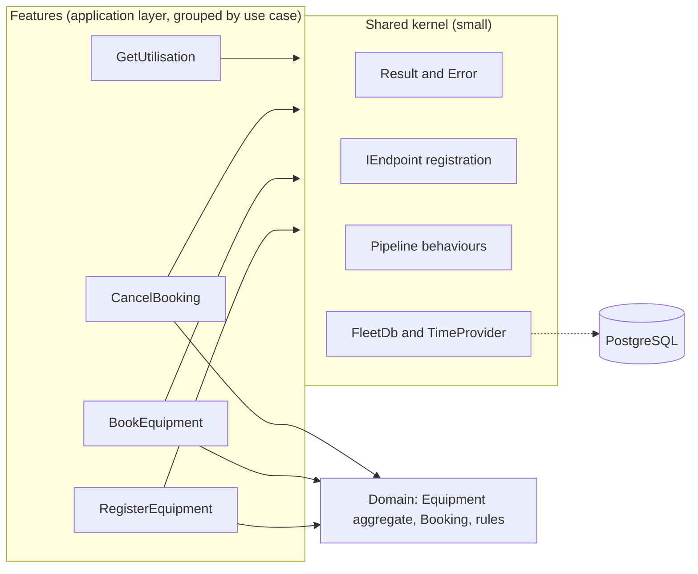
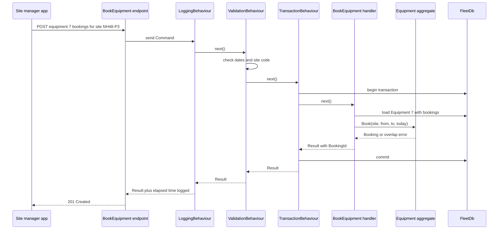
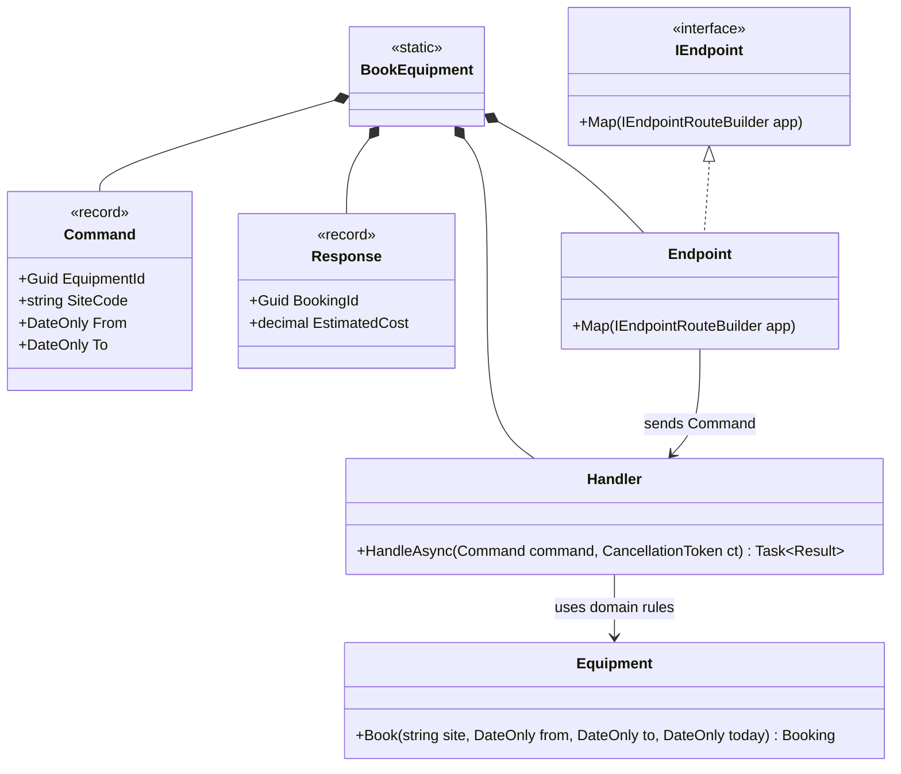

The [introductory lesson](#/lesson/m02-vertical-slice) showed the idea: one folder per feature instead of one folder per technical layer. This lesson is about what happens when you use it for a real system with real business rules, a few dozen endpoints and a team of six. Where do the rules go when two slices need them? How big may the shared folder grow? How do you add logging, validation and transactions once? And can you have slices *and* Clean Architecture at the same time? (Yes, and it is often the best combination.)

The running example is a **plant and machinery hire system** for a construction company. It owns about 400 machines (cranes, excavators, transit mixers, pavers) that move between project sites. Site managers book machines for date ranges. The yard team registers new machines and retires old ones. Management wants utilisation reports: how many days each machine earned money last month.

## Learning objectives

By the end of this lesson you will be able to:

1. Lay out an ASP.NET Core minimal API as feature slices, each with its request, validation, handler, response and endpoint in one place.
2. Keep business rules in a shared domain model, so slices share *rules* without sharing *each other*.
3. Decide what goes into the shared kernel and, more importantly, what must stay out of it.
4. Register endpoints and handlers by convention, and keep `Program.cs` short.
5. Add cross-cutting behaviour (logging, validation, transactions) as an ordered pipeline that slices can opt into.
6. Combine Vertical Slice Architecture with Clean Architecture's dependency rule.
7. Migrate a layered codebase to slices one feature at a time.

## Prerequisites

- [Vertical Slice Architecture (introduction)](#/lesson/m02-vertical-slice): the basic idea and a first example.
- [Aggregates](#/lesson/m08-aggregates): the domain model that slices will share.
- [Domain versus infrastructure dependencies](#/lesson/m08-domain-vs-infra): the dependency rule still applies inside slices.
- [CQRS fundamentals](#/lesson/m08-cqrs-fundamentals): slices map naturally to commands and queries.

## Explain it like I'm a beginner

Picture two ways to run a big wedding kitchen.

**Kitchen A is organised by station.** One team chops everything, one team fries everything, one team plates everything. To add a new dish, say paneer tikka, you must brief the choppers, the fryers and the platers, and each team changes its routine. If the frying team is overloaded, every dish waits.

**Kitchen B is organised by dish.** One small team owns biryani from raw rice to the serving tray. Another owns paneer tikka. Each team has its own recipe card. To add a new dish, you add one team and one recipe card, and the others don't change.

But kitchen B still shares some things. Everyone uses the same **pantry** of basic ingredients (salt, oil, onions), and everyone follows the same **food-safety rules** (hand washing, fridge temperatures). The pantry is small and boring on purpose. Nobody keeps half-made biryani in the shared pantry for the tikka team to "reuse".

Software works the same way:

- Kitchen A is a **layered** codebase: Controllers, Services, Repositories folders.
- Kitchen B is **vertical slices**: one folder per feature (`BookEquipment`, `CancelBooking`, `GetUtilisation`).
- The pantry is the **shared kernel**: a few small, stable helpers (a `Result` type, the database access, the clock).
- The food-safety rules are the **domain model** plus **cross-cutting behaviours** (validation, logging, transactions) that apply to every slice.

## First-principles explanation

### What a slice is

A **vertical slice** is everything one request needs, from the HTTP route down to the database, kept together. In practice that is one file (or one small folder) per endpoint containing:

| Part | Example for `BookEquipment` |
|---|---|
| Request (command or query) | `Command(Guid EquipmentId, string SiteCode, DateOnly From, DateOnly To)` |
| Validation of input shape | Dates present, site code format, range ≤ 90 days |
| Handler | Loads the `Equipment` aggregate, calls `Book(...)`, saves |
| Response | `Response(Guid BookingId, decimal EstimatedCost)` |
| Endpoint | `POST /equipment/{id}/bookings`, maps the result to HTTP |

The organising principle, in Jimmy Bogard's phrase, is to **minimise coupling between slices and maximise coupling within a slice**. Things that change together live together.

### Why it exists — the problem with layers at scale

In a layered codebase with 60 endpoints:

1. **A feature is scattered.** Adding "extend a booking" touches `BookingsController`, `IBookingService`, `BookingService`, `IBookingRepository`, `BookingRepository`, a DTO file and an AutoMapper profile. Seven files in five folders, all for one behaviour.
2. **Shared services become god classes.** `BookingService` grows to 1,500 lines with 25 methods, because every booking-related feature "belongs" there. Two developers editing it conflict every week.
3. **One abstraction fits nobody.** A generic `IRepository<T>` with `GetAll`, `Find` and `Update` serves the booking command poorly (it needs one aggregate with its bookings) and the utilisation report poorly (it needs a grouped SQL query).
4. **Fear of change.** Changing a shared service method used by 9 features risks all 9.

### How slices fix it, and what they cost

- **Each feature can choose its own approach.** The booking command uses the rich `Equipment` aggregate. The utilisation report runs a hand-written SQL query. A simple "list sites" lookup reads a table directly. Nobody forces all three through one repository.
- **Changes are local.** "Extend a booking" is one new file plus one new domain method.
- **Deleting a feature is easy.** Remove the folder. Nothing else referenced it.

The cost is **some duplication**. Two slices may each have a 3-line query that looks similar. That is usually fine. Duplication is cheaper than the wrong abstraction, and you can extract a shared helper later once you see a real pattern.

### Where the business rules go

This is the question that makes or breaks slices in a DDD system. If each slice re-implements "a machine cannot be double-booked", the rule will drift. The answer:

> **Slices share the domain model. Slices do not share each other.**

- Rules about one aggregate live **on the aggregate**: `Equipment.Book(...)` rejects overlapping bookings. Every slice that books calls it.
- Rules across aggregates live in a **domain service** in the domain folder.
- A slice never calls another slice's handler. If `ExtendBooking` needs logic from `BookEquipment`, that logic belongs in the domain (or, rarely, in the shared kernel), not in `BookEquipment`.

### The shared kernel: small on purpose

The shared kernel is code that **all slices use and that rarely changes**:

- A `Result<T>` and `Error` type, and their mapping to HTTP problem responses.
- The `IEndpoint` interface and registration by convention.
- Database access (`DbContext` in production), `TimeProvider`, the current-user accessor.
- Pipeline behaviours (logging, validation, transactions).

It must **not** contain business logic, feature-specific DTOs, or "helpers" that serve two slices. A good test: if a change to a shared-kernel class requires re-testing more than one feature's behaviour, the class probably contains feature logic and should move into the domain or back into the slices.

### Cross-cutting behaviour

Logging, validation, authorisation and transactions apply to many slices. Three mechanisms, from lightest to heaviest:

| Mechanism | Scope | Good for |
|---|---|---|
| Route group (`MapGroup`) with endpoint filters | HTTP endpoints | Authorisation, request logging, validation filters |
| Decorators around handlers | Handlers registered in DI | Validation, metrics |
| A pipeline of behaviours (MediatR-style) | Every request through a dispatcher | Ordered chains: logging → validation → transaction |

This lesson builds a tiny pipeline without any library, because the idea is short: each behaviour receives the request and a `next` delegate, and decides whether and when to call `next`. Behaviours can **opt in** by checking a marker interface on the request: for example, only commands that implement `ITransactional` get the transaction behaviour.

### Combining slices with Clean Architecture

Slices and Clean Architecture answer different questions:

- **Clean Architecture** answers "which way do dependencies point?" (inward, towards the domain).
- **Vertical slices** answer "how do I group the application layer?" (by feature, not by technical role).

So the combination is natural:

```text
Fleet.Domain           Equipment aggregate, Booking, domain exceptions      (no references)
Fleet.Application      Features/  <- the slices: requests, handlers, validation
                       Shared/    <- Result, pipeline, ports such as IFleetDb
Fleet.Infrastructure   EF Core DbContext, SQL for reports, external adapters
Fleet.Api              Program.cs, endpoint registration
```

In smaller systems, put the endpoint inside the slice in one project, and keep the domain in a `Domain` folder that slices depend on. The dependency rule still holds: `Domain` knows nothing about `Features`. See [Clean Architecture in ASP.NET Core](#/lesson/m08-clean-architecture-aspnet) for the four-project version.

### When it is useful

- Many endpoints (roughly 20+) that change independently.
- A team of several developers working on different features in parallel.
- Features with very different data-access needs (rich commands and heavy reports in one system).
- A codebase where a few "service" classes have become bottlenecks.

### When it is unnecessary

- A small API with 5–10 endpoints and one developer. Layers or even endpoints with inline logic are fine.
- A library or a domain-heavy engine with almost no endpoints. There is nothing to slice.
- A team that is not ready to accept local duplication. They will build a big shared folder and recreate layers by another name.

### Trade-offs it introduces

| You gain | You pay |
|---|---|
| A feature's code is in one place | Some duplication between slices |
| Parallel work without merge conflicts | Discipline needed to keep the shared kernel small |
| Each slice picks its own data access | Less uniformity: two slices may solve similar problems differently |
| Easy to add, change and delete features | Discovering "all the places that touch bookings" needs search, not a folder |
| Fits CQRS naturally | Without a rich domain, rules get copied between slices |

## Visual explanation

### Layers versus slices over the same domain



Each slice is a column. Three of them depend on the domain model, because they change state and must obey its rules. `GetUtilisation` is a query and skips the domain entirely, reading data through the shared database access. All slices use the shared kernel. There are **no arrows between slices**: `CancelBooking` doesn't call `BookEquipment`. The domain has no outgoing arrows, which is the Clean Architecture dependency rule, still intact.

### One request through a slice and its pipeline



The endpoint turns HTTP into a `Command` and hands it to the pipeline. Logging is outermost, so it measures everything. Validation runs next and can short-circuit with a 400 before any database work. The transaction behaviour wraps the handler only because this command opts in (`ITransactional`). The handler is small: load, call one domain method, return a result. The overlap rule is decided by the aggregate, so a future `ExtendBooking` slice gets the same rule for free.

### Inside one slice



The static class `BookEquipment` is just a container that gives the slice a name and stops its nested types (`Command`, `Handler`, `Endpoint`) from clashing with other slices' types of the same name. `Endpoint` implements the shared `IEndpoint` interface so it can be discovered automatically. The only arrow leaving the slice goes to the domain.

## Step-by-step example

### Step 1 — the layered starting point

```csharp
// Controllers/EquipmentController.cs: 14 actions
// Services/EquipmentService.cs: 1,100 lines, 31 public methods
public async Task<BookingDto> BookAsync(Guid equipmentId, BookingDto dto)
{
    var eq = await _repo.GetByIdAsync(equipmentId);
    var bookings = await _bookingRepo.GetForEquipmentAsync(equipmentId);
    if (bookings.Any(b => b.From <= dto.To && dto.From <= b.To && !b.Cancelled))   // rule copy #1
        throw new ValidationException("Overlap");
    ...
}
// ExtendBookingAsync, 400 lines further down, has rule copy #2 (and forgets the Cancelled check).
```

### Step 2 — move the rule into the domain first

Before slicing anything, move "no overlapping active bookings" into `Equipment.Book` and `Equipment.Extend`. This is the most important step. Slicing code whose rules are still in services just spreads the rules across more files.

### Step 3 — carve out one slice

Create `Features/Bookings/BookEquipment.cs` with `Command`, `Validator`, `Handler`, `Response` and `Endpoint`. Point the existing controller action at the new handler (or delete the action and map the new endpoint at the same route). Run the tests. Nothing else changes.

### Step 4 — repeat, and watch the service shrink

Each migrated feature removes a method from `EquipmentService`. When it is empty, delete it. This is the **strangler** approach applied inside one codebase: new slices grow around the old layers until the layers disappear. You never need a big-bang rewrite.

### Step 5 — extract shared pieces only when they hurt

After ten slices you notice every endpoint maps `Result` to HTTP the same way. Now, with real examples in hand, extract `ResultHttpExtensions` into the shared kernel. Don't design the shared kernel up front.

## Production-style C# implementation

```text
Fleet.Api/
  Program.cs
  Domain/Equipment.cs
  Shared/Result.cs
  Shared/Endpoints.cs
  Shared/Pipeline.cs
  Shared/FleetDb.cs
  Features/Equipment/RegisterEquipment.cs
  Features/Bookings/BookEquipment.cs
  Features/Bookings/CancelBooking.cs
  Features/Reports/GetUtilisation.cs
```

### The domain, shared by every slice

```csharp file=Domain/Equipment.cs
namespace Fleet.Domain;

public enum EquipmentKind { Crane, Excavator, TransitMixer, Paver, Roller }

public sealed class FleetRuleException(string code, string message) : Exception(message)
{
    public string Code { get; } = code;
}

public sealed record Booking(Guid Id, string SiteCode, DateOnly From, DateOnly To, bool Cancelled = false)
{
    public int Days => To.DayNumber - From.DayNumber + 1;
    public bool Overlaps(DateOnly from, DateOnly to) => !Cancelled && From <= to && from <= To;
}

/// <summary>Aggregate root. Every slice that changes bookings goes through these methods.</summary>
public sealed class Equipment
{
    public const int MaxBookingDays = 90;
    private readonly List<Booking> _bookings = new();

    public Guid Id { get; }
    public string Code { get; }
    public EquipmentKind Kind { get; }
    public decimal DailyRate { get; }
    public bool Retired { get; private set; }
    public IReadOnlyList<Booking> Bookings => _bookings;

    public Equipment(Guid id, string code, EquipmentKind kind, decimal dailyRate)
    {
        if (string.IsNullOrWhiteSpace(code)) throw new FleetRuleException("equipment.code", "Equipment code is required.");
        if (dailyRate <= 0) throw new FleetRuleException("equipment.rate", "Daily rate must be positive.");
        Id = id; Code = code.Trim().ToUpperInvariant(); Kind = kind; DailyRate = dailyRate;
    }

    public Booking Book(string siteCode, DateOnly from, DateOnly to, DateOnly today)
    {
        if (Retired) throw new FleetRuleException("booking.retired", $"{Code} is retired.");
        if (from < today) throw new FleetRuleException("booking.past", "Bookings cannot start in the past.");
        if (to < from) throw new FleetRuleException("booking.range", "End date is before start date.");
        if (to.DayNumber - from.DayNumber + 1 > MaxBookingDays)
            throw new FleetRuleException("booking.too-long", $"A booking can be at most {MaxBookingDays} days.");
        var clash = _bookings.FirstOrDefault(b => b.Overlaps(from, to));
        if (clash is not null)
            throw new FleetRuleException("booking.overlap", $"{Code} is already booked for {clash.SiteCode} from {clash.From} to {clash.To}.");

        var booking = new Booking(Guid.NewGuid(), siteCode.Trim().ToUpperInvariant(), from, to);
        _bookings.Add(booking);
        return booking;
    }

    public void CancelBooking(Guid bookingId, DateOnly today)
    {
        var index = _bookings.FindIndex(b => b.Id == bookingId);
        if (index < 0) throw new FleetRuleException("booking.not-found", "No such booking on this equipment.");
        var booking = _bookings[index];
        if (booking.Cancelled) return;                         // idempotent
        if (booking.From <= today)
            throw new FleetRuleException("booking.started", "A booking that has started cannot be cancelled. Release the machine instead.");
        _bookings[index] = booking with { Cancelled = true };
    }

    public void Retire(DateOnly today)
    {
        if (_bookings.Any(b => !b.Cancelled && b.To >= today))
            throw new FleetRuleException("equipment.has-bookings", "Cancel or finish future bookings before retiring.");
        Retired = true;
    }
}
```

### The shared kernel

```csharp file=Shared/Result.cs
namespace Fleet.Shared;

public enum ErrorKind { Validation, NotFound, Conflict }

public sealed record Error(string Code, string Message, ErrorKind Kind)
{
    public static Error NotFound(string code, string message) => new(code, message, ErrorKind.NotFound);
    public static Error Conflict(string code, string message) => new(code, message, ErrorKind.Conflict);
    public static Error Invalid(string code, string message) => new(code, message, ErrorKind.Validation);
}

public sealed class Result<T>
{
    private Result(T? value, Error? error) { Value = value; Error = error; }
    public T? Value { get; }
    public Error? Error { get; }
    public bool IsSuccess => Error is null;
    public static Result<T> Ok(T value) => new(value, null);
    public static Result<T> Fail(Error error) => new(default, error);
    public static implicit operator Result<T>(Error error) => Fail(error);
}

public static class ResultHttpExtensions
{
    /// <summary>One mapping from domain-level errors to HTTP, used by every slice.</summary>
    public static IResult ToHttp<T>(this Result<T> result, Func<T, IResult> onSuccess) =>
        result.IsSuccess
            ? onSuccess(result.Value!)
            : result.Error!.Kind switch
            {
                ErrorKind.NotFound => Results.Problem(result.Error.Message, statusCode: 404, title: result.Error.Code),
                ErrorKind.Conflict => Results.Problem(result.Error.Message, statusCode: 409, title: result.Error.Code),
                _ => Results.Problem(result.Error.Message, statusCode: 400, title: result.Error.Code)
            };
}
```

```csharp file=Shared/Endpoints.cs
using System.Reflection;

namespace Fleet.Shared;

/// <summary>Each slice exposes one class implementing this. Program.cs never lists routes by hand.</summary>
public interface IEndpoint
{
    void Map(IEndpointRouteBuilder app);
}

public static class EndpointRegistration
{
    public static IServiceCollection AddSlices(this IServiceCollection services, Assembly assembly)
    {
        foreach (var type in assembly.GetTypes().Where(t => t is { IsClass: true, IsAbstract: false }))
        {
            if (typeof(IEndpoint).IsAssignableFrom(type))
                services.AddSingleton(typeof(IEndpoint), type);
            // Convention: a nested class called Handler inside a Fleet.Features type is a slice handler.
            else if (type.Name == "Handler" && type.DeclaringType is not null
                     && type.Namespace?.StartsWith("Fleet.Features", StringComparison.Ordinal) == true)
                services.AddScoped(type);
        }
        return services;
    }

    public static WebApplication MapSlices(this WebApplication app)
    {
        var api = app.MapGroup("/api");   // shared filters, auth and rate limiting can be attached here once
        foreach (var endpoint in app.Services.GetServices<IEndpoint>().OrderBy(e => e.GetType().FullName, StringComparer.Ordinal))
            endpoint.Map(api);
        return app;
    }
}
```

Convention-based registration keeps `Program.cs` at a few lines however many slices exist. The trade-off is "magic": a developer must know the convention. A test that resolves every handler from the real container (shown in the testing section) catches mistakes early.

```csharp file=Shared/Pipeline.cs
using System.Diagnostics;

namespace Fleet.Shared;

/// <summary>Marker: commands that need a database transaction around their handler.</summary>
public interface ITransactional { }

/// <summary>Marker: requests that can validate their own shape before any work happens.</summary>
public interface IValidatable
{
    IReadOnlyDictionary<string, string[]> Validate();
}

public interface IPipelineBehaviour
{
    Task<Result<TResponse>> HandleAsync<TRequest, TResponse>(TRequest request, Func<Task<Result<TResponse>>> next, CancellationToken ct)
        where TRequest : notnull;
}

public sealed class LoggingBehaviour(ILogger<LoggingBehaviour> logger) : IPipelineBehaviour
{
    public async Task<Result<TResponse>> HandleAsync<TRequest, TResponse>(TRequest request, Func<Task<Result<TResponse>>> next, CancellationToken ct)
        where TRequest : notnull
    {
        var name = typeof(TRequest).DeclaringType?.Name ?? typeof(TRequest).Name;
        var sw = Stopwatch.StartNew();
        var result = await next();
        logger.LogInformation("{Slice} finished in {Elapsed} ms, success {Success}, error {Error}",
            name, sw.ElapsedMilliseconds, result.IsSuccess, result.Error?.Code);
        return result;
    }
}

public sealed class ValidationBehaviour : IPipelineBehaviour
{
    public Task<Result<TResponse>> HandleAsync<TRequest, TResponse>(TRequest request, Func<Task<Result<TResponse>>> next, CancellationToken ct)
        where TRequest : notnull
    {
        if (request is not IValidatable v) return next();
        var errors = v.Validate();
        if (errors.Count == 0) return next();
        var first = errors.First();
        return Task.FromResult(Result<TResponse>.Fail(Error.Invalid($"validation.{first.Key}", string.Join(" ", first.Value))));
    }
}

public sealed class TransactionBehaviour(FleetDb db) : IPipelineBehaviour
{
    public async Task<Result<TResponse>> HandleAsync<TRequest, TResponse>(TRequest request, Func<Task<Result<TResponse>>> next, CancellationToken ct)
        where TRequest : notnull
    {
        if (request is not ITransactional) return await next();
        using var tx = db.BeginTransaction();
        var result = await next();
        if (result.IsSuccess) tx.Commit();     // otherwise disposed without commit: rolled back
        return result;
    }
}

/// <summary>Runs behaviours in registration order (first = outermost), then the handler.</summary>
public sealed class Sender(IEnumerable<IPipelineBehaviour> behaviours)
{
    private readonly IPipelineBehaviour[] _behaviours = behaviours.ToArray();

    public Task<Result<TResponse>> SendAsync<TRequest, TResponse>(TRequest request,
        Func<TRequest, CancellationToken, Task<Result<TResponse>>> handler, CancellationToken ct) where TRequest : notnull
    {
        Func<Task<Result<TResponse>>> next = () => handler(request, ct);
        for (var i = _behaviours.Length - 1; i >= 0; i--)
        {
            var behaviour = _behaviours[i];
            var inner = next;
            next = () => behaviour.HandleAsync(request, inner, ct);
        }
        return next();
    }
}
```

The `Sender` builds the chain from the inside out: it starts with the handler and wraps it in the last behaviour, then the second-last, and so on, so the first registered behaviour runs first. Libraries such as MediatR do the same, with more features (notifications, streaming, generic constraints per behaviour). You don't need one to use slices, but it is a reasonable choice if the team already knows it.

```csharp file=Shared/FleetDb.cs
using System.Collections.Concurrent;
using Fleet.Domain;

namespace Fleet.Shared;

/// <summary>Stands in for an EF Core DbContext over PostgreSQL. Slices use it directly; no generic repository.</summary>
public sealed class FleetDb
{
    public ConcurrentDictionary<Guid, Equipment> Equipment { get; } = new();
    public int Commits { get; private set; }

    public FleetTransaction BeginTransaction() => new(this);

    public sealed class FleetTransaction(FleetDb db) : IDisposable
    {
        private bool _committed;
        public void Commit() { _committed = true; db.Commits++; }
        public void Dispose() { /* a real transaction rolls back here when !_committed */ _ = _committed; }
    }
}
```

There is deliberately no `IEquipmentRepository`. With EF Core the `DbContext` already is a unit of work with repositories (`DbSet<T>`). Slices can use it directly: commands load aggregates with `Include`, queries project with `Select`. Add a repository only where a slice benefits from hiding a complicated load. This is a common and defensible choice in slice-based codebases, and it is the opposite of what the [repository lesson](#/lesson/m06-repository-uow) recommends for layered systems, so make it consciously and write it down in an ADR.

### The slices

```csharp file=Features/Equipment/RegisterEquipment.cs
using Fleet.Domain;
using Fleet.Shared;

namespace Fleet.Features.Equipment;

public static class RegisterEquipment
{
    public sealed record Command(string Code, EquipmentKind Kind, decimal DailyRate) : IValidatable, ITransactional
    {
        public IReadOnlyDictionary<string, string[]> Validate()
        {
            var errors = new Dictionary<string, string[]>();
            if (string.IsNullOrWhiteSpace(Code) || Code.Length > 20) errors["code"] = ["Code is required, up to 20 characters."];
            if (DailyRate is <= 0 or > 5_00_000m) errors["dailyRate"] = ["Daily rate must be between 1 and 5,00,000."];
            return errors;
        }
    }

    public sealed record Response(Guid Id, string Code);

    public sealed class Handler(FleetDb db)
    {
        public Task<Result<Response>> HandleAsync(Command c, CancellationToken ct)
        {
            if (db.Equipment.Values.Any(e => e.Code == c.Code.Trim().ToUpperInvariant()))
                return Task.FromResult<Result<Response>>(Error.Conflict("equipment.duplicate", $"{c.Code} already exists."));
            var equipment = new Fleet.Domain.Equipment(Guid.NewGuid(), c.Code, c.Kind, c.DailyRate);
            db.Equipment[equipment.Id] = equipment;
            return Task.FromResult(Result<Response>.Ok(new Response(equipment.Id, equipment.Code)));
        }
    }

    public sealed class Endpoint : IEndpoint
    {
        public void Map(IEndpointRouteBuilder app) =>
            app.MapPost("/equipment", async (Command command, Handler handler, Sender sender, CancellationToken ct) =>
                (await sender.SendAsync<Command, Response>(command, handler.HandleAsync, ct))
                    .ToHttp(r => Results.Created($"/api/equipment/{r.Id}", r)))
               .WithTags("Equipment");
    }
}
```

The namespace `Fleet.Features.Equipment` shares a name with the domain class `Fleet.Domain.Equipment`, so the handler writes the full name. In a real codebase you might name the folder `Fleet` or `Machines` to avoid that.

```csharp file=Features/Bookings/BookEquipment.cs
using Fleet.Domain;
using Fleet.Shared;

namespace Fleet.Features.Bookings;

public static class BookEquipment
{
    public sealed record Request(string SiteCode, DateOnly From, DateOnly To);

    public sealed record Command(Guid EquipmentId, string SiteCode, DateOnly From, DateOnly To) : IValidatable, ITransactional
    {
        public IReadOnlyDictionary<string, string[]> Validate()
        {
            var errors = new Dictionary<string, string[]>();
            if (string.IsNullOrWhiteSpace(SiteCode)) errors["siteCode"] = ["Site code is required."];
            if (From == default || To == default) errors["dates"] = ["Both dates are required."];
            return errors;   // shape only: overlap, past dates and length are domain rules
        }
    }

    public sealed record Response(Guid BookingId, int Days, decimal EstimatedCost);

    public sealed class Handler(FleetDb db, TimeProvider clock)
    {
        public Task<Result<Response>> HandleAsync(Command c, CancellationToken ct)
        {
            if (!db.Equipment.TryGetValue(c.EquipmentId, out var equipment))
                return Task.FromResult<Result<Response>>(Error.NotFound("equipment.not-found", "No such equipment."));
            try
            {
                var today = DateOnly.FromDateTime(clock.GetLocalNow().DateTime);
                var booking = equipment.Book(c.SiteCode, c.From, c.To, today);
                return Task.FromResult(Result<Response>.Ok(new Response(booking.Id, booking.Days, booking.Days * equipment.DailyRate)));
            }
            catch (FleetRuleException ex)
            {
                return Task.FromResult<Result<Response>>(Error.Conflict(ex.Code, ex.Message));
            }
        }
    }

    public sealed class Endpoint : IEndpoint
    {
        public void Map(IEndpointRouteBuilder app) =>
            app.MapPost("/equipment/{id:guid}/bookings", async (Guid id, Request body, Handler handler, Sender sender, CancellationToken ct) =>
                (await sender.SendAsync<Command, Response>(new Command(id, body.SiteCode, body.From, body.To), handler.HandleAsync, ct))
                    .ToHttp(r => Results.Created($"/api/equipment/{id}/bookings/{r.BookingId}", r)))
               .WithTags("Bookings");
    }
}
```

Notice the split of checks. The command's `Validate` checks only the **shape** of the input (required fields). Everything that is a **business rule** (no past dates, no overlaps, 90-day limit) is decided by `Equipment.Book`, so the upcoming `ExtendBooking` slice can't forget any of them.

```csharp file=Features/Bookings/CancelBooking.cs
using Fleet.Domain;
using Fleet.Shared;

namespace Fleet.Features.Bookings;

public static class CancelBooking
{
    public sealed record Command(Guid EquipmentId, Guid BookingId) : ITransactional;
    public sealed record Response(Guid BookingId, bool Cancelled);

    public sealed class Handler(FleetDb db, TimeProvider clock)
    {
        public Task<Result<Response>> HandleAsync(Command c, CancellationToken ct)
        {
            if (!db.Equipment.TryGetValue(c.EquipmentId, out var equipment))
                return Task.FromResult<Result<Response>>(Error.NotFound("equipment.not-found", "No such equipment."));
            try
            {
                equipment.CancelBooking(c.BookingId, DateOnly.FromDateTime(clock.GetLocalNow().DateTime));
                return Task.FromResult(Result<Response>.Ok(new Response(c.BookingId, true)));
            }
            catch (FleetRuleException ex) when (ex.Code == "booking.not-found")
            {
                return Task.FromResult<Result<Response>>(Error.NotFound(ex.Code, ex.Message));
            }
            catch (FleetRuleException ex)
            {
                return Task.FromResult<Result<Response>>(Error.Conflict(ex.Code, ex.Message));
            }
        }
    }

    public sealed class Endpoint : IEndpoint
    {
        public void Map(IEndpointRouteBuilder app) =>
            app.MapDelete("/equipment/{id:guid}/bookings/{bookingId:guid}", async (Guid id, Guid bookingId, Handler handler, Sender sender, CancellationToken ct) =>
                (await sender.SendAsync<Command, Response>(new Command(id, bookingId), handler.HandleAsync, ct))
                    .ToHttp(_ => Results.NoContent()))
               .WithTags("Bookings");
    }
}
```

```csharp file=Features/Reports/GetUtilisation.cs
using Fleet.Shared;

namespace Fleet.Features.Reports;

/// <summary>A query slice. It reads data directly and never calls domain behaviour.</summary>
public static class GetUtilisation
{
    public sealed record Query(DateOnly From, DateOnly To) : IValidatable
    {
        public IReadOnlyDictionary<string, string[]> Validate() =>
            To < From || To.DayNumber - From.DayNumber > 366
                ? new Dictionary<string, string[]> { ["range"] = ["Range must be 1 to 366 days."] }
                : new Dictionary<string, string[]>();
    }

    public sealed record Row(string Code, string Kind, int BookedDays, int PeriodDays, decimal UtilisationPercent, decimal Revenue);

    public sealed class Handler(FleetDb db)
    {
        public Task<Result<IReadOnlyList<Row>>> HandleAsync(Query q, CancellationToken ct)
        {
            var periodDays = q.To.DayNumber - q.From.DayNumber + 1;
            IReadOnlyList<Row> rows = db.Equipment.Values
                .Where(e => !e.Retired)
                .Select(e =>
                {
                    var booked = e.Bookings.Where(b => !b.Cancelled).Sum(b => OverlapDays(b.From, b.To, q.From, q.To));
                    return new Row(e.Code, e.Kind.ToString(), booked, periodDays,
                        Math.Round(100m * booked / periodDays, 1), booked * e.DailyRate);
                })
                .OrderBy(r => r.UtilisationPercent).ThenBy(r => r.Code)
                .ToList();
            return Task.FromResult(Result<IReadOnlyList<Row>>.Ok(rows));
        }

        private static int OverlapDays(DateOnly aFrom, DateOnly aTo, DateOnly bFrom, DateOnly bTo)
        {
            var start = aFrom > bFrom ? aFrom : bFrom;
            var end = aTo < bTo ? aTo : bTo;
            return end < start ? 0 : end.DayNumber - start.DayNumber + 1;
        }
    }

    public sealed class Endpoint : IEndpoint
    {
        public void Map(IEndpointRouteBuilder app) =>
            app.MapGet("/reports/utilisation", async (DateOnly from, DateOnly to, Handler handler, Sender sender, CancellationToken ct) =>
                (await sender.SendAsync<Query, IReadOnlyList<Row>>(new Query(from, to), handler.HandleAsync, ct))
                    .ToHttp(rows => Results.Ok(rows)))
               .WithTags("Reports");
    }
}
```

In production this handler would be a single SQL query with `GREATEST`/`LEAST` for the overlap and `GROUP BY equipment_id`, run through Dapper or EF Core's `SqlQuery`. Because it is its own slice, choosing raw SQL here doesn't force anything on the command slices.

```csharp file=Program.cs
using Fleet.Shared;

var builder = WebApplication.CreateBuilder(args);

builder.Services.AddSingleton(TimeProvider.System);
builder.Services.AddSingleton<FleetDb>();
// Order matters: first registered is outermost.
builder.Services.AddScoped<IPipelineBehaviour, LoggingBehaviour>();
builder.Services.AddScoped<IPipelineBehaviour, ValidationBehaviour>();
builder.Services.AddScoped<IPipelineBehaviour, TransactionBehaviour>();
builder.Services.AddScoped<Sender>();
builder.Services.AddSlices(typeof(Program).Assembly);

var app = builder.Build();
app.MapSlices();
app.Run();
```

`Program.cs` has not grown with the four slices, and it won't grow with forty.

## Bad design vs good design

**Bad: slices calling slices.** `ExtendBooking.Handler` creates a `BookEquipment.Handler` and calls it "to reuse the overlap check". Now changing `BookEquipment`'s response breaks `ExtendBooking`, and the pipeline runs twice (two log lines, a nested transaction). Shared rules belong in the domain.

**Bad: the shared kernel that ate the slices.** `Shared/BookingHelpers.cs` grows `CalculateCost`, `IsOverlapping`, `MapToDto`, `GetActiveBookingsForSite`. Each slice uses two or three of them. You have rebuilt `BookingService` under a new name, with the same merge conflicts and fear.

**Bad: anaemic slices.** Each slice has a perfect folder structure, but every rule is written inline in each handler. Four handlers have four slightly different overlap checks. Vertical slices without a domain model only move the duplication around.

**Bad: ceremony per slice.** Every slice must have `Command.cs`, `CommandValidator.cs`, `Handler.cs`, `Response.cs`, `Endpoint.cs`, `MappingProfile.cs` and `Tests.cs`, even for a one-line lookup. The team stops creating slices and hides new endpoints in old ones.

**Good:** rules on the aggregate, small slices (one file is fine), a shared kernel that holds only stable plumbing, and cross-cutting behaviour in one ordered pipeline. Simple slices stay simple: a lookup slice can be ten lines with no validation and no pipeline.

:::callout type=tradeoff title="Duplication versus coupling"
Two query slices with similar 5-line `Where` clauses are fine. Extract only when (a) the logic is a business rule (move it to the domain), or (b) it has been copied three or more times and changes for the same reason every time (move it to the shared kernel). Similar-looking code that changes for different reasons should stay duplicated.
:::

:::callout type=warning title="Feature folders are not bounded contexts"
`Features/Bookings` and `Features/Reports` are slices of one application over one model. A bounded context is a separate model with its own language, as discussed in [Bounded contexts](#/lesson/m08-bounded-contexts). In a [modular monolith](#/lesson/m08-ddd-modular-monolith), each module (context) has its own slices inside it.
:::

## Practical playground

This playground runs the pipeline idea in one file: a logging behaviour, a validation behaviour, and two slices sharing one domain rule. Run it, then add a third slice, `ExtendBooking`, that reuses `Machine.Book`'s overlap rule without calling the other slice.

:::playground type=csharp title="Slices, a shared domain and a pipeline"
```csharp file=Program.cs
using System;
using System.Collections.Generic;
using System.Linq;
using System.Threading.Tasks;

// ----- Domain shared by all slices -----
public sealed record Booking(string Site, DateOnly From, DateOnly To);
public sealed class Machine(string code)
{
    public string Code { get; } = code;
    public List<Booking> Bookings { get; } = new();
    public Booking Book(string site, DateOnly from, DateOnly to)
    {
        if (to < from) throw new InvalidOperationException("End before start");
        if (Bookings.Any(b => b.From <= to && from <= b.To)) throw new InvalidOperationException($"{Code} is already booked");
        var booking = new Booking(site, from, to);
        Bookings.Add(booking);
        return booking;
    }
}

// ----- Shared kernel: a tiny pipeline -----
public delegate Task<string> Next();
public static class Pipeline
{
    public static readonly List<Func<object, Next, Task<string>>> Behaviours = new()
    {
        async (req, next) => { var r = await next(); Console.WriteLine($"  [log] {req.GetType().Name} -> {r}"); return r; },
        (req, next) => req is BookMachine { Site: "" } ? Task.FromResult("400 site required") : next(),
    };

    public static Task<string> Send(object request, Func<Task<string>> handler)
    {
        Next next = () => handler();
        for (var i = Behaviours.Count - 1; i >= 0; i--)
        {
            var b = Behaviours[i]; var inner = next;
            next = () => b(request, inner);
        }
        return next();
    }
}

// ----- Slice 1 -----
public sealed record BookMachine(string Code, string Site, DateOnly From, DateOnly To);
public static class BookMachineSlice
{
    public static Task<string> Handle(BookMachine c, Dictionary<string, Machine> db)
    {
        try { var b = db[c.Code].Book(c.Site, c.From, c.To); return Task.FromResult($"201 booked {b.From}..{b.To}"); }
        catch (InvalidOperationException ex) { return Task.FromResult($"409 {ex.Message}"); }
    }
}

// ----- Slice 2: a query, no domain behaviour -----
public sealed record GetBookings(string Code);
public static class GetBookingsSlice
{
    public static Task<string> Handle(GetBookings q, Dictionary<string, Machine> db) =>
        Task.FromResult("200 " + string.Join(", ", db[q.Code].Bookings.Select(b => $"{b.Site} {b.From:dd MMM}-{b.To:dd MMM}")));
}

public static class Program
{
    public static async Task Main()
    {
        var db = new Dictionary<string, Machine> { ["CR-25T-007"] = new Machine("CR-25T-007") };
        var nov3 = new DateOnly(2026, 11, 3);

        var requests = new object[]
        {
            new BookMachine("CR-25T-007", "NH48-P3", nov3, nov3.AddDays(9)),
            new BookMachine("CR-25T-007", "SH12-P1", nov3.AddDays(5), nov3.AddDays(12)),
            new BookMachine("CR-25T-007", "", nov3.AddDays(20), nov3.AddDays(21)),
            new GetBookings("CR-25T-007"),
        };
        foreach (var r in requests)
        {
            Func<Task<string>> handler = r switch
            {
                BookMachine c => () => BookMachineSlice.Handle(c, db),
                GetBookings q => () => GetBookingsSlice.Handle(q, db),
                _ => () => Task.FromResult("404")
            };
            await Pipeline.Send(r, handler);
        }
        // Challenge: add ExtendBooking(Code, Site, OldTo, NewTo) as a third slice that reuses Machine's rule.
    }
}
```
:::

## Exercises

:::exercise id=m08-vertical-slice-ex1 difficulty=beginner kind=code title="Cancel-booking slice: map domain errors to results"
Write the handler for the `CancelBooking` slice. The domain method `Machine.CancelBooking` already contains the rules. Your handler must turn its outcomes into a `Result` that the endpoint can map to HTTP.
::requirements
- Unknown machine id: `NotFound` with code `machine.not-found`.
- The domain throws `FleetRuleException` with code `booking.not-found`: return `NotFound` with that code.
- Any other `FleetRuleException`: return `Conflict` with the exception's code and message.
- Success: return `Ok` with the booking id.
- Do not re-implement any rule in the handler.
::acceptance
- Cancelling a future booking succeeds and the booking is marked cancelled.
- Cancelling a booking that has started returns `Conflict` with code `booking.started`.
- An unknown booking id returns `NotFound`.
- An unknown machine id returns `NotFound` with code `machine.not-found`.
::hint
The handler has three jobs: find, delegate, translate.
::hint
Use `catch (FleetRuleException ex) when (ex.Code == "booking.not-found")` for the special case, then a general catch.
::hint
`today` is passed in through the command, so the test controls it.
::hint
```csharp
if (!db.TryGetValue(c.MachineId, out var machine)) return Result.Fail(new Error("machine.not-found", "...", ErrorKind.NotFound));
try { machine.CancelBooking(c.BookingId, c.Today); return Result.Ok(c.BookingId); }
```
::starter
```csharp file=CancelBooking.cs
using System;
using System.Collections.Generic;

public enum ErrorKind { Validation, NotFound, Conflict }
public sealed record Error(string Code, string Message, ErrorKind Kind);
public sealed record Result(Guid? Value, Error? Error)
{
    public bool IsSuccess => Error is null;
    public static Result Ok(Guid value) => new(value, null);
    public static Result Fail(Error error) => new(null, error);
}

public sealed class FleetRuleException(string code, string message) : Exception(message) { public string Code { get; } = code; }

public sealed record Booking(Guid Id, DateOnly From, DateOnly To, bool Cancelled = false);

public sealed class Machine(Guid id)
{
    public Guid Id { get; } = id;
    public List<Booking> Bookings { get; } = new();
    public void CancelBooking(Guid bookingId, DateOnly today)
    {
        var i = Bookings.FindIndex(b => b.Id == bookingId);
        if (i < 0) throw new FleetRuleException("booking.not-found", "No such booking.");
        if (Bookings[i].Cancelled) return;
        if (Bookings[i].From <= today) throw new FleetRuleException("booking.started", "Booking has started.");
        Bookings[i] = Bookings[i] with { Cancelled = true };
    }
}

public static class CancelBookingSlice
{
    public sealed record Command(Guid MachineId, Guid BookingId, DateOnly Today);

    public sealed class Handler(Dictionary<Guid, Machine> db)
    {
        public Result Handle(Command c) => throw new NotImplementedException();
    }
}
```
::tests
```csharp file=CancelBookingTests.cs
using System;
using System.Collections.Generic;
using Xunit;

public class CancelBookingTests
{
    private static readonly DateOnly Today = new(2026, 10, 20);

    private static (CancelBookingSlice.Handler H, Machine M, Guid Future, Guid Started) Setup()
    {
        var m = new Machine(Guid.NewGuid());
        var future = new Booking(Guid.NewGuid(), Today.AddDays(5), Today.AddDays(9));
        var started = new Booking(Guid.NewGuid(), Today.AddDays(-2), Today.AddDays(3));
        m.Bookings.Add(future); m.Bookings.Add(started);
        return (new CancelBookingSlice.Handler(new Dictionary<Guid, Machine> { [m.Id] = m }), m, future.Id, started.Id);
    }

    [Fact]
    public void Cancels_future_booking()
    {
        var (h, m, future, _) = Setup();
        var r = h.Handle(new(m.Id, future, Today));
        Assert.True(r.IsSuccess);
        Assert.Equal(future, r.Value);
        Assert.True(m.Bookings.Find(b => b.Id == future)!.Cancelled);
    }

    [Fact]
    public void Started_booking_is_a_conflict()
    {
        var (h, m, _, started) = Setup();
        var r = h.Handle(new(m.Id, started, Today));
        Assert.Equal(ErrorKind.Conflict, r.Error!.Kind);
        Assert.Equal("booking.started", r.Error.Code);
    }

    [Fact]
    public void Unknown_booking_is_not_found()
    {
        var (h, m, _, _) = Setup();
        var r = h.Handle(new(m.Id, Guid.NewGuid(), Today));
        Assert.Equal(ErrorKind.NotFound, r.Error!.Kind);
        Assert.Equal("booking.not-found", r.Error.Code);
    }

    [Fact]
    public void Unknown_machine_is_not_found()
    {
        var (h, _, future, _) = Setup();
        var r = h.Handle(new(Guid.NewGuid(), future, Today));
        Assert.Equal("machine.not-found", r.Error!.Code);
        Assert.Equal(ErrorKind.NotFound, r.Error.Kind);
    }
}
```
::solution
```csharp file=CancelBooking.cs
using System;
using System.Collections.Generic;

public enum ErrorKind { Validation, NotFound, Conflict }
public sealed record Error(string Code, string Message, ErrorKind Kind);
public sealed record Result(Guid? Value, Error? Error)
{
    public bool IsSuccess => Error is null;
    public static Result Ok(Guid value) => new(value, null);
    public static Result Fail(Error error) => new(null, error);
}

public sealed class FleetRuleException(string code, string message) : Exception(message) { public string Code { get; } = code; }

public sealed record Booking(Guid Id, DateOnly From, DateOnly To, bool Cancelled = false);

public sealed class Machine(Guid id)
{
    public Guid Id { get; } = id;
    public List<Booking> Bookings { get; } = new();
    public void CancelBooking(Guid bookingId, DateOnly today)
    {
        var i = Bookings.FindIndex(b => b.Id == bookingId);
        if (i < 0) throw new FleetRuleException("booking.not-found", "No such booking.");
        if (Bookings[i].Cancelled) return;
        if (Bookings[i].From <= today) throw new FleetRuleException("booking.started", "Booking has started.");
        Bookings[i] = Bookings[i] with { Cancelled = true };
    }
}

public static class CancelBookingSlice
{
    public sealed record Command(Guid MachineId, Guid BookingId, DateOnly Today);

    public sealed class Handler(Dictionary<Guid, Machine> db)
    {
        public Result Handle(Command c)
        {
            if (!db.TryGetValue(c.MachineId, out var machine))
                return Result.Fail(new Error("machine.not-found", "No such machine.", ErrorKind.NotFound));
            try
            {
                machine.CancelBooking(c.BookingId, c.Today);   // all rules live here
                return Result.Ok(c.BookingId);
            }
            catch (FleetRuleException ex) when (ex.Code == "booking.not-found")
            {
                return Result.Fail(new Error(ex.Code, ex.Message, ErrorKind.NotFound));
            }
            catch (FleetRuleException ex)
            {
                return Result.Fail(new Error(ex.Code, ex.Message, ErrorKind.Conflict));
            }
        }
    }
}
```

The handler is translation only. If the rule changes ("bookings can be cancelled up to 24 hours before start"), only `Machine.CancelBooking` changes, and every slice that cancels (this one, and perhaps a future bulk-cancel slice) picks it up.
::mistakes
- Copying `if (booking.From <= today)` into the handler "to return a nicer error".
- Catching `Exception` and returning 500-style errors for rule violations.
- Calling `DateOnly.FromDateTime(DateTime.Now)` inside the handler, so the test cannot control today.
::extensions
Make the domain return a result instead of throwing, and compare the two handler versions for readability.
:::

:::exercise id=m08-vertical-slice-ex2 difficulty=beginner kind=code title="The utilisation query slice"
Management wants machine utilisation for a period. Write the query handler. It reads data directly and uses no domain behaviour.
::requirements
- Input: `From` and `To` (inclusive). Period days = `To - From + 1`.
- For each machine that is not retired, booked days = total days of non-cancelled bookings that fall inside the period (clip bookings that start before or end after it).
- `UtilisationPercent = round(100 × booked / period, 1)`.
- Sort by utilisation ascending (idle machines first), then by code.
::acceptance
- A 10-day booking fully inside a 30-day period gives 33.3 %.
- A booking from 25 Sep to 5 Oct, for a 1–31 Oct period, counts 5 days.
- Cancelled bookings and retired machines are ignored.
- Rows are sorted idle first.
::hint
The only tricky part is clipping a booking to the period. Draw two ranges on a line.
::hint
Overlap start = the later of the two starts. Overlap end = the earlier of the two ends.
::hint
If the overlap end is before the overlap start, they don't overlap: 0 days.
::hint
```csharp
var start = b.From > q.From ? b.From : q.From;
var end = b.To < q.To ? b.To : q.To;
var days = end < start ? 0 : end.DayNumber - start.DayNumber + 1;
```
::starter
```csharp file=Utilisation.cs
using System;
using System.Collections.Generic;
using System.Linq;

public sealed record BookingRow(DateOnly From, DateOnly To, bool Cancelled);
public sealed record MachineRow(string Code, bool Retired, IReadOnlyList<BookingRow> Bookings);

public static class GetUtilisationSlice
{
    public sealed record Query(DateOnly From, DateOnly To);
    public sealed record Row(string Code, int BookedDays, decimal UtilisationPercent);

    public sealed class Handler(IReadOnlyList<MachineRow> machines)
    {
        public IReadOnlyList<Row> Handle(Query q) => throw new NotImplementedException();
    }
}
```
::tests
```csharp file=UtilisationTests.cs
using System;
using System.Linq;
using Xunit;

public class UtilisationTests
{
    private static readonly GetUtilisationSlice.Query October = new(new(2026, 10, 1), new(2026, 10, 30));

    [Fact]
    public void Ten_days_in_thirty_is_33_3_percent()
    {
        var m = new MachineRow("EX-01", false, new[] { new BookingRow(new(2026, 10, 5), new(2026, 10, 14), false) });
        var row = new GetUtilisationSlice.Handler(new[] { m }).Handle(October).Single();
        Assert.Equal(10, row.BookedDays);
        Assert.Equal(33.3m, row.UtilisationPercent);
    }

    [Fact]
    public void Bookings_are_clipped_to_the_period()
    {
        var m = new MachineRow("CR-07", false, new[] { new BookingRow(new(2026, 9, 25), new(2026, 10, 5), false) });
        Assert.Equal(5, new GetUtilisationSlice.Handler(new[] { m }).Handle(October).Single().BookedDays);
    }

    [Fact]
    public void Cancelled_and_retired_are_ignored()
    {
        var a = new MachineRow("A", false, new[] { new BookingRow(new(2026, 10, 1), new(2026, 10, 30), true) });
        var b = new MachineRow("B", true, new[] { new BookingRow(new(2026, 10, 1), new(2026, 10, 30), false) });
        var rows = new GetUtilisationSlice.Handler(new[] { a, b }).Handle(October);
        Assert.Equal("A", rows.Single().Code);
        Assert.Equal(0, rows.Single().BookedDays);
    }

    [Fact]
    public void Idle_machines_first_then_code()
    {
        var busy = new MachineRow("Z-BUSY", false, new[] { new BookingRow(new(2026, 10, 1), new(2026, 10, 30), false) });
        var idle2 = new MachineRow("B-IDLE", false, Array.Empty<BookingRow>());
        var idle1 = new MachineRow("A-IDLE", false, Array.Empty<BookingRow>());
        var codes = new GetUtilisationSlice.Handler(new[] { busy, idle2, idle1 }).Handle(October).Select(r => r.Code).ToArray();
        Assert.Equal(new[] { "A-IDLE", "B-IDLE", "Z-BUSY" }, codes);
    }
}
```
::solution
```csharp file=Utilisation.cs
using System;
using System.Collections.Generic;
using System.Linq;

public sealed record BookingRow(DateOnly From, DateOnly To, bool Cancelled);
public sealed record MachineRow(string Code, bool Retired, IReadOnlyList<BookingRow> Bookings);

public static class GetUtilisationSlice
{
    public sealed record Query(DateOnly From, DateOnly To);
    public sealed record Row(string Code, int BookedDays, decimal UtilisationPercent);

    public sealed class Handler(IReadOnlyList<MachineRow> machines)
    {
        public IReadOnlyList<Row> Handle(Query q)
        {
            var periodDays = q.To.DayNumber - q.From.DayNumber + 1;
            return machines
                .Where(m => !m.Retired)
                .Select(m =>
                {
                    var booked = m.Bookings.Where(b => !b.Cancelled).Sum(b => Overlap(b, q));
                    return new Row(m.Code, booked, Math.Round(100m * booked / periodDays, 1));
                })
                .OrderBy(r => r.UtilisationPercent)
                .ThenBy(r => r.Code, StringComparer.Ordinal)
                .ToList();
        }

        private static int Overlap(BookingRow b, Query q)
        {
            var start = b.From > q.From ? b.From : q.From;
            var end = b.To < q.To ? b.To : q.To;
            return end < start ? 0 : end.DayNumber - start.DayNumber + 1;
        }
    }
}
```

In PostgreSQL, the whole handler becomes one query, which is exactly why reports deserve their own slices:

```sql
SELECT e.code,
       COALESCE(SUM(GREATEST(0, LEAST(b.to_date, @to) - GREATEST(b.from_date, @from) + 1)), 0) AS booked_days
FROM equipment e
LEFT JOIN bookings b ON b.equipment_id = e.id AND NOT b.cancelled
WHERE NOT e.retired
GROUP BY e.code
ORDER BY booked_days, e.code;
```
::mistakes
- Counting whole bookings instead of clipping them to the period.
- Using `To - From` without the `+ 1`, so a one-day booking counts as zero.
- Integer division (`100 * booked / periodDays` with ints), which turns 33.3 into 33.
::extensions
Add an optional `Kind` filter and a `Revenue` column (booked days × daily rate), and decide whether the rate should be the rate at booking time (a fact stored on the booking) or today's rate.
:::

:::exercise id=m08-vertical-slice-ex3 difficulty=intermediate kind=design title="Slices plus Clean Architecture for a tender module"
A company's tender module is currently layered: `TenderController`, `TenderService` (2,000 lines), `TenderRepository`, `BidService`, `BidRepository`. Features: publish a tender, amend a tender (corrigendum), submit a bid, withdraw a bid, open bids after the deadline, list tenders by status, and a comparative statement report of all bids for a tender.

Rules: bids only before the deadline; one active bid per bidder per tender; a corrigendum can extend but never shorten the deadline; bids are sealed (nobody can read amounts) until opening.

Design the target structure: domain, slices and shared kernel, combined with Clean Architecture's dependency rule. Use the LLD designer.
::acceptance
- The four rules each live on a named domain class, not in slices.
- One slice per feature (at least 7), each marked as command or query.
- The shared kernel holds only plumbing (no tender-specific helpers).
- No slice depends on another slice.
- The comparative statement is a query slice that can use SQL directly, and still respects the "sealed until opening" rule.
::hint
Which object must be loaded to check "one active bid per bidder" and "before the deadline" together? That decides the aggregate boundary.
::hint
For a tender with 40 bids, holding bids inside the `Tender` aggregate is fine. For 4,000 it might not be. State your assumption.
::hint
"Sealed until opening" is a read-side rule too. Where can a query slice check it without loading the aggregate?
::hint
Model slices as classes with a responsibility like "Command slice: Features/Bids/SubmitBid".
::starter
```json
{
  "classes": [
    { "id": "Tender", "name": "Tender", "kind": "class", "fields": ["-TenderId Id", "-DateTimeOffset Deadline"], "methods": [], "responsibility": "Aggregate root. TODO: rules" },
    { "id": "SubmitBid", "name": "SubmitBid", "kind": "class", "fields": [], "methods": ["+Task~Result~ HandleAsync(Command c)"], "responsibility": "Command slice" }
  ],
  "relations": [ { "from": "SubmitBid", "to": "Tender", "kind": "dependency" } ]
}
```
::solution
```json
{
  "classes": [
    { "id": "Tender", "name": "Tender", "kind": "class",
      "fields": ["-TenderId Id", "-string Title", "-DateTimeOffset Deadline", "-TenderStatus Status", "-List~Bid~ _bids", "-List~Corrigendum~ _corrigenda"],
      "methods": ["+void Publish(DateTimeOffset now)", "+void Amend(Corrigendum c, DateTimeOffset now)", "+BidId SubmitBid(BidderId bidder, Money amount, DateTimeOffset now)", "+void WithdrawBid(BidderId bidder, DateTimeOffset now)", "+void OpenBids(DateTimeOffset now)"],
      "responsibility": "Domain aggregate root (Fleet-style Domain project). Rules: bids before deadline; one active bid per bidder; corrigendum may only extend deadline; open only after deadline" },
    { "id": "Bid", "name": "Bid", "kind": "class", "fields": ["-BidId Id", "-BidderId Bidder", "-Money Amount", "-bool Withdrawn"], "methods": [], "responsibility": "Child entity of Tender. Amount sealed until Tender.Status = Opened" },
    { "id": "Corr", "name": "Corrigendum", "kind": "record", "fields": ["+string Text", "+DateTimeOffset NewDeadline"], "methods": [], "responsibility": "Value object" },
    { "id": "Publish", "name": "PublishTender", "kind": "class", "fields": [], "methods": ["+Task~Result~ HandleAsync(Command c)"], "responsibility": "Command slice: Features/Tenders/PublishTender" },
    { "id": "Amend", "name": "AmendTender", "kind": "class", "fields": [], "methods": ["+Task~Result~ HandleAsync(Command c)"], "responsibility": "Command slice: Features/Tenders/AmendTender" },
    { "id": "Submit", "name": "SubmitBid", "kind": "class", "fields": [], "methods": ["+Task~Result~ HandleAsync(Command c)"], "responsibility": "Command slice: Features/Bids/SubmitBid" },
    { "id": "Withdraw", "name": "WithdrawBid", "kind": "class", "fields": [], "methods": ["+Task~Result~ HandleAsync(Command c)"], "responsibility": "Command slice: Features/Bids/WithdrawBid" },
    { "id": "Open", "name": "OpenBids", "kind": "class", "fields": [], "methods": ["+Task~Result~ HandleAsync(Command c)"], "responsibility": "Command slice: Features/Bids/OpenBids" },
    { "id": "List", "name": "ListTenders", "kind": "class", "fields": [], "methods": ["+Task~Result~ HandleAsync(Query q)"], "responsibility": "Query slice: Features/Tenders/ListTenders, SQL with paging" },
    { "id": "Cs", "name": "GetComparativeStatement", "kind": "class", "fields": [], "methods": ["+Task~Result~ HandleAsync(Query q)"], "responsibility": "Query slice: SQL joins bids; WHERE tender.status = 'Opened' enforces sealing" },
    { "id": "Result", "name": "Result~T~", "kind": "class", "fields": [], "methods": [], "responsibility": "Shared kernel" },
    { "id": "Pipe", "name": "IPipelineBehaviour", "kind": "interface", "fields": [], "methods": [], "responsibility": "Shared kernel: logging, validation, transactions, audit" },
    { "id": "Db", "name": "TenderDbContext", "kind": "class", "fields": [], "methods": [], "responsibility": "Infrastructure: EF Core over PostgreSQL, used directly by slices" },
    { "id": "Clock", "name": "TimeProvider", "kind": "abstract", "fields": [], "methods": [], "responsibility": "Shared: injected so deadline rules are testable" }
  ],
  "relations": [
    { "from": "Tender", "to": "Bid", "kind": "composition", "multiplicity": "0..*" },
    { "from": "Tender", "to": "Corr", "kind": "composition", "multiplicity": "0..*" },
    { "from": "Publish", "to": "Tender", "kind": "dependency" },
    { "from": "Amend", "to": "Tender", "kind": "dependency" },
    { "from": "Submit", "to": "Tender", "kind": "dependency" },
    { "from": "Withdraw", "to": "Tender", "kind": "dependency" },
    { "from": "Open", "to": "Tender", "kind": "dependency" },
    { "from": "List", "to": "Db", "kind": "dependency" },
    { "from": "Cs", "to": "Db", "kind": "dependency" },
    { "from": "Submit", "to": "Clock", "kind": "dependency" },
    { "from": "Submit", "to": "Result", "kind": "dependency" }
  ]
}
```

Structure and reasoning:

```text
Tenders.Domain          Tender, Bid, Corrigendum, TenderRuleException      (no references)
Tenders.Application     Features/Tenders/{PublishTender, AmendTender, ListTenders}.cs
                        Features/Bids/{SubmitBid, WithdrawBid, OpenBids, GetComparativeStatement}.cs
                        Shared/{Result, IPipelineBehaviour, IEndpoint}.cs
Tenders.Infrastructure  TenderDbContext, EF mappings, SQL for reports
Tenders.Api             Program.cs (AddSlices, MapSlices)
```

- **Aggregate:** `Tender` holds its bids, because "one active bid per bidder" and "before the deadline" must be checked together. Assumption: a few hundred bids at most per tender. If tenders routinely drew thousands, `Bid` could become its own aggregate with a unique index on (tender, bidder) and a deadline check using a snapshot of the deadline.
- **Five command slices** each load `Tender` and call one method. None contains a rule.
- **Two query slices** use SQL. The comparative statement filters on `status = 'Opened'`, so the sealing rule holds on the read side too. A unit test for that query slice is mandatory, because a mistake leaks commercial information.
- **Shared kernel:** `Result`, the pipeline (including an audit behaviour that writes who did what, a common need in public procurement), `IEndpoint`. Nothing tender-specific.
- **Dependency rule:** slices depend on Domain and Shared. Domain depends on nothing. Infrastructure implements the database access.
::alternatives
For a small team, one project with `Domain`, `Features` and `Shared` folders plus an architecture test is enough. Split into projects when several teams contribute or when the rule keeps being broken.
::mistakes
- A `TenderHelpers` class in the shared kernel with `IsBeforeDeadline` used by three slices. That is a domain rule.
- A comparative-statement query that reads bid amounts without checking the tender's status.
- `SubmitBid` calling `GetTender`'s handler to load the tender.
:::

:::exercise id=m08-vertical-slice-ex4 difficulty=intermediate kind=code title="Discover endpoints by convention"
Write the discovery part of `AddSlices`: given a set of types, find every concrete class that implements `IEndpoint`, create an instance of each, and return them in a stable order. Also report types that look like endpoints but cannot be created.
::requirements
- `EndpointDiscovery.Discover(IEnumerable<Type> types)` returns a `DiscoveryResult` with `Endpoints` (instances) and `Problems` (strings).
- Include only non-abstract classes implementing `IEndpoint`. Skip interfaces, abstract classes and unrelated types.
- Endpoints are ordered by `Type.FullName` using ordinal comparison.
- A matching type without a public parameterless constructor is not instantiated. Instead, add `"<FullName>: needs a public parameterless constructor"` to `Problems`.
::acceptance
- Two valid endpoint types give two instances in name order.
- An abstract base endpoint is skipped silently.
- An endpoint with only a constructor that takes parameters produces exactly one problem message.
- Unrelated types are ignored.
::hint
`typeof(IEndpoint).IsAssignableFrom(t)` plus `t.IsClass && !t.IsAbstract`.
::hint
`t.GetConstructor(Type.EmptyTypes)` returns `null` when there is no public parameterless constructor.
::hint
`Activator.CreateInstance(t)` creates the instance. Cast it to `IEndpoint`.
::hint
Sort the candidate types first, then build both lists in one loop.
::starter
```csharp file=EndpointDiscovery.cs
using System;
using System.Collections.Generic;
using System.Linq;
using Microsoft.AspNetCore.Routing;

public interface IEndpoint { void Map(IEndpointRouteBuilder app); }

public sealed record DiscoveryResult(IReadOnlyList<IEndpoint> Endpoints, IReadOnlyList<string> Problems);

public static class EndpointDiscovery
{
    public static DiscoveryResult Discover(IEnumerable<Type> types) => throw new NotImplementedException();
}
```
::tests
```csharp file=EndpointDiscoveryTests.cs
using System;
using System.Linq;
using Microsoft.AspNetCore.Routing;
using Xunit;

namespace Slices.Bookings { public sealed class Book : IEndpoint { public void Map(IEndpointRouteBuilder app) { } } }
namespace Slices.Assets { public sealed class Register : IEndpoint { public void Map(IEndpointRouteBuilder app) { } } }
namespace Slices.Base { public abstract class EndpointBase : IEndpoint { public abstract void Map(IEndpointRouteBuilder app); } }
namespace Slices.Broken { public sealed class NeedsArgs(string route) : IEndpoint { public string Route { get; } = route; public void Map(IEndpointRouteBuilder app) { } } }
namespace Slices.Other { public sealed class NotAnEndpoint { } }

public class EndpointDiscoveryTests
{
    [Fact]
    public void Finds_concrete_endpoints_in_name_order()
    {
        var r = EndpointDiscovery.Discover(new[] { typeof(Slices.Bookings.Book), typeof(Slices.Assets.Register), typeof(Slices.Other.NotAnEndpoint) });
        Assert.Equal(new[] { "Register", "Book" }, r.Endpoints.Select(e => e.GetType().Name).ToArray());
        Assert.Empty(r.Problems);
    }

    [Fact]
    public void Skips_abstract_and_interfaces()
    {
        var r = EndpointDiscovery.Discover(new[] { typeof(Slices.Base.EndpointBase), typeof(IEndpoint) });
        Assert.Empty(r.Endpoints);
        Assert.Empty(r.Problems);
    }

    [Fact]
    public void Reports_types_that_cannot_be_created()
    {
        var r = EndpointDiscovery.Discover(new[] { typeof(Slices.Broken.NeedsArgs), typeof(Slices.Bookings.Book) });
        Assert.Single(r.Endpoints);
        Assert.Equal("Slices.Broken.NeedsArgs: needs a public parameterless constructor", Assert.Single(r.Problems));
    }

    [Fact]
    public void Works_on_a_whole_assembly()
    {
        var r = EndpointDiscovery.Discover(typeof(EndpointDiscoveryTests).Assembly.GetTypes());
        Assert.Contains(r.Endpoints, e => e is Slices.Bookings.Book);
        Assert.Contains(r.Endpoints, e => e is Slices.Assets.Register);
    }
}
```
::solution
```csharp file=EndpointDiscovery.cs
using System;
using System.Collections.Generic;
using System.Linq;
using Microsoft.AspNetCore.Routing;

public interface IEndpoint { void Map(IEndpointRouteBuilder app); }

public sealed record DiscoveryResult(IReadOnlyList<IEndpoint> Endpoints, IReadOnlyList<string> Problems);

public static class EndpointDiscovery
{
    public static DiscoveryResult Discover(IEnumerable<Type> types)
    {
        var candidates = types
            .Where(t => t is { IsClass: true, IsAbstract: false } && typeof(IEndpoint).IsAssignableFrom(t))
            .OrderBy(t => t.FullName, StringComparer.Ordinal);

        var endpoints = new List<IEndpoint>();
        var problems = new List<string>();
        foreach (var type in candidates)
        {
            if (type.GetConstructor(Type.EmptyTypes) is null)
            {
                problems.Add($"{type.FullName}: needs a public parameterless constructor");
                continue;
            }
            endpoints.Add((IEndpoint)Activator.CreateInstance(type)!);
        }
        return new DiscoveryResult(endpoints, problems);
    }
}
```

In `Program.cs`, fail fast at startup if `Problems` is not empty: a slice that silently isn't mapped is a 404 in production that no compiler catches. The production version in this lesson registers endpoints in DI instead of using `Activator`, which allows constructor injection; both are reasonable.
::alternatives
Source generators can produce the registration code at compile time, avoiding reflection and working with Native AOT and trimming. For most server apps, reflection at startup costs a few milliseconds and is fine.
::mistakes
- Ordering by `Name` instead of `FullName`, giving unstable order when two slices have the same class name (`Endpoint`) in different namespaces.
- Swallowing construction failures, so a slice disappears silently.
:::

:::exercise id=m08-vertical-slice-ex5 difficulty=advanced kind=code title="An ordered pipeline with opt-in behaviours"
Build the pipeline that runs behaviours around slice handlers. Behaviours run in registration order (first is outermost). A behaviour can short-circuit by not calling `next`. A transaction behaviour must apply only to requests that opt in with `ITransactional`.
::requirements
- `Pipeline.SendAsync<TRequest>(TRequest request, Func<TRequest, Task<string>> handler)` runs the behaviours then the handler, and returns the result.
- Behaviours implement `IBehaviour.HandleAsync(object request, Func<Task<string>> next)`.
- With behaviours A then B, the order of events is: A before, B before, handler, B after, A after.
- `ValidationBehaviour` returns `"400"` without calling `next` when the request implements `IValidatable` and `IsValid` is false.
- `TransactionBehaviour` records `"begin"` and then `"commit"` (on a result starting with `"2"`) or `"rollback"` (otherwise), but only for `ITransactional` requests. If the handler throws, it records `"rollback"` and rethrows.
::acceptance
- Ordering test passes with the exact event sequence.
- Invalid requests never reach the handler.
- Queries (not `ITransactional`) produce no transaction events.
- A throwing handler leads to `"rollback"` and the exception reaches the caller.
::hint
Build the chain from the inside out: start with `() => handler(request)` and wrap it in each behaviour, last to first.
::hint
Capture the current `next` in a local variable inside the loop, or every behaviour will call itself.
::hint
Opt-in is just `if (request is not ITransactional) return await next();` at the top of the behaviour.
::hint
For the exception path: `try { var r = await next(); log(r.StartsWith("2") ? "commit" : "rollback"); return r; } catch { log("rollback"); throw; }`.
::hint
```csharp
Func<Task<string>> next = () => handler(request);
for (var i = _behaviours.Count - 1; i >= 0; i--)
{
    var b = _behaviours[i]; var inner = next;
    next = () => b.HandleAsync(request!, inner);
}
return next();
```
::starter
```csharp file=Pipeline.cs
using System;
using System.Collections.Generic;
using System.Threading.Tasks;

public interface ITransactional { }
public interface IValidatable { bool IsValid { get; } }

public interface IBehaviour { Task<string> HandleAsync(object request, Func<Task<string>> next); }

public sealed class EventLog { public List<string> Events { get; } = new(); }

public sealed class Pipeline(IReadOnlyList<IBehaviour> behaviours)
{
    public Task<string> SendAsync<TRequest>(TRequest request, Func<TRequest, Task<string>> handler) where TRequest : notnull =>
        throw new NotImplementedException();
}

public sealed class ValidationBehaviour : IBehaviour
{
    public Task<string> HandleAsync(object request, Func<Task<string>> next) => throw new NotImplementedException();
}

public sealed class TransactionBehaviour(EventLog log) : IBehaviour
{
    public Task<string> HandleAsync(object request, Func<Task<string>> next) => throw new NotImplementedException();
}
```
::tests
```csharp file=PipelineTests.cs
using System;
using System.Collections.Generic;
using System.Threading.Tasks;
using Xunit;

public class PipelineTests
{
    private sealed class Recording(string name, EventLog log) : IBehaviour
    {
        public async Task<string> HandleAsync(object request, Func<Task<string>> next)
        {
            log.Events.Add(name + " before");
            var r = await next();
            log.Events.Add(name + " after");
            return r;
        }
    }

    private sealed record BookCommand(bool IsValid) : ITransactional, IValidatable;
    private sealed record UtilisationQuery;

    [Fact]
    public async Task Behaviours_run_in_registration_order()
    {
        var log = new EventLog();
        var p = new Pipeline(new IBehaviour[] { new Recording("A", log), new Recording("B", log) });
        var r = await p.SendAsync(new UtilisationQuery(), _ => { log.Events.Add("handler"); return Task.FromResult("200"); });
        Assert.Equal("200", r);
        Assert.Equal(new[] { "A before", "B before", "handler", "B after", "A after" }, log.Events.ToArray());
    }

    [Fact]
    public async Task Invalid_request_short_circuits()
    {
        var log = new EventLog();
        var p = new Pipeline(new IBehaviour[] { new ValidationBehaviour(), new TransactionBehaviour(log) });
        var called = false;
        var r = await p.SendAsync(new BookCommand(false), _ => { called = true; return Task.FromResult("201"); });
        Assert.Equal("400", r);
        Assert.False(called);
        Assert.Empty(log.Events);
    }

    [Fact]
    public async Task Transaction_commits_only_for_transactional_success()
    {
        var log = new EventLog();
        var p = new Pipeline(new IBehaviour[] { new ValidationBehaviour(), new TransactionBehaviour(log) });
        Assert.Equal("201", await p.SendAsync(new BookCommand(true), _ => Task.FromResult("201")));
        Assert.Equal(new[] { "begin", "commit" }, log.Events.ToArray());
        log.Events.Clear();
        Assert.Equal("409", await p.SendAsync(new BookCommand(true), _ => Task.FromResult("409")));
        Assert.Equal(new[] { "begin", "rollback" }, log.Events.ToArray());
    }

    [Fact]
    public async Task Queries_get_no_transaction()
    {
        var log = new EventLog();
        var p = new Pipeline(new IBehaviour[] { new TransactionBehaviour(log) });
        await p.SendAsync(new UtilisationQuery(), _ => Task.FromResult("200"));
        Assert.Empty(log.Events);
    }

    [Fact]
    public async Task Exception_rolls_back_and_propagates()
    {
        var log = new EventLog();
        var p = new Pipeline(new IBehaviour[] { new TransactionBehaviour(log) });
        await Assert.ThrowsAsync<InvalidOperationException>(() =>
            p.SendAsync(new BookCommand(true), new Func<BookCommand, Task<string>>(_ => throw new InvalidOperationException("db down"))));
        Assert.Equal(new[] { "begin", "rollback" }, log.Events.ToArray());
    }
}
```
::solution
```csharp file=Pipeline.cs
using System;
using System.Collections.Generic;
using System.Threading.Tasks;

public interface ITransactional { }
public interface IValidatable { bool IsValid { get; } }

public interface IBehaviour { Task<string> HandleAsync(object request, Func<Task<string>> next); }

public sealed class EventLog { public List<string> Events { get; } = new(); }

public sealed class Pipeline(IReadOnlyList<IBehaviour> behaviours)
{
    public Task<string> SendAsync<TRequest>(TRequest request, Func<TRequest, Task<string>> handler) where TRequest : notnull
    {
        Func<Task<string>> next = () => handler(request);
        for (var i = behaviours.Count - 1; i >= 0; i--)
        {
            var behaviour = behaviours[i];
            var inner = next;                       // capture this step's continuation
            next = () => behaviour.HandleAsync(request, inner);
        }
        return next();
    }
}

public sealed class ValidationBehaviour : IBehaviour
{
    public Task<string> HandleAsync(object request, Func<Task<string>> next) =>
        request is IValidatable { IsValid: false } ? Task.FromResult("400") : next();
}

public sealed class TransactionBehaviour(EventLog log) : IBehaviour
{
    public async Task<string> HandleAsync(object request, Func<Task<string>> next)
    {
        if (request is not ITransactional) return await next();   // opt-in
        log.Events.Add("begin");
        try
        {
            var result = await next();
            log.Events.Add(result.StartsWith('2') ? "commit" : "rollback");
            return result;
        }
        catch
        {
            log.Events.Add("rollback");
            throw;
        }
    }
}
```

Why the ordering matters in practice: put **logging outermost** (it sees validation failures and timings), **validation before transactions** (don't open a database transaction for a request that is malformed), and **transactions innermost**, closest to the handler (hold locks for the shortest time). Opt-in markers keep queries cheap: a utilisation report doesn't need a transaction.
::alternatives
- Endpoint filters on a route group (`MapGroup("/api").AddEndpointFilter<...>()`) give a similar chain at the HTTP layer, with access to `HttpContext`. They don't run for handlers invoked from background jobs or message consumers.
- MediatR's `IPipelineBehavior<TRequest, TResponse>` offers the same idea with generic constraints, so a behaviour can be registered only for `TRequest : ITransactional`.
::mistakes
- Wrapping in forward order, which runs the last-registered behaviour first.
- Not capturing `inner`, so the closure refers to the final value of `next` and recurses forever.
- Committing on any non-exception result, including business failures such as `409`.
:::

:::exercise id=m08-vertical-slice-ex6 difficulty=advanced kind=written title="Two slices need the same logic"
Three slices now need "is this machine available for this date range at this site?": `BookEquipment`, `ExtendBooking`, and a new query `FindAvailableMachines` that lists available cranes for a site manager. A developer proposes an `AvailabilityHelper` in `Shared/`. Evaluate the options and recommend one.
::acceptance
- Distinguishes the write-side check (a rule that must hold) from the read-side search (a convenience that may be approximate).
- Evaluates at least three options, including the shared helper.
- Recommends a design and says where each piece of code lives.
- Mentions what happens under concurrency (two bookings at once).
::hint
Is "no overlap" a business invariant or a query concern? It is both, in different ways.
::hint
The query must be fast across 400 machines. The command must be correct for one machine.
::hint
What stops two simultaneous `BookEquipment` requests from both passing the check?
::solution
**Options:**

1. **`Shared/AvailabilityHelper`.** One method used by all three slices. Simple, but it puts a business rule in the shared kernel, which then changes whenever the rule changes and is coupled to all three slices. It also tempts the query slice to load full aggregates to call it.
2. **Domain only.** `Equipment.IsAvailable(from, to)` and `Equipment.Book(...)`. The command slices use it. The query slice would have to load all 400 aggregates with their bookings to call it, which is slow.
3. **Split by side (recommended).** The *rule* lives on the aggregate: `Equipment.Book` and `Equipment.Extend` both call a private `EnsureNoOverlap`. That is the only authoritative check. The *search* lives in the `FindAvailableMachines` query slice as SQL: `NOT EXISTS (SELECT 1 FROM bookings b WHERE b.equipment_id = e.id AND NOT b.cancelled AND b.from_date <= @to AND @from <= b.to_date)`. It is a convenience: if it shows a machine that gets booked a second later, the booking command will still reject the clash.

**Concurrency:** the domain check alone doesn't stop two requests that load the same `Equipment` at the same time from both passing. Protect the aggregate with an optimistic concurrency token (a version column), so the second save fails and is retried or rejected. In PostgreSQL you can add a database-level guarantee too: an exclusion constraint, `EXCLUDE USING gist (equipment_id WITH =, daterange(from_date, to_date, '[]') WITH &&) WHERE (NOT cancelled)`, using the `btree_gist` extension.

**Where the code lives:** `Domain/Equipment.cs` (rule), `Features/Bookings/BookEquipment.cs` and `ExtendBooking.cs` (call the rule), `Features/Availability/FindAvailableMachines.cs` (SQL search), and a migration for the exclusion constraint in Infrastructure. Nothing in `Shared/`.

The general lesson: when slices need the same *rule*, move it into the domain. When they need the same *data shape*, let each slice query it in its own way, and accept small duplication.
::mistakes
- Treating the read-side search as authoritative, so the booking command skips its own check.
- Ignoring concurrency because "the check is in the domain".
:::

## Automated testing

Slices change how you organise tests, too: **test per slice, through its public request and response**, plus a few cross-cutting tests.

**1. Domain tests** for the rules every slice relies on: overlaps, past dates, 90-day limit, cancellation after start, retirement with future bookings. These are the most valuable tests in the system and need no infrastructure.

**2. Slice handler tests.** Construct the handler with a `FleetDb` and a fixed `TimeProvider`, send a request, assert on the `Result` and the stored state:

```csharp
public class BookEquipmentTests
{
    private sealed class FixedClock(DateTimeOffset now) : TimeProvider
    {
        public override DateTimeOffset GetUtcNow() => now;
        public override TimeZoneInfo LocalTimeZone => TimeZoneInfo.Utc;
    }

    [Fact]
    public async Task Overlapping_booking_is_a_conflict()
    {
        var db = new FleetDb();
        var crane = new Equipment(Guid.NewGuid(), "CR-25T-007", EquipmentKind.Crane, 18_000m);
        db.Equipment[crane.Id] = crane;
        var handler = new BookEquipment.Handler(db, new FixedClock(new(2026, 10, 20, 9, 0, 0, TimeSpan.Zero)));

        var first = await handler.HandleAsync(new(crane.Id, "NH48-P3", new(2026, 11, 3), new(2026, 11, 12)), default);
        var second = await handler.HandleAsync(new(crane.Id, "SH12-P1", new(2026, 11, 8), new(2026, 11, 15)), default);

        Assert.True(first.IsSuccess);
        Assert.Equal(10 * 18_000m, first.Value!.EstimatedCost);
        Assert.Equal("booking.overlap", second.Error!.Code);
    }
}
```

**3. Pipeline tests** for ordering, short-circuiting and opt-in (exercise 5). Write them once; they protect every slice.

**4. Wiring tests.** Build the real service provider and resolve every handler and endpoint. This catches the "forgot to follow the convention" class of bug:

```csharp
[Fact]
public void Every_slice_handler_resolves()
{
    var services = new ServiceCollection()
        .AddSingleton(TimeProvider.System).AddSingleton<FleetDb>().AddLogging()
        .AddSlices(typeof(FleetDb).Assembly);
    using var sp = services.BuildServiceProvider(new ServiceProviderOptions { ValidateOnBuild = true, ValidateScopes = true });
    Assert.NotNull(sp.GetRequiredService<BookEquipment.Handler>());
    Assert.True(sp.GetServices<IEndpoint>().Count() >= 4);
}
```

**5. A few HTTP-level tests per slice** with `WebApplicationFactory<Program>` (from `Microsoft.AspNetCore.Mvc.Testing`): status codes, route parameters, problem-details shape. Keep them few. The handler tests do the heavy lifting.

**6. Architecture tests**: slices don't reference other slices, and the domain doesn't reference `Features` or `Shared`. The introductory lesson's exercise 5 shows one way.

## Real-world application

- **Large line-of-business APIs** (ERP modules, project-management platforms, procurement systems) commonly reach hundreds of endpoints. Feature folders with one handler per endpoint keep teams working in parallel without a shared service bottleneck.
- **Combining with modular monoliths.** Each module (bounded context) has its own `Domain`, `Features` and `Shared` folders. Slices never cross module boundaries; modules talk through public contracts or events.
- **Incremental modernisation.** Teams moving an old MVC application with fat service classes to minimal APIs often migrate one endpoint at a time into slices, deleting service methods as they go, rather than rewriting.
- **Libraries in the .NET ecosystem**, such as MediatR, Wolverine and FastEndpoints, are popular ways to build slices. Each adds conventions (handlers, pipelines, endpoint classes). The structure in this lesson works without them; adopt a library when its features (messaging, source-generated registration, OpenAPI integration) are worth the dependency.

## Interview questions

:::interview
::q beginner
What is a vertical slice?
::a
Everything one use case needs, from the HTTP endpoint to data access, grouped together: request, validation, handler, response and route mapping. Code is organised by feature (`BookEquipment`) instead of by technical layer (controllers, services, repositories). Coupling is high inside a slice and low between slices.
::q beginner
What goes in the shared kernel?
::a
Small, stable plumbing that every slice uses: a `Result` and error type, HTTP mapping of errors, endpoint registration, pipeline behaviours, database access, the clock and the current user. Not business rules (those go in the domain) and not helpers that only two slices use.
::q intermediate
Two slices need the same business rule. What do you do?
::a
Put the rule in the domain model, on the aggregate or in a domain service, and have both slices call it. Never have one slice call another slice's handler. If two slices only need similar *queries*, it's usually fine to let each have its own query and accept small duplication.
::q intermediate
How do you add logging, validation and transactions without copying code into every slice?
::a
Use a pipeline: behaviours that wrap handlers and receive a `next` delegate, run in a defined order (logging, then validation, then transaction). Requests can opt in with marker interfaces such as `ITransactional`. Alternatives are decorators registered in DI, or endpoint filters on a route group for HTTP-only concerns.
::q advanced
How do Vertical Slice Architecture and Clean Architecture relate?
::a
They answer different questions. Clean Architecture sets the direction of dependencies (inward, to a domain with no outward references). Vertical slices decide how to organise the application layer (by use case). Combined, you get a Domain project with aggregates and rules, an Application project whose `Features` folder holds slices, an Infrastructure project, and a host. The usual difference from "pure" Clean Architecture is that slices often use the `DbContext` directly instead of a repository per aggregate, accepting that as a pragmatic dependency for simplicity.
::q advanced
What are the main ways a vertical-slice codebase goes wrong, and how do you prevent them?
::a
(1) Anaemic slices: rules copied into handlers. Prevent by putting rules on aggregates and reviewing for duplicated conditions. (2) A bloated shared kernel that recreates the service layer. Prevent with a rule that shared code holds no business logic, and an owner who reviews additions. (3) Slices calling slices. Prevent with an architecture test. (4) Too much ceremony per slice, so people avoid creating slices. Prevent by allowing one-file slices and no mandatory validator for trivial queries. (5) Convention-based registration failing silently. Prevent with wiring tests and fail-fast startup checks.
:::

## Summary and revision

**Key takeaways**

- A slice holds everything one endpoint needs. Organise by feature, not by technical layer.
- Slices share the domain model, never each other. Business rules live on aggregates and domain services.
- Keep the shared kernel small: result types, registration, pipeline, database access, clock.
- Cross-cutting behaviour belongs in an ordered pipeline (logging, then validation, then transaction), with opt-in markers.
- Combine slices with Clean Architecture: dependencies still point inward. Slices are the application layer, grouped by use case.
- Accept small duplication between slices. Extract only rules (to the domain) or stable plumbing (to the shared kernel).
- Migrate from layers one feature at a time, deleting service methods as slices replace them.

**Terminology**: vertical slice, feature folder, handler, shared kernel, pipeline behaviour, marker interface, composition root, strangler migration.

:::flashcards
Q: What is the organising principle of Vertical Slice Architecture?
A: Minimise coupling between slices and maximise coupling within a slice: things that change together live together.
Q: Where does a business rule needed by two slices go?
A: In the domain model (aggregate or domain service), never in another slice or the shared kernel.
Q: What belongs in the shared kernel?
A: Small, stable plumbing: Result and Error, HTTP mapping, endpoint registration, pipeline behaviours, db access, clock.
Q: In which order should logging, validation and transaction behaviours run?
A: Logging outermost, then validation, then transaction closest to the handler.
Q: How does a behaviour apply only to some requests?
A: The request opts in with a marker interface (for example ITransactional) and the behaviour checks for it.
Q: How do slices and Clean Architecture combine?
A: Clean Architecture sets the inward dependency direction; slices organise the application layer by use case.
Q: Should a slice call another slice's handler?
A: No. Move the shared logic into the domain, or let each slice do its own query.
Q: How do you migrate a layered codebase to slices?
A: One feature at a time: move rules into the domain, carve out a slice, delete the old service method, repeat.
:::

## Knowledge check

:::quiz pass=70
::q single
`ExtendBooking`'s handler creates a `BookEquipment.Handler` and calls it to reuse the overlap check. What is the best fix?
- [ ] Make `BookEquipment.Handler` static so it is cheaper to call.
- [x] Move the overlap rule onto the `Equipment` aggregate and have both slices call it.
- [ ] Copy the overlap check into `ExtendBooking`.
- [ ] Merge the two slices into one.
> Slices share the domain, not each other. The rule belongs on the aggregate.
::q single
After a year, `Shared/` contains `BookingHelpers`, `CostCalculator` and `SiteRules`, each used by two or three slices. What has happened?
- [ ] The architecture is working as intended.
- [x] The shared kernel has become a service layer; business logic should move to the domain.
- [ ] The team needs more shared helpers.
- [ ] The slices should be merged.
> Business rules in the shared kernel recreate the layered bottleneck under a new name.
::q multi
Which belong in a typical shared kernel? (Select all that apply.)
- [x] A `Result<T>` type and its mapping to HTTP problem details.
- [x] Pipeline behaviours for logging and transactions.
- [ ] The rule that bookings cannot overlap.
- [x] Endpoint discovery and registration.
> Plumbing is shared. Rules go to the domain.
::q single
A request is malformed. Which behaviour order avoids opening a database transaction for it?
- [ ] Transaction, then validation, then logging.
- [x] Logging, then validation, then transaction.
- [ ] Validation, then transaction, then logging, with logging innermost.
- [ ] The order does not matter.
> Validation must run before the transaction to short-circuit cheaply. Logging outermost sees everything.
::q single
A utilisation report needs a grouped query over 400 machines and 20,000 bookings. How should its slice read data?
- [ ] Load every `Equipment` aggregate and compute in memory.
- [x] Run a dedicated SQL query (or EF Core projection) inside the query slice.
- [ ] Call the booking command slice for each machine.
- [ ] Add a method to the shared kernel used by all slices.
> Query slices may choose the data access that suits them. Reports rarely need the domain model.
::q single
How do Vertical Slice Architecture and Clean Architecture relate?
- [ ] They are incompatible, so you must choose one.
- [ ] Slices replace the domain layer.
- [x] Clean Architecture sets dependency direction, and slices organise the application layer by use case.
- [ ] Clean Architecture requires one controller per aggregate.
> They answer different questions and combine well.
::q single
Convention-based registration silently skipped a new slice, and its route returned 404 in production. Best prevention?
- [ ] Stop using conventions and list every route in `Program.cs`.
- [x] A wiring test that resolves all handlers and endpoints, plus a fail-fast check at startup.
- [ ] Add a comment explaining the convention.
- [ ] Use a different HTTP framework.
> Automated checks keep conventions safe. Listing routes by hand is fine for small apps but doesn't scale well.
:::

## Completion criteria

You have finished this lesson when you can:

- [ ] Score at least 70 % on the knowledge check.
- [ ] Complete exercises 1 and 2, with `dotnet test` passing.
- [ ] Complete at least one of exercises 3, 4 and 5, and compare with the solution.
- [ ] Explain, using one feature from a codebase you know, what would be in its slice, what in the domain and what in the shared kernel.
- [ ] Describe how you would migrate one fat service class into slices without a rewrite.
