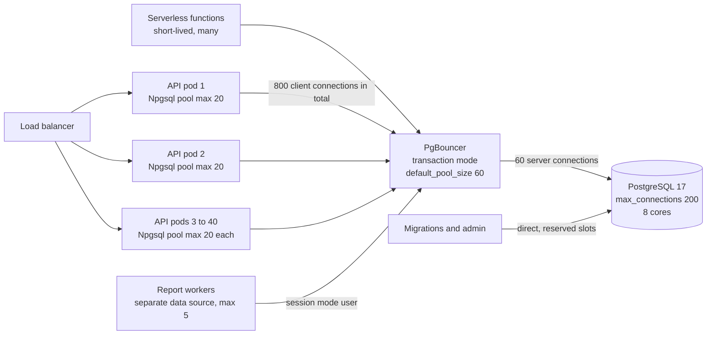
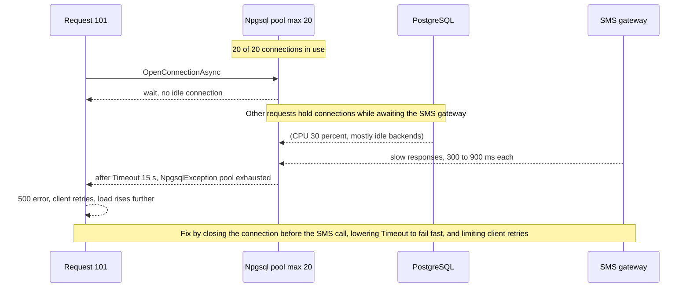

Results day for a state school board: at 10:00 sharp, two million students refresh the same page. The API scales from 6 pods to 40 in a few minutes, CPU on the database is at 35 %, and yet half the requests fail with "connection pool exhausted" or "too many clients already". Nothing was wrong with the queries. Everything was wrong with how connections were shared. This lesson explains the connection pool from first principles and gives you the arithmetic to size it.

## Learning objectives

By the end of this lesson you will be able to:

1. Explain why opening a PostgreSQL connection is expensive and why the server cannot simply accept thousands.
2. Describe how Npgsql's built-in pool works and the settings that matter (`Maximum Pool Size`, `Timeout`, idle lifetime, `NpgsqlDataSource`).
3. Size a pool with Little's Law and check that all instances together fit under `max_connections`.
4. Choose between PgBouncer's session, transaction and statement modes, and list what transaction mode breaks.
5. Diagnose pool exhaustion from symptoms, `pg_stat_activity` and application metrics, and fix the real cause.
6. Configure timeouts so a slow database degrades gracefully instead of taking the API down.

## Prerequisites

- [Transactions and ACID](#/lesson/m09-transactions-acid): why transactions must be short, and what "idle in transaction" means.
- [Query planning and EXPLAIN ANALYZE](#/lesson/m09-query-planning): slow queries are the most common hidden cause of pool exhaustion.
- Helpful: [Deadlocks, optimistic and pessimistic locking](#/lesson/m09-locking), because lock waits also hold connections.

## Explain it like I'm a beginner

Think of a busy railway reservation office with 20 counters. Each counter has a clerk (a database connection). Customers (web requests) arrive, wait for a free counter, do their business, and leave.

Hiring a new clerk for every customer and firing them afterwards would be absurd: hiring takes time (opening a connection means a TCP handshake, TLS, authentication, and PostgreSQL starting a new server process). So the office keeps a fixed team of clerks and lets customers share them. That team is the **connection pool**.

Two numbers decide whether the office works:

1. **How long each customer stays at the counter.** If a customer stands there while phoning a relative to check a date (an HTTP call inside a transaction), the counter is blocked for minutes.
2. **How many counters the building can hold.** PostgreSQL has a hard limit (`max_connections`, default 100), and every connection costs memory and CPU even when idle.

Now imagine the railway opens 40 offices (40 API pods) and each one is told it may hire up to 100 clerks. That is 4,000 clerks for a building with 100 counters. Most offices find the door locked ("too many clients already"). The fix is not a bigger building. It is fewer clerks per office, customers who finish quickly, and sometimes a dispatcher in the lobby (**PgBouncer**) who hands out the 100 real counters to thousands of waiting customers one transaction at a time.

## First-principles explanation

### What a PostgreSQL connection costs

PostgreSQL uses one operating-system **process per connection**. Opening one involves:

1. A TCP connection, and usually a TLS handshake (one or two network round trips).
2. Authentication (SCRAM-SHA-256 is several round trips plus deliberate CPU work).
3. The postmaster forking a backend process, which then loads catalog caches as queries arrive.

Within a data centre, the total is typically a few milliseconds and can reach tens of milliseconds with TLS across zones (an estimate; measure yours). That is often longer than the query itself.

Each backend also uses memory: a baseline of a few MB, more as it caches catalog entries and prepared plans, plus up to `work_mem` per sort or hash node while a query runs. Thousands of connections also slow down every snapshot, because each new snapshot has to consider all active backends. PostgreSQL 14 made this much cheaper, but idle connections are still not free.

So the server wants **a modest number of long-lived connections that are busy most of the time**, while the application wants **to borrow a connection for a few milliseconds whenever a request needs one**. A pool reconciles the two.

### How Npgsql's pool works

Pooling is on by default in Npgsql. Every distinct connection string (in practice, every `NpgsqlDataSource`) has its own pool.

- `await dataSource.OpenConnectionAsync()` returns an idle physical connection from the pool if one exists, otherwise opens a new one, as long as fewer than `Maximum Pool Size` (default **100**) are open.
- When the pool is at its maximum and all connections are in use, `OpenAsync` **waits** for one to be returned. If none comes back within `Timeout` (default **15 s**), it throws an `NpgsqlException` saying the pool has been exhausted.
- Disposing the `NpgsqlConnection` (`await using`) returns the physical connection to the pool. It is not closed. Npgsql resets session state before reuse, so a `SET` from one request does not leak into the next.
- Idle connections above `Minimum Pool Size` (default 0) are closed after `Connection Idle Lifetime` (default 300 s), checked every `Connection Pruning Interval` (default 10 s).
- `Connection Lifetime` (default 0, meaning unlimited) closes connections older than the limit when they are returned. Setting it to, say, 15 minutes helps load spread back across servers after a failover or a scale-out behind a load balancer.

Since Npgsql 7, the recommended entry point is `NpgsqlDataSource`, registered once as a singleton (`builder.Services.AddNpgsqlDataSource(connectionString)` from the `Npgsql.DependencyInjection` package). EF Core with the Npgsql provider uses the same pool underneath. A `DbContext` opens a connection only when it executes a query or `SaveChanges`, and returns it right after, unless you start a transaction, which pins the connection until commit.

### Pool sizing with Little's Law

**Little's Law**: average items in a system = arrival rate × average time each item spends in it. For a pool:

> busy connections = requests per second needing the database × seconds each request holds a connection

Normal day for the results portal:

- 600 requests per second across the fleet, of which 500 touch the database.
- Each holds a connection for about 8 ms (two indexed queries plus network).
- Busy connections ≈ 500 × 0.008 = **4** on average for the whole fleet.

Results day:

- 25,000 requests per second hit the fleet; a cache absorbs 80 %, so 5,000 per second reach the database.
- With the same 8 ms hold time: 5,000 × 0.008 = **40** busy connections on average. Allow for bursts (×2 is a reasonable planning factor) and you need about **80** connections in use at the peak.

The same arithmetic shows what kills you. If one code path keeps the connection open while it calls an SMS gateway that takes 300 ms, its hold time becomes ~308 ms. At even 500 requests per second on that path, it alone needs 500 × 0.308 ≈ **154** connections. No pool size fixes that; shortening the hold time does.

### The fleet-wide budget

Every instance has its own pool, and the server's limit is shared:

> instances × Maximum Pool Size ≤ max_connections − superuser_reserved_connections − connections for replication, migrations, monitoring and humans

With `max_connections = 200`, 3 reserved for superusers, about 2 for replication slots and 15 kept for admin, jobs and monitoring, the application budget is about **180**. With 40 pods at the default `Maximum Pool Size = 100`, the fleet could try to open 4,000. The first 180 succeed, and every further attempt fails with `FATAL: sorry, too many clients already` (SQLSTATE `53300`).

Divide the budget: 180 ÷ 40 pods ≈ **4 connections per pod**. That sounds tiny, but recall the busy-connection estimate: 80 at peak across the fleet is 2 per pod. A small pool with short hold times beats a big pool with long ones.

Raising `max_connections` to 2,000 is rarely the answer. A database with 8 cores can only run about 8 queries truly in parallel; beyond a small multiple of the core count, extra active connections queue for CPU and I/O, contend on locks, and *increase* latency for everyone. A common starting rule of thumb for active connections is 2 to 4 × the number of cores, which you then tune by load testing.

### PgBouncer: a pool in front of the database

When there are many clients (dozens of pods, serverless functions, background workers) a **server-side pooler** sits between them and PostgreSQL. Clients connect to PgBouncer as if it were PostgreSQL. PgBouncer keeps a small set of real server connections and lends them out according to its **pool mode**:

| Mode | A server connection is assigned for | Use when | Breaks |
|---|---|---|---|
| `session` | the whole client connection | apps that use session features | little; but gives almost no multiplexing benefit for long-lived app pools |
| `transaction` | one transaction | most web APIs and workers | session state: `SET` (use `SET LOCAL`), session advisory locks, `LISTEN`, temporary tables kept across transactions, `WITH HOLD` cursors, protocol-level prepared statements unless PgBouncer 1.21+ with `max_prepared_statements` |
| `statement` | one statement | rare; autocommit-only workloads | multi-statement transactions entirely |

In transaction mode, 2,000 client connections can share, say, 60 server connections, because at any instant only the clients *inside a transaction* need one. The busy-connection arithmetic from Little's Law now applies at PgBouncer: `default_pool_size` per database and user pair should cover the peak number of concurrent transactions, and `max_client_conn` should cover all client connections.

Npgsql notes for transaction mode: session state does not survive between transactions, so do not rely on `SET` or session advisory locks; Npgsql's documentation recommends `No Reset On Close=true` with PgBouncer in transaction mode, since PgBouncer handles resets and the client-side reset would be wasted work; and avoid explicit prepared statements unless your PgBouncer version supports them. Check the Npgsql compatibility page for your versions.

Managed PostgreSQL services often include a built-in PgBouncer or a proxy, and some offer one as a separate managed component. The same mode rules apply.

### Two pools in a row

With PgBouncer, you have *two* pools: Npgsql's per-pod pool (client side) and PgBouncer's server pool. Keep Npgsql pooling on, because it saves the client-to-PgBouncer connection setup. Size Npgsql's `Maximum Pool Size` per pod for its own concurrency (for example 20), and size PgBouncer's `default_pool_size` for the database (for example 60). Now 40 pods × 20 = 800 client connections are fine, because they are cheap PgBouncer connections, not PostgreSQL backends.

### Pool exhaustion: symptoms and causes

**Symptoms**: requests time out after exactly `Timeout` seconds (15 s by default) with a pool-exhausted message; p99 latency rises while database CPU stays low; thread-pool or request queues grow; `pg_stat_activity` shows many connections in state `idle in transaction` or `active` waiting on locks.

**Causes**, from most to least common:

1. **Long hold times**: an HTTP call, file upload, or message publish while a connection or transaction is open.
2. **Slow queries**: a missing index turns 5 ms into 500 ms, so hold time rises 100× and the pool drains.
3. **Leaks**: a connection opened without `using`/`await using`, or a `DataReader` never disposed, is never returned. The pool shrinks over hours.
4. **Lock waits**: a migration or a hot row makes connections wait inside the database.
5. **Thread starvation from sync-over-async** (`.Result`, `.Wait()`): connections are returned late because the threads that would finish the work are blocked.
6. **The pool is genuinely too small** for a correct, fast workload. This is the least common cause, and the only one that raising `Maximum Pool Size` fixes.

### Timeouts that protect the system

- **Npgsql `Timeout`** (pool wait and connect): lower it from 15 s to, say, 3 s for user-facing APIs so requests fail fast instead of piling up.
- **`Command Timeout`** (Npgsql, default 30 s): cancels a query from the client side.
- **`statement_timeout`** (server, per role or per transaction): the server cancels long statements even if the client is gone.
- **`idle_in_transaction_session_timeout`**: the server kills sessions that sit inside a transaction doing nothing.
- **Request deadline**: pass the request's `CancellationToken` into every database call so abandoned requests release their connections.

Pair these with a [bulkhead](#/lesson/m10-bulkhead): give background jobs their own small `NpgsqlDataSource` (and a separate PgBouncer user or pool) so a runaway report cannot drain the pool that serves logins.

## Visual explanation

### Pools from pods to PostgreSQL



Each pod keeps its own Npgsql pool, but those 800 client connections land on PgBouncer, which is designed to hold thousands cheaply. PgBouncer maps them onto 60 real backends, only lending one for the duration of a transaction. Serverless functions, which cannot keep a long-lived pool, also go through PgBouncer. Report workers use a separate, small data source and a separate PgBouncer user so they cannot starve the API. Migrations and administrators connect directly so they still get in when the pooler is saturated.

### What pool exhaustion looks like from inside a request



The request does not fail because the database is busy; the database is mostly idle. It fails because every pooled connection is parked inside other requests that are awaiting the SMS gateway. The pool wait times out after 15 seconds, the client retries, and the extra load makes the queue longer. That feedback loop is why pool exhaustion often looks like a sudden cliff rather than a gradual slowdown.

## Step-by-step example

### Step 1 — measure hold time, not query time

Wrap connection usage in a timer (the C# section below does this with `System.Diagnostics.Metrics`) and record the time from `OpenConnectionAsync` returning to the connection being disposed. For the results lookup: open 0.1 ms (from pool), query 3 ms, map 0.3 ms, dispose. Hold ≈ 3.5 ms. For the "send result by SMS" endpoint as originally written: 312 ms, because the SMS call happened inside the `await using` block.

### Step 2 — apply Little's Law per endpoint

| Endpoint | DB RPS at peak | Hold time | Busy connections |
|---|---|---|---|
| `GET /results/{roll}` | 4,500 | 3.5 ms | 15.8 |
| `GET /schools/{id}/summary` | 400 | 25 ms | 10 |
| `POST /results/{roll}/sms` (before fix) | 300 | 312 ms | 93.6 |
| `POST /results/{roll}/sms` (after fix) | 300 | 4 ms | 1.2 |

Before the fix, one low-traffic endpoint needed more connections than everything else combined.

### Step 3 — fit the fleet under the budget

Budget 180 connections. Without PgBouncer, 40 pods give 180 ÷ 40 = 4 per pod; peak need after the fix is (15.8 + 10 + 1.2) × 2 burst ≈ 54 across the fleet, or about 1.4 per pod. `Maximum Pool Size=4` works, with little headroom for pod imbalance. With PgBouncer in transaction mode: Npgsql `Maximum Pool Size=20` per pod, `default_pool_size=60`, `max_client_conn=1000`.

### Step 4 — set the timeouts

```text
Host=pgbouncer.internal;Port=6432;Database=results;Username=results_api;
Maximum Pool Size=20;Timeout=3;Command Timeout=5;Connection Idle Lifetime=60;No Reset On Close=true
```

```sql
ALTER ROLE results_api SET statement_timeout = '5s';
ALTER ROLE results_api SET idle_in_transaction_session_timeout = '10s';
```

### Step 5 — watch it

```sql
SELECT application_name, state, count(*) AS connections,
       max(now() - state_change) FILTER (WHERE state = 'idle in transaction') AS longest_idle_in_tx
FROM pg_stat_activity
WHERE backend_type = 'client backend'
GROUP BY application_name, state
ORDER BY connections DESC;
```

Set `Application Name=results-api` in each connection string so this query tells services apart. In PgBouncer, `SHOW POOLS;` reports `cl_waiting` (clients waiting for a server connection) and `maxwait`; alert when `cl_waiting` is non-zero for more than a few seconds.

## Production-style C# implementation

Npgsql cannot be referenced by the course checker, so the compilable code below models the pool behind an interface. It contains: options with fleet-budget validation at startup, a connection-string builder, an instrumented pool wrapper that records wait and hold times with `System.Diagnostics.Metrics`, an in-memory pool with Npgsql-like semantics (max size, wait with timeout, exhaustion error), and a results service that keeps hold time short by doing the slow SMS call after releasing the connection.

```text
Results.Api/
  Program.cs
  Data/PoolOptions.cs
  Data/IConnectionPool.cs
  Data/InMemoryConnectionPool.cs
  Data/InstrumentedPool.cs
  Results/ResultService.cs
```

```csharp file=Data/PoolOptions.cs
using System.Text;

namespace ExamResults.Data;

public sealed class DatabasePoolOptions
{
    public const string Section = "Database";

    public string Host { get; set; } = "localhost";
    public int Port { get; set; } = 5432;
    public string Database { get; set; } = "results";
    public string Username { get; set; } = "results_api";
    public string ApplicationName { get; set; } = "results-api";
    public int MaxPoolSize { get; set; } = 20;
    public int MinPoolSize { get; set; }
    public int PoolWaitTimeoutSeconds { get; set; } = 3;
    public int CommandTimeoutSeconds { get; set; } = 5;
    public int IdleLifetimeSeconds { get; set; } = 60;
    public bool BehindPgBouncerTransactionMode { get; set; }

    /// <summary>Fleet-wide numbers used to check the budget at startup.</summary>
    public int ExpectedInstances { get; set; } = 1;
    public int ServerConnectionBudget { get; set; } = 180;

    /// <summary>Builds an Npgsql connection string. The password comes from a secret store, never from here.</summary>
    public string ToConnectionString()
    {
        var sb = new StringBuilder()
            .Append($"Host={Host};Port={Port};Database={Database};Username={Username};")
            .Append($"Application Name={ApplicationName};")
            .Append($"Maximum Pool Size={MaxPoolSize};Minimum Pool Size={MinPoolSize};")
            .Append($"Timeout={PoolWaitTimeoutSeconds};Command Timeout={CommandTimeoutSeconds};")
            .Append($"Connection Idle Lifetime={IdleLifetimeSeconds};");
        if (BehindPgBouncerTransactionMode) sb.Append("No Reset On Close=true;");
        return sb.ToString();
    }

    /// <summary>Returns problems with the configuration; empty means valid.</summary>
    public IReadOnlyList<string> Validate()
    {
        var problems = new List<string>();
        if (MaxPoolSize < 1) problems.Add("MaxPoolSize must be at least 1.");
        if (MinPoolSize > MaxPoolSize) problems.Add("MinPoolSize cannot exceed MaxPoolSize.");
        if (PoolWaitTimeoutSeconds is < 1 or > 30) problems.Add("PoolWaitTimeoutSeconds should be between 1 and 30.");
        // Without PgBouncer, every pod's pool lands directly on PostgreSQL backends.
        if (!BehindPgBouncerTransactionMode && ExpectedInstances * MaxPoolSize > ServerConnectionBudget)
            problems.Add($"{ExpectedInstances} instances x {MaxPoolSize} = {ExpectedInstances * MaxPoolSize} " +
                         $"connections exceeds the server budget of {ServerConnectionBudget}.");
        return problems;
    }
}

public static class PoolMath
{
    /// <summary>Little's Law: average busy connections = rate x hold time.</summary>
    public static double BusyConnections(double requestsPerSecond, double holdMs) => requestsPerSecond * holdMs / 1000.0;

    public static int SuggestedPoolSize(double requestsPerSecond, double holdMs, double burstFactor = 2.0, int instances = 1) =>
        Math.Max(1, (int)Math.Ceiling(BusyConnections(requestsPerSecond, holdMs) * burstFactor / instances));
}
```

```csharp file=Data/IConnectionPool.cs
namespace ExamResults.Data;

/// <summary>A borrowed connection. Disposing returns it to the pool, exactly like disposing an NpgsqlConnection.</summary>
public interface IPooledConnection : IAsyncDisposable
{
    int PhysicalId { get; }
    Task<T> QueryAsync<T>(Func<CancellationToken, Task<T>> work, CancellationToken ct = default);
}

public interface IConnectionPool
{
    int MaxSize { get; }
    int InUse { get; }
    int Idle { get; }
    Task<IPooledConnection> OpenAsync(CancellationToken ct = default);
}

public sealed class PoolExhaustedException(int maxSize, TimeSpan waited)
    : Exception($"The connection pool has been exhausted: all {maxSize} connections were busy for {waited.TotalSeconds:F1} s. " +
                "Look for long hold times before raising the pool size.");
```

```csharp file=Data/InMemoryConnectionPool.cs
namespace ExamResults.Data;

/// <summary>
/// Npgsql-like pool semantics for tests and local runs: reuse idle connections, open new ones up to MaxSize,
/// otherwise wait up to the timeout and then fail. Real code uses NpgsqlDataSource.
/// </summary>
public sealed class InMemoryConnectionPool : IConnectionPool
{
    private readonly SemaphoreSlim _slots;
    private readonly Stack<int> _idle = new();
    private readonly object _gate = new();
    private readonly TimeSpan _waitTimeout;
    private int _opened;
    private int _inUse;

    public InMemoryConnectionPool(int maxSize, TimeSpan waitTimeout)
    {
        if (maxSize < 1) throw new ArgumentOutOfRangeException(nameof(maxSize));
        MaxSize = maxSize;
        _waitTimeout = waitTimeout;
        _slots = new SemaphoreSlim(maxSize, maxSize);
    }

    public int MaxSize { get; }
    public int InUse { get { lock (_gate) return _inUse; } }
    public int Idle { get { lock (_gate) return _idle.Count; } }
    public int PhysicalConnectionsOpened { get { lock (_gate) return _opened; } }

    public async Task<IPooledConnection> OpenAsync(CancellationToken ct = default)
    {
        if (!await _slots.WaitAsync(_waitTimeout, ct)) throw new PoolExhaustedException(MaxSize, _waitTimeout);
        lock (_gate)
        {
            _inUse++;
            // Reuse the most recently returned connection (warm caches), otherwise "open" a new physical one.
            var id = _idle.Count > 0 ? _idle.Pop() : ++_opened;
            return new Lease(this, id);
        }
    }

    private void Return(int id)
    {
        lock (_gate)
        {
            _inUse--;
            _idle.Push(id);
        }
        _slots.Release();
    }

    private sealed class Lease(InMemoryConnectionPool pool, int id) : IPooledConnection
    {
        private int _returned;
        public int PhysicalId { get; } = id;

        public Task<T> QueryAsync<T>(Func<CancellationToken, Task<T>> work, CancellationToken ct = default)
        {
            if (Volatile.Read(ref _returned) == 1) throw new ObjectDisposedException(nameof(IPooledConnection));
            return work(ct);
        }

        public ValueTask DisposeAsync()
        {
            if (Interlocked.Exchange(ref _returned, 1) == 0) pool.Return(PhysicalId);   // double dispose is harmless
            return ValueTask.CompletedTask;
        }
    }
}
```

```csharp file=Data/InstrumentedPool.cs
using System.Diagnostics;
using System.Diagnostics.Metrics;

namespace ExamResults.Data;

/// <summary>Decorator that records how long callers wait for a connection and how long they hold it.</summary>
public sealed class InstrumentedPool : IConnectionPool, IDisposable
{
    public const string MeterName = "Results.Data.Pool";
    private readonly IConnectionPool _inner;
    private readonly Meter _meter = new(MeterName);
    private readonly Histogram<double> _waitMs;
    private readonly Histogram<double> _holdMs;
    private readonly Counter<long> _exhausted;

    public InstrumentedPool(IConnectionPool inner)
    {
        _inner = inner;
        _waitMs = _meter.CreateHistogram<double>("db.pool.wait", "ms", "Time spent waiting for a pooled connection");
        _holdMs = _meter.CreateHistogram<double>("db.pool.hold", "ms", "Time a connection was held by the caller");
        _exhausted = _meter.CreateCounter<long>("db.pool.exhausted", description: "Pool wait timeouts");
        _meter.CreateObservableGauge("db.pool.in_use", () => _inner.InUse);
    }

    public int MaxSize => _inner.MaxSize;
    public int InUse => _inner.InUse;
    public int Idle => _inner.Idle;

    public async Task<IPooledConnection> OpenAsync(CancellationToken ct = default)
    {
        var start = Stopwatch.GetTimestamp();
        try
        {
            var conn = await _inner.OpenAsync(ct);
            _waitMs.Record(Stopwatch.GetElapsedTime(start).TotalMilliseconds);
            return new Timed(conn, _holdMs);
        }
        catch (PoolExhaustedException)
        {
            _exhausted.Add(1);
            throw;
        }
    }

    public void Dispose() => _meter.Dispose();

    private sealed class Timed(IPooledConnection inner, Histogram<double> hold) : IPooledConnection
    {
        private readonly long _start = Stopwatch.GetTimestamp();
        public int PhysicalId => inner.PhysicalId;
        public Task<T> QueryAsync<T>(Func<CancellationToken, Task<T>> work, CancellationToken ct = default) => inner.QueryAsync(work, ct);

        public ValueTask DisposeAsync()
        {
            hold.Record(Stopwatch.GetElapsedTime(_start).TotalMilliseconds);
            return inner.DisposeAsync();
        }
    }
}
```

```csharp file=Results/ResultService.cs
using Microsoft.Extensions.Logging;
using ExamResults.Data;

namespace ExamResults.Lookup;

public sealed record ExamResult(string RollNo, string Name, int TotalMarks, string Division);

public interface IResultQueries
{
    Task<ExamResult?> FindAsync(IPooledConnection conn, string rollNo, CancellationToken ct);
}

public interface ISmsSender
{
    Task SendAsync(string mobile, string text, CancellationToken ct);
}

public sealed class ResultService(IConnectionPool pool, IResultQueries queries, ISmsSender sms, ILogger<ResultService> log)
{
    public async Task<ExamResult?> GetAsync(string rollNo, CancellationToken ct)
    {
        await using var conn = await pool.OpenAsync(ct);   // open late
        return await queries.FindAsync(conn, rollNo, ct);  // one indexed query, then dispose returns it
    }

    /// <summary>
    /// The slow external call happens AFTER the connection is returned. Holding the connection across it
    /// would multiply hold time by roughly 100 and drain the pool under load.
    /// </summary>
    public async Task<bool> SendBySmsAsync(string rollNo, string mobile, CancellationToken ct)
    {
        ExamResult? result;
        await using (var conn = await pool.OpenAsync(ct))
        {
            result = await queries.FindAsync(conn, rollNo, ct);
        }   // connection back in the pool here

        if (result is null) return false;
        await sms.SendAsync(mobile, $"{result.Name}: {result.TotalMarks} marks, {result.Division}", ct);
        log.LogInformation("Result SMS sent for {RollNo}", rollNo);
        return true;
    }
}

/// <summary>In-memory query implementation for local runs and tests.</summary>
public sealed class InMemoryResultQueries(IReadOnlyDictionary<string, ExamResult> rows, TimeSpan latency) : IResultQueries
{
    public Task<ExamResult?> FindAsync(IPooledConnection conn, string rollNo, CancellationToken ct) =>
        conn.QueryAsync(async token =>
        {
            await Task.Delay(latency, token);
            return rows.GetValueOrDefault(rollNo);
        }, ct);
}

public sealed class LoggingSmsSender(ILogger<LoggingSmsSender> log) : ISmsSender
{
    public async Task SendAsync(string mobile, string text, CancellationToken ct)
    {
        await Task.Delay(TimeSpan.FromMilliseconds(300), ct);   // a typical slow gateway
        log.LogInformation("SMS to {Mobile}: {Text}", mobile, text);
    }
}
```

```csharp file=Program.cs
using Microsoft.Extensions.Options;
using ExamResults.Data;
using ExamResults.Lookup;

var builder = WebApplication.CreateBuilder(args);

builder.Services.AddOptions<DatabasePoolOptions>()
    .Bind(builder.Configuration.GetSection(DatabasePoolOptions.Section))
    .Validate(o => o.Validate().Count == 0, "Database pool configuration is invalid; see DatabasePoolOptions.Validate().")
    .ValidateOnStart();   // fail the deploy, not the first busy morning

builder.Services.AddSingleton<IConnectionPool>(sp =>
{
    var o = sp.GetRequiredService<IOptions<DatabasePoolOptions>>().Value;
    // Production: builder.Services.AddNpgsqlDataSource(o.ToConnectionString()) and an adapter over NpgsqlDataSource.
    return new InstrumentedPool(new InMemoryConnectionPool(o.MaxPoolSize, TimeSpan.FromSeconds(o.PoolWaitTimeoutSeconds)));
});
builder.Services.AddSingleton<IResultQueries>(new InMemoryResultQueries(
    new Dictionary<string, ExamResult>
    {
        ["2026BR104512"] = new("2026BR104512", "Aarav Kumar", 412, "First"),
        ["2026BR104513"] = new("2026BR104513", "Sana Parveen", 455, "First with distinction"),
    },
    TimeSpan.FromMilliseconds(3)));
builder.Services.AddSingleton<ISmsSender, LoggingSmsSender>();
builder.Services.AddScoped<ResultService>();

var app = builder.Build();

app.MapGet("/results/{rollNo}", async (string rollNo, ResultService svc, CancellationToken ct) =>
{
    try
    {
        var r = await svc.GetAsync(rollNo, ct);
        return r is null ? Results.NotFound() : Results.Ok(r);
    }
    catch (PoolExhaustedException)
    {
        // Fail fast with a retry hint instead of a 15-second hang and a 500.
        return Results.Problem("Service busy, please retry shortly.", statusCode: StatusCodes.Status503ServiceUnavailable);
    }
});

app.MapPost("/results/{rollNo}/sms", async (string rollNo, SmsRequest req, ResultService svc, CancellationToken ct) =>
    await svc.SendBySmsAsync(rollNo, req.Mobile, ct) ? Results.Accepted() : Results.NotFound());

app.MapGet("/health/pool", (IConnectionPool pool) => Results.Ok(new { pool.MaxSize, pool.InUse, pool.Idle }));

app.Run();

public sealed record SmsRequest(string Mobile);
```

### The real wiring with Npgsql

```csharp
// Not compiled by the course checker: requires Npgsql and Npgsql.DependencyInjection.
var o = builder.Configuration.GetSection("Database").Get<DatabasePoolOptions>()!;
builder.Services.AddNpgsqlDataSource(o.ToConnectionString() + $"Password={secrets.DbPassword}");

// A separate, small data source for report jobs: a bulkhead.
builder.Services.AddKeyedSingleton("reports", (_, _) =>
    NpgsqlDataSource.Create("Host=pgbouncer.internal;Port=6432;Database=results;Username=results_reports;" +
                            "Maximum Pool Size=5;Timeout=10;Command Timeout=120;Application Name=results-reports"));

// Usage: open late, dispose early, pass the request's cancellation token.
app.MapGet("/results/{rollNo}", async (string rollNo, NpgsqlDataSource db, CancellationToken ct) =>
{
    await using var cmd = db.CreateCommand("SELECT roll_no, name, total, division FROM result WHERE roll_no = $1");
    cmd.Parameters.AddWithValue(rollNo);
    await using var reader = await cmd.ExecuteReaderAsync(ct);   // borrows a pooled connection for this command
    // ... map one row ...
});
```

`dataSource.CreateCommand(...)` borrows a connection for the command and returns it when the reader is disposed, which keeps hold time minimal for single-statement work. For EF Core, `AddDbContextPool<T>` pools `DbContext` *objects*, which is a different thing: it saves allocation work, but database connections are still governed by the Npgsql pool settings in the connection string.

:::callout type=warning title="A leaked connection is a pool slot gone until the process restarts"
`var conn = await db.OpenConnectionAsync();` without `await using`, or a reader that is never disposed on an exception path, keeps a physical connection checked out forever. With a pool of 20, twenty leaks over a day and the pod is dead, typically at the busiest hour. Always use `await using`, and alert on `db.pool.in_use` staying at the maximum while request rate is low.
:::

## Bad design vs good design

**Bad: big pools everywhere, connections held across slow work.**

```csharp
// Anti-pattern: Max Pool Size=200 on 30 pods, and a connection held across an HTTP call.
await using var conn = await dataSource.OpenConnectionAsync();
await using var tx = await conn.BeginTransactionAsync();
var result = await LoadResultAsync(conn, rollNo);
await smsGateway.SendAsync(mobile, Format(result));      // 300-900 ms with the connection checked out
await MarkSmsSentAsync(conn, tx, rollNo);
await tx.CommitAsync();
```

30 × 200 = 6,000 possible connections against `max_connections = 200`; under load, pods fight for backends and get `53300 too many clients`. The ones that get in hold their connections for most of a second, so the pool drains even at modest traffic, and the 15-second default wait turns a brief spike into minutes of timeouts.

**Good: small pools, short holds, fail fast, pooler in front.**

1. Hold connections only for database work. Do the SMS call after disposing; record "sent" in a second short transaction or through an outbox.
2. Size each pod's pool from Little's Law and the fleet budget; validate it at startup.
3. Put PgBouncer in transaction mode in front when instances are many or elastic.
4. Lower the pool wait `Timeout` to a few seconds and map exhaustion to `503` with `Retry-After`.
5. Give batch and reporting work their own data source.

**When is this overkill?** A single internal app with one or two instances, 20 users and the default pool will never come near any limit. Keep defaults, use `await using`, and move on. PgBouncer adds a hop, a component to run and monitor, and the transaction-mode caveats; add it when instance counts or client counts make the arithmetic fail, not before.

:::callout type=tradeoff title="A bigger pool moves the queue, it does not remove it"
If the database can run 16 queries in parallel, 200 connections all trying at once will queue inside PostgreSQL for CPU and locks instead of queueing in your pool. Queueing in the pool is cheaper and easier to observe. Increase the pool only when the database has spare capacity and the wait is in the pool.
:::

## Practical playground

The playground holds a *snapshot* of `pg_stat_activity`-style data from the results-day incident, plus each service's pool configuration. (The in-browser PostgreSQL has a single connection, so there is no live pool to watch.) Try:

1. Count connections per `application_name` and `state`.
2. Find sessions that have been `idle in transaction` for more than 30 seconds at the time of the snapshot, and the query they last ran.
3. Compute each service's maximum possible connections (`instances × max_pool_size`) and compare the total with `max_connections`.
4. Apply Little's Law to `endpoint_stats`: busy connections = `db_rps × hold_ms / 1000`. Which endpoint dominates?
5. Rewrite the numbers for the "after fix" hold time of the SMS endpoint (4 ms) and recompute.

:::playground type=sql title="Results day: connection snapshot and pool budget"
```sql
CREATE TABLE server_setting (name text PRIMARY KEY, value int NOT NULL);
INSERT INTO server_setting VALUES ('max_connections', 200), ('superuser_reserved_connections', 3), ('cores', 8);

CREATE TABLE service_pool (
  service       text PRIMARY KEY,
  instances     int  NOT NULL,
  max_pool_size int  NOT NULL,
  via_pgbouncer boolean NOT NULL
);
INSERT INTO service_pool VALUES
 ('results-api', 40, 100, false), ('school-portal', 6, 50, false),
 ('sms-worker', 4, 20, false), ('reports', 2, 10, false), ('admin-console', 1, 10, false);

CREATE TABLE endpoint_stats (
  endpoint text PRIMARY KEY,
  service  text NOT NULL REFERENCES service_pool,
  db_rps   numeric(10,1) NOT NULL,
  hold_ms  numeric(10,1) NOT NULL
);
INSERT INTO endpoint_stats VALUES
 ('GET /results/{roll}',          'results-api',   4500,   3.5),
 ('GET /schools/{id}/summary',    'school-portal',  400,  25.0),
 ('POST /results/{roll}/sms',     'results-api',    300, 312.0),
 ('GET /admin/toppers',           'admin-console',    2, 850.0),
 ('job: district report',         'reports',        0.5, 9000.0);

CREATE TABLE activity_snapshot (
  pid              int PRIMARY KEY,
  application_name text NOT NULL,
  usename          text NOT NULL,
  state            text NOT NULL CHECK (state IN ('active','idle','idle in transaction','idle in transaction (aborted)')),
  wait_event_type  text,
  xact_start       timestamptz,
  state_change     timestamptz NOT NULL,
  query            text NOT NULL,
  sampled_at       timestamptz NOT NULL
);
INSERT INTO activity_snapshot
SELECT 4000 + g,
       CASE WHEN g <= 120 THEN 'results-api' WHEN g <= 160 THEN 'school-portal' WHEN g <= 175 THEN 'sms-worker'
            WHEN g <= 180 THEN 'reports' ELSE 'admin-console' END,
       CASE WHEN g <= 175 THEN 'app_rw' WHEN g <= 180 THEN 'reports_ro' ELSE 'admin' END,
       CASE WHEN g <= 120 AND g % 3 = 0 THEN 'idle in transaction'
            WHEN g <= 120 AND g % 3 = 1 THEN 'active'
            WHEN g BETWEEN 121 AND 160 AND g % 4 = 0 THEN 'active'
            WHEN g BETWEEN 176 AND 180 THEN 'active'
            ELSE 'idle' END,
       CASE WHEN g <= 120 AND g % 3 = 1 THEN 'Lock' WHEN g BETWEEN 176 AND 180 THEN 'IO' ELSE 'Client' END,
       CASE WHEN g <= 120 AND g % 3 <> 2 THEN timestamptz '2026-06-15 10:02:00+05:30' - (g % 50) * interval '1 second'
            WHEN g BETWEEN 176 AND 180 THEN timestamptz '2026-06-15 09:58:00+05:30' END,
       timestamptz '2026-06-15 10:02:00+05:30' - (g % 50) * interval '1 second',
       CASE WHEN g <= 120 AND g % 3 = 0 THEN 'UPDATE result_sms SET status = ''sending'' WHERE roll_no = $1'
            WHEN g <= 120 AND g % 3 = 1 THEN 'UPDATE result_sms SET status = ''sending'' WHERE roll_no = $1'
            WHEN g <= 120 THEN 'SELECT roll_no, name, total, division FROM result WHERE roll_no = $1'
            WHEN g <= 160 THEN 'SELECT school_id, count(*), avg(total) FROM result WHERE school_id = $1 GROUP BY 1'
            WHEN g <= 175 THEN 'SELECT id FROM sms_job WHERE status = ''pending'' LIMIT 50 FOR UPDATE SKIP LOCKED'
            WHEN g <= 180 THEN 'SELECT district, division, count(*) FROM result GROUP BY 1, 2'
            ELSE 'SELECT * FROM topper ORDER BY total DESC LIMIT 100' END,
       timestamptz '2026-06-15 10:02:00+05:30'
FROM generate_series(1, 182) AS g;
```
:::

## Exercises

:::exercise id=m09-connection-pooling-ex1 difficulty=beginner kind=sql ordered=true title="Summarise the connection snapshot per service"
From `activity_snapshot`, return one row per `application_name` with: `total`, `active`, `idle`, `idle_in_tx` (state `'idle in transaction'`), and `waiting_on_lock` (rows whose `wait_event_type` is `'Lock'`). Order by `total` descending, then `application_name`.
::acceptance
- One row per application.
- Uses `count(*) FILTER (WHERE ...)` or an equivalent `SUM(CASE ...)`.
- `idle_in_tx` counts only the exact state `'idle in transaction'`.
- Column names and order as specified.
::hint
Group by `application_name` and count with conditions.
::hint
`count(*) FILTER (WHERE state = 'active')` counts only matching rows within each group.
::hint
`wait_event_type` can be NULL; `FILTER (WHERE wait_event_type = 'Lock')` simply skips NULLs.
::setup
```sql
CREATE TABLE activity_snapshot (
  pid int PRIMARY KEY, application_name text NOT NULL, state text NOT NULL,
  wait_event_type text, state_change timestamptz NOT NULL, query text NOT NULL, sampled_at timestamptz NOT NULL
);
INSERT INTO activity_snapshot
SELECT 4000 + g,
       CASE WHEN g <= 120 THEN 'results-api' WHEN g <= 160 THEN 'school-portal' WHEN g <= 175 THEN 'sms-worker'
            WHEN g <= 180 THEN 'reports' ELSE 'admin-console' END,
       CASE WHEN g <= 120 AND g % 3 = 0 THEN 'idle in transaction'
            WHEN g <= 120 AND g % 3 = 1 THEN 'active'
            WHEN g BETWEEN 121 AND 160 AND g % 4 = 0 THEN 'active'
            WHEN g BETWEEN 176 AND 180 THEN 'active'
            ELSE 'idle' END,
       CASE WHEN g <= 120 AND g % 3 = 1 THEN 'Lock' WHEN g BETWEEN 176 AND 180 THEN 'IO' ELSE 'Client' END,
       timestamptz '2026-06-15 10:02:00+05:30' - (g % 50) * interval '1 second',
       CASE WHEN g <= 120 THEN 'UPDATE result_sms SET status = ''sending'' WHERE roll_no = $1' ELSE 'SELECT 1' END,
       timestamptz '2026-06-15 10:02:00+05:30'
FROM generate_series(1, 182) AS g;
```
::check
```sql
SELECT application_name,
       count(*) AS total,
       count(*) FILTER (WHERE state = 'active') AS active,
       count(*) FILTER (WHERE state = 'idle') AS idle,
       count(*) FILTER (WHERE state = 'idle in transaction') AS idle_in_tx,
       count(*) FILTER (WHERE wait_event_type = 'Lock') AS waiting_on_lock
FROM activity_snapshot
GROUP BY application_name
ORDER BY total DESC, application_name;
```
::solution
```sql
SELECT application_name,
       count(*) AS total,
       count(*) FILTER (WHERE state = 'active') AS active,
       count(*) FILTER (WHERE state = 'idle') AS idle,
       count(*) FILTER (WHERE state = 'idle in transaction') AS idle_in_tx,
       count(*) FILTER (WHERE wait_event_type = 'Lock') AS waiting_on_lock
FROM activity_snapshot
GROUP BY application_name
ORDER BY total DESC, application_name;
```
`results-api` holds 120 of 182 connections: 40 are `idle in transaction` (a transaction is open but the backend is waiting for the application, which is awaiting the SMS gateway) and 40 are `active` but waiting on a `Lock`, queued behind those open transactions that updated the same `result_sms` rows. Only 40 are idle and reusable. The database is not busy computing; it is waiting for the application. This one query usually tells you whether exhaustion is a hold-time problem (`idle in transaction`, `Lock`) or a capacity problem (many `active` with CPU or IO waits).
::mistakes
- Counting `state LIKE 'idle%'` as idle, which mixes reusable idle connections with ones stuck inside transactions.
- Using `WHERE` instead of `FILTER`, which removes rows from every count, not just one.
:::

:::exercise id=m09-connection-pooling-ex2 difficulty=beginner kind=code title="Size a pool with Little's Law and the fleet budget"
Implement a small calculator the team can use in design reviews.
::requirements
- `BusyConnections(rps, holdMs)` returns `rps × holdMs / 1000`.
- `PoolSizePerInstance(rps, holdMs, burstFactor, instances)` returns the busy connections × burst factor divided across instances, rounded **up**, and at least 1.
- `Budget(maxConnections, reserved)` returns `maxConnections − reserved`.
- `FitsServer(instances, maxPoolSize, maxConnections, reserved)` is `true` when `instances × maxPoolSize` does not exceed the budget.
- `MaxPoolSizePerInstance(maxConnections, reserved, instances)` returns the budget divided by instances, rounded **down**, and throws `InvalidOperationException` if that is less than 1.
::acceptance
- 5,000 RPS × 8 ms → 40 busy connections.
- With burst factor 2 across 40 instances → 2 per instance.
- 40 instances × 100 does not fit in 200 − 20; 40 × 4 does.
- 180 connections across 40 instances → at most 4 each; 500 instances → exception.
::hint
Little's Law: items in the system = arrival rate × time in system. Convert milliseconds to seconds.
::hint
`Math.Ceiling` rounds up and `/` on integers rounds down.
::hint
Remember the "at least 1" rule for the per-instance size, so a quiet service still gets a connection.
::starter
```csharp file=PoolSizing.cs
using System;

public static class PoolSizing
{
    public static double BusyConnections(double rps, double holdMs) => throw new NotImplementedException();

    public static int PoolSizePerInstance(double rps, double holdMs, double burstFactor, int instances) =>
        throw new NotImplementedException();

    public static int Budget(int maxConnections, int reserved) => throw new NotImplementedException();

    public static bool FitsServer(int instances, int maxPoolSize, int maxConnections, int reserved) =>
        throw new NotImplementedException();

    public static int MaxPoolSizePerInstance(int maxConnections, int reserved, int instances) =>
        throw new NotImplementedException();
}
```
::tests
```csharp file=PoolSizingTests.cs
using System;
using Xunit;

public class PoolSizingTests
{
    [Fact]
    public void Littles_law()
    {
        Assert.Equal(40.0, PoolSizing.BusyConnections(5000, 8), 6);
        Assert.Equal(93.6, PoolSizing.BusyConnections(300, 312), 6);
    }

    [Fact]
    public void Per_instance_size_rounds_up_and_is_at_least_one()
    {
        Assert.Equal(2, PoolSizing.PoolSizePerInstance(5000, 8, 2.0, 40));
        Assert.Equal(3, PoolSizing.PoolSizePerInstance(5000, 8, 2.0, 30));   // 80 / 30 = 2.67 -> 3
        Assert.Equal(1, PoolSizing.PoolSizePerInstance(1, 2, 2.0, 10));
    }

    [Fact]
    public void Default_pools_do_not_fit_a_large_fleet()
    {
        Assert.Equal(180, PoolSizing.Budget(200, 20));
        Assert.False(PoolSizing.FitsServer(40, 100, 200, 20));
        Assert.True(PoolSizing.FitsServer(40, 4, 200, 20));
        Assert.True(PoolSizing.FitsServer(45, 4, 200, 20));    // exactly 180
    }

    [Fact]
    public void Max_pool_per_instance_rounds_down()
    {
        Assert.Equal(4, PoolSizing.MaxPoolSizePerInstance(200, 20, 40));
        Assert.Equal(3, PoolSizing.MaxPoolSizePerInstance(200, 20, 50));
    }

    [Fact]
    public void Too_many_instances_without_a_pooler_is_an_error()
    {
        Assert.Throws<InvalidOperationException>(() => PoolSizing.MaxPoolSizePerInstance(200, 20, 500));
    }
}
```
::solution
```csharp file=PoolSizing.cs
using System;

public static class PoolSizing
{
    public static double BusyConnections(double rps, double holdMs) => rps * holdMs / 1000.0;

    public static int PoolSizePerInstance(double rps, double holdMs, double burstFactor, int instances)
    {
        if (instances < 1) throw new ArgumentOutOfRangeException(nameof(instances));
        var perInstance = BusyConnections(rps, holdMs) * burstFactor / instances;
        return Math.Max(1, (int)Math.Ceiling(perInstance - 1e-9));   // tolerate floating-point noise on exact values
    }

    public static int Budget(int maxConnections, int reserved) => maxConnections - reserved;

    public static bool FitsServer(int instances, int maxPoolSize, int maxConnections, int reserved) =>
        (long)instances * maxPoolSize <= Budget(maxConnections, reserved);

    public static int MaxPoolSizePerInstance(int maxConnections, int reserved, int instances)
    {
        var size = Budget(maxConnections, reserved) / instances;
        if (size < 1)
            throw new InvalidOperationException(
                $"{instances} instances cannot each get a connection from a budget of {Budget(maxConnections, reserved)}; put a pooler such as PgBouncer in front.");
        return size;
    }
}
```
The calculator encodes the two numbers that matter: how many connections the workload needs (rate × hold time) and how many the server allows (budget ÷ instances). When the first is far below the second, keep pools small. When the second drops below 1 per instance, no pool setting can help, and a server-side pooler is required. The small epsilon in `Ceiling` stops exact results like 2.0000000001 from rounding up to 3.
::mistakes
- Forgetting to convert milliseconds to seconds, which overestimates by 1,000×.
- Rounding the per-instance size down, which under-provisions every pod.
- Multiplying `instances × maxPoolSize` in `int` for very large fleets without considering overflow.
:::

:::exercise id=m09-connection-pooling-ex3 difficulty=intermediate kind=sql ordered=true title="Which services blow the connection budget?"
Using `service_pool` and `server_setting`, list services in descending order of possible connections (`instances × max_pool_size`), with a running total, and flag the first service whose running total exceeds the application budget (`max_connections − superuser_reserved_connections − 15`, where 15 is kept for admin and monitoring) and every service after it. Return `service`, `possible`, `running_total`, `budget` and `over_budget` (boolean). Break ties by `service`.
::acceptance
- Computes `possible` per service and a running total with a window function in the specified order.
- Reads the budget from `server_setting`, not a hard-coded 182.
- `over_budget` is true exactly for rows whose running total exceeds the budget.
::hint
`instances * max_pool_size AS possible`.
::hint
`SUM(possible) OVER (ORDER BY possible DESC, service)` gives a running total in that order.
::hint
Compute the budget in a CTE: `SELECT max(value) FILTER (WHERE name = 'max_connections') - max(value) FILTER (WHERE name = 'superuser_reserved_connections') - 15 AS budget FROM server_setting`.
::hint
Join the budget with `CROSS JOIN` and compare `running_total > budget`.
::setup
```sql
CREATE TABLE server_setting (name text PRIMARY KEY, value int NOT NULL);
INSERT INTO server_setting VALUES ('max_connections', 200), ('superuser_reserved_connections', 3);
CREATE TABLE service_pool (service text PRIMARY KEY, instances int NOT NULL, max_pool_size int NOT NULL);
INSERT INTO service_pool VALUES
 ('results-api', 40, 3), ('school-portal', 6, 10), ('sms-worker', 4, 5),
 ('reports', 2, 5), ('admin-console', 1, 10), ('board-backoffice', 3, 8);
```
::check
```sql
WITH b AS (
  SELECT max(value) FILTER (WHERE name = 'max_connections')
       - max(value) FILTER (WHERE name = 'superuser_reserved_connections') - 15 AS budget
  FROM server_setting),
p AS (
  SELECT service, instances * max_pool_size AS possible FROM service_pool),
r AS (
  SELECT service, possible, SUM(possible) OVER (ORDER BY possible DESC, service) AS running_total FROM p)
SELECT r.service, r.possible, r.running_total, b.budget, r.running_total > b.budget AS over_budget
FROM r CROSS JOIN b
ORDER BY r.possible DESC, r.service;
```
::solution
```sql
WITH b AS (
  SELECT max(value) FILTER (WHERE name = 'max_connections')
       - max(value) FILTER (WHERE name = 'superuser_reserved_connections') - 15 AS budget
  FROM server_setting),
p AS (
  SELECT service, instances * max_pool_size AS possible FROM service_pool),
r AS (
  SELECT service, possible, SUM(possible) OVER (ORDER BY possible DESC, service) AS running_total FROM p)
SELECT r.service, r.possible, r.running_total, b.budget, r.running_total > b.budget AS over_budget
FROM r CROSS JOIN b
ORDER BY r.possible DESC, r.service;
```
The budget is 200 − 3 − 15 = 182. The results API (120) and school portal (60) fit with 180, then the next service tips the total over. Even though each team picked "small" pools, together they can open 244 connections: on results day, whichever pods connect last get `too many clients`. Options: shrink the largest contributors (the results API needs only about 2 per pod by Little's Law), move elastic services behind PgBouncer, or raise `max_connections` modestly if the server has memory and the active-connection count stays near the core count.
::mistakes
- Ordering the window by `service` only, which produces a running total in alphabetical order rather than by size.
- Hard-coding the budget, so the check silently goes stale when `max_connections` changes.
- Forgetting a tie-breaker in the window order, so services with equal `possible` get the same running total.
:::

:::exercise id=m09-connection-pooling-ex4 difficulty=intermediate kind=code title="Build a bounded async pool with a wait timeout"
Implement a minimal object pool with the same semantics as Npgsql's connection pool: reuse idle objects, create new ones up to a maximum, otherwise wait for a return until a timeout, then fail.
::requirements
- `RentAsync(timeout, ct)` returns a `Lease<T>`. If an idle object exists, reuse the most recently returned one. If none exists and fewer than `MaxSize` have been created, call the factory. Otherwise wait for a return.
- If no object becomes available within `timeout`, throw `TimeoutException`.
- Disposing a `Lease<T>` returns its object exactly once, even if `Dispose` is called twice.
- `InUse` and `Created` report the current state.
::acceptance
- Renting `MaxSize` objects creates `MaxSize` objects; renting one more waits and times out.
- Returning an object releases a waiting renter, who receives that same object.
- Double dispose does not let two renters share one object.
- Rent, return, rent reuses the object instead of creating another.
::hint
A `SemaphoreSlim(maxSize, maxSize)` counts free slots. `WaitAsync(timeout, ct)` returns `false` on timeout.
::hint
After acquiring a slot, take an idle object from a `Stack<T>` if there is one, or create a new one. Protect the stack and counters with a `lock`.
::hint
On return, push the object back and call `Release()` on the semaphore. Guard with `Interlocked.Exchange` on a flag in the lease so it only happens once.
::hint
```csharp
if (!await _slots.WaitAsync(timeout, ct)) throw new TimeoutException(...);
lock (_gate)
{
    InUse++;
    var item = _idle.Count > 0 ? _idle.Pop() : Create();
    return new Lease<T>(item, this);
}
```
::starter
```csharp file=BoundedPool.cs
using System;
using System.Collections.Generic;
using System.Threading;
using System.Threading.Tasks;

public sealed class BoundedPool<T>
{
    private readonly Func<T> _factory;
    private readonly object _gate = new();
    private readonly Stack<T> _idle = new();
    private readonly SemaphoreSlim _slots;

    public BoundedPool(int maxSize, Func<T> factory)
    {
        if (maxSize < 1) throw new ArgumentOutOfRangeException(nameof(maxSize));
        MaxSize = maxSize;
        _factory = factory;
        _slots = new SemaphoreSlim(maxSize, maxSize);
    }

    public int MaxSize { get; }
    public int InUse { get { lock (_gate) return _inUse; } }
    public int Created { get { lock (_gate) return _created; } }
    private int _inUse;
    private int _created;

    public Task<Lease<T>> RentAsync(TimeSpan timeout, CancellationToken ct = default) => throw new NotImplementedException();

    internal void Return(T item) => throw new NotImplementedException();
}

public sealed class Lease<T> : IDisposable
{
    private readonly BoundedPool<T> _pool;
    private int _returned;

    internal Lease(T item, BoundedPool<T> pool) { Item = item; _pool = pool; }

    public T Item { get; }

    public void Dispose() => throw new NotImplementedException();
}
```
::tests
```csharp file=BoundedPoolTests.cs
using System;
using System.Threading.Tasks;
using Xunit;

public class BoundedPoolTests
{
    private sealed class Conn { public int Id { get; init; } }

    private static BoundedPool<Conn> NewPool(int max)
    {
        var next = 0;
        return new BoundedPool<Conn>(max, () => new Conn { Id = ++next });
    }

    [Fact]
    public async Task Creates_up_to_max_then_times_out()
    {
        var pool = NewPool(2);
        var a = await pool.RentAsync(TimeSpan.FromSeconds(1));
        var b = await pool.RentAsync(TimeSpan.FromSeconds(1));
        Assert.Equal(2, pool.Created);
        Assert.Equal(2, pool.InUse);
        await Assert.ThrowsAsync<TimeoutException>(() => pool.RentAsync(TimeSpan.FromMilliseconds(50)));
        a.Dispose(); b.Dispose();
    }

    [Fact]
    public async Task Return_wakes_a_waiter_with_the_same_object()
    {
        var pool = NewPool(1);
        var first = await pool.RentAsync(TimeSpan.FromSeconds(1));
        var waiting = pool.RentAsync(TimeSpan.FromSeconds(5));
        Assert.False(waiting.IsCompleted);
        first.Dispose();
        var second = await waiting;
        Assert.Same(first.Item, second.Item);
        Assert.Equal(1, pool.Created);
    }

    [Fact]
    public async Task Double_dispose_returns_only_once()
    {
        var pool = NewPool(1);
        var lease = await pool.RentAsync(TimeSpan.FromSeconds(1));
        lease.Dispose();
        lease.Dispose();
        var x = await pool.RentAsync(TimeSpan.FromSeconds(1));
        await Assert.ThrowsAsync<TimeoutException>(() => pool.RentAsync(TimeSpan.FromMilliseconds(50)));
        Assert.Equal(1, pool.InUse);
        x.Dispose();
    }

    [Fact]
    public async Task Reuses_idle_objects()
    {
        var pool = NewPool(5);
        var l1 = await pool.RentAsync(TimeSpan.FromSeconds(1));
        var id = l1.Item.Id;
        l1.Dispose();
        var l2 = await pool.RentAsync(TimeSpan.FromSeconds(1));
        Assert.Equal(id, l2.Item.Id);
        Assert.Equal(1, pool.Created);
        Assert.Equal(0, pool.InUse - 1);
        l2.Dispose();
        Assert.Equal(0, pool.InUse);
    }
}
```
::solution
```csharp file=BoundedPool.cs
using System;
using System.Collections.Generic;
using System.Threading;
using System.Threading.Tasks;

public sealed class BoundedPool<T>
{
    private readonly Func<T> _factory;
    private readonly object _gate = new();
    private readonly Stack<T> _idle = new();
    private readonly SemaphoreSlim _slots;

    public BoundedPool(int maxSize, Func<T> factory)
    {
        if (maxSize < 1) throw new ArgumentOutOfRangeException(nameof(maxSize));
        MaxSize = maxSize;
        _factory = factory;
        _slots = new SemaphoreSlim(maxSize, maxSize);
    }

    public int MaxSize { get; }
    public int InUse { get { lock (_gate) return _inUse; } }
    public int Created { get { lock (_gate) return _created; } }
    private int _inUse;
    private int _created;

    public async Task<Lease<T>> RentAsync(TimeSpan timeout, CancellationToken ct = default)
    {
        if (!await _slots.WaitAsync(timeout, ct))
            throw new TimeoutException($"All {MaxSize} pooled objects were in use for {timeout.TotalMilliseconds} ms.");
        lock (_gate)
        {
            _inUse++;
            T item;
            if (_idle.Count > 0) item = _idle.Pop();      // LIFO: the warmest object first
            else { item = _factory(); _created++; }
            return new Lease<T>(item, this);
        }
    }

    internal void Return(T item)
    {
        lock (_gate)
        {
            _inUse--;
            _idle.Push(item);
        }
        _slots.Release();                                 // wake one waiter, if any
    }
}

public sealed class Lease<T> : IDisposable
{
    private readonly BoundedPool<T> _pool;
    private int _returned;

    internal Lease(T item, BoundedPool<T> pool) { Item = item; _pool = pool; }

    public T Item { get; }

    public void Dispose()
    {
        if (Interlocked.Exchange(ref _returned, 1) == 0) _pool.Return(Item);
    }
}
```
The semaphore is the pool's capacity; the stack is its inventory. Separating them keeps the logic simple: a slot guarantees you may hold *an* object, and the stack decides *which* one. The `Interlocked.Exchange` guard is the difference between a harmless double dispose and two requests sharing one database connection, which in a real pool would interleave their protocol messages and corrupt both. Npgsql's pool is far more sophisticated (lock-free fast paths, idle pruning, broken-connection handling), but its observable behaviour matches this one.
::mistakes
- Releasing the semaphore before pushing the object back, so a woken waiter finds the stack empty and creates an extra object.
- Creating objects outside the lock, so `Created` races past `MaxSize`.
- Making `Dispose` return the object every time it is called.
:::

:::exercise id=m09-connection-pooling-ex5 difficulty=advanced kind=written title="Put PgBouncer in front of a growing fleet"
Your platform has grown to: 60 API pods (autoscaling 20 to 120), 200 to 1,500 concurrent serverless function instances for document processing, 8 worker pods that use `LISTEN/NOTIFY` for cache invalidation, a reporting service that sets `SET work_mem = '256MB'` at connection start, and a migrations job. PostgreSQL 17 runs on 16 cores with `max_connections = 300`. Peak is 9,000 database-touching requests per second with an average hold time of 6 ms, plus 400 function executions per second each holding a connection for 40 ms.

Design the connection architecture. Cover: (1) busy-connection estimates with Little's Law, (2) which clients go through PgBouncer and in which pool mode, and which do not, (3) what must change in the reporting service and the workers to be compatible, (4) Npgsql settings for the API and functions, (5) PgBouncer sizing (`default_pool_size`, `max_client_conn`, reserve), and (6) the metrics and alerts you would add.
::acceptance
- Shows the Little's Law arithmetic for both API and functions, including a burst factor.
- Puts API and functions behind PgBouncer in transaction mode and justifies it.
- Keeps `LISTEN/NOTIFY` and migrations off transaction-mode pooling, with a reason.
- Replaces session-level `SET` with `SET LOCAL` or per-role settings for the reporting service.
- Gives concrete Npgsql connection-string settings and PgBouncer numbers that fit `max_connections = 300`.
- Names at least three specific metrics with alert thresholds.
::hint
API: 9,000 × 0.006. Functions: 400 × 0.04. Then think about bursts and the 16 cores.
::hint
Which features break under transaction pooling? Check each client against that list.
::hint
`ALTER ROLE reporting SET work_mem = '256MB'` applies at session start on every server connection for that role, which survives transaction pooling. `SET LOCAL` inside each transaction also works.
::hint
PgBouncer's `SHOW POOLS` gives `cl_active`, `cl_waiting`, `sv_active`, `sv_idle`, `maxwait`.
::solution
**1. Arithmetic.** API: 9,000 × 0.006 = 54 busy connections on average. Functions: 400 × 0.040 = 16. Total ≈ 70; with a burst factor of 2, plan for ~140 concurrent transactions at peak. The server has 16 cores, so 140 *active* queries at once would already queue for CPU; in practice many "busy" connections are waiting on network round trips, so ~100 to 150 server connections for application traffic is a reasonable ceiling to start load testing from (an estimate to validate).

**2. Who goes where.**

| Client | Path | Mode | Why |
|---|---|---|---|
| API pods (20-120) | PgBouncer | transaction | elastic, many clients, no session state needed |
| Serverless functions (up to 1,500) | PgBouncer | transaction | cannot keep long-lived pools; connection storms on scale-out |
| Workers with `LISTEN/NOTIFY` | direct to PostgreSQL (or PgBouncer session mode) | session | `LISTEN` needs a dedicated session that stays attached |
| Reporting service | PgBouncer, separate user and pool | transaction | after removing session `SET` |
| Migrations | direct, using reserved headroom | session | DDL with `lock_timeout`, advisory locks, long sessions |

Without PgBouncer, 120 pods × even 5 connections = 600 plus 1,500 functions would exceed 300 instantly.

**3. Compatibility changes.** Reporting: replace `SET work_mem = '256MB'` at connection start with `ALTER ROLE reporting SET work_mem = '256MB'` (applied whenever a server connection is opened for that role, so it survives transaction pooling), or with `SET LOCAL work_mem = '256MB'` inside each report transaction. Workers: keep one dedicated `NpgsqlConnection` per pod for `LISTEN` (a long-lived connection, not pooled for queries) and use the normal pooled data source, via PgBouncer, for their other queries. Everyone: no session advisory locks (use `pg_advisory_xact_lock`), no temp tables across transactions, no `WITH HOLD` cursors. Check prepared statements: either PgBouncer 1.21+ with `max_prepared_statements` set, or no explicit `Prepare()` from Npgsql.

**4. Npgsql settings.** API: `Host=pgbouncer;Port=6432;Maximum Pool Size=10;Timeout=3;Command Timeout=10;Connection Idle Lifetime=60;No Reset On Close=true;Application Name=api`. Functions: `Maximum Pool Size=2;Timeout=5;Connection Idle Lifetime=15;No Reset On Close=true;Application Name=doc-fn` (a function instance handles few concurrent executions and may be frozen; short idle lifetime avoids hoarding). Workers' query pool: `Maximum Pool Size=5`. Pass request cancellation tokens everywhere.

**5. PgBouncer sizing.** `pool_mode = transaction`, `max_client_conn = 4000` (120 × 10 + 1,500 × 2 + workers and spare), `default_pool_size = 120` for the app user and database, `reserve_pool_size = 20` with `reserve_pool_timeout = 2` for short bursts, and a separate pool for the reporting user with `pool_size = 10` so reports cannot take more. Server-side total: 120 + 20 + 10 = 150, plus 8 direct `LISTEN` connections, plus migrations and admin (say 20), plus 3 superuser reserved ≈ 181, comfortably under 300, leaving headroom for a second PgBouncer instance during rolling restarts. Run at least two PgBouncer instances behind a TCP load balancer for availability, and divide `default_pool_size` between them.

**6. Metrics and alerts.** PgBouncer `cl_waiting > 0` for more than 10 s (clients queueing for a server connection); `maxwait > 1 s`. Application `db.pool.wait` p99 > 100 ms and `db.pool.exhausted` > 0 per minute. PostgreSQL: count of `idle in transaction` sessions older than 5 s (should be ~0), total backends > 80 % of `max_connections`, and CPU > 75 % sustained (in which case more connections will not help). Track the hold-time histogram per endpoint; a jump there is the early warning before exhaustion.
::mistakes
- Putting `LISTEN/NOTIFY` workers behind transaction-mode PgBouncer, where notifications are delivered to whichever session happens to be attached, or lost.
- Sizing PgBouncer's server pool to `max_connections`, leaving no room for migrations, replication and admin.
- Leaving Npgsql's `Maximum Pool Size` at 100 on functions, so a scale-out to 1,500 instances means 150,000 potential client connections.
- Assuming more server connections increase throughput on a 16-core machine.
:::

## Automated testing

**1. Unit tests for configuration and pool behaviour.** Invalid pool settings should fail at build time, not on results day:

```csharp
public class PoolOptionsTests
{
    [Fact]
    public void Fleet_that_exceeds_budget_is_rejected()
    {
        var o = new DatabasePoolOptions { ExpectedInstances = 40, MaxPoolSize = 100, ServerConnectionBudget = 180 };
        Assert.Contains(o.Validate(), p => p.Contains("exceeds the server budget"));
    }

    [Fact]
    public async Task Sms_endpoint_returns_the_connection_before_the_slow_call()
    {
        var pool = new InMemoryConnectionPool(1, TimeSpan.FromMilliseconds(100));
        var sms = new BlockingSmsSender();   // test double that waits until released
        var svc = new ResultService(pool, new InMemoryResultQueries(Rows, TimeSpan.Zero), sms, NullLogger<ResultService>.Instance);

        var sending = svc.SendBySmsAsync("2026BR104512", "+9198xxxxxx01", CancellationToken.None);
        await sms.Started;                     // the SMS call is in progress...
        Assert.Equal(0, pool.InUse);           // ...and the only connection is already back in the pool
        sms.Release();
        Assert.True(await sending);
    }
}
```

**2. Leak tests.** Run each endpoint 1,000 times in an integration test with a pool of 5 and assert the pool's `InUse` returns to 0 and no request timed out. With Npgsql, check `pg_stat_activity` for the test's `application_name` after the run.

**3. Load tests with the real pooler.** Use k6, NBomber or similar against a staging stack with PgBouncer: ramp to 2× expected peak, record `db.pool.wait`, PgBouncer `cl_waiting` and database CPU, and find the knee where latency rises. That knee, not a formula, sets your final pool sizes.

## Real-world application

- **Exam results, ticket launches, sale days**: spikes 20 to 50× normal. Caching absorbs reads, short hold times and small pools keep the database reachable, and pool-exhaustion errors map to `503 Retry-After` instead of hangs.
- **Kubernetes microservices**: dozens of services × replicas × default pool size routinely exceed `max_connections`; a per-service connection budget and PgBouncer are standard practice.
- **Serverless and edge functions**: cannot keep pools across invocations, so they always need a server-side pooler or a managed proxy.
- **Government and infrastructure portals** with heavy month-end reporting: separate data sources (bulkheads) keep reports from starving citizen-facing endpoints.
- **Multi-region deployments**: pools per region pointing at local replicas for reads (see [Read replicas and replication lag](#/lesson/m09-replicas)), and `Connection Lifetime` set so pools rebalance after failover.

## Interview questions

:::interview
::q beginner
Why do applications use a connection pool instead of opening a new database connection per request?
::a
Opening a PostgreSQL connection costs a TCP handshake, usually TLS, authentication round trips and a new server process: typically milliseconds, often longer than the query. Each connection also consumes server memory and a process. A pool keeps a small number of physical connections open and lends them to requests for the few milliseconds they need, so requests skip the setup cost and the server sees a stable, modest number of connections. In Npgsql pooling is on by default; disposing a connection returns it to the pool.
::q beginner
What happens in Npgsql when all pooled connections are in use?
::a
`OpenAsync` waits for a connection to be returned. If none is returned within the `Timeout` setting (15 seconds by default), it throws an exception saying the pool is exhausted. The usual causes are long hold times (external calls inside a connection or transaction), slow queries, leaked connections that were never disposed, or lock waits, rather than a pool that is genuinely too small.
::q intermediate
How do you size a connection pool?
::a
Use Little's Law: busy connections ≈ request rate × connection hold time. 5,000 database requests per second at 8 ms each is 40 busy connections on average; multiply by a burst factor (about 2) for peaks. Divide by instance count for the per-pod pool, and check the fleet total (`instances × Maximum Pool Size`) against `max_connections` minus reserved and admin connections. Also respect the database's real parallelism: beyond a small multiple of core count, more active connections only add queueing. Validate with a load test, and fix hold time before raising sizes.
::q intermediate
What are PgBouncer's pool modes, and what breaks in transaction mode?
::a
Session mode assigns a server connection for the client's whole session; transaction mode only for the duration of each transaction; statement mode for each statement (so no multi-statement transactions). Transaction mode gives the most sharing and suits web APIs, but anything that relies on session state breaks: session-level `SET` (use `SET LOCAL` or per-role settings), session advisory locks, `LISTEN/NOTIFY`, temporary tables used across transactions, `WITH HOLD` cursors, and protocol-level prepared statements unless PgBouncer 1.21+ with `max_prepared_statements` is configured. Npgsql recommends `No Reset On Close=true` with transaction-mode PgBouncer.
::q advanced
During a traffic spike, the API returns pool-exhausted errors while database CPU is 30 %. Walk through your investigation and fix.
::a
Low CPU with exhaustion means connections are held but not working. Check `pg_stat_activity` grouped by application and state: many `idle in transaction` points to the app holding transactions open across slow work (HTTP calls, message publishes); many `active` with `wait_event_type = 'Lock'` points to lock contention, often behind those open transactions or a migration. Check application metrics for connection hold time per endpoint and look for an endpoint whose hold time is hundreds of milliseconds. Check for leaks (in-use connections not dropping when traffic does). Fixes: move external calls outside the connection scope, shorten transactions, set `idle_in_transaction_session_timeout` and `statement_timeout`, lower the pool wait `Timeout` and return 503 with `Retry-After` so clients back off, and add a bulkhead for background work. Only then reconsider pool size, and check the fleet budget before raising it.
::q advanced
Design connection management for 100 autoscaling pods and 2,000 serverless instances against one PostgreSQL primary with 16 cores.
::a
Put PgBouncer (at least two instances for availability) in transaction mode between all elastic clients and PostgreSQL. Size its server pool from Little's Law for peak concurrent transactions, capped around the database's useful parallelism (for 16 cores, roughly 64 to 150 server connections to start, validated by load test), with a small reserve pool for bursts and separate pools per role (API, reports) so one cannot starve another. Set `max_client_conn` to cover all pods × their small Npgsql pools plus functions × 1 or 2. Keep Npgsql pooling on in pods (`Maximum Pool Size` around 10, `Timeout` a few seconds, `No Reset On Close=true`), use tiny pools with short idle lifetimes in functions, and keep sessions that need `LISTEN` or long DDL on direct connections with reserved headroom. Remove session-level state from application code. Monitor PgBouncer `cl_waiting` and `maxwait`, app pool wait time, `idle in transaction` counts and database CPU, and offload reads to replicas with their own pools if the primary's parallelism becomes the limit.
:::

## Summary and revision

**Key takeaways**

- Each PostgreSQL connection is a process with real setup and memory cost; pools turn expensive connects into cheap borrows.
- Npgsql pools per connection string (per `NpgsqlDataSource`), default `Maximum Pool Size = 100` and pool wait `Timeout = 15 s`; disposing returns the connection.
- Busy connections = rate × hold time. Hold time, not pool size, is usually the lever.
- The fleet total `instances × Maximum Pool Size` must fit under `max_connections` minus reserves; with many or elastic instances, use PgBouncer.
- Transaction-mode PgBouncer gives the most sharing but breaks session state (`SET`, session advisory locks, `LISTEN`, temp tables, unsupported prepared statements).
- Exhaustion with low database CPU means connections are held idle or waiting on locks; find the endpoint with the long hold time.
- Fail fast with short pool waits, server-side timeouts and 503s; isolate background work with its own small pool.

**Terminology**: connection pool, physical connection, `NpgsqlDataSource`, `Maximum Pool Size`, pool wait `Timeout`, `Command Timeout`, `Connection Idle Lifetime`, `Connection Lifetime`, Little's Law, hold time, `max_connections`, `superuser_reserved_connections`, SQLSTATE `53300`, PgBouncer, session mode, transaction mode, statement mode, `default_pool_size`, `max_client_conn`, `cl_waiting`, bulkhead, `idle_in_transaction_session_timeout`.

:::flashcards
Q: What does disposing an NpgsqlConnection do when pooling is on?
A: Returns the physical connection to the pool for reuse; it is not closed, and its session state is reset before the next use.
Q: What are Npgsql's default Maximum Pool Size and pool wait Timeout?
A: 100 connections per pool and 15 seconds, after which OpenAsync throws a pool-exhausted exception.
Q: State Little's Law for connection pools.
A: Average busy connections = requests per second × seconds each request holds a connection.
Q: 40 pods with Maximum Pool Size 100 against max_connections 200: what happens under load?
A: The fleet can try to open 4,000 connections; once the server's limit is reached, new connections fail with "too many clients already" (53300).
Q: What does PgBouncer transaction mode do?
A: Assigns a real server connection to a client only for the duration of each transaction, so many clients share few backends.
Q: Name three things that break under transaction pooling.
A: Session-level SET, session advisory locks, LISTEN/NOTIFY (also temp tables across transactions, WITH HOLD cursors, and unsupported prepared statements).
Q: Pool exhaustion with low database CPU usually means what?
A: Connections are held but idle (idle in transaction during external calls) or waiting on locks; the hold time is too long.
Q: Why not just raise max_connections to 5,000?
A: Each connection costs memory and a process, and beyond a small multiple of the core count extra active connections only queue and contend, raising latency.
Q: What is a connection-pool bulkhead?
A: A separate, small data source (and pooler pool) for background or reporting work so it cannot drain the pool serving user requests.
:::

## Knowledge check

:::quiz pass=70
::q single
An endpoint handles 800 database requests per second and holds each connection for 15 ms. Roughly how many connections are busy on average for this endpoint?
- [ ] 1.2
- [x] 12
- [ ] 53
- [ ] 120
> Little's Law: 800 × 0.015 s = 12. With a burst factor of 2, plan for about 24 across the fleet.
::q single
After a deploy, an endpoint holds connections for 400 ms instead of 5 ms, and the pool is exhausted at the same traffic. What most likely changed?
- [ ] The pool size was reduced.
- [x] A slow external call or long transaction was added inside the connection scope.
- [ ] PostgreSQL's max_connections was lowered.
- [ ] The database ran out of CPU.
> An 80× jump in hold time at constant traffic is almost always new work inside `await using var conn` or a transaction: an HTTP call, a publish, or a slow query.
::q multi
You move an API from direct connections to PgBouncer in transaction mode. Which code needs to change? (Select all that apply.)
- [x] `SET search_path = tenant_42` run once after opening a connection
- [x] `SELECT pg_advisory_lock(42)` held across several transactions
- [ ] `SET LOCAL statement_timeout = '2s'` inside a transaction
- [x] A worker that runs `LISTEN cache_invalidation`
> Session-level settings, session advisory locks and `LISTEN` depend on staying attached to one server session. `SET LOCAL` only lasts for the current transaction, so it works.
::q single
30 pods each have `Maximum Pool Size=10`, and PostgreSQL has `max_connections = 200` with 3 reserved and 20 kept for admin and jobs. Do the pools fit?
- [x] No: 300 possible connections exceed the budget of 177.
- [ ] Yes: pools only open connections when needed.
- [ ] Yes: Npgsql shares pools between pods.
- [ ] No, but only because of the 3 reserved connections.
> Pools open connections on demand, so they fit on a quiet day, but under load all pods can reach their maximum at once. Plan for the maximum: 30 × 10 = 300 > 200 − 3 − 20 = 177.
::q single
Which pool wait timeout is most appropriate for a user-facing API during spikes?
- [ ] 60 seconds, so no request fails
- [ ] The default 15 seconds
- [x] A few seconds, mapped to 503 with Retry-After, so overload sheds quickly instead of piling up
- [ ] 0, disabling the timeout
> Long waits hold request threads, sockets and client patience while the queue grows. Failing fast keeps the system responsive and lets clients back off.
::q single
Database CPU is at 95 % and the pool is exhausted. What should you do first?
- [ ] Double Maximum Pool Size on every pod
- [x] Find and fix the expensive queries (or add capacity or replicas); more connections would only queue more work on a saturated CPU
- [ ] Switch PgBouncer to statement mode
- [ ] Raise max_connections
> When the database itself is saturated, extra connections increase contention. Reduce the work per request (indexes, query fixes, caching) or add capacity.
:::

## Completion criteria

You have finished this lesson when you can:

- [ ] Score at least 70 % on the knowledge check.
- [ ] Complete exercises 1 and 2, and either 3 or 4.
- [ ] In the playground, identify from the snapshot that the incident is a hold-time problem, and show the fleet's pool budget is exceeded.
- [ ] For a service you work on, compute busy connections with Little's Law, set `Maximum Pool Size` and `Timeout` with a written justification, and check the fleet budget.
- [ ] Explain to a teammate when PgBouncer transaction mode is safe and what in your codebase would break under it.
