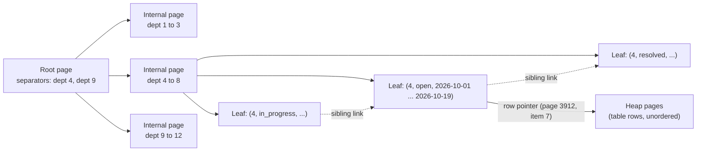
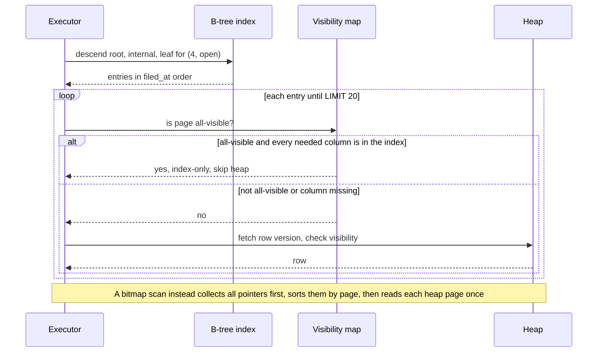

Most slow queries in a young system are not slow because the database is weak. They are slow because the database has to read every row to find the twenty it needs. An index fixes that in one statement. The same statement, repeated carelessly across a table, can also double your write latency and fill your disk. This lesson teaches both halves: how to pick the index that turns a 4-second query into a 4-millisecond one, and how to count what it costs.

## Learning objectives

By the end of this lesson you will be able to:

1. Explain how a B-tree index finds a row in a few page reads, with numbers for a 50-million-row table.
2. Choose between B-tree, hash, GIN, GiST and BRIN for a given column and query.
3. Order the columns of a composite index using the rule "equality first, then range or sort", and predict which queries it serves.
4. Use covering (`INCLUDE`) and partial (`WHERE`) indexes to get index-only scans on small slices of a big table.
5. Estimate the write cost of an index, including the effect on HOT updates, and find unused or redundant indexes.
6. Create and drop indexes safely in production with `CONCURRENTLY`, from SQL and from EF Core migrations.

## Prerequisites

- [Relational database fundamentals](#/lesson/m09-relational-fundamentals): tables, primary keys, `UNIQUE`.
- [Normalization and denormalization](#/lesson/m09-normalization): an index is often the alternative to denormalizing.
- You will read a few query plans here. [Query planning and EXPLAIN ANALYZE](#/lesson/m09-query-planning) goes deeper.

## Explain it like I'm a beginner

A state government runs a public grievance portal. Citizens file complaints: a broken street light in Gaya, irregular water supply in Patna, a pension not credited in Purnia. After five years the `grievance` table has 50 million rows.

A district officer opens her dashboard: "open grievances for my department, newest first". Without an index, PostgreSQL does what you would do with an unsorted pile of 50 million paper forms: pick up every form, check the department and status, keep the matching ones, then sort them by date. That is a **sequential scan** (seq scan).

An index is the register at the front of the office: a book sorted by department, then status, then date, where each line says "form number 81,22,417 is in cabinet 3,912, drawer 7". To answer the officer, you open the register at "Department 4, open", read the last 20 lines, and fetch those 20 forms. You never touch the other 49,999,980.

Three facts about that register matter for the rest of the lesson:

1. **It is sorted in one particular order.** A register sorted by department then date is useless for "all grievances filed yesterday, any department", just as a phone book sorted by surname cannot find everyone named Priya.
2. **It must be updated every time a form is added**, and often when one changes. Ten registers means eleven writes for every new form.
3. **It takes space.** On a big table, indexes often take as much disk as the table itself.

PostgreSQL offers several kinds of register. The everyday one is the **B-tree** (balanced tree). Others are specialists: **hash** for pure equality, **GIN** (generalized inverted index) for "rows containing this word or tag", **GiST** for geometry and ranges, and **BRIN** (block range index) for huge tables that are naturally in time order.

## First-principles explanation

### How a B-tree finds a row

A table is stored as 8 KB pages in no useful order (the **heap**). A B-tree is a separate structure of 8 KB pages arranged in levels:

- **Leaf pages** hold `(key, row pointer)` entries in sorted order and are linked left to right, so a range can be read by walking sideways.
- **Internal pages** hold separator keys that say which child page covers which key range.
- One **root page** sits at the top.

A lookup reads the root, follows one pointer per level, and lands on the right leaf. How many levels? An 8 KB page holds a few hundred small keys. With a fan-out of about 300 (an estimate for an `int` plus a `timestamptz` key):

- 2 levels (a root pointing to 300 leaves of 300 entries each) ≈ 90,000 rows.
- 3 levels ≈ 300 × 300 × 300 = 27 million rows.
- 4 levels ≈ 8 billion rows.

So a 50-million-row table has a B-tree about 4 levels deep. Finding one row costs about 4 index page reads plus 1 heap page read, and the top levels are almost always cached in memory. That is why a well-indexed point lookup on a huge table takes well under a millisecond of database time, while a seq scan of the same table reads millions of pages.

B-trees support `=`, `<`, `<=`, `>`, `>=`, `BETWEEN`, `IN`, `IS NULL`, and `LIKE 'prefix%'` (with the `C` collation or a `text_pattern_ops` index). Because leaves are sorted, they can also return rows **already in `ORDER BY` order**, which removes a sort step and makes `LIMIT 20` stop after 20 rows.

### Composite indexes and the leftmost-prefix rule

A composite index on `(department_id, status, filed_at)` is sorted by department first, then status within each department, then date within each status. Like a phone book sorted by (city, surname, first name):

- `WHERE department_id = 4` → usable: one contiguous block of the index.
- `WHERE department_id = 4 AND status = 'open'` → usable, smaller block.
- `WHERE department_id = 4 AND status = 'open' ORDER BY filed_at DESC LIMIT 20` → perfect: seek to the block, read it backwards, stop after 20. No sort.
- `WHERE department_id = 4 AND filed_at > now() - interval '7 days'` → only the first column narrows the search. `status` is skipped, so within department 4 the dates are not one contiguous range. PostgreSQL scans all of department 4's entries and filters dates inside the index.
- `WHERE status = 'open'` → the leading column is missing. PostgreSQL 17 cannot seek; at best it scans the whole index. (PostgreSQL 18 added **skip scan**, which can jump between leading-column values when there are few of them. Do not design for it on 17.)

The rule that falls out: **put columns compared with `=` first, then at most one column used for a range or for `ORDER BY`.** Columns after the first range column can only be used as filters, not to narrow the seek.

What about "most selective column first"? That advice is mostly a myth for B-trees. Within the equality columns, order barely affects lookup cost, because the tree seeks on all of them together. Order matters for *which other queries can reuse the index*. If many queries filter only by `department_id`, put it first.

### Index scan, bitmap scan, index-only scan

- **Index scan**: walk the index, and for each match fetch the heap row. Great for a few rows or for ordered output with `LIMIT`.
- **Bitmap scan**: collect all matching row pointers into a bitmap, sort by page, then read each heap page once. Better when matches are in the thousands and scattered. It can also combine two indexes with `BitmapAnd` or `BitmapOr`.
- **Index-only scan**: if every column the query needs is in the index, skip the heap. PostgreSQL still has to know the row is visible to your transaction. It checks the **visibility map**, which `VACUUM` maintains. On a freshly loaded or heavily updated table you will see `Heap Fetches: 4,812` in the plan, meaning it fell back to the heap for those rows.

### Covering indexes with INCLUDE

`CREATE INDEX ... ON grievance (department_id, status, filed_at) INCLUDE (priority)` stores `priority` in the leaf entries without making it part of the sort key. Queries that read `priority` can now be index-only. Benefits over adding `priority` as a fourth key column: the internal pages stay smaller, and a `UNIQUE` index can carry extra payload without changing what "unique" means. Cost: wider leaves, so a bigger index and more write work. Include only the two or three columns a hot query actually reads.

### Partial indexes

At any moment perhaps 2 % of grievances are open. The dashboard only ever asks about open ones. A partial index stores only those rows:

```sql
CREATE INDEX grievance_open_idx ON grievance (department_id, filed_at) WHERE status = 'open';
```

For 50 million rows with 2 % open, that index holds 1 million entries instead of 50 million: about 50× smaller, more likely to stay in memory, and only written for open rows. The query must contain a condition that implies the index predicate (`WHERE status = 'open'` written the same way). A parameter like `status = $1` does not let the planner prove it, which is a common surprise with generic prepared plans.

Partial **unique** indexes encode business rules: `CREATE UNIQUE INDEX ON grievance (citizen_id, subject_hash) WHERE status IN ('open','in_progress')` stops a citizen filing the same open complaint twice, while allowing it again after resolution.

### Expression indexes

An index on `lower(email)` serves `WHERE lower(email) = lower($1)`. An index on `email` does not. Any function applied to the column in the query must match the indexed expression. The same goes for `date(filed_at)`: prefer rewriting the query as a range (`filed_at >= '2026-10-01' AND filed_at < '2026-10-02'`) so the plain index works.

### The specialists

| Type | Good for | Not for | Notes |
|---|---|---|---|
| **Hash** | `=` on long values (tokens, URLs) | ranges, sorting, uniqueness, multi-column | Crash-safe and WAL-logged since PostgreSQL 10. Rarely beats B-tree; measure first. |
| **GIN** | arrays (`@>`, `&&`), `jsonb` (`@>`, `?`), full-text `tsvector @@ tsquery`, trigram `LIKE '%x%'` with `pg_trgm` | ordering, ranges | One entry per element, so writes are expensive. A pending list (`fastupdate`) batches inserts and is merged later. |
| **GiST / SP-GiST** | geometry (PostGIS), ranges, nearest-neighbour, exclusion constraints | plain equality | `EXCLUDE USING gist (room WITH =, during WITH &&)` prevents double bookings. |
| **BRIN** | huge append-only tables where a column correlates with physical order (timestamps on logs, sensor data) | randomly ordered columns | Stores min and max per range of pages (128 pages by default). Kilobytes instead of gigabytes. Lossy: rechecks rows. |

BRIN deserves a number. A 500-million-row GPS-ping table ordered by time might need a B-tree of roughly 10 GB on `recorded_at` (an estimate). A BRIN index on the same column is in the low megabytes. A query for one hour of data reads only the page ranges whose min and max overlap that hour. The catch: if rows arrive out of order, or are updated so they move, every range covers every hour and the index becomes useless.

### The write cost

Every index is extra work on writes:

- **INSERT**: one new entry in every index (GIN: one per element, deferred via the pending list).
- **DELETE**: nothing immediately. `VACUUM` removes dead entries later.
- **UPDATE**: PostgreSQL writes a new row version. If no indexed column changed **and** the new version fits on the same page, it is a **HOT update** (heap-only tuple) and *no* index is touched. Otherwise every index gets a new entry, even indexes on columns that did not change. Since PostgreSQL 16, columns covered only by BRIN indexes do not block HOT.

That last rule is the expensive surprise. Add an index on `status` to a table where `status` changes three times per grievance, and every status change now writes to *all* indexes, not just the new one. Leaving free space on each page with `fillfactor = 90` improves the odds that HOT can apply.

A worked estimate. The portal receives 200 new grievances per second at peak and 300 status updates per second. The table has 5 B-tree indexes.

- Inserts: 200 × 5 = 1,000 index entries per second.
- Updates with `status` indexed: not HOT, so 300 × 5 = 1,500 entries per second.
- Updates with `status` not indexed and 90 % HOT success: 300 × 0.1 × 5 = 150 entries per second.

The `status` index alone costs 1,350 extra index writes per second, plus WAL volume and replica traffic. That may be fine. It should be a decision, not an accident.

### Finding indexes you do not need

`pg_stat_user_indexes.idx_scan` counts how often each index has been used since statistics were last reset. An index with `idx_scan = 0` after a month of normal traffic, that is not `UNIQUE` and not backing a constraint, is a candidate to drop. Also look for **redundant** indexes: an index on `(a)` is redundant if `(a, b)` exists with the same method and no predicate, because the larger one serves every query the smaller one does (at a slightly higher cost per lookup). Check replicas too: statistics are per server, and a reporting replica may use an index the primary never does.

### Building indexes in production

`CREATE INDEX` blocks writes to the table for the whole build. On 50 million rows that may be minutes. `CREATE INDEX CONCURRENTLY` allows writes during the build. It takes longer, scans the table twice, cannot run inside a transaction block, and if it fails it leaves an `INVALID` index behind that you must drop and retry. `DROP INDEX CONCURRENTLY` and (since PostgreSQL 12) `REINDEX CONCURRENTLY` follow the same rules.

## Visual explanation

### The structure of a composite B-tree



A search for "department 4, open, newest first" starts at the root, whose separators say department 4 lives under the middle internal page. That page points to the leaf holding `(4, open, ...)` entries, which are sorted by date. The executor reads that leaf from the right-hand end, follows each row pointer into the heap to fetch the full row, and stops when `LIMIT` is satisfied. The dotted sibling links are what let a range scan move to the next leaf without going back up the tree.

### What the executor does for each kind of scan



The loop shows why covering indexes and `VACUUM` work together. With every needed column in the index, the executor only goes to the heap when the visibility map cannot vouch for the page. After a vacuum on a table with few recent changes, almost every page is all-visible, so the scan never touches the heap. On a table with heavy churn, the same plan quietly does a heap fetch per row.

## Step-by-step example

The playground below seeds 40,000 grievances. Follow along there.

### Step 1 — the baseline

```sql
EXPLAIN ANALYZE
SELECT id, filed_at FROM grievance
WHERE department_id = 4 AND status = 'open'
ORDER BY filed_at DESC LIMIT 10;
```

You will see `Seq Scan on grievance`, `Rows Removed by Filter: 39,9xx`, then a `Sort`. Every one of the ~900 pages was read to return 10 rows.

### Step 2 — the composite index in the right order

```sql
CREATE INDEX grievance_dept_status_filed_idx ON grievance (department_id, status, filed_at);
ANALYZE grievance;
```

Re-run the query. The plan becomes `Index Scan Backward using grievance_dept_status_filed_idx`, with `Index Cond: ((department_id = 4) AND (status = 'open'))` and no `Sort` node. A handful of pages are read. On 40,000 rows the gain is a few milliseconds; on 50 million it is the difference between seconds and milliseconds.

Now try the wrong order to see why it matters:

```sql
-- Same columns, range column in the middle: filed_at can no longer provide the order.
CREATE INDEX grievance_bad_idx ON grievance (department_id, filed_at, status);
```

For this query, the planner can still seek on `department_id`, but it must filter `status` entry by entry while walking all of department 4's dates. It works, but it reads more of the index. Drop it: `DROP INDEX grievance_bad_idx;`.

### Step 3 — a partial covering index for the dashboard

The dashboard counts open grievances per department since a date:

```sql
CREATE INDEX grievance_open_idx ON grievance (filed_at) INCLUDE (department_id) WHERE status = 'open';
VACUUM ANALYZE grievance;   -- run on its own, it cannot run inside a transaction block

EXPLAIN ANALYZE
SELECT department_id, count(*) FROM grievance
WHERE status = 'open' AND filed_at >= '2026-03-01'
GROUP BY department_id;
```

Expect `Index Only Scan using grievance_open_idx` and `Heap Fetches: 0`. Check the size: `SELECT pg_size_pretty(pg_relation_size('grievance_open_idx'));` is a few dozen KB, against about 1.6 MB for the full composite index.

### Step 4 — GIN for tags, hash for tokens, BRIN for time

```sql
CREATE INDEX grievance_tags_gin   ON grievance USING gin (tags);
CREATE INDEX grievance_token_hash ON grievance USING hash (tracking_token);
CREATE INDEX grievance_filed_brin ON grievance USING brin (filed_at);
ANALYZE grievance;

EXPLAIN ANALYZE SELECT count(*) FROM grievance WHERE tags @> '{urgent}';
EXPLAIN ANALYZE SELECT id FROM grievance WHERE tracking_token = md5('777');
```

The tag query uses `Bitmap Index Scan on grievance_tags_gin`. The token lookup uses the hash index. The BRIN index works because rows were inserted in `filed_at` order; check `SELECT correlation FROM pg_stats WHERE tablename = 'grievance' AND attname = 'filed_at';` returns a value close to 1.

### Step 5 — count the cost

```sql
SELECT indexrelname, pg_size_pretty(pg_relation_size(indexrelid)) AS size, idx_scan
FROM pg_stat_user_indexes WHERE relname = 'grievance' ORDER BY pg_relation_size(indexrelid) DESC;
```

Six indexes now. Every insert writes to five of them (BRIN summarizes lazily). Ask of each one: which query needs it, and how often does that query run?

## Production-style C# implementation

Index decisions belong in code review, so it helps to make the rules executable. The compilable code below is a small **index advisor**: it models an index definition and a query shape, reports whether the index can seek, avoid a sort and answer index-only, and generates safe `CONCURRENTLY` DDL. A second component flags unused and redundant indexes from `pg_stat_user_indexes`-style rows. Real code reads those rows with Npgsql (snippet afterwards); here they arrive through an interface.

```text
Grievance.Api/
  Program.cs
  Indexing/Model.cs
  Indexing/IndexMatcher.cs
  Indexing/IndexDdl.cs
  Indexing/IndexHygiene.cs
```

```csharp file=Indexing/Model.cs
namespace Grievance.Indexing;

public enum IndexMethod { BTree, Hash, Gin, Gist, Brin }

public sealed record IndexColumn(string Name, bool Descending = false);

public sealed record IndexDefinition(
    string Name,
    string Table,
    IReadOnlyList<IndexColumn> Keys,
    IReadOnlyList<string> Include,
    string? Predicate = null,
    IndexMethod Method = IndexMethod.BTree,
    bool Unique = false);

/// <summary>A simplified description of one query: which columns are compared how, and what it reads.</summary>
public sealed record QueryShape(
    IReadOnlyList<string> EqualityColumns,
    string? RangeColumn,
    string? OrderByColumn,
    IReadOnlyList<string> SelectedColumns,
    string? Predicate = null);

public sealed record IndexMatch(
    string Index,
    int SeekColumns,
    bool AvoidsSort,
    bool IndexOnly,
    bool PredicateApplies,
    IReadOnlyList<string> Notes);
```

```csharp file=Indexing/IndexMatcher.cs
namespace Grievance.Indexing;

public static class IndexMatcher
{
    private static readonly StringComparer Cmp = StringComparer.OrdinalIgnoreCase;

    public static IndexMatch Evaluate(IndexDefinition index, QueryShape q)
    {
        var notes = new List<string>();
        var equality = new HashSet<string>(q.EqualityColumns, Cmp);

        // A partial index is usable only if the query repeats its predicate.
        var predicateApplies = index.Predicate is null || Cmp.Equals(Normalize(index.Predicate), Normalize(q.Predicate));
        if (!predicateApplies)
        {
            notes.Add($"Partial index predicate '{index.Predicate}' is not implied by the query.");
            return new IndexMatch(index.Name, 0, false, false, false, notes);
        }

        if (index.Method != IndexMethod.BTree)
            notes.Add($"{index.Method} indexes cannot return rows in order; any ORDER BY needs a sort.");

        // Leftmost prefix: equality columns extend the seek, the first range column ends it.
        var seek = 0;
        foreach (var col in index.Keys)
        {
            if (equality.Contains(col.Name)) { seek++; continue; }
            if (Cmp.Equals(col.Name, q.RangeColumn)) { seek++; }
            break;
        }
        if (seek == 0) notes.Add("Leading column is not constrained: PostgreSQL 17 cannot seek, at best it scans the whole index.");
        if (seek < index.Keys.Count && q.RangeColumn is not null && !index.Keys.Take(seek).Any(k => Cmp.Equals(k.Name, q.RangeColumn)))
            notes.Add($"Range on {q.RangeColumn} is not part of the seek: it will be checked as a filter.");

        var avoidsSort = index.Method == IndexMethod.BTree && AvoidsSort(index, q, equality);
        if (q.OrderByColumn is not null && !avoidsSort) notes.Add($"ORDER BY {q.OrderByColumn} will need a Sort node.");

        var available = new HashSet<string>(index.Keys.Select(k => k.Name).Concat(index.Include), Cmp);
        var needed = q.SelectedColumns.Concat(q.EqualityColumns)
            .Concat(new[] { q.RangeColumn, q.OrderByColumn }.OfType<string>());
        var indexOnly = index.Method is IndexMethod.BTree or IndexMethod.Gist && needed.All(available.Contains);
        if (!indexOnly) notes.Add("Heap fetch needed per row: add the missing columns with INCLUDE if this query is hot.");

        return new IndexMatch(index.Name, seek, avoidsSort, indexOnly, true, notes);
    }

    private static bool AvoidsSort(IndexDefinition index, QueryShape q, HashSet<string> equality)
    {
        if (q.OrderByColumn is null) return true;
        for (var i = 0; i < index.Keys.Count; i++)
        {
            if (Cmp.Equals(index.Keys[i].Name, q.OrderByColumn)) return true;   // all earlier columns were pinned by '='
            if (!equality.Contains(index.Keys[i].Name)) return false;
        }
        return false;
    }

    private static string Normalize(string? predicate) =>
        string.Join(' ', (predicate ?? string.Empty).Split(' ', StringSplitOptions.RemoveEmptyEntries));
}
```

```csharp file=Indexing/IndexDdl.cs
using System.Text;

namespace Grievance.Indexing;

public static class IndexDdl
{
    /// <summary>
    /// Builds production-safe DDL. CONCURRENTLY avoids blocking writes but cannot run inside a transaction block,
    /// so migration tools must run it outside one.
    /// </summary>
    public static string Create(IndexDefinition ix, bool concurrently = true)
    {
        if (ix.Keys.Count == 0) throw new ArgumentException("An index needs at least one key column.");
        if (ix.Method == IndexMethod.Hash && (ix.Keys.Count > 1 || ix.Unique))
            throw new ArgumentException("Hash indexes support exactly one column and no UNIQUE.");
        if (ix.Include.Count > 0 && ix.Method is not (IndexMethod.BTree or IndexMethod.Gist))
            throw new ArgumentException("INCLUDE is supported by B-tree and GiST indexes only.");

        var sb = new StringBuilder("CREATE ");
        if (ix.Unique) sb.Append("UNIQUE ");
        sb.Append("INDEX ");
        if (concurrently) sb.Append("CONCURRENTLY ");
        sb.Append($"IF NOT EXISTS {Quote(ix.Name)} ON {Quote(ix.Table)} USING {ix.Method.ToString().ToLowerInvariant()} (");
        sb.Append(string.Join(", ", ix.Keys.Select(k => Quote(k.Name) + (k.Descending ? " DESC" : ""))));
        sb.Append(')');
        if (ix.Include.Count > 0) sb.Append(" INCLUDE (").Append(string.Join(", ", ix.Include.Select(Quote))).Append(')');
        if (ix.Predicate is not null) sb.Append(" WHERE ").Append(ix.Predicate);
        return sb.Append(';').ToString();
    }

    public static string Drop(string indexName) => $"DROP INDEX CONCURRENTLY IF EXISTS {Quote(indexName)};";

    private static string Quote(string identifier) =>
        identifier.All(c => char.IsAsciiLetterLower(c) || char.IsAsciiDigit(c) || c == '_')
            ? identifier
            : "\"" + identifier.Replace("\"", "\"\"") + "\"";
}
```

```csharp file=Indexing/IndexHygiene.cs
namespace Grievance.Indexing;

/// <summary>One row of pg_stat_user_indexes joined to pg_index, as the hygiene job sees it.</summary>
public sealed record IndexUsage(
    string Name, string Table, IReadOnlyList<string> KeyColumns, IndexMethod Method,
    bool Unique, bool Partial, long Scans, long SizeBytes);

public sealed record HygieneFinding(string Index, string Kind, string Detail);

public interface IIndexStatsSource
{
    Task<IReadOnlyList<IndexUsage>> ReadAsync(CancellationToken ct = default);
}

public sealed class IndexHygiene(IIndexStatsSource source)
{
    public async Task<IReadOnlyList<HygieneFinding>> ReviewAsync(CancellationToken ct = default)
    {
        var rows = await source.ReadAsync(ct);
        var findings = new List<HygieneFinding>();

        foreach (var ix in rows.Where(r => r.Scans == 0 && !r.Unique))
            findings.Add(new HygieneFinding(ix.Name, "unused",
                $"0 scans since stats reset, {ix.SizeBytes / 1_048_576.0:F1} MB. Check replicas before dropping."));

        foreach (var a in rows.Where(r => !r.Unique && !r.Partial))
        {
            var cover = rows.FirstOrDefault(b =>
                b.Name != a.Name && b.Table == a.Table && b.Method == a.Method && !b.Partial &&
                b.KeyColumns.Count >= a.KeyColumns.Count &&
                b.KeyColumns.Take(a.KeyColumns.Count).SequenceEqual(a.KeyColumns, StringComparer.OrdinalIgnoreCase) &&
                (b.KeyColumns.Count > a.KeyColumns.Count || string.CompareOrdinal(a.Name, b.Name) > 0));
            if (cover is not null)
                findings.Add(new HygieneFinding(a.Name, "redundant", $"its key columns are a leading prefix of {cover.Name}"));
        }

        return findings.OrderBy(f => f.Index, StringComparer.Ordinal).ThenBy(f => f.Kind, StringComparer.Ordinal).ToList();
    }
}

/// <summary>Fixed rows for local runs and tests. Production reads pg_stat_user_indexes via Npgsql.</summary>
public sealed class StaticIndexStats(IReadOnlyList<IndexUsage> rows) : IIndexStatsSource
{
    public Task<IReadOnlyList<IndexUsage>> ReadAsync(CancellationToken ct = default) => Task.FromResult(rows);
}
```

```csharp file=Program.cs
using Grievance.Indexing;

var builder = WebApplication.CreateBuilder(args);

builder.Services.AddSingleton<IIndexStatsSource>(new StaticIndexStats(new[]
{
    new IndexUsage("grievance_pkey", "grievance", new[] { "id" }, IndexMethod.BTree, true, false, 9_200_000, 1_100_000_000),
    new IndexUsage("grievance_dept_idx", "grievance", new[] { "department_id" }, IndexMethod.BTree, false, false, 1_200, 1_000_000_000),
    new IndexUsage("grievance_dept_status_filed_idx", "grievance", new[] { "department_id", "status", "filed_at" }, IndexMethod.BTree, false, false, 4_800_000, 1_900_000_000),
    new IndexUsage("grievance_priority_idx", "grievance", new[] { "priority" }, IndexMethod.BTree, false, false, 0, 1_050_000_000),
}));
builder.Services.AddSingleton<IndexHygiene>();

var app = builder.Build();

app.MapPost("/advisor/evaluate", (EvaluateRequest req) =>
    Results.Ok(new { match = IndexMatcher.Evaluate(req.Index, req.Query), ddl = IndexDdl.Create(req.Index) }));

app.MapGet("/advisor/hygiene", async (IndexHygiene hygiene, CancellationToken ct) => Results.Ok(await hygiene.ReviewAsync(ct)));

app.Run();

public sealed record EvaluateRequest(IndexDefinition Index, QueryShape Query);
```

### Reading real statistics with Npgsql

```csharp
// Not compiled by the course checker: requires the Npgsql package.
const string sql = """
    SELECT s.indexrelname, s.relname, s.idx_scan, pg_relation_size(s.indexrelid),
           i.indisunique, i.indpred IS NOT NULL AS partial, am.amname,
           ARRAY(SELECT a.attname FROM unnest(i.indkey[0:i.indnkeyatts - 1]) WITH ORDINALITY k(attnum, n)
                 JOIN pg_attribute a ON a.attrelid = i.indrelid AND a.attnum = k.attnum ORDER BY k.n) AS cols
    FROM pg_stat_user_indexes s
    JOIN pg_index i ON i.indexrelid = s.indexrelid
    JOIN pg_class c ON c.oid = s.indexrelid
    JOIN pg_am am ON am.oid = c.relam
    """;
await using var cmd = dataSource.CreateCommand(sql);
await using var reader = await cmd.ExecuteReaderAsync(ct);
// map each row to IndexUsage ...
```

### Declaring indexes in EF Core with the Npgsql provider

```csharp
// Not compiled by the course checker: requires EF Core and Npgsql.EntityFrameworkCore.PostgreSQL.
modelBuilder.Entity<GrievanceRow>(e =>
{
    e.HasIndex(g => new { g.DepartmentId, g.Status, g.FiledAt });
    e.HasIndex(g => g.FiledAt)
     .HasFilter("status = 'open'")
     .IncludeProperties(g => g.DepartmentId)
     .HasDatabaseName("grievance_open_idx")
     .IsCreatedConcurrently();                 // emits CREATE INDEX CONCURRENTLY
    e.HasIndex(g => g.Tags).HasMethod("gin");
});
```

When you write a migration by hand, `migrationBuilder.Sql("CREATE INDEX CONCURRENTLY ...", suppressTransaction: true)` runs the statement outside the migration's transaction, which `CONCURRENTLY` requires.

:::callout type=warning title="A failed CONCURRENTLY build leaves an INVALID index"
If `CREATE INDEX CONCURRENTLY` fails (a duplicate violates `UNIQUE`, a deadlock, a cancelled deploy), the index stays behind marked invalid: it is not used for reads but is still maintained on every write. Find them with `SELECT indexrelid::regclass FROM pg_index WHERE NOT indisvalid;`, drop them with `DROP INDEX CONCURRENTLY`, fix the cause, and retry.
:::

## Bad design vs good design

**Bad: one index per column, "just in case".**

```sql
-- Anti-pattern: seven single-column indexes added one per slow-query ticket
CREATE INDEX ON grievance (department_id);
CREATE INDEX ON grievance (status);
CREATE INDEX ON grievance (filed_at);
CREATE INDEX ON grievance (district);
CREATE INDEX ON grievance (priority);
CREATE INDEX ON grievance (citizen_id);
CREATE INDEX ON grievance (lower(subject));
```

Problems: the dashboard query (`department_id = ? AND status = 'open' ORDER BY filed_at DESC LIMIT 20`) can at best combine two of these with a bitmap AND and then sort, which is far worse than one composite index. `status` and `priority` change often, so most updates stop being HOT and write to all eight indexes. `status` alone has four values, so its index is rarely chosen anyway. Total index size exceeds the table.

**Good: indexes designed from the query list.**

```sql
CREATE INDEX grievance_dept_status_filed_idx ON grievance (department_id, status, filed_at);  -- officer worklists
CREATE INDEX grievance_open_idx ON grievance (filed_at) INCLUDE (department_id) WHERE status = 'open';  -- dashboard
CREATE INDEX grievance_citizen_idx ON grievance (citizen_id, filed_at);                      -- "my grievances"
CREATE INDEX grievance_tags_gin ON grievance USING gin (tags);                                -- tag search
```

Four indexes, each traceable to a named query with a known frequency. `status` appears only where the query needs it, and the partial index only stores open rows.

**When is an index not worth it?** Small tables (a few thousand rows fit in a few pages; a seq scan is as fast). Columns with very few distinct values queried without other conditions, unless a partial index targets the rare value. Write-heavy tables read mostly in bulk by analytics jobs. And any index you cannot name a query for.

:::callout type=tradeoff title="Every index is a bet on the read-to-write ratio"
An index costs a little on every write, forever, to save a lot on some reads. Start from the slow-query log (`pg_stat_statements`), design for the top queries by total time, and re-check `idx_scan` a month later. Drop what lost the bet.
:::

## Practical playground

The playground seeds 40,000 grievances (about 900 heap pages) with only a primary key. Use the **Explain** button to see plans.

1. Run the Step 1 query and note the seq scan and the sort.
2. Create the composite index from Step 2, run `ANALYZE grievance`, and confirm the plan changes to an index scan with no sort.
3. Build the partial covering index from Step 3. Run `VACUUM ANALYZE grievance` on its own, then check for `Index Only Scan` and `Heap Fetches: 0`.
4. Create the GIN, hash and BRIN indexes from Step 4 and compare their sizes.
5. Write a query that the composite index *cannot* seek for, such as `WHERE status = 'open'` alone, and read its plan.

The in-browser engine is PGlite, which is built on PostgreSQL 18. Its plans show a few extra lines (such as `Index Searches`) and it can use **skip scan** on a composite index whose leading column is missing. PostgreSQL 17 cannot, so treat such plans as "would be a full index scan or a seq scan on 17".

:::playground type=sql title="Grievance portal: 40,000 rows, choose the indexes"
```sql
CREATE TABLE department (id int PRIMARY KEY, name text NOT NULL);
INSERT INTO department VALUES
 (1,'Water Resources'),(2,'Road Construction'),(3,'Energy'),(4,'Urban Development'),(5,'Rural Works'),
 (6,'Health'),(7,'Education'),(8,'Social Welfare'),(9,'Revenue and Land Reforms'),(10,'Panchayati Raj'),
 (11,'Public Health Engineering'),(12,'Transport');
CREATE TABLE grievance (
  id             bigint GENERATED ALWAYS AS IDENTITY PRIMARY KEY,
  tracking_token text        NOT NULL,
  citizen_id     bigint      NOT NULL,
  department_id  int         NOT NULL REFERENCES department,
  district       text        NOT NULL,
  status         text        NOT NULL CHECK (status IN ('open','in_progress','resolved','rejected')),
  priority       smallint    NOT NULL,
  filed_at       timestamptz NOT NULL,
  tags           text[]      NOT NULL DEFAULT '{}',
  subject        text        NOT NULL
);
INSERT INTO grievance (tracking_token, citizen_id, department_id, district, status, priority, filed_at, tags, subject)
SELECT md5(g::text),
       100000 + (g * 7919) % 15000,
       1 + (g / 3) % 12,
       (ARRAY['Patna','Gaya','Muzaffarpur','Bhagalpur','Darbhanga','Purnia'])[1 + (g / 7) % 6],
       CASE WHEN g > 38000 AND g % 5 = 0 THEN 'open'
            WHEN g > 38000 AND g % 5 = 1 THEN 'in_progress'
            WHEN g % 10 = 9 THEN 'rejected'
            WHEN g % 97 = 0 THEN 'open'
            ELSE 'resolved' END,
       1 + g % 3,
       timestamptz '2025-01-01 00:00+05:30' + g * interval '17 minutes',
       CASE g % 5 WHEN 0 THEN '{water,urgent}'::text[] WHEN 1 THEN '{road}' WHEN 2 THEN '{electricity}'
                  WHEN 3 THEN '{pension}' ELSE '{road,urgent}' END,
       (ARRAY['Street light not working','Pothole on main road','Drinking water supply irregular',
              'Pension not credited','Drain overflowing'])[1 + g % 5] || ' near ward ' || (g % 40)
FROM generate_series(1, 40000) AS g;
ANALYZE grievance;
```
:::

## Exercises

:::exercise id=m09-indexes-ex1 difficulty=beginner kind=sql ordered=true title="The worklist query the composite index was built for"
The setup creates `grievance_dept_status_filed_idx ON grievance (department_id, status, filed_at)`. Write the officer's worklist query: the 10 most recently filed **open** grievances for **department 4**, returning `id`, `district` and `filed_at`, newest first. Then press **Explain** and confirm the plan.
::acceptance
- Returns exactly 10 rows, newest `filed_at` first.
- Uses equality on `department_id` and `status` and orders by `filed_at DESC`.
- Explain shows an index scan (backward) on `grievance_dept_status_filed_idx` and **no Sort node**.
::hint
The index can serve the query only if the query constrains its first two columns with `=`.
::hint
`ORDER BY filed_at DESC` matches the third index column. A B-tree can be read backwards, so `DESC` needs no separate index.
::hint
Add `LIMIT 10` so the scan can stop early.
::setup
```sql
CREATE TABLE grievance (
  id bigint GENERATED ALWAYS AS IDENTITY PRIMARY KEY, department_id int NOT NULL, district text NOT NULL,
  status text NOT NULL, filed_at timestamptz NOT NULL
);
INSERT INTO grievance (department_id, district, status, filed_at)
SELECT 1 + (g / 3) % 12,
       (ARRAY['Patna','Gaya','Muzaffarpur','Bhagalpur','Darbhanga','Purnia'])[1 + (g / 7) % 6],
       CASE WHEN g > 18000 AND g % 5 = 0 THEN 'open' WHEN g % 10 = 9 THEN 'rejected'
            WHEN g % 97 = 0 THEN 'open' ELSE 'resolved' END,
       timestamptz '2025-01-01 00:00+00' + g * interval '17 minutes'
FROM generate_series(1, 20000) AS g;
CREATE INDEX grievance_dept_status_filed_idx ON grievance (department_id, status, filed_at);
ANALYZE grievance;
```
::check
```sql
SELECT id, district, filed_at
FROM grievance
WHERE department_id = 4 AND status = 'open'
ORDER BY filed_at DESC
LIMIT 10;
```
::solution
```sql
SELECT id, district, filed_at
FROM grievance
WHERE department_id = 4 AND status = 'open'
ORDER BY filed_at DESC
LIMIT 10;
```
The plan is `Limit -> Index Scan Backward using grievance_dept_status_filed_idx` with `Index Cond: ((department_id = 4) AND (status = 'open'))`. The two equality conditions pin the first two index columns, so the matching entries form one contiguous run that is already sorted by `filed_at`. Reading that run backwards yields newest-first rows, and `LIMIT 10` stops after ten. No other rows are touched, and no sort is needed.
::mistakes
- Forgetting `LIMIT`: the result is right but the scan reads every open grievance for the department.
- Ordering by `id DESC` instead of `filed_at DESC`. Here they happen to correlate, but the index cannot provide `id` order, so a sort appears.
- Writing `status IN ('open')` with extra values: `IN` with several values on the second column still uses the index, but can no longer return rows in a single `filed_at` order, so a sort comes back.
:::

:::exercise id=m09-indexes-ex2 difficulty=beginner kind=code title="Apply the leftmost-prefix rule"
Implement two functions that predict what a composite B-tree index can do for a query. `SeekColumns` returns how many leading index columns narrow the search. `AvoidsSort` returns whether the index can deliver the query's `ORDER BY` without a sort step.
::requirements
- Walk the index columns in order. Each column compared with `=` adds 1 and continues. A column equal to the range column adds 1 and stops. Any other column stops.
- `AvoidsSort` is `true` when there is no `ORDER BY`. Otherwise the order-by column must be in the index and every index column before it must be an equality column.
- Column names are compared case-insensitively.
::acceptance
- Index `(department_id, status, filed_at)` with `department_id =`, `status =`, `ORDER BY filed_at` → seek 2, avoids sort.
- Same index with `department_id =` and a range on `filed_at` → seek 1 (the gap at `status` ends the seek).
- Same index with only `status =` → seek 0.
- `ORDER BY filed_at` with no filters → needs a sort; `ORDER BY department_id` with no filters → no sort.
::hint
Think of the phone book sorted by (city, surname, first name). You can only jump to a place in the book using a prefix of that order.
::hint
For `SeekColumns`, use a `foreach` with `continue` for equality and `break` after the range column or any unmatched column.
::hint
For `AvoidsSort`, loop through the index columns: return `true` when you reach the order-by column, `false` when you meet a column that is not pinned by `=`.
::hint
```csharp
foreach (var col in indexColumns)
{
    if (eq.Contains(col)) { n++; continue; }
    if (string.Equals(col, q.RangeColumn, StringComparison.OrdinalIgnoreCase)) n++;
    break;
}
```
::starter
```csharp file=PrefixRule.cs
using System;
using System.Collections.Generic;
using System.Linq;

public sealed record QueryShape(string[] EqualityColumns, string? RangeColumn, string? OrderByColumn);

public static class PrefixRule
{
    public static int SeekColumns(string[] indexColumns, QueryShape q) => throw new NotImplementedException();

    public static bool AvoidsSort(string[] indexColumns, QueryShape q) => throw new NotImplementedException();
}
```
::tests
```csharp file=PrefixRuleTests.cs
using Xunit;

public class PrefixRuleTests
{
    private static readonly string[] Ix = { "department_id", "status", "filed_at" };

    [Fact]
    public void Worklist_query_seeks_two_and_avoids_sort()
    {
        var q = new QueryShape(new[] { "department_id", "status" }, null, "filed_at");
        Assert.Equal(2, PrefixRule.SeekColumns(Ix, q));
        Assert.True(PrefixRule.AvoidsSort(Ix, q));
    }

    [Fact]
    public void Gap_in_the_middle_ends_the_seek()
    {
        var q = new QueryShape(new[] { "department_id" }, "filed_at", "filed_at");
        Assert.Equal(1, PrefixRule.SeekColumns(Ix, q));
        Assert.False(PrefixRule.AvoidsSort(Ix, q));
    }

    [Fact]
    public void Range_after_full_equality_prefix_is_used()
    {
        var q = new QueryShape(new[] { "department_id", "status" }, "filed_at", null);
        Assert.Equal(3, PrefixRule.SeekColumns(Ix, q));
        Assert.True(PrefixRule.AvoidsSort(Ix, q));
    }

    [Fact]
    public void Missing_leading_column_cannot_seek()
    {
        var q = new QueryShape(new[] { "status" }, null, null);
        Assert.Equal(0, PrefixRule.SeekColumns(Ix, q));
    }

    [Fact]
    public void Range_on_leading_column_stops_after_it()
    {
        var q = new QueryShape(new[] { "status" }, "department_id", "filed_at");
        Assert.Equal(1, PrefixRule.SeekColumns(Ix, q));
        Assert.False(PrefixRule.AvoidsSort(Ix, q));
    }

    [Fact]
    public void Order_by_without_filters()
    {
        Assert.False(PrefixRule.AvoidsSort(Ix, new QueryShape(new string[0], null, "filed_at")));
        Assert.True(PrefixRule.AvoidsSort(Ix, new QueryShape(new string[0], null, "DEPARTMENT_ID")));
    }
}
```
::solution
```csharp file=PrefixRule.cs
using System;
using System.Collections.Generic;
using System.Linq;

public sealed record QueryShape(string[] EqualityColumns, string? RangeColumn, string? OrderByColumn);

public static class PrefixRule
{
    private static readonly StringComparer Cmp = StringComparer.OrdinalIgnoreCase;

    public static int SeekColumns(string[] indexColumns, QueryShape q)
    {
        var eq = new HashSet<string>(q.EqualityColumns, Cmp);
        var n = 0;
        foreach (var col in indexColumns)
        {
            if (eq.Contains(col)) { n++; continue; }
            if (Cmp.Equals(col, q.RangeColumn)) n++;   // a range narrows the seek, then ends it
            break;
        }
        return n;
    }

    public static bool AvoidsSort(string[] indexColumns, QueryShape q)
    {
        if (q.OrderByColumn is null) return true;
        var eq = new HashSet<string>(q.EqualityColumns, Cmp);
        foreach (var col in indexColumns)
        {
            if (Cmp.Equals(col, q.OrderByColumn)) return true;
            if (!eq.Contains(col)) return false;       // an unpinned earlier column scrambles the order
        }
        return false;
    }
}
```
Both rules come from the same picture: index entries are sorted by the first column, then the second within ties of the first, and so on. Pinning a column with `=` collapses it to a single value, so the next column becomes "the sort order" of what remains. A range keeps many values of its column, so the column after it is no longer sorted across the range.
::mistakes
- Counting every query column that appears anywhere in the index, ignoring order.
- Continuing after the range column. Columns after a range can be checked as filters inside the index, but they do not narrow the seek.
- Returning `true` from `AvoidsSort` when the order-by column is in the index but an earlier column is only range-filtered.
::extensions
Support `IN (...)` lists on a column: they can still seek, but a multi-value `IN` before the order-by column breaks single-pass ordering.
:::

:::exercise id=m09-indexes-ex3 difficulty=intermediate kind=sql ordered=true title="Find redundant indexes from the catalog"
Years of slow-query tickets have left `grievance` with overlapping indexes. Using `pg_index` and `pg_class`, return every index on `grievance` that is **redundant**: another index on the same table with the same access method has key columns that start with exactly the same columns. Return `redundant_index` and `covered_by`, ordered by both.
Rules:
- Ignore `UNIQUE` indexes as candidates (they enforce a rule), but they may be the covering index.
- Ignore partial indexes and expression indexes on both sides.
- For two indexes with identical columns, report only the one whose name sorts later as redundant.
::acceptance
- Compares column lists by position (`indkey`), not by name or definition text.
- A hash index and a B-tree on the same column are not reported, because the methods differ.
- The partial index is not reported.
- Exactly the redundant pairs are returned, no duplicates.
::hint
`pg_index` has one row per index: `indexrelid` (the index), `indrelid` (the table), `indkey` (column numbers, for example `3 5`), `indisunique`, `indpred` (predicate) and `indexprs` (expressions). The access method is `pg_class.relam` of the index.
::hint
Self-join `pg_index a` to `pg_index b` on the same `indrelid` with `a.indexrelid <> b.indexrelid`.
::hint
"Starts with the same columns" can be tested on the text form: `(b.indkey::text || ' ') LIKE (a.indkey::text || ' %')`. The trailing space stops column 3 matching column 30.
::hint
For identical lists, add `AND (a.indkey::text <> b.indkey::text OR ca.relname > cb.relname)`. Print names with `a.indexrelid::regclass::text`.
::setup
```sql
CREATE TABLE grievance (
  id bigint PRIMARY KEY, tracking_token text NOT NULL, department_id int NOT NULL, status text NOT NULL,
  filed_at timestamptz NOT NULL, citizen_id bigint NOT NULL, subject text NOT NULL
);
CREATE INDEX idx_dept               ON grievance (department_id);
CREATE INDEX idx_dept_status        ON grievance (department_id, status);
CREATE INDEX idx_dept_status_filed  ON grievance (department_id, status, filed_at);
CREATE INDEX idx_status_dept        ON grievance (status, department_id);
CREATE INDEX idx_token              ON grievance (tracking_token);
CREATE INDEX idx_token_copy         ON grievance (tracking_token);
CREATE INDEX idx_token_hash         ON grievance USING hash (tracking_token);
CREATE INDEX idx_open_dept          ON grievance (department_id) WHERE status = 'open';
CREATE INDEX idx_lower_subject      ON grievance (lower(subject));
CREATE INDEX idx_citizen            ON grievance (citizen_id);
CREATE UNIQUE INDEX uq_citizen_filed ON grievance (citizen_id, filed_at);
CREATE INDEX idx_id_filed           ON grievance (id, filed_at);
```
::check
```sql
SELECT a.indexrelid::regclass::text AS redundant_index,
       b.indexrelid::regclass::text AS covered_by
FROM pg_index a
JOIN pg_index b ON b.indrelid = a.indrelid AND b.indexrelid <> a.indexrelid
JOIN pg_class ca ON ca.oid = a.indexrelid
JOIN pg_class cb ON cb.oid = b.indexrelid
WHERE a.indrelid = 'grievance'::regclass
  AND ca.relam = cb.relam
  AND NOT a.indisunique
  AND a.indpred IS NULL AND b.indpred IS NULL
  AND a.indexprs IS NULL AND b.indexprs IS NULL
  AND (b.indkey::text || ' ') LIKE (a.indkey::text || ' %')
  AND (a.indkey::text <> b.indkey::text OR ca.relname > cb.relname)
ORDER BY 1, 2;
```
::solution
```sql
SELECT a.indexrelid::regclass::text AS redundant_index,
       b.indexrelid::regclass::text AS covered_by
FROM pg_index a
JOIN pg_index b ON b.indrelid = a.indrelid AND b.indexrelid <> a.indexrelid
JOIN pg_class ca ON ca.oid = a.indexrelid
JOIN pg_class cb ON cb.oid = b.indexrelid
WHERE a.indrelid = 'grievance'::regclass
  AND ca.relam = cb.relam
  AND NOT a.indisunique
  AND a.indpred IS NULL AND b.indpred IS NULL
  AND a.indexprs IS NULL AND b.indexprs IS NULL
  AND (b.indkey::text || ' ') LIKE (a.indkey::text || ' %')
  AND (a.indkey::text <> b.indkey::text OR ca.relname > cb.relname)
ORDER BY 1, 2;
```
Five rows come back: `idx_citizen` (covered by the unique `uq_citizen_filed`), `idx_dept` (covered by both longer department indexes), `idx_dept_status` (covered by `idx_dept_status_filed`) and `idx_token_copy` (an exact copy of `idx_token`). `idx_status_dept` survives because its leading column differs, `idx_token_hash` because its method differs, and `idx_open_dept` because it is partial and much smaller. `idx_id_filed` is not redundant to anything, but it is pointless: the primary key already makes `id` unique, so a second column never narrows anything. Catalog queries cannot see that; a human must.

Two caveats before dropping anything. The longer index is a little bigger, so lookups via it cost slightly more; that is almost always worth the saved writes. And this query ignores sort direction, collation and operator class (`indoption`, `indcollation`, `indclass`); production tooling should compare those too.
::mistakes
- Comparing `pg_get_indexdef()` strings, which differ in the index name and so never match.
- Forgetting the trailing space trick, so an index on column 3 appears to be a prefix of one on column 30.
- Reporting both members of an identical pair, which tempts someone to drop both.
- Treating a `UNIQUE` index as redundant: dropping it removes a business rule.
::extensions
Extend the query to treat `INCLUDE` columns correctly: compare only the first `indnkeyatts` key columns.
:::

:::exercise id=m09-indexes-ex4 difficulty=intermediate kind=code title="Estimate index write amplification, including HOT"
Before adding an index on a hot table, the team wants a number: how many index entries per second will writes produce? Implement a simple model of PostgreSQL's behaviour.
::requirements
- `IsHotCandidate(indexes, updatedColumns)` is `true` when no non-BRIN index has any of the updated columns as a key column (since PostgreSQL 16, BRIN-only columns do not block HOT).
- `IndexEntriesPerSecond(indexes, workload)`:
  - Each insert writes `EntriesPerRow` entries into every non-BRIN index (1 for B-tree and hash, more for GIN). BRIN counts 0.
  - Each update that is a HOT candidate succeeds as HOT with probability `HotSuccessRate` (page had room) and writes 0 entries. The rest are non-HOT.
  - Each non-HOT update writes `EntriesPerRow` into every non-BRIN index.
  - Deletes write nothing (vacuum cleans up later).
::acceptance
- 200 inserts/s with indexes B-tree, B-tree, GIN (2.5 entries per row) and BRIN → 900 entries/s.
- Adding 300 status updates/s where `status` is in a B-tree → 1,350 more.
- The same 300 updates on an unindexed column with 90 % HOT success → 135 more.
- Updates that only touch a BRIN-indexed column remain HOT candidates.
::hint
First compute `perRow`: the sum of `EntriesPerRow` over indexes that are not BRIN.
::hint
Inserts cost `InsertsPerSec × perRow`. Non-HOT updates cost `nonHotUpdates × perRow`.
::hint
`nonHotUpdates = UpdatesPerSec` when the update is not a HOT candidate, and `UpdatesPerSec × (1 − HotSuccessRate)` when it is.
::hint
```csharp
var perRow = indexes.Where(i => i.Kind != IndexKind.Brin).Sum(i => i.EntriesPerRow);
var hot = IsHotCandidate(indexes, w.UpdatedColumns);
var nonHot = hot ? w.UpdatesPerSec * (1 - w.HotSuccessRate) : w.UpdatesPerSec;
```
::starter
```csharp file=WriteCost.cs
using System;
using System.Collections.Generic;
using System.Linq;

public enum IndexKind { BTree, Hash, Gin, Brin }

public sealed record IndexSpec(string Name, IndexKind Kind, string[] Columns, double EntriesPerRow = 1);

public sealed record Workload(double InsertsPerSec, double UpdatesPerSec, string[] UpdatedColumns, double HotSuccessRate);

public static class WriteCost
{
    public static bool IsHotCandidate(IReadOnlyList<IndexSpec> indexes, IEnumerable<string> updatedColumns) =>
        throw new NotImplementedException();

    public static double IndexEntriesPerSecond(IReadOnlyList<IndexSpec> indexes, Workload w) =>
        throw new NotImplementedException();
}
```
::tests
```csharp file=WriteCostTests.cs
using System.Collections.Generic;
using Xunit;

public class WriteCostTests
{
    private static readonly List<IndexSpec> Indexes = new()
    {
        new IndexSpec("grievance_pkey", IndexKind.BTree, new[] { "id" }),
        new IndexSpec("grievance_dept_status_filed_idx", IndexKind.BTree, new[] { "department_id", "status", "filed_at" }),
        new IndexSpec("grievance_tags_gin", IndexKind.Gin, new[] { "tags" }, 2.5),
        new IndexSpec("grievance_received_brin", IndexKind.Brin, new[] { "received_at" }),
    };

    [Fact]
    public void Inserts_only()
    {
        var w = new Workload(200, 0, new string[0], 0.9);
        Assert.Equal(900, WriteCost.IndexEntriesPerSecond(Indexes, w), 6);
    }

    [Fact]
    public void Updating_an_indexed_column_is_never_hot()
    {
        Assert.False(WriteCost.IsHotCandidate(Indexes, new[] { "status" }));
        var w = new Workload(200, 300, new[] { "status" }, 0.9);
        Assert.Equal(900 + 1350, WriteCost.IndexEntriesPerSecond(Indexes, w), 6);
    }

    [Fact]
    public void Updating_an_unindexed_column_is_mostly_hot()
    {
        Assert.True(WriteCost.IsHotCandidate(Indexes, new[] { "assigned_officer" }));
        var w = new Workload(200, 300, new[] { "assigned_officer" }, 0.9);
        Assert.Equal(900 + 135, WriteCost.IndexEntriesPerSecond(Indexes, w), 6);
    }

    [Fact]
    public void Brin_only_column_does_not_block_hot()
    {
        Assert.True(WriteCost.IsHotCandidate(Indexes, new[] { "RECEIVED_AT" }));
    }

    [Fact]
    public void Brin_adds_no_per_row_entries()
    {
        var brinOnly = new List<IndexSpec> { new IndexSpec("b", IndexKind.Brin, new[] { "received_at" }) };
        Assert.Equal(0, WriteCost.IndexEntriesPerSecond(brinOnly, new Workload(1000, 1000, new[] { "x" }, 0)), 6);
    }
}
```
::solution
```csharp file=WriteCost.cs
using System;
using System.Collections.Generic;
using System.Linq;

public enum IndexKind { BTree, Hash, Gin, Brin }

public sealed record IndexSpec(string Name, IndexKind Kind, string[] Columns, double EntriesPerRow = 1);

public sealed record Workload(double InsertsPerSec, double UpdatesPerSec, string[] UpdatedColumns, double HotSuccessRate);

public static class WriteCost
{
    public static bool IsHotCandidate(IReadOnlyList<IndexSpec> indexes, IEnumerable<string> updatedColumns)
    {
        var updated = new HashSet<string>(updatedColumns, StringComparer.OrdinalIgnoreCase);
        return !indexes.Where(i => i.Kind != IndexKind.Brin).Any(i => i.Columns.Any(updated.Contains));
    }

    public static double IndexEntriesPerSecond(IReadOnlyList<IndexSpec> indexes, Workload w)
    {
        var perRow = indexes.Where(i => i.Kind != IndexKind.Brin).Sum(i => i.EntriesPerRow);
        var nonHotUpdates = IsHotCandidate(indexes, w.UpdatedColumns)
            ? w.UpdatesPerSec * (1 - w.HotSuccessRate)
            : w.UpdatesPerSec;
        return w.InsertsPerSec * perRow + nonHotUpdates * perRow;
    }
}
```
The key insight is in the non-HOT branch: a non-HOT update adds an entry to *every* index, not just to the index on the column that changed, because the new row version lives at a new physical address that every index must point to. That is why indexing a frequently updated column is so much more expensive than its own size suggests. The model leaves out WAL bytes, page splits and GIN's pending list, so treat its output as an order-of-magnitude estimate.
::mistakes
- Charging only the index on the changed column for a non-HOT update.
- Treating BRIN columns as HOT blockers. That was true before PostgreSQL 16.
- Counting deletes as index writes. Index entries for deleted rows are removed later by vacuum.
::extensions
Add a `fillfactor` parameter and derive `HotSuccessRate` from it and the average row size, instead of taking it as input.
:::

:::exercise id=m09-indexes-ex5 difficulty=advanced kind=written title="Design the index set for the grievance table at state scale"
The portal will hold 60 million grievances after five years, growing by about 30,000 per day (peaks of 150 inserts per second after a disaster). Each grievance changes `status` about three times and `assigned_officer` about twice. Queries, with daily frequency:

1. Officer worklist: open or in-progress grievances for one department and district, newest first, 20 per page. ~400,000 per day.
2. Citizen "my grievances" by `citizen_id`, newest first. ~250,000 per day.
3. Lookup by `tracking_token` (32-character string) from SMS links. ~300,000 per day.
4. Tag search: grievances tagged `flood` in the last 30 days. ~5,000 per day, spikes during monsoon.
5. Monthly report: counts per department and status for one calendar month. 50 per month, run on a replica.

Propose the indexes (with full `CREATE INDEX` statements), justify column order, say which are partial or covering, estimate the write amplification per insert and per status update, and say what you would *not* index and why.
::acceptance
- Each index is tied to one or more listed queries.
- Composite column order follows equality-then-range-or-sort, with reasoning.
- Uses at least one partial index and justifies its predicate with a fraction or count.
- Addresses the cost of `status` being in an index on a frequently updated table.
- Chooses B-tree or hash for the token with a reason, and BRIN or nothing for the monthly report.
- Shows the arithmetic for write cost.
::hint
Convert daily counts to per-second averages first (divide by 86,400), then think about peaks.
::hint
Query 1 only needs open and in-progress rows. What fraction of 60 million is that?
::hint
Query 5 runs 50 times a month on a replica. Is any index worth maintaining on the primary for it?
::hint
Count the non-BRIN indexes, then remember that a status change is never HOT if `status` is a key column of any of them.
::solution
**Rates.** 30,000 inserts per day ≈ 0.35 per second on average, 150 at peak. Status and officer updates are 5 per grievance → 150,000 per day ≈ 1.7 per second average. Reads: worklist ≈ 4.6/s, citizen ≈ 2.9/s, token ≈ 3.5/s. This is a read-heavy table with modest writes, so a few well-chosen indexes are cheap.

**Indexes.**

```sql
-- Q1: worklist. Partial: only active rows. Equality columns first, then the sort column.
CREATE INDEX CONCURRENTLY grievance_worklist_idx
  ON grievance (department_id, district, filed_at DESC)
  INCLUDE (status, priority, subject)
  WHERE status IN ('open', 'in_progress');

-- Q2: citizen history. Equality, then sort.
CREATE INDEX CONCURRENTLY grievance_citizen_idx ON grievance (citizen_id, filed_at DESC);

-- Q3: token lookup. Unique B-tree also guarantees no collisions.
CREATE UNIQUE INDEX CONCURRENTLY grievance_token_uq ON grievance (tracking_token);

-- Q4: tags. GIN on the array, combined with a time filter.
CREATE INDEX CONCURRENTLY grievance_tags_gin ON grievance USING gin (tags);
```

**Q1 reasoning.** At any time maybe 3 % of grievances are active: about 1.8 million of 60 million. The partial index is about 30× smaller than a full one and stays in memory. `department_id` and `district` are both equality filters, so their mutual order hardly matters for this query. Put `department_id` first because department-level views (all districts) can reuse it. `filed_at DESC` last gives newest-first pages with no sort. `INCLUDE` makes the page index-only, given regular vacuuming. `status` is not a key column because the predicate already restricts it, but it is in the `INCLUDE` list and in the predicate. That means a status change still affects the index (rows enter and leave it), so those updates are not HOT. That is acceptable at 1.7 updates per second.

**Q3: B-tree, not hash.** A hash index would work for `=`, but it cannot be `UNIQUE`, and uniqueness of tracking tokens is a real rule. A 32-character key B-tree on 60 million rows is a few GB (estimate). Acceptable.

**Q4.** `tags @> '{flood}'` uses the GIN index, and the planner can `BitmapAnd` it with a time condition, or simply filter the matches by date. If monsoon spikes make it slow, a partial GIN index on `WHERE filed_at > '2026-06-01'` rebuilt each season is an option.

**Q5: no new index.** 50 runs a month on a replica. A sequential scan of one month's partition (see [Partitioning and sharding](#/lesson/m09-partitioning-sharding)) or a BRIN index on `filed_at` (a few MB, ideal because rows arrive in time order and are rarely moved) is enough. Do not add a B-tree on the primary for a monthly report.

**Write amplification.** Non-BRIN indexes: primary key, worklist, citizen, token, GIN (say 2 tags per row) → 1 + 1 + 1 + 1 + 2 = 6 entries per insert, and the worklist index only for active rows (new grievances are active, so it counts). Peak: 150 × 6 = 900 index entries per second. A status update touches a column in the worklist predicate, so it is non-HOT: up to 6 entries each (the partial index skips the new version once the grievance is resolved), about 10 per second on average. An `assigned_officer` update touches no indexed column, so with `fillfactor = 90` most are HOT and touch no index.

**Not indexed:** `status` alone (four values; covered by the partial index), `priority` (three values), `district` alone (covered by the worklist prefix only together with department; add later only if a district-only screen appears), `lower(subject)` (search should go to full-text or a search engine, not a B-tree).
::mistakes
- Indexing every filter column separately instead of designing composite indexes per query.
- Putting `filed_at` before the equality columns, which breaks the seek for the worklist.
- Using a hash index where a uniqueness rule exists.
- Building a B-tree on the primary for a report that runs 50 times a month on a replica.
- Ignoring that a column in a partial index predicate also blocks HOT updates.
:::

## Automated testing

**1. Unit tests for the advisor.** The pure functions lock down the rules your team agreed on:

```csharp
public class IndexMatcherTests
{
    private static readonly IndexDefinition Worklist = new("grievance_dept_status_filed_idx", "grievance",
        [new("department_id"), new("status"), new("filed_at")], []);

    [Fact]
    public void Worklist_query_seeks_and_avoids_sort()
    {
        var q = new QueryShape(["department_id", "status"], null, "filed_at", ["id", "filed_at"]);
        var m = IndexMatcher.Evaluate(Worklist, q);
        Assert.Equal(2, m.SeekColumns);
        Assert.True(m.AvoidsSort);
        Assert.False(m.IndexOnly);   // id is not in the index
    }

    [Fact]
    public void Ddl_is_concurrent_and_rejects_multi_column_hash()
    {
        Assert.Contains("CONCURRENTLY", IndexDdl.Create(Worklist));
        Assert.Throws<ArgumentException>(() => IndexDdl.Create(Worklist with { Method = IndexMethod.Hash }));
    }
}
```

**2. Plan regression tests against real PostgreSQL.** In an integration test (Testcontainers), seed representative data, run `ANALYZE`, then assert on `EXPLAIN (FORMAT JSON)` output: the worklist query's top plan node must be an `Index Scan` on `grievance_worklist_idx` and must not contain a `Sort`. Keep these few and focused on critical queries, because plans legitimately change with data volume.

**3. Migration checks in CI.** Fail the build if a migration contains `CREATE INDEX` without `CONCURRENTLY` on a table listed as large, or if `SELECT indexrelid FROM pg_index WHERE NOT indisvalid` returns rows after migrations run.

## Real-world application

- **Government and public-service portals** serve worklists of active cases out of tables dominated by closed ones. Partial indexes on the active statuses are the standard tool.
- **Payments and UPI-style ledgers** look up transactions by reference id (unique B-tree) and list them by account and time (composite, equality then time), which is also what makes [keyset pagination](#/lesson/m09-pagination) fast.
- **IoT and telemetry** (vehicle GPS, sensor readings, drone flight logs) use BRIN on time columns, often combined with time-based partitions, because B-trees on billions of rows cost more than the data.
- **E-commerce search filters** use GIN on attribute arrays or `jsonb`, and push full-text relevance ranking to a search engine once requirements grow.
- **Booking systems** use GiST exclusion constraints so that two bookings of the same room cannot overlap in time.

## Interview questions

:::interview
::q beginner
What is an index, and why doesn't every column get one?
::a
An index is a separate, sorted structure that maps column values to row locations, so the database can find matching rows without reading the whole table. A B-tree on a 50-million-row table finds a row in about four page reads. Not every column gets one because indexes cost on every write (each insert adds an entry to every index, and non-HOT updates add entries to all of them), take disk and memory, and slow down vacuum. A column that is never searched, sorted or joined on gains nothing.
::q beginner
You have an index on `(department_id, status, filed_at)`. Which of these queries can use it to seek: filter by `department_id`; by `status`; by `department_id` and `filed_at`?
::a
Filtering by `department_id` seeks on the first column. Filtering by `status` alone cannot seek on PostgreSQL 17, because the leading column is missing; it would need a full index scan or a seq scan. Filtering by `department_id` and `filed_at` seeks on `department_id` only: `status` is skipped, so the dates for department 4 are spread across several status groups and `filed_at` is checked as a filter while walking department 4's entries.
::q intermediate
When does a partial index beat a full index, and what can stop the planner from using it?
::a
When queries target a small, well-defined slice of a large table, such as open grievances (2-3 % of rows) or unprocessed jobs. The index is much smaller, stays cached, and is only maintained for rows in the slice. The planner can only use it if it can prove the query's `WHERE` clause implies the index predicate. Writing the condition differently (`status <> 'resolved'` instead of `status = 'open'`) or passing the value as a parameter in a generic prepared plan (`status = $1`) can prevent that.
::q intermediate
Explain HOT updates and why adding an index on a frequently updated column can slow down the whole table.
::a
A HOT (heap-only tuple) update happens when no indexed column changes and the new row version fits on the same heap page. The old version just points to the new one, and no index is touched. If any indexed column changes, or the page is full, the update is non-HOT: the new version has a new address, so *every* index on the table gets a new entry, not only the index on the changed column. Adding an index on `status`, which changes several times per row, turns those updates from HOT into non-HOT and multiplies index writes by the number of indexes. A lower `fillfactor` leaves room on each page and helps HOT succeed for the remaining updates.
::q advanced
A 400 GB time-series table needs queries by time range. Compare B-tree and BRIN for the timestamp column and describe when BRIN fails.
::a
A B-tree stores one entry per row: precise, supports ordering and point lookups, but on billions of rows it can be tens of GB and adds a write per insert. BRIN stores a min and max per range of pages (128 by default), so it is kilobytes to megabytes and nearly free to maintain. A range query reads only page ranges whose summaries overlap, then rechecks rows. It works when physical order correlates with the column (check `pg_stats.correlation`, close to 1). It fails when rows arrive out of order (late-arriving data, backfills), when updates move rows to other pages, or after bulk deletes that let new rows fill old pages: each range's min and max then spans most of the timeline and nothing can be skipped. Partitioning by time plus BRIN within partitions is a common robust combination.
::q advanced
How do you add an index to a 200 GB table in production without downtime, and what can go wrong?
::a
Use `CREATE INDEX CONCURRENTLY`, outside any transaction block (in EF Core, `IsCreatedConcurrently()` or `migrationBuilder.Sql(..., suppressTransaction: true)`). It does not block writes, but it scans the table twice and waits for existing transactions to finish, so a long-running transaction delays it. Set `lock_timeout` so it does not queue behind a lock forever, and raise `maintenance_work_mem` for the session to speed up the sort. If it fails, for example because of a uniqueness violation, it leaves an `INVALID` index that is still maintained on writes. Detect it via `pg_index.indisvalid = false`, drop it with `DROP INDEX CONCURRENTLY`, fix the cause and retry. Watch replica lag during the build because index creation generates a lot of WAL, and check disk space: you need room for the new index plus temporary sort files.
:::

## Summary and revision

**Key takeaways**

- A B-tree finds a row in about 4 page reads even at 50 million rows, and can return rows pre-sorted so `LIMIT` stops early.
- Composite index order: equality columns first, then one range or sort column. Columns after a range only filter. PostgreSQL 17 cannot seek without the leading column.
- Index-only scans need every column in the index (use `INCLUDE`) and an up-to-date visibility map (vacuum).
- Partial indexes shrink an index to the slice queries care about and can encode business rules as `UNIQUE ... WHERE`.
- Hash for pure equality (rarely needed), GIN for arrays, `jsonb` and full text, GiST for ranges and geometry, BRIN for huge naturally ordered tables.
- Writes pay for every index. Non-HOT updates write to all indexes, so indexing frequently updated columns is expensive.
- Find unused (`idx_scan = 0`) and redundant (prefix) indexes, and build and drop with `CONCURRENTLY`.

**Terminology**: heap, B-tree, leaf page, fan-out, leftmost prefix, index scan, bitmap scan, index-only scan, visibility map, covering index, `INCLUDE`, partial index, expression index, hash index, GIN, GiST, BRIN, correlation, HOT update, fillfactor, `CONCURRENTLY`, invalid index.

:::flashcards
Q: Roughly how many levels deep is a B-tree on 50 million rows, and why does that matter?
A: About 4 levels with a fan-out of a few hundred, so a lookup reads about 4 index pages plus 1 heap page, and the top levels are usually cached.
Q: What is the column-order rule for a composite B-tree index?
A: Columns compared with `=` first, then at most one column used for a range or ORDER BY. Columns after the first range only act as filters.
Q: What does INCLUDE add to an index?
A: Non-key payload columns stored in the leaf pages, so queries reading them can be index-only without changing the sort key or the uniqueness rule.
Q: When can the planner use a partial index?
A: Only when it can prove the query's WHERE clause implies the index's predicate, typically by repeating the same condition literally.
Q: What is a HOT update?
A: An update that changes no indexed column and fits on the same heap page, so no index entries are written.
Q: Why does a non-HOT update cost more than one index write?
A: The new row version has a new physical address, so every index on the table needs a new entry pointing to it.
Q: When is BRIN a good choice?
A: For very large tables whose column values correlate with physical row order, such as append-only timestamps; it stores only min and max per page range.
Q: Name two things a hash index cannot do that a B-tree can.
A: Range queries or ORDER BY, and UNIQUE or multi-column indexes.
Q: What happens if CREATE INDEX CONCURRENTLY fails?
A: It leaves an INVALID index that is not used for reads but is still updated on writes; drop it and retry.
:::

## Knowledge check

:::quiz pass=70
::q single
The query is `WHERE tenant_id = $1 AND created_at >= $2 ORDER BY created_at DESC LIMIT 50`. Which index serves it best?
- [ ] `(created_at, tenant_id)`
- [x] `(tenant_id, created_at)`
- [ ] Two separate indexes on `tenant_id` and `created_at`
- [ ] A hash index on `tenant_id`
> Equality column first, then the range and sort column. The index seeks to the tenant, reads its newest entries backwards and stops after 50. With `created_at` first, every tenant's rows are mixed together within the date range.
::q single
A `jobs` table holds 30 million rows, of which about 5,000 are `status = 'pending'`. Workers poll `WHERE status = 'pending' ORDER BY created_at LIMIT 10`. What is the best index?
- [ ] `CREATE INDEX ON jobs (status)`
- [ ] `CREATE INDEX ON jobs (created_at)`
- [x] `CREATE INDEX ON jobs (created_at) WHERE status = 'pending'`
- [ ] `CREATE INDEX ON jobs USING brin (status)`
> The partial index contains only the 5,000 pending rows in `created_at` order: tiny, always cached, and the scan stops after 10. A full index on `status` has 30 million entries, and BRIN on a status column with no physical correlation is useless.
::q multi
An update changes only `assigned_officer`, which is not in any index. Which conditions must hold for it to be a HOT update? (Select all that apply.)
- [x] No indexed column changed
- [x] The new row version fits on the same heap page
- [ ] The table has no more than one index
- [ ] The transaction uses Serializable isolation
> HOT depends only on indexed columns being unchanged and on free space in the page. The number of indexes and the isolation level are irrelevant. A lower fillfactor increases the chance of free space.
::q single
A query reads only columns that are all in a B-tree index, but the plan shows `Index Only Scan ... Heap Fetches: 48,000`. What is the most likely cause?
- [ ] The index is corrupted.
- [x] Many pages are not marked all-visible in the visibility map, typically because vacuum has not run since heavy writes.
- [ ] Index-only scans always visit the heap.
- [ ] The query needs an `INCLUDE` clause.
> The executor must confirm visibility; when the visibility map cannot vouch for a page, it checks the heap. Running `VACUUM` (or tuning autovacuum) updates the map.
::q single
Which index type fits `WHERE tags @> ARRAY['flood']` on a `text[]` column?
- [ ] B-tree
- [ ] Hash
- [x] GIN
- [ ] BRIN
> GIN is an inverted index: one entry per array element, pointing to rows that contain it. B-tree and hash compare whole values; BRIN summarizes page ranges.
::q single
You must add an index to a 150 GB table that receives writes all day. What should the migration run?
- [ ] `CREATE INDEX` inside the migration's transaction
- [x] `CREATE INDEX CONCURRENTLY`, outside a transaction block, then check that the index is valid
- [ ] `REINDEX TABLE` first, then `CREATE INDEX`
- [ ] `LOCK TABLE ... IN ACCESS EXCLUSIVE MODE`, then `CREATE INDEX`
> A plain `CREATE INDEX` blocks writes for the whole build. `CONCURRENTLY` does not, but cannot run inside a transaction and may leave an invalid index if it fails.
::q single
Your table has indexes `(a)`, `(a, b)` and `(b, a)`, all plain B-trees with no predicate. Which one is a candidate to drop as redundant?
- [x] `(a)`
- [ ] `(a, b)`
- [ ] `(b, a)`
- [ ] None of them
> `(a, b)` serves every query `(a)` can serve, because `a` is its leading column. `(b, a)` has a different leading column, so it serves different queries.
:::

## Completion criteria

You have finished this lesson when you can:

- [ ] Score at least 70 % on the knowledge check.
- [ ] Complete exercises 1 and 2, and either 3 or 4.
- [ ] In the playground, turn a seq scan plus sort into an index scan with no sort, and get an index-only scan with `Heap Fetches: 0` from a partial covering index.
- [ ] Given a list of queries and their frequencies, write the `CREATE INDEX` statements and estimate the write cost per insert and per update.
- [ ] Explain HOT updates and the leftmost-prefix rule to a colleague without notes.
